# 卡耐基梅隆大学【中英⚡深度强化学习与控制｜10-703 Fall 2018, Deep Reinforcement Learning and Control】 p16 P16 16 Exploration vs Exploitation -BV1RyqPBbEJV_p16-

Okay， let's start up。 today， we're going to begin a two lectures section on exploitation and exploration。

 The idea is very simple。 We've talked about it。😊，Off and on over the course， but。

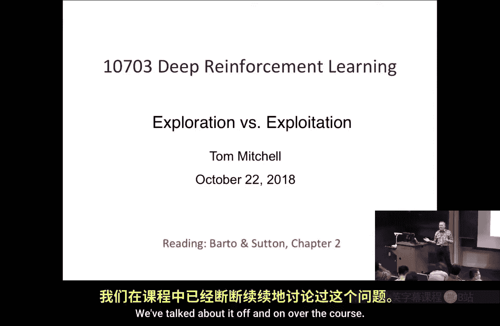

It's an important part of reinforcement learning because basically whenever you're making a decision。

 you could exploit the knowledge you have so far and choose the action that you currently estimate。

 although you could be wrong， currently estimate is the best action。

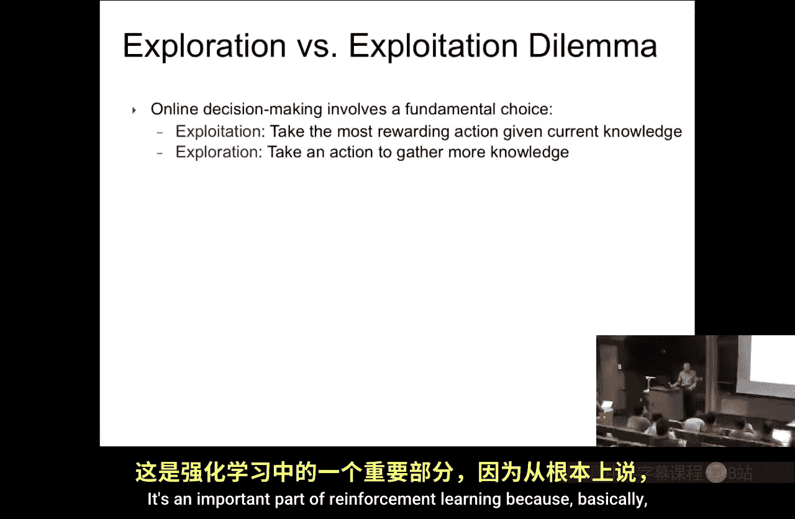

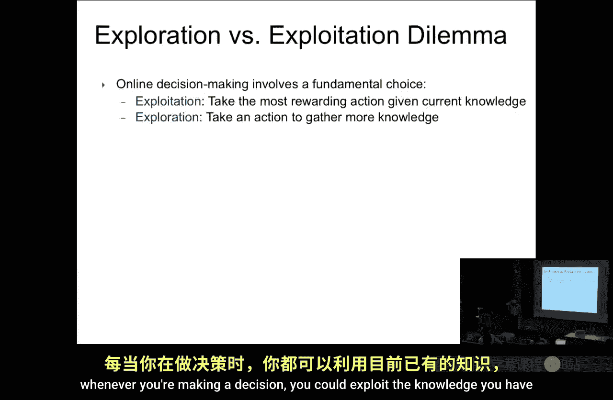

Or you could invest in the future and do some exploration instead。

 and maybe you'll learn something that will in later years， make you even a better exploiter。😊。

So in any kind of learning system over time。😊，There is this question of。

Kind of a bird in the hand versus two in the bush or something like that。So the best strategy might。

 if you're going to plan to live for 100 years， might be to spend some time exploring in the early years so that you learn an even better policy。

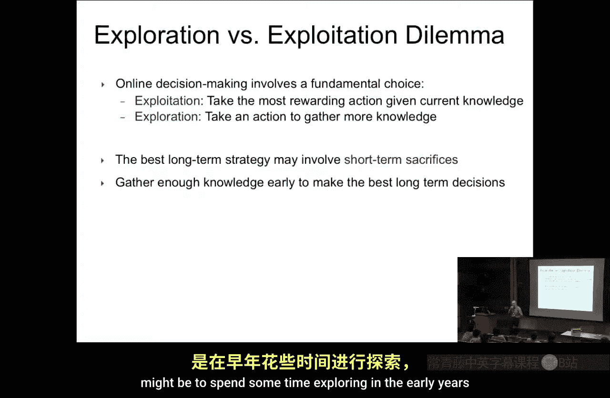

To use in the longer term。And you see this everywhere。

 If you're going to a restaurant with your friends， you might figure out what's the best restaurant。

 you know， or you might explore and try a new restaurant。 By the way。

 I recently explored and tried a restaurant calledNe fishish nor fowl。😊，Which is a great restaurant。

In Pittsburgh， it's a little pricey。 But if you want to go do something special。

 go explore neither fish nor fowl。 It does have both fish and fowls。

 I don't know what the name came from， but。So you can do that if you're drilling for oil。

 you can drill in the best region that you currently know of or you could drill a well somewhere else。

 if you're playing a game， of course， you can play the tried and true strategies that you know。

 or you could try something weird and crazy and put yourself into a part of the space you haven't really previously explored。

So today， we're going to talk about a variety of。Approaches and some theoretical results。

About exploring and exploiting and instead of telling you what they all are， let's just jump in。

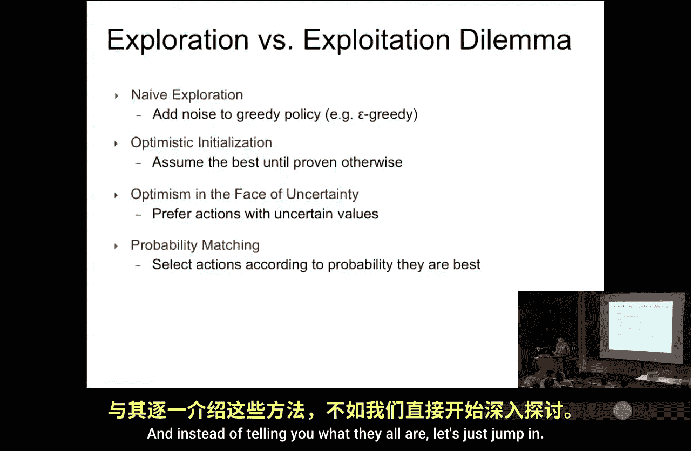

Now we're going to do this。And it really helps simplify thinking we're going to do this in the context of abandonedit problems。

 which are really a special case of a Markov decision process that we've been talking about so far。

 It's a special case where there is no state。And so you can think of it this way。

 A multi armed bandit is just a tuple of a set of actions you can perform。

 and you can think of that as like arms in a slot machine。

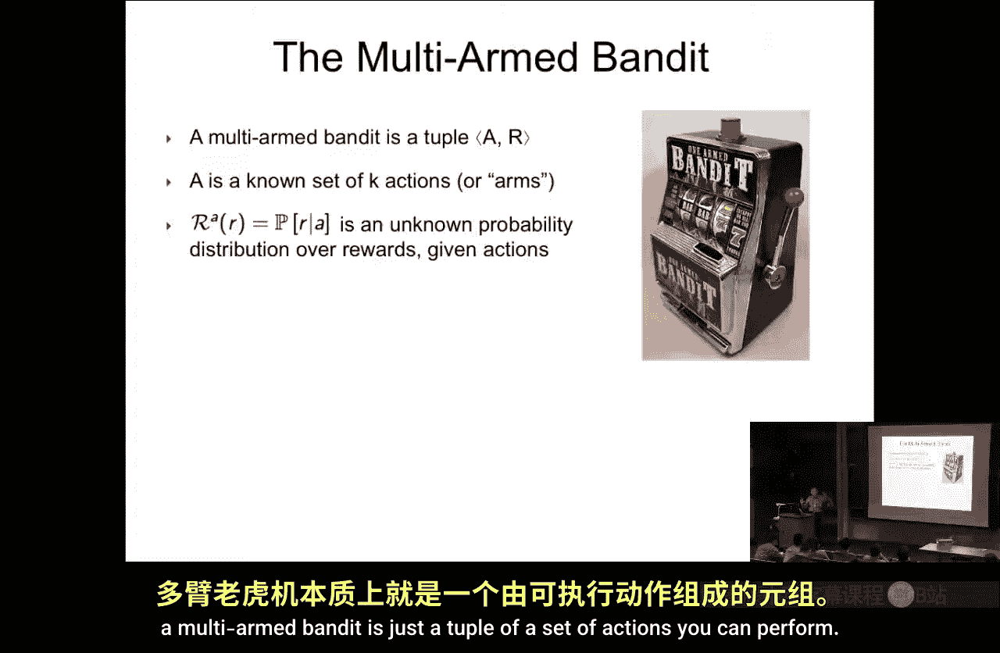

Most slot machines actually have one arm。 but you could imagine building a slot machine where theyre。

K arms， and each arm has a different probability of paying off。And then you could have to play。

With that。Kay armedmed bandit。And we assume that there is some reward。

hich is unknown to you at the beginning， just like in。MDPs and reinforcement learning。

 So there is some probability distribution that is unknown to you。

 but that determines what reward you will probabilistically receive if you do a particular action A。

And basically， that's what a multi-arm band it is。 So you notice it's just like MDP。

 except there is no state or put another way。 There's only one state。 and you're in it all the time。

 And every time you pull the arm on the。On the bandit。 On the canir and bandit。

I's the same distribution of rewards。So following though， the MDP。Kind of framing。

We'll say at each step， you have a sequence of times and each time you can pick some action。

And you'll receive some reward that's generated according to the probability distribution。

Conditioned on the action that you chose。And your goal。

 just like in other kinds of reinforcement learning， is to maximize。

Cumulative reward here we're not going to discount in this case。

 but and so the question generically is what's the best strategy？

And we're going to focus on exploring and exploiting。And a lot of the。

Details here that we're going to talk about will be simpler because instead of talking about a full MDP with states。

 we're talking about this simplified kind of MDP， which is just abandoneded。

but still the ideas that we talk about and the approaches。You can easily， you can， in fact。

 see how you can extend those to MDP as well。By the way， I didn't say this。

 although it's on the first slide， chapter2 in the Bart and Sutton book is a pretty good description of most of the material that we're going to cover here。

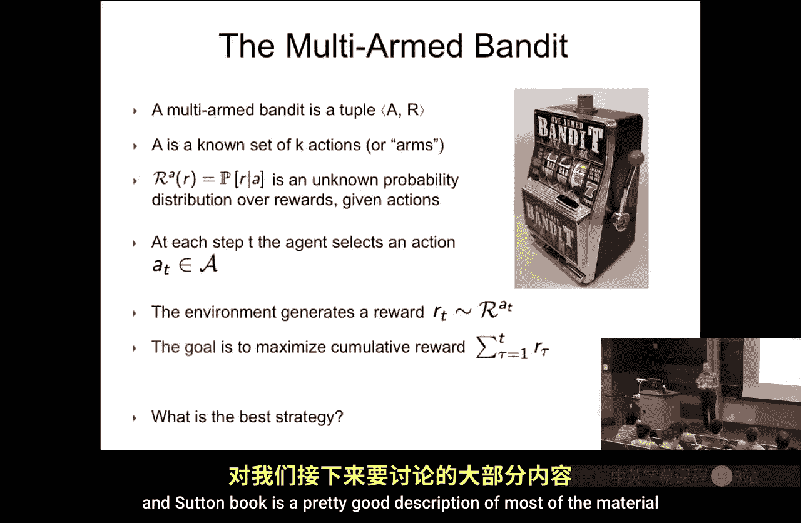

Okay， so just to make this concrete and to give us an example to refer back to。

 and this is actually out of chapter 2， here's a way to think about a K armed bandit。

 Suppose there are in this case，10 different actions you can perform。Each one。

 one of these horizontal。Indicated actions， and then there is a probability distribution on the reward that you'll receive if you do the CaF action。

You can see here these happen to be Gaussian probability distributions。Okay， but that。

That's what the。Kr bandit problem looks like。And so now the question is。

 if I hid that slide from you， didn't show you the probability distributions。

Given that you can see the probability distribution， what's the right policy？

What's the optimal policy。中けと。Yeah， just keep pulling arm number 3 all the time。

 Do action 3 all the time。You can't beat that， right， What's the expected payoff。Oh。

 about one and a half。Is there any。Recent to try one of those other actions if you see。

 if you know this distribution， No， because the expected payoff is lower for any other thing。Okay。

 so in a lot of cases， in fact， unless there's a tie。A deterministic policy is your best policy here。

Okay。All right， now we're going to be interested in the case where you don't know what that is。

 so let's define a little simple terminology。

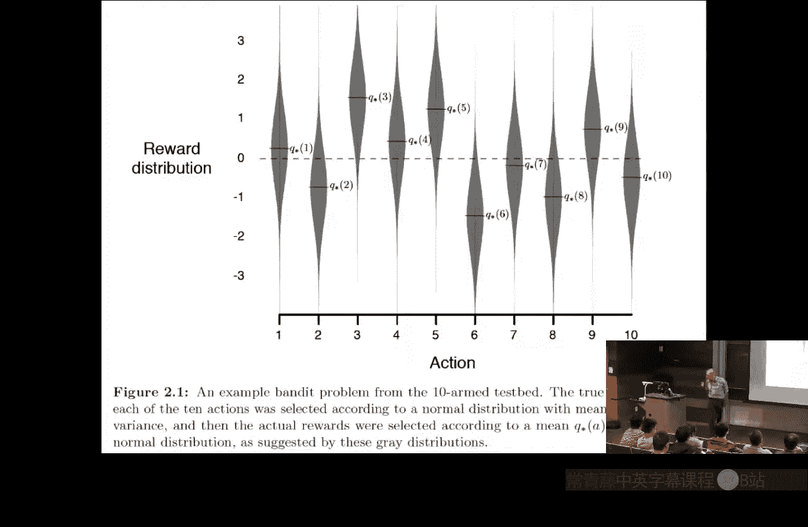

嗯。Just like before we'll say there's a Q function， although now we're going to not make it a function of state because there is no state。

But the Q function is literally the expected reward that you'll get for any given action。

And we'll use V star again， to represent the optimal。Value that you can get。

And so V star is just the maximum over the possible actions of the value。Of the expected。Reward。

We' define the regret。For taking。A particular action in one step as just the difference between the best reward you could have gotten。

In expectation and the rewards that you actually do get。From choosing your。Possibly optimal。

 possibly suboptimal action。Okay， and then if you get to pull the。A multiple times。

 So we'll say the total regret is just。The sum of the instantaneous regrets。And a lot of。

A lot of the formal results about bandits and about。To some degree， reinforcement learning。

Really is about trying to come up with algorithms where you can prove some bound on what this total regret will be。

You see why it's called regret。Like。It's the。It's the difference between。

The reward you could have gotten if you had known the optimal strategy initially and the。

Reward that in fact you get。With your strategy。 And， of course， if you don't know the。

 if you don't know the reward distribution in advance， then obviously， you're going to have to。

Unless you're really lucky in expectation， you're going to have some non zero regret because it's going to be a learning curve where you get better and better at。

Your policy， but while you're learning， you're probably going to be performing sub optimally。

So when we get back to the question of exploration versus exploitation， it's really。

question of how do we minimize。This total regret， how do we play this trade off between exploring and exploiting in order to minimize the total regret。

 yes。thinging is like what we've be calling is that？えちに繰でされ。Of what we'd be calling on advantage？嗯。

What we called advantage is。A little bit different。 It's， it's very closely related。 But what。

 when we set advantage， we meant。If you take an action in a particular state。嗯。

How does that change the value of the state you end up in， I mean。

 but then what's the difference between the value of the next state and the value of the state。And。

This is just a little different mentallyly because there is no state here， but。Molo that。

 it really is pretty much the same idea。Okay。Alright， so there's our terminology。

 One more bit of terminology。 We'll talk about the count。

 the number of times that you choose in action over。The window of time that you're playing。

 And we'll talk about the gap and the gap。Is the difference between。嗯。

The best value you could have gotten。And the value you get if you choose action A。

 So you can think of， for example， if you knew that， what do we say。

 action number 3 was the best one in that plot we're looking at。 Okay。

 so the difference between the value you get。If you do action number five and what you could have got if you do action number three is what we'll call the gap。

For action number 5。 So it's the difference between。Your expected reward。And。

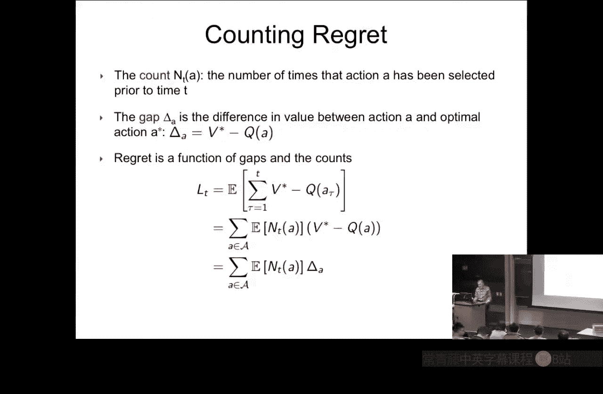

The expected reward you could have gotten if you had chosen the best action。

So we can then talk about the total regret。Is just the expected。

Some over the different times you play of this。Instantaneous regret。

And if we take that expected value， rearrange it， I can write it this way。嗯。

Where n here is just the count of the number of times that action A has been selected up to time T。

And so the total loss from 0 up to time T is just。The sum overall。

 the actions of the expected number of times you play each action。Times its gap。

So when you play the optimal action， this gap will be zero by definition。And for all other actions。

 which。You regret having played。 There will be an on zero gap。Why did it， by the way， Why didn'。

 Why can I get away with。Bringing this expectation。

Why didn't I put the right bracket over here instead of here？

It's because we've defined V and Q in expectation already。So V is the expected。

Best reward you could get if you play the optimal policy。

 So we've already defined V to be an expected value。 and similarly， Q。 It's the expected。Reward。

 if those rewards， for example， are Gaussian distributed， then the expected reward is just the mean。

And。So that's why I only need to take the expected value of this and what's that expected value over。

 well， that's over my policy。来。Stochastic policy for choosing in action。Or even a。

Deterministic policy that changing over time。Then。Based on the outcomes of earlier plays。

 then this is an expected value over that。And since I'm using Delta to represent the gap。

 I can just rewrite it this way。Okay， and this is just going to be useful notation in thinking about different policies and their expected regret。

Over the entire period of time from zero up to t。So just that's why we're introducing this notation。

Okay， now， of course， the problem would be trivial， but we don't really know the rewards。

 And therefore， we don't know the gaps。 And so it's all about， how can we learn。

By exploring and exploiting。 And theoretically， what we'd like to do is characterize different。

Learning algorithms that trade off exploring and exploiting。

Characterize them in terms of what is their total loss。Starting from0 up to time T。

What's their expected total loss？

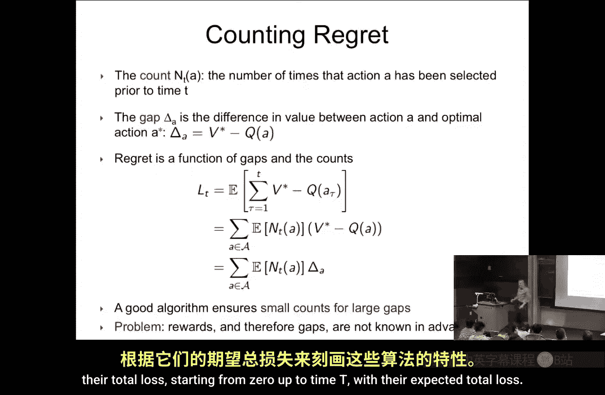

Okay， so it turns out， for example， we've talked previously about epsilon greedy algorithms。That。

Well， let wait till you get to the detailed slide。 But we're going to see that there are different kinds of algorithms that give us different performance in terms of the total regret that they。

Accumulate in expectation， and some of them will be linear in the total number of time steps。

 But our goal is to try to get things which have regret， which is subline。

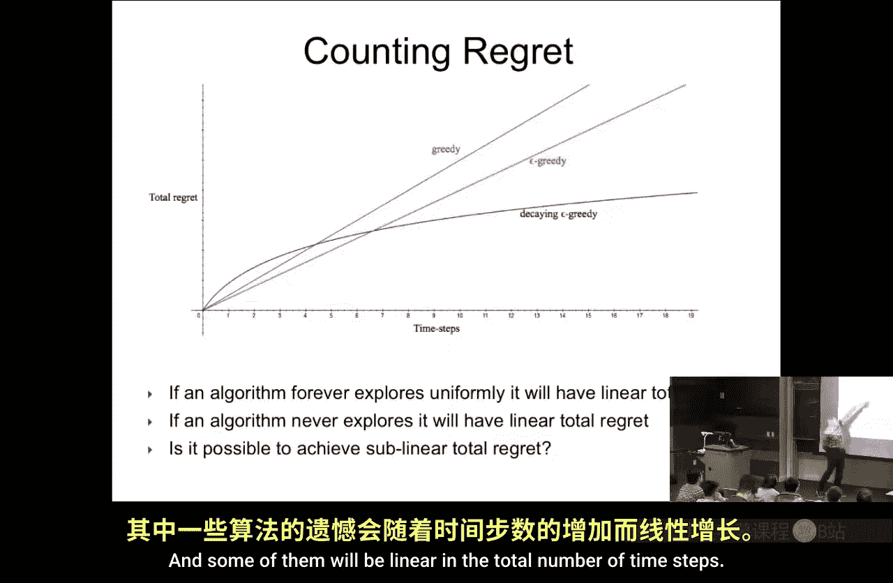

In the amount of。

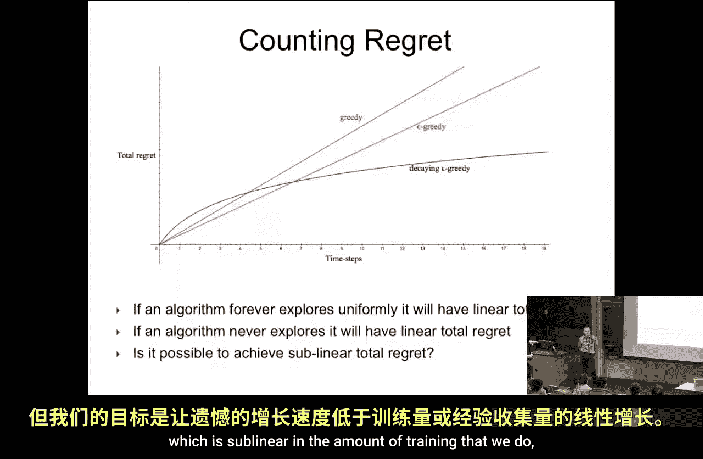

Training that we do， the amount of experience we collect。Okay。

 so let's start with the simplest thing， greedy algorithm。

Just consider the algorithm that we estimate Q。Que for each action。Again， there's no state。

 So estimating Q is very simple。 We just get the sample average， if we。

If N T of a is the number of times that we've chosen action A from 0 up to time T。

Then all we really want to do is take the average reward that we get whenever we actually。Chose。

At time， I。To use actionary。So and this notation， one of this thing just is a indicator function。

 itss value is 0， if the。Predicate in the middle is false。 and the value is one。

 If the predicate in the middle is true。 So this is just a way of saying。

 count up all the rewards we receive whenever the action we chose was actually action A。

 and then divide by the number of times we chose action A。 It's just the mean。Okay。

 so we can just keep playing and learn this simple version。呃。

It's a reasonable strategy for learning Q。 And then the greedy algorithm。

After having tried each action a few times。Then after we'll call that the burn in period。 After that。

 it just selects the action with the highest estimated Q value。So is that exploring or exploiting？

Right， the burn in part is exploring， but after that， it's pure exploitation。

You're not you're just saying， okay， I tried。Each restaurant three times。

 And now I'm just going to go with the one that I had the best experience。

 and I'm going to go there forevermore。嗯。So there'd be pure exploitation。

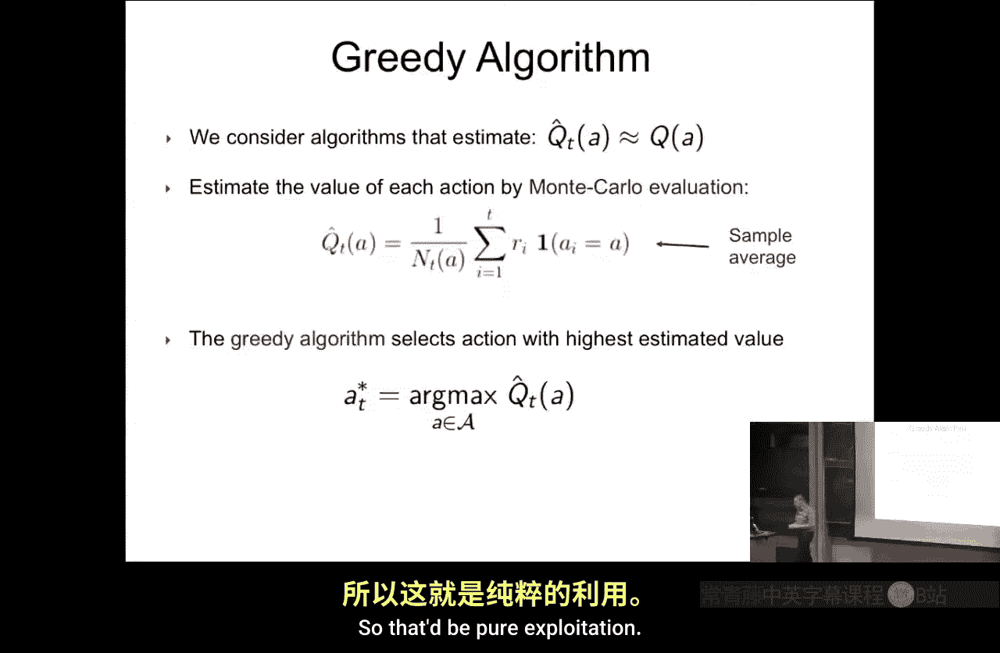

Rsaurant is not a good example， isn it。嗯。Then we could have the epsilon greedy version of this， yes。

现在。Greing algorithm， doesnn't it somewhat depend on like what your you set your key values as。

 So like what if you set your Q values initially， it's really optimistic And then you and then over time。

 you found that they weren't as good as you thought。

 And then you as long as you keep on selecting the best one， then you'll be doing kind of。

Both exploration and。Yeah， that's a good point。 So we could do that。

 But the way we've defined our Q estimate here， this is our learning algorithm for learning Q。

 And so we're just taking the sample mean。What you were talking about of having some initial kind of prior。

 you could think of it as a Bayesian prior is we'll get to that。 But in this case。

 we're talking about this。Completely reasonable， unbiased estimator。Of the。Q value。

But your point is a good one。 what will come to that。Okay， so now we can modify this。

 And instead of having pure exploitation， we could make it epsilon greedy。

 which an idea we've already discussed， where of course。

 what we do is with probability 1 minus epsilon。We choose uniformly at random。In action。And then。

Oops， I'm sorry， with probability， Epsilon， we choose uniformly at random in action。

 and with the rest of the probability 1 minus epsilon， we exploit。

So you can think of epsilon greedy as being。Epsilon percent of the time， we will explore。Uniformally。

 and1 minus epsilon， we will explain。So if we do that， then we're blending。With ratio epsilon。

Exploring and exploiting。And if you think about analyzing this， then you realize。The loss。

Per unit time， the loss it。At on the teeth step。The regret， I should say。

The expected regret is just going to be。The gap。The some overall actions of the gap of regret gap that we suffer for that action。

 which of course， will be zero for the optimal action。

 but non zero for all the other suboptimal actions。

Times the probability that we're going to choose that。Which is just epsilon。

That's when we're choosing random action。Divided by the number of actions。

 because the epsilon probability of exploring will then be chopped up further into the。

K different actions that we have available。Okay， so there's the expected loss per unit。Time。

Written in terms of the gaps。

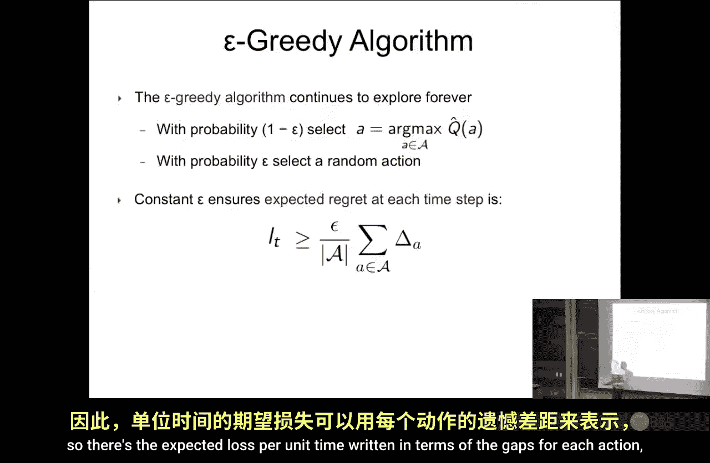

For each action。The gap between。It's expected payoff。And the optimal payoff。And so in this sense。

 you can say， well， epsilon greedy is going to be。呃。Linear in time。In the expected total regret。

That is， this is the regret per unit time。And you see， this is a constant。Right， that。

Number of actions is constant。 epsilon is constant， the actual gaps。

 even though they're unknown to us for each action are also constant。

And so this loss per unit time is a constant。This expected regretted unit per unit time。 And so。

If we do this across time， we're summing up， we're getting a linear。

Expect loss with that coefficient， yes。The equation size of the expected request is at least。Right。

 so。The expected regret is that。Yeah， this is at least。 and why is that， Why Why is this not equal。

 Why is it greater than or equal。Thats the very。Right， right。 So with one epsilon。

 one minus epsilon probability， we're going to think we're going to choose the action that we believe is optimal。

 but it might not be。And if it's not， right， it's just the one that we currently think based on our estimate of Q is optimal。

And so that's why I had to put it greater than or equal instead of an equal。就是。Yes， yes。

 so that means well。That's right。That means it's lower bounded by the linear。Function。

If you think about what's going to happen。Here's a good question to ask yourself。Or for me to ask。

 if you ran this using our。

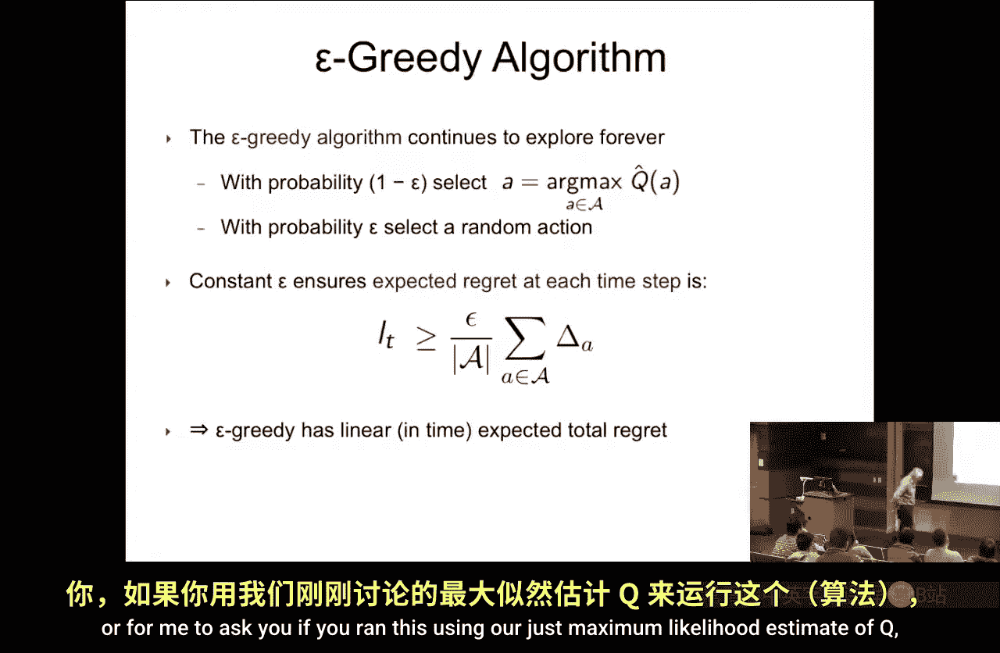

Just massive some likelihood estimate of Q， like we talked about in the greedy algorithm。

 I'm just getting the sample mean for the reward for each action。 If we actually run that。

And we look at the difference between。This quantity and the actual observed。Loss per unit time。

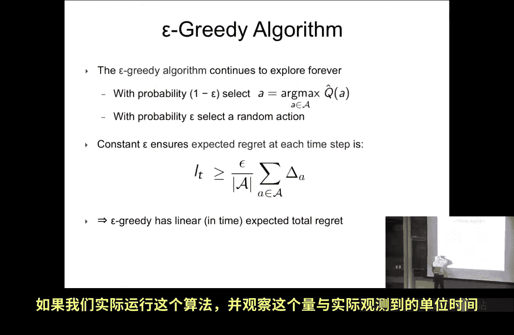

Does that difference between。This quantity and the actual loss status。The。

 the difference between the actual value and what I get if I predicted it to be this。

 Does that difference。Grow， reduce， or stay the same over time。In expectation。な北定。Yes， as I go。

 I'm always updating the Q value。So then it will reduce， right。

 because over time I will get a better and better estimate of the actual Q value。

 my estimated Q value would get closer and closer。It'll converge as one over the square root of the number of times they try it toward the true Q value。

And。So then I won't have that as frequently。 I won't have as frequently。

The risk that I'm choosing is suboptimal action。Good。Okay， and here's the algorithm。

 It's actually very， very simple。We initialize our Q estimates。And then counts for each action。

And then with probability epsilon or1 minus epsilon， we explore or exploit。

We observe what the reward really is， we update our count。

 we update our maximum likelihood estimate of the Q value。Oh， and I've written it this way。

 you'll remember that。You can incrementally compute these means。

 You don't have to actually keep all the old data。Recompute the same meaning every single time。

From all the detailed data， you can just update your old estimate。By adding in。呃。

If the reward you receive is actually equal to what you thought it would be。

 then you actually don't update the Q estimate。But if the reward you receive is greater or less。

 then you adjust your。Maximum likelihood estimate。By a fraction of。

One over the number of data points you've now seen。

So this is just the incremental way of computing the。The sample mean。

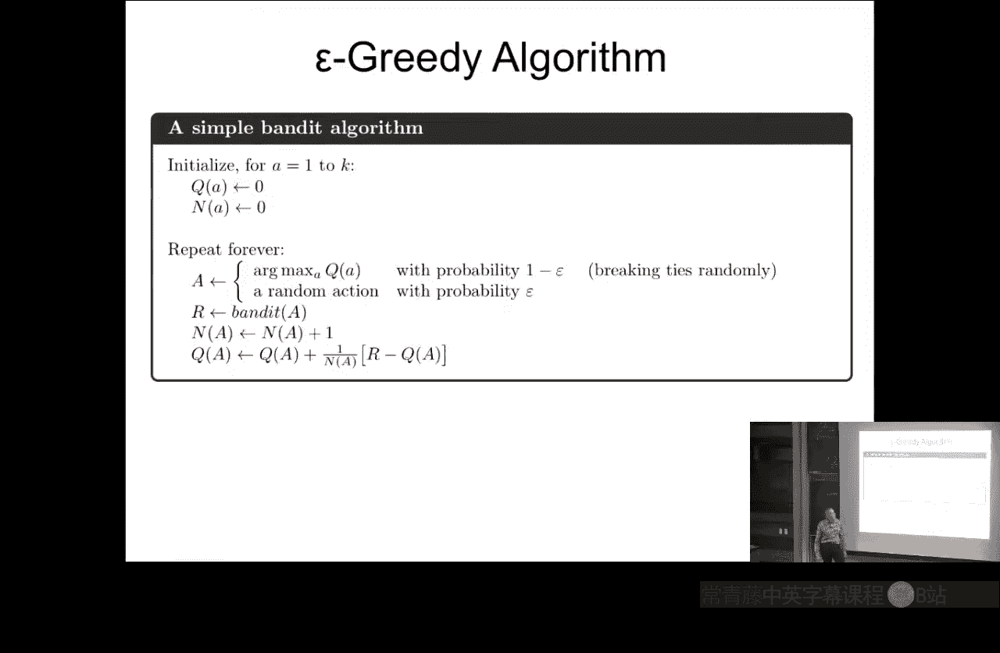

So it's， it's that simple。And in fact， if you do this， do this。

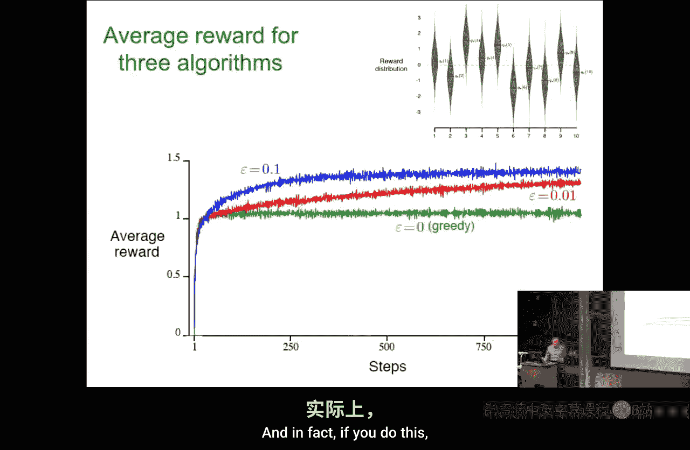

On that multi iron bandit problem that we talked about， here's what happens。

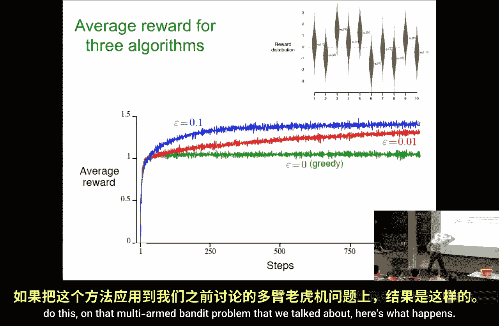

This is averaged over several。Several runs。 But you can see what happens in green。

 We have just the greedy algorithm after some short burn in。And here you see the burn in period。嗯。

We then just keep exploiting。 and so we don't get any better。On the other hand， if we do。

Epsilon greedy with epsilon 0。1。We explore。Quite a bit and quickly reach。A pretty good level。

If we use a smaller epsilon， a smaller fraction of the time exploring。

Then we don't converge as quickly toward the optimal。呃，而。

We don't converge as quickly toward as good an average reward。I removed the word optimalim。嗯。

But as you can see， it's getting there。And what would happen if what do you think would happen if I continue the curve out to here？

Will it ever cross the blue line？Will it ever meet the blue light？Yeah， of course。

 it'll meet the blue line because eventually a smaller fraction of the time。

 I'm trying the action I'm exploring。 but eventually I'll explore enough to get to the blue line。

What， will the blue line， Oh， what if it go further。Will the red line ever cross the blue line？

SomeSince there's variation due to the epsilon， at some point due to random。

 the red line will be slightly above it。Any expectation will'll let bit up。Who thinks it will？

Who thinks it won't。Let's take a will。 a will person can explain。Yes。Eventually， it's been fine。

And because it has such a small epsilon， it's going to stick to three much more the time than the other one has a larger。

Exactly。So you and I know that action three is the best action。And。

The blue line will probably figure that out， and so will the red line eventually。

They'll both figure that out that their Q estimate for action 3 will be highest。

And so when they're being greedy。They will choose action three。But when they're not being greedy。

 they're still going to choose uniformly at random some action。

And this one is only going to do that 1% of the time。This one's going choose a random action。

10% of the time。

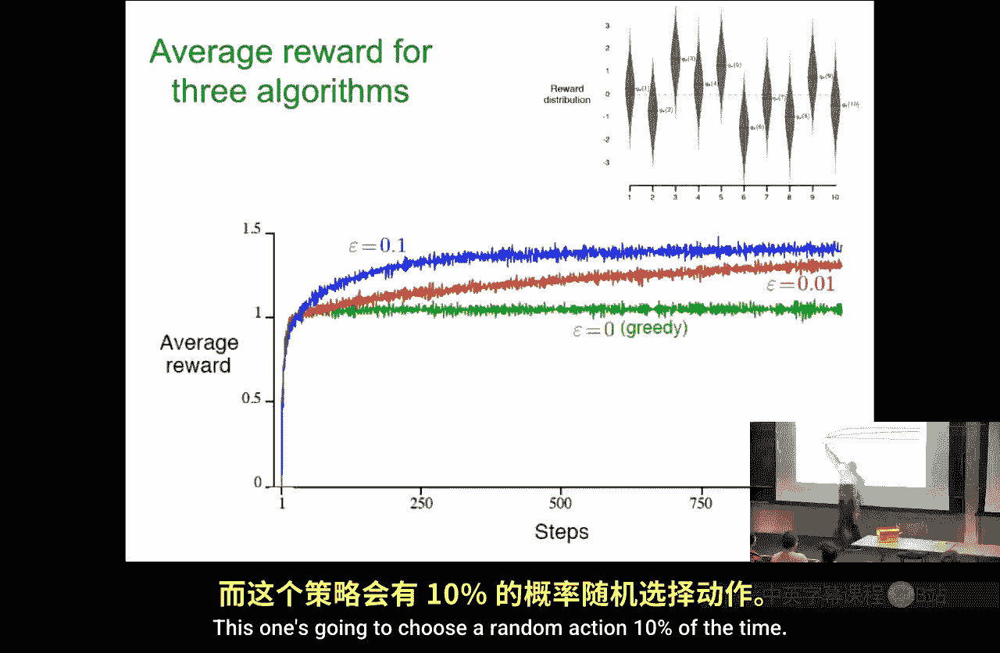

So it's going to waste。By exploring the opportunity it could have had to exploit。Okay。Good。

 so you see， this kind of suggests that maybe we should actually have strategies that have a changing epsilon over time。

 because once it knows or。Statistically has high confidence that it knows the expected knows the Q values for these actions。

 Then it really should change to doing less exploring and more exploiting。

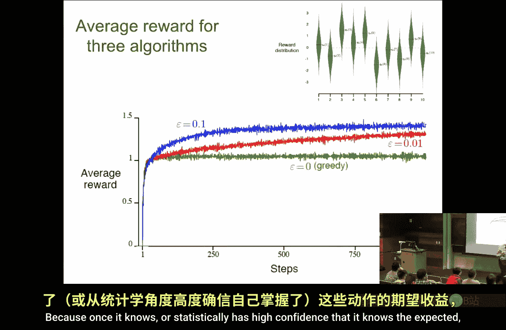

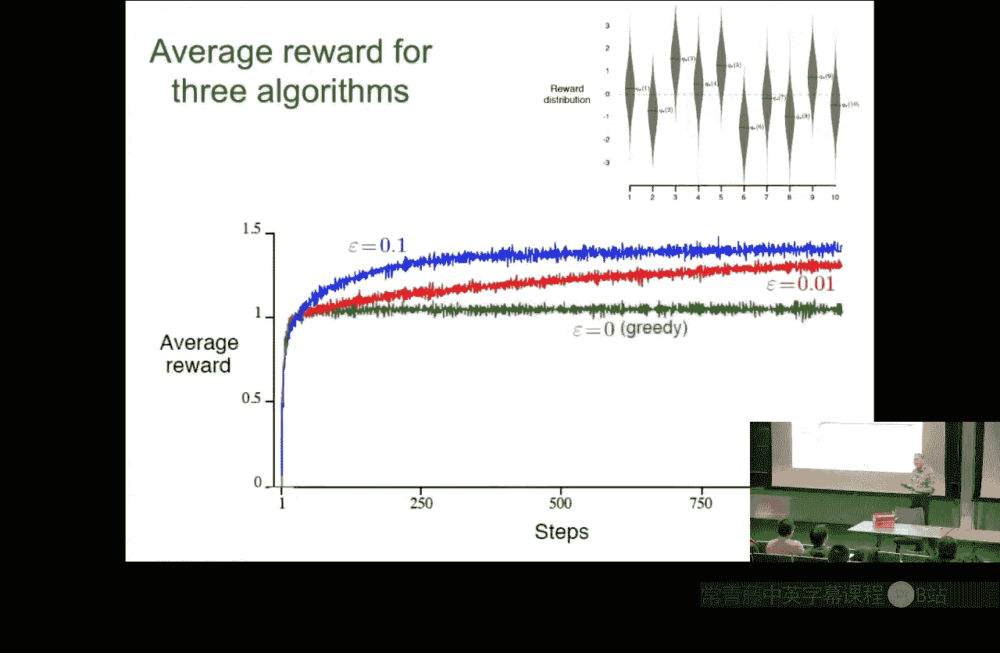

All right， so we can look at。That， but before we do。

Let's also take a quick look at non stationary worlds。 So we define the multi arm bandit problem。

 as we have defined。MDPs。As having a stationary。Distribution， both on。The next state function。

 the effect of inaction and stationary distribution in terms of the probability distribution on a reward。

But in some domains， it's not stationary。And in fact。

 if you think back to the policy and value iteration algorithms that we actually use。嗯。You know。

 we started out by talking about policy and evaluationeration as， well， we'll pick a policy。

 we'll evaluate it， meaning we'll run lots of samples and find out its value。

 and then we'll calculate a better policy from that。

But then we quickly departed from that when we were talking about policy and value iteration。

 and we said instead。Well， we can just update the Q function and greedily follow the new Q function。

 So we ended up interleaving。The learning of Q and the using of Q。

 So we never really had a stationary state distribution。From which we are sampling。And so。

That replay buffer that we have， for example。嗯。Maybe has some very old stale data that's。

Not representative of the state distribution we would get if we follow what we now think is the optimal policy。

So there are cases， even in the kind of algorithms we talked about for training MDPs。

 where there's some kinds of non stationationity。So what can we do about this。

 since take the simple case where what if the reward function itself changes over time。

 which would drive you crazy if you go to Las Vegas and start playing the gambling machines and they change unbeknownst to you。

 the reward function it would be。Even worse than Las Vegas currently is。Okay， but then obviously。

 we might want to base our reward estimates， more on more recent experiences to cover for the possibility that。

Those distributions are changing。So again， if we say what we really want。

 if we had a stationary distribution on rewards， we would just get the maximum likelihood estimate of。

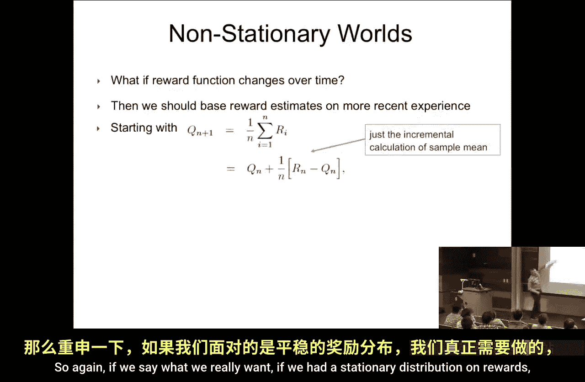

What the Q function is for each action。We can make the incremental version of it as we talked about。

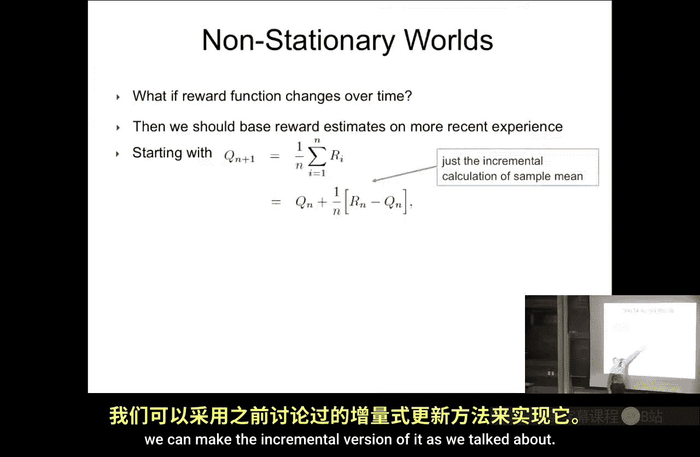

But here's an idea which is useful in practice。

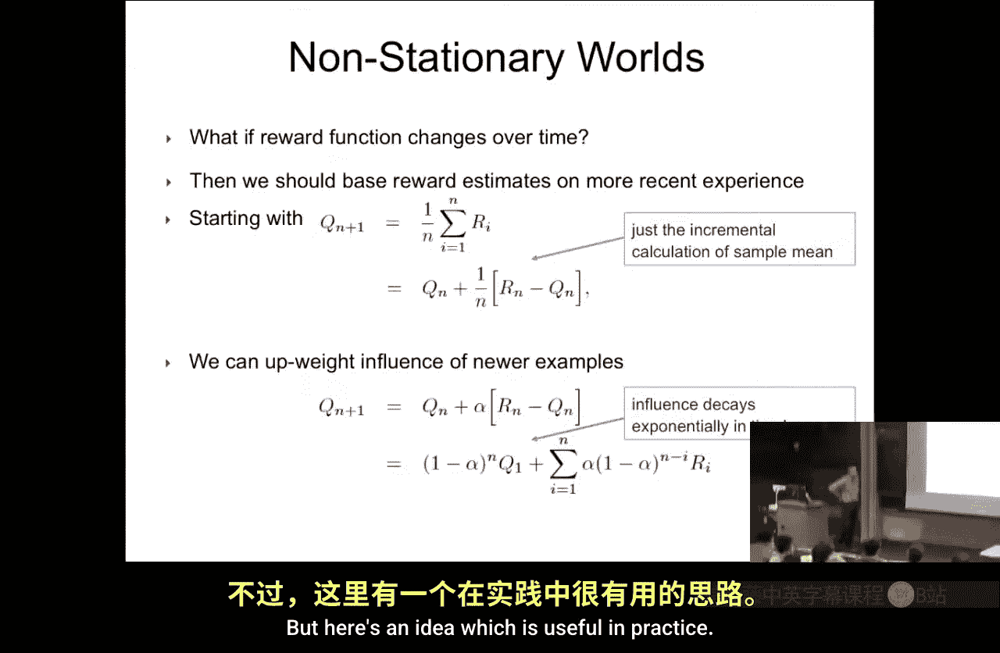

What if we keep the general form of this， But instead of updating our queue。By the proper。

If one over n， where n is the total number of。Of experiments we've run， of samples we've collected。

 This is the proper way to get the。Maximum likelihood estimate of Q。But what if we just say， well。

 use a different constant here。Well， if you expand this out and in chapter 2， they do。

 you can see that you can rewrite this expression as being equal to this。

And so now you can see what's happening is， again， n is the total number of times we've tried。嗯。

The particular action。 And we're trying to get the Q value for that action。

You can see what happens is。The influence of。The subscript here is the8th。

Estimate of the nth reward we receive on the nth trial。 And this is our nth estimate of the Q value。

 You see what happens is。The very first estimate of the Q value。Gets weighted by this term， which is。

 if alpha is positive， is exponentially decaying。In time， as N grows。

 the number of times we actually。Play action， a。Then the influence of the very first experience is decreasing exponentially。

And similarly here， I mean， we， we're adding up all of them with this similar。呃。In a similar way。

So this is a way if we change that one over n to some constant which is positive， but less than one。

Then you can see， we end up。Essentially， waiting more recent experience exponentially more。

Heavily than ancient experience。So， it's Kenra nice。

ASple way to adjust your algorithm to make up for the。

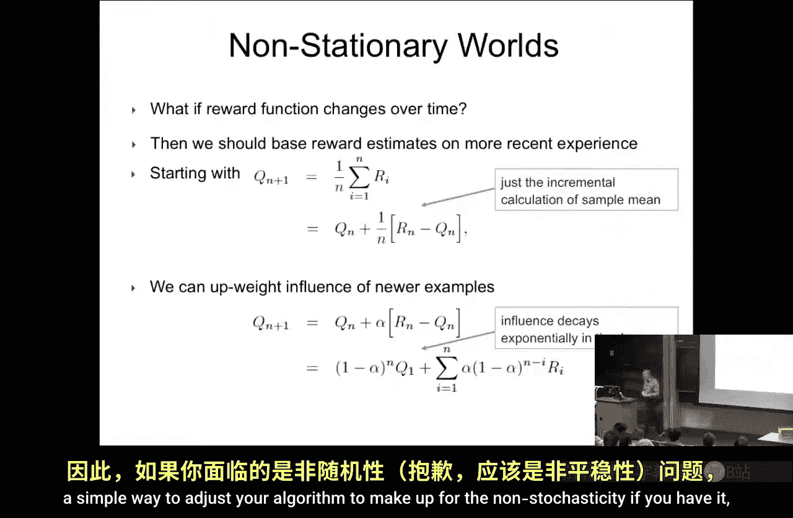

Nonstoity， if you， if you have it， nons stationity， if you have it， sorry。

And there is a detail on this， which we can even make that alpha itself be a function。

 It doesn't even have to be a constant。 We can make it a function of both the time step and and the actions。

 We can use the different。

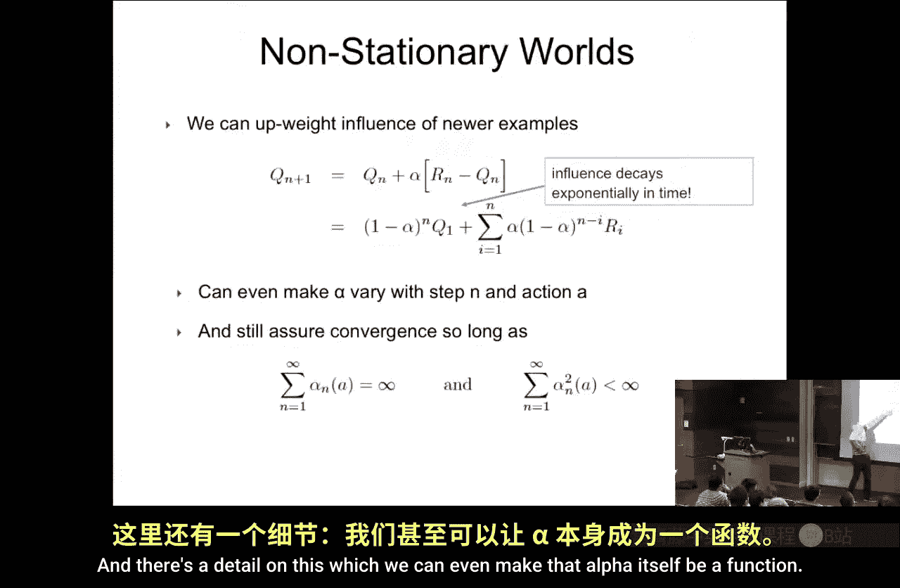

Alpha for each one of those， if we want。And we'll still get convergence so long as these two properties hold。

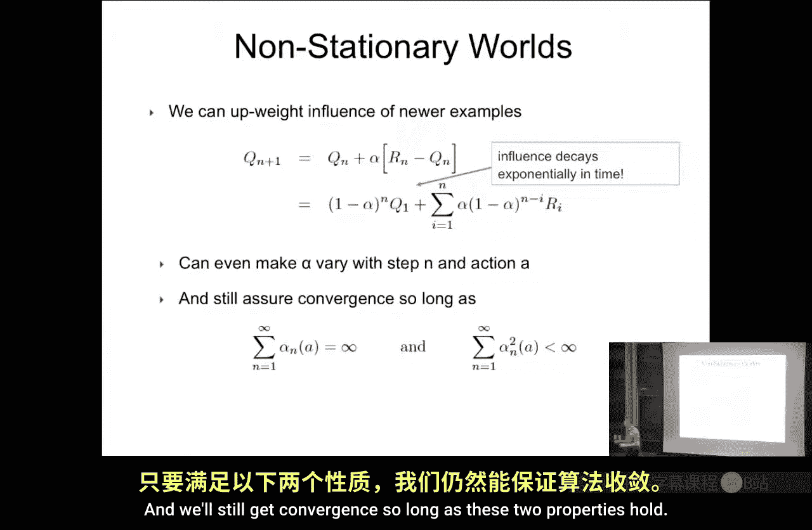

And you can think of the properties as requiring that。The alphas must be big enough。That。

The initial random。Data that you saw gets eventually。Completely overwhelmed by other data。

 because these things sum up to infinity。But they must be small enough that you'll actually converge。

 And so the square of that。Must sum too。Some finite must converge to some finite some。

So this is a theoretical result。 We're not going prove it。

 but it kind of gives you an idea of how what flexibility is available to you in terms of replacing that one over n in the incremental computation of maximum likelihood estimate by a constant or not even or even a function of and and the action。

 Yes。没应白。A long time， we start waiting like really old experiences a lot because alpha turns really close to zero。

No， no， no。 This just says that the sum of these。Must be finite。

 It doesn't say how you distribute them。 You can make the old ones。呃。

You can make the old alphas big and make the later one small or vice vers just the total sum of all those alphas。

I mean， like。Alpha is like how much we weight the current experience V。

 how much we weight old ones and every small alpha meanss we care a lot about older experiences compared to the current time so it's like if we're in a nonstationary world we'll be caring about。

TheRewards from a long time ago。No， I think that's not in this case， we're， we're actually。Okay。

 so in this case where alpha is constant。Then， yes， ancient experience is going to be ignored。那。

Not emphasize， but ignored， right。Because you see the exponential decay of that。

 this is going to be a number lesson than one。 It's going to exponentially decay N。嗯。

Here we're saying we could actually replace that alpha by an arbitrary function of N and a。😊。

I think what you said would be true for some choices we could make for this function。

 but not for all。Right， this， this is not， this is not making any assumption about whether a sub 1 is bigger or less than a sub 100。

It's just saying the total sum of all those coefficients has to。

Have an infinite sum square and their squares has to have a finite sum。It does mean why。

The limit alpha as N is infinite is。The limit of alpha， like alpha n and becomes very big。

 I think it's close to0 otherwise becomes very big as N grows。 No。

 Al goes very small as n becomes very big。Otherwise， the sum of the squares can't possibly be finite。

The total set of alphas has to have。SomeSome small things in it， but it's not the set。

 not the sequence， that's the difference。So this is just。

 this is not saying which ones have to be big and which have to be small。

 It's just says the sum over the set of them has to have this property。 So it's not。

 it's not telling you whether you should wait the original ones or the late ones differently。Okay。嗯。

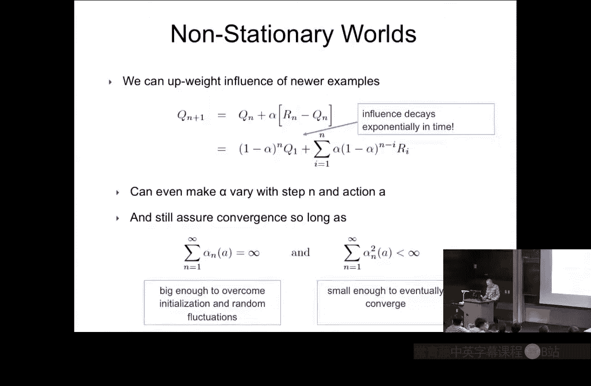

And so now we can go back and modify our epsilon greedy algorithm very simply。

 just by where we used to take one over the number of times So we tried the action we can use our。

Function，So again， algorithmically， this is very straightforward。

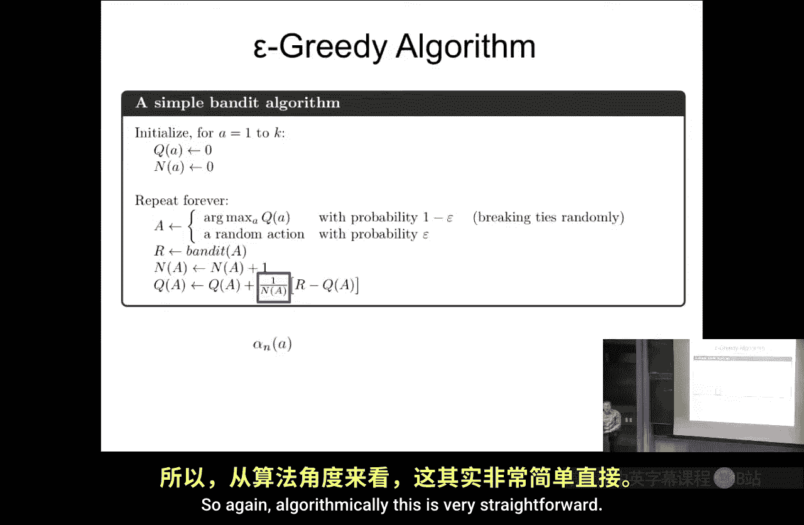

Okay， but back to stationary worlds。 that was just kind of a side。

Sidelight to talk about non stationary。Let's come to the point that you were mentioning earlier of optimistic initialization。

So this turns out to be a good， practical thing to do instead of。嗯。

Getting the maximum likelihood estimate of Q just using our observations。

We could initialize the value of Q to some optimistic number。Some high value。And then update。

 as we always would。So if you think about it that way， you realize this is just like。

Getting the maximum likelihood estimate from the observed data plus。

One hallucinated data point that we started with。And if you think about that。嗯。

And you've taken the machine learning course before。 Then， you know， that's just a way of。

Getting instead of a maximum likelihood estimate， a Bayesian estimate where you put a prior。On the。

A particular kind of prior。On the parameter that you're trying to estimate。anyway。

 this is a good idea。 In many cases。 We'll still update， as always。

 It's just that we start out with this initial value that corresponds to having。

In a hallucinated initial example。 And you could imagine modifying this to have multiple hallucinated examples。

 which is like putting a stronger prior。嗯。But then just update。And if we do this。

What it does is it encourages exploration early on， because if we have。

 let's say you saw that plot of what the real rewards were。 They were all like。😊。

The means we're all below like 5。 So what if we start with an optimistic estimate of 100。

For every action。Then what's going to happen， We'll pick some action。We'll try it。

Will be disappointing because the the reward we receive is actually going be much less than 100。

And so we'll update this Q estimate by lowering it。Bweing it。And now we'll pick in action。

 but we're not going to pick that one。So now we'll pick one of the others is where we're overly optimistic。

 So we're just going to force ourselves to keep trying the ones where we're overly optimistic until they get brought down to reality by。

Hard lived experience。That that bring our Ss down to the real thing。So what this does。

 you can see is it has this influence that it encourages exploration early on。But。

Then things get better。Now， of course， if we have a purely greedy algorithm。

After some burn in period， it still might not have settled down to the。To the right values。

 And we still can have。

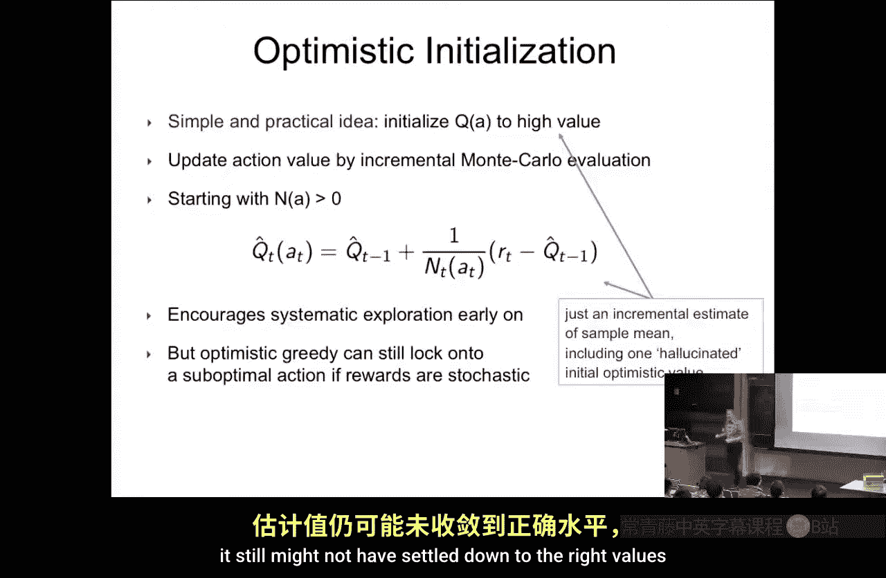

A lock into a suboptimal action。So here， in fact。嗯。Is in blue， the optimistic， greedy。Algorithm。Okay。

 so we initialize。Every action to the value of5 here。And then we， we don't have。

We don't have an e epsilon is 0。 We're being greedy。

But we're being greedy relative to our incorrect optimism。And so we're being。

 we're actually doing a lot of exploring early on， after which we greedily。呃。Effectively。

 get more realistic estimates of Q。On the other hand， if we compare that to a non optimistic。

Realistic epsilon greedy algorithm do where we really do get maximum likelihood estimates of the Q values。

Then you see takes us longer to do well。嗯。Things do improve over a longer period of time。

Will this gray curve ever meet the blue curve？Who thinks yes。Who thinks no。

I'll choose a no to explain。Maybe because of what we discussed earlier。

 like you're always going to choose a random action with somepro。It's optimistic。嗯。

Like the optimistic and visualization。that， it might be better。That's good yeah， so in the end。

At the end， asymptically， we're going to be exploring with probability zero with the Epsilon01。

Whereas in this one， we're going to be exploring 10% of the time。 And so even after we've。

Converge toward good estimates。We're going to be。Still suffering regret because 10% of the time we're just acting randomly。

And we don't need to do that。So in this case， the gray will not meet the blue。It looks like。

The blue crew is like went up around 80%， I'm not sure why that would happen。

But if the realest me is only。In the random action。When they go higher， that's。Get stuck。Yeah。

 that's a good point， which I had not noticed。What's going on， help me。Yesス。

I'm also wondering about that， but if we're still on the same10 desktop， then seem that。

The two best actions were very very present valued。

And so it might be possible that if theyre close enough。

 it's actually like sometimes switching between each other。

 so if the values are very close and the variances are very big。

It's going to keep this meeting with one and the other。诶来。figure out well which Yeah。

 that's a great explanation It's still one000 times steps。😊。

It seems like a the problem is that your exploration is0%， so if you happen to get。

 you're going to have high variance estimates of these Q values as you get started because。😊。

You don't have enough samples。 And if you get it to a situation where like you say。

 maybe the true value to which you don't know of one action is just a little bit higher than another。

 but if you happen to get a sample of data，Where you're underestimating the value of the good one。

Of the better one。But you have a representative sample。

 and you're getting an accurate estimate of the second best one。You're going to turn off。

 you're never going to explore。So as soon as that optimistic value comes down。

 it's possible that it'll actually go below its true value。In which case。

 if it goes below the estimated value of a different action。Basically， you're locking out。

 ever experimenting to find out。A better estimate of the top action。So， that's why。Thank you。

 so that was a good repair of my misunderstanding。But and that justifies the comment on this earlier slide。

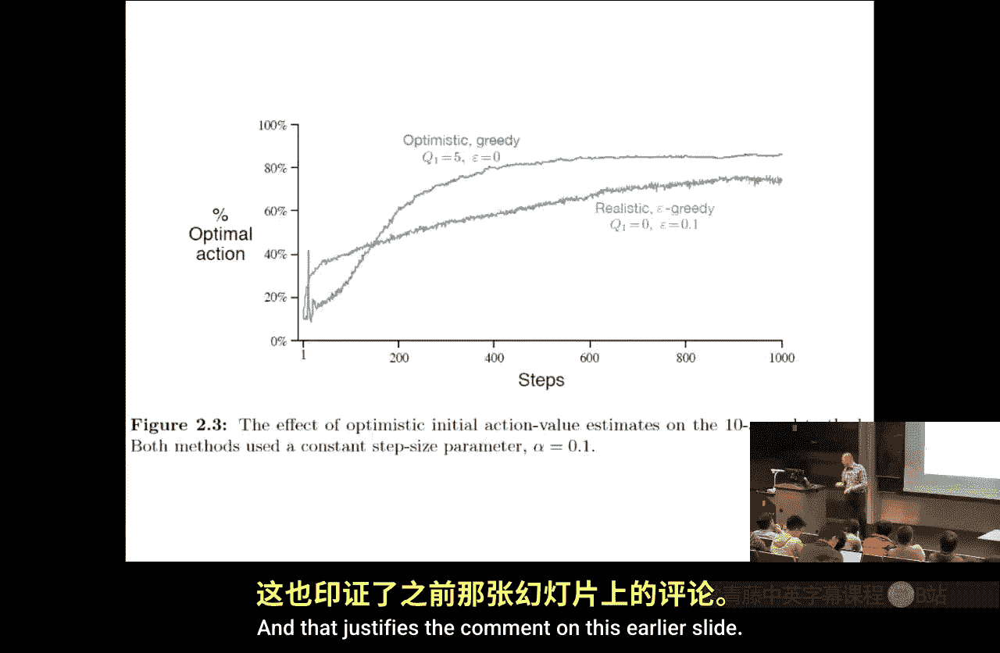

呃。Optimistic greedy can still lock into a subbotimal action。

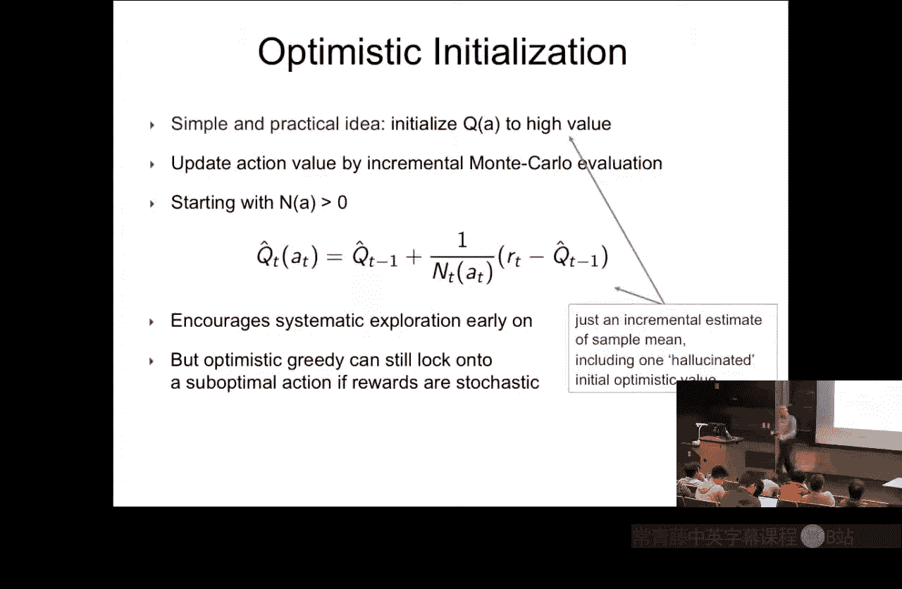

Okay， so in that case， I guess we have to say。If taking into account that the blue curve is appearing to being asymptoting around 80%。

 I take it back。 The gray 1 might actually get up to。

90% of what it can do because it it'll eventually。Converge toward accurate estimates of all the cube values。

Which would give it 100% but then it' going to be exploring 10% also。Okay， now， another idea。

 of course， is that we could have epsilon decay over time。

And there's a nice little theoretical result here。Which says。Suppose we use this strategy。

 let's say C is some constant。D is the smallest non zero gap。 Now， what does that mean。

 that means if we take the best action。And the second best action。Then D is the gap between those。

 It's the difference between their expected values。And if we use this schedule。For epsilon。

Then it's possible to prove this has logarithmic。Asymptotic total regret。No longer linear。

So what's going on here？By the way， this is not very practical because we don't really know what that gap is。

 So we don't know what D is。 So in practice， we can't really。Use this because。

It's not until we know Q that we know what D is， but if we could do this。

What this is saying is epsilon， of course， can never go above probability 1， but。

What this is saying is。The more actions we have， the bigger epsilon should be that makes sense。

 We want to think in terms of number of examples per action， not total number of examples。

As time increases， we're going to decrease as 1 over t， that's our scaling。Of this。Epsilon。

 and then d squared， what does that mean， that means if we take this gap， the smallest non zero gap。

As that gap shrinks。We're going to need a lot more。Epsilon。this ratio is going to grow。

 So as the gap gets very， very small， where one over a very small number squared。

 So as a gap shrinks， this quantity is going to grow。Does that make sense intuitively？Of course。

 it does because if， if my best action is here， my next best action is here。But in scenario2。

 the best action is still here， but the next best action is almost there。

 I'm going to need a lot more data， a lot more samples to be confident of which of these two very near。

 very close reward actions is best， whereas if the gap is big then I'm not going to need so much data to have the same kind of confidence。

So it makes sense。 And， and， it shows that there is a way of getting logarithmic。expected reward。

 But you have to， unfortunately know and advance this。

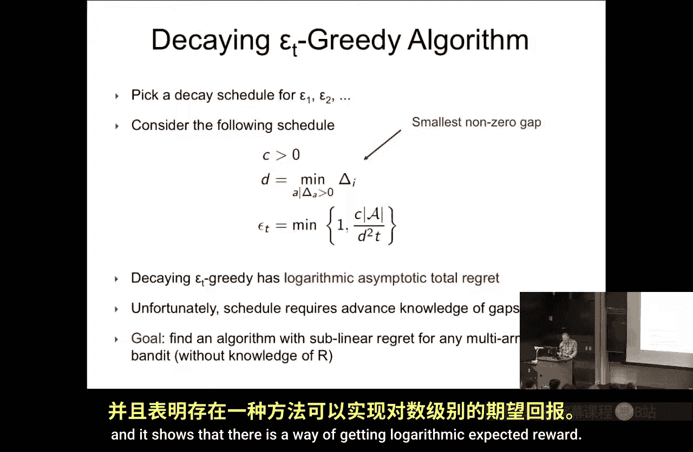

Quantity。Okay， so a kind of related idea， which can be implemented unlike the other the previous one。

Is to use upper confidence bounds。 So what if we say。We have our maximum likelihood estimate of Q。

 just the average reward we've seen。For each action。

But statistics tells us that we can put an upper bound。A confidence interval。So， you know。

 like if you flip coin k times。And it's going to come up heads or tails。

 We have confidence bounds that tells us as's a function of how many flips N。How far is our estimate。

Our maximum likelihood estimate going to be from the true value。And as in the number of flips grows。

 then。The probability distribution。Over our estimate。Become sharper and sharper。 and are。

Confidence bounds become smaller and smaller。So we can use that idea。And。And then， we can use。嗯。

We can we can look at basically the sum on the right here and use that sum as our basis for choosing which action。

To try。And when we have a little bit of data。The upper bound， this the U term will be wide。

 will be big。We have a lot of data for that action， it will start shrinking。

And so this is a way of encouraging us to explore actions where we have most uncertainty about the true Q value。

And yeah， as I said， here's the action。 I'm just going to take choose the action that maximizes the right side of this。

 the upper bound on。For some confidence level。

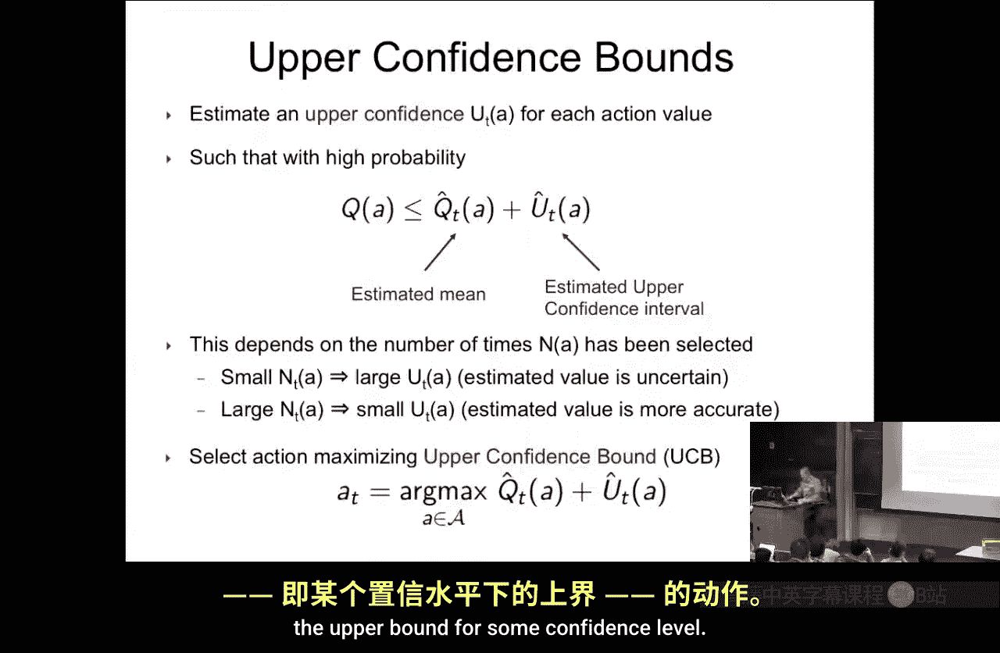

Okay， so just to illustrate this， suppose。That。I'm a Bayesian。And I want to know the probability。

Let's take action A3。I I've gathered a certain amount of data。

 and the mean of that data is apparently 2。45。

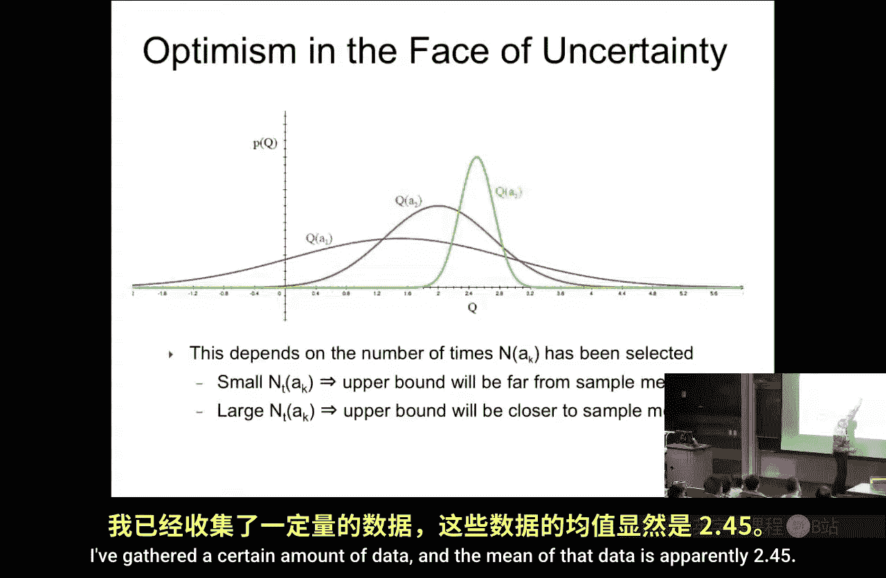

That's the most probable value for a Q， given the data that I have。

But given that I only have a finite sample of data。

 there's some probability that the true value of Q for action 3 is 2。8 or maybe 2。

 and those have different probabilities。And similarly for all the other actions。And so if we use。

 let's say， the 90% confidence interval on these。Like the green curve。

 the 90% confidence interval means what's the value of Q for which 90% of the probability mass here is for the value of Q to be below there。

And 10% probability above that。And so that' would be around here， whereas for the blue one。

 it'll be over here。So， even though my estimated。My best estimate for the Q value for action 1 is about 1。

3。And my best estimate for action 3 is about 2。5。嗯。If I use。This upper bound， then I'm going to say。

 well。When I add in the upper bound， it's for the blue curve。

 it's over here where 90% of the probability is below， but there's still 10%。

Probability that the true value。Of action 1， even though my current estimate would put me here。

 there's some probability because I haven't seen that much data yet。That the true value of。

 of the blue。Action is at this level。And so I'm going to choose that and do it。 I'll explore。

 when I explore and get more data， what happens to the width of the blue curve。

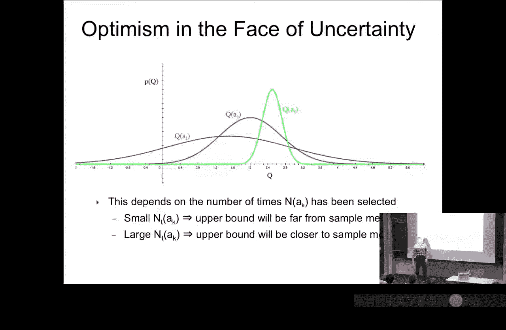

It sharpens， right， It gets smaller and more and more data gets sharper and sharper。 Asmptically。

 it becomes just。Goes toward a point estimate。And so it's the width of these curves that we're going to use to capture the uncertainty and whether we should what we should explore with。

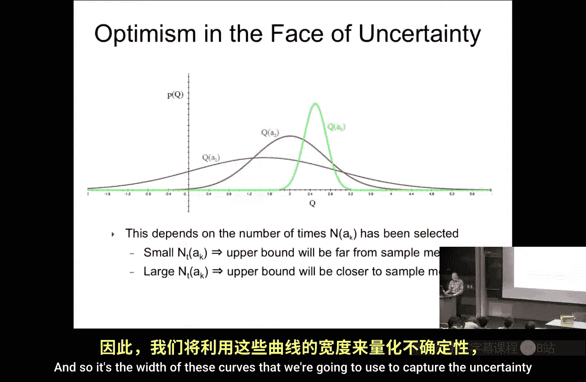

Now。There is this little technical detail。How can we actually calculate this upper bound if we don't know the form。

Of， of the distribution。On the Q function。

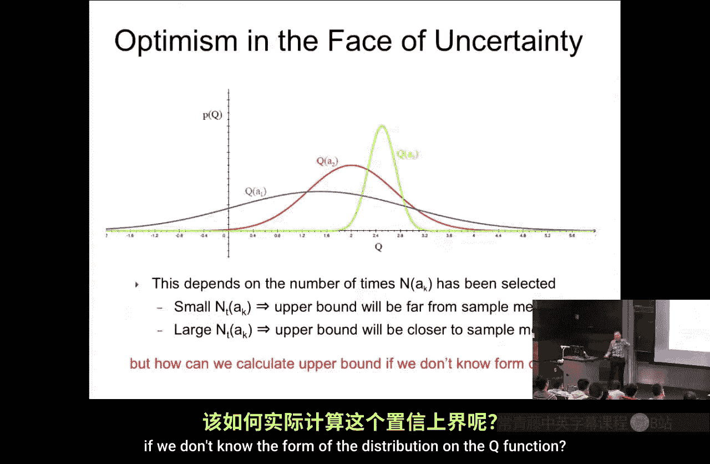

And the nice thing is。Huffings inequality。 If you've taken a course in machine learning。

 you probably have already experienced Huffing's inequality。 If you have not。

 every person who leaves CMU with machine learning in their resume should know Hftings inequality。

 It's really important。And it's beautiful because it's so general。 you can apply it in many cases。

 including to estimates where you don't know the functional form of the distribution that's governing your variables。

😊，Let's see what it says。Let x1 through X， T。Be independent， identically distributed。

 according to some distribution， which we don't know。Rand variables in the continuous interval。

 are real number between 0 and 1。And let X T bar be just the sample mean。

 the maximum likelihood estimate of the mean。呃。For those variables。Then。

 despite the fact that we have no idea what the underlying distribution。

Is on these X variables just that they're all from the same distribution。

 We can say that the probability。That the expected value of x。

 That is the true mean of that unknown distribution。

This is the true mean of that unknown distribution。

The probability that that true mean is more than our sample mean。

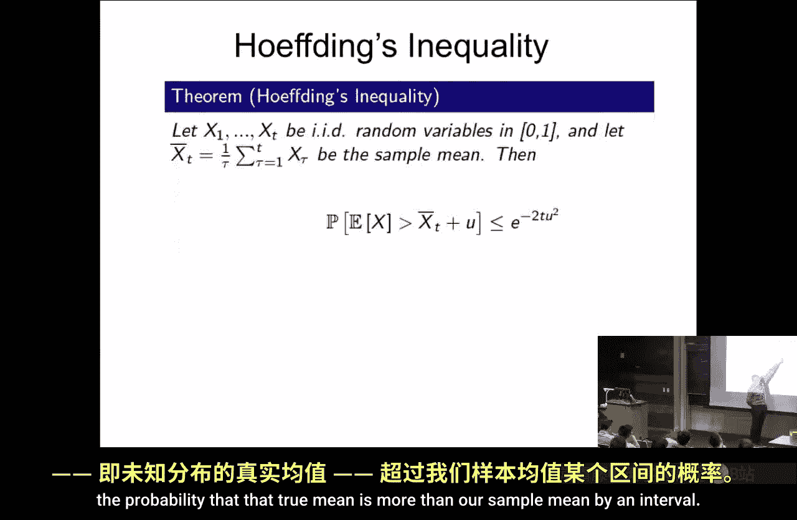

By an interval U。Is bounded。By this much。And what's that， This is E to the minus2 T U squared。 U。

 of course， is our， our interval， our upper bound interval。So as that grows。

 the probability decreases E to minus u squared。So the probability that it's within 01 is。

Less proable than the probability that that's within 09。 As you grows， this probability drops And T。

 What's T。 Oh， T is the sample size。So the more samples we get， remember， they go from x 1 to X T。

 the more samples we get。The lower the probability that our estimate is worse。

The lower the probability that our sample mean deviates from the true mean。With margin。

So Hfting's inequality is just beautiful， you can use it in so many ways。嗯。

And we're going to use it here。So we're going to say， okay。

Then the probability there maximum like this。 I'm sorry。

 the probability that the true Q value for action A。Is more than our sample mean。

 our maximum likelihood estimate。Plus some upper bound UT。Is bounded by this。

So now all we have to do if we want to implement an algorithm is we just pick a value for this bound to say。

 well， I don't want that to happen more than 5% of the time。And now。The algorithm that simply。Ohoops。

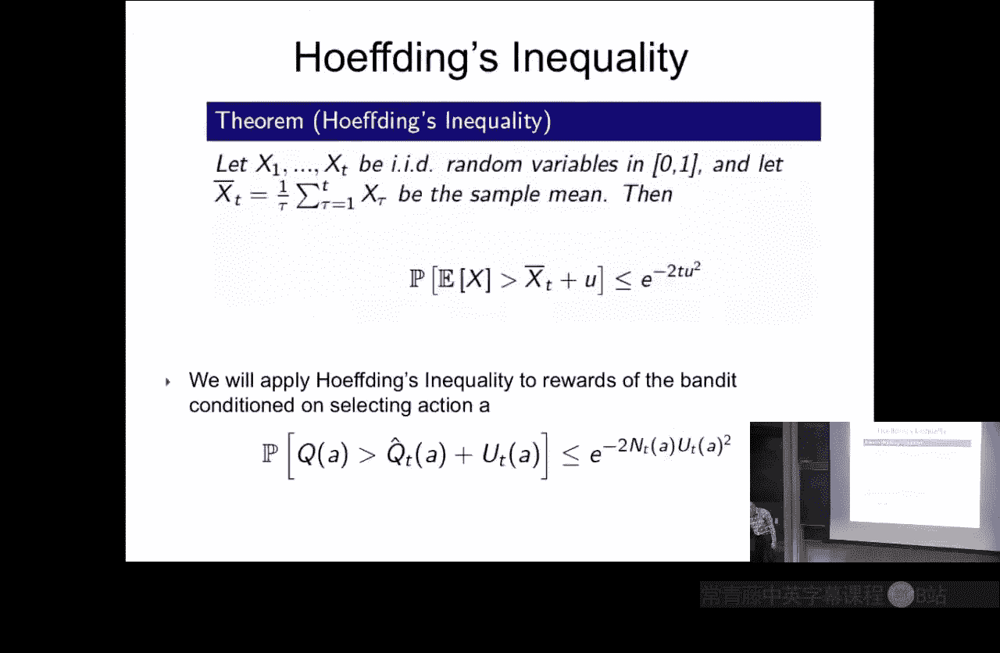

Let's go through it here。 Then， then the algorithm that。Uses this will be。

 we can bring in Hfting's inequality to calculate that。Okay， so let's see how we do that。

Suppose that。Suppose we solve for， you know， we set our probability。

 I don't want that to happen more than 5% of the time。 So I said P to 05。05。Now。

 if you just saw this， you get the upper bound。Is this。And again。

 this is the number of times we've tried action A。 So it's good that。Our upper bound shrinks。

 If we want the 5% at worst bound， This is going to shrink as a number of examples grows。

And if we want 10% instead of 5%， then this is going to be larger。Okay， so。So， that's the idea。

And then。For example， if we say that。We want。Their probability。P。To go as the number of steps T。

To minus some constant， let's pick c equals4。Then if we plug in that for P P equals T to the -4。

 then we can get a very direct。嗯。A very direct solution for the quantity。

How much should we look instead of using our estimated Q value。

 We should use our estimated Q value plus this quantity。

 If we want to make sure that with probability P。嗯。Probability at most P， the。呃。

True value of Q is below our upper bounded version。 The maximum likelihood plusus。Okay。

 so this gives us a way of just calculating basically those confidence intervals in a way that's agnostic of what the underlying distribution is。

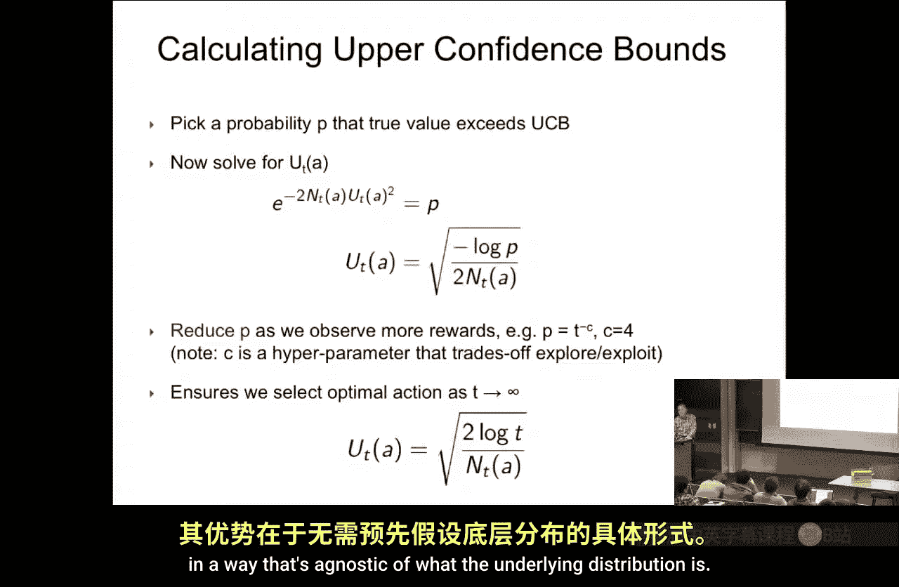

And so that leads to a very simple algorithm。We take the action that maximizes our current estimate of Q plus this upper bound quantity。

And as we get。嗯。More and more examples that upper bound quantity shrinks goes away。

The approach zero asymptically， and we default back to the exploitation strategy of using just our estimate Q。

 but in the early game where we have very few examples， just one。

 say then the upper bound is going to put in that kind of optimism。

And because this is based on huffing's inequality。It's a justified schedule。And， in fact。

 it satisfies what we wanted， which is a practical algorithm that gives us logarithmic。

Eymptotic total regret。Loarithmic in time。 So T is the number of steps。That we've taken。

 and you see it grows as the log of that。 And then this is， again， a constant。 Those gaps are。

 whatever they are， even though we don't know them。But it's a constant。

 And so you can see that the total loss from time。0 up to T grows only logarithmically in T。Cool。

 so this is actually very nice。So's upper bound algorithm。Instead of using our estimate of the mean。

 instead of taking our maximum likelihood estimate for Q。

 we take that plus some upper bound interval that corresponds to a certain probability。

Of our estimate being off by that much。Okay， so if you try this in practice。

 here's a plot again on the same10 arm bandit problem we looked at before。And you can see。

This upper bound UCB algorithm， in this case， outperforms epsilon greedy with epsilon 0。1。

It's not that different in this case。But it is。Better。I'm gonna skip that。Okay， so now。

 now that we're kind of into the idea of using。Statistics and confidence bounds to actually estimate。

嗯。When we should exploit and when we should explore。

 we can become we should look at another approach called Bayesian bandits。嗯。In some cases。

 we may know something about the form of the probability distribution on rewards。So in that case。

 we can use Bay rule。上一个。To when we use that。down on the。Mmhm。😊，要不。呃。

So is the assumption that the sum of the bottom is bounded？呃，一 yes。诶。病りになるよ。Let's see。

 this is a constant。That's a constant。 The only question is the sum of log T from T from 0 to infinity。

 I sure hope that's bounded。So what was the assumption to made and how did we use it then？

I so this slide said that we assume that。对。Weass something on the distribution of res， oh， oh。No。

 we made no assumption about the distribution of rewards。嗯。

Which is why we fell back to using huntinging bounds because they give us。Distribution free。

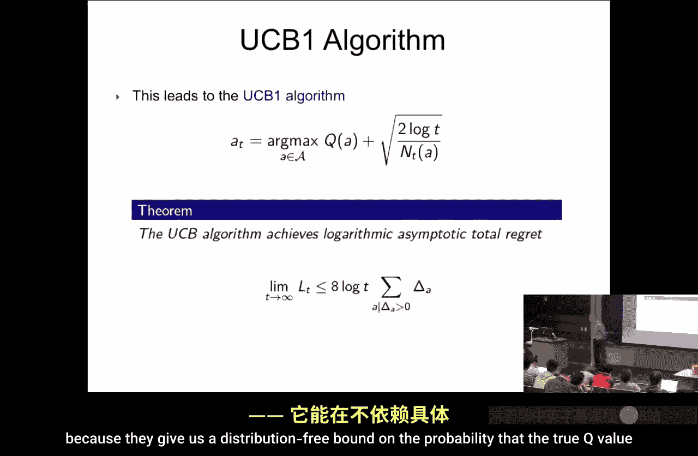

found。On the probability that the true Q value， which we're trying to estimate。

Is off from our maximum likelihood estimate by at least this much。That's what Hfting bound is。ださて。

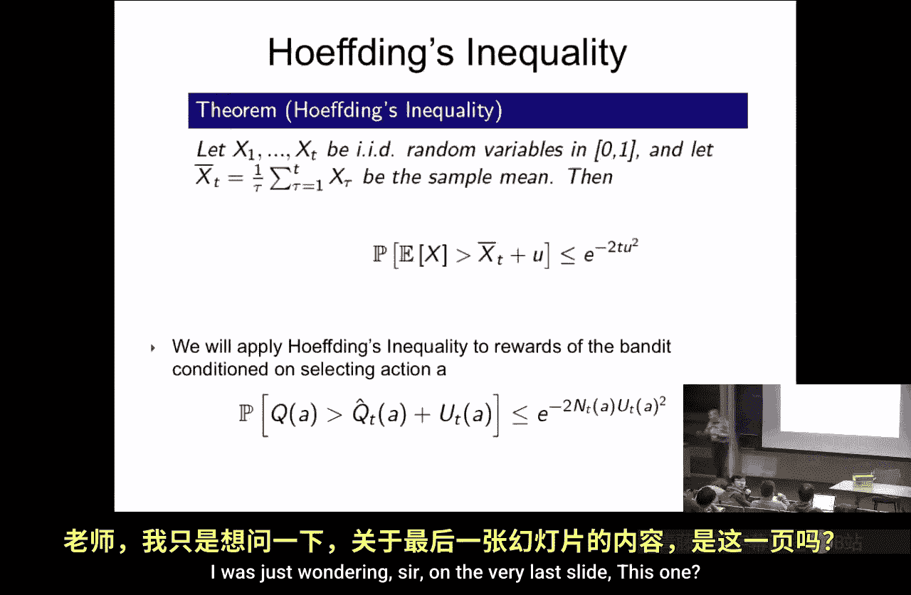

诶。The test says that no， where we work currently。

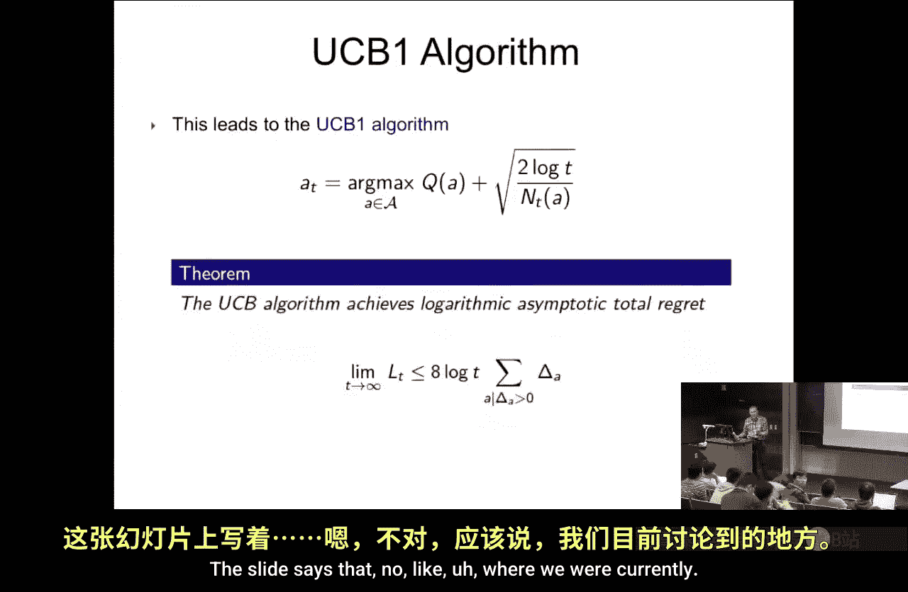

This one and then back。No， like the。When you switch to Bayes in embedded。

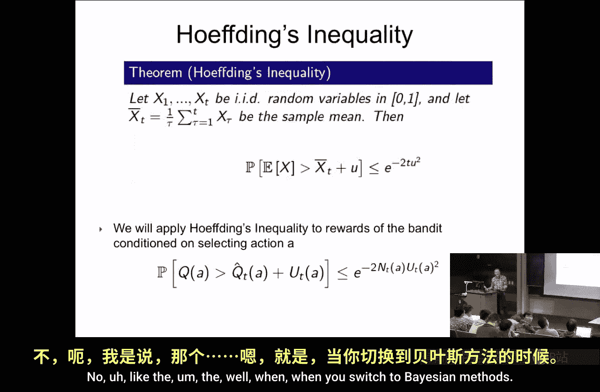

Yeah he said that we had made no assumptions， but the reward solution except for the balance on rewards。

And I just then remember us making the assumption on the balances on the re。你啲有。No， we did not make。

 I'm sorry， I shouldn't have that line is a misleading line。 I shouldn't have。

 We have not here made assumptions about bounce on the reward， I guess。Have we？Oh。

 they're between 0 and 1。 That's right。 So the huffing， thank you， the hfting。Bounds。

The way we stated the hfting bounds， they assumed that the quantity we're trying to estimate is between 0 and1。

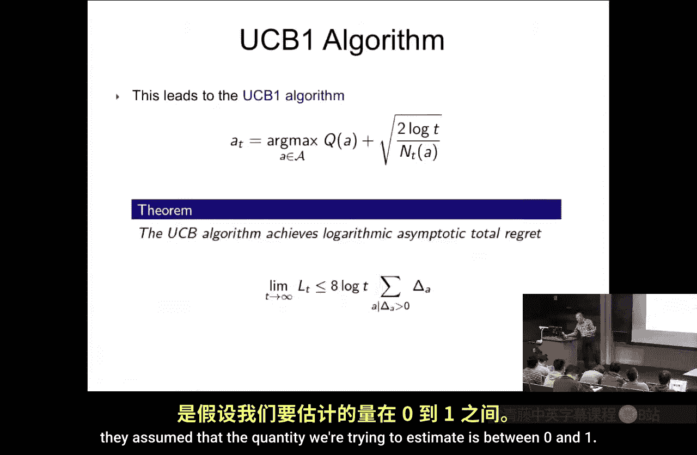

These are random variables in01。On my feet， I don't know what to say about how you would adapt to non01。

But that would be an excellent。Homework question。Then you could teach me。 Yeah， so on my feet。

 I don't know what to say about if it's not 0 in 0， And。おし。許しくさ。research。We not， win on the game。

Well that was 01， but there were also you could win double in。

 so in this case was 012 or something Yeah， yeah， I'm pretty sure I've seen a version of hfting bands that says it's between A and B。

For for arbitrary it's a bees， but again， standing here。

 I can't give you that So I see how we could generalize this to between A and by just distribution but the normal distribution is unbounded in any way Yes。

 yes。

That's right。That's right。The normal distribution is unbounded， but we're not saying。

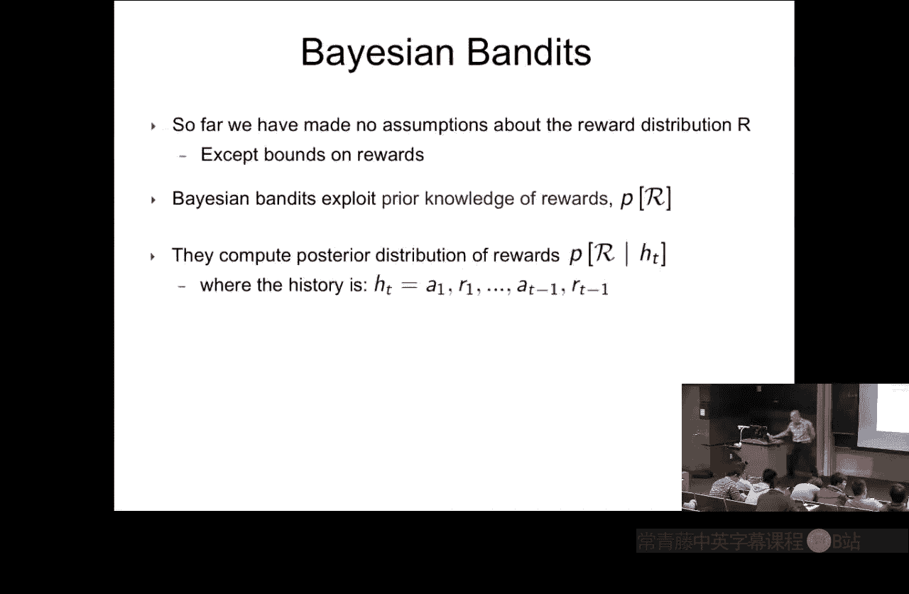

Let's see what exactly we are saying。Yeah， this says the random variables are themselves bounded。

 so yeah， if it's a Gaussian distribution， the random variables are not bounded。Sa commission， yes。

the random mirror both the diitude， A and B， and you can divide by B minus。I think that's correct。

 which still doesn't unfortunately cover the gassian case。But I mean， if you say straight based， oh。

 it works for question distributions， we definitely believe that yeah yeah， yeah。

 you only get in trouble very rarely。😊，Right。

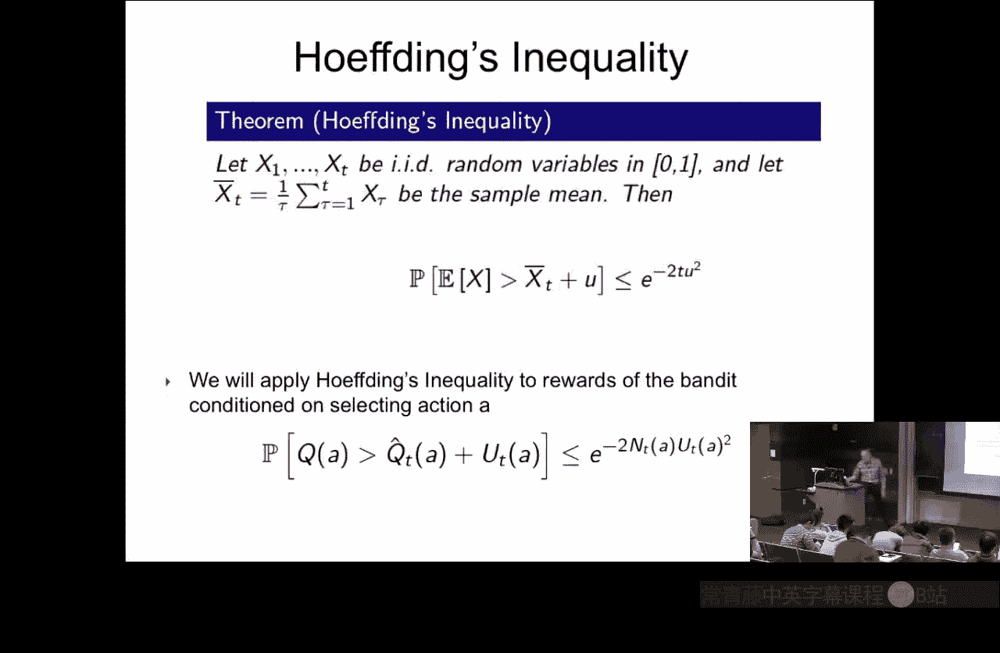

But good point， good and good catch。 Let me。Finish up by。Looking at one more idea。

 And then we'll continue this next time。嗯。So suppose we do know the form of the reward function。

 For example， suppose we know it's Gaussian， although we don't know the parameters of that。

 we don't know what the mean is。 We don't know what the。Standard deviation is。嗯。Still。

 as long as if we're willing to put down a prior。On， on with those。Mean and what mu in sigma。

 the mean and the standard deviation are。Then we can， as a Bayesian， solve for。

If we put down a prior on with。That distribution of rewards is。

 what the parameters of that distribution are， Then we can solve for。

The probability distribution on those parameters， given the experience we actually see。

Get the posterior。And then we can use the same kind of UCB algorithm。

 But now we're not relying on hfting inequality。 we're simply using。

Our greater knowledge of what the distribution form really is。

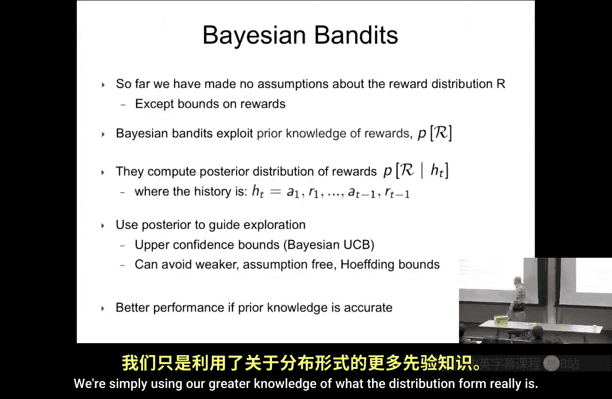

So we can， we can do that and just illustrate。

Suppose that we do know。The distribution for each action。

Distribution of rewards for each action is a Gaussian distribution， it's non deterministic。

So we pulled that same lever several times， it might get different。A rewards。

 but it's Gaussian distributed。嗯。Then。It's not hard to。

Work out with the。If we have some prior。Probability。

 we're willing to assign to the mean and standard deviation of each。Then the posterior。

 the probability distribution on those same parameters， which will be different from the prior。

Given the experience is simply that prior times the data likelihood。The product over the experience。

 all the time takess we've gone through。Of the probability under this normal distribution of observing the the actual reward that we got。

Given those parameters。So this is just Bay's rule。But it says that we can get the posterior distribution。

On mu and Sigma for each action。If we start with a prior and look at the basically the data likelihood。

And so in this way， we can actually literally compute with these。Curves are。

 we can estimate know initially they'll just be the prior distribution。嗯。

But then we can get a posterior。And we can solve for these distributions。 And then again。

 we can pick。Action that has the maximum， again， upper bound。 So we're going to take。The mean。

Reward for this action。 plus some constant times the standard deviation。

And this is normalized again by one over the square root of the number of samples that we have。

And this assures that as the number of samples grows to infinity， this term shrinks to zero。

 and so we end up in the end again， simply exploiting。

But now we're using the calculated variances of these distributions to guide our exploration as we go。

So this is just like the， the logic of this is just like the logic on hing bounds。

 except that now we're。Taking more advantage of more knowledge that we have。

 which is the form of the reward distribution itself。Okay。

 so I think I'll end there because I'm gonna to give Katterine a chance to say whatever is on her mind。

And we have a few more things to say， which we'll say next time。What I would like to ask is。

 what if we don't know the form of the distribution。Which is。Most of the。Most of the time， the case。

 you don't know the distribution reward reward function。 You don't know。 and these are bandits。

 also in the next class， once Tom does his initial。Hrap up， we're going to talk about exploration on。

Beyond bandits， right， we're state dependent here。 We're not state dependent。

 We just sample the same action。 and we're going to build Q functions。

 and these Q functions can be extremely complicated。

 And you saw that it's extremely important not to just。Keep track of the expected value。

 But rather also your uncertainty。 So once you're building a Q function approximation， right。

 some in some places of your space， this queue will be very certain because you've seen lots of data from that space。

 And in other parts of the space is going be quite uncertain。 Okay， so far。

 we have been feeding one neural network。And which is similar to a point estimateament here， right。

 is like the expectation of the which。 we just take one。嗯。1。

 we don't consider the distribution of the weight of the neuro。

 Just consider one snapshot of what gradient descent gives us。

 And we have no way to know when these Q estimates are certain and we should trust them and when they are certain。

And why this is important， because as you saw here。

 you can just explore by keeping track of your uncertainty。 essentially。

 if we were able to keep track of the distribution of queuees each time what we would sample from this distribution and follow as if this queue is correct and collect new data and update our model。

 Okay so in this way， when you're more uncertain this is where you spend your efforts exploring and when you're certain you you know you just exploit you don't explore。

 Okay so we're going to talk about this， we'll discuss how we can this uncertainty in neural networks。

 what are the more formal way of doing it， what is a more computationally tractable way of doing it。

 So we'll see a lot of different solutions that you can take we will talk about uncertainty。

 not only on the queue functions as here， which is what essentially we're doing。

 but rather also on transition functions okay。When predicting our dynamics。

 So we'll try to explore by building a model of the environment and try to make as much progress on this model。

 these are all equivalent notions， maximizing my learning progress minimizing my prediction error maximizing the information gave from the next transition。

 we'll see how all these are equivalent and we will show at the very end。

 how you can just win entire games without any extrinsic reward。

 simply by having as a reward this exploration bonus that tells you I want to make my predictive model to fail。

 So you're playing so that you can surprise as much as possible the predictive model of the environment that you're building without knowing anything about the score game without knowing anything about when you die。

 Okay， so， so this will show how important exploration is in all this。F。I mean。

 we will see it as in empirical， our empirical how say evidence will come from arog games。

 But in robots also， it's going to be the same。ok。

Let's see you next time。