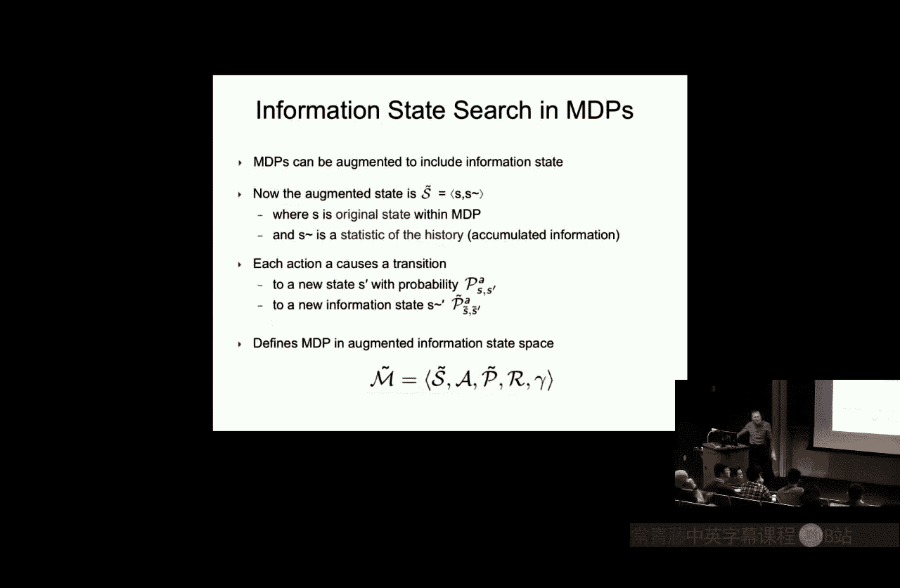
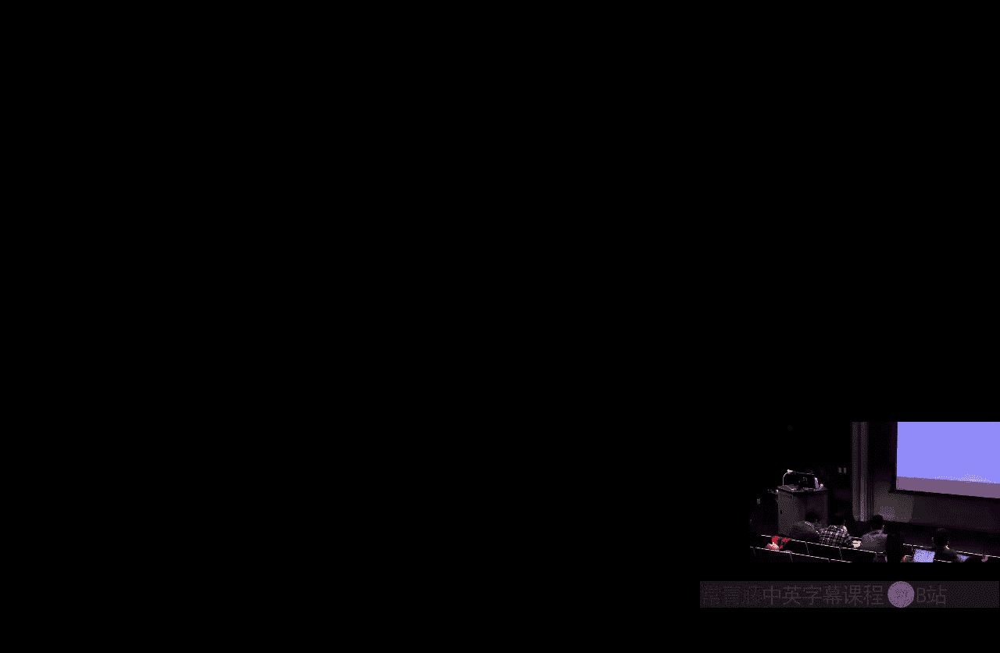
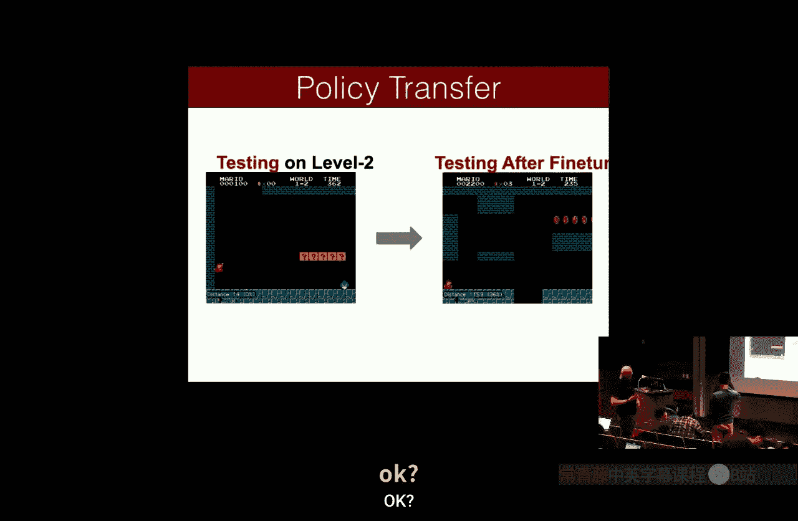

# 卡耐基梅隆大学【中英⚡深度强化学习与控制｜10-703 Fall 2018, Deep Reinforcement Learning and Control】 p17 P17 17  Exploration and Function Approximation -BV1RyqPBbEJV_p17-

Okay， so let's start up。 I want to take 5 to 10 minutes before I turn over the microphone to Kaarina to finish up one topic that I'm。

 I'm。We didn't have time to cover last time。 So we're talking about exploration versus exploitation。

 And， you know， we talked about a number of approaches。

 I just want to end up by saying there are even more approaches。

 and one that's kind of easy to describe is called probability matching and the idea is simply this。

 If you take a。Probabilistic Bayesian approach to the question of what's the best way to trade off？

Exploration and exploitation， one way you can do it is say， well。

 you just want your policy pie to always choose the action。That is。

In expectation has the highest probability of being the best action。

And so that means given your experience， H T， all the rewards and states and actions you've taken up till time T。

 let's just say that with。You're going to assign to each action a probability that you'll choose it。

 which is just equal to the probability that it's the best。The best action。

 the action that has the best Q values。 that's a very kind of obvious way to look at the question。

And。If you think about it。It。And this will be maybe more clear when we look at one simple example。

 It turns out that this approach is naturally optimistic in the face of uncertainty。 That is if you。

Are unsure exactly what the Q value is。 So you have some distribution of possible Q values for inaction。

Then if you have some Q values where you know a lot。

 And so you have a very tight distribution and others where you have a very broad distribution。

 then the broad ones are going to kind of be。Have some significant probability because the distribution is so broad that they're the best action。

 and so in that sense， it's kind of， its just kind of follows from the simple and kind of obvious principle that you're going to end up being optimistic and choose ones where you have more uncertainty。

Now， practically this can be somewhat of a problem， but just to get the idea across。

 Thompson sampling is one instantiation of this idea， and I just want to illustrate it here。So again。

 the principle we're trying to follow is to assign to each action， our policy。

 to assign a probability， which is equal to the probability that it's the best action。

And so what they really means is。嗯。If we have some。Probability distribution on rewards。

Paing attention to this floating R。 If we have some probability distribution， R on rewards。

Then what we want is the probability that this is the best action is just the expected value over。嗯。

That reward function of it being the best action。And so in。To， to illustrate this， suppose that。

In fact。We have some。Assumed parametric form for the reward function。Suppose， for example。

 we think it's a Gaussian reward function。That is for each action。

 there is a mean in a standard deviation that defines the distribution of rewards that we'll get for that action。

And of course， suppose we don't know what that reward distribution is， but it exists out there。

And so。If we assume， for example， that it's Gaussian， then we can use Bay law。To compute。

To estimate that Gaussian reward distribution。Now， if we're going to estimate a Gaussian reward distribution。

 what are the parameters we need to estimate。Right。

 give away question just to make sure you're not sleeping。

 You may have to estimate the mean and the variance for for the Gaussian for each action。And。

 you know， instead if we're Bayian， then instead of getting a maximum likelihoodestator of that。

 we might have some priors。On what we think that mean and variance is for each action。

 and then we collect some experience， HT again is the sequence of rewards and actions and states that we observe。

 given that then we can get a posterior distribution。On the parameters of that。rewardward functions。

 So we get a。Estimate， posterior。Estimate of the mean and the variance associated with a reward distribution for each action。

Now， suppose just to illustrate this plot up in the right hand corner is our estimate say for the muse。

Suppose we have three actions， and。Having seen some experience。We now estimate that the mean。

For action。Blue， red， and green are the three means shown there。But of course。

 we're uncertain what those means are。 We have just a distribution over those。

And we have a similar distribution for the variances， let's say。

 the sigmas that define those three reward functions for the red， green and blue actions。

Then the idea of Thompson's sampling。Is that we can。呃。

We can basically sample to estimate these expected values by doing the following thing。 we take。

The current parameters that we or the current distribution over parameters。

That we have as a Bayessian， as we're trying to estimate the mus and sigmas for the reward functions。

And we just sample that， we sample a reward distribution。

From our posteriors on the mu in sigma parameters。So that means， for example。

 we'll pick a green mu and a red mu and a blue mu。By sampling those three distributions that we have on the muse。

And similarly， we'll sample a red， blue， and green sigma。

And then given that sample reward distribution， now we actually can say， well。

 given that we've chosen these mus and sigmas， here are the reward distributions。

 And then we can simply solve for what would be。The best or what would be the Q value under that sample。

And if we sample repeatedly， of course， it's an unbiased， it'll give us an estimate of the expected。

呃。Value of the Q value for the action， where that expectation is taken now over。

The uncertainty that we have about what the reward distribution really is。

And then we just choose the maximum action， according to。The sample that we've drawn and we take it。

Okay， so you can see， and we can sample more times if we want to have better estimates or we can。呃。

Sample fewer times and just take more actions。 But， but you get the idea。

 So what this is doing is really taking into account。More explicitly。As a Bayian。What is the？

Not what is the most likely reward distribution given the data。

 but what's the distribution over reward distributions given the data and then sampling that is a way of。

Turning that into action， yes。Distributions because in'm practice。你觉得。The math is mighty。

 easy and I wasn't going to state that those were Gaussians， they're just shapes。嗯。You know。

 some people try to rationalize these things by things like the law of large numbers and more mechanistic explanations of how rewards get generated。

 but the truth is that's very different in different domains and so in general， it's hard to justify。

 but mathematically it is easier。Do we need to work。

I don't know the answer to that and my guess is that a Catarina knows that answer better than I do when it comes to robotics applications。

 but B， I'm sure you can come up with domains where it's a very reasonable thing to do。

 and I bet if you put your mind to it you come up with domains where it's。Obviously， bonehead thing。

But the idea is that there you know， be some distribution。

 some parametric form that we're assuming for this distribution。

 And then we can get the posterior over the parameters of that distribution and sample。

That posterior， which is a way of really sampling distributions。And。And so it， it takes into account。

Properly， the true uncertainty that we have about the reward function that we're trying to。

Choose actions。 Design a policy for。So anyway， that was the idea that we didn't get to talk about last time。

 I think it's a useful idea。 In fact， we'll see that it's a useful idea。

 And so I just want to summarize then here are the kinds of approaches we've。😊，Talked about。-1。

So we talked about epsilon greedy approaches， ways of being explicitly optimistic。

Either by initializing all of our Q values。Not as zero， but is some large optimistic value。

Which we noticed is the equivalent of putting a Bayess prior on what those。Q values R。

We talked about。Taking into account uncertainty by using upper confidence bounds rather than the most probable value。

 according to the distribution。And probability matching is what we just talked about here。

 the Thompson sampling。Being an example of that， there is one other idea。 I'll just mention it。

 verbally。And you'll love this idea because。It's exactly if you were a truly dedicated。

 MD Pete person the way you would think of the problem。We can actually define。An MDP。

To take into account。嗯。The information that we have from our history， maybe I'll show you this slide。

 It's a little easier to。Here's the idea。The motivation is we'd like to， if we're gonna do。

Resoning about exploration versus exploitation， we'd really like to use all of the information available。

And so as an MDP person， one way you can do that is say。If you give me an MDP， which has state S。

 I'm going to define a new MDP。S Tilda S squiggle hat。

 which is concatenation of the state you gave me。Plus， a summary of my history。

 the accumulated information that I have。And then I can say that in my transformed MDP。嗯。You know。

 the next state function maps given in action in a new state。

 which is literally the pair maps to a new。Pered state。And now my next state function。

 the model that I'm trying to learn here。Actually， can predict or is。Would predict if it was known。

Not just the change to the physical state S that you gave me。

 but also the change to my information state。How much more I will know if I take this action。

 So it's a way of trying to explicitly model。The information value of taking this action。

Not just the reward in your original ground MDP。And then， of course。

 I need to define an appropriate reward function to go along with that， but。

So then it just gives me a different MDP and the policy that I want to think about now is one that will maximize some reward over some interval。

 but that's explicitly now taking explicitly making。The information that I know。

And the expected information that I'll know if I take this action， part of the MDP itself。

So it's kind of an elegant， beautiful idea， and it's like what you would do if you've never thought of anything in your life except MDPs。

 So it's an interesting one you kind of have in the back of your head。Okay， so with that。

 let me turn it over to。Karina， any questions while she's setting up。Yes。

All of them and we。So the dental course。Explorural。If he had some prior knowledge to me。4。Right now。

So statement， I need to leave early today， so I won't be available。

So we will discuss now about how can we use exploration。

 the ideas we have just seen with functional approximation in large continuous state spaces。So。

 let's visit the M。Basic exploration ideas we have seen so far when first of all is Epsilon greedy This we knew already before entering the explorational lectures is something we've been using all along and because we've been using all along。

 we know that it can be used with large continuous state spaces we saw the upper confidence bound that tells us how to choose the action based on how many times you have visited a particular action so have we count actions and we see how it comes from。

From this heous inequality and Tom just discussed about tops and sampling where instead of just keeping track of the mean rewards。

 you keep track of the full distribution of the mean rewards and sample from this distribution。嗯。So。

And we want to take these ideas now to large， continuous state spaces。

 We have the following problems。 First of all， we need to generalize the notion of counts。Well。

 because we had bandits， if you remember those count did not depend on states。

 so now we'll be counting state common action I' would say。

 appearances now the problem is that once we go beyond Tr methods。

 how do we count in the real world we will never see the same state again。

Counting when exactly you've seen the same state will not essentially will be meaningless because this will always be zero。

 so we'll need to to design a notion of similarity between our states and we'll see a couple of different ways that you can take exactly the same how to say upper confidence bound and instead of this NAC which is me accounting in our case you will be this pseudo count that will come up with。

Then the question is， how do we take the idea of Thompson sampling？😮，In general， limited pieces。

 okay， beyond bandits。We want to keep track of a distribution okay of our model parameters our model in bandits was then rewards。

 the mean words of the different bandits in general。

 how do we generalize this in general in a general Markov decision process we need to discuss about distributions over Q functions so far。

We would only have one critic。 if you remember， we would always be building one。

Q function approximation。What is the problem with what we've done so far and the most interesting part of the lecture is in the middle is some idea that we didn't see seen in the previous lecture。

 how do you use transition dynamics and how do you build a model of the world as you go along and how you can use it？

To get。Exploration rewards， Okay， and we will see this in extreme where we throw away the task relevant rewards。

 and we only use curiosity reward wordss coming from this transition dynamics。 And， you know。

 we still can solve some tasks， which means that curiosity。😊。

cororrelates well with task relevant rewards， you'll do well if you don't get stuck all the time at the same point。

嗯。Now what I want to mention is to be able to explore， you really need to know what you don't know。

 okay that's why keeping track of a distribution is important。

 because if I just give you three mean estimates of the words of the bandits。

 you don't know which estimates are at all and thin Gausian and some are short and fat Gausian right which has a lot of uncertainty。

😡，So if you don't know for which bandage you are certain and which band you are uncertain。

 you don't know how to guide your exploration。 This is exactly the problem。

 so we do want to represent our uncertainty。And we'll see how can we represent this uncertainty。

 I mean， in the case of band was easy， we'll see how we can do this with Q functions，And exploration。

 efficient exploration all has to do with how do you keep track of your uncertainty in your Q function。

 in your transition dynamics on your policies on the states that you have visited that you have not visited。

 okay？And you try to visit the part of the state that will minimize essentially your uncertainty。

So let's make this concrete。 This is what we just discussed。 okay。

 you want to keep a posterior distribution of the mean words of the bandits and sample from it。

Once you sample those variables， then you just act。You knowI see if they're the truth， all right。

 so essentially you pick everybody with whom you have the highest in reward。

AndThen we take this new data point and you update your distribution。 All right。

 no eps no gradienty here， just because you keep track of the distribution， just sampling from it。

 you don't need to add extra noise。 Okay so that's the beauty。 So how do we generalize this。Well。😮。

We need to get。The equivalent is exactly this。 We don't have one single Q function。

 We have a distribution okay overq functions。 we sample oneq function。

 We think that this is the golden correct trueq function。 And throughout the rest of the episode。

 we just act under this Q function by maximizing the Q values。

 we take the tops the experience tables that we obtain the whole distribution， okay。All the you this。

Distribution of the is updated。This is off policy。 so it doesn't matter who which one you use to correct those experience samples。

 The whole distribution will be updated。 Now， the question， of course。

 is how do we keep track of a distribution of Q function， yes。Maybe we'll answer this later。

 but why do you choose a Q function for a single episode instead of like for every？

What you're saying so I think your question is why instead of sampling actions from epsilon greed。

 don't I sample for every time step of reabon a new cu function it just right instead of have to say committing online function for the whole eil so committing so this is exactly the benefit of using sub distribution or functions instead of epsilon greed。

 this noise is undirected while at least the queue that you will commit for multiple time steps following it。

 you will be able to see much further that even every time step than always is picked up independently。

Well， I guess without the epsilon greedy， coulds still a sample a newQ function。Yes you can。

 but then again the noise is independent， you don't want independent noise。

 you want to say okay what if this is my cue， then what these few thinks about the world。

 oh then I need to potentially explore this because if you want to sense release and the other sense you're there。

 then again are you don't have hours we say deep exploration deep for like many time steps。嗯。后ら so。

Here's the thing， there are many solutions to this problem， some are beautiful and principled。

 but they don't work well and some are less beautiful and less principled。

 but they're easier to implement them in practice the work。😡，Better and people use them。However。

 I think this problem is very important， so we should think about this case and let's make this concrete。

 imagine that your data points are those black crosses okay so this is the x。

 this axis x axis and the y axis and we are trying to fit a regression network to those data points okay。

And then look query to this network， and you say， okay， what is your value for this x？

It returns with this thread。W， okay， now you have no。

Clue of whether you should trust your prediction or not。😡。

And there is no reason why would you trust your prediction beyond the regime that you have any data。

 any evidence now the question is we do want a way to know when we are uncertain and we'll make the connection to the cube straight away。

This problem arise is because your weights。You have only used full testament for your weights。

 you did keep track of the full distribution of the weights under this training set。Many。

 many neural networks would have fitted it perfectly。😡，Okay， however， you committed in one of them。😡。

Now， not only you don't know when you should trust it or not。

 but probably you also have overfied like crazy。And why I like this。Byian， let's say。

 view of neural records， despite the fact that so far empirically is not used why because it has not anperform dropout。

 which is just random masking of weights， which probably you know from previous scores that you've taken but it's a personal way to manage overfitting。

 you say I have this label set。And I'm just going to change the weights from my prior distribution so as I fit the train。

 but other than that I'm going to have as high answer and to enter my weights as possible。Okay。

And then you only need to change one knob to control your overfitting how well you fit your training set versus how well your。

You follow distribution。the prior distribution of the weights。

So here is how a Bayian neural network looks like。Every weight is a small distribution。 Now。

 this doesn't cost you much more parameters。To bar just say a single way instead of using one scholar。

 you may use what I mean。one other deviation two extra values， for example。

 so now if you want mixture， okay， a few more values， but you want that much more。

Once you sample those weights， once you sample those weights。

 while all of them agree when there is data， they disagree in the regime where you don't have evidence。

 they disagree， so then you can look at the entropy of those predictions and realize that oh。

 I really don't know， you know。What happens here， I should not trust my prediction now how is this related to your cu？

嗯。Okay， it is related。In the following way。Where you don't know the part of this is you don't know。

 the Q functions will all disagree。 Okay this means what that they all guide you in exploring all different directions。

So this is good。 I do want to explore when I don't know。 However。

 in the part of the space where you know what's happening， all your functions will， you know。

 suggest the same options。 So then you're going to be exploiting。 Allright。

 so you explore and exploit based on your uncertainty， which is much better than epsilon greedy。

 Okay， so this is good。This is good。Now， as we said， there are multiple ways you can do this。

 so I do have later in this lecture。It。Couple of slides on variational inference for Baynets。

 If you guys are interested， we can totally organize the rest station on variational inference both for Bayesian neural networkss。

 as well as latent variable models like a variational tors， mostly because they come in fact。

 they're going to come later in this lecture。 So I'm not exactly sure how much time we're going have。

 that's why if we don't have time this lecture， we can totally take this part in station。

 Now what I want to discuss is the following， there are many ways that you can do better than just having a single Q function。

 The best one， the most principled one is to train a Bayesian Q function。 Allright。

 where the weight instead of being estimate the distribution。

 Then you sample from those exactly what you did with abundance and you commit on the thing that you sampled for the whole episode。

 you take the。Taples that you collected， You update your Bayijaian network and you continue。 Now。

 the second。A point which you know at least in computer vision。

 people use a lot are ens sampless instead of training a single network。

Multiple of them on different subsets of the data。 Now。

 apart from using different subsets of the data， you can also use different weight initializations to encourage diversity between them。

 So then when you are to make a prediction，You can look at the entropy of all this sample set。 Now。

 for Q function， you're just going to sample one of those guys exactly the same thing that you would do by sampling weight。

 Is that clear。Now training multiple models is computationally inefficient。

 apart from that having data to be completely different in each other is also data inefficient so an approximation to the ensembles is this type of architecture where there is a backbone that is trained with whole data but there are multiple heads which are trained with different subset of data so again to sample a Q function you just sample ahead and you just trust that head and this is exactly what we're going to see in this DQN paper。

And the most weak way to do andselings is by training with dropout。

 randomly switching on and off weights。 Okay， randomly switch of weights。 When you switch weights。

 you have a neural neural network， right， So is as if during training。

 you're training multiple samples completely randomized now test time。

People do this for regularization。 and test time， they switch off， drop out。 And they say， okay。

 here is your network。 Now， if you want to see the entropy and figure out the insert of your prediction。

 you need to switch on drop out also a test time。Take the assemble and look at the entropy of your predictions。

嗯。Okay。So this is exactly what we want。We want。When we have data， actually。

 this green and blue goes with the next。嗯。This is exactly what we said。

so the entropy is high in the no datata regime okay then the Q function values you have high entropy。

 they will encourage exploration will send you in different places otherwise when the Qva have low entropy then I exploit I do not explore they also are just the same and important thing is that we are not using epsilon greedy here right we are exploring。

啊。Because we keep up of multiple Q functions。 So here are the results。 and yes。

 you do better if you use bootsshop DqN as opposed to using a starter dN with Epsilon greedy。

 you see the scores are in general better for different games and here comes the difficult game where nobody can score because the rewards are extremely sparse usually in a games as soon as you hit something or you hit the wall or something there is a reward up in the screen that all the time rewards what happens So you get very dense rewards in some case the rewards are very sparse you need to go find the key。

 put the key in the door and then you get something Does this make sense。

 so now for you to go to pick up the key in the door， there is nothing to guide you to do this。

 okay that's why it's important。You know， to gather knowledge that you know geese go to doors。

 the agent doesn't know anything about this。 Okay so that's why building a model of the world is important。

嗯。Yes， yes。Why it。楼二点。听没见。Yes是 yes。W at the end， the reward goes down， right？

Instead of going all the way up。 So I think there is something wrong here overall。

 the more you train， the better policies you get， does this make sense。

 except if there's some weird collapse。 Okay， so what you do is you do random seat and the normal curve would be。

 the more you train， the more data you get the higher score you obtain。

 okay so let me check about this and get back to you either next week or Friday。

 depending when we're gonna to meet again。And in our。For training。Yes。

 find that after its go a high point， it may go down pretty quick in sometimes similar with this picture so the policy will out。

Or win the game。Then it will crash and I'm wondering is there any theory or？

cation for this situation。Yeah， so for which in particular part of the homework you're talking about？

对常ね。やごめんごめん。So you'll drain the network and then the work out。

 it behaves pretty well after training and training， and then suddenly it crashed。

It cannot do anything in more advanced levels of the game， let's the same with the pictures。

So ask us。I'm wondering is there any research on that， but one second。

 I want to ask when you say it crashed in which level it crashed。

 let's say in which level let's say yes， so things that before you were able to solve then you cannot solve them or you go in the new environment and I already achieve like 200。

And think it goes down to minus 200。I training data it just droppeds。All have this experience。

 you know， things are climbing up， it's getting better， better， better。And sometimes it never。

There comes back up。Drops again。I see what if it has to do with the way you sample your data。

 does this make sense you may be sampling you're fitting this Cu all the time right。

 let's say what if the way you sample your data you forget the important points。

 there are some important ways you to get right but as there is more data if you do blind sampling。

Because let me tell you， you have a lot of data tableples。

 some data taples will generate error signal to you will give you some gradient signal to improve and some others will not right。

But this shouldn't hurt you， except if these normalizations are the problem。

 because whether you fit data tablepos that don't have anything to learn from。

 then your your policy just shouldn't change， right。In this situation， they just explore。Certain。

I mean， the certain。Yes， based on the uncertainty， but on that picture。It go down。2。

Let's see another， so I'll check with this and I'll reply on Piazza on this question says you all have this。

Okay， so one second。 So here is the in6。 this is what we'll be using all along in the course。And。

What we'll see now is we're going to add something。 we're going to add an exploration bonds。

 we're going to add an exploration bonds。😡，So this is very simple because then you just take the reward exactly the same way you had it and you just put it in your favorite model3 algorithm you don't change anything the only thing we'll discuss is how well compute this exploration bonus reward maybe two things you need to be paying attention one is the weight that you put in front of that exploration bonus and the other very important thing is the following extreing reward are always the same same state actions next states will always give you the same exsing reward okay however the exploration bonuses are changing。

They are no stationary because what is new now， it becomes all the known later。Okay， do you see。

 So throughout training your policy， while the extre reward is all the time the same。

The exploration reward changes。Now how do you do， how do you deal with this Well what I've seen in many papers is the following instead of just using the TD0 as your critic。

 you're trying to train your critic and usually we take reward plus gamma Q okay to try to regress against now because this Q changes slowly your Q changes slowly we gradient in descent。

It may not be able to reflect those fast changing rewards。So what you do is you mix。 You take the TD。

 It gives you some reward。 You take the Monte Carlo estimate。

 which reflects all those exploration bonus， and you take an average of those two does if that makes sense or。

Or some multistep return that also would do。嗯。Yeah， that's the thing to keep trying。 And in both。

Things that we'll see。 It's all about novelty。 counting is also about novelty。

 I want to visit the states that I haven't visited before。 Okay。

 so that's one type of novelty we will see。 And the other is novelty on transitions。 Oh。

 I have never seen this from this state in action to end up in that new state。

Now what you should put there in the place of this exploration bonus。

 this what we've seen before from UCB， but any form would do as long as as the count increases the exploration bonus goes down。

 what we're about to discuss now is a method that generalizes counting to large continuous state spaces。

And you will use this form here。 So we'll just discuss how to get in with a large continuous space space just now。

嗯。So we have this general form for the award， this is cool。

 now our exploration bond dependspens on the count of a particular state， yes。😊。

The problem is in high dimensions， we rarely visit the state twice so we cannot just count states。

 we need to capture an notion of state similarity and we need to re the states that are more disim to what we've seen so far so this is all very simple。

As opposed to just being different because all states will be different from each other。嗯。

So how we're going to do it。 So this is the new thing。

We're going to train parameterized visitation density models that tells us how much we have visited a particular state what's the probabilityity of this state being in our training set so far。

 what we've seen so far so these states are which is going to be images or short sequences of images。

 for example，So imagine that we knew how to build such a。P T T， although this is a big。

 how to say research question， given images， how do you assign probability and the images that are correct and natural。

 you say hyper probability and images that are super weird， you say a low probability。

 So it's the same thing when you have a particular training set。

 you want to give hyper probability to images on that training set and low probabilitybil to images that are maybe natural but you haven't seen them before okay we're going to use similar genetic models of images。

 Now if you had such a thing then you would fit it to the states that you've seen so far。

 So now every state has a probability take a step observing your state， you update the model okay。

And。You will use the model before and after the transition to estimate the count。

And we have these two questions。 We say that， you know what this probability that we assign on that state better equal to。

This pseudo count divided by how many states we've seen so far， okay， and。So again。

 given this fitted paththeta prime as we have a transition。I will design my N hat。

 this is my pseudo count so that it satisfies this equation。ok。

That is how we would generalize counting in this case。 Now， imagine we have those probabilities。

RightSo if existed the notion of Sual， that is the equations that it would satisfy。

 right the probability of a state is how many times you've been in the state divided by hominist states you've seen so far。

 Okay， this is very simple。So， that's it。This is the question you would get。

And then the only thing you do is you fit this in your exploration bonus。A question which is this。

 and then you add this your ex word and you apply your model free algorithm， yes。

close to each other have。Yes， so you cannot really ensure this but you choose architectures that are smooth and you hope that the probability density that you fit is well behaved and it will be increasing。

 let's say for a particular state if you see it before and now we're going to discuss about potential models that we can use for such a dense estimation。

😡，Yes， so， so basically the whole。Point in the slides is how do you compute this density， All right。

Okay， sure， now if you manage to compute this density you will do better as they show in the paper。

 Yes， so counting is always good that epsilon greedy。嗯。So we want to assign for bill to every state。

What the authors used was a model that was conditioning every pixel to its local neighborhood and was counting some factors based on some local statistics。

 but if you could go to design such a thing now， why don't you just pick a model。

 an image generation model out of those that are available in the literature and this is what this paper did which is you know。

From the same authors， you know， next paper， let's say。So there are states of the art。啊。Models。

 let's say。For example， this one is from IimMma 2016 was the best received the best paper work in a S 2016。

 it's called Pixer Riica and U Network。Wch do the following starting from nothing they can generate an image by sampling one pixel at a time。

And sampling condition on a partial image， they can complete it。 Again， sampling one pixel at a time。

 okay。So let me put this in a context。 So， first of all， let me start by saying that there is a。

Generating images， is a very active area of research right now。Some models。😮，Interestingly。

 some models care about generating beautiful samples。

 but you cannot really use them to assign probabilities。Interestingly。

 we care to assign probabilities right now。 Okay， as we saw in the previous。

 we don't care about being beautiful， generating beautiful samples or generating fast， etctera。😊，Ah。

 guns。And V is。As you see， they can generate good samples。 They are fast to generate。

 but they are not。Easy to use to estimate low likelihood。And autoregressive models。

 these are models that essentially generate an imagemaron pixel at the time。

They're easier to estimate densities， but they dont， they're much easier to train。

 they're much more stable to train， but they don't generate very beautiful samples。Now guyss。

 we're going to see when we're going to discuss about imitation learning because we'll discuss about gene adversarial im learning。

 so we will talk about this technology at that point of the lecture VA is we may see later in this lecture for those that。

Do not know。呃。Yeah， let me not go into detail。 However。

 let's go into some details in the autoregressive model just to see how simple they are。Yes。

 we want to compute probabilities。 We don't care to generate beautiful images right now。

So this is how GzaV work they take a set of。noise noise vector。

 and they feed it into a huge fit for neural network to generate an image。All right。Or all at once。

 Now， autoregressive models， they don't do this。 They generate one pixel at a time。

 And the most interesting thing in that model when it came out was that conditioned on all the pixels so far。

😊，Okay， you are about to sample the next pixel， that was a softm out of 2，55 values。

 While all previous models were using essentially regression， they use classifications says。

 you know， you have 255。 your pixel out  to 55。 Okay Now the truth is that later than this。

 There was another paper that said you don't need to go into softmax there other ways。

 But in any case， that was very interesting。 You just multiply softm， essentially， that's all you do。

 Okay， Now how do you。😊，First of all， let me say， why is it so difficult to build a good gene model for images。

Pixels have so many interdependencies。 You do need to capture all those interdependencies， okay， and。

This model captured then because they go to these abstract later variables that potentially say。

 okay， maybe there should be an animal and this should be a dog and the cat on the left， et cetera。

 et cetera， and progressively through the layers of the network generate the image。

 here will generate every pixel will condition or whatever will generate so far to generate the next pixel。

From from those soft maxes。 And that's what we're doing， we're saying。Using the base theorem。

 we build a sequential model， and now you may imagine what is the first neural architecture that comes in mind to essentially realize this。

Equation and e listium， a special e listium。So you share weights as you have， let's say。

 to generate 300 by 300 pixels。To generate each pixel you're using the same weights。

On your neural network， the only thing that changes is your conditioning。Okay。嗯。嗯。The the order。

 the order matters quite a bit because depending on the order。

 the dependencies that you're going to capture change。 Okay。

 so we'll show different STMs with different orderings that capture different。

So the standard specialist TM goes like that。 You estimate for one at a time。

 You take into account what you've generated before and up and you generate the next one pixel or the time。

 This is unfortunately too slow because you cannot parallel。 You need to generate。One pixel， right。

 you need。 So the the guy down to the left needs to wait everybody above him to be generated for him to to generate right。

 So that's the problem。Okay， no parallelization one pixel done， so that's pretty slow。

Here is a soft mark that I told you。which was nice， they treat pixels as discrete screen variables。

 so once you are to generate a pixel condition in whatever huge hidden state you have。

 you just sample from a soft glance， bottom I a soft glance。So it looks something like this。

Royal Esem， so。Now we're going to sacrifice some interdependencies for the sake parallelization instead of generating an epi at the time。

 we're going to generate a whole row at a time。 So this means that me and the guy next to me that we're in the same row we cannot condition and each other will just gonna condition on the people behind us that have already been generated and the generation will continue row by row。

 I don't think this is important for you to know。I just want to say that we have wonderful density models instead of using guns or Vs that are hard to estimate densities。

 we can use it or aggressive and to estimate counting that's all。

 so this is a royal STM So you put it here now there's a diagonal and STM you generate pixels in that order okay now to be able to generate this in this at the same time they did some。

Rearrangement to be able to parallelize the pixel generation across the diagonals。And eventually。

 what one is the pixel CNN because it's much faster。 So what you do is that， again you have a CNN。

 The problem with the CNN is you have a filter kernel， right， So this means condition all around you。

 The problem is that the finger all around has not been generated yet。

 So you better mask this convolution。 So there are these mask that you're going to be using to only have no zero values in your mask。

 All pixels that have already been generated。私。啊。And here is the different three architectures。

We the three different architectures， and it says it's very slow because the more dependencies。

Ft does wars look like， oh， well。Words look like， but we need to use it because it's the fastest。

Look like it was how likely you make the images that you had this is what we're optimizing for。

And in general， pixel， if you have better density， you will do better so for example。

 here in that particular image you see that if you use pixel CN。

 you have higher score than using the more naive CTS model of that original paper。嗯。And importantly。

 this is what preproing you do， so this is how your images look， you down sample them。

 you make them grayscale， and this is what you fit on your model because otherwise would be too big and this is what the city has generates and this is what the pixel CNN then generates which is a little bit more accurate。

 let's say。Now let's go to another approach， which is so simple。

 so simple to generalize counting in high dimensions。 they say， why don't we do hashing。

 Why don't we take images， compress them， and then use this compressed code as a called for a hash function。

And we just do approximate kind using Hashing。And now the most important question。

 you ask how we're going to compress the images， well， you can just use a auto encoder， okay。

UnlikeLike what you see here， we take an image and we go to this tiny little bottleneck。 Okay。

 which could be the code for the image will decide which bin。

Will count our and then from this bottleneck， you need to generate it again back the image。

 and as you see you have a soft max here is again the sampling of the pixels at the variant。Okay。

Now what is the problem with this， the problem is that two images may have extremely subtle changes that are important for your policy。

 let's say there is a person， there is a person holding a knife。 if you just compress the two images。

This knife will disappear。 why， because this autoencoder has nothing to do。

 The autoencoding loss its just reconstruction。 You get good loss， low loss。 Okay。

 your objective goes high once you are able to reconstruct most of the pixels well。

 So if most of the background， you reconstruct here the carpet well。 You're kind of good。

 I'm just so tiny on the carpet。 Does this make sense。 So overall， yes， it sounds good。 but things。

Break once you try to do these na solutions。All right。嗯。Yeah。

 now you're going to say why dont we put explicit attention of our objects right。

 which is we humans have a very strong bias towards objects and that's a very good question and we're going to have potentially next week lectures on transfer learning and what architecture should we be using and we will discuss about all these biases that we can incorporate。

 yes。you're already doing like the image processing while playing the game。

 couldn you just use the state vector that you like produce from doing that because then you would imagine that that would have information you need since you're using it too。

Make decisions about what actions to take。And then do deep passion that way rather than just like naively。

Because then you're like your weights for processing image are based off of your actual play of the game rather than So what you're saying is why don't you take your Q function that you're training that in how it takes。

S the status input， for example， right and goes to some bottleneck and why don't you use this as your hush Yeah exactly。

Like a state。Generally before you。Just state that input it in the Q。嗯哼。😊。

So what you're saying is how can we make this encoding more relevant to our objective， let's say。

 okay， which is approximatingcuvisor of the policy being or something。

 and why don't we just use the weights over the queue that were training？Yeah， basically。

 maybe not that the。Like the output of the kupuncture， but some intermediate state after you。Right。

 the problem is that this Q potentially doesn't know anything about new states。Right。

It doesn't know anything about new states。 Let me think because okay， one second， let me go to the。

 Well， let's go back to this question。 once we see how they use these autoco as exploration bonds。

 Okay， one second。 So here is deep hing。 This autoencor is going to come back for when we talk about transition dynamics and and they will discuss more。

So yes， if you use thePL translu pulse optimizationization。

 we discussed about this and you just add this autoncor hash。Then you do well。 and they say， look。

 it's better to train not onr than then take the pixels and has the pixels。 I mean。

 of course cashing the pixels themselves directly is a very low baseline。 I mean。

 does this makes sense。 Of course， we need to go to some latent space where things have been compressed too。

To feed them in the has function。Now we've discussed about counting。 That's what weve seen。 Okay。

 and yes， we discussed about two ways of generalizing count， both of them。

 both in and density of the images you've seen and training auto encoders are not related to your objective。

So both of them suffer from the fact that they may not pay attention to the very subtle differences that make frames differ from each other of what you need to do when you see them。

 So this problem remains here， so lets just keep it in our minds。 Now the next chapter， okay。

We're not going to do state counting。 We're just going to build the model of the world。

 What is the model， when we talk about model do we make about the transition function。

 then next step function。😡，And we'll have agents that build this internal model， okay？

And they will explore， guided from a desire to improve this model。

 I want to explore so that this model of the world I have in my mind improves the fastest。 Okay。

 so to understand this intuitively， potentially if I will already know what happens exactly my transition function。

 I should do in this part of this bit better， I need to explore different part of the space。

 because if I take the same tops， I'm just going to generate zero gradient signal now。

 I already know here。How to predict。And。Building mental models all over the world is something well known here is Kenneth Craig advocating mental models 1943 saying that organism carry a small scale model of the external reality。

 what can happen， they use it to generate hypotheses， and what is the best， et cetera， et cea。😊。

And this is the knowledge that you will carry across different games。 Okay， ideally， now。

 you're going to say that one at our game and the other do not look very similar。

In high level they do， like lots of games have monsters。 Lots of games have guns。

 lots of games have walls that you cannot penetrate through。 Okay。

 so the hope is that this model would generalize。Across different games， in many， many situations。

 kids better go to doors as opposed to somewhere else， right。嗯。Now， I want to tell you。

 models will come back。When we talk about model data reinforcement learning。

 how we enroll a model to evaluate it right now， we're not doing this。 were just using a model。

 the transition dynamics to explore to feed the model and essentially get exploration bonds when this model is not accurateright。

 so we'll use more these model more fully in later lectures， okay。Okay。

 this is two different ways to use the model。A possibility for implementing curiosity and boredom in model building neural controllers。

 So Jogen Smith Hoover already had advocated these ideas now。To be concrete。

 let's consider transition dynamics， how you will estimate these exploration bundles。

 you have a lot of choices。 You can use the predictionctionary of your transition dynamics。

 the norm of the gradient， the information gain regarding your weight distribution， Okay。

 what does this mean that you have a Bayeian transition model。 there is some distribution theta。

 a transition comes next example。Once you you fit it again to this additional double。

 once your weight have changed a lot， then you have large information gain。

 If nothing changed means you already knew about this， nothing has changed。 So you're not。

 you're making small learning progress or。You want to improve your learning progress and now you're going to say when these guys are equivalent。

 isn't it this that large prediction error means that I have large gradient and high learning progress。

Do you guys agree with this Well， it turns out。That in stochastic environment， it is not the case。

Okay， so I want to say that the model we're building。

Better be imagine as I'm exploring this CMU environment。

 the model better be high capacity enough if your model is low capacity， first problem， low capacity。

 then no matter how even if I show you everything about the world。

 you won't be able to fit it so all the time you'll have prediction error。Does this make sense。

 so this assumes that you have your training a very big function approximation for transition dynamics that can fit the world all。

 and that when there is an error， it in fact means not that you have seen this before but you are not able to fit。

Because your capacity is low， but rather because you haven't seen it before。 So that's number one。

 number two， we will see what happens in stochastic environment。 And because it's interesting。

 I'm just gonna to give for a surprise， so。Let's me concrete and start with the simplest thing。

 which is predictionary。What does this mean I'm playing Super Mariio？😡。

And I want to build transition dynamics。 What is transition dynamics， I have a state。

 and I have an action， I hit them in a neural network， and I want to predict the next state。

Here the current state can be the current image or the last four images to capture a little bit of the history。

 and the next state can be the image that comes next， okay so Mario jumped。嗯。Okay。

 and then the exploration reward bonus， as we said， is the prediction error。Will be嗯。Actually。

 this is wrong。 This is comes from the next。 Basically。

 your transition T S of a comma theta minus su prime is exactly your。Prediction error。

 forget about this red。 comes from a different slide。 It was a good place from a different slide。

 But that's your prediction error。 Now， you try to fit your model。

 try to minimize those prediction errors。 once it comes to state that the prediction is high。 Okay。

 then you're happy because you say， oh， I better explore this。 Okay， I should explore this。😊，Now。

 you've seen some states and actions。And you've estimated those exploration bonuses。

 The idea is that。This transition model that you fit from this part of the space generalizes to other parts of the space to tell you when things are novel。

嗯。嗯。So the problem with this very simple training of visual dynamics is that predicting pixels directly is not easy。

And usually， it fails。I mean， you can use guns and all this fancy machinery。

 but what people do is instead of predicting images directly。

 they go to some latent space and they try to train dynamics on that latent space okay to be more compact。

 you want representations that are compact to learn dynamics easier。Okay。

 so we'll see how this does as a baseline， but overall we're going to see it doesn't do very well。

But here's a transition model that can totally give us some bonuses when the transition error is large。

 right for this state action next state taples。Do we agree。 So， we'll see the exact algorithm。

Here is an alternative that we can do。You said。Instead of fitting directly the state and the pixels and trying to predict pixels。

 I'm just going to encode first my images using this dark red neural network， which is an encoder。

 and we call it epsilon， it's an encoder and has some weights that are phi phi。And once you encode。

 then you' are trying to predict。😮，The encoding of your next state， essentially。Okay。

 and you try to minimize。I forgot alpha there， which is there。 Okay。

 and you try to minimize the prediction of your network to match the encoding of your future state。

 Does this make sense。 So we have this model that better predict exactly this。Do do you see。

So what do you think of this problem of this optimization， yes。それて。Yes。

 we do like the in thing value。They have two images and then you're predicting the action Yeah excellent。

 this and next slide， just hold one second。Well called one second。 But， but。

 but let's see predicting images is hard。 Let me tell you， if you predict the action。I see。

 And never use this as your exploration bonds as opposed to what happens next。I see。Let me think。

First of all， for sure， in this way you cannot capture things that you cannot control。😡，Okay。So。

 for example， there are states where I see a lot of interesting students。

 other students that I cannot control doing some acrobatics out there。Let's say。

 And I find this states interesting。 Actually， I haven't thought about this。 So we will see this。

 What you're suggesting as a regularization for our transition model。😊。

Not as used as an exploration bonus。Instead of the next state prediction， does this make sense。

But this is good。 Let me think。Let's go in the next slide， and we'll come back。

 So what is the problem with this optimization problem。So we said predicting pixels is hard。 Okay。

 great。 So then let's take an en in front of the images。 and let's try to predict the encoding。

 So now the transition model will take the encoder will take the action。 Well， if you want。

 you can encode also the action you put some fully connected is not important。 Then you combine them。

 predict the next state。 Now this next state instead of being pixels is the encoding of the next state。

 Now， if I just write down this。Problem， and I try to minimize jointly both the parameters of my dynamics。

 as well as the parameters of my encod function。There's going to be a trivial solution coming out。

 why？确谢。Saan Mort。Right， the quant can say everything is 0。 Then you predict0 from 0。 if you're good。

There is nothing that keeps us back to reality， that you know this encoding better be related to your image。

 you don't just take an encoder there， do you see what I mean。

 there is nothing that well before we heard something that keeps us back in reality we had to predict the pixels okay。

So， yeah， so that's a problem。 People know that this is a problem， and they have proposed solutions。

So one is what we know already this solution。 We say we'll use an auto encoder。 We'll forget that。

 you know， this encoding has nothing to do with our loss。 And， you know。

 it's very elegant because now。This is what keeps us back in reality that the encoding epsilon S phi better regenerate back the pixels So if it's  zero。

 there's no way it's going to generate back the right pixels， correct？So now this encoding is useful。

 so I pretrain in phi， phi， whatever is the name of those weights。😊。

And then I freeze them when I train my dynamics， makes sense。It makes sense。Great。😊，Oh， that's cool。

 Great。 So now let's see this in an algorithm to be more concrete。😊，书。😡。

We observe state action next state reward。 Now this reward is the extrinsic reward。 Okay。

 well nothing changes in the first line in line 3， line 4， let's encode the observations。 Okay。

 great， the only difference here is instead of absolutely using sigma as the encoder。

Then let's compute my transition error， So M is the transition。

 a model minus the encoding of the next state， and I putl to square。😡，Okay， great。

 so you compute your error。And then you create the， as we say。

 a augmented reward right that combines your extriing reward with your prediction error。😊，Coect。😊。

Great， so here's your prediction error。 We'll discuss about this averaging soon。😊。

And then you say if this is max， I need to update the max because I'm using the max to essentially normalize my reward。

 We've discussed about why normalization is important the same way we have the baseline in that creating and the advantages the same way when you normalize the bonuses because in the beginning。

 things are going be crazy， crazy， crazy novel。 later， they're going to be very tiny。

 If you don't normalize these tiny， tiny bonuses are not going be big enough to change your。

 your gradient signal。 Okay so it's always good to normalize。

 We said that this is nonary this bonuses。 So we need to do that。

 And then we say we we store out this in our memory bank， which has the。😊，Augmented reward。

 before in our experience buffer we're using， you know， the extrisic reward。

 now we're storing the taples with this augmented reward， okay。Okay， great。 So we pass this。

 let's say， experience related to any reinforcement learning algorithm， whatever you prefer。

 let's see。Acctor critic or actually this particular paper， I'm not sure which one it used。嗯。😊。

And that's it。That's all that happens。 Okay， So then what thel is going to do。

TheThe model algorithm will see which states had higher reward。

 which now is going to be also high exploration and will balance the post towards exploring the Vo。

The hope is that those that generated high bonus exploration bonds here。

 similars will generate similar bonds in the next， let's say。In the next time steps。

 does this make sense， you have never seen those and states。 you've seen some others okay。

 that suggested that you need to train your policy towards exploring those。 Okay。

 that also made you to explore those others that you haven't seen， of course， before。

 Does this make sense。It's a little bit weird， right？😊，呃。

Because before we had test relevant words that tells us， yes， we like states， for example。

 that are where near the。Heating device now whenever you see in the device you go there now we like states that are novel。

 now there may be other states that are novel in different way。

 Okay it's not clear how much this can generalize from the one that is a novel in a green way to something thats novel in the blue way does this make sense。

 but for sure generalize to something that's novel in the green way that can generate to prediction error for you So this is two things first that were normalization want to pay attention to and second here is the autoencoder。

 the autoencoder you may pretrain it and freeze it or you may be changing it as you train see more data you update your encoding。

 Now here's the problem。 once you train a neural network to some inputs where the inputs the sense are changing you are a little bit in trouble because if you're changing the encoding and you're building dynamics that are using this to predict the next state encoding then this changing encoded。

cause trouble to your transition dynamics。 Does this make sense， But in any case， you handle it。

 essentially。You， periodically。Update this encoding so that you don't create this stability。

 Let's say， alright。嗯。Okay， so here's another solution that your colleagues suggested。

 That was one solution。 One solution was， let's use an autoncod loss。

 We know what's the problem with the autoton coding loss。

 You predict the blue background and you have already extremely low loss。

 and the tiny little things very hard to encode in that bottleneck。 Now。

 here is another way to regular your problem so that you don't get the trivial solution。

 It says this encoding。Phi that has weighs Phi Epsilon S of Phi better be so that it should predict the action that given to states。

 it should predict the actions that generated the transition。

So this encoding should all care essentially， about whatever the agent can control。😊。

Whatever the agent cannot control This is not going to help us to infer alpha will be forgotten from that。

Encoding， so which is great because this encoding is much more focused。 Okay。

 so this sounds like a great idea。 And again， here， the and fire are joint on this optimization。

 And this time we're not going to have the trivial solution。 Okay。

 because encoding is stressed out so that it generates the action。😊，We will see how this is doing。嗯。

This is good。 we will join essentially they enjoying forward then backward months。 So this was good。

 but here's the problem。 It came another paper that said even if you just use random weights and you freeze them and you train dynamics on top of them。

 you will be okay。In the。Atari games。Now we'll see when you will not be okay。 but in any case。

 do you see the other solution， forget the bot5， just initialize it and freeze it and just train the dynamics of those random encodings that took your high dimensional images and made them all dimensional vectors for you。

 the random projections。😡，Okay。I another iss another way to do it？

So let's compare them now and this is the interesting part we'll compare those setups。

 the thing that we've been seen so far is when we have only task reward， extrinsic reward。

 then we'll have this intrinsic and the intrinsic bonus that we discussed from the predictionctionary。

Then we'll have extrisic， but only the terminal I'm not going to give you intermediate rewards to encourage your behavior I'm only going to reward you once you are done you went to the right place of the maze。

 you finish the game， etc ceter so much sparser basically reward and the last part which are most interesting is only curiosity I'm not going to reward you when you finish the game or when you kill the enemy or you know when you save the little cloud or whatever I'm just going to reward you once you make your prediction。

😡，your transition model fail。 Okay， most， I'm just going give you bonuses by making you go to states that cause you large prediction error。

Okay。So。So， here。Well， what do we see here， We see that。If you use the curiosity。

So there is a line here， which is completely a0。 The black one。

 that is the one that uses ex reward all。 So what this says that is that if you use。

Curiosity rewards and extremely fast reward， you will do much better collecting the normal reward as if you were training under the normal rewards。

thist makes sense to you。 so you are not training using the rewards that' going to be test on。

 I added this curiosity that has nothing to do with my task and I ended up having a policy that does very well on getting task rewards on you know killing the enemies and jumping and I mean here there are no enemies is just the unity maze you need to just go to a lot of rooms in the maze。

 but okay so this curiosity bonus is be doing really well。

And their unknown features seem to be doing as good as using the inverse model regularized features so far。

 let's see。Here now you're going to ask which model3 method did you use， well， I use A3C。

 a synchron sector critic， okay in this paper at least that's what they used。And they show that。Here。

 and the curiosity shines once you have sparsa and sparsy words。

 you see the blue curve that A3 C trained only sparse words is completely at zero。 It's just yes。

Sorry。Okay let me finish my sentence， so basically we have here that curiosity is good and not only curiosity is good。

 but curiosity that doesn't predict pixels， the predicting pixels is the green。

 but rather predicting those inverse regularized features is better。😊。

so this transition model in particular is doing better here，😡，不不要走。We have very interesting videos。😊。

Yes。I never't know what the unity baseze is， but I imagine it that。

Nice reward for reaching the end of the Mayze。There is any word that over actually that。

Much an interesting rewarding。It's everything that you did along the way that'。Very nice。

 let's go to those at games。 Let's see what it does in those at games。 That's a good question。

 Let's see。 So I have some videos。 So this do。😊，Well， okay。

 random So let me they transfer better to new environments。 I want to show you some videos。So。Okay。

 so this is about moving around in the maze and you see that we are able to explore much more environments using only the Cur word。

 okay？Here we're learning to move using only the Cur word。😮，Here， I mean。

 that looks a little bit like an entire game。Not exactly， but this is the same idea。

 Just somes in this guy running around。 only curiosity。 Okay， and the interesting thing is that this。

 when they trained it， when they trained those。So here is Mario。

 so you train on level one and the policy generalizes on a new level。😊，Level 3。Which has completely。

Different textures。 Now， I want to say the following。Well， look， it doesn't general。

 well he's jumping， this is good。哦我。And this is after fine tuning so it's better。

 So now once you go to a new environment instead of starting for scripts。

 you start from the police that you trained before。 Now I want to say somebody once you are dead。

 the way they trained it is when you die， you don't penalize you just start from the beginning Eventually the agent figures out that if I die。

 I just see the same things So I should not die So they are able to go many。

 many levels level even 10 levels just guided by curiosity So curiosity correlate。

 essentially trying to see more and more and more stuff correlates well with the At game and whatever video game reward gives it yes。

他。Oh， okay， sure。Right， so we have a big part of the。Lecture。

 probably I'm going to give you next time with the。Good by let one for had of new tutorial。

We have to discuss about Baynets for exploration。