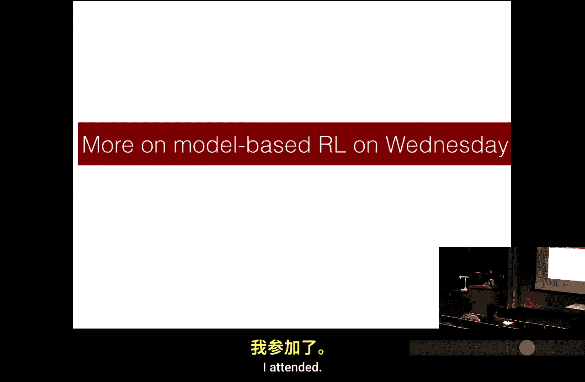
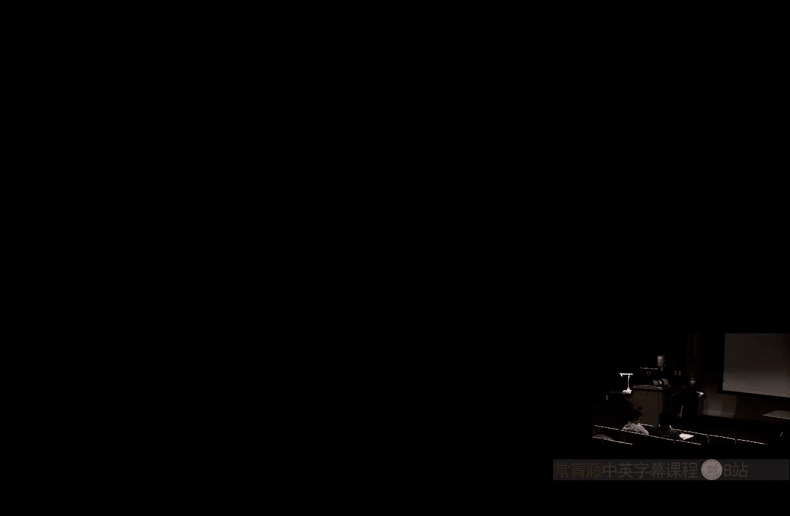
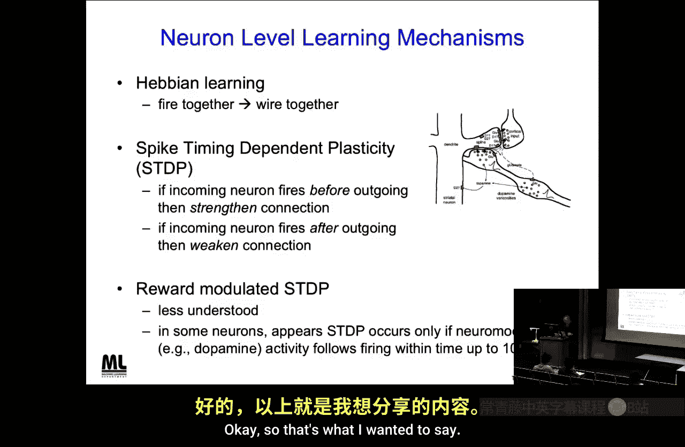

# 卡耐基梅隆大学【中英⚡深度强化学习与控制｜10-703 Fall 2018, Deep Reinforcement Learning and Control】 p18 P18 18 Exploration and Function Approximation Part 2 -BV1RyqPBbEJV_p18-

So what is motivation， Moti are forces that energize an organism to act。And that directs activity。

There are ex motivations， which are ex words， which we have seen so far。

 being moved to do something because of some extraordinary work like money or winning a game。

 etc ceter。 And they're also interesting motivations。

 an organism being moved to do something because it is inherently enjoyable， It's interesting。

 It's novel， he's curious about it。 It's helping them learn， etca。

 And then there's another type of increasing necessity that I put in the list， which is not done。😊。

To distinguish， essentially this curiosity and this drive for learning and drive for something novel to drive that。

呃。Cause us to satisfy our hunger， satisfy our thirst， find shelter from rain， etctera。 Okay。

 both of them are intrinsic。 Okay， but one is a drive to something likekable and the other something is drive to something necessary。

 Okay， Now， why is this important。 And why we should care about it。 First of all。

 we need to adapt the reinforcement learning diagram that we've seen before。

 Most or other or words are intrinsic。 Yes， our agent interacts with the external world。

 But most of the time those words comes either from internal necessities or internal desires。Okay。啊。

And yes， the important thing because I got some questions after the previous lecture is that the extris motivation is task dependent。

 while the intrinsic motivation is task independent。And。It has been noted in 1966 by Berlin。

 but from other scientists as well， that curiosity goes beyond hunger， beyond thirst， beyond。

 let's say， sexual appetite， it's a different drive that moves us the live organism towards exploration and learning。

And now the important question that comes in our mind is， why should we care about it？Well。

 we should hear because if curiosity is this general cost function and that if we could somehow code up in our agents。

 then we would have edges that could learn almost autonomously with very little supervision， okay。

 very little human supervision。And we learn multiple tasks。 And once they solve one task。

 they go to another tasks。 and then we create automatic curricula。 As we'll see later。

 this comes straight out of curiosity， straight to learning progress。

 because an organ will learn that a task that I already know will not contribute to my learning progress and a task that is too hard will also not contribute to my learning progress。

 exactlyact the same that if you take a very difficult math textbook， you throw it away。

 you say maybe I should try to nail down the easier concepts first。 Okay。

 so if we use learning progress or curiosity as our cost functions。

 we can achieve this online continual learning。😊，And why this is not a trivial result。 Well。

 because many people would think that what drives humans is not curiosity， but rather。

 let's say reproduction， right， we have babies and the babies have babies。

 And how can we code up such reproduction in our agents。 We cannot。 Okay。

 so there is a deadlock right there， but curiosity， In fact， we can， not only we can。

 but people have already started doing this already from early 1990s。 So this is yougen Spit Hober。

 when he was young。Published in many papers。Where。He was developing agents that they had this me word to develop this internal world model。

 Okay， the transition dynamics that we saw in our previous lecture， okay， and。In his first papers。

 he was saying that the agent doesn't want to get bored。

 so he's going to seek states and actions that will cause his world model to fail。

 will cause large prediction error， okay。Do you remember for those that were here in last lecture。

 this is exactly what we discussed。 How can we encode cur words。

 exploration bonuses based on prediction error， okay。Is there any questions so far？

I'm just trying to put what we did in the previous lecture in the more context。

So this is what the Ugen is saying。 He's saying， you don't need to dev a different algorithmic setup to utilize this exploration bonuses。

 Just use exactly the same thing you were using for standard task as specific rewards。 But right now。

 these reward will be intrinsic。 Okay， and indeed， that's exactly what we did。

 We compute the exploration bonuses and we put them as rewards in actualc architectures。 Okay。Now。

 let me do a very quick overview。But what we saw。 Well， first of all。

 we talked about pseudo counting。 How do we visit states that we haven't seen before。

 This is not what I want to to discuss again。 but basically at that stage。

 this exploration bonuses were dependent on those pseudo counts， the larger the count。

 the lower the bonus， which means I've been in that state before or I've been in similar states before。

we also talked about this type of exploration bonuses based on prediction error。

 the larger the prediction error， the larger the bonus。 Allright。

 and the important thing to keep in mind。Is that those exploration bonuses， these intrinsic rewards。

 in contrast to the extrins reward， you will always when you kill a monster。

 you will always be rewarded in Atari games here when you are exploring in the beginning when you kill a monster。

 you'll be rewarded。 something new is happening later， you will not you'll say okay。

 I just kill the master， nothing new hear okay I've seen this before many times So those rewards are nons stationary and we need to take care of this and the very small trick that people do is that they compute Monte carlo rewards and TD rewards because the TD targets take too long to assimilate this quick changing rewards。

So what I thought last time is that I told you， you know what predicting pixels is bad。

 Forge about it， but I didn't go into details to show you that。 yes， people have tried predicting。

Pixels directly predicting raw pixel observations。 Okay， so let me just give one example of this。

What is this here， it's a standard next step of function transition dynamics。

 in this case visual dynamics， our current state is represented with an image or an image sequence。

 we also fit the action we want to predict the next state in this case the next observation okay。

Is that clear。Everything's clear so far。 Okay， so I just want to discuss one work that exactly does this such a pixel prediction and use it for exploration。

 Okay， and I want to show you results to see in what state or frame prediction algorithms are right now。

😊，Well， in a nutshell， what this work did， action conditional video prediction using deep neural networks in At games。

Is that given an image or an image sequence and an action， they predict the pixel of the next frame。

 exactly what we saw before。Then because you don't care just to predict the next frame。

 but rather the next 300 frames， you need to enroll your model forward。

 You'll feed your predictions back as input。 So we'll see what tricks you need to do in your course function for this to work。

And then they used this frame prediction to come up with an exploratory behavior for DQ N。

And so they didn't use the prediction error because apparently the simple thing didn't work very well。

 But what they do is they they're about to choose an action。 They have 16 alternatives。

 They feed every action they predict the next frame。 They have a buffer of recent frames visited。

 and they measure the dissimilar of those predicted frames to what you've seen。

 and you pick the action that will send you to the most dissimilar frame so that you avoid this epsil gradient behavior of running around like this back and forth。

 back and forth， okay。Very simple。 Yes， of course， they improved over D Q N。

 Everybody can improve over epsilon greedy。 It's just very naive exploration。😊，Two cost functions。

 no sorry， two neural architectures， one fit forward and one recurrent。 They're extremely simple。

 Please pay attention so that we can completely understand what's happening。 In the first case。

 you will fit four frames as input。 Why for frames， you want to capture the velocity of the objects。

 So one image is not enough。And you will pass through some convolutional layers。

 The action is gonna come， okay。The action is also going to encoded potentially in some load dimensional encoding。

You combine them， and then you decode them into the next frame。So this is the fit forward network。

This recurringcur network essentially takes only one image。As input。

 but also has a hidden state to remember the previous history， okay。And takes the action。 And again。

 similar CNN and code decode。Alright， and one interesting detail。Is the following。

There are two ways to combine your state encoding， this low dimensional vector with your action encoding。

 Either you'll concatenate them。Or you'll have multiplicative interactions。Okay， now。

On top of the concateination， if you put a deep enough network。

 potentially to discover these multiplicative interactions。

 But if you put them directly in in the architecture。

 you'll make it easier for the network to learn to relate a particular action with a particular state encoding。

 do you see So we have this multiplicative interactions in both architectures。

 I don't think you need to worry too much about this。

 An important thing to know is this forward enrolling。 In both cases。

 either in the fit forward mapping or in the recurringcur and mapping。

 you'll take your prediction and feed it back as input， predict the next frame， Fi it back as input。

 Pre the next frame， fit it back as input and continue like this。My question is。

 what can go wrong while training such a model？Let's think。 so in the beginning。

 your predictions will be garbage， right most the outputs will be0 because the weights of your query cells are is0。

 So if you try to to take losses for， let's say five step prediction period and what is the loss L2 pixel intensity loss。

 the standard pixel loss， The problem is that you will be fitting back in garbage predictions。

 Allright， do you all understand this。 So then what will the network learn to predict something out of garbage。

 So the way we do it。Is。We do a progressive enrolling。 So first， we transform one frame forward， we。

Overfi。 Okay， so now we see we can predict well， the next frame。

 Then we expand the period of prediction to 2， and we put losses both on the next frame and the frame after the next。

 then we expand to 3，4，5，300 as much as we like。 if you don't do this， errors compound。

 And even if you train an extremely， extremely sharp next frame prediction。Once you unroll it。

 things will go very fast to to very bad very high error， okay。Now。

 the interesting thing here is the videos。They look pretty good。Let's see if they play。 Oh Well。

 they didn't， right。Okay， here it is。 So this is paid invaders。 On the left is the learn simulator。

And roll forward。 And on the right is ground truth。 notice that what is missing are the bullets。

 The bullets are these tiny things that are spike up。 These are extremely small objects。

 and small objects don't generate large loss and the standard L 2 error。

 And this is precisely the problem as， as we said the。The other day， the same problem with autoenrs。

 you try to predict pixels， but often a very tiny region。Is relevant for what you care。

 for your better you care about。 Okay， a lot of blue background。

 If it we into what's green or yellow or white， you， it wouldn't mind。 Okay， it wouldn't matter。Now。

 having said that， we are able to show these beautiful results。😊，In simulator for atari games。

 deter deterministic environments， O， or close deterministic。And very toy visuals。

 Once you go to a real world。If you try to do such train prediction and we'll see this type of models in the next lecture where we're going to discuss about model based reinforcement learning。

 some of those models will be on visual dynamics。 You will see that very， very fast。

 you will see super， super blurry outputs， okay。So now。

 what question should we all have in our minds。Okay， so this， this is not an important slide。

 It just shows that such informed exploration improves over Epsilon greedy。

 And the only change is this。 Instead of the Epsilon greedic choice of the action。

 you choose an action that minimize similarity to a trajectory buffer I equation here of the similarity。

嗯。This is the important question。 What should we predicting about， What should we care to predict？

 And our next lecture will also be about this question。Observations have a lot of information。

 Its very difficult to predict raw pixels。 They are very high dimensional。 Moreover。

 there are a lot of things that the agent cannot control and cannot。Fast predictors stochastic。

Beyond that， there are a lot of things that are irrelevant。

 We should not care to predict those parts of the image， okay。

So this is the realization that we said the last time。

 and I don't want to go into details of our alternative solutions that we proposed。

Just to remind you， we said， let's train an auto encoder and let's predict the encoding。 Okay。

 And we said the problem is that the auto encoder also is completely tasked。 irrelevant。

 Then we discussed about this super interesting alternative， Okay。

 which combines forward model and inverse model so that this frame encoding。😊。

Is able to predict the action of the agent。That's all you care about。

 So then dismiss means that the state encoding will forget about any part of the frame that is not necessary to predict the action。

 So it will neglect anything that the agent cannot predict。 cannot control。 Allright。

 So very nice and succinct。 state encoding in this way。 Then we said。

 let's use random neural networks and fix them and train dynamics on top of them。 And interestingly。

 this work well for Atara games。 Okay， the embarrassing part。😊，And then。

We saw all these alternatives。 We said， okay， so far， weve seen only task rewards。

 then we can combine task rewards with curiosity rewards。

 Then we can have extremely sparse task rewards terminal。 I don't reward you for killing monsters。

 I only reward you if you finish the game， Okay， And then we said， what if we use only curiosity。

 only curiosity rewards。And， and forget about task。And people using only curiosity the other way to。

 the other way to say is no reward or reinforce learning。Is not new。 There are many。

 many papers on this domain， even from 1985 and and onwards。 However。

 the one that we visited is a very recent one。 I think it's going appear in 2018， okay。

We use this modern machinery， A3 C， actor critictic， a synchronous actor critic。

 and deep neural networks for prediction error。For the exploration bonuses。

 And what So these are new things。 So what we saw here is that curiosity helps more the parer the task rewards。

 Okay， so this is nothing surprising。😊，Now is surprising。 And the thing is that most of the time。

 the test rewards are extremely sparse。 Okay， so interestingly， oftentimes。

 you will hear in deep learning that you need to train。

 you need to train for exactly what you're going to test on。

 because if you train for an objective that is not exactly matching the test objective。

 you're not going to do well。 Okay， so this is not the case here。

You train using curiosity words and you end up having policies that collect a lot of task related rewards。

 Okay， because the task related words are just so sparse。

 And if you train only for task related rewards， you end up with calls that too much worse。 Okay。

 so what does this mean， This means that curiosity。 in terms of prediction error。

 at least for video games is a good proxy for solving the game。 if you will try。😊。

To plan so that you cause your predictive model to fail， you will end up solving Super Mario， Okay。

 because you will be trying to see new new things again and again。So no my question is。

What if Super Mario didn't have levels，1，2，3，4，5， but only had level 1。Okay。And we， you know。

 start an agent that is only driven by curiosity and that is learning this model。 Okay。

 with this a neural networks， inverse model， forward model and computes exploration bonuses。

 collects experience， Retrain this model。 What's gonna happen eventually。I mean。

 from the previous lecture， you remember that we， this curiosity and policy was able to pass 10 levels。

 Okay， so we know that its gonna， at some point we'll be able to finish level 1。 Now。

 what's gonna happen if you continue training it on level 1。It's gonna happen。 What happened to your。

Policies that once they were able to solve the carpo。 Okay。

 then the experience buffer essentially just collected transitions along this optimal policy。

 and and forgot about the rest of the what to do in the rest of the space。 So here again。

 if we're able time to win the game。 we will learn the model that you know what， in this way。

 I win them game， winning the game will not be interesting anymore because I've seen it。

 And then maybe if I kill myself is gonna be more interesting， right？ So， of course。

 you will see the。Curioity driven policy to degrade。The cool thing though。

 is that our world is very interesting。 We will never find such a bottleneck that we've solved everything。

 Okay， so coming in here， I had this thought about these superstar。 super smart mathematicians。

 My mathematicians actually don't suffer from this problem， but super successful singers， right。

 in the beginning， they strive， they strive for curiosity to try to do better and better and better。

 They reach the plateau of absolute success。 And then they try drugs to surprise themselves， right。

 because somehow they just reach this plateau。 you know， if you in the right direction。

 they couldn't make any more curiosity progress。😊，嗯。Now。嗯。Well， so this policy now that is jumping。

 it has been trained on this other environment。Okay， so because interesting motivation is。

T independent。 Okay， you can train a policy in one environment， put it in another environment。

 Of course， you can find tune。 What does it mean fine tune again with curiosity。

 But in these new textures of dark textures， because Mario has， okay， somehow the videos are。干嘛呢？

Okay， economic know is not wrap now It's fine。Okay， so let let's go to this。

So we saw what prediction error as exploration bombs can do。 Now， I'm asking you。

 what do you think are the limitations of using， of implementing computational curiosity as prediction error。

When do we think that。Just using this L 2 of our transition model will not cause our agent to do learning progress。

Yes。啊。大。I didn't hear what you said if there's like 1000 very creative ways to die。

The waiting package。And like by curiosity。こ合て。To that。And once you explored all of them。Oh。

 it's easier to。 Not know。 That's not So we said that before。 The thing is that as soon as you win。

 okay， even if there's only one way to win。Then you will end up in the next level。

 So you were just going get surprised yourself for the next level， right。But I agree if you are。

 if I， if you get stuck there， then， of course， this is gonna to be boring。

 and then you'll switch to the dying behaviors， as we said earlier。Yes。

Can be addicted to very interesting things。 So stock。Like what， very easy。That's can code。系。有没先出さ。

Era like one。I know the environment just give a random。Alright。

 so if you're in a stochastic environment and somehow you cannot fit this predictive model。

 you will never get out of there。 You'll just stay there because each time you gonna have a high prediction error。

 So each time you will be rewarding those states that are inherently are predictable。Okay。

 and so how could we test that？ So imagine we're trying an agent to navigate this maze。

 And at some point， we give to our agent。At telecontrol。嗯。A remote。 So let's see what's gonna happen。

Oh， well， we didn't manage to see what's going on。 So now it work the video。 Okay。

 there is some certain for Caity here。Okay， fine。 So now it's going to start jumping。This is good。

 And then if it's fine tuned， it's gonna do even better。 That's wonderful。😊，We， we will get back to。

Transfer policies。 Okay， here it is。 So here isn't navigating this all good。 And then I put the TV。

And then he's just playing with the remote and surprising himself all the time。

 And the predictive model never fits， so。😊，Basically， using。And that's it。

 So using the prediction error。has exactly this problem。 what if the environment is stochastic。 Now。

 I want to mention right here the following。 we have assumed that this predictive model has high capacity。

 If your model has low capacity， you will start experiencing high prediction error。

 even in deterministic cases when your model just cannot fit。 So there is a implicit assumption。

 Okay， that your predicted model is high capacity。 Now。

 let's try to see what we can do to fight stochasticity。😊。

This is exactly what your colleague said that the agent will forever be attracted to noiseis states。

So this should not be super surprising。 We know that regression fails once for the same input。

 you have multiple outputs with multiple modes。 Okay。

 because the lister solution is just to go in the middle， alright。So， so that we know。

 we know that the regression fails under multimodal outputs。

 What we need to know is how to handle this。So there are two ways we can go about it。

 Either we can add stochastic units in our network。 So some units are just going to be sampled。

 And as you sample them and propagate those values in the network。

 then you end up predicting different things。 and then you'll use this distribution to compute your prediction error by using。

 for example， the closest sample。 Okay， so some of those samples may be close to。

The particular outcome that you saw。 So that's nice。 Or you need to have stochastic weights。 Again。

 you sample the weights of your neural network， you fit the same input。 But with each sample weights。

 you have different outputs， correct， So either one you can do or the other。嗯。Great。

 so here is the stochastic units。The yellow layer has disease， right。

 that the previous layer has proposed given the weights， their weights and their inputs。

 state and action。 They proposed the mean and the sigma of those stochastic units。

 Then you sample from those Gaussians。 And then you push no Gaussians in。Later layers。

 So we'll go on this in detail。 We're gonna have like a 5，10 minutes tutorial of this。

 And then I'm going to point you to other tours。 You can read if you want more details。

So how the exploration reward is going to change， where either you can take the mean across your Z samples or just expectation across your Z samples。

 both could be better than just regression。Okay， with all the deterministic units。

 The other thing you can do is you can make this network vision。Okay， Bayesian network。

 the theta is not just one point estimate， but rather distribution。 you sample from the distribution。

 you get a different network is like an infinite and sample。 Okay。

 tons and tons of the samples each time you sample each weight is parameterized by a Gaussian or a small mixture of Gaussians。

 you don't pay that much cost on more parameters。 Now that the difficult thing is how do you train those models。

 Okay。Now， before we go into how do you train those models， let's see more closely what this does。

I just said we're going to sample those stochastic winds from Gausatians。 Okay， now。

 we all think in our minds that Gaatians are extremely simple。Okay， yes。 But the thing is。嗯哼。😊。

The thing is that。If we sample from a simple distribution。

 but then we fit the output into some complicated function， Okay。

 which is the layers that come after those stochastic variables。

 those Gaussians can be transformed in arbitrary ways to approximate our output。

 So we should not worry about it。 Okay， we should not worry about it。

 This is not like the old meanfield approximation where we were stuck with the Gaussians。 Now。

 the Gaussians enter into this deep， you know， long linear transformations of the later layers。

This is a nice figure。 How you can go from that simple gaussion to this nice ring。 Now， the G here。

We decided the F， were going to train this F so that we maximize our objective。Now。

 let's see how to train。 Now to make things simple。 Let's forget about the conditioning。

 and we'll add the conditioning later。 For now， let's just assume were want to build a good generative model of images。

 Were want to be able to sample noise， these and transform them into realistic samples。 Okay。

 from the image manifold。 How would we train this。😊，Well， this doesn't say anything。

 The only thing that it says is that at the output of the network。

 we're not going to have discretion， we're going to have a Gaussion for every pixel。

 So for every pixel， what you care to predict is the mean of that Gaussian。

 This Gaussian will have a constant standard deviation。This is what you always have been doing。

 When you minimize L 2 is as if you are maximizing data likelihood other E Gausian distribution。

 Okay， so， so this is nothing。 I'm just noting this for completeness。 Okay， so there。

 so we haven't said something interesting yet。 well。

What we're going to do now that we have these latent variables。

 where we'll try to maximize data likelihood。 But the data likelihood now includes the marginalization。

Across this latent variable Z。 And this integral is intractable。

 Why because there are too many Z combinations to compute so that you。

 to be able to compute this integral correctly。So the first thing that we can do when we have a problem is like。

 we forget we have this problem。You say I don't care。

 let me I'm still going sample from disease and why you may be tempted to sample from disease。

 mostly because we have had them lecture before and we know how to take gradients。

 That's the beautiful thing because there is an expectation under Z。

 this Z comes from a constant distribution has nothing to word parameters。

 So once you take derivative we respect to seeta this derivative can enter into the expectation。

 correct。All right。Well， the thing is that。So maximizing the tele group is minimizing the by of log likelihood。

 some over all the examples of our dataset。 for each example， we draw a number of these samples。

 okay。And。😊，Here， the probability of the image， given the sample， actually， this should be ZI。

 all right， like here。And。This is， this is very。 we can compute this and and take gradients。

 There is nothing difficult here。And we call this sampling from the prior。

 we have a paper on motion prediction under multimodality conditions。

 stochastic networks where you can see how this knife solution performs in comparison to others because everybody says oh。

 this doesn't work is not clear to everybody that this shouldn't work， I mean in this case。

 yes that later in the conditioning we're going to see is not clear so there we compare against this way of training。

Now， what does variational inference。What the idea introduces， It says we cannot sample from disease。

 Okay， because sampling there is very is not guided。

 Most of those these will be irrelevant will end up to really bad images that have nothing to do with my image X。

 Okay， I have a particular image。 I want to maximize this likelihood。

 If you just randomly sample these。 You have， let's say 500 these。500 Gausians。

 there is a very big space。 Okay， how can you find disease that lead to good access。

So what do we're going to do， We're going sample from a different distribution。

The variational approximation distribution Q。 We always call that distribution Q。

And what we're going try to do is we're going try to make this distribution Q close to the posterior。

 What we care about， the probability of Z， given that image。 Well， that posterior， for sure。

 we cannot estimate， But let's see how we can make progress， okay。

 so we're trying to bring our Q distribution， which we're gonna parameterize and optimize， Okay。

To minimize we're going optimize so that we minimize the k divergence between this variation approximation and our true posterior。

 So let's see how the math works out。Well， the first line is by the definition of kill dirgence。

 We've seen it in previous lectures when we talked about natural gradients， okay。

Then we take the log of denominator minus the log of the denominator in the second line。

In the third line。We have the bedroom。Right， the probability of Z given x probability X given Z multily probability Z divided by the probability of image X。

 Okay， so by the way， this variational approximation happens for each example。 X for each example。

 we need to infer the latetnt Z。 Okay， I' mentioning this because later that will use similar variational inference to estimating weights of a neural network。

 is is not the case。 All images will contribute to finding the weights of the network。 Okay。

 so let's continue。 So there's nothing that we did here interesting。With the visual。And then。

 we just。Decompose this fraction into the twonominators and minus the denominator，Now。

 the thing to observe is that。Well， let's reorganize the terms， so how can weorganize them， Yes。

 you can take this and this and together they make a U KL and then you have this term and then you have that term Okay and this term doesn't depend at all on the variational approximation Q okay so it's not going to affect your optimization。

So in any case， you see how the math works out。 Now， let's try to understand what's going on here。

 We have some brriar over Z。You have some prior overs。 Now。

 my question to you is what prior over you are going to use。Deep variation differencess。

 don't worry about it。 In any case， those these are going to enter into some。

Super complex dolinear transformations。 choose a very simple prior over Z。

 I say we use independent Gaussian，0 min and unit variance。 Allright， very simple。

So we have our prior。And we say， look， the Q that you are seeking that is conditioned on x。 by。

 by the way， this Q， you can totally make it not conditional on x。

 but things will not work very well because to predict good Z。 Okay。

 you need to kind of know about the image X。 I'm going to get to this point。But basically， would say。

 you know， your queue better not be super complex， better be close to prior。

 Okay And at the same time， this is the regularization term at the same time。

We need to be able to explain those xs。 This is exactly this neural network in the previous slide that takes Z and produces X。

 Okay， do you see the probability of x given Z， And then a term that doesn't depend on Q。

 So what is the optimization problem that variational infer solves。It's exactly this。

We try to minimize the scale the scale and at the same time， maximize this data term。

 This is called the reconstruction。 and this is the regulargization。

And why it's called variational encoder， why we call this， we usually call the variational encoder。

 Do we see an encoder here？An encoder that takes an image and produces a latent vector。

Is exactly our variation approximation Q。 This is exactly our encoder。And do we see a decoder here。

 something that takes Z and produces X， which very much should remind us of the neural network in the previous slide。

Yes， this is it。 Okay， so don't get confused。 Those variation decors don't have much to do with the standard auto encoders。

 It's just that at the end of the day， what you optimizing， okay。Have two neural networks。

 one ending one， decoding。 And that's how the name came。Okay。Now， here。

It's some very clean formulation of how things came out。

 And now we will try to make it concrete of how can we optimize this。 And here' is a beautiful image。

😊，嗯。We'll take an image X， Okay， and this is Q。 and this is going to be a deep neural network parameterized with weights speed。

Okay。And this neural network will。Predict mus and sigmas for each of your Zs。

 You can decide to have 50 theses，500 Zs as many as you like， okay。

And then we'll sample from those these。 There are stochastic units because we sample。

 We can sample from them and then pass them through this decoder P， which has weights theta。

 which you also need to optimize for。 Okay， so that the output。F of Z matches your image X。

 Does this make sense。Now， for those that were here。

 once we discussed about how do we take gradient of expectations， Okay。

 we know that because here we have an expectation over Z。

 the Z depends on the parameters we optimize for， which is what phi phi。Thank you。

To be able to pervoate the gradients， what are we going to do。What are we going to do。

How we take gradients of expectations when the gradient， the the parameter， we take the gradient。

 with respect to which we take the gradient is in the distribution。So guys here， for example， this。

 let's think this is the construction laws， okay。There is an expectation over Q。

 There is an expectation over Z。 You're still gonna sample from Z like before。

 But now these these are sampled from this informed distribution Q， okay。Alright。

 so the means and sigms of disease are not 0 and one。 They come out of this queue。

 So they should be way more informed once they train。 Allright， now my question is。

 how can I take gradient on that cost function。I want to tell you that the K L has a close form solution once everything is Gaussian。

Okay， that doesn't depend on sampling， but depends only on using sigmas。 Allright。

 you can look at this。Now， this。When I tell you this doesn't matter。

 People have used more complex priors， mixture of Gaussians。

 There is no close form solution from the K L。 They just sample it。O。

 you also add the expectation over Z in that term。 Now， can you please somebody tell。

 say how we take gradients over the expectation over Z。

What we discussed in the last two lectures ago。Yes。Yes， Gu Para drives。 How will Para drives。

Instead of sample from Z， which depends on our weight theta。

 what are we going to do since Z is Gaussian， We will put some helping variable epsilon。

 which depends on a fixed distribution。0 mean and unit variance。

 And we said that there is this beautiful parameterpartization trick for Gausian variables。

 and we like it because z is Gaussian。 That's why we chose it。 okay。

And now z equals mu multily sorry mu plus sigma epsilon。 Allright。

 so now the Z became a deterministic function。Of our fixed noise。

 epsilon and the outputs of our neural network。 So now you can sample from this epsilon and just aggregate gradient through this expectation of fixed epsilon。

 okay。I would like to urge you to read this beautiful tutorial by Carl Dorssh。

 which explains variation of to modelss very well very intuitively， okay？And you'll find it on。嗯，那。

Well， okay， so this looks like this just in neural network。

 back propagation will give us the gradients。 No problem。 Will some over epsilon。

 You don't even given that many samples。Yes， this is the reconstruction loss。

 And this is the K L terms。 And I want to tell you something。

 I want to tell you that the prior we imposed on Z。 Okay， the prior。

 this Gausian with 0 mean and unit variance it has nothing to do with this Epsilon。 Okay。

 it's a completely different。 You could have chosen a different prior。 Okay。

 you could have chosen a different prior。 So the one goes right there in the K L。😊。

And the other is where we sample the epsom from， alright。Now， what happens。

 Who can imagine how this model will look at test time。 We said， we're training this。

To generate images。Now， what you see here is we have this encoder， the encoder。

 I call it the cheating model because it looks at the image。

 It looks at the image and tells you what Z to use， right？ So， of course。

 you cannot use this to sample images。 What are you going to use to sample images。Well， at this time。

 you only need the head。Now， we have ensured by optimizing this objective that this prior over z。

 which is just this zero mean unit the variance Gaussians are close。😡。

To the variational distribution。 So you can safely use them。 And at the same time。

 we have sure that the encoder， when the Z comes out of the right place。

 it will generate correct images。 So we'll throw over the model and we'll just give this at test time。

Okay， and here are the images that came from this paper of 2014， I think， on en variational base。

 which introduced。This， how to say technology。 I would like to say that before that our latent variables These were not continuous We discrete。

 So when you have discrete latent variables， all these don't work。 Reparization doesn't work there。

 Okay， so the beauty is that we have continuous this and we're able to use the reparization trick and back propagate all the way through。

😊，Now， I want everybody to say， okay， great。How I'm going to use this to predict stochastic dynamics condition on some stage in action。

 I want to be able to predict lots of different futures。 That's how we started。 Well， here。

 I told you samples and random noise。Are we are you okay with the time。 We suppose some random noise。

 you generate images。 Shouldn't you be conditioning on the current state interaction action， Yes。

 you should。 And it's extremely trivial that have to say the math is the same。

 The only thing that you do is you have this extra conditioning X。

The X is used both at training time。😮，test time。X is the current state in action is the extra context that you provide to your model。

 okay。You fit it as input to the variation approximation and the model at test time end to the decoder。

 It enters both the encoder and the decoder， okay。So this is a paper we have how how do you predict trajectories in such super。

 super stochastic settings。 Look at here the stochasticity。 We show how regression fails。

 VE may also fail if you've done sampling enough and provide a different loss function。

 you can look at it。 if you wish， I also think it's a very gentle。 how to say introduction to to Ves。

 Now， having discussed how to use stochastic units in our network and see how simple it is。

 Let's see again， how we can use stochastic weight。You remember the motivational slide。

 I want to be able。So let me show this actually。 Why would I care to have satochastic weights。

 There are two types of uncertainty I'm trying to fight。

 The first type of uncertainty is shown in the image。My input data iss this dark dots。

 I'm trying to regress to the target Y， which is the Y axis。

 I want my network to be able to tell me in some way that。Beyond this regime， there is no data。 So I。

 I really cannot trust its predictions。 Okay， a regression network。

 a deter deterministic regression network has no way to say that a Bayesian network can。

 because you can subwayate， look at the entropy。Of the different networks。

 exactly the same thing we did for ensems。 Okay， so this is the first motivation。

 You know this motivation， because I think I mentioned it last time。Now。

 the second motivation is that not only will be able to be uncertain when we have in data。

 but we can also show that we're uncertain ones。 we have multiple multimod outputs。 Allright。

 and we'll be able to。Move the， the， the distributions of our weights so that we capture these multimod outputs。

 Okay， well if we had a single weight per neuron， we wouldn't be able to， alright。Now。

 the reason I'm going to show this is just to see how analog it is。Again。well， again。

Estimating those weights。 Now， again， we estimate the data likelihood， we have an integral。

 The integral This time is over weights。 You need to take an integral de theta tons and tons of weight combinations。

 This integral is inable。 How are you going do it， Okay， don't worry， I'm going introduce a Q。

 I have a Q。 Now this Q will predict theta and will be conditioned on some other variables， Phi。

 Some other variables fee before also we have three， This is is the same but notation。 And this。😊。

Approxiation， variation approximation better be close to my true posterior。

 which there's no way I can estimate betheta given the data set。 However。

 I can of I need to minimize the scale divergence。 That makes sense。 this is my optimization。

 This is how I'm going to fit those weights fee。 Okay。

 so that I can end up with theas that have high that give high likelihood to my data。Exp the kale。

nothing。 This is just very simple things。 Again， the base rule here， here is again， the terms。

 I want my Q。Over those latent weights theta。To be close to my prior。 now。

 the first thing you will always discuss and ask yourselfselves is what family I should use for my prior。

 Okay， we always do this for these， we chose zero mean unit variance。For those guys， again。

 we're gonna use Gaotians。 the people here in that beautiful paper。 Let me show this title， actually。

Well， the title comes later。 Yeah， the people here。

 once you don't seek a close first solution for your KL。

 you can put whatever prior on your theta you want。 They put for example， a mixture of Gausians。

 both are zero min， you want your weights to be zero min right but one has a tight sigma and another has a big sigma okay。

And so this is your prior。And you fix the parameters of this。 You don't optimize it。

 They say they try to optimize those two， and things collapse。And they explain why there。And the。

and again， you compute gradients in the normal way。 Let me show you what。 So here is the。

 the two terms。 the data likelihood。 We want the data set。To be highlighted give our theta。

 notice here that the same theta， the same parametertheta should be able to explain all my data。

 Well before we have different these for different images， correctect。

 So that's why my queue here does not is not conditioned on any X or any input。 Okay。

 and this is the K。 I want the weight complexity to be small。

 I want my weight to be simple to be close to their prior。 Okay。

 so this gets also some nice explanation based on shnon coding theory。

 but we're not gonna discuss them now。And here is what it is。 My fee is just going be new in sigmas。

 The means and the sigmas of the different weights of the network for every weight。

 you have million weights。 Youre to have million news and million sigmas。 Okay。

 two colorss for every weight。All right。These are your fees。嗯。

This is the prior that I discussed with you。Of the theta， What is K， K is from  one to1 million。

 That's how many ways you have。 Okay， you multiply the oceansians。

You use the same P in the same sigma for all of them。

 Imagine you have a different how you're going to pick them。 And here's， again， the problem。 Let's。

Greduent。Greating respect。 What should be my mu Sigma， right？ That's what we care about。

 What should be the mu signalsigma of the distribution of my weights。Now， why this is a problem。

 who can say why this is a problem。Here I just put the expectation over Q， expectation over  Q。

 I took the expectation。 I put these terms inside。Why this is a problem。

 Because we're trying to take gradient with respect to a parameter that is inside the distribution of the expectation。

 If we didn't have P here， the gradient would enter the expectation and would be done。

 which just would aggregate gradients average。 But now we have P there。 What are we going to do。Yes。

 we will re parametermatize。 That's exactly what we'll do。 And here is how we would do it。😊，嗯。Well。

Physor Gaians。 Okay， so instead of sampling。No， sorry。 So that is our Gaussians。

 And instead of sampling Phi， I'll be sampling epsilon。Okay。

 and the epil is from a fixed distribution。 And now here is the the mu and sigma。

 So either you call it mu and sigma Phi is the same。 And now theta。

 the weights of my network are a deterministic function of this noise sample from a fixed distribution。

And transformed using these P parameters。Okay， this is the rapriization。

 Let me show you how simple it is now。Sample epsilon， O， from 0 mean Uni one。

Form the theta using this equation， it's a deterministic function。

Take gradients with respect of this expression。 Now。

 the theta at the same point is going to also instant the network。 You can put valuess。

 a lot of things there that are don't depend on any parameters。

 You can instant any network you want with this set weights。 Okay。

 you need this network because this is how you're gonna estimate this data likelihood cost， okay。

B of data given data。 And then you'll update your mus sigmas。 Okay， that， that's it。

But you can see more details into this weight and for neural networks。

 I thought it's cool that they use it for Thomson sampling。

 So we've seen Thomson sampling of the cube distribution using ensembles。

 We have it here also with Bay networks。 I think it's nice that we see tools， and then we can also。

 you know， relate to the papers in the literature。😊，I feel given this introduction。

 if you read the variational encoder。Tutorial and the weight uncertainty paper。

 you will be able to completely understand the details。Now。I think said that。You know， you can said。

Sure， you can take soastic networks。 You can take prediction error。

 but you can also have an alternative objective about learning progress。And so I don't want to， to。

 to spend too much time on this。 But， but basically。

 the straightforward way to estimate your learning progress， you keep a buffer。You take a state。

 you update your prediction model and you take this buffer， run your new prediction model。

 See if your prediction errors went down。And if they went down， then you reward。

 let's say this instead， you give high reward。 Basically， you do reward the prediction error。

 you reward the reduction of the prediction error。 Okay， that's turning progress。

 because I don't want to spend much time。 I would like to tell you that in this paper。

 variational information maximization exploration。 They use exactly this base net。

 That's why I describe it to you， how to train it。 because they use exactly the same setup。

 and they defined their reward as this。 They k divergence between the weights before the transition and after the transition。

 You have a base net。 You train it。 You have a new transition。 You retrain。

 You see how much the theta changed。 What does it mean theta changed。

 high kl divergence between before and after。 And you take this as your reward。 That's it， okay。

And look， the same things。 The queue is identical。 It is a product of Gaussians here。

 We have this exploration bonus， exactly the same mini we saw in the previous slide。 And yes。

 it helps。 Now， having said that the packpath that is the author of the previous paper。

 a large scale exploration implemented this and couldn't get this to work。 So that's another story。

 Now， I'm going to close by giving you an example of exploration on a real robot， alright。😊，Now。

 in real robots， things work very differently。Here's a paper from Peterstone。

 They said we're going focus with model based Rl because if you go with model 3l。

 it will never work on the real robot。 What doesn' it mean model based。

 Let's try to learn reward function and the transition function。

 Let's focus on the transition function， they use the random forest。 Why we like random forest。

 not only that decision forest are high capacity， but if you put random。

 you put many trees together and you have uncertainty。

 You can look at the entropy of the trees and say high entropy。 I'm not sure about this transition。

 low entropy， I'm sure about this transition。 So this is nice。 Now what will be the reward。

 So they combine two。 One， the entropy of the trees， the transitions， as well as the state density。

 because they say and it is very logical， you have never been in the different room。

 How is that your transition model that you training supposed to take a completely new image and tell you whether it's going to be high curiosity or not。

Of course， it's gonna to be high curiosity。 It has never even seen this input。 The thing is that。

TheBaion net better， you know， really respond， saying that， look， I haven't seen that input。

 Each of my sample weight shows different thing。 Yes， now if you use a regression network。

 it won't be able to tell you that I haven't seen this input。 Okay。

 you hope that the prediction will be high。 So they use combined reward。 That's all。Now。

 let me show you a demo。 There is nothing interesting here。 Here is the demo。

 Here is the now or robot。 It has a button on its foot， and it has a pink patch。

 And this is the actions it can do。 Okay， can move its arm。And the question is， the state。

 So we should always ask what should do a state and action representation。

 So this is what I wrote down there。The， the actions are these。Move motions。 The state is the。

 the angles， the hand， how much pink it sees and how much it here。 Okay。

 now the interesting thing is the following。You can use curiosity to learn models fast， good models。

 fast， random exploration， which is what most people use to， to learn models。 Okay， you know。

 move around randomly， take experience taples， train your model， okay。😊，Is not。 You know。

 you're going waste a lot of experience if。While you are about to take the action。

 you do online decision， online planning， they do something like Monte Carro research。

 We learn dynamics in this case。 Okay， you try to pick the action that you think is going cause get the highest at。

呃ello。Prediction error， you know， the highest and the most novel state is even better。

 So more on model based reinforcement learning this Wednesday。That's it。 I attended。

呃。Yes。by。Just curiosity。The actual does that。Yes， I agree。 So first of all。

 for the actual class you're interested in， imagine you want to put a robot in front of a batch of toys。

 Okay and imagine that you take baby toys and baby toys have a lot of manipulation skills。

 Sometimes you do press a button， sometimes you to close the flap。 you need to move the lever。

 you need to do this。 that Does this make sense。Do you agree with this。

 There are a lot of things that you care to solve。 I mean。

 it's not about publishing your papers It' about really learning something。 Now。

 if you want to put rewards， you need to code up a reward for every little thing on the toy。

 Is this what you do to your baby。 No， the baby plays。 And its time it is something different。

 something that moves different， sounds different， It gets happy。 And then after a little bit。

 it forgets and wants a different toy because it already knows the dynamics of the previous toy。

 Basically， requires a lot of。

Engineering， I mean， we say that rewards are the simplest one to code。

 and it's the least supervision。 but if you really want to scalealable multitask and multi goal learning。

 it's still tons and tasks of supervision， right。Do you agree。Now， interesting。

 they showed in this paper that you can portray train with curiosity。 You have now the model。

 and now I'm going to give you task related rewards， and you'll be able to do well。 Okay， Allright。

 thank you。 Sorry。😊，啊。I want to talk about some work that tries to relate and this is described in Chaer 15。

 the ideas we've been talking about of reinforcement learning algorithms。

To how animals and people learn。And actually， I tried to write a paper along with Ken Kainger。

 who studies human learning a lot。Ken and I tried to co-author a paper called Machine learninging and Human Learning。

 We finally gave up because we couldn't find enough good examples of how machine learning algorithms actually mimic what we know about human learning。

 but the very best example we came up with， which made us try in the first place was really around reinforcement learning so。

😊，This is really， if people ask me what is the best example of how what we know about human learning and machine learning come into alignment。

 my answer is reinforcement learning。 So let me show it this way。

 Here's an experiment conducted on a monkey。😊，And the monkey was。

Had a probe in its brain that was recording from a single neuron。And。What you， Well， let me say this。

 The， the monkey was every once in a while given sugar on its tongue。Which monkeys like sugar。

 just like people。 and what you see here up in the upper right corner is a plot of the spiking of that neuron。

Over time and where you see the R， that is the point in time where the sugar went on the monkey's tongue。

And the way to read this plot is that ignore the little， well。

 the top part of the plot is really a histogram that's summing up all the spikes in the rows that are below。

And each row is one trial， it's one time sequence。And the dots show the spiking of that one individual neuron during a time sequence。

Each row is a different tri。So then you can see from the histogram there。

That if you average over a number of trials that this particular neuron。

Fires when the monkey gets sugar on its tongue。Which is very interesting。嗯。And so if I asked you。

 what do you think is the information that neuron is encoding， you might think， for example。

 it could be the reward signal。I keep。Here's another experiment on the same monkey。In this case。

 there's a conditioning stimulus， a blink of light。That occurs one second before the sugar appears。

And once the monkey learns that a blink of light is a good thing because it's going to be followed a second later by sugar。

Here is the spiking profile of that very same neuron。

So apparently this neuron is not simply recording the reward。hich is the sugar still。

 but it's recording something else。Yes， function a value function for the future。

so it's got to be related to。For perhaps related to the value function。

 Let me show you a third experiment， same monkey。Once the monkey learned that the light would be followed by sugar a second later。

What happens if you don't give the monkey the sugar is a cruel experiment。

So you blink the light and then you don't give the sugar。Here's what happened。

So now when the sugar is supposed to appear， it doesn't， there's a suppression。

Of the background level of activity in this neuron。So as Kaarina is suggesting。

 this neuron is doing something much more interesting than simply recording that sugar is appearing。

😊，And so， if you。Try to model what it's doing。The best model is actually。

 to say this is the bellman error。 This is the temporal difference error。Between。What the monkey。If。

 if you imagine that the monkey has a value function and its perceiving rewards。

And you work out what a simple。呃。The value function learning system would do， in this case。

It predicts perfectly this behavior。Because if you think about it。

Before the monkey knows the value function。Say， hass value function being 0 everywhere。

 It's not expecting reward。Then the error is going to be0 minus0。 it's just going to be the reward。

 when a reward occurs， the monkey wasn't expecting it。 that's the error。

 that's the temporal difference error。That's what we see in the top plot。

Once the monkey learns that the light link。呃。Is basically a state where there's a hi word。

Then it's going along。 It doesn't know when the light is going to blink。

But then when the light blinks， all of a sudden， it now anticipates the reward。

And so this is the point in time at which the surprise happens， the unexpected increase。呃。

Now that the light is blinked， the value is high before it was low。

 And so there's a big difference here。And then again， here， later。

 when the monkey believes that the light precedes the reward， then again， here， when the light blink。

 that's a pleasant surprise。 But then there's the unpleasant surprise here。

 when the reward doesn't actually appear。 And again， that's another。😊，No zero bellman era。Okay。

 so this is what I mean when I say that reinforcement learning has a very interesting relationship。😊。

To what we see in neural activity in monkeys。Okay。We see the same thing in humans。

 That experiment on monkeys was done in the late 90s， but more recently。

 we have things like functional MRI， where we can look inside people's brains without sticking needles in their head and so。

Peter Diane and some other people did a study where they put people in a scanner。

And they presented him， presented people with。Basically。

 a sequence of actions that form a Markov process。And。They would get a sequence of two cues。

 after which they would get a lot of pain or a little pain。 Sorry about that。

It's even more cruel than withholding the sugar。呃。But that was the experiment they did。

 And then as you can see here。If the first position they could have Q， A or C at the second position。

 they could have Q， B or D。And then finally， they would experience either low or high pain。

And so as people were learning this。They were recording their brain activity， brain wide with FMRI。

And so now， again， if you apply temporal difference learning， say Q learning。

Or value function learning with a model where the model is simply weight。

 And then your action is weight。嗯。Then what you'll see is that before learning。We。

 the temporal difference error。Is given by the dotted line here。嗯。When you're done learning。

 the solid line shows what happens。 So， for example， let's take this Q Q A。

 you're going to learn that Q A followed by Q D is low pain。 Eventually， you're going to learn that。

 But unfortunately， Q A is usually followed by QB， which has high pain。So here you're going to。

The temporal difference value will be when you see Q A， all of a sudden。

 you think you're gonna to get a lot of pain。 But then when you see it was followed by Q D。

 then now you're， you're in better shape。Whereas if you got Q A on the top row there followed by QB。

 it's even worse pain you're going to experience。And then you get the pain。 And now going forward。

 you're not expecting。A big problem。And then here becomes the temporal difference prediction error at that point。

 you didn't know what Q is coming， unfortunately it's QA， that's a problem， but then it's QD。

 that's a pleasant surprise。So again， you can map out exactly what the temporal difference errors are at。

The stage where you haven't learned the model as a person in the scanner。

 stage where you've partly learned it in the stage where you've finally perfectly learned it。

 So what they did was they。Looked for places in the brain where the activity correlated with。

These plots。And what they found。Was that there were several places in the brain shown here in yellow。

Where， in fact， the neural activity during the experiment correlated very strongly with the temporal difference。

So not only in monkeys， but in us humans。嗯。We also see strong evidence。That。

Whatever the brain is doing， part of it is encoding。

What we've been calling the temporal difference there。The observed reward。Plus。

 the difference in the value of functions。So， this leads people。 So。

 So that's the main experimental result。In both monkeys and people。

 we see this interesting neural activity。 So what that means about how brains learn is still not fully understood。

😊，Has LED some people to propose models of learning。In the brain， that look like。

But there are a couple more details that are known。 One is that the neurons。

In the monkey and apparently in the humans。Thattter。嗯。That are demonstrating this behavior。

Are associated with dopamine。 Dopamine is a neurotransmitter in the brain that is also associated with addiction。

 actually。呃。And it turns out there are certain。Neurons in the brain that。

Express this neurotransmitter， called dopamine。Here is a plot showing。

The tree or arbor of connectivity from one dopamine neuron and itss。

500000 connections to other neurons in the brain。By the way， this is exceptional。 Most， on average。

 most neurons on in the brain have 50000 connections。

 and dopamine neurons have about an order of magnitude， more。呃。

And so they connect to many other places。嗯。Here， these arrows indicate the locations of those dopamine neurons。

 and the arrows here show what parts of the brain they reach out into。

So there is a particular region in the brain。嗯。You can see there。Fun names here。

 But they the interesting thing is people think dopamine is associated with reward or。嗯。

Surprise in the brain。And the physical evidence is that they project throughout the brain in this way。

There's also a lot more detail known and we won't go into it today since it's not really a neuroscience class。

 but you all know that neurons talk to each other through synapses。And so this top thing top right。

 which is labeled cortical input， is just the end of one neuron cominging from cortex。

 and then here's another neuron。In the stiaus， which is a region of the brain that has is being communicated。

2。From the courttical。Input， and it involves transfer of different chemicals。Interestingly。

 the dopamine。Neuron also projects into this same。General region， but not quite the same place。

 So the space between the cortical input and the dendrite is called the synapse。

 That's where the communication happens。And it turns out these dopamine neurons project。

In what we call the posts synapse part of the neuron。

That is the synapse where the communication happens。

 But then the dopamine is somehow communicating with。The receiver。

 not the sender of the information at the synaps。And all these arrows and little chemical names just are an indication that we don't really know what's going on。

 but it's under a lot of study。So。Maybe I'll， I'll just。嗯。Finish up with this slide。But in general。

If you ask， what do we know about how brains learn。

 and every time I get a chance to ask a neuroscientist。A cell level neuroscientist， This question。

 I always do。 And they always give me the same answer。

 which is the only mechanisms we know are these three。So。

The neuroscientists tell me that the only mechanisms we know。Are all about strengthening。

Connectivity at the synapses。The simplest version of this， which is called heavyian learning。

 many people。Fhrase it with this slogan。 If you fire together， you wire together。

 which means if the if there's the synapse and the incoming signal。呃。Fires。

 the incoming neuron fires， and so does the outgoing neuron。

 then that synaptic wake will be strengthened。The next more specific version of this is called Spike timing。

 dependent plasticity， which just means the timing matters on that， the detailed timing。 So。

 for example， if the incoming neuron fires。20 milliseconds before。The outgoing neuron。

Then the synapse will be strengthened。But the timing really matters if， in fact。

 the sequence is the other way， if the incoming neuron fires after the outgoing neuron。

 then that connection will actually be weakened。So somehow， timing plays an important role。

And this is a whole dimension of the problem that we don't think of as much in the algorithms that we're talking about。

 but it's kind of intriguing to think about。What's going on there？The third。Version of this。

 which is less understood and more。嗯。Conentious。Is that at least for some neurons。

 it appears that this spike timing dependent plasticity exists。

 but there's another condition which must occur in order for the synapse to strengthen。

 which is that it only will happen if some neuromodulator in particular dopamine for many of these neurons。

Follows that communication across the synapse within some window of time。

 and that window of time can be up to many seconds。

And this partly goes along with some other results that show the biology that's going on that actually。

Chemically changes the cells so that the strengthening occurs is a chemical reaction。

 a biochemical reaction that in fact， requires multiple seconds to complete。

And so there are ways of inhibiting or preventing that， the， the progression of that。

Biochemical change at the synapse。 And it appears that these neuromodulates。

 So one hypothesis is that the neuromodulators。In that way， it can actually govern。

What gets learning。 So if you think about it， you can think of the dopamine as。

Having an effect on these。On the， the learning at the synapse level。

And the first results that I showed for the monkey and for the human。

Are in regions of the brain where there are neurons that either are generating the dopamine or that are sensitive to the dopamine and the dopamine causes their firing rates to change。

Okay， there's a much longer story。 But what I really wanted to do is just not let us go through this course without realizing that there is actually a very interesting correspondence here。

 And， in fact， there's been a lot of。😊，Research over the last。15 years now。Maybe a little longer。

 where。嗯。I think it's fair to say that， without。The input from computer science and reinforcement learning in particular。

 it would have been a lot harder for the neuroscientists to make sense out of the。

Different signals that they were observing。And so really。

 reinforcement learning is an example of a situation where。

The these algorithms designed for engineering purposes actually give us the most useful perspective we have to date for making sense out of what we see in biology。

The transfer in the other direction we haven't seen very much。

 But you can see that there is a lot of subtlety to the biology itself and maybe sometime in the future。

We'll see feedback from the other direction thatll help us make better reinforcement learning algorithms。

Time will tell， maybe you'll do that。Okay， so that's what I wanted to say。

