# 卡耐基梅隆大学【中英⚡深度强化学习与控制｜10-703 Fall 2018, Deep Reinforcement Learning and Control】 p19 P19 19  Model Based Reinforcement Learning -BV1RyqPBbEJV_p19-

Welcome to the Model based reinforcement Learning Leture。Today， we'll discuss about models。

 How can we learn them， How can we use them。To select actions and to train our policies。

 what are the pitfalls do， you know， to take care of。

A model concrete is the transition function and the reward function。

 We've seen these two functions all along in this course。Instead of assuming that the model is given。

 as we did when we discussed about planning and learning using multicollo research。

We're going to try to learn these two functions from experience。

We have some design choices to make here。 What should be our action representation。

 What should be the learning machinery behind this that we're gonna fit this experienced tableples。

 We do have a very simple supervised learning problem when we learn models。 So this is the nice。

That's why we like it。 We can take gradients。 There are not the difficulties that arise when we try to learn。

Under specific task related rewards。嗯。Now， the one question that comes in mind and many people have particular traditional robotics researchers is why do we need to consider general learning models as opposed to。

Neuttonian systems of equations where potentially few parameters are hidden。

 We do not know their values， but we do know the structure right， of the parametricic form。

In this case， if we were using a system on utonian equation of motion， for example。

 to predict how objects move under forces of the agent。

 we would need to learn only very few parameters， so naturally it would be very easy to fit and to generalize。

The truth is that the real world is very complex。There not only the。

Prameter values are unknown of the friction， coefficient or the inertia matrix of the objects。

 but rather there are many unobserved phenomena。 Maybe there is wind。

 maybe the way the agent attaches the object。 This is a very difficult model using standard physics。

 Okay So that's why we depart from traditional physics and we try to learn those rules of motion。

 and we call those models of intuitive physics。 Okay because and and an argument why the human brain baby learning intuitive physics as opposed to you know。

 fitting newtonian systems of equations is that a very small part of the world knows about newton。

Alright， yet everybody can act so well and can predict outcomes of our actions。Now。

As soon as you decide to depart from transitional physics。

 you have the problem that you need to fit a large number of parameters。

 and the question of generalization of this model。I is very important and is upfront。

So we'll see exactly how this question enters into the discussion。

If you remember in our previous lecture we discussed how can we use learn dynamics for exploration to drive our curiosity words whenever the prediction model would make a mistake。

 we would give a high exploratory bonus to this particular state which are create good learn and would guide the policy the over states that would provide such high reward will make our prediction model to fail there we did have a short discussion of what should be the architecture of that transition model。

We said。So， so this same discussion is relevant here。

 Okay so the first thing we can do is to predict directly raw visual observations。

 And now I'm talking about visual observations because I'm from computer vision。 Now。

 if you have tactile feedback， you may just go and predict or raw tactile input or audio input raw input。

 etc。And people have done this。Okay， and given its difficulty and we have seen why。

 why it's difficult， right， It's very high dimensionional observations， you would ask why would we。

 Why do people care so much。 Well， before， because if you have the observation available。

 If you take an action and you are able to guess what would be the future observation。

 then from this observation， you can calculate a bunch of words that may come to your mind。

 Not only how you're gonna win the game， right， which you would be able to do if you were predicting this scholar value。

 But rather， how can I make Mario to jump， how can I make him run backwards， forward。

 jumping the well jump down， etcter。 a tons of related goals， And unfortunately， this does not。

 I'm sure this is not very easy to grasp when I show you super Mario， Okay。

 which the only thing that you care about is to advance forward in the game， but think， for example。

 about billiards。 Let's say you want to play billiards， sometimes you gonna。

Shoot the bolt towards the left sometimes over the right。

 Sometimes you want to make it bounce on the wall and bounce back and then。

Go diagonal to your target。 So you need to be able to have a very， very diverse set of policies。

 Okay， so instead of learning those policies directly， you learn a model which once you have folded。

 all those reward can be evaluated。This this makes sense。 So the model knowledge is useful。

 and there。A range of different goals that you might be interested to achieve。So we will see。

 in fact， model learning for billiards in a second。So there is nothing you hear。

 We've seen exactly this model before。 A condition， video prediction for Atari games。

 if you remember， right in the previous lecture。Now。

 a better choice would be instead of predicting your observations to predict an embedding H。

And the question is， so this age， the hope is going to be lower dimensional of the observation。

 thus easier to predict。The question is what should H capture from the observation。

 Well it should capture whatever you guys would need to predict your goals if you care to control Mario in any way。

 this H should capture everything about the motion of the agent you want to control but forget about anything that you cannot control because it will make your prediction problem easier。

How can you design such magical H。嗯。One solution。We son。

In the previous lecture was to couple this forward model learning with inverse model learning。Okay。

 so inverse model essentially says capture in this embedding of your observation。

 only the formation that will allow you to recover the action of the agent。

 Imagine the agent is stationary， is not acting。 A lot of things are changing on the background。

 right， Bird are flying。 Masters are jumping。All those will be neglected because you cannot use them to recover the action of the agent。

 Allright， now， I'm not arguing that this is the right embedding age。

I may not be able to control a monster， but I would very much like to predict what's going happen when a monster enters towards me。

 if that makes sense， but it's a shortcut towards fighting this golden age。嗯。

What can you do with this age， Well， I can give you then target goal image， compute a target goal H。

 and estimate your reward based on this distance， the larger the distance， the lower your reward。

 okay。Overall， this is going to be a general thing， we'll take a model， androll it， predict。

 compare the prediction to our desired configuration， the larger the distance the lower the reward。

 we try to change our actions so that we make the long- term predictions closer to what we care to predict to our desired goal。

So here it is again。Yes， and we can enroll。Unrolling will fast cause our model to be inaccurate， Why。

 because。The CNN or your learning machine takes as input its own predictions。

 its own predictions naturally will have some certain error。 Once you feed your own predictions。

 errors will accumulate while people have done and it works well is the following。

Instead of feeding a very spontaneous action， feed an action sequence and try to predict the outcome。

 That is， instead of verifying grain temporal models that you need to enroll quite many times to look ahead far in the future。

Train courseer。Courseer in time and coursearer to program graularity。Models。

 and then you can look ahead by very few unrolls。 and we'll see an example of this at the end of the lecture。

 Whatever I'm discussing now， we will see examples of all this in the lecture。

 I'm just trying to summarize the points， yes。Yes， by enrolling， I' mean in the following。

 you have a model that takes as input， the state or the observation。I mean。

 the observation and then the state will be， you know。

 the CNN will distill it into some state and takes as input the action and predicts a future。

Value either an embedding or the observation。 Unroll means that instead of just firing this transition model once。

 you will take your input， feed it back。Your output fitted back as input， predict again。

Fit it back as input， predict again and so on and so forth。 So to be able to do that。

 the output domain should be matching the input domain of this。Observation。

 you should be predicting similar things that you fit as in， yes。Unrolling entering my。

To learn like a good meeting。咧。No， that's a good point。

 The only purpose of enrolling is to look ahead far in the future。

 You can think about enrolling as our multicur unfoldfolding。 Okay， we had a large depth。

 We wanted to see what's going to happen after 200 steps，300 steps That's why we un we cannot。哎就。

The prediction of our dynamics to tell us what age we should be predicting if we remember for a previous lecture。

 we said that if you try to learn this age while you're turning your dynamics。

You will end up with a tri solution， which is what map every observation to zero。

 then you will fill zero prediction error。 You will always be predicting  zero。

So your loss function will not go forward， right， Does this make sense of what I'm saying？

So that's why to find this edge， you need to put some auxiliary tricks。

 Either what people do is they say this age better be reconstructing。The images。

 you remember this auto encoder， coupling that we did， Other people say this H。

Should be coupled with inverse model， we saw that as well。

Other people say this age should predict the rewards as opposed to observations， okay？

Other people hardwire this age and say you know what。

 the only thing I care to predict is motion of my pixels and this is going to be my age。

 and I'm going to show you this to you。 So this age other people hardwi it and decide what they care to predict。

 and there are many， many examples of this and other people try to learn it through some auxiliary type of。

Loss， not only your prediction loss。Because if you only say find me an H， which I can predict well。

 then I'll tell you my pre reservation to 0， you'll predict it very well。Does this make sense？Yes。😊。

I should been Ro。So。Yes， so in Monte Carlo research， what we did is we say， okay。

 what if I take this action where I'm going to end up where you end up， again。

 you sample many actions and then you query for each of those again。

 your model so you end up in different places。And then where you end up again。

 use sample actions and you end up in different place when you are full the tree。

 Does this make sense。 Now， this is for discrete actions。Once you have continuous actions。

 doing the searches harder correct， so we will discuss in a couple of slides that a similar way of searching。

 once you have a desired imagine that I give you a desired H goal here and I tell you find me the action sequence that will minimize the distance of your prediction in 10 times this from this age goal。

 you can just propagate you can。ToTate it with gradient descent。 That's one thing you can do。

Other thing you can do is just sampling。 Many people do something like state of the art models do something。

 Let me sample actions and see which action takes me closer to each goal。 Now， you are going to ask。

 how can I sample efficiently， Well， you can do crosscenttropy method First， you sample coarly。

 You see which actions take you closer to the goal， Then you sample finer along those actions。

As we had described in previous lectures。Okay， so we have the technical questions to ask and they're going to come back。

 but the question is another question is if we have a good model where we're going to use it。

 okay so three usage use cases come in mind for such models。

 The first is about online planning okay it's also called model predictive control you have trained your model now you are about to take an action。

You know what reward you're trying to maximize， You enroll。 you try to optimize over your actions。

 either using discrete sampling or continuous gradient in descent。And choose a very very。

 very informative action。 Okay， and， and you're done there。 There， there's no policy learning。

 nothing。 Okay， so youll learn a model， and I tell you， achieve this particular configuration。

 And then you say， okay， no problem。 Let me plan。 or， you know， back propagate through my model。

 And I'm going find this desired action。The second case is to use this model to create simulate experience to train your policy。

 This is the standard name of model based reinforcement learning， along with true experience samples。

 you're using simulate experience samples。 so we'll see how this works in the last case。

Which was used in alphapha go0。 if you remember， we were selecting actions by tree unfolding to。

 to be able to suggest very， very smart actions during training。

 I'm going to show you an example where we trained these neural dynamics。

 and we use something similar to this。 And indeed， you explore much better and faster。 Allright。

 So the last example have only， I've only seen so far with。😊。

Ground truth models when we know the model。 So now we'll see how we can use this for learning models。

 okay。So this is how online planning looks like。 We have the state with sample actions。

 They take to different states， with sample actions when fall till a desired depth。

 We evaluate the reward， which。End up state takes us closer to to our desired configuration。

 and you choose the action of the initial state。 Okay， online planning。

 we select action for a particular state we in。If you remember， this was used in offline。

We use this for Alphago， you also used it for offline Monte carroes for playing at targets。

Is there any question here？Whatever we did before with ground of models。

 we do them now using learn mixed models。So usually people。

 this is usually used with discrete actions， although I will show you that you can do exactly the same just by discretizing your action space for continuous actions。

 you can do gradientding descent。This is our well known computational graph。

This is the parameter setover policies， our transition dynamics， the states。

 the policy action selection and reward。 This is for a non MP with known dynamics。And only words now。

What do I mean by。Gre and dissent for actual selection is the following。 Forge about the policy。

 You just have trained a model here。Okay。You have trained this parametertheta。

 Now you freeze those parameters。And you but propagate。You unfold your model。

 you enroll your model for a specific number of tasks， let's say 10 tasks。

 you want to see if your final state is closer to your desired goal。 Okay。

 so you have some differential function there that measures the distance。

And then you can propagate directly towards those actions。 You say。

 what should be my action sequence to give me the desired configuration。Is that clear？Yes。

 this is the continuous outlook of online plan。Because everything is different trouble， we can just。

Take gradient to send directly on the option。And while you're doing this， of course。

 your dynamics are frozen，Now， how we do the second thing， model based enforcement learning？

You remember。This graph， this graph is from stochastic value gradients。

 I'm sure you remember DDPG did deterministic policy gradients is going to come up in the homework3 part2。

 The computational graph of DDPG is exactly the same， but there is no Z， there is no stochasticity。

But you can make your actions stochastic just by adding this Z。

 which is sampled from a fixed distribution， you can totally propagate through it concretely what happens is in terms of all you sample batch of z。

 you push them forward， all of them compute the gradients and average， that's it like。

Not much more than what we need to do with deterministic policies now。Heres， again。

 our computational graph of a nonMP， known rewards， non dynamics。

 And here is what you can do once you have。The dynamics learned， okay。

 and you're trying to improve your policy before you remember I had removed the policy notes over were just aropaggging directly reactions well here。

You can try to matchim your Q function and take gradients directly to change your policy。

This is essentially doing multi step versions of the DPG。Allright。

 and you can do it because you have the dynamics。 All right， in the TPG。

 you will just using the queue of the particular time step。Does this make sense a little bit， yes。

明你要必须录。You need to have the goal image， right？I think what you're asking is。U with here。 No。

 here you have aq function。 You don't assume you have the reward here。 Okay。

 you don't assume you have the reward。 Now， maybe what you're saying is in the previous in the previous case。

 Yes， very nice。 So let's we'll discuss about this， yes。哦 sorry。In the previous case。

 your question is， how do I compute this reward？Yeah， so what is。

 I have a final image where I end up and I have a gold image。

 which is my desired image configuration， and I think L toOS or some loss or some defeats。Another。

Ecoding because this doesn't work because exactly your frame production is pretty bad。I predicted。

 for example， motions。It depends whatever you predict。

 your goals should be encoded in the same space if you are predicting images。

 your goals should be an image， if you are predicting pixel emotions。

 your goals should be a desired to motion。Okay， if your your predictions are in terms of some measurements。

 so for example， how many masters you killed and how many lives you had and how much how say food you have accumulated。

 then your goal should be in terms of both quantities， Whatever you're predicting。

 your goal should be expressed in the same quantities。

 we will see many different models with different choices for this parameter and I think but this is an excellent question。

Yes。Use by why you're using theta in the transition data。

So are those thes the same as the datas for the policy and no， I will put the different。ほ랑 그럼 홈피。

I think， I think， I had it three before。 Yeah， I agree like。 So because usually theta goes with pi。

 I'm going to put a different parameter there。Okay， efficient exploration。

 there is no explanation for this。 We're just going to sit at the end of the lecture。Now。

 here are the challenges for model learning。First， errors accumulated during enrolling。

 we discussed about this。Policy learned on top of a model is a bounded by the accuracy of a model。

 That's why。So this is a problem and the thing is that policies。

 as soon as your model makes some mistakes and thinks that the world is close。

 closer than what it is， then the policy， if you train to policy of those microdynamics。

 will definitely exploit this weakness and think that it go there while it didn't， okay。

And the last thing is that with lots of experience， Model free method will always do better。

 Of course， it means with lots and lots and lots of experience。How do we tackle those challenges？

First of all， let me say that this is an open area of research。

 so I'm just showing in this lecture what people have done。

 what decision choices they made and where we are， this is still open how you can learn good models and use them to build good policies。

But here are some answers。Use the model only to pretrain your policy and then find tune model3。

 this way you will need much less experience in your model3 fine tuning than starting from scratch。

 So that makes a lot of sense。 Okay we will not use we will not see examples of those answers。

 this are going to all be seen in the next lecture Okay when we're going to be talking about local models let me show you but this is a clear fix。

Use model not to take gradients， but rather to suggest actions for exploration。

 this we're going to see at the last example of today's lecture。

So try to predict something which is exccinct and compact so that you don't have a lot of errors。

We'll see an example of wisdom doom for this video game where the authors decided to predict some measurements as opposed to some encoding of the observations and were able to performform the second month by 50% and win them competition。

 I think last year。The wisdom competition。And the last which is very visible is to abandon global models。

Models that are expected to do well everywhere in your state space and rather than train local models。

 local linear models， these are super fast to fit。 Okay。

 so we will use this in the next lecture and then do model based are well using these local models。

 very fast you'll be able to achieve your desired action trajectories and then distill knowledge of those action trajectories trained with those very simple models into complex and expensive neural network policies。

 Okay so this is known as guided policy search。 You don't train direct your policy。

 you train cheap model based learners with very simple local dynamics that work only for this particular initial and final configuration and then distill those mode across a neural network to be able to generalize across the state space。

 this negative sense。Again， I'm not sure I don't believe that iss going to be the final answer to Mo learning and soon in the future。

 maybe in1 two years we will be able to learn more fast and cheaply。

 but right now I think this is where we are okay。So three questions to keep in mind when we discuss a model model learning。

The first is what shall we be predicting and this is very related to the question of your colleague like what is the goal encoding well the goal encoding how you present your goals depends on what you're predicting if you want to present your goals as an image。

 of course you need to predict phrase if you want to present your goal as move the pixels somewhere then you need to be predicting emotions if you want to present your goal as make noise。

 then what you should be predicting is the energy in the microphone。Does this make sense。

 so your prediction should be span the space of your goals。Ideア。

Now what is the architecture inside here Yes， of course you can put a vanilla in them but probably is not going to generalize people have come up with smart encodings that will try to generalize better across the state space across for example having you may be learning some model but there are only three entities present now there are six and you still won't be able to generalize as opposed to fail miserably and the last is what should be the action representation if the action is very short in time you are in a back shape because you need to enroll quite a bit to look ahead far in the future if your action is something a long action trajectory then potentially you did very few enrolls to go far so do this three questions make sense。

Okay， so we will to motivate all this。 We'll start from a very simple case。

 Let's assume you want to learn to play billards。 All right， there are balls。

 you the agent is allowed to apply force on those balls directly。 There is no stick。

You' are allowed to apply for some balls and you want to learn how these balls move under this force of the agent。

And once you learn how these balls move， you should be able to play in the sense that you should have a goal in mind saying。

 I want to send this。Baowll to this particular hole。 And you should achieve it。

 Or you want to be seeing a ball moving and you say， oh， I need to hit。

 I need to choose the action so that if I， I shoot this ball under this action。

 I apply this force to that particular ball will hit the moving ball or or any crazy goal you want to come up with。

 okay。Okay， so okay， great so。So here is billiards， what they're going to do well。

When we're about to learn to play billards ourselves， the first time we went there， first of all。

 a lot of knowledge carried through by how the objects move in the world。

 we would never expect to push the goal in that way and the ball to go the other way。 for example。

 So there's already a big amount of transfer， now we are tempted to say that models generalize across tasks right model knowledge generalizes whatever have seen from how objects move the rest of experience so far P the bigger table will you be used now。

 I want to tell you that this is true。 only if you have the correct architecture for your model。

 if your model is a big cn with pixels， I'm not sure that you know， you've seen a lot of objects。

 a very different object comes is not clear to me that you'll be able to predict the correct motion。

 it all depends on your architecture。 Yes， but model should generalize across tasks。

 The architecture we need to learn exactly would be useful if they're able to generalize across tasks okay。

In any case， you can， you have some prior experience。

 but then you play and you watch other people playing and here is how things are going。

 you apply forces， the balls are moving。And no。You want to squeeze now these observations of yours into a neural model that taking as input the force and how the bill table looks like will be able to predict the next bill table。

 Okay， do you think this is a reasonable， let's say。Forulation for model learning in this case。

뭔가 do think크？Here's how it will look like， we'll take the videoard table， we'll take the force。

 fit them into a CNN， and try to predict the next frame。Okay。

If I was only watching billiards played with five balls。

 would they be able to generalize two billiards played with six or seven balls in this case？

Potentially no， potentially my CNN would overfi on these particular numbers of what were I trained on。

 all right？Now that's one problem， the other problem is what your colleague ask。

What will my goals be expressed on？Will my goals be， okay， get me this goal image？😡。

Or will my goals be， you know here is the motion of this goal that I want you to achieve and here is the motion of that other goal that I want you to achieve and here's a desired location for this ball。

 etc。😡，It seems to me that in billiards， we think in terms of locations where we want the objects to be displaced to。

😡，ok。This is much more succint representation， very much fewer numbers than trying to predict the pixels directly。

Do you agree with this So if we do this change， we are able to predict much better than if we predict pixels directly。

😡，O。So let's put these two ideas now together。So the first idea is instead of feeding to our CNN the fool。

Biliard image， the image of the billiard table， we will just focus around a particular object。Okay。

And we'll learn in this way the dynamics of a particular object in billioniards。

And then how will be able to predict the next configuration of my billiard table。

 I will apply this model to every object that I have in the scene。

 so basically there is again weight sharing in CNN there is weight sharing across patches here there is also weight sharing but is across the objects that I have on the table okay。

What do you think about this choice， Do you think it's restrictive。Yes。Since there only。

Is there a shoeboard or ever？I saved it one more time。 I didn't understand it I there a。

You can only use one boat each time。What is the do off the floor？Yes。

 so the fourth here is applied to the center of one ball， Yes， and you can only choose the same body。

I mean， let us remindm ball that nobody has applied forceson。

 you can still put the predictive model to see where I'm going to end up。

 maybe some other ball is going to hit me and I need to move， right？So yes。

 you can have forces on whatever balls you want， not one ball at a time。

 though it's going to be difficult to happen in reality with many people pushing balls at the same time。

This predictive model will apply to every， whether there is force on it or not。 In fact。

 forces will be pretty sparsy， right most of the time we just watch balls moving while somebody has already applied the force。

Okay， it seems like there could be a problem。Two balls air where sort of the field they're looking at around the bowls don't overlap。

Great，Yes， very nice so your colleague is in the following。

 how are we going to coordinate the predictions of displacements for different objects？

Here the choice is instead of putting a very tiny field of view around each ball make it big so that every ball can see its surroundings and implicitly when I see that I'm about to collide here。

 I'll predict this displacement and this ball sees that I'm about to collide with it so it's going to predict the opposite displacement and hopefully you know in this way。

😊，All predictions will be compatible with each other。 Okay， first of all。

 there shouldn't be people jumping on top of other So this never happens in the 2D world。

 so our predictive model better also respect this constraint。

But the question of your callinglea is sure， but what if there are some。

 let's say telepathetic interactions between both that are not in the same field of you， correct。

 Very nice， so we'll reply this question in a couple of slides now it turns out that for billiards。

 such big receptive field is more than enough because interactions are local and in fact。

 this is also the structural bias that we impose because interactions are local。

 you don't need to look at the full earth， the whole table at the same time in the same way as in you are not going to take the full earth as input。

 probably the way people interact is the same everywhere。

 So I'm just going to learn the local model and apply it everywhere。Oonor。Okay。

So this is our first choice。嗯。So now this is what the CNN is going to look。

 going to look at the receptive field centered around the particular balling time。Now。

 our second choice is this。 I'm going to be predicting the bull displacement。O。Does this make sense？

Now， your question should be the following since we send that to be able to unroll。

To be able to enroll the model forward。We said that our output should match our input。

 otherwise wouldn't be able to fit it in。 Do you agree with this。

 So if you are predicting displacement， but your input takes images。

 how they're going to agree with each other。Well， there's gonna to be a trivial visual renderer that takes the displacement of the balls。

 paste them on the table， creates the new image in this way。

 and then feed it back in Okay so now this may sound like a hack。

 but it is not essentially it says the following the world has some certain appearance。

 When things interact in the world， their appears don't change essentially motion changes the substance。

 the content even locally doesn't change the same particles are just moving around so I can just predict only the dynamic part of my world and keep the static part the same。

 The static part here is the appears of the balls， for example， okay。Now。

 the question is at some point， you need to decide what to predict， what to。

Deefine as dynamic and what to define as static where the static are from you don't need to predict and the dynamic is the fact that you need to predict。

松。If you do all these choices， we have an object center CNN。

 we apply to one object at the time we copy paste， then you'll be able to match。

 let's say the simulator kind of， you see that very fast the predictions look different。

 but for short term， they look the same。Something that was very important to get this working was hard negative mining。

The CNN will load very， very fast to predict linear motion。But because collisions are very rare。

 if you don't make sure that you res them， you sample collisions more than the rest of the data。

 okay then the syn will never learn them because does thist make sense to you okay and this is always the world。

 Many dynamicss are really easy and there are some rare events。

 you really need to replay these rare events enough for your model to learn them。Okay。In fact。

 this has also a biological explanation， they say once you burn your hand， you touch the stove。

 you burn your hand， this event replacing your brain quite many times。

 so this synap is clear so you don't need to try again to see if you're going to burn yourself。Okay。

 so now what I can do， I can see the green ball going up。

 somebody can tell me and I can choose actions， I can just sample actions to choose the one that will send the red ball to collide with the agreement。

 for example，So two good ideas we've seen so far， the first is instead of feeding images。

 feed graphs， okay？And the second is to predict motion is that of appearance。

 and both of those ideas can be carried through in future works and we'll see these instantis。

Do you have questions so far。Okay。I want to tell you that when this work was developed。

 we really didn't know if the CNN would learn to bounce back， and I think this this is。

 I mean people had tried and they were not able to get this working。So now it looks trivial。

 but back then it was nottrial， so let's see the three questions that we just answered。

So our first question was what are we predicting Well we said we're going to be predicting object displacement trajectories by the way。

 whenever we predict something， we will never predict the actual quantity。

 we will always predict the displacement the difference of that quantity so we will never be predicting positions will predicting displacements so the future position will be previous position plus the predict displacement so this is always going even if you predict features。

 you're going to be predicting the features themselves， but that the delta of the features。

 which you're going to enter your current features to get your future prediction and you did back so this is always going to be the case。

Then we had one CNN object， which you focus on different objects and you predicted。You know。

 the future scene。And the last was are action representations essentially force applied to every object。

now then。Attentive reader will see that there is one assumption here that we made in comparison to a standard frame prediction model。

The assumption is that you are able to track the objects that you watch because to be able to center your glimpses around these objects。

 you really need to know where these objects are。 Does this make sense。

So the claim here is going if you really want to predict what's going to happen to an object。

 it is not possible that you have not detected that object。

 otherwise you wouldn't be asking the question of where this object is going to go in the first place if you cannot even delineate it from its background okay so yes。

 tracking is absolutely necessary。To start manipulating an object。

 I should at least be able to see it。If that makes sense， okay。

 so visual recognition and detection precede the desire to manipulate something。All right。

 so here comes now the question of your colleague， what if the loads？

Cannot communicate only through the receptive fields。 Well， it sounds good。

 Then instead of just considering a bag of notes， as we did before。

We also consider edges between them Now， between every two nodes that you think they are going to communicate。

 you need to put an edge。This is just a robotic agent， there is no vision here。

 there is no visual image， I'm just visualizing the robotic agent。

 and for every joint in that agent you have a node， every body in that agent is a node。

 every link between bodies is an edge， all right。And we'll learn model dynamics on top of such graph representation。

ok。Now， why is that just going to help？ Well， that's a good question。嗯。Well。

 before we go into details of how we compute the future updates。Let's look at the node features。

There are three types of features， one is the observable feature， whatever we can see。

 and these are three deposits for the nodes， rotations， for decocoturns。

linearar Nirovelocities does this make sense so you can see those features。

 then there are some features that you cannot see like the mass and the inertia tensor。All right。

 and you can train the model to infer those latent quantities by looking only at dynamic observable trajectories。

And the actions are the following things that we applied on the notes。 And here's how the。

Gra of date works。We have a graph， the graph is a set of nodes and edges。

And every node computes some features， and we've seen this before， every node。

 every object had some CNN attached to it and was predicting something。

 Okay so here instead of predicting thisplace you can just predict some features first。

Now all of us are nodes， all of us are predicting some features。

 and the interesting thing is that we all share the same predicting function。啊FM。

Does this make sense and all the edges share the same predictiveing function F。

And why this is important because I can be trained on graphs with five nodes and applied to graphs on 15 nodes Okay。

 so this is this is important for I don't know beforehand。

 I mean now there's no objects in the scene so it's a bit。We are to explain it this way。

 but the goal is that you train yourself， you train the predictive model with two objects。

 now five objects are there， that's okay， I'm just going to apply the same dynamics。

And share my weights across the graph。Great， so now we have shared computation between nodes and edges。

Everybody has computes and features。 and now what's going to happen， Well。

 every node will send these features。To its neighbors。

 And so then we're not going to have two nodes not communicating。 I think this answers your question。

 right， great， So now we share notes。 And what do we do really computer features and we predict the final quantities that we care about。

 okay。Does this make sense？That's it very simple in the sense that it comes kind of naturally from the previous。

여。ASe。 And I predict only the dynamic features。 I don't predict mass and inertia， et cetera。

 because I think these are static。 Okay， in the same way that before we predict positions and we didn't predict。

A they intend to do the bulls。Let's go back to our three questions。Here， what are we predicting。

 we predict the dynamic information for those nodes， which means what。

 where my body joints are going to be， what is going to be their orientation。

 what is going to be the velocity in the aangular velocity this is what I'm predicting okay。

What is the architecture of my model where it's a graph neural network where computation is shared。

 the way are shared across edges and across nodes？Allright and there is a lot of recent work about how to say graph neural networks and we believe it gets a key to generalization for example。

 under gunard over state space and the last question is your action representation well。

 these are the forces applies to your robotic joints， let's say okay。And。

What can you achieve with this， Well， you can predict very well where your robotic hand is going to end up。

And they applied here for different robotic configurations， the swimmer。

 the runner of the open AI gym。 And you see that the predictions essentially fall exactly on top of the ground roof。

 the ground truth his。The allowed prediction is the dash line and the groundoff is a solid line and they just fall exactly on top of each other。

O。So we can predict very well where our agent is going to be so far we forget about the environmental of the agent。

 we just want to predict the internal agent state， Does this make sense before I was talking about visual dynamics。

 not their low vision okay I'm just trying to predict apply for some my reportinging hand and predict this configuration。

Okay。And here 해주 got can도。Well， I can specify for you a full post。My goal。

 And then what you're going to do， they're going to run gradient descent。

 the same we predict in the beginning。Estimate what forces we need to apply the joints and get the robot to match the goal configuration。

So again， the important thing to note here is your goal is expressed in the same。

Space as your predictions， your predictions are in terms of positions。

Of orientations and veloc of those， your goal is also going to be the same probably here。

 the veloc are zero and you just specify the orientation and the position。Yes。

So if you're doing grings， just send your so for the actions。

 but how do you know how many transitions？You would need to take or are you doing like a search No you don the usually you fix your hoous again。

10 steps I want get to that configuration， you un fault 10 times。

 you unroll 10 times and then propagate just hope that you can actually get there better。Yes。

 if you can then you still 15。へ。I think if you put a large horizon。

 then if it gets there fast it just going it stay。Okay。

 so that's one good idea that we just saw about going from just objects to a full graph Now what about predicting motion instead of appearance is this a useful idea or it was just a hack okay？

嗯。I must say that in the graph CNN， we just saw we were predicting motions。

 but now I want to say there were more visual dynamics now I'm going to show how motion can also be used for predicting visual dynamics。

right now for frame prediction， when you want to break from frame one to frame two。

 a lot of pixels are the same What this company is just the pixels have moved around a little bit。

 So instead of training a neural network， thats takes a equal of frame and cause them and decocodes them into the next frame and if you want you can also put some stochastic units to be able to have some stochastic outputs like different variations of where exactly the next frame is going to be。

Instead of that。You can do a very small structural tweak and make this prediction much simpler。

Instead of predicting pixels directly， I will be predicting the optical flow。Which means in fact。

 the backward optical flow for every pixel of the resulting image of the next ten image I want to predict。

 I'm going to estimate where where from the first image here， I should be grabbing the pixel from。

Does this make sense why we're not predicting first of all， let me ask the following question。

 do people， all people know here what this optical flow？Which people know about this optical flow？

外的票。So whenever we have an image from one frame to the next pixels move。

 this pixel motion field is called optical flow it's as if the pixel instances are flowing towards the next image on computer vision we have very accurate and very accurate machinery to predict such motion and small displaces like when the frame rate is high does this make sense and。

Recently， when this machinery has become end up being a neural network architecture specially designed for this problem now what I'm saying is that to predict the next frame instead of just encoding the image into some compact vector and try to de it into the next frame。

The easier thing would be to predict some motion field and then take the pixels from the previous image and move them。

Now instead of doing this forward moving it's like forward warping。

 the problem with forward warping is that if for every pixel here。

 you estimate a motion of where it should end up。You're going to end up having holes in that next brain。

You're going to end up having locations， pixel locations where nobody ended up there。

You don't want that because then you're going to feed up the images with holes back in your model。

 and the model is going to be very surprised。 So what we do is we compute the backward optical flow for every pixel here。

We say， where should I grab this pixel from in the previous image？

And how do you train the neural network？There are two ways you can try it。 The first is to。

You encodes in an encodes in decoder here you predict something that looks like an optical flow。

 which is what two channels。As because the original image。

 one having the Dx and the other having the D Y， so we have two deep motion。

And then so you take this， you don't supervise this。

 you don't have supervision at all in this motion。Then you do the cup warping。

You get the next frame and then you try to match the pixel intensity there。オ。

That's one way Now your question should be， but is this war defable？Yes。

 it is differentiable and this came out of this paper fashion transformers。

 essentially working is a bi sampling then you can totally propagate through this biar sampling All right it's just some weights。

 essentially use whatever every pixel of four weights for its neighborhood of how to estimate the intensity。

ok。So now another thing you can do， I must say the following， this loss is very fragile。

In the sense that if you have large emotions。And imagine I'm here in the next frame I'm here。

 however in the beginning of the training， the flow is what zero because all the weights are initialized to zero。

 so there is nothing here， so I have a very high pixel loss。

Then your iPhone doesn't know where to go to pick up the pixel right So if you want to do some thislosome pixel intensive work。

 you need to do a multi scale architecture where in the course of scale。

 it see that nearby there is something related to me okay otherwise you can totally。

Estimate this topic flow。O。And between the next frame and the previous frame。Compleion supervised。

Using this neural network method that generalized super well has trained of synthetic images and then put the loss based on the flow field directly and there once you predict zero。

 but actually the actual flows， let's say 30， then you have a very clear direction of where we're going to go and you say。

 oh and you're really to increase this flow vector from  zero to 30。

 Do you see that the gradients are much clearer there and you can make faster progress。Okay。

 so this is an important point that's why I mention here。Now。

 so I'm showing here the tense player this has nothing to do with manipulation。

 So can we use this model for manipulation， This is the question。So here are some predictions， one。

2 three are the input frames， then you showed the optical flow and then you see the red first you see the red prediction and then you see the flow that generate that prediction okay。

For human motion。Now the question is the following。

 you have a robot and there are some objects on the table。Can this robot learn a model of re。

Which includes pixel motion learns to predict how pixels move under the agent actions so that if。系。

Express my goals in terms of pixel displacements， I say I want this pixel to move from here to here。

 10 centimetersm to the left。Then I can unroll this move forward， look at the final displacements。

 take a loss， and compute the options that willll get to do the displacement。do you see what I need。

So again， if we go back to our three questions。The first is what are we predicting。

 We're predicting pixel displacements。 You see that pixel prediction is not the frame in pixel in prediction directly is not used because。

It doesn't behave well it doesn't behave well as a goal specification to show an image your pixel test is so blurred that the pixel matching is really notform。

 So here we show we want to predict pixel motions allright and we want to express our goals in terms of motions。

 I want this gun to move to the left okay。So that's one thing。

 the second is what architecture and the second is the action encoding。

 so the action encoding is also very interesting in this paper I think I forgot to put the title of that paper it's called the self supervised prediction using temporal skip connection so I'll add it in a little bit。

And the question is the following。 Imagine that you have this griper。

And this gripper is moving in front of its background like this。

 a robotic agent is moving in front of its background like that。

Can you use the model that I just described？To predict this motion well。First of all。

 this model just takes into account the state， which means the visual image。

 the second thing you need to input is the action but basically what this model says is take the start from the first image。

 predict optical ca flow， move the pixels， now take the second image， move the pixels。

 predict the third image， take the third image， move the pixels。

 predict the fourth image and so on and so forth。Can we run in our mind what would be the problem with such a predictive model？

And let me to understand the invitation， think about this， I'm here， this is frame one。

And this is frame two。So now you have trained your model to predict the motion field so that if you are work frame one。

 you'll get frame two， correct？Now， let me show you frame3。ok。Now you need to take your prediction。

 which is framed too， hopefully it's going to be very close to the real image and you want to predict。

Fra free。And again， now you're pretty for free。Now you need to predict frame four and frame five。

 what do you see as the problem？Look， where everyone， this guy is visible。At frame2。

 this guy got included。 Now you're about to predict frame three， correct。

 You're only allowed to use pixels of frame two。 somehow。 These pixels are gone。

 You will have an error on this location。 Allright。

 and now I included all this behind my table in the frame4。

 you're going have an error in all these locations and errors will accumulate and occlusion will just take over。

So that's the problem of just using the last frame to predict the future， right， pixelel get o。

 Let's think。Of some simple fix to this。The beautiful fix that some people wish that was reality would be to go to a 3D space where things are permanent。

Okay， not in 2D projections things get wood and upload all the time， you go to 3D space。

 things are permanented and you pretty motion of objects you in the 3D space。Now， in practice。

 such trivial thing has not been accomplished yet。Because you need to know chemical operation。Yeah。

 there there are a lot of difficulties in any case， going in a learning based way。

 What people have done is they try to fit an object model in every object。

 Then you put the 3D machine there， They try to predict motion of the machine。

 not your 3D machine doesn't have anything to do with the object that is in the scene only unless you have designed it too much exactly the object。

 So it's very model based。 So this。Worked yet， let's say， okay。Now。

Does that make sense what I'm saying。Do you understand why occlusion is a problem Because all the time I'm including pixels and you need them to predict the next frame And as you enroll。

 I'm going to be including the cumulative occlusion increase so fast。

 all these will be held gone by the time you reach here。

 So a basic fix that the offers proposed was a following When youre about to predict frame the next frame。

 Don't just use the last frame。 Use all the frame sequence so far。 let's say the last 1 frames。

 So once I go。This is frame one and this is frame two and I uploaded this guide that's fine because to predict frame three。

 you are allowed to use this frame where you were seeing this object okay so now instead of predicting one transformation。

 one optical flow from the last frame you can predict 10 transformations from all your 10 previous images。

Okay。I think that was very smart。 So here are the two competitors。This guy。

Is only looking at the last time  step。 Now he's taking a sum over different transformations。

 not one that I suggested here， they have different transformations because each transformation is very simple it's allowed to have one very simpling function。

 so not a general flow field。But basically， this suffers from occlusions。And this guy。

 on the contrary， is trying to predict tip+1 by using the first and all the frames till then。Okay。

 all the frames still team。So is able to grab occlusion portions from previous images。

 and let me show you the comparison。Well， this is the architect， let's first the comparison。

 so the first guy is able to see behind the arm。Juicy。The。

 the agent that is able to use the full f history， while the agent that can only use the last image look how bad it is。

The occlusion， you know， the comm occlusion takes over essentially you cannot predict anything at the end。

 okay？Do you think that makes sense to you guys？Now what is the architecture。

 the architecture is a little bit complicated， but essentially it convolutions， convolutions。

 convolutions， theconvolutions， the convolutions。You predict a mask because you have different transformations。

 it's not clear that you need different mask， you can just predict one warping for every image and combine all of them and predict the next frame。

 but basically if you have the differenti this spatial transformer module。

 the rest is extremely easy。

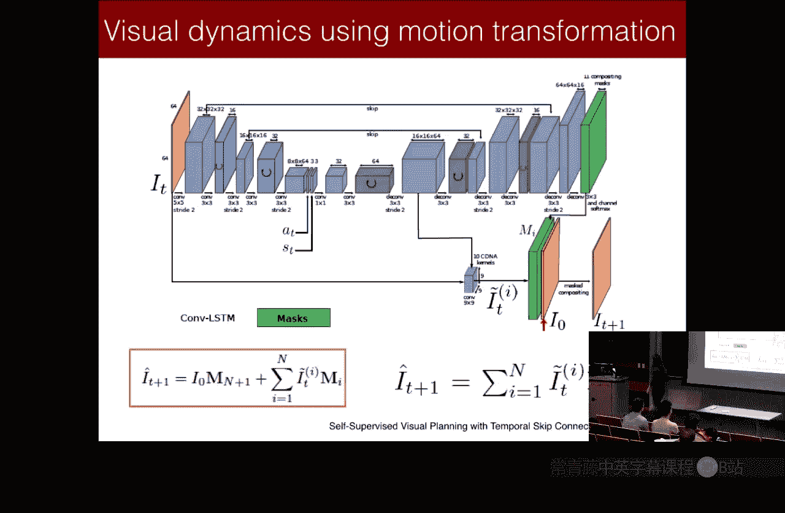

I was hoping that we'll be able to see some。Of the results here。

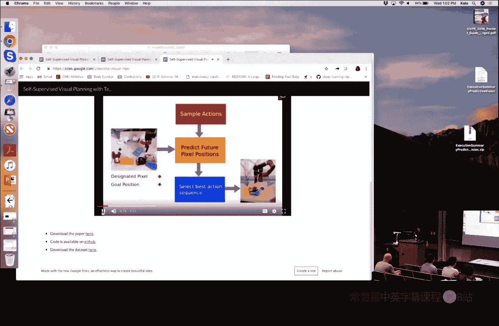

I want you to see the blur over。嗯。Of the predictions。It's a bit slow。 That's fun。Here。

 do you see So on the left is the。The agent that only used the last frame and on the right is the agent that is able to use a history of 10 frames。

 so as we see the background is not washed off。Okay。

 so the another thing I wanted to comment about this work is the loss function。

 the loss function is not exactly what we commented is not generate the pixel intensity。But rather。

 match the pixel displacements is exactly what I said。

 we estimate the motion and we put it as a loss on the predicted。Flow field。

 as opposed on the pixels after the working。 Okay， it's way more informative loss function。

Let me see if there are other videos here。O here's the object。

 so we have the initial position and the target position indicated with these dots and hope the object is able to push sorry the robot is able to push in the right direction from the red to green okay？

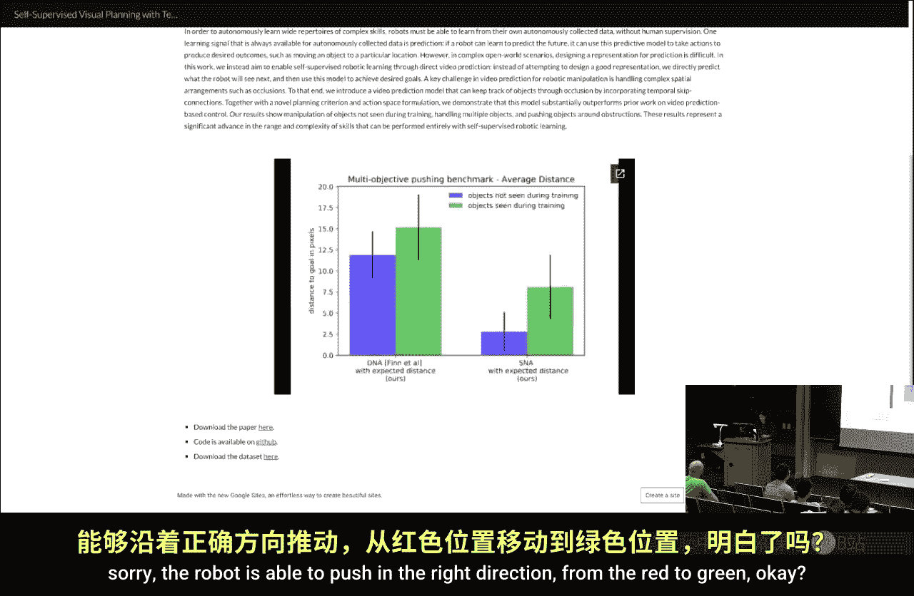

Let's in now here。 what's gonna。よ。Okay， so this is， I think。

 the state of the art on predicting raw visual observations。 The question is。

 do we really need to predict visual observations？You see there is blur and I have experiment myself with this model to see how much you know how much it can generalize and how much occ can take。

 but I wanted to。In this last part， to think about the following。

We do not care to predict our observations。 We care to predict exactly like Tom indicated some spec re words。

 what we care for our actions okay so the monkey was predicting where it's going to be hungry or when it's gonna to get a sugar and what if somebody have told us this and this and this is what we care to predict and the truth is the following sometimes I care about translation。

 move the ocean in particle location， sometimes I care about rotation some other I don't when I push it off the table。

 I don't care exactly where it's going to want but when I'm trying to grab my phone。

 I care very much about very subtle motions right because I do it all the time I need extremely fast So what if somebody have told us what should be this prediction space what should be this prediction space so。

There is this is a paper which I like a lot to called learning to act by predicticing the future。

 where the main idea is the following。 somebody has given you some measurement stream along with your images。

 You have these measurements。 What are these measurements。For this particular game。

 well the measurements will be health， ammunition， levels and enemies killed for wisdom as opposed to one scholarly word。

And your goal can be expressed as a combination of those measurements。

And here are your prediction targets。 As we said， it's always a difference。

 What is now and what's going to be in the future。 Now。

 the thing to notice here is that I'm predicting those measurements。For the next TN。phraserase。

 TN time steps， I'm not going to enroll anything I'm just going to do one short long termm prediction TN was set to let's say a number of 32 Okay so I'm just trying to predict how these measurements change。

And the only thing I'm going to do。By Google G is going to be expressed as this vector on top of those measurements so I can have multiple goals I can say。

 oh kill as many as you want or get as highignition level as you like or you stay healthy and never you know diminish your health or something。

 does this make sense so you predict some quantities and then your goal can be anything in terms of those quantities。

So how does this work， it is extremely simple。啊。We just drink。

A you expert predictor that given the current observation or short sequence of observations。

 Oi and actions。えン？Gal vectors。Given those predicts that the next。Measurement differences。Okay。

 that's all it is， you have a lot of examples， you see this is n is the number of examples you experience samples。

 and you're train with the using regression。Now。Once you have trained this predictor。

 how do you choose actions？Using， using this， you just。Try to find the action that maximizes。

This is a product。Okay。There's no policy explicit， you just use the model directly is exactly what we said in the beginning using this gradientding descent。

 we tried to find the action so that this is maximized。You don't need an explicit policy。

 The only thing you train is a model。 One question that may come to your mind is how do I need to collect this data？

That would be a good question， you start with random policy。

So youll start collecting examples with a random policy， you feed your model。

 now you have some basic F in the beginning it is going to be completely random。

 now you have some basic F， you can estimate your actions， your optimal actions using this formula。

You should add some exploration noise to have some exploratory behavior to collect more， more data。

 Okay，s that's how。 So you enter， we we always do this。

 We always interleave model learning with policy learning else， the model that you learn。

Will not be able to capture the state space that the police is going to send you。

 So we always give this in their living。 that's exactly what they did。Okay。

 do you see how simple it is？Now， if you want to see the architecture， it's also extremely simple。

 you fit the images， the measurements and the goal G vector。You encode them。

 and the only trick that they did is that they predict for every action。

 the mean of those measurements。And。So it's a duplicate。

 the same mean for every action and then here how different actions change this means。

 some increases it， some decrease it， you remember similar thing was when we had this dwelling networks。

 right？You try to the target F， this is what you are trying to predict。O。So。That's it。

 And you do much better than other models that don't consider such measurement screen。 For example。

 the second best method is H3C that use this。Rewards， they tested their method under different goals。

 you can train by changing this G vector， how are you going to sample it where you can sample it continues between an integral between minus1 and1 that tells you how to weight the different measurements or you can have it fixed during training and then at test time。

 if you vary this G vector during training at test time you can sample a new G vector if you like。

They considered four environments from the Dunung game， some of them are very easy。

 some of them are much harder and the interesting thing。

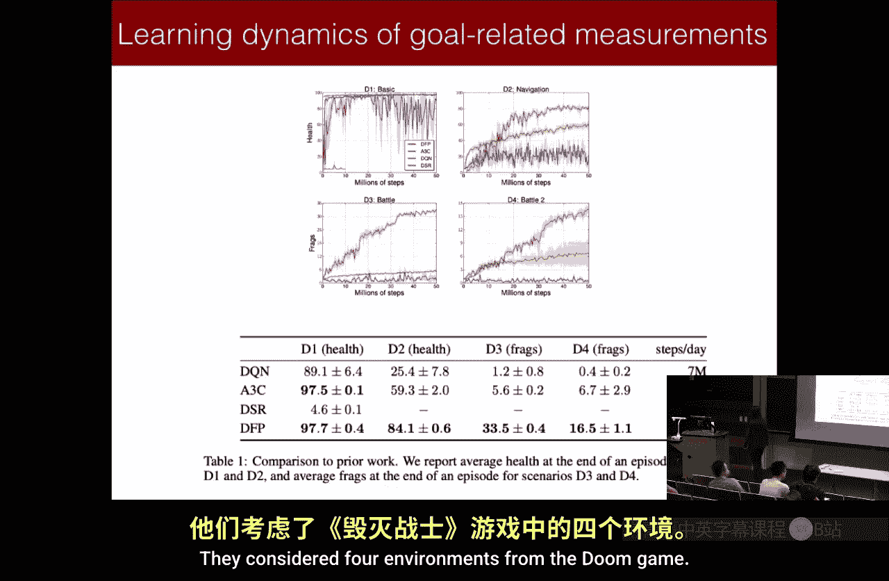

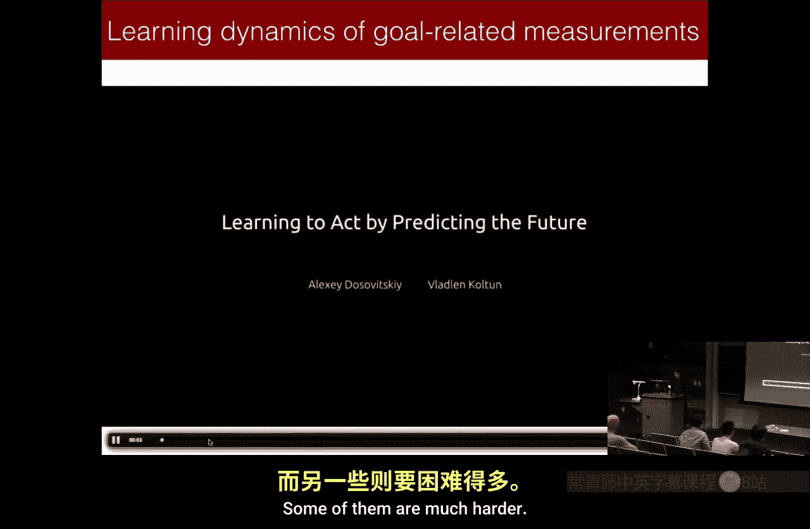

So this is A3C， so in the simple environments， the standard algorithms do well。

 so nowadays say it's our approach， youd see there is not much difference。

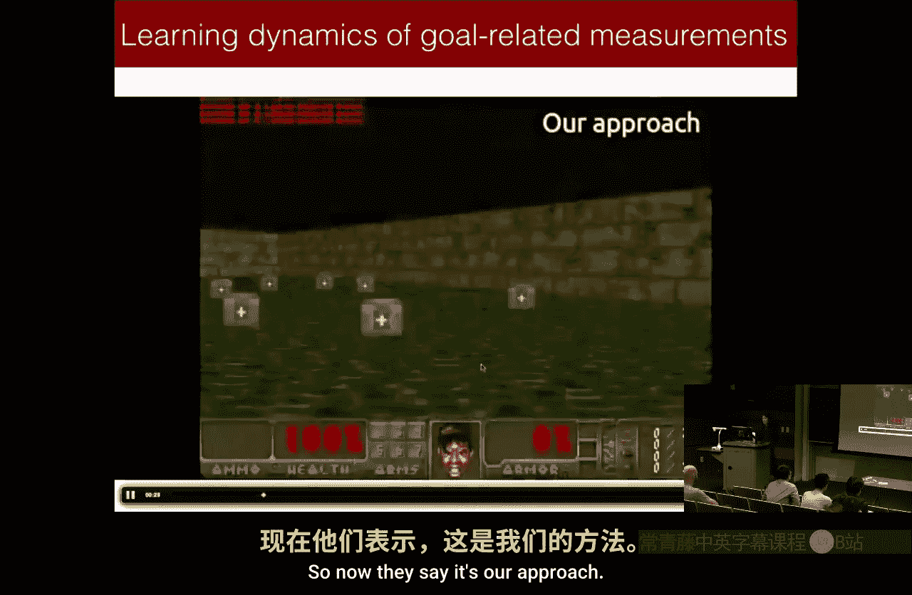

Once you go to harder environments， there is a huge， so this navigation is also easy。

 so let me take you here。

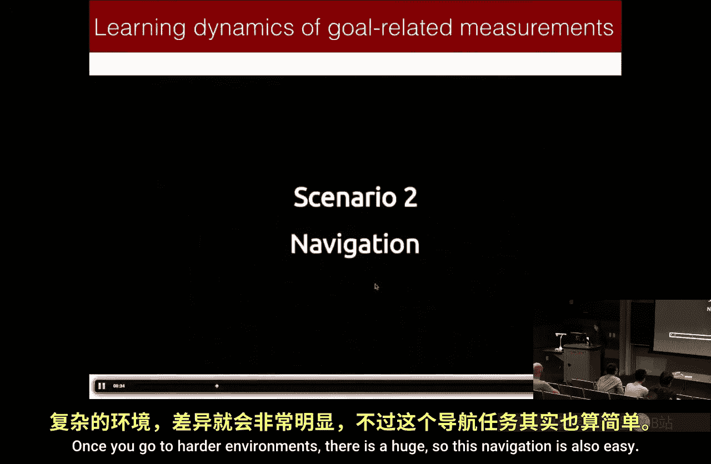

So this is A3C， is killing some masters here。啊，哼哼。ガンドスた in the same room。

And their approach is just running much faster because it's a much simpler problem now you just have a standard supervised learning problem just to predict those measurements。

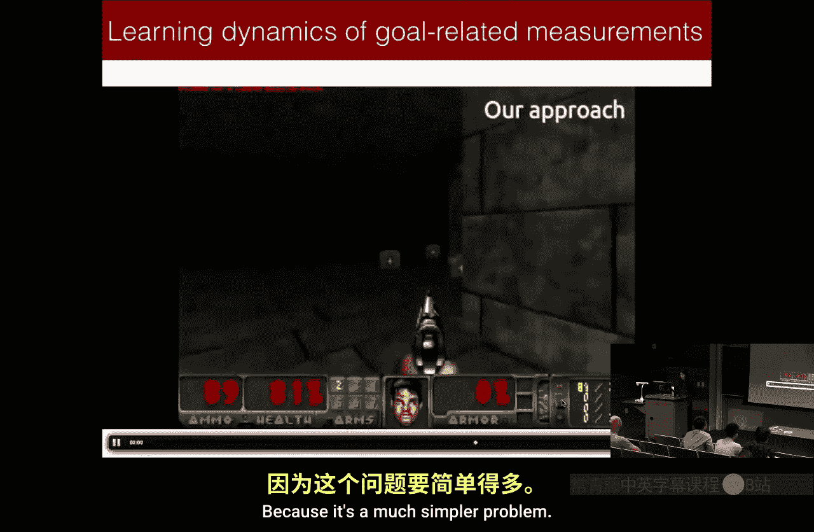

Now of course these measurements better be quite dense in time if they're very， very sparse。

 you are not in a good shape and I think that's the whole point of the measurements they're not exactly rewards did you finish the game or not。

 they give you indicators of how well you're doing the same way you go to learn to drive and your teachers't going to tell you yes no it's good this you're doing grid now now you keep bigger distance better velocity control etc。

 so here is the hardest environment that they created so you see this is pretty stuck at the same place this AC and their method is running really fast。

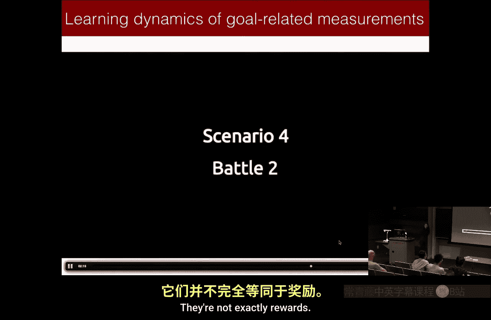

That's it。 So if we knew what we care to predict， we would just fit it with a standard supervised。

Learning， and then we optimize for our actions。

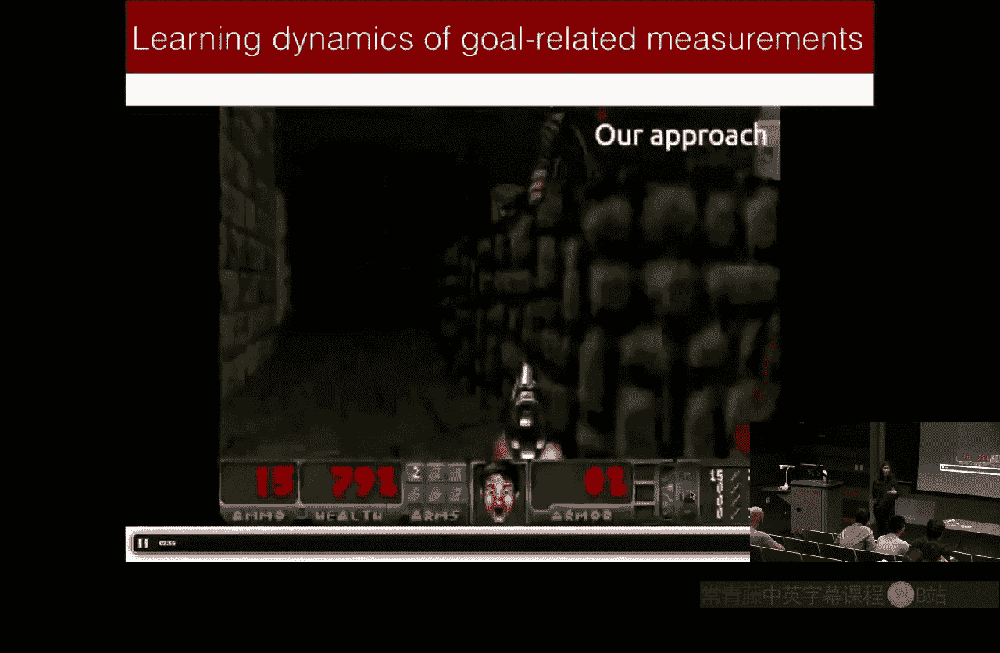

Okay， very simple。

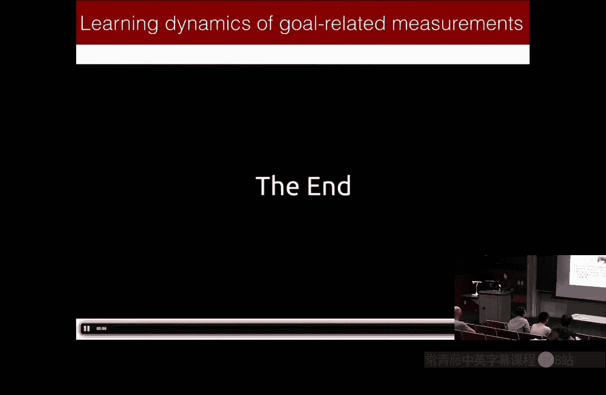

Now we have a very few minutes left， I want to discuss on approach that we recently experimented with which is the following let's assume we want to do continuous control I we very much like this alpha goes zero how it said that it' very important during exploration to choose good actions。

So we said， okay can we do something similar， can we look ahead during exploration with our learn dynamics。

 with our learn dynamics and see if we can choose better actions then let's say if long bring you some other exploration method。

The important choice in this work， you remember these three questions。

 what is our actual representation， what is our architecture， what we're predicting？

What we're predict is the strength of the object and the state of the griper。

 the essentially the 3D location of the object and gripper， and theirvelocities。

There is similar for the grass in it， so you assume that a visual model already is given you those quantities。

The action representation is interesting， we're using insidesight experience replay to learn some basic skills reach。

Transfer， you're holding an object you transfer， you reach a particular location and you grasp。

And each of those skills， if you remember his side experience like has multiple goals。 for example。

 you can grasp and put these objects in many different locations。

 or you can reach in very different locations on the table。

 or you can transfer these objects in very different locations on the 3D。 Allright。

 So your action representation is exactly this。 Which skill and which role。

 Now the beauty of this is that。Once you train those skills。

Each of those skills becomes a multi step inverse model。

 I can specify the skill identity one two or three and the goal and issue the policy and is going to send me there so I can make very big jump。

And then to be able to use those skills to do three enrolling。On top of the policy that I learned。

 I need to train dynamics， which means if from this state。

 I should this skill one to or three with this goal， what's going to be my resulting state。

 where's going to be my gripver and where's going to my object。Now。

 because those skills are so long in time， there are long action trajectories。

Even two three unrollings were able to look ahead quite many steps。

 you don't need to do extensive unrolling and this saves you from error accumulation。All right。

 so you have a skill set。All right， which is the policy， is the Q function。

 the dynamics team U is not important。 and at each flo ratioial step you on full history string。

 you see which。Threepath got you closer to your goal because you have your goal expressed in terms of the object3 C and you pick that action。

 And the thing is that you don't always trust your model because then you're gonna if the model is not good。

 you will ever have to say recover， but you are stochastic。

 Sometimes you trust the model and sometimes you don't and you just sample from your current policy。

 for example， your model free and the interesting thing is first， in the beginning。

 you always trust your model。 right iss exactly what we said we say train with model base。

 and then find through with model free。 So in the beginning， you trust most of your model。

 And then at the end， you trust most of the policies。

The actions coming of the policy you learned with some epsilon greedy exploration。

So using this method， you are able to get much better。

Curs you much accelerated learning over a state of the art for complicated skills。

We may touch again on this topic of hierical reinforcement learning。

 which means learning some basic skills and then changing them。

 compute these computational graphs in time to go far and achieve very complicated longer horizon tasks by composing similar tasks what we like here is the following in this hierarchical reinforcement learning if you just chain options。

 you end up with something like this you want to pick up this and then you'll say oh， let me go here。

 let me go down。So basically， you suffer from the modularity of the skills that you change。Well。

 if you just use your kids just to explore and suggest actions， then at the same time your're。

Still training policy over primitive level actions。

 very simple actions as opposed to this course dynamics。Which will end up being very。

 very somewhat about and doing the things extremely very modular and very awkward。

 So we do compare against I think some of your colleagues have asked about skills that have both continuous and discrete actions and we compare and exactly we do better because you use the skills to explore。

 but you don't use the skills to compose your policy over this course。

Some actions or macro actions you still allow your posts to be as fast and as expert as it likes to be once you have explored of Ka So we have few more minutes I was wondering if we should take some questions now if you have some questions from this lecture。

 that's the end in the next next week， we'll discuss about the following。

 we'll give up on global models。Trying to train neural networks work in all the state space and we'll focus on what we can do with linear models and trajectory optimization。

 we'll see how fast they work and what we can do to disill these very simple controllers into big neural network policies afterwards。

Are there any questions？

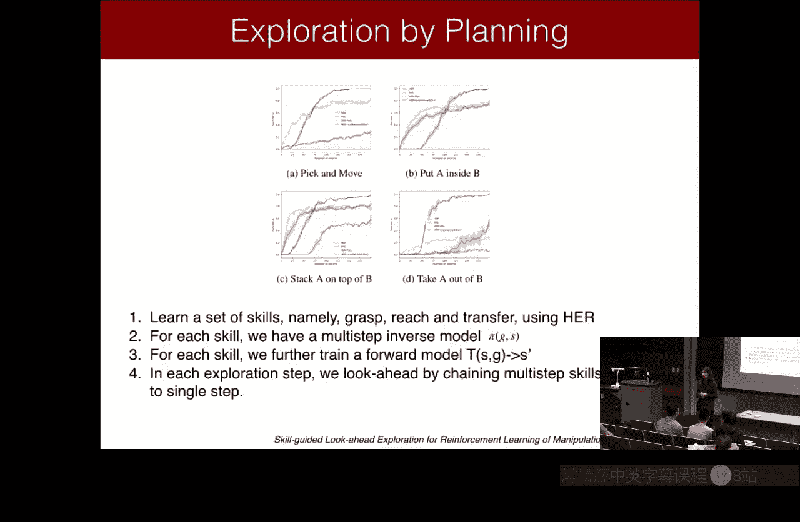

Okay， great。 So then you're afraid to go。