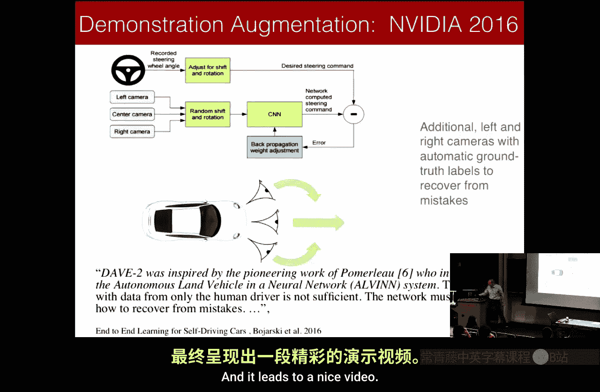
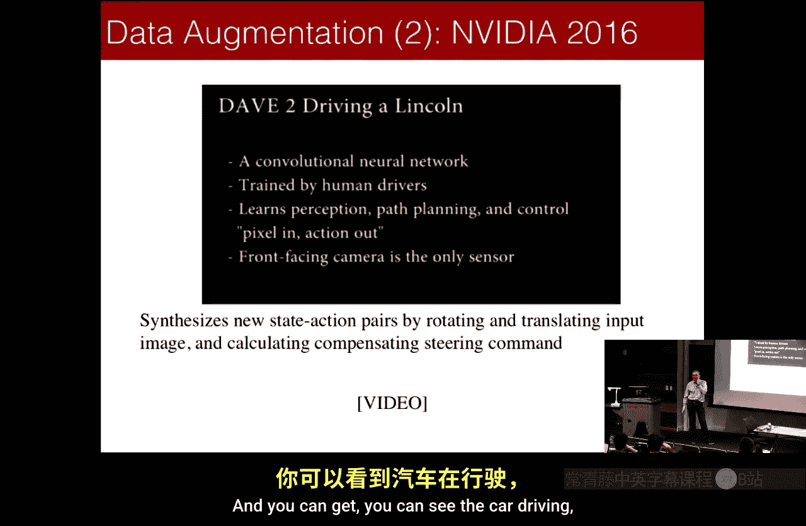
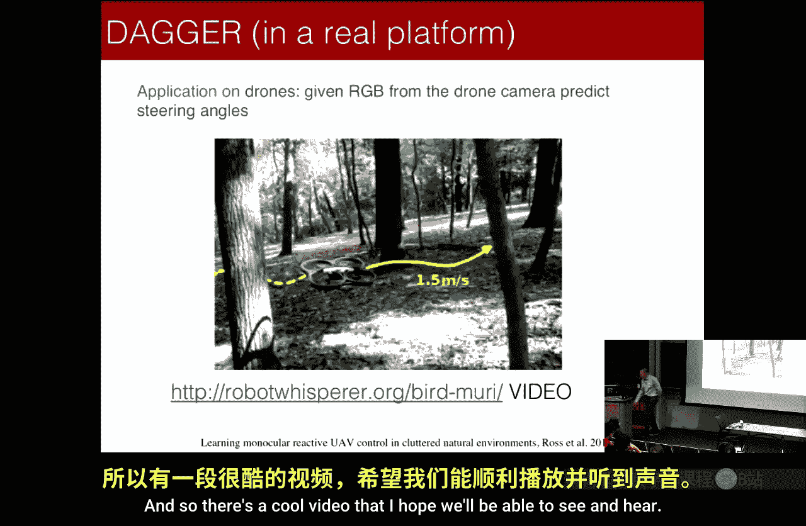
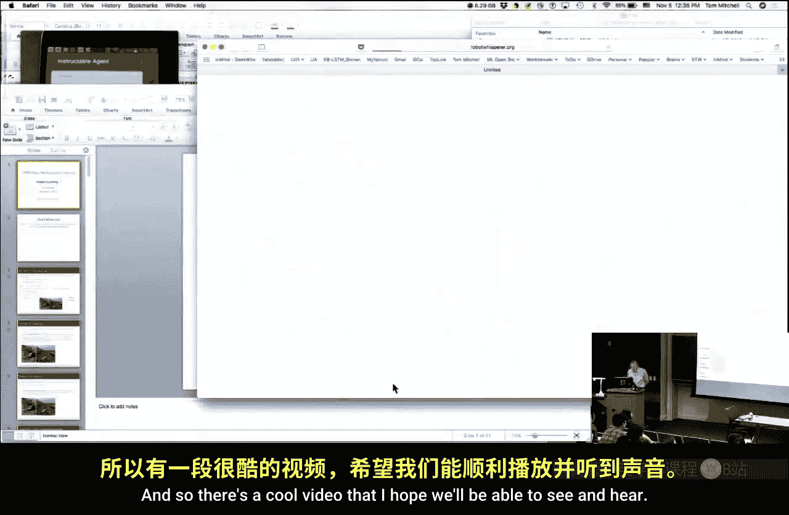
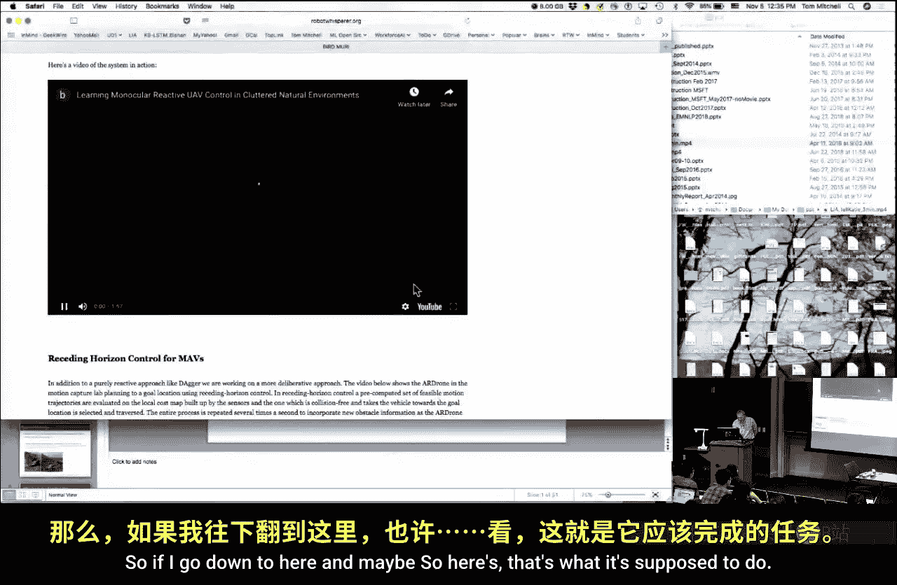
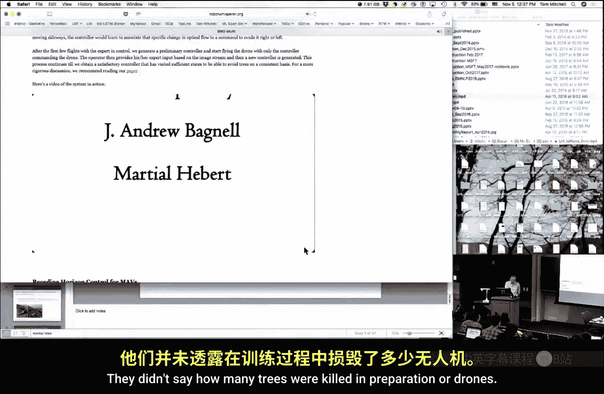
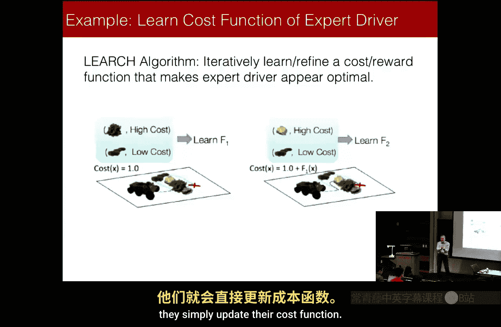
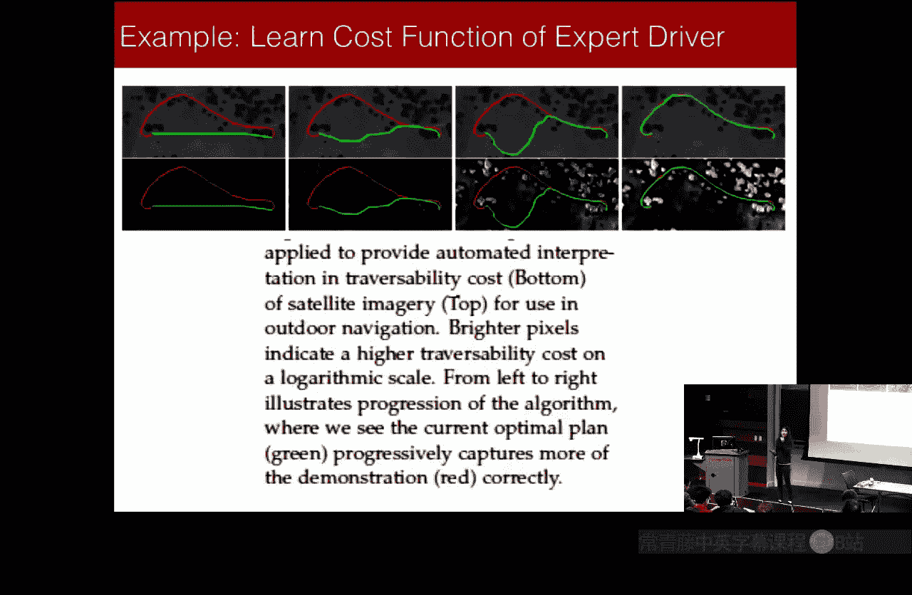

# 卡耐基梅隆大学【中英⚡深度强化学习与控制｜10-703 Fall 2018, Deep Reinforcement Learning and Control】 p20 P20 20  Imitation Learning 1 -BV1RyqPBbEJV_p20-

Okay， well let's start。Today， we're going to。Move on to the topic of imitation learning。

 we'll do a couple lectures on this topic。And the idea of imitation learning is actually very simple。

 It's instead of trying to discover everything on your own as a learner。

 why don't you imitate an expert。 So that's kind of an obvious thing to consider。and。You know。

 if you try to discover everything on your own as we've pretty much been assuming so far for the semester。

 then one of the problems you run into is that if you have sparse rewards。

 this can take an inordinate amount of time and furthermore， if the actions that you're doing。

For example involve cross country driving in the woods。

 it could be that mistakes that you make along the way could be fatal。

 so it's not just a matter of patience and sample complexity。

 it's also a matter of survival in many cases， that's why we have parents。😊。

So especially in robotic systems， this is a pretty critical issue because physical motion can be damaging to the robot。

Okay， so。There are a couple ways of getting at this。

 One way to get advice from an expert is to get a reward function。

Or even to get multiple reward functions， like， for example， if I was teaching you to play chess。

 I could give you the reward function that says zero unless you checkmate your opponent or I could try to give you a less sparse。

 more dense reward function that says plus when every time you take a pawn plus three every time you take an plus8 every time you capture the queen and so forth。

 And so that's a way of giving really a reward function that's more dense and that's a way that。

Trainers can help。嗯。And。Essentially， what we're going to talk about today is learning from demonstrations provided by an expert。

 so for example， if we have a vehicle like this that we'd like to train to navigate successfully。

 one way to do it is to give reward functions like minus one every time you brush against the side of a tree and so forth。

 but we could also just take the steering wheel and drive the car and let it observe what we're doing as it perceives the environment and so it can obtain in that way。

 state action reward sequences just like the ones we've talked about。

 except if the person driving knows what they're doing。

Then these will be examples of a good policy to try to imitate。So that'll be today's focus。

So this is called imitation learning。 and there really are two broadly speaking two approaches that we're going to talk about today。

 One is what you might call。Which you might call supervised learning。

I see this slide is just saying when I already said。

 here's what I want to say There are two broadly speaking， two kinds of approaches we'll talk about。

 one is very direct the teacher can simply show you in this state you should perform this action。

 in this state， perform this action and it becomes really a supervised learning problem。😊。

As distinguished from the reinforcement learning problem that we've talked about generically， right。

 So in a supervised learning problem， we have， we're trying to learn some function。 In this case。

 it'll be the policy。From states to actions， and we call it supervised learning if we have training examples of the form。

 here's the input to the function and here's the output。And， of course， in reinforcement learning。

 instead， what we have is often a。Sequence of delayed training signals from the sequence of actions that we perform。

Which makes it a more difficult。Problem， function approximation problem then if we have。

Simply input output pairs of the policy function that we're trying to learn。 So that's one。

Class of approaches we'll take a look at。 and the other is more indirect， where， in fact。

 what we might try to do instead is use the expert actions that we're observing to infer what their reward function is。

And， and then use that as the basis for training ourselves。 Now， why wouldn't we just have the。

Expert type in the reward function for us。Well， depending on what the expert is good at。

 it might be hard to type in a reward function。Like if you have an expert tennis player。

They might say， well， the reward is hitting the ball until your opponent doesn't。

 but it's harder for them to maybe type in a quantitative。Reward function to tell you。Exactly。

What's a better way to swing than another。 They might be able to watch you swing if they're a good tennis instructor and tell you。

 oh， you should bend your knees more when you're doing that and don't stoop down。 But it's hard to。

That kind of advice might be easier for them to give。 but in general。

 typing in a reward function can be very tough。Yes。

If even if you successfully learned the reward function。

 don't you still have the same problem of like wearing the policy to go with that reward function so you're back to like square one you're kind of back to square one。

 so we're going to assume by。For part of this lecture， we're going to assume， yeah。

 we have a subroutine that knows how to give a reward function， solve for the optimal policy。

So that'll become a subroutine in some of these algorithms， yes。

There's no way you can possibly make the expert demonstrate their response for every state。

I work to this states that in its shell right。Yeah， very good point。

 So one of the problems we're going to encounter here is that experts。Are not infinitely patient。

 so they're not going to give us examples of every state what we should do。

 We're going to have to rely on generalizing。And one of the things that saves us。

 especially in robotic kind of applications， is that if you think of all the possible states of the world could be in like this room。

You know， physically there are a lot of weird states it could be in。

 but you and I have been here long enough enough days during the last couple months to realize that it's a very small fraction of the states of the world that are physically possible that actually we encounter here。

And furthermore， if you're。And so that's going to help us all we really need。

In the sense of in the same sense as when we do supervised training。

 what we really need is a training distribution of states that's representative of what we're going to encounter。

During test time。And if you think about control problems， one of the nice thing about control， like。

 let's say， driving。Is if you think of all the positions your car could be on a road。

And then you think of the distribution of positions where your car actually is with high probability on the road。

 which would be like going forward in the correct lane。

As opposed to going backward in the incorrect lane。嗯。Then actually， because it's a control problem。

 we get to choose the state distribution by our actions。

 and that tends to lead to even more skewed state distributions than if we're taking them randomly generated by the world。

And so that skuw helps us in terms of。The distribution we actually have to sample from the trainer。

 but it's still an issue。 It's a good point， yes。The indirect。

Aren't there like many reward functions？There are， and in fact。

There's not even a unique reward function， given a set of actions that you observe the expert to。

 So this， yeah， so there are all kinds of difficulties with doing this。

 The first time I heard somebody talk about this， which was。😊，Around 2000。I thought。

That's an impossibly difficult problem。But in fact， I've been proven wrong again。Since then。

 so people have made progress on this。Okay， and when I say for the purposes of this discussion。

 when I say experts， I might mean a human expert or some other computer program that's very good that I want to emulate instead of the expert。

And that might even be a collection of experts， for example。

 that are good at different subspaces of the problem space。 But the point is， could be a human。

 could be a computer。Okay， so here is the first example of。This kind of work that I had seen。

 This is done by former CMU PhD student。Dean Palmerlo， who is also a former CMU robotics faculty。

Who was also a former successful startup company generator in the area of automated driving。

But for Dean's PhD thesis in 1989， he had the idea that he should train a neural network。

To steer a car。And so he built a simple， single hidden layer。Neurural network。

Here's one version of it。 The input was based on a camera mounted by the rear view mirror of the car looking forward that would get an image like this。

 He used to 32 by 32 grid。Of。Of pixel intensities to code there and also had a range finder。

That would just scan and find obstacles at a distance。

And so he trained the neural network to take that sensory input is the input to the network。

 And then the output was really a steering command， encoded。Almost like a one hot vector。

 but not quite。 So you could think of the。45 direction output units is indicating should you drive straight or a little bit to the right or a more to the right and so forth。

 So if you imagine a one hot encoding where everything is zero and there's a single one what he actually used was instead of a one hot。

 he put a Gaussian around that so that if you're supposed to turn this direction。

 he would code it as one in that direction and then a gaussian and decaying values elsewhere。

Just for engineering reasons that worked。But then。He trained this。By driving the vehicle around。

And collecting data and also replaying in simulation some of those videos。And he got a person。

To provide the steerring actions。So you know， in the simple version， persons in the car steering。

 the car is sensing the steering direction。And so now for the policy that you want to learn。

 which is literally this neural network。It takes the observed sensory readings as input。

And it's trained to reproduce the steering commands。Of the user。So he tried this。

And it kind of worked。 But the single biggest surprise。Was。That， even though。And by the way。

 he tested this out on Route 28 north of Pittsburgh。 If you've ever driven on Route 28。

 you know what。Like crazy idea this is and this was at a time in 1989 there was a lot of work going on much of it at CMU on self-driving vehicles。

 it was in a very early stage of research and most of the work involved driving robots around in Shenley Park next door on the narrow paths and so the vehicles at that point would go like a maximum speed of maybe 10 or maybe 15 miles an hour faster than you would typically walk but。

😊，Not highway speeds。Dean actually changed the whole story by driving his vehicle。

 ended up driving 55 miles an hour on routeute 28 north of Pittsburgh。

 So it was a really quantum jump in the technology at the time that he did it。😊。

But the single biggest surprise was that when he got out on the road and let the vehicle steer。

For the first few seconds， it would do fine。But then， you know。

 it's just a computer and it would drift one way or another。

 And once it drifted far enough off the center line。It actually out of the lane。

 it was supposed to be in。It actually didn't know how to get back into the lane。

And if you think about it and you think about the distribution of training examples that a good driver would be showing。

That makes perfect sense。Because the system had been trained。On a distribution of states。

That would be generated by an expert driving policy。And yet， it wasn't quite an expert。

 So eventually it would drift， its errors would accumulate。

And once every for every accumulating Eric， it got further and further from the kinds of states that it had been trained on in supervised training mode。

And so that lead LED Dean to。嗯。This comment in his paper， in addition。

 the network must not solely be shown examples of accurate driving， but also how to recover。

What mistake has been made？Partial initial training on a variety of simulated road images should help eliminate these difficulties。

 And， in fact， what he ended up doing was writing a little program that took the。

Images that he had from the good driving， and he would just translate those images to the left。

Or to the right。And。Calculate the compensation， the。

 the steering direction you should take to compensate for those synthesized training examples。

And so this was the way of him taking。One distribution of examples。That really did represent。

The state distribution you'll get if you drive well。

 but then perturbing that so that he had more representative examples of edge cases。

Literally edge of the road cases so that the system could have examples to train on for that。

 And that made a big difference in the performance。But you see in， in the terminology。

 we're using an art class now。嗯。By the way， and most of today， I'm going to use O instead of T。

To represent the observed features of the state， rather than S for the full state。

Mostly because when we're talking about robots， they don't really get to observe the full state。

 but just some observations from their sensors， but you can see the kind of thing that would happen if you have an expert trajectory around some racerackrack and then you let go the wheel and let the vehicle take over if it makes a little bit of an error each time those errors will accumulate。

And so the real problem here is that。The distribution on states。

That we get from the pi star optimal policy is different from the distribution of states。

For the policy pi theta that we're learning。And that's the source of the problem。

And this is actually different from supervised learning。 If you think about it。

 if you recall back in your first course in machine learning。

 where we talked about PA learning results。We were able to prove。That， with probability。

At least one minus Delta， a program that shown M training examples in supervised training mode。

Will produce a classifier， who's。True air is no worse than epsilon。Provided， and what did we say。

 providedvided the train distribution and the test distribution are the same。

 They don't even have to be known the pack results say。As long as there is a fixed distribution。

 we don't even have to know it。Then we can get these Delta epsilon bounds。On how well we can learn。

But even though we're using supervised learning methods。

 like training a neural network in supervised mode。We're not actually in a situation where。

These distributions are the same。 And a big part of the problem is that。In many cases， when we train。

 say， supervised method for diagnosing patients。It's fair to assume that the training examples are。

IID。Independent and identically distributed。But in this case。

 where we're generating a sequence of states and the errors are accumulating。 Really。

 these are not I ID D examples anymore。And so， and we've seen that previously in the course。

 That's why we keep this memory buffer and resample batches of training examples from long ago。

 as well as recently。But this is really the heart of the problem。And so。One solution。

 which is common。Is to just。Change the distribution that we train on by augmenting that distribution with examples that are more like the ones we're going to encounter when the actual policy is executed。

So if you think back to important sampling and reweighting examples based on their probabilities。

 you can imagine a whole family of approaches that you can take。And indeed， you can。

 But it turns out that a fairly straightforward。Approach works pretty well。Which is。Oh， I see。 Yeah。

 which is illustrated in this more modern version of Dean Palmerlo's work。

There's an a nice paper that came out in 2016 from the Nvidia team。Where they use， of course。

 NviIDdia GPUs to train a deep network that could run Liy split and at frame rates， steer a car。And。

Their network， unlike Dean's had 27 million connections，250000 parameters。And。But like Dean。

 they trained it with supervised training。But they also and they say in their paper。

 this was inspired by Palmerlo's work， training with data from only the human drivers not sufficient。

 the network must learn how to recover from mistakes and so you can see what they did was。

In addition to having the driver drive and collecting those examples。

They also synthesize examples where they adjust for the shift。 They， they both translated。

To the side， and they rotate it。To generate synthetic examples and for those examples。

 they could actually had a good enough simulator to calculate what the correct steering direction would be to get back。

Onto the， to the road。And so。They do this sort of thing where they now mix a combination of。

Actual training examples with synthesized examples。And it leads to a nice video。

Oh my goodness， did I not。 Oh， I didn't。I feel bad。Ohs okay。 We'll skip this video。

 We'll have another one in a second。 If we have time， we'll come back to this video。

But at leads to a nice video， which if you search on Dave 2 driving a link and you'll see this on YouTube。

 and you can get。You can see the car driving and you can see even feature values that are computed inside the network as the car is driving。

Feature values like this。 So this， for example， shows。What the forward looking camera sees on top。

And then as this says。This is the activation of the first layer feature maps in the neural network。

And on the right is the second layer feature maps。 but you can see just even looking at these that it's getting these weird road like shapes。

And you can see it's actually。Training in a nice way to do this。

So I bring up the NviDdia thing because it's a modern example。 But in fact。

 it's trained again with this mix of。Actual and synthetic examples。

 And the reason those synthetic examples are so important is they make the training distribution much more like。

What the test， test distribution is going to be。Okay。

 so this leads to a very simple to implement algorithm called dagger， which looks like this。

 And the idea of dagger is basically to iteratively get more and more training examples that are going to be。

Again， representative of what the。Policy trainer needs to see in order to handle the distribution of cases it's going to generate。

 And here's what you do。 So first， you get some human data and you train your pi sub theta on that。

Here I'm using you as the symbol for actions， by the way。

 which is kind of standard terminology and control theory。

So you can think of U as our old S or our old A and O is our old S。

 So you get a bunch of state action examples from the human。You train your policy pie。

 then you run it。 So， for example， imagine you're running it around。嗯。Track here。

And then what you do is you ask the human to label。

The examples that you're generating with that policy。So basically， you know。

 the key issue is that the。Distribution of states generated by the expert policy is not the same as the distribution of states generated by the learned policy。

 pi。 And so this is a way of simply saying， let's run the learned policy to generate the states the observed features of the states and for each of those last a human to label the correct action。

Now， we've got the distribution of states， not from the expert， but from。The policy itself。

And then we take those and we merge them in with the data we had before。

And then we go back and we retrain our policy and iterate on this。

So this turns out to be a pretty nice， efficient way。Of collecting。

Data that will help learn the right policy without pestering the trainer more than necessary。

So it's kind of corrections。So that's the dagger algorithm。And。It still has a couple， you know。

 leaves open。 a couple problems。 One is that we're still executing a possibly unsafe policy。

 which could drive us off the road into ruin。But the second is that we're still pestering the user。

 We're still asking for a fair amount of data。And depending on the importance， it might be worth it。

Or have to put in a simulator NA。Yeah， so there are a couple ways of doing this。A typical way is to。

Capture the data and then put it basically in a simulator， and let the user。嗯。You know。

 for every single state， you could have the user steer the way they want to steer， for example。

that if you do it in that way， offline， it also gives you a chance to slow down the replay。

 which could be really important if you're， let's say you doing high speed racing。

And that it might be tough for the user to actually just keep up and give the feedback at frame rates。

So it's kind of an art， but often it's done in sort of capture and then label rather than doing it in real time。

 anyway， but， you know， people do both。Ktarna， feel free to jump in on any of these questions I think you've maybe got more experience than I do and especially the robotic applications of these。

Actually， in this case， they did click on the simulator to record。Let's say the human and in fact。

 theres another paper with exactly the same methodology for driving a drone in a forest and they do discuss on the paper how awkward it is to replay the same episode and ask this label from the expert human。

 so it is hard labeling to go back and replay that。

Because also the human gets scared and that's a very very， very abrup emotion。

Put the drone back in It's not like， oh， take it a little bit right。

 humanss aren't used to that distribution of states either。So it's an awkward labeling process。😊，Yes。

 is this typically a very long process because you get the first train of human data distribution and update the distribution train again and keep iterating like how long how many iterations you with？

I really don't know。Do you have a。第于现在。Yeah， sure。 Each time you go and ask humans， it takes time。

 right， to record the。But like how many iterations you'd have to go through for this。

 I was looking at some videos on YouTube of people doing Atari game， rice racing kind of things。

 and they were showing examples of after 25。😊，Iterations of retraining with dagger。

 And you could notice a qualitative improvement。In the policy change， they weren't saying there。

How much data they collected on each iteration， But I assumed it was something like。

They drove until the game killed the car。 and that I assume that was one iteration or one sample。

 And they said， well， we retrained after and after 25 heres what it looks like。

 and it was visibly better。So。There are a lot of very cool videos out on YouTube for looking at。

 especially video game versions of this to see。😊，What's going on。Okay， speaking of cool videos。

 here's one。People use this approach for training a flying robot， which is here shown here。

 it's a drone。And they wanted to train it to fly through the woods without crashing into trees。And。

So， there's a。

Cool video that I hope will be able to。See and hear。

So if I go down to here。Maybe。

So here that's what it's supposed to do。 So here's the expert input。And they use dagger。

 this algorithm。Three fine。Okay， so this is the view from the drone。

Color bar shows the policy driven command。These are the features from low level features。

 from visual input。They're getting things like optical flow， which they say cur。Edges。没完成。😔。

And so using dagger， they train this using an expert to help。And。As video shows。It's able to。

To traverse。Parts of the train that werent， you know， were not part of the training set。

 So it's generalizing。Somewhat appropriately。Some bros must have been。しごう。

Each time there was a mistake， a drone was destroyed。嗯。It's a sad thing。😊，Total trees avoided。

 You see。They didn't say how many trees were killed in the preparation or drones。😊。

Okay， so there's one from our own robotics Institute heroes。All right。So it is hard， in fact， to。

 even in that case， to generate the correct feedback when you。

When you can't get the sensory data back on the effect of your actions。

 right So you're kind of doing this。If you're doing this without a simulator that's simulating the effects of your actions。

 then。That's a problem。Reaction time can be an issue。 And so， as I mentioned。

 one solution to that is to play back the。Experience in slow motion。嗯。And， right。

 we still have imperfect policies。 So it's expensive to train in the real world。Okay， so anyway。

 one approach and you can see a couple examples of it there is if we want to learn a policy from demonstrations。

 we could train the policy directly， and the key issue we have to worry about is that the distribution of states over which those training examples are drawn。

Tend to be different from the distribution of states that our imperfect policy will generate。

 So you see algorithms like Dgg or give us a way of。Somewhat efficiently capturing data from experts。

To get the right distribution。Let's talk about the other approach of reward function learning。

So the idea here is that， you， if you think about our。Reinforcement learning， typical setting。

We have some reward function in mind。 Maybe we have a forward model of the dynamics。

And then given those two things， we have a variety of reinforcement learning algorithms we've talked about in the course。

Their job is to find a policy that maximizes the expected future discounted reward。Given that policy。

And then it takes action for each state。 And so the idea of inverse reinforcement learning is to lets。

Given。Given this。And。Actions from the user。 let's solve for what their reward function should have been must have been。

So that's the general setup。For inverse reinforcement learning。

So we still have a state space an action space。 Let's assume we have the dynamics。

 We know the next state function。could be probabilistic。 We have demonstrations from the teacher。

 but we're not told the reward function。 And so our job is to see if we can recover that reward function from that what we are given。

And to use that rewardword function to find a good policy。

And this behavior cloning is a phrase people use for talking about what we。

Just supervised training method that we just looked at。

So here's the general framing of inverse reinforcement learning。嗯。And here's the way to think。

Suppose we have some robot like this one up here in the corner。 We have an expert who。

Telly operates that vehicle， let's say， gets us some examples。And so one way to think about it is。

That expert generates a sequence of state action pairs。While they're operating。The system。And。

We could say that。嗯。Why star is just the trajectory data that we observe when the action。Is done。

 And we could say， well， what if we assume the reward function itself。

Is some linear function of some features extracted from。This trajectory。So you could think of。

This is being some feature vector， which is computed from me。 So It doesn't have to be exactly this。

 It could be computed。Say even by a neural network。A bunch of features of the state。

And if we assume the。Reward function is some linear function of these。

Calculated features of the state action pairs。Then we can say the problem of learning the reward function。

Is the problem of。Learning what this set of weights is。If， in fact， we predeine what the。

With this feature vector is。And this is a common。Simplification。That。That is used widely。

The simification being that， it's。It's up to the designer to come up with good features of the world。

And it's up to the reward。Estimator。To come up with the weights on those different features。

So if we think of it that way。嗯。Then， we can。Go back to basics。 We could say， well。

 our job is to find。A reward function， let's call it R star。

 which is the one we attribute to the trainer。We want to discover what that is and what's the property it would need to have。

Well， this is the property if you think about it。 We want。

 We want to assume that the expert knows what they're doing。 For example。

 Sose they have a reward function and they've got the optimal policy。

Then what will be the property that their reward function will satisfy？

It'll satisfy the property that every other policy is not as good。Or at least not better than theirs。

So this is that property written down。 What we're saying is that。We want a reward function our star。

 That's the one we're looking for， such that the expected value of that over the optimal policy。

 the policy of the expert who's training us。That expected value is at least as great。😊。

As that same reward function controlled by any other policy that should be true for every other possible policy。

So this is just a way of saying the property that defines the reward function of the expert。

 If we assume the expert。Actuallyley optimizes it。Is this property？

That it's the one such that the expert actions outperform all other policies。Okay。

 so that makes sense because this is really the key。Yes。Last slide the feature vector。我先给他。

Com or was it a function of the entire trajectory grid？

Here we are saying that each of these feature vectors is。Well， in this schematic。

 each feature vector is computed at a single time， so it's the state action pair。

And then we're saying why stars？Is that sequence So here I'm saying F of Y star。

 So generically I'm saying that， but in this example。

 we're assuming it decomposes into the same weight applied across time to different。

Time specific features。And this is the framing that we're going go with for a couple slides now。Okay。

 so everybody comfortable with this， yes。It also means you'll never do better。Because you're singing。

That's right。And the expert also can never tell you I。That's right。That's right。 So here。

 and those are both really good points。 So here， we're assuming， you know， the problem framing is。

Really this， that this is what we're given and we're not given any other information。

 So in that case， really。Yes， it's probably。 you could probably prove that it's unsolvable to。嗯。

To determine whether the expert is。I I have to be careful。 You don't。

 You don't know whether the expert has the right policy and you don't know their reward function。

 therefore。嗯。You' kind of double blind。 and it's， it's hard to get everything right。We will see。

An approach where。We can avoid learning saying that we're learning the reward function。

 but we can still guarantee that we get to be at least as good as the expert in it。Okay， so。Okay。

 so this is the property wherereafter we're searching for a reward function that satisfies this。 Now。

 if we assume the reward is linear over some features of those state action pairs。As we saw。

 as we suggested in that previous slide。Then let's see what happens， then we can say well。

 the reward associated with any given state， sorry。

 I left out the action for any given state is just some linear weights。

 W times the feature vector that we're observing of observed features for that state。And so， now。

I can see。The thing we're trying to optimize。Or the the expected reward for a given policy factors in this way。

 I can rewrite it。First， by pulling the weights out of the expectation。And。

Then calling this expectation， which is really。Under policy pi。This is。呃。

The expected value under policy pi under the state distribution generated by policy pi。Of。

The feature values discounted in time， according to where they are in the sequence。

And so if I call this distribution of discounted future feature values。New。

Then I can rewrite the reward function as a linear combination of these。Discounted。

Future feature values。And so now I can see that if I go back to the property， we agreed we want。

 which is that。The property that the experts reward function satisfies is that it gives a better expected reward than any other policy would。

And if we substitute now。For that， this。Then all we really need to do。

Is find a set of weights such that the。Distribution mu over discounted future feature values。

Is greater than that same way applied to the mu that we'll get。

Over the distribution of those same feature values under other policies。

What's nice is that we started by seeing some property that。

Was going to be hard to evaluate which we agreed was correct。

 but it was going to be hard to evaluate because we don't know what our is。

But if we make the assumption that the reward function is a linear。

Function of the feature values phi。And we define mu as the discounted future， some of。Feature values。

Then we can show that this is equivalent。 and the nice thing is this is something we can observe。

We may not know what the reward function of the expert is。

 but we can observe what features occur as the user is operating the device。

And so now we can solve for W in terms of this。Yes。たで。好先。No， actually， these are both， I mean。

 for like the second。This one。So in both cases， there's a ferral pi applying to this and a ferral pi applying to this。

I should have bracketed it， I should have put a square bracket here and a square bracket here。

 but for every pie。We want this to be the case and for every policy pie we want this to be the case。

 so it is the same。Does that make sense？Of course， it could be expensive to find every policy pie。

Okay。So the key new feature here is that now we're talking about not the expected discount of future reward。

 but simply the expected discounted sum of feature values。And given those。

 we're gonna to be able to solve for Ws that。Satisfy this property。Okay， so。I see。 okay。Sorry。

 let me。So it leads to。Okay， let me take these in sequence。So just to be clear about。

How we would get this distribution on future expected feature values。If we had。

An expert training us by driving the car， the robot or the device。

 and they create M different trajectories。 Then what we're going to do is we're going to average over all those trajectories and every time point in each trajectory。

To get this， we really are interested in。The expected value of this。

Discount of future features with respect to the state distribution that's implied by the policy。

 So we're going to sample multiple trajectories and look at every state along that。Just to be clear。

Okay， so now。Here's a nice observation that's due to a paper that you really should read。

I haven't put this up on the website， though the slides are。

 I'll put a pointer to this paper up on the website， too， as one of the two readings。呃。

But they point out that。For a policy pie to be guaranteed to perform， as well as the expert policy。

That should say pi star。 It suffices that the feature expectations match。To is。Approximately match。

So。The one norm here is just the sum of the features， by the way。嗯。So。Basically。

Even if we can find a way to make these features match。Then。We can know that。 we're mimicking。

Expert policy。To within epsilon。Even if we don't know what the expert reward function is。So this is。

 this basically licenses us if we want to even。Find a different way of matching the feature distribution without that even going through the intermediate step of calculating W to figure out what the reward function is。

So which is pretty cool。 if you think about it。And then。This is assuming that your reward weights。嗯。

Are stayed less than one also so that the rewards stay in the range from 0 to 1。

But which is not really a real constraint because you can just scale everything。

own so this is an important thing。 And here's the simple proof of it。

So why would we wish to find a pie hat such that。嗯。The distribution on。

Future discounted feature values。 Min is close to the expert。

 Mu E is the expert generated distribution on。Future discount and feature values。Well。

 for such a pi squiggle， we would have that for any weights。That are。At most one。These。

The difference between the the expert policy， pi E and our arbitrary pi squiggle。Will be。

And this first step is what we already proved saw on the previous slide。

 I'm just rewriting that as the。Expector reward is the weights times the。

Distributions on the discount of future feature values。 And we can rewrite this because。

X times Y is less than。The norm of X times the norm of why。Lesser equal。So you can factor it then。

The second line just follows from the fact that we've put both of these to have norm 1。

 And so when you。This would be less than one time steps line。 So basically， it's easy to show that。

What we're showing here is that。If。We find a pie such that its feature distributions match those of the expert to within epsilon。

Then its expected reward will also cement match to within epsilon。So it's straightforward math。

 but the significance of this is it really says that okay， it's good enough just to match。

Not the features of individual states， but the discounted future features。

 So we we're taking into account the trajectories。 we're really matching properties of the trajectories rather than properties of the states。

 And that's enough to let us do。Mimicking imitation learning without。

If we can find a way to do that without even estimating W， that'd be fine， too。Okay。

 so here's an algorithm。嗯。That a and I use。Again， they're assuming that the reward function is a linear function of some features。

And then the algorithm is just pick some policy pi 0。And then。

Go through an iterative loop where we're going to refine that policy each time。

Guess the reward function。That is， find the reward function such that the teacher。

Outperforms our current policy and all the previous ones we've considered in earlier iterations。And。

One way to say that is。We want to obey the constraint that we've talked about before。That。

The weighted feature values for the expert policy is greater than the weighted feature values for the others。

 because that's what gives us。The knowledge that the expected reward is greater by some mark。

And this must be true for each policy that we've。Considered so far。And so this one we saw for this。

We're basically finding。The weights for the reward function。 we know the reward function， we can。

Here's the subroutine。 Invoke our known reinforcement learning algorithms to。

 to learn the right policy for that reward function。And now if this margin is small enough。

If the distance between these。Is small enough。Then we know we've actually found two within Epsilon。

的的。The policy that would give us the same reward is the expert policy to within Epsilon。

And otherwise， we just go back and we pick。We iterate again。 We， we pick another policy and。

 and generate another reward function。Yeah。We didn't use it here。

 so here we're actually literally solving for the weights。嗯。

We're solving for the ways to solve this optimization problem。

 So here we are explicitly calculating ways getting the reward function。 and then。

Finding the right policy， according to that。Okay， so。When they did this and they applied it。

And a simple grid world， not unlike our little robot grid world。

 where you get rewards in different parts of the grid。They compared。

This kind of inverse reinforcement learning， using that algorithm。2。Supervised training。

 the first approach we talked about today。And the two curves that dominate are variances of the inverse reinforcement learning algorithm。

 And these other three are。Different ways of， of doing supervised learning。

And the horizontal answer here is the log of the number of sample trajectories。

So you can see here that in terms of sample complexity。This kind of inverse reinforcement learning。

 where we're estimating the reward function， instead of just supervised training the policy actually is dominating by far in terms of sample complexity。

Okay。Alright， now， one thing I didn't mention is how do we solve this。

Optimization in the problem in the middle。And again。

 if you think back to your introduction to machine learning course。

 you should recognize that form of problem It's the same form of problem we state。Basically。

 when we do support vector machine。Calculation。It's a constrained optimization problem。

 We're trying to maximize the margin。Between these two values。

 and we're picking is the maps over our possible choices of weights。

So we want the waste that will maximize margin。Between these two quantities。 So， in fact。

 we can use essentially the same algorithms that we use for support vector machines。

To solve that problem。You can think of here's the typical support vector machine。呃。

Thing where we have two classes of points， and we're trying to learn the classifier that best separates them。

 and the classifier is represented by a weight vector。

And we choose that wave vector to maximize the margin。

So here you can think of each point as representing a policy。And the。Point is。

Is that quantity that we measured for the policy， the expected discounted future features of the policy？

And I guess I should show it under that interpretation， I should only have one black dot。

 which is the expert policy。And then the white dots would be the different other policies that I've considered as I've been iterating and trying to get more of them。

So basically， we can use the SVM maximum margin algorithms to drive the weights。

 And those weights will be the ones that。Maximize the margin。

 the distance between W times these points and W times the expert policy。And again。

 that's exactly what were looking to find。 the maximum the weights that will give us the maximum margin between。

The weights times， these kind of points versus the weights times at count of。

You want to find the maximum margin between the optimal fall。In our policy rather than。

Like shouldn't we be trying to minimize to get closer to the alcohol policy？Here。Let's see。Or you。

Are we trying to maximize that distance from the policy executive we've learned previously？Yeah。

 we're trying to find the way that'll make the expert。

As far better as possible from the policies that we've considered so far。

So we're trying to maximize our esteem for the expert。

So it's more like we're trying to learn the expert not trying to learn the other policy。

We're saying the most let's pick the W that makes the experts actions most rewarding。And then we can。

 relative to that reward， train ourselves a new policy。

So it's this little competition each time through our loop。We're going to。

Reestimate what the reward function is and make the expert is。

The headroom between our other policies and the expert as large as possible。

 and then we're going to use that reward function to train a better policy。没公的同就算。

Or you only have one point for this？Yes， and so that's why I said when I got to this。

 I really should only have one black point under that interpretation。Right。

These diagrams a generic SVM diagram All right， that's a generic SVM。

 but under this interpretation there'd be many white points， the not expert policies。

 and there'd be just one black point。😊，Okay， so once you go down this road。

 you can see that we can generalize this in a couple ways。嗯。For example。

 we could add in another term。Where instead of saying。嗯。We want to。

Here's the standard maximum margin problem。Instead。

 we could frame it by adding in another term that tells us。Basically。

 our preconceived idea about the distance between pi star and pi。So the idea is that the margin。

 we'd like it to be larger for policies that are more different。From the experts observed policy。

 And so， for example。Onces。Once we have a sample of actions done by the user and we've derived the full policy pi ourselves。

 we can apply Pi to each of the examples know from the user and look at the number or fraction of states where Pi disagrees with the action choice。

And so in that case， this is a way of bringing in that additional information that has to do with not just an individual state at a time or an individual trajectory at a time。

 but the entire state space。Really。And so for that reason。

 this is sometimes called the structured prediction max margin。

We can also generalize to multiple MDP or。Oops， I guess I first should say we can also do the usual SVM。

Trick of changing the optimization objective to allow slacklack variables that is。

To allow there to be cases where we observe。Li。Expert policy not dominating us。 And that， of course。

 could be true if the reward function is probabilistic， for example。

So we can bring in Slack variables in the same way that we do in support vector machines。

And we can also sum over。Multiple MDPs and policies。 So if you think like if we have。

here's a good example。 Suppose we have some trajectory planning thing from different initial states or even different final states。

But in the same world， and we want a single policy to deal with those。

So then we can generalize that way too。Okay， so this。Gives us a way to see this。So。

 all this comes from the。I see。All this comes from。That simple idea。That all we really need to do。

 if we want to。Mimic the expert if we're willing to assume the reward function is a linear combination of these features that we can observe。

 which is a big assumption。Then。We can mimic the expert in this way by literally reestimating the reward function。

 reest our policy。So I'll just give one more。Example of this that grounds out a little bit differently。

 This is taken from the second reading， which I'm going to recommend to you today。

 called an invitation to imitation。But your bag now。嗯。

And this just is a sketch of his own work on trajectory planning。And in this case。

 they're controlling a robot and off road navigation and they had an expert drive a car。

 and they're trying to learn the policy。And the way they set it up。Is that the perception system。

 there's the caption。 I'll just read it basically。 The perception system gives us a grid kind of description of the world。

And the idea here is that。At any given point in the grid。

 there are features like maybe rocks or trees or texture of the grass。

 texture of the color of the grid cell and so forth。And those are。Features。

That can be used to assign a cost function or a reward function， if you like。

 for that you will get if you have to pass through that state as part of your trajectory for navigation。

And so， you can think。The features are massaged into an estimate of the traversibility。

 which is a scalar value that describes the reward or penalty of going through that step。

 So the W that we're going to end up learning in this application is just the W that takes the observed。

If could think of each grid cell as a state， take the perceived features of that state。

 learn a W that calculates the cost of going through that state。Now， the algorithm that they use。

 they just start with a。Very simple uniform cost function， saying every。

Sell is worth the same amount。Which I guess would mean you do shortest path if you're trying to plan a trajectory from point A to B。

But then they look at what the expert does。And if they find things where the expert and the policy diverge choose different actions。

 and they go there and they basically learn in another function to add into this that makes it true that。

The way the expert went will be a lower cost wave than the way that the。System went， and they， again。

 iterate that。Each time they find a difference between the expert。

 they simply update their cost function。

And so then they have， that iterative process leads to this kind。Of。

A sequence of trajectory planning。 So which you see。On the bottom here。

Is a map of an area where the brightness indicates traversibility that is the cost。

And on top is the satellite imagery that they're using to calculate these traversibility features。

And so you can see left to right is time。 And so initially in green。

 you see their policy takes the shortest path route because it assumes the cost is the same everywhere。

 whereas the expert takes the red route。And then iteratively。

 as they're updating their cost function。You can see that it converges to the expert。

 But this is another， just another example of that same process of saying。

Let's assume the reward is some。Linear combination of these features。

 And we look at the discounted future。In this case。

 I think the discount factor is maybe maybe they've even used  zero， I don't know。

 Maybe they're using the total sum of cost for the trajectory。

Although you could see discounting as a way of taking into account that you might perceive more when you get closer。

嗯。But basically， they're learning a reward function again。

That's a function of the observed features of the state times some linear。为子。

So it comes out this way。Okay， so that's the idea for today。So， to summarize。

The first thing we looked at was supervised training that is learning the policy directly from state action pairs contributed by Viasper。

 The second way we saw is more indirect。Where。We tried to estimate more globally what the reward function is。

 You can see that one of the advantages of that is we might be able to generalize better。

If the observed features actually correlate well with a reward function， we might。

Be able to generalize better than if we're doing straight supervised learning。

There's an awful lot more that's going on in this area these days， very active area of research。

 And so we'll have another lecture。 Katterine is going to talk on Wednesday following up on this and looking at。

Some robot control examples and maybe other things。So let me turn it over to you for。

So one's is that this discount did expect to state features that were saw。

Especially if they're not discounted， this trajectory。

Will have exactly the same features as this trajectory。

Does this make sense because we average across the states。

 So we use these expected state features as a proxy for the state distribution。

 the trajectory distribution， but it's not a great proxy。

Another big approximation we made is this linearity that we want the reward to be linear。

Over the state features， the question is can we do better， can we remove these two constraints。

 can we have a better description of our trajectoryor distribution and state distribution and can we have a reward function be a general neural network and the answer is yes and we'll see this on Wednesday it's in fact a very recent result that came last year and it turns out that you don't even need any state density estimation it looks like this。

You have a set of expert trajectories and you're training a policy network that given states strength to imitate those trajectories。

You have a second network that looks at what you're generating and looks also at the expert trajectories and tries to give you gradients guidance of whether the distribution match we not going to be averaging across trajectories in this case you can compute features directly on the trajectories themselves。

 and I think someone asked this question。And this is exactly geneative adversarial networks。

 the framework ofvers， of course， and this line of work is called generative adversial imitation learning。

😊，So we'll see the connection between this framework and maximum enthtropy inverse reinforcement learning that again came out of CMU on Wednesday。

And we're going to talk about trajectory and controllers next week。

 Let me make one more comment in this lecture， our experts have been humans。

 Can you imagine a situation where one model would like to imitate another model。

 Both of the models are reinforcement learning algorithms。😊。

Why would one reinforcement learning algorithm like to imitate another reinforcement learning algorithm。

 And this is the idea behind guided policy search， which is very， you know。

 it's a framework that is very famous in robotics。 Well， the reason is the following。

These two learning models can have very different hypothesis classes。

 You can have one a reinforcement learning algorithm having a very small hypothesis class for the model that is used。

 which is very， very fast to learn for this particular case though it cannot generalize okay so as a result we need to distill knowledge of those very simple hypothesis classes。

 very simple model based learners reinforcement learnings into a neural network policy So our teachers are small hypothesis class models and the student is a high like large hypothesis class model This is exactly the opposite that what a famous machine learning researcher each carana proposed in a paper it's called student teaching learning where he had a very deep neural network being the teacher learn from many。

 many training examples and was distilling the knowledge of this deep model to a much shorter model than we can run。

 let's say on your mobile phone post training so。😊。

It'sExact the difference between being in a supervised learning regime where you have tons of training data and you can train deep models versus in a regime where the rewards are sparse。

 you cannot afford， you're on a real robotic platform。 You cannot afford having many data samples。

And you really need to constrain your hypothesis class。

 And I think the second case is much more close to the way。Humans learn。

 Or let's say if we ever develop autonomous agents。

 those would learn through sequential tasks where they incrementally learn are opposed to given millions of supervised examples。

 So I think this is interesting。 But I I think for。Better。Con of thought， maybe on Wednesday。

 we should look at this adversarial limitation learning。 And next week。

 we can look at imitating controllers。Sect Wednesday。

