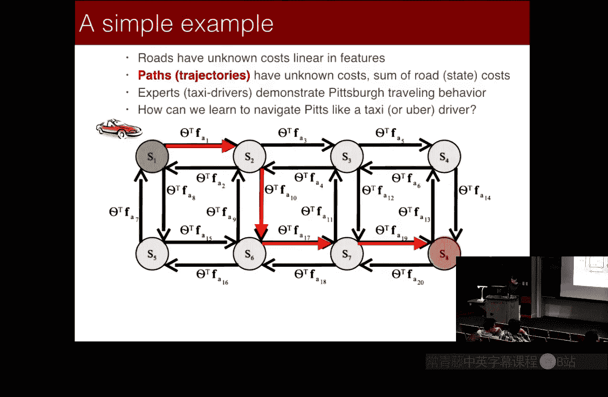
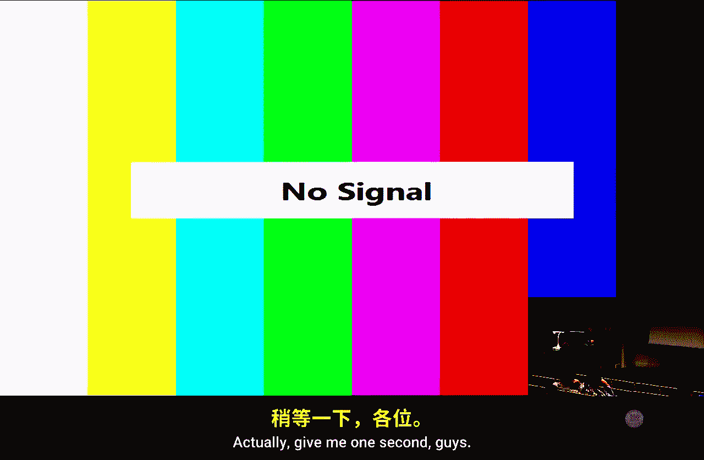
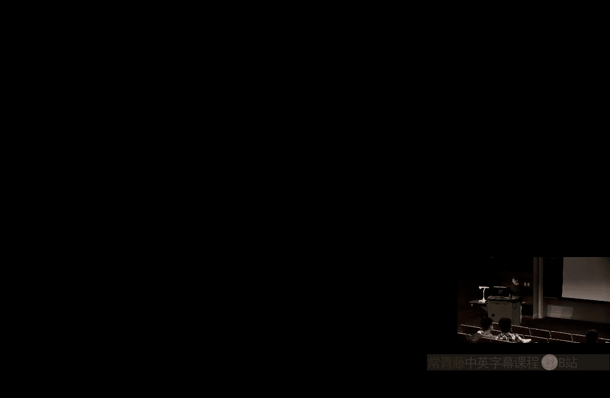
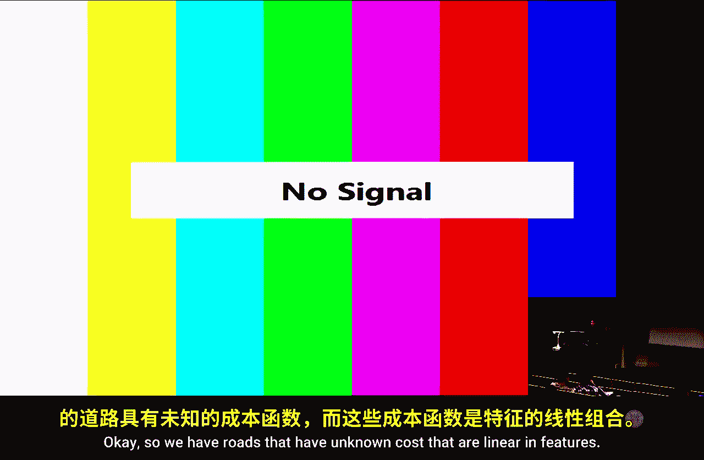
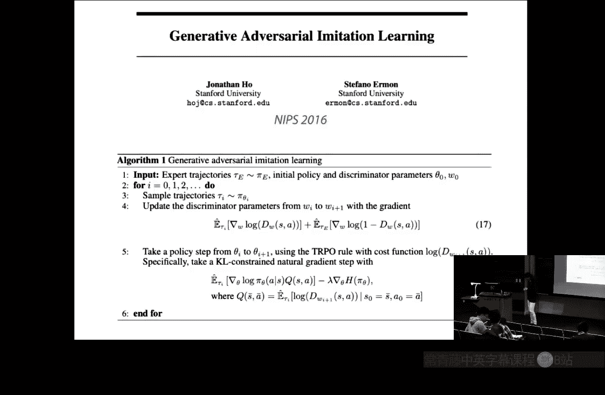

# 卡耐基梅隆大学【中英⚡深度强化学习与控制｜10-703 Fall 2018, Deep Reinforcement Learning and Control】 p21 P21 21  Maximum Entropy Inverse RL, Adversarial imitation learning -BV1RyqPBbEJV_p21-

Okay， welcome。 We'll continue on imitation learning and in reinforcement learning。 A couple of。

Logistic information next week， we're going to have a couple of guest lectures， Ro。

And Barnaash will present on Monday and Wednesday。And please do come in person It's way more fun you'll be able to ask questions。

 I don't know what Rass will talk about， I'm sure it's super exciting。

 I know what Barnabush will talk about， which is using reinforcement learning on scheduling experiments for physical sciences like chemistry and physics。

Where every experiment takes time， we do want to。Try to find the， as we say。Needle and a high stack。

 and it's very important which experiment to schedule next in a smart。

 intelligent way as opposed to brute for search， there is even a new master's degree starting in CMU exactly on master's on physical sciences。

Reinforment learning is in the center of this topic。

 So please do come next week and tell your friends that are watching us from home to also come。And。

 and and have fun。So this is reinforcement learning。

 we have a reward function and we need to come up with an algorithm that maximizes reward function。

Sometimes the dynamics are known on the environment， sometimes they're not。

And what we said about in reinforce learning。Is that it's the opposite problem。

 We have a set of expert trajectories。And we tried to come up with a reward function that if you would try to maximize a reward function。

 you would generate similar trajectories， okay。Now， in contrast to dagger。

 we cannot interactively query the expert to ask additional labels。

 So this is the set that will investigate in this lecture。 Okay， which is a more realistic set。

So what in reinforcement learning boils down is a distribution matching problem。

 Can we come up with a policy whose resulting state action distribution matches the state action distribution of the imator。

Okay and what dagger does， it takes an approximation to that distribution matching problem and says if I try to approximate for every state the action。

 then potentially I will end up with distributions that match we saw that this is not the case very fast the distribution divergt that trajectory diverges is not you cannot basically forget about it in dependencies of actions outlook and trajectory and try to break such trajectory you know distribution matching problem into action matching and we had to essentially iteratively query the expert and and here's our datas so we will see that at the end of this lecture we will。

Tackle this as a distribution matching problem using latest tools。From generative models， okay。

Let's start with a very simple example。Imagine that we want to learn a policy。To drive。

A cab in the city of Pittsburgh。And when this paper came out， there was no Uber。

 So there were indeed。Collecting expert traors from taxi drivers。松。The states are road segments。And。

The roads have costs。 O， all these road segments must have costs that are linear in features。

 These linear in features is also the assumption that we had。In the previous lecture。

 soon in about 20 slides， we will relax this assumption。 Okay， but for now。

 imagine that every road segment has a cost which is linear in its features。😊，Yeah。

 so let's forget about goals。 We just want to estimate how good is to drive in every road segment。

 okay。The problem is that given a set of taxi driver trajectories。

 can I come up with those costs so that if I compute a policy under this rewards for these road segments。

 my resulting trajectorors will match those expert trajectorors collected from the taxi drivers。

So what features would you use to evaluate a road segment。

 One could be how many bridges that road segment。these roads and the crosses。 Okay。

 we know that bridges have traffic。 Another would be how many miles is in the interstate versuss suburban neighborhood roads versus downtown roads。

 The other could be how many number of stoplight or stop signs this road segment has， okay。

Actually， give me one second guys one second。

Yes， we're good。Yes， okay。

Okay， so we have rows that have unknown costs that are linearing features， we have trajectories。

 okay that are the sum of road cost。 so this is important that the cost of a trajectory is additive over the costs over different states。

We have experts taxi drivers demonstrate as their behavior， and we want to learn to drive like them。

And the first thing we may try to do is feature matching。

 And this is exactly what we discussed in the last lecture， which means what。

I can estimate expected features along trajectors of the experts，😮。

And I will try to match those features in expectation under the policy that we'll come up with。

What does this mean in practice that if taxi drivers。Use。

130 miles of interstate and cross 12 bridges in average over a month。Worse of trips。

The policy that we should come up with also in expectation should you know。

 use that much the many miles of interstate and cross similar number of bridges， okay。

So this sounds very reasonable， okay？😡，Will come up essentially with some sufficient statistics that we try to match between the expert trajectories and that trajectorors we'll come up with。

So F Tilde。Is the demonstrated feature counts。 Okay， we expected features。 Well。

 the expectation is essentially sum under the expert trajectories。And。

Our policy is induces this trajectory distribution。

 We know that what is the probability of the trajectory。 Please remember this， you know。

 formula because probability of a trajectory will come up everywhere in this lecture。

 It's at the composition of the probability of the first state and the probability of action given state。

 which is exactly our policy that we try to come up with and the dynamics。

 probability of next state given the current state and action and we have zero control over the dynamics on the environment。

 Okay， We only have control over this。P alpha given S。

 So coming up with a distribution over trajectories essentially means coming up with a distribution of action。

 given states。So this feature matching sounds very reasonable。 Alright， it sounds very reasonable。

 Now， what is the problem of just asking。For those expected feature matches。Too much。

 to expected feature counts too much between experts and the trajectory we're trying to come up with。

What could be a potentially caveat of this constraint？Essentially， we try too much distributions。

And we try to measure。Distribution distance， simply looking at the expected values of features。

The thing is that there could be many distributions over trajectories that satisfy this matching of expected features。

For example， you can generate the same mean of 130 miles of interstate and 12 bridges crossed by never during the month。

Either across a bridge or go for an interstate。 But at the last stage。

 you just wrap around bridges and interstate。 And then again， in expectation， yes。

 you matched the the statistics。 Do you see the the problem that there are tons and tons of distributions you can come up with that satisfy your constraint。

Right， for example， you say on expectation， I want to attend the class in person 50% of the time。

 this 50% can be in the beginning can be， in the end。

 there is a huge difference in where you're going to distribute your watching of the lecture in class。

 right？The question is the following。 The constraints still sounds reasonable。

 The question is which distribution out of all those distributions that satisfy this constraint。

 we should pick。Well， here is the interesting thing。

 We don't need to answer this question because other people have answered this question for us。

 There is the principle of maximum entropy， which says if you have some sufficient statistics or prior information about the distribution。

 okay， that you're trying to satisfy the distribution you need to choose。

Is the one that does not overcome it that it is as uncertain as possible。

 as high entropy as possible， as surprising as possible under your constraint。Right， and。

And why this is the best distribution to choose， because then you make sure you don'tate any of your prior biases into that distribution beyond the constraint you are trying to satisfy。

😡，Another。Yes， and this is exactly what this is， but。

We want to minimize the amount of prior information that we built into that distribution。

 We don't want put to put any biases or easy initialization biases into that distribution。

 And at the same time， there is this physical explanation that， yes。

 physical systems tend to move towards maximum entropy configurations over time。 So。

 so this is exactly what were going to choose also。

 we're going to resolve this ambiguity by choosing the distribution of our trajectories that has the maximum entropy。

啊。This is the definition of a maximum entropy is。The expected surprise。

What is surprise minus log of P。If。A very surprising event happens。What does this mean。

 an event that has low probability。Then the surprise is high， if an event has high probability。

 the surprise is low，And。I want to ask you， imagine that we're flipping coins。If the coin is fair。

 it will come back heads and tails 50% of the time。

If the coin is biased or it is not unfair or in some way， it will， you know。

 prefer heads more than tails。Which of the two cases has highest stropy。The fair coin。

Or the bias going。The fair coin， because we're surprised more， right， we can have less。

 we're less ability to predict the result。 okay well if bring heads 80% of the time。

 then I'm much better predicting heads， right？okay。

 so we understand what this maximum would be and just making sure here。Okay， great。

 So let's try to do this optimization。We're going to come up with this distribution over trajectories that maximizes the entropy。

 yes。So if we already have a distribution。Why wouldn't you try to like minimize the care diveverence with the ground root distribution？

Okay， so your yes， your colleague says， why if we have a set of expert trajectories。

 that's what we have， we have a set of expert trajectories and we try to do distribution matching between the set of expert trajectories。

 this distribution of expert trajectories and the distribution will come up with why would you pick the expectations of feature count as a good measure？

Okay， why don't you try to put a better measure between the distributions。

 Is this what you're saying， Yes， because when this machinery was developed。

 people didn't know how to do this。 However， on November 26， we will have here an excellent young。

CM U graduate。 Okay， he's right now in the faculty market， who will talk about。learningearning。

Polices from expert behavior of driving again， cell driving cars。

 how to mimic this driving behavior exactly by minimizing two way KL between the expert trajectories and the trajectories you generate Okay。

 however， I would like to say that this is， I would say， historic type of introduction。

It's just a beautiful story。 how it starts from there。

 And people realize eventually that you know what， who cares about the expectations。

 Let me just do distribution matching directly and we end up there。 Okay， we will end up there。

 and we end up on guns that does try to do some type of distribution matching。

 I want to say that on November 26， we'll have a talk which where the K L constrain this way more。😊。

Explicit on and I think it's the best right now， trajectory prediction。 Okay， does this make sense。

 So let's， let's come up with this question again on November 26。Yes。3た。

So those tall eyes are a state that sort trajectory happens I'm not sure what you meet tall eyes。下我。

Oh， Tao eyes Taoai is one trajectory。しては。No， it is a path。 it's a path。

 It's a path that your policy is generating。 And what it says is that under the expectation。

Of your traors that you're generating， if you take their features。

 you better match the demonstration features， okay。Allright。

 so you're trying to come up with a policy and it says the number of months you're going to spend the computer have some expert that did very well in their studies。

 I want to try to match how many times I'm going to spend on the computer。

 how many times I'm going to spend the gym， how many times I'm going to spend parting based on the expectations of that other person now on expectation this doesn't mean anything we know that how things are distributed is way more than expectation like when you're going to go to the gym before or after a deadline is important and the expectation forgets about this information。

especially because we're going to talk about features over states。

 So where are these features throughout the trajectory is nowhere in these expected feature count。

 Does thist make sense a little bit to what I'm saying。可わ。いか。This trajectory。Yes， B is a probability。

 Taai is a trajectory。 P Tay is。The probability of a trajectory， yes， by the way。

 I want to say that soon this linearity we're going to remove this linearity of the cost， okay。

 at least， but still we're going to be additive over cost over states。 okay。

 like a cost of a trajectory will be added over the cost of the states。Let's see。 Anyhow。

 that's what people decided to do。 And they said， okay， let me try to find。

The distribution of our trajectories， okay， which we just had the formula right there。

 which essentially means find the policy。 Okay， P alpha givenness。That maximizes the entropy。

And at the same time， what expectation matches the demonstration that demonstrated feature count。

F them， okay。And of course， it better also add to one because it's a distribution。

This means that it should be as uniform as possible。

I don't want to overcome it to a particular distribution。

Remember that the cost of a trajectory is linear。Over features。

 and not only it is linear over features， but it is additive over the cost of the states。

 We said that。It is additive over the cost of the road segments。Then。

The constraint can be written in this way， I have a distribution over the costs of my trajectories。

And I need to match on average the cost of the expert Now in the previous slide we were matching features。

 now we're matching costs， why because IRL is all about recovering this golden cost function the IRL goal is to come up with those costs because they say if I have the cost。

 I can design then any trajectory I want by changing this costs。😡。

And here is how the optimization problem is written down I'm trying to。Well， yes。

 maximize the entropy， minimize the minus of the entropy under those constraints。

 The previous constraints were in terms of features。 Those constraints are in terms of costs。Okay。

Now， I'm not sure if everybody knows that。 I think I mean。

 it's a very basic result that if you try to maximize your entropy。And you have this problem。 Okay。

 it's a constrained optimization problem。 What are we going to do？ Well， first， I mean。

 obviously you can do like the method of like grand multipliers。

So we take the constraints into the objective。We put this little。

La Grian multipliers in front of every constraint。And we take the gradient and set it to 0。

And what you're going to end up with is this form， which means what the probability you are searching is。

Proportal to an exponential of those costs。 So what does this mean， This means that。

How does this exponential family of distributions come out Well it comes out from the principle of maximum entropy。

 okay。So you have some features you are trying to match。오케이。

And you want to find the distribution that matchess those features。

 Then what you should do is you should consider this family of distributions。

 the exponential family of distributions， which is what。

It says that the probability of a particular member of that distribution is proportional to the exponent of those features。

And we have also this partition function Z that make sure that our distribution sums to one。Okay。

 we just sum all those unormalized probabilities。So we saw that this exponential family that comes out all the time。

 right energy based models， everybody use exponential families。

 well there is a good reason this family maximizes the entropy okay the distribution is the fund distribution maximizes the entropy under the constraints of those feature counts okay。

So， yes， we have preference for low cost path。And we have equal cost。

Pass with equal costs are equally probable。Okay， we don't over commit to one path or the other。

If they have the same cost， do you， do you see。So， indeed， we are a high entropy distribution。

 We don't overcome more than what the cost tell us。 Does this make sense to you guys。Okay， great。

 So you better lets we can stay in that result why。

 because it's going to come up once we're going to talk about soft learning and maximum entrepreneurpy reinforce learning。

 again， we'll be using exponents exactly because of this reason。

 once you have some features here trying too much， you better put them in the exponent and then put the partition function and this is the family distributions you want to consider。

 Okay， because this family distributions。😊，If costs are the same。

 the same probability will be assigned to both。Outcomes to， to， to both Yeah。

 to both data poison and distribution。So since now we know what how to say form。

We need to use to have maximum entropy on our side。 What are we going to use。

We're going to try to maximize the likelihood。What maximize the likelihood Well will maximize the likelihood of the expert trajectories。

 We want to make our expert trajectories very probable。

 We want to come up with parameters of that cost。 You remember， theta transpose F。

 We're trying to find those thes now。 Okay， so that our expert trajectories are very probable。

That's what we always do。 We， do you， do you guys agree。Great， so maximizing， yes。

 the product is similar to maximize the sum of the logs。😊，Sorry。

 maximizing the log of the product to maximizing the sum of the logs of the individual expert trajectories。

 and we already said that we need to choose this exponential familiar distributions So probability of T star。

 What is the star1 of those expert trajectories will be written in terms of this exponent minus c theta tau star C theta tau star is the cost。

 the higher the cost， the lower the probability。 that's why we need to have this minus over there okay。

I mean， since our agreement is thattheta is the cost， not the reward， okay。Sa yeah， let's see。Well。

 to be completely honest here， maybe not because you don't have C。

 so I can put the minuss in the theus。 But because our agreement is that C is the cost。

 that's why you need then the the minuss。Great， so what are we going to do。

 This is what happens all the time with gendered models。 We're just going to decompose thenominator。

 then the denominator。Yes。And。Yes， the denominator is the same for all expert trajectories。

 so basically we're going to have d times that term。By the way， that term looks extremely worrying。

 I see a big summation there overall all possible trajectories。

 let's see how this is going to be done。Other than that， the things look。So far。Okay。Right。嗯。

What have we done nothing， essentially， we made the maximization into a minimization and we say。

 okay， this， I'm going to call it my loss function。Okay， just a very simple manipulation so far。

 Let's start to take a gradient。 Okay， sure we can take a gradient。

 and then we have a summation over the trajectories。Prorovide by the experts。Of the gradient。

 of the cost。If the cost is linear and is extremely simple， this is just the features， right？

The great novelbel linear term plus。The number of expert trajectories。Of。Well。

 if we take the gradient of this， the log of something is one over。 this goes into the denominator。

 Okay， and then we have a summation over tau。 The gradient goes inside the summation。

 What is the gradient of V to the minus city the tau。

 Well the exponent multiplied with the gradient of the thing that is in the exponent， right。

 minus density the tau de Okay， this is standard。Ruleles of differentiation。

And if we do a little bit of manipulation， in particular what type of manipulation this happens here。

 this guy， which is the partition function， will go inside the summation and divide this term。

 and here we come up again with the probability of a trajectory。Let's see how this looks。

 Well it says that the gradient of the cost of the expert should match in expectation the gradients of the costs of the distribution you're trying to come up with。

😮，Okay， this makes sense intuitively。Now we're going to do a few more manipulations to go from summations over trajectories to summations over states。

 we do expect that this is possible because all these costs are just additive over states， okay？打你。

tiny little world here is again the probability of a trajectory。

 probability of being on the first state， the probability of taking actions under states and where the dynamics model takes us。

 we just discussed why we like the probability of those trajectorors to be proportional to the exponent of the minus cost to have the maximum entropy be by our side。

And we remember that the cost of the trajectory is additive over the cost of states。

So this means that the probability of a trajectory is proportional to the exponent of the summation over the cost of the states。

And what we had before and was summation over trajectories。 Now， theres sumation over states。

 The states are taken from the trajectories of the expert。

 and the states are taken from the trajectories that our。Policy will come up with， okay。

And we have a probability of a state as a probability of a trajectory。

 And this is a probability of a cost of a particular state as a as instead of the cost of a trajectory。

 okay。Great， so this means that successful limitation boils down to learning a policy。

 which will induce a distribution over trajectories that matches the state visitation distribution。😊。

Well， I wouldn't say the state visit distribution。 I would say that the gradients between the cost coming from the expert trajectories and the expected gradients going to spot coming from your distribution you're going to come up with better match。

 Okay this this， what we say here is going to come up in later slides。 Now。

 this cost can be attached to states or can be attached to statess and actions， okay。So this work。

 which we're going to soon call maximum entropy inverse reinforcement learning and came right after the formulation from Peter Abi and And that we saw in the previous lecture was developed here in CMU and when it was first developed。

 it was considered for this example that I told you driving Pittsburgh where the dynamics are known。

 you know how one road is match to another road that if you turn right you're going to end up from this state to that state。

 So we have Tular method and known dynamics。And the thing is that under non dynamics so what is the difficult let's go back and see what is the difficult in this slide because we're ready to compute gradients now。

 the only thing that we're missing is this probabilities of state given theta and tau。

 so basically how long how probable is every state under our。😊，Policy， okay。

How we're going to compute those。 Well， it turns out that if you know the dynamics and you are in a table or setup。

 like in the first paper that proposed this method， it's very easy。 You just do dynamic programming。

 Let me show you how。First， instead of consider how long your policy will stay in every state。😮。

You just use a time index and say， how long am I possibly going to stay in this state in the first time instance。

 And then in the second time instance， And then in the third and the fourth。 and eventually。

Eventually the desired state density will be the summation across the time steps。

 the probability or the time that your policy spent on a particular state is how much time you spend in the first。

 the second the third， the fourth time steps okay so if you do this type of time indexing and you initialize there in the first time step。

 then there is the very simple recursive formula that you can apply and estimate those time index the intensity starting from zero and going to。

😊，Capital town， okay。Okay， so we we said that we know the dynamics。

 So the probability of S given as prime and alpha we know。

The initial state distribution mean one of us， we know。The probability of alpha given S。

 we do not know。 this is exactly what we're trying to estimate is our policy， right。

 Do you guys agree。But if we knew the policy， then the state density width。

Would come out straight out of this formula。 Do you see in Tular methods？And non dynamics。 do。

 do you agree a little bit with this。Because the probability of being a particular state at T plus1 decomposes over terms。

Over actions in states。What is the probability of being in S prime， Okay。

 and what's the probability of jump from S prime to S in the next time step。Okay。

Does this make sense， Do you understand this recursive formula， how we go assuming that we have？

A distribution over states for time T。We can predict the probability of states at time T plus one。

 okay。All right， so since you can so easy， this so easy to estimate the probability of being in a particular state。

 then you just need to plug it into your formula and take gradients however。Yes， and， and what。

 and one more simplification you can do simply because you assume that you have linear costs。Well。

 then。The only thing that survives here is D F， and the only thing that survives here is D F。

 And basically， this shows again that we are back at feature matching， okay。Now。

 you're gonna to say since youre back at F， Imagine why you need the cost。 Well， you need the cost。

 because if you remember were use the probability of alpha given S。 so essentially。

These are just the following iterative method of。In virtual reinforcement learning， first。

 we'll start with some expert demonstration from the taxi drivers。Then。Because we have， I mean。

 in this particular case， you have non dynamics and it's a tableular method so you can use the simplest possible thing you can use to compute a policy。

 given your initialization of the cost theta， okay。And then。Based on this policy。

 you can solve from the state visitation frequencies。

And you can plug whatever you found into your gradient。And you can update your datata。

 which is update the costs。So basically， we alternate。 And this is how actually。

 I don't know if you remember。 But that's exactly the iteration we did in the previous lecture。

 But with different formulation， we didn't have maximum me in the previous lecture。 If you remember。

 we had this max margin。For， we alternate between updating our cost and updating our policy。Okay。

 and given a policy， there is dynamic programming that will give you the state densities。

To plug into your gradient for the cost。So how does this look like， Well， I will initialize my thes。

We have here are the features we have for the demonstrators， we have these bridges are three and 20。

7 and 10， and I initialize my thetas and I come up with some particular weights。

And then under those weights， I compute。The expected feature counts。

And once I see that the particular feature has lower value than the corresponding。You know。

 expected feature count from the expert trajectories。

 Then I will basically decrease its cost so that I make it more probable。Allright。

 and I iterate till I'm happy with my matching。😊，Okay， so and in this way， I'm gonna come up with a。

Policy that ends up with some。distribution of a traject is that both does not over and obeys the expected feature counts。

 assuming that this is what you want。 You want to put the constraint that the expected feature counts much。

 okay。Now， what was the problem？With the previous formulation。So are we kind of okay so far， O。

 so we had two limitations， if you remember。The first is that the cost was linear over the features。

 and the second is that dynamics were assumed known。Both are big im to me。 It seems that the first。

Is not that difficult。 The second is definitely more difficult。

 and there has been many works that try to address the first or the second。 In particular。

 the work on Finn 2016。Try to address both。 yeah。Let's see。First of all。

 let's try to remove these two constraints。The first we're going to do is we'll consider costs of trajectories。

That are still additive in time over costs of states， okay？

But this cost of states will not be linear anymore。Will not。 They will not be linear。

 So we'll forget about this。Still， we have this maximum likelihood。 samee thing。 Still。

 we want maximum metropy So we'll end up with this exponential family。

 So nothing has changed over there。 Of course， we still need to carry on our shoulders this partition function。

 okay， which sums the normalizedized probabilities of all the trajectories。And。Yes， and。

 and here is the the loss function that this is exactly what we had seen earlier， right？ Now。

 if you remember earlier， we had Tular methods， we had， let's go back to see what we had。Yeah。

 we had the summation over states。 Okay， and we're in Tular methods， which means what。

 you can enumerate all your states。 I know all the role segments in Pittsburgh。 Does this make sense。

 So this is not that terrible。 I can just go through all of them。

 Estimate the density to all of them。 That's exactly what we did。And then， you know。

 multiply with a gradient。The problem is that what happens once you cannot not enumerate。

Those states anymore， right， You have large， continuous state spaces。Correct。😊，Here as again。

 we had Tular methods in Tular methods， you can enumerate right in a table， all possible states。

And actions。That's why it's called Tr。Now， let's see what's going happen with this summation。

 which now is clearly intractable。Well， this looks very easy and nice， right， Look how nice it is。

 It's not linear， but still， I can take gradient。Right as long as it's differentiable。

Here is the problem。 There is a huge summation here over all states on my state space。

What are we going to do？And， and we need to compute this summation on the Z。 that's the problem。Yeah。

 so you see here an integral over trajectories， but please remember the previous slides where we converted integrals and summation over trajectories to to summs over states。

 the same thing here because as we said the cost is addeded over states so what do you think we should do now to compute this huge。

三。Well， I say with sample， the thing is the following， some of those states。

 most of those states will have extremely low probability， okay？I mean。

 there are tons of states in the world but the experts and our trajectory will not go through those states。

 Okay like， for example。Once we play Alphago out of all the states that are possible in the game and the board configurations。

 we visit extremely few once we play the game。All right。呃。So， okay， fine。 So let's try to sum。

 This means that， first of all， we need to come up with a distribution。

We need to come up with the distribution from where we're going to sample。嗯。

What would be the best distribution， The best distribution would be。

The distribution of our trajectories that are exactly the expert distribution okay and in fact， yes。

 some papers did that。 they went around the expert trajectories and sampled nearby because they say in any case around far away from the experts。

 the probability is probably is very low， so why should I bother with these parts of the state space okay？

And some other papers said， I want to show this actually weird is and then we'll come back here here。

Some people said， let's sample uniform everywhere。Some people said in the vicinity of the demonstrations。

 I will only care about what happens nearby the demonstration trajecties which makes sense。

 the demonstrator went this way I will probably check what's going to happen nearby。

 but I will definitely not consider walking along the seats right because why would I consider this and then Finn said were going to start with some cu is not going to be good by sampling distribution。

 but I will update this cu which makes sense of course as I update。啊。Yes， as I improve my cost。

 I will come up with a better policy。 of course Id better use this new policy to sample for my Z。

 correct， so it sounds supernatural。😡，嗯。And let's see how to do it。

 So here I just put the general formula for important sampling。 I'm sure you've seen it many times。

 You have some expectation under some probability distribution P， which you don't know。

 don you cannot sample from that P。But you'll sample from another distribution Q and you better put the correction term and the denominator once your expectations that with respect to Q as opposed to respect to P。

 Allright and by putting this。 So here is the Z here is the integral in the intractable sum you try to estimate and there is some fantastic distribution out there that if you sample from it you will end up states with high probability。

 you don't know the distribution。 So what you're going to do is you're going to collect a set of trajectories from another distribution queue。

All right。And here is this。This F， But you better put the the Q on the bottom。

 correct for the fact that you are sampling from， from Q。嗯。So this looks， in my opinion。

 a little bit。Interesting because this Q is what is the policy you're trying to come up with。

 Okay that's what what you're trying to come up with。 So let's see how the math works out。

 Well here is what we want to estimate。 Yes， now you just picked the Q you put it in the summation and you have this important sampling weights which is exactly the exponent over the Q and here is how the gradient works out。

 you remember this gradient formula from few slides ago。

 the only difference is that here is you have a general gradient as opposed to F because you don't have a linear cost same thing here and this w essentially we had before the state densities and now the state densities。

😊，We have this exponent。 Okay， that tells us when a state is probable， but we divided by the Q。

 because that's how where we're sampling from。And them。What does it mean to， to。

 to itatively update that sampling distribution。Well， first。You need to initialize your cube， O。

 which is the distribution for where you're going be estimating the partition function。

You can either initialize it randomly or initialize close to the expert because you are trying to find some distribution over tra as close to the expert。

 al right。You have already a set of expert trajectories。Now， you will generate samples from that Q。

And you will use these generated samples to update the cost using gradient and de。

 exactly what we saw in the previous slide。And then you will update this queue。嗯。

Using once you come up with you take the current cost and given the current cost。

 you can use your favorite method to update your policyCQ。And。

So basically where it says update your queue is the forward reinforcement learning problem and where it says update the rewards is the reverse reinforcement learning problem in the previous slide we saw this gradient term how you update your cost okay。

嗯。Interestingly， this queue is exactly the policy you' are looking for。😊，And。This is a diagram。

 that shows， again。So you initialize your queue。So you sample from that queue， all right。

 and then you have a cost that looks at the human demonstrations。

 looks at your sample trajectories and takes a gradient step， you remember。😮，The gradient。

And then you update the queue， all right？Now。So essentially， we have。

A generator that predicts some probability over trajectories。And then， we have。

A judge that tells us how good are those trajectories with respect to the expert trajectories， Okay。

 so is it if。Our policy is a generator network， and。You know。

 this formula that takes the gradient steps。And pushes us to be closer。

To the expert trajectors as a discriminator network。So， if we see。The diagram in that form。

 we don't care about the rewards。 Do you see what I mean， You can throw away the rewards。

I am predicting。A policy， probability of action given states。

 then I give you my generated trajectories and you have the expert trajectories。

 and you tell me how I need to change my policy。Okay， so that my trajectory is much more。

With the expert。 now， the way we did it before is through going through the cost， which means what。

I had to come up with the policy how by looking at the cost， the cost would generate a policy for me。

 Okay， using a forward reinforcement learning problem。 once I have a reward， I can generate a policy。

 correct， then you would correct my reward。All right。You would， you would correct。

 So basically the generator and the discriminator before were communicating through this cost function。

 the cost theta over state features。I would come up with a policy based on those cost features。

 the costs over the features。 and the discriminator would tell me how to adapt those costs。

So that next time that will come up with a policy。Okay。

I'll be able to much better the costs of the expert。Now the truth is the following。

 you do not need these costs， you can also just generate those trajectories。

 and have a discriminator that directly looks at trajectories without going through the cost。

 and then you don't need to solve iteratively the reinforcement learning problem， yes。

What is to stop that is if you don't have enough human demonstrations。

What is to stop the this matter from just learning human demonstrations。 So in that case。

 you have a policy that doesn't generalize。 Yeah， that's a good question。

 and the answer is the following。 I'm not sure if we should answer it now or if you just in1 slides。

 because I'm about to discuss a little bit about the guns。 But the idea is the following。

 The same thing happens。 Also when you generate images。 You want to generate some images。

 You have some set of real images。And you start predicting images through your model， the generator。

And if you， you know， forever。Take this gradient steps。

You be able to match exactly the distribution of of natural images。 Allright， now。

 there are a couple of things that prevent you to do so so that you don't generalize。😊。

So that you're generalizing as opposed to exactly mimicking your expert images。

The first is that you stop early。You stop optimizing at some point and say， okay。

 I think my images look good enough。 The second is the capacity of the generator。

 the generator will not be able to generate your the images You show it perfectly。

Does this make sense。Right， because it's a small function。

 So if youll generate a restroom where the bathroom is there and then the bathroom is there。

 potentially would also generate by the random noise you fit it also when the bathroom is in the middle。

 okay。It's a smooth function。だかなから。没 this。Yes， you should。 it should not be small。 We need more。

 I agree with you， yes。Mhm。😊，But I can try to， to have a better answer because I agree with you。

 It also depends very much on how many demonstration trajectors you have。

 So you really be able to see what means the distribution。

 I can try to find when things break like under which number， okay。Yeah。

 so I think this is the most interesting thing that so far in IRL。

 the policy would communicate with this judge through the cost while if you just consider that the only thing you care to match is state action distributions。

 who cares about the cost， you can directly take gradients based on this distribution matching as opposed to let me try to make the cost so that if I solve my reverseal learning problem。

 I will approach closer to the expert。Let's do- so we'll come back to this。

 we'll come back to this adversarial imitation learning。

 but basically let's discuss about guns for a few slides。Well， in General adversarial networks。

 we came up， I think， 2014。Is essentially a generative model。

Wwhichch started as a generated model of images， but you can put it on trajectories also。

 and people have put it on trajectories， okay， like taxi driver trajectories。

Where you sample some noisy。You have a neural network that takes this noise and produces some images of course。

 in the beginning， this image will going be completely random。

And then you have another network that takes your generated images and some real natural images here of digits。

And is trying to predict。When it's trying to output one， the discriminator is trying to point one。

 when the data， when the image came from the real。Data distribution。

 real images and 0 when it was generated。 So the discriminator is trying to figure out which data points come from the rear distribution and which data points come from。

The generator。Okay。At the same time， the generator is trying to do the opposite。Is trying。

To make the discriminator。Output。A high value， not for the natural images。

 but rather from the images that the generator provided。 Okay。

 so we have a generator discriminator playing a game。Now。

 the interesting thing here is the following。😊，How are these two networks initialized？

 They are both initialized with random widths。The goal of the discriminator is not to just。You know。

 be very good at distinguishing the images。 The whole point of having a discriminator there is somebody to provide you gradients of how to improve your generation process。

Now， imagine that we give to the generator fantastic Mnes digits。

 and then we also feed the completely random images from the initialized generator network。😊。

It's very， very easy for the discriminator to say。No， this is not correct。

 It's obviously generated from the generator。 And， yes， this is a natural， correct digit。

 What we do is the following。First， in the beginning of the training。

 oftentimes we add noise to that ground through digits to make them look more like random。

 What's gonna to come out from the generator to make the job of the discriminator harder so that once it sees a little bit things too much to be able to say yes。

 go towards this direction。 I think this is what confuses me。

 you're doing good job here or confusing me， for example。

 because if the discriminator never gives a useful gradient signal。 If it always says， oh。

 this is fake。 This is fake。 This is fake。 It never be able to say， oh， this looks。

Kind of close to real。 Then you don't have any useful gra signal go to the generator。

 which is the whole。Point of this process。 Does this make sense。So that's one thing。

 The second thing is that the way we schedule the optimization between generator and discriminator is that we coordinate them so we don't take steps on the discriminator。

 We don't make them harder to fool unless first we train our generator a little bit。

 Does this make sense so they need to progress the same so that they are able to help each other essentially we have useful gradients to go on the generative network。

So why， why should the guns， What was wrong with the generative models we had before。Well。

It's the same， yes。IWon could you explain what the role of Z is as？But to generate。

 so Z it just trying to， So it it comes from the uniform distribution。 Okay。

 we just want the generator。 We need to feed something to the generator to to generate natural images。

 Do you agree with this。So we feed noise and we believe that this super expressive and nonlinear function right here will be able to convert these noise into natural images and as you change the noise。

 you hope to span the distribution， the manifold of natural images here， the digits。

Does this make sense， So the generator is supposed to convert that distribution into distribution of images。

 And interestingly， on November 26， we're gonna see this Z being。Trajectories。

 so you'll see trajectories， random， completely random distribution trajectories being converted into trajectories that are come。

 Let's say， similar to the expert trajectories， okay。All right。

 so what's the problem with the previous generative models and what is different here？

I want you to remember what we said during our curiosity driven exploration lecture。

 we said we wanted to compute densities like how probably the particular image。

 I give you a data set， and I want you to give me back probabilities of images belonging to that dataset。

 That's how the traditional generative models where they were supposed to give you an image and they assign you a probability of this image coming from you know the manifold you're trying to represent So。

So here， there is no such computation of probabilities。 We just learn to sample。 Allright。

 And this is better because now you don't need to estimate partition functions because to be able to estimate probabilities。

 you always need to make sure that's probabilitybil sum to one。

 you will always have this intractable sums that we saw previously。 Okay， we saw that before guns。

 the only thing we were able to do with the summation is in the tableular methods where you can enumerate all these stigmas。

 once you go and in a large space where you cannot enumerate anymore。 Allright， then I mean。

 there was a problem。 Then we said， oh， we need to do important sampling。

 and we need to find this cu and it ended up that， yes， if you use gun。

 it will guide you how to find that queue。Right， just by you learning to sample essentially correctly from your state space without caring about probabilities and assignment on values。

 So let's see。So the risk of success is discriminative deep learning so far， however。

 generative models are important。There are models that are able to model a particular manifold of data you care about。

 I mean why generative models well we care about generative models everywhere， for example。

 we want to be able to mimic human speech or we want to be able to mimic sentences that humans write or we want to be able to do machine translation which is again generative modeling but instead of conditioning noise。

 what I showed is a little bit more useful so you condition on the sentence that you're trying to translate okay。

So there is this word conditional， which means， again， you try to mimic something from a manifold。

 but conditionally， you know something。 And indeed。

 these pro over traors that we're gonna to see are conditional。 They look at the patch。

Around the taxi。 they see that there' is road。 Okay， they see where the road turns。

 They see the previous history of where the the cab was， and they predict a distribution。

 So it is a generative model， but it is a conditional， generative model。

 Remember the conditional encoders。 These are different models Here is generative developer course there。

 We talk about V is。 This that's fine。 So。The conditional variableal encoders belong to the general class or conditional geneative models。

 However， before Bs， things were even harder with these intractable sumations。嗯。Okay， great。

 So we care about generative models。 And what was the dominant approach， Max likelihood。

 And this is exactly also what we saw earlier， right。

 We said we want to maximize the likelihood of our expert trajectories。 What else can you do， right。

 You're trying to model the manifold of trajectories？ Yes。

 youre try to learn a machinery that will maximize their likelihood。😊。

What is the problem with this formulation， We remember what was the problem。

 The problem is that all these intractable sumations， these partition functions。

People have come up with different forms of generative models here。

 and directed Gal models allow you to compute。Features， here is again， the exponent。

This is good now we know that it comes from the principle of maximum entropy so it makes sense they say I want to come up with a probability over observable x and latent H so that I don't overcomit I'm just trying to match the sufficient statistics seen from my data。

 the manifold and prime domic and once I see that the statistics between data points much I'm going to assign equal probability。

Right。Very simple。What is not simple is these summations。

 that you need to do a sum of O the X and all theH。

 and these are huge spaces and how you are supposed to compute those summations， right？

And if you put some。Yeah。And this is called the probability， again， we had thenominator。

 the denominator exactly same form as what we had in our industrial reinforcement learning。 right。

 you see it's exactly the same。😊，Texim equation 4。People have come up with direct Gka models where there are this conditional independence and assumptionss。

Still， we have a problem。 Again， we have exponentially in many states。嗯。

In any case there are a lot of different gene models here is the VAs they helped a little bit by training this recognition model that conditions on your output and this helps you guide the sampling okay so you don't need too many Z's because you have a cheating model that conditions on your output and tells you whats used to use and you're trying to minimize the KL between those good Z's that cheat and the ones that you sample from random noise。

😊，But the main idea on general adresarial networks is do not write a formula for probability of your data points。

Just learn to sample directly。I'll give you white noise， or I'll give you， not white noise。

 noise input， or I'll give you noise input at some conditioning input。

 and you're supposed to learn to sample from the desired output。 forget about assigning。

 How probable is it one。 I mean， we people are also not very good at assigning。

 exactly how probable is We can say， oh， yeah， that looks probable。 And then we say， oh， yeah。

 that doesn't look probable。 And that's what the discriminator also is doing。 All right。

 we don't say， okay， this is 0。0033。All right。嗯。So here is how it looks like。

The generator takes us input this noisy from this Gaussion， we we have many of these， we have 500 z。

 each one comes from a zero mean units a standard deviation Gaussian。

The noise enters into this big differentiable function， outputs a face which here looks good。

 But in the beginning of the train will look pretty bad。And this phase enters in that discriminator。

And。The discriminator at the same time is trained using ground truth labels of whether the samples are fake or not to produce the correct answer。

And it provides here is where the gradient goes from the discriminator directly to train that generator。

And。So， and this is the cost function that we saw earlier。

The discriminator is trying when the x is sampled from the data， what is the data。

 the correct data distribution of the generator， the discriminator is trying to output1。Okay케。

And when it comes from the generator， the discriator is trying to output 0。At the same time。

 the generator rank the inverse。 and we saw the path that provides gradients from the discriminator direct de generator。

 and instead of 1 minus Dg。We usually feed this just because the gradient is more stronger。

Which means what。It means that if you fit an image N D。Is high。

Which means D thinks that it's from the real distribution。Then your gradientding is high， you say。

 okay， go towards that direction， okay？That's what we're trying to maximize at least。 Okay。

 we've tried to find the generator so that the output of the D goes high。 Okay。

 and then you compute greatness based on that formula。Yeah。下。

This weights to zero and just use biases。終わ千後。So it could just ignore all of them。you pass。Yeah。

 that's a good question so it's not enough for the generator so that's an excellent question imagine that I have a manifold of natural images where my P data will be sampled from。

Let's say human faces。 And imagine that the generator outputs all the time a fantastic。

 very beautiful face。😊，Still， the discriminator will very easily figure out whether this is from the mindful of natural images versus from the generator。

 So it's not enough your face to look good。 The distribution needs too much。 For example。

 imagine actually thiss a good question。 I should have myself said this first。

 imagine that your discriminator looks a manifold of faces that smile。😊。

And imagine that your generator spits out faces super photouralistic that are just not smilinging。

 The discriminator will not be happy。 Eventually， it would be super easy for the discriminator to figure out whether something comes。

😊，From your generator versus coming from the manifold of smiling people。O。

 so it will push gradientence to the generator so that make it make smiley faces。😊，Okay。Still。

 it will figure out。 Imagine that I have all of you smiling in this pool and only you smiling in the other pool。

 If I see you smiling， I'm going to， oh， this is from this pool。😊，Does this make sense。

 as long as the distributions not't match， the discriminator can easily say that， you know。

 there is some。Diffence between them。Mmhm。No， it doesn't look up to one example。

 It looks at a set of examples， yes。Right。I if it's something one right then？M哼。Yes。

 so you give it a set of P data。 P data cannot be one sample。 if it wasn' one sample。

 then it will guide the generator judge generate that one sample。

 assuming that the P data is a data set which is big enough and things are sampled from that P data。

 Okay then your generator should match the statistics of that P data。 And in fact。

 we do have a lot of problems with this distribution is much。

 I'll tell you one project that we are having。 So we want to remove。This ouluose rift from。

You want to take images with this and want to make images without。 okay。

 and because our discriminator。What comes as images of people without their more， let's say。

 smiling or they have open mouth。 Then once we remove this。

 we also see a smile that we we didn't want to see， right。

 We want to mimicmake the the expression of the person without the。When he was wearing the oulus。

 okay。But that's a good question。Okay， that's it。 so we have distribution。

 model distributions as we train， they become closer and closer。嗯。

Some properties that are infinite data， infinite model capacity。Yeah， which is usually not the case。

 fantastic images out there that are not in my in these slide， fantastic， fantastic images。

 A lot of research on how do you stabilize， how do you train these models in a more stable way。

 Beautiful face have come out。 Beauti other images have come out。😊，Yeah how to condition them。

 how to make them not change， I will probably add some nice images here。 we have a paper for example。

 where we make professors in this department looking more female or looking more like Tom Cruise or some crazy things like this。

But here is adversarial limitation learning。 So if we try to make those。

To take what we just learned and just put it into imitating trajectories of experts。

 What would you do， You just forget about the rewards， forgetge about the expected future matching。

 And you would just do the following thing。 You would have some policy。

 that given states that the expert visits tries to predict trajectories， okay？And。

And the reward for your policy update will come how well your trajectories and are indistinguishable from the expert trajectories。

 Now， if you don't want to put full trajectories， you can put states。 Okay。

 you can fit states in the discriminator， you don't need to feed， you can fit whatever you like。

 So in particular， if you very few trajectories。 if you fit trajectories。

 you' are not gonna be in great shape。 Po， if you fit states is better。 okay。And yeah， it's。

 the reward is how you well you match the， the demand distribution and how well you confuse this discriminator。

 Do you see any reward here， No， there is no reward。 Do you see any internal， you know。

A real problem given the reward。 No， because there's no reward。 So this， we can say is。Its own。

 you know， stands on its own inverar else says that I want to recover the reward here。

 you never really recover the reward。 The discriminator continuously progresses and continuously based on your state of your policy and how good it is or how bad it is。

 It's adapted right is theyre jointly making progress to fit gradients to improve this policy Okay so that the state distributions match。

 you can also put the state action distributions， or we can remove this action if for example。

 you are manipulating something and the robot has very different actions throw away the actions and just make sure the states。

 the state distribution match instead so much simpler。 Okay， much simpler。

 We did all this have to say。Around going through the reward recovery to end up saying that the most intuitive thing is that。

 yes， to just mimic the expert， you just need to mimic the distribution of state and actions。😊。

Alright。That's it。 And this we came up in Nps 2016。 This is generative adversive limitation learning。

 What do they do。Well， they say， I have some expert trajectories。

And I have some initial parameters for my generator and the discriminator。

 we can totally be random them。And then。I sample some trajectors from my generator。

And I update my discriminator based on this formula， the same formula we saw before， okay？

And then I will update now my generator。How will update my generator？😮，Well， they use TRPO here。嗯。

And。The cu of state inaction。Is exactly。you fit this state and action in the discriminator and tells you how good it is or how bad it is。

 So the value function for the state and actions is evaluated through the discriminator， alright。Now。

 there are many other ways that you can， you know， use， essentially the。Discriminator。

 and we'll see on November 26 is just brute force trajectory prediction。

 I just want to explain something with H here。 This age has nothing to do with our。I mean。

 it has to do with RH。 I already tell that this age was there even when we talked about the actor critic。

 So basically every paper in Enment learning Model3。

 there's going to be a sentence somewhere hidden that says we also add the entropy of the policy。

 make sure we don't overcom it。 and we also take gradient respect to the entropy of the policy。

 and this helps exploration。 and there is also magic parameter here。

 Lada essentially is a regularization。 The fact that you don't want your policy to become very。

Picked very hard to say。Overcomting， but I haven't discussed about this because we'll talk all about this term in a later lecture。

But basically， what this says is that this is the normal policy gradient。

 this is the normal policy gradient。And you didn't go through a reward and try to estimate the cu。

 We didn't estimate an explicit reward function in Iran model free reinforcement learning to get this queue。

 Instead we get them directly from the discriminator。

 All right that tells us how will the state an action。

Much is the state action distribution from the expert。 Does this make sense？

I'm pretty sure that if we were trying to recover reward and try to estimate this skills。

 it would be super， super， super time consuming， right？ Yeah， so let's forget about this term。

 and they showed results with different number of regularization Lada， which are here。

I think your colleague had an excellent question， what's happens with a number of those trajectories and do things break down when the number of trajectories is very small。

 so I would like to investigate a little bit of this question before I say something in any case here it seems that for all those open AI Jim you know。

Results， the same number of lambmbda worked the best。젠トで 많이し죠？Yes。

 so we'll come back to maximum entropy。 we saw today maximumim Mentropy universal Enal learning。

 Eventually we gave up on it later。 Allright， the H enters here。😊。

Into this formula in the same way that detened for all model free methods。So that's it for today。

 please come next week to the invited speakers lectures I think it's going to be lots of fun and let's you know wait for this exciting lecture on maximum reinforcement learning with super latest development of this year okay。

