# 卡耐基梅隆大学【中英⚡深度强化学习与控制｜10-703 Fall 2018, Deep Reinforcement Learning and Control】 p22 P22 22 Neural Map Structured Memory for Deep RL Russ Salakhutdinov -BV1RyqPBbEJV_p22-

Okay， so let's start。We extremely happy to have Ru here。

 who is a professor in the machine learning department。

Haras's very famous research product that you all have heard about like encoders。

 Whatman machines yearss neighbor encodings which I like very much and tons of other things watch he is going to talk about today from what I understand is fraction memory for reinforcement learning so far our policies our actors and critics have been taken as input a single frame two three frames for frames and Russell going to show us methods that take long term that construct a long term memory of the scene and this is much we to understand this is going to be akin to a geometric map of the scene from what I understand so this is very exciting and enables yes a much larger evidence on the navigation domain in particular so they should feel free to ask questions subsid ask questions so that you fully understand the so if you have questions as I go through through the talk just ask me questions so I'm going to talk the whole lecture is going to be。

of flaglog dedicated towards words the use of memory。In the last couple of last three， four years。

 people started exploring the notion of external memory。

 and I'm going to show you some examples of that。😊，Let's see if that works。

Okay so I'll give you a little bit of a background。

 I'll probably go over background quite quickly just because this is an enforcementment learning class so you'll probably know a lot about reinforcement learning by now。

 then I'm going to talk about neural mapap， which is location away memory and then I'll show you some examples of how you can incorporate prime knowledge with a memory particularly in the language domain。

 which is a very different domain from reinforcement learning。😊，Okay， so。

We all know that a lot of deep learning algorithms basically stated as a supervised learning problems。

 right， you're basically mapping inputs to the outputs and in this setting the environments are typically static。

 the outputs I assume to be ID or independent of each other。

 which standard which is a standard setting， but in reality。

 when we look at the environments and the reinforcement learning， the environments can be dynamic。

 they can change over time。😊，Actions that you taking in the environment can can affect the environment with arbitrary time lags。

 right， So the action that you take right now could have an impact on the environment long term。

Into the future。And it's also the case that labels can be very expensive or difficult to get， right。

 and this is why we typically rely on reinforcement learning to learn complex behaviors。

And just very quickly， instead of providing a label。

 the agent basically is provided with a reward signal， high reward encourages good behavior。

 and reinforcement learning will produce policies， you mapping observations to actions。

 and you try to maximize some long- term reward， and it also allows us to learn some interesting behaviors in dynamic environments。

😊，Okay， so and for the rest of the lecture we're going to assume that we're going to be using deep neural network that's going to be penentizing our policy right and we can adapt parameters of our policy by using Q learning acra evolution strategies a whole bunch of different algorithms that you can do right and this。

 I guess in this class you've covered a whole bunch of those already。😊。

Let me show you one particular example， which is the example of a navigational task。嗯。

And here's an example of basically navigating in the 3D environment。😊。

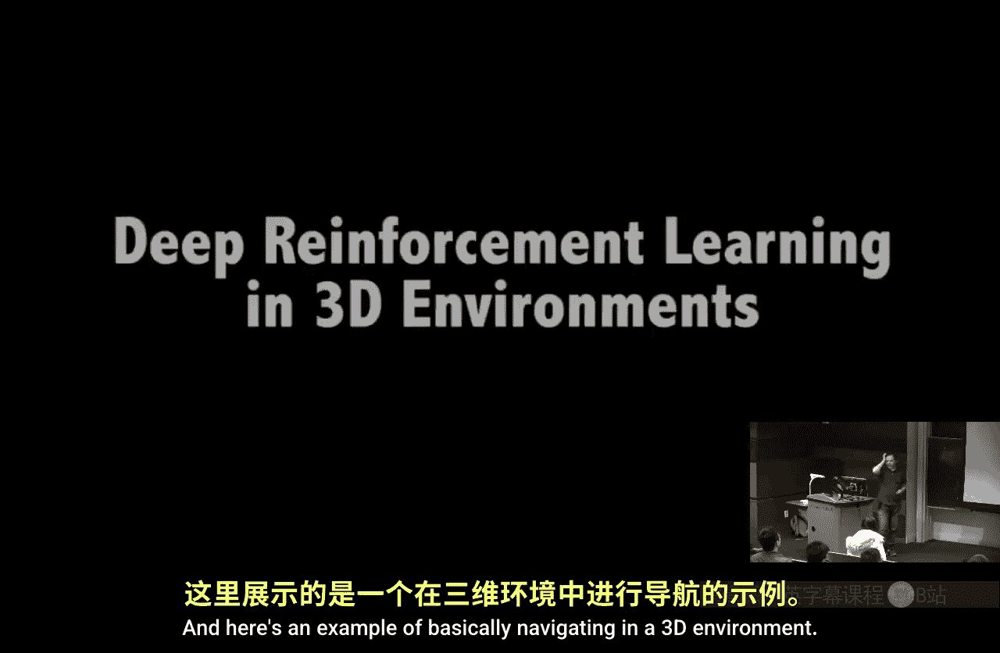

This is a little bit of an older paper， but it shows you the input is basically frames。

 these are pixels， the actions up turn left and right go forward and the rewards here are basically collecting objects so you're not telling the environment how to navigate you just basically telling it do whatever you need to do to collect as many objects as possible and what's interesting about this is that you know through the process of learning you basically。

😊。

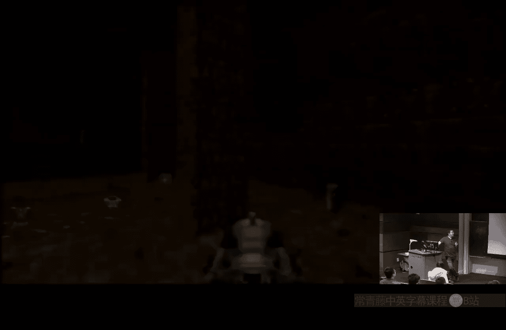

Able to navigate in these complex environments。嗯。Here's just single perspective just single just a single frame。

 yes， so the single frame and you have you just output the action and so it avoids things like going into the lava。

 you can train with random textures， these are kind of like 3D navigational tasks in a simulated world。

 but what's interesting is that once you train with a whole bunch of different textures。

 then if I put the agent in a new environment， unknown environment， a new map。😊。

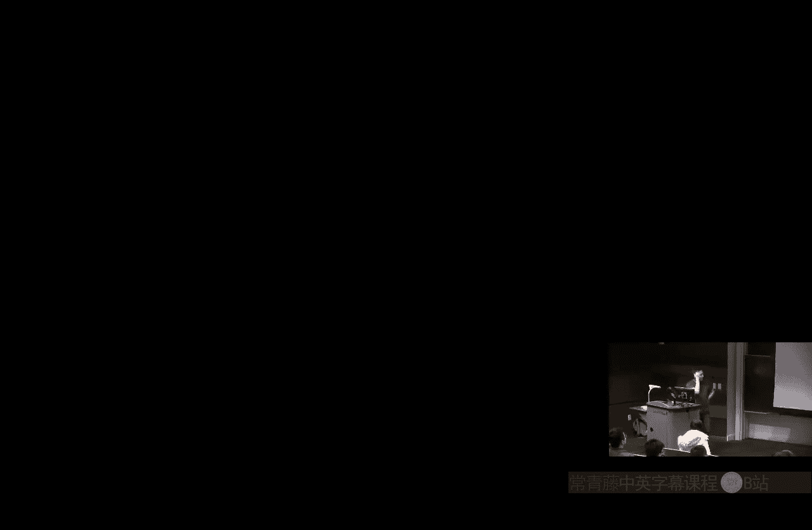

Then the agent can basically navigate in this environment without any， any problems， right。

 So basically now I throw it an unknown map and it basically moves around。

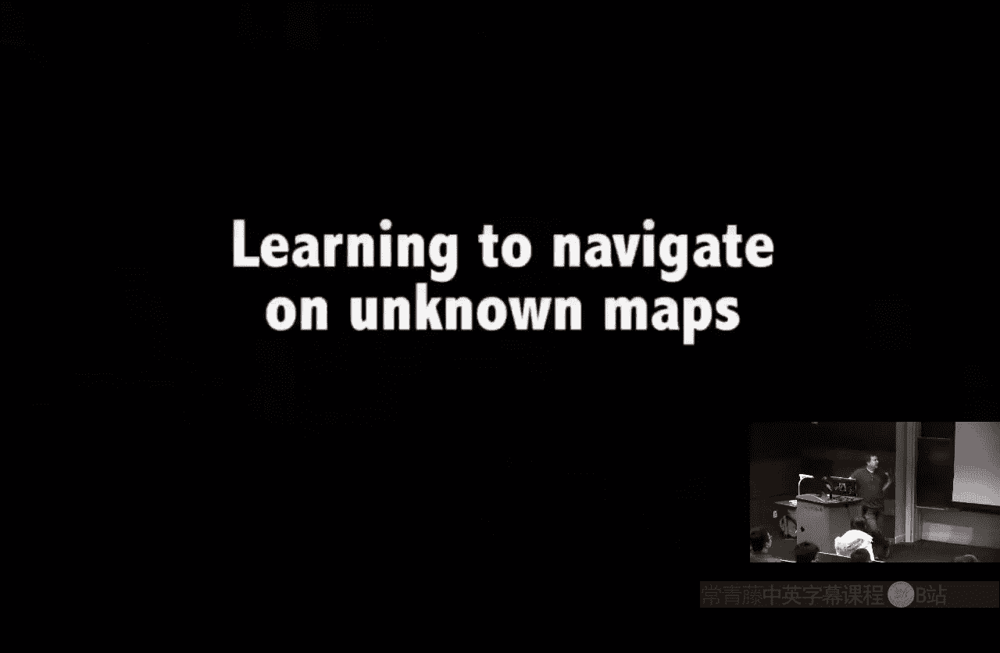

So that's interesting。Now。Yes， this new map has new textures。

 so it's of so I think that at the training time is a good question。

 I think at the training time there were over 20 different textures。

RightSo basically learn to figure out like there are things that corners and walls and sort of some geometric I guess notion about the environment。

 but it's able to navigate the environment pretty reasonably well。Now。

 the problem with what I've shown you so far is that these are the systems where you're learning so called reactive policies。

 meaning that。I observe the the， the frame I take in action。 I observe the frame I take in action。

 and I instantly forget。Whatever I've seen so far， right， there is no notion of memory。

 There is no notion of planning。 There is no notion of just basically just executing。

 here's what I see I take in action。 This is what next I see I take in action okay。

So can we learn an agent with a more advanced external memory？😊，And in 2014。

 there was an excellent paper coming out from Alex Graves called neuralural tuuring machineschines。

 which was a combination of a bunch of previous works。

 but which basically sort of put together this notion of external memory。😊。

And these excellent papers to look at， the idea is you're basically designing the external memory mechanism where you can write to this external memory and you can read from this external memory。

 okay？😊，And one of the key challenges， which is still is the case。

 is that memory systems are very difficult to train。

 especially using reinforcement learning objectives， which are very noisy and stable and so forth。😊。

So I'm gonna to show you some examples in trying to solve this problem。

 but it still remains a very challenging， very challenging problem。 Now， why is memory challenging。

So here's an example。 It's a very simple example， but sort of illustrates why this is a challenging task。

So suppose an agent sits in a simple random maze， okay。So you see the agent over here， this guy。

 and somewhere near the start of the state， the agent sees an indicator。😊。

RightAnd the color of the indicator basically determines which goal the agent has to navigate to either here or here。

 so for example， if it's a green indicator， I have to navigate to this goal。

 if it's a blue indicator I have to navigate to this other goal。😊，So why is this challenging， Well。

 if I tell my system a priority these rules， if I tell the system， if you see green。You know。

 go to this target。 If you see blue go to the solid target， then it's an easy problem。Right。

 but it becomes a difficult problem。 if I don't tell the agent anything。

The agent goes in the 3D world。Does bunch of exploration， random actions hits this target。

 gets positive reward。So the enforcement learning algorithm will basically say， okay， well。

 that was a good set of actions。 Go to this target next time。next time you hit the same target here。

 you get negative reward。😊，Right？And so through the process of exploration， you start figuring out。

 well， I keep hitting these targets， random， randomly placed and random mazees。

 Sometimes I get positive reward， sometimes I get negative reward what's going on right。

 And eventually you have to figure out that there is this indicator that tells you where you should go。

Right， now the challenge is that。The time that it takes you to travel from seeing the indicator to the goal could be arbitrarily large。

Right， and that's where the problems come in because standard systems like LSTMs and the recurrent networks and such。

😊，They're not very good at maintaining or storing the information over long periods of time。Right。

So you need something beyond that。 So this is just a very simplistic task。

 but you can make it arbitrarily hard for any。Reinforcement learning algorithm that uses L SMs or you know。

 just as evolution of the recurrent state will fail。So you need something beyond that。

 and you need some mechanism to， to store things。One particular way of doing it would be to store everything you see。

Right you get the agent and you just store every single frame。

And then you try to do some kind of retrieval mechanism to figure out like what have you seen and how it correlates with where I need to go。

 So that would be a very inefficient way of doing it。 But that's one way of doing it。嗯。Sure。

It's simple， but it's not to ask humans it's not intuitive。

 it doesn't have objects how long will it take us to understand that green should go to red Yeah。

 it is basically through the I'll go through the model that does this。

 but it's through the process of learning very inefficient right now。Oh humans。

 humans can solve this particular task fairly quickly。 they understand， they understand， yeah。

 they understand that if you navigate in some 3D environment。

 you see these objects and very quickly with like a few iterations。

 you start picking up correlations right now this problem can be made abitrial large because I could have this environment and I could say。

 you know if my if my laser point points this way， you have to exit through this door。

 if it points this way， you have to exit through this door figure this out now obviously it would be impossible for humans to figure it that right so it can obviously make it arbitraryial hard right so there needs to be some prime knowledge that you can incorporate for sure yeah question。

😊，Just。I a frame for the。Situation that's surprised the agent。

so then you have to define what surprise means。没创新问题。Sure， but then these are random mazes。

 so every episode you get a random maze。Right， now you can make it harder by basically saying walls will have textures。

 There would be something on the walls。 And then a certain indicatess， yes， you can do that。

 but then you have to define what the surprise is to store what， what you need to store。うんん。🤧。So。

 so at the start， there is no prime knowledge。Then the following has to hold， right。

 You have to write the color to the memory somewhere at the start of the maze。😊。

You have to never overwrite memory of the color over t time steps while you're doing exploration。

 so you have to maintain this indicator and you have to find and you have to enter the goal。Right。

Otherwise， you get negative reward。And one solution would be to write everything into the memory。

 which is not as efficient， but nevertheless is a solution。Okay。So now before I get into the model。

 I'd like to spend a little bit of time talking about the basic idea of memory and the basic idea behind neural touring machines。

It's an excellent paper， you should read it。The basic idea of neural tuuring machines is you basically turn neural networks into differentiable computers。

😊，And you're doing it by giving them a read and write access to external memory。Right。

 so the idea is that what you're effectively doing is you creating these neural networks that separate computation from memory。

And that's a wonderful idea， I think that' sort of like there's a bunch of different papers that were put together around the same time。

 you know， attention for machine translation and so forth。

 and then these ideas were kind of like put together into one。😊，One paper。

 and it's a wonderful paper。 I think that the insight， again， here is that you separating compute。😊。

What your neural networks are doing from memory， what you're writing。

 and what you're reading from the memory。 And I think that's a very important idea。

 It's a very important contribution， because so far。

 when you look at a lot of practical applications like。Imagenet classification or any tasks。

 lots of in lots of the settings， your neural network essentially stores information about the data。

When you' try to classify dogs versus cats， the neural network kind of learns the right sort of representations through the training data to figure out how to classify things。

 but these are quite different because these systems actually allow you to store something in the memory and read something from the memory。

😊，And the nice way that was done is that you can define differentiable compute。

 which basically means that you can learn what you need to write， where you need to write。

 and you can learn what you need to read。😊，At， you know， what time。Okay。

So here's the architecture that was introduced in that paper。 so the idea here is the same。

 you have external input and you have external output。

 so you still youre still mapping inputs to the outputs right except for now。😊。

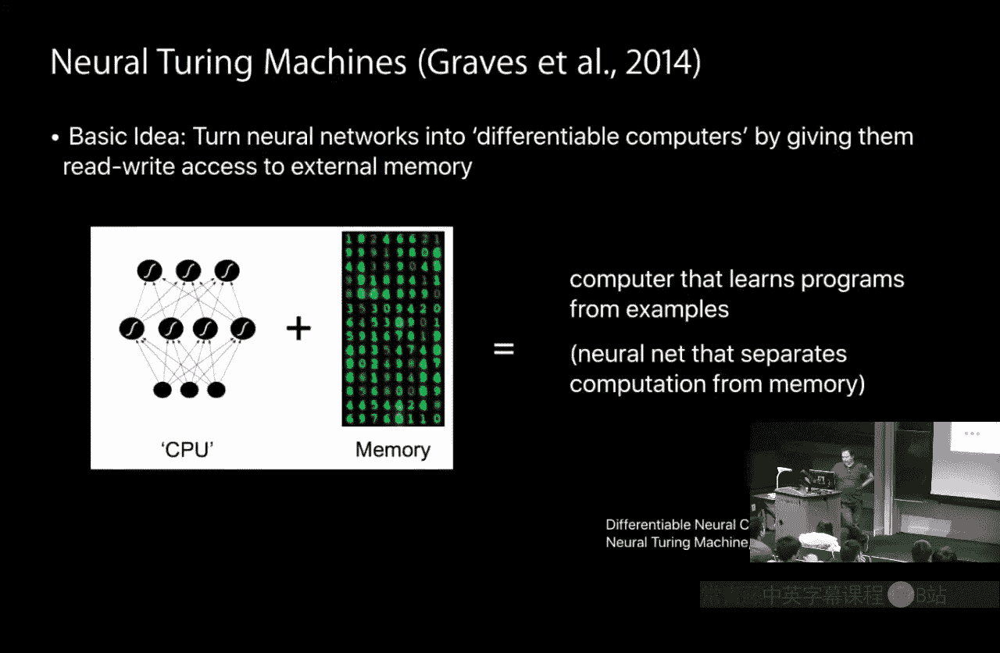

You have so-cal controller， and you can think of a controller as a neural network or a network4 network。

 It's a controller。 and you have two heads。 You have read head。That reads something from the memory。

 And you have a right head that writes into the memory。

And you can think of a memory as just a real valued matrix。Okay。

And everything here is differentiable。That's important because that allows you to develop algorithms that basically allow you to learn what you need to write into the memory。

What information need to write into the memory？Ex part about this memory iss it the fact that we don't need to all the member to part up at every duration if we do hard attention so that this memory can be huge and that should not always computation because yes or even if it's soft attention still is exciting because comparison to RNNs。

 these are more permanent than so as we'll see in the rest of the lecture so they've defined so-called soft attention。

 which is kind of like a distributed read and distributed right。

 it's still better than RNNs in some sense because you can permanently store something。

Over long time steps。People have also try to do hard attention， which is kind of like， you know。

 use some kind of reinforced algorithm to figure out what to write at one particular location。

 I'll show some examples of that。 But again， these systems are extremely hard to train。

So what you're seeing is that this memory is better at preserving values as opposed to his forget gates of LSDN thats right。

 they're much better to preserve values of a long time steps for sure。

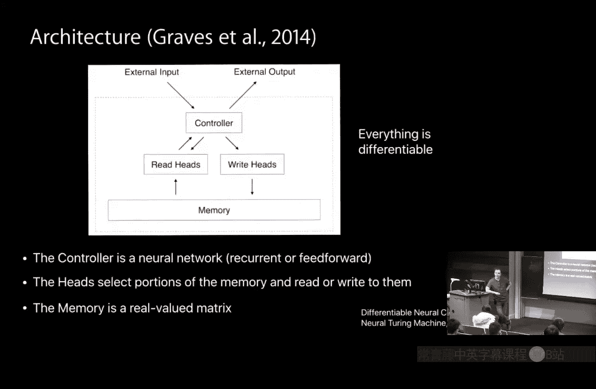

Am。So let me。

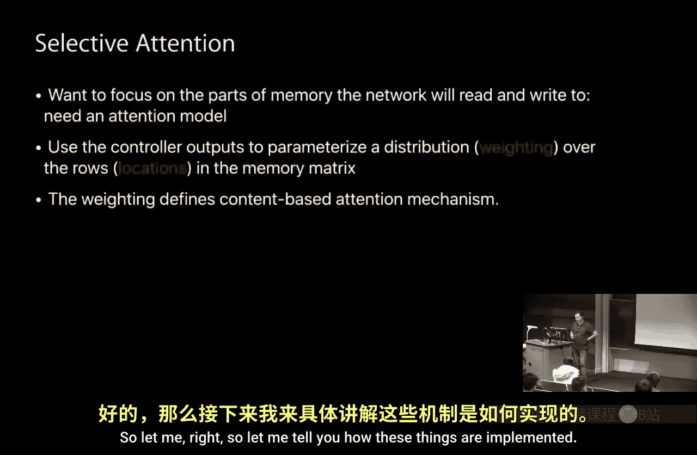

Right， so let me tell you how these things are implemented。And its actually pretty easy。

 its yes question。😊，So where does the memory？So the controller decides。

What to access from the memory。Oh， I'm going to show you。

So I'm going to show you how these operations are working right now。Right。

 and then we're going to go through the neural map。

 which will make it much more precise exactly how these operations are done and how the whole thing is differentiable。

ok。You know you first look at this and like how in the world can you decide this to be differentiable。

 it's hard。How do you decide what to write， what to read， and so forth。

 But it turns out that the solution is actually pretty simple。

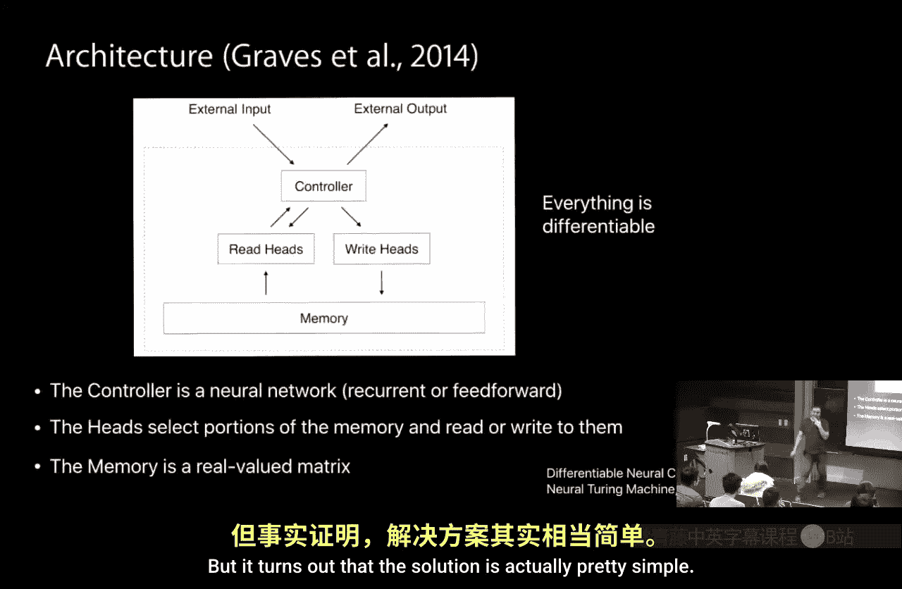

mSo。One of the things that we need to do is we need to have a notion of selective attention。

So we need a notion of attention mechanism。嗯。So what we need to do is we want to focus on the parts of the memory。

 where the networks will read from and write you。 So you need an attention model。

And what we're going to do is we're going to use。Outputs of the controller。

 So think of it output of the neural network。To parametermeterize the distribution。

Over the roles of the memory， memory matrix。Okay， and I'm going make it。

 I'm going to make it precise what that means。 And this particular weightne will define content based attention mechanism。

So it's almost like I'm going to give you a query vector or the output of a control。

 its going to be some vector， and I'm going to define an attention mechanism that chooses the location in the memory。

😊，And then I can choose to write into that location or read from that location。Okay。So。

So how do we do addressing？ Well， we're gonna be doing addressing by content。

So we're going to have a key vector K， which is going to be output。

 which is going to be the output of the controller。

 and it's going to be compared to the content of each memory location。

 So think of a memory as a matrix， you're going to be comparing it to every single row of this matrix。

Each row is going to be think of it as like a cell in a memory。Okay。

And we're going to be comparing using some similarity measure， S。

 So typically those would be cosine similarity measures。

And then we're going to be normalizing it with a softm。

 so it's almost like saying it's a soft way of saying， given the vector K。

 find new locations in the memory that are close as close as possible to my vector K。😊，Right。

 so if you can think of it as almost like a retrieval mechanism or identifying which part of the memory you want to either read from or write to。

Okay。And let me show you what exactly we're going to do is this is what these weights would look like。

So given K， which the controller outputs， think of it as a neural network outputs K。

A vector of dimension K or K vector。I'm going to be using some kind of similarity cosine similarity。

 I'm going to be comparing it to a particular address in the memory。 Again。

 it's just a vector using cosine similarity。 and then I'm going to be normalizing it over all。😊。

Rose of the memory。Right。And so， and then there is also typically parameter sharpness。 Beta。

 you can think of it as a temperature that can tell you like how much focus you want to be versus how much spread you wantan to be。

Do you want to concentrate just on a few cells locations or do you want to spread it out？

And here you should note that this is where the expensive piece comes from。

 because you have to sum over all memory locations。Right。嗯。

And this is why it's called soft attention， because these weights are giving you probability distribution over all the rocks in the memory。

In the memory matrix。And this can be very expensive because if your memory grows。You have to kind of。

 you know， compute this。 And the reason why we need to do this softm this normalization is because we。

 we're later gonna see that the whole thing then becomes differentiable。 In fact， when we look。

What the read operation does， The read operation will return a vector R， which is the read vector。

As an input to the controller at the next time step so that you're reading from the memory and you're giving it to control at the next time step and it's just going to be the weighted average。

So it's almost like taking expectation of the memory with respect to these weights。😊，Right。

Beta is produced by the controller or it's a fixed parameter It's a fixed parameter it during training make it so it's of like initially you can make it be sort of I guess large and then you kind of like force it to be small It's a hyperparmeter that you have to play with。

Right， and so now your read vector is just the weighted average of the memory locations right and you can make it as sharp or you can make it as wide as possible。

 So and again， the reason why you can think of this as an expectation operation， right。😊。

And one thing you should know is that。You know， if you want to find a derivative of some discontinuous function。

If you take an expectation， the whole thing becomes continuous。Which means they can differentiate。

So that's why these are sometimes called soft attention mechanisms is because I can actually take grades with respect to parameters over here。

If I had to choose a single location， if I had to sample， if I had to sample， oh sorry。

If I had to sample from the soft Max， I would basically so choose the maximum if I said I'm only going to be looking at one location。

If it's a sampling operation， then you know， you could you get the potential user reinforce because you're only choosing once。

 is's almost like youre taking action。 But the problem then is becomes that the training becomes。

Far more uns。So it's a trade off between efficiency versus。You know， optimization efficiency。

And then each right hand receives an array vector E think of it as just some vector maybe zeros or I think that you learned it as well。

 and you basically add it into the controller and then you write it to modify the memory cells so now you're updating the memory by basically saying here's what the content I want to update my memory with。

 and this is how much do I want to forget what I've written to that content of the cell before。😊。

Right so these are very simple operations， but at the same time they are differentiable。😊，Right。

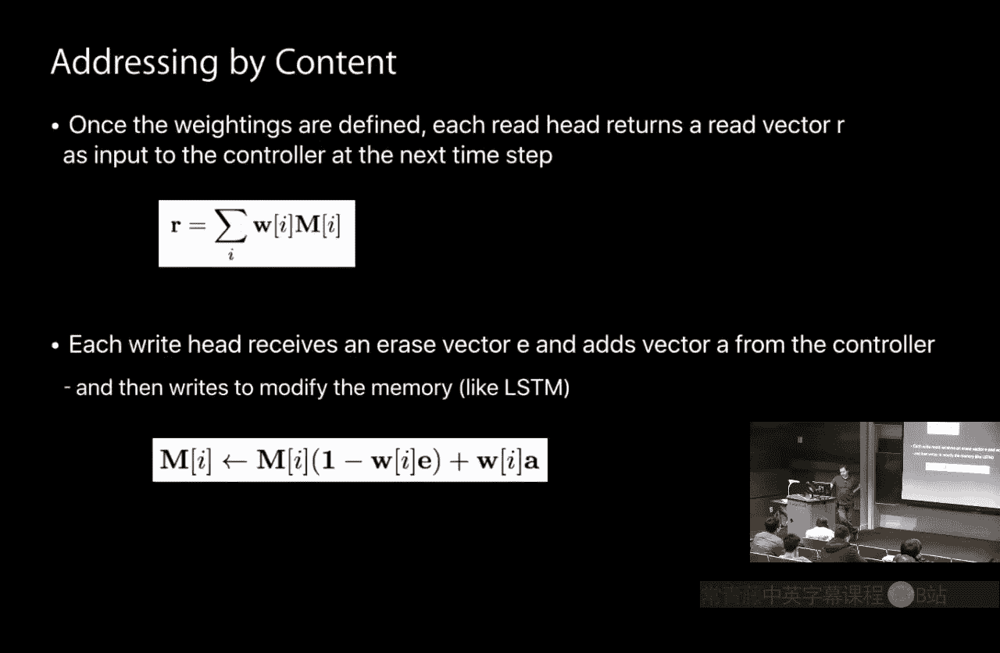

And heres， for example， here is what they can do。 Here's the copy algorithm。 They've trained it。

So here you're looking at the time。 So I'm just giving you a bunch of inputs that you can see on top。

 So these are the inputs。 And I wanted the outputs to be exactly the same thing as what the inputs are。

Right， so what they learned is that they basically learned。

 this is what you're storing in the memory。And this is your weightning。Right。

 or your ws and ws become very concentrated at a particular location。

 So it basically stares that says that this location store this vector。

 this location store this vector and so forth。 And then the model learns that once you need to output。

 it basically goes to this location。😊，Retrieves from the memory。What the thing is and outputs it。

こちてます。This is trained to just reconstruction laws。Of the fold。

 so training basically contains these inputs， these outputs。So it basically tells them all。

 figure out。What you need to do so that， you know， given these inputs and these and the outputs。

 and it basically learned to just store。It sort of says， if you have a memory， big matrix。

 eventually the weights would say the first one， this location store this vector， second location。

 this location is stored and so forth。😊。

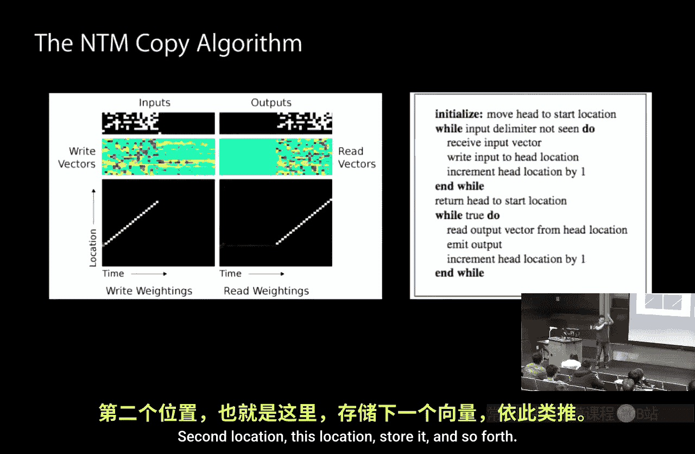

They've also shown that， you know， you can do things like。

If you only training got like 10 inputs 10 outputs。 So you' just learning to10。

 you know go from 10 to 10，10 inputs to 10 outputs， they can actually generalize to almost 120。

 So you know， they can generalize to this algorithm and basically say store more information and then recover it。

Once they go to 120， there are some errors that start popping up。

 so there you can't perfectly store it， but it's actually pretty good。Right。啊。哎，我想。App blindable。

 So you let it， let's say， think。Right or some syn and then right。

 so the way that they do is that you know it's like a sequential thing， which is like x1， x2。

 x3 that comes in。And then time at each time you're basically writing， you're learning what to write。

And then at output time you're just reading。 So the input time you're writing the output you're just reading。

 But I think that in their case， the algorithm basically learned the waitinging it learned that it just basically needs to store and then just copy it from the memory。

 So it basically wanted to store and then copy from the memory， which is kind of nice。😊，That's right。

 That's right。 The controller takes the memory the input， yes。

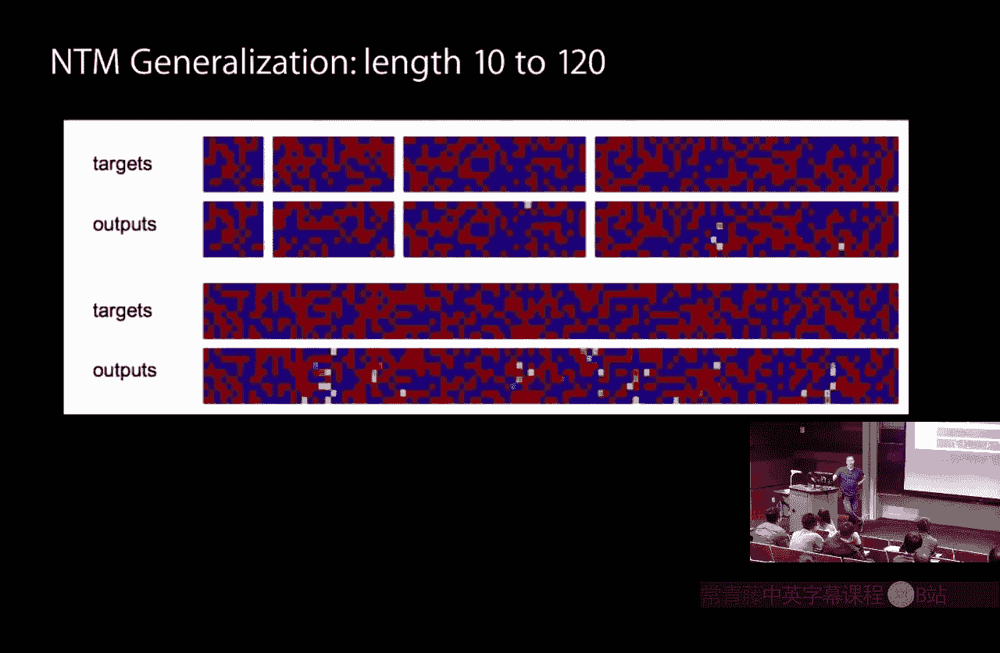

嗯。They could also do things like copy N times。嗯。So they basically saying， well。

 if these are my inputs。I need to copy these inputs and times right so essentially they just basically say that store it and these are the weights into the memory and then at just at the output you you start this content you read it。

 and you start you read it and so forth。So they basically showed bunch of examples that they can learn things like for loops。

 for example。 and these are differentiable for loops。 They've learned things like， you know。

 iteration to step， variable count to n and so forth。 so they can count for。

You know a whole bunch of things obviously mean these are standard operations but was interesting that they were able to learn you know nontrival things like learning a follow loop is just by examples right you're not telling it this is a follow loop。

 you need to do it n times I just give you inputs outputs。

 input outputs you have to figure out that it's actually a follow loop。😊，Now， at the same time。

 still the training of these systems is fairly brittle。 So it takes a while to train them， right。

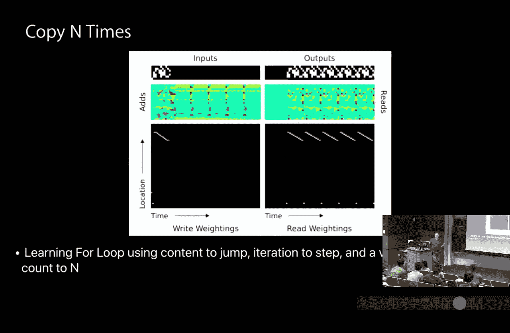

嗯。So now， one thing that， you know， coming back to our problem， let's say the navigational problem。

One thing that you can do is you can say， well， what I'm going to do is I'm just going to store。

Let's say I'm going to store in key in value or just the frames。

Representations for the last M frames。 I can just say have a buffer of M things。

 And I'm just gonna storing what I've seen in the past M frames。And then what I can do。

Is that each step， I'm going to be performing a read operation over the memory database。

And the reader operation is nothing more than I just observe the current thing。

I extract its features from the frame。 let's say I look at the cosine similarity。

 Here's my thing that comes in。 I'm basically looking at cosine similarity between what I have in my memory。

 I create the probability distribution， and then I'm reading it from the memory。😊。

There is a sort of like a special way of somethings called key value。

 which is keys used to to compute this probability distribution。

 which basically says where I need to look and the value is what I need to retrieve。

 So sometimes people do you know， break it down the two pieces。

 And these memory networks have been used quite successfully in language tasks。😊。

For question answering tasks， so your memory could bere storing a bunch of sentences and then I give you a query and I look at the closest sentences in my database。

 I retrieve the closest ones and then I can ask questions about documents， for example。Right。

 so these systems have been used quite successful in language and understanding。

 but here you can also do the same thing， can just store M frames。😊，嗯。So it easier。

The fact that when you say story percentage for the last time frame。

 you don't need to learn that That's right That's right that's right So the only thing what these memory networks are doing is that they avoid the problem of learning what to write they just basically just right everything so the right operation is fixed basically and it's only read operation which is that you find similar things and you do the retrieval so it's almost like a differentiable retrieval operation。

And that makes the problem much easier because you actually don't need to learn what to write。

 you write everything。Right。And writing is actually pretty challenging task because it's a distributed right and so it's generally quite difficult to get to work。

嗯。So it's easy to learn。 You basically store as much as possible， but it can be inefficient。Right。

So you needs M， whatever you're storing to be large in the horizon of the task you're trying to accomplish。

RightIt's almost like when you're born， somebody sticks camera on your forehead and you record your entire life。

Right？If you could do that， fine。But but at the same time， can you learn something more intelligent。

 Can you learn something like things that you don't need to store。

 Can you learn to store things that are important for you to take actions in the future。Right。

 that bring you the most reward， for example， and time and space requirements basically increase with M。

嗯。And so even in the space of like language understanding。

 question answering what people typically do is they say， well。

 I can't store every single Wikipedia thing， what I'm going to do is I'm just going do some simple retrieval fight in maybe 10 articles and then store all the sentences and do this attention and such。

😊，So let's look at the neural map， which is a very simple extension of the memory network。

 which basically takes the following inductive bias。

So we're going to be structing memory into w by w grid of k dimensional cells。😊，Okay。

 so you have a cube K by K。 You have to define oh， sorry， it's W by W。 And for every location X， Y。

 you write into x prime， Y prime in a W by W grid。Right so here you're making one fundamental assumption。

 which is， you know， the location of the agent。 So if you're here。

 you're writing in this part of the memory， if you're here。

 you're writing in this part of the memory， here， you're writing this part of the memory， right。

So here you're making an assumption， I'm going to show you some examples of where we can relax this assumption。

 but the key assumption is that we know where we are。😊。

So what we're going to be doing here is we're not going to be doing distributed right。

But we're going to be doing location specific right operation。

Which substantially improves the stability of algorithm。Right。

 but it comes with an additional prior knowledge that we have to know the location。

This is like there is no free lunch， so whatever we do。

 we have to put either some kind of prior knowledge or something。

And so basically it acts as a map of the agent fills out as it explores the environment。😊。

And so the inductive bias here prevents the agent from overr its memory too often。

 and it can learn whether it needs to override a particular location。

 or it actually learns where it actually needs to store what it sees in the environment。

 In many cases， basically doesn't store。 eventually， it learns to store。😊，These indicators。

Right into the memory or the state of the indicator into the memory。So how does it work。

 essentially you can think of it as you know you have some state。

 you get some features from the state， you write in the specific part of the memory， you take action。

😊，Then given an action， the environment gives you the next state。 you read from the memory。

What you need to read here。 So that becomes part of the feature here。 And then again。

 you update your memory。And so forth。Right and so that proceeds through time。So if you look at it。

 it actually looks a lot like kind of like an LSTM， right。

 but except for your hidden state now is a very structured hidden state。😊。

And you know exactly where you need to write in this structured memory。Right。

Which makes the problem much easier。Particularly for the credit assignment problem。Right。

We read can write in different locations。That's right， That's right。 That's right。

 So you read and write from the different locations。 you write at the location where you are。

 But when you get to the target， I'll show you some examples where you get from the to the target。

 the read operation actually reads from the part of the memory that has the indicator。

 so it can read the state of the indicator and then force the policy to。😊。

Either take action to get to the goal state or， you know， retract。We access is it by content so need。

Do you see what I the indicator you need to remember the color of the indicator to do the soft attention or。

 so the way that it functions is that when I get once I get to the state where I see the goal state。

It basically learns that when I see the goal state。You do retrieval by content。

 but it learns to retrieve from part of the memory that has the indicator。

RightSo it basically learns to transfer like colors to the colors of the indicator。

So it basically says， what I'm seeing right now is the target that I need to enter。

The similarity of this target is the similarity to the indicator and nowhere else。

 And then once I retrieve the state of the indicator， then the color of the indicator tells me。

 do I need to hit this target or do I need to go back and find a different target。Right。あです。

You得 back。Yes， we have to back propagate。 So we've used like。Verss of like truncated backpro。

 There is a little bit of curriculum learning。 But yes。

 you have to back propagate through the whole thing。Right now。

 the problem we've made it artificially hard because the only signals you get。

Is if you hit the target and that can be very large。Right， at the same time。

 we're working in these kind of like 2D 3D environments that are not too complex。Right。

 but I think that ultimately to make it more realistic， you have to do some form of reward shaping。

 or you have to have some auxiliary things that you need to incorporate because sometimes the time when you hit the target and the time you observe the indicator and then random ma can be very long because the agent has to explore this environment。

And so the reward signal is extremely sparse。Right。So in this case。

 we made the problem perhaps too artificially hard for us。 but at the same time。

 I'm going to show you with enough compute， you can learn this。嗯。Like before。さの手も動き。

That's right That's right， That's exactly what's going on。

 This is more of a like I see something I use convolutional。

 I'm going to show you exactly what what the operations are actually。😊，But it's yes。

 you write everything。Do you think your is hard。 That's right。An engineering question。

 let's say the month is。It allocated or you assume you know what is the size of the map and where you start right because we know where the agent is so we know approximately the size of the map so we kind of basically say if the edge at that particular location it maps this part of the memory yeah so that's I'm going show some examples how to avoid this and egocentric environment where the engine doesn't know the map and just moves around and explores but then you have to sort like localization and stuff like that which is also hard yes。

Some parts of。こいた方面。Yeah， so that's let me show you exactly what the operation is。

 It's like a soft read operation。😊，That that've shown you kind of like what neural doing the machines are doing。

But let me let me go through the operations。 So the whole thing is you know。

 is done through a bunch of operations。 The important operations are the read。

 then getting the context， your writing， updating the states of the memory。😊。

And then basically producing the policy。So let me go through all of these operations and all of these operations are differentiable。

 which basically means that if you're using act critic or if you're using Q learning。

 whatever the target is， you can back propagate through these things。😊，嗯。So the read operations。

 there is two read operations， there is a global read。😊。

Which is just the global summarization of the entire memory。 And there is a context based retrieval。

 which is depending what you're seeing right now， you're trying to retrieve that。So。

We also have sparse right with only agent positions。

 and then we're basically using read and write vectors that we get。Basically。

 those are used to compute the policy。So there are a whole bunch of things you could do。

 There are a whole bunch of architectural choices you made like do you really need a global summarization。

 Do you need a context based summarization， Do you need both read and write to compute the policy and so forth。

 There's a bunch of things you could probably do better。 but let me show you what we've done。

So you're reading the entire。 So the the global read is just very simple。

 You're basically reading the entire neural map using a deep convolutional neural network because it's just three dimensional cube。

 You just do 3D convolutions， and that basically gives you some notion of。

What's stored in your entire memory。Right。So for example， you can do two things like。

Or the indicator or the state of the indicator。 Or you can achieve， you know。

 the the location of the map。Or the structure of the map that you've discovered so far。

 Or you can achieve pieces where you've been in the map where you haven't been in the map that can help you explore the environment more efficiently。

Then there is context based grid operation， So this is sometimes called grid operation with attention。

And you have sort of batch of equations here。嗯。And let me actually show you pictorially what these things are doing。

Okay， so imagine that I give given the state that I'm currently in。

 so think of it as the frame that I'm receiving what I'm seeing right now。😊，The RE vector。

 which is the global summary of my memory， initially just a bunch of zeros。

 but as I'm dating the map gives me some features。😊，I now compute the query of vector Q。你给。

So I'm just concatetnating those two， pass it through another matrix W， and I get some vector Q。

And let's say that my memory is just a  two by two memory。Okay， what I do。Is。

I basically do a dot product between my query vector and every memory cell。

RightSo if I do the dot product， let's see if my animation works。Right， and we normalize。

I get these probabilities alphas。 So these probaities alphas is basically telling me this entry is most similar to my query vector。

Right。So it produces a similarity alphas， which sum to one。

 is just the probability distribution of my memory。

And then I basically take elementwise product between the query similarities and the memory cells。

 so this's just a dot dot product。😊，Ellemet wise product。And then， I do。The sum。

Which essentially kind of takess expectation。Given what I see。

 it's an expectation over the contents of the memory。The intuition you should have here。

Is that you're basically returning the context vector C sub T in the memory M。

 which is closest to the query vector Q。 That's what you're doing。You're basically saying。

 given my query， find me the closest vector in my memory。Right。

Except for I'm doing it in a differentiable way。😊，Right， because when you're taking an expectation。

 if I have some。Contact C， I can back propagate through this entire thing。Right， so I can update。

Let's say the parameters of this thing， I can back propagate through the read vector。

 I can back propagate through。 I can update what these things are and so forth。Right。So this。

 this is， this is essentially attention mechanism。嗯。Hel sorry。Yeah。

 this is essential attention mechanism。Right，Differentiable attention mechanism。Yesし。Iplication of。

Ppectation versus a statement accident。B要。So you can take the maximumL and back propagate through that。

 it becomes a little bit tricky because you're basically going to hit some local optimum。What。

 what people have explored before also is instead of taking the maximum。

 you're basically sampling according to these alphas。

So you sample from a probability distribution In expectation， you basically will point to the cell。

Right， but sampling， then you can do it with sampling， but then you know， you have to be able to。

Anytime you sample， it's a discrete choice you're making and if you're making a discrete choice。

 you can't back propagate through that discrete choice。Right。You can use reinforce type of algorithm。

 which basically says sample bunch of things and kind of average by backping through。

 You can do that。 But then the variance becomes large。Right， on the other hand。

 if you don't sample and you memoriesize like 1000 by thousand or a million by million。

 and if you memoriesmorize million by million。Then you have to access every。

 every time you're reading from the memory。 You have to access every single location of their memory。

 which is very inefficient。And so then theres like a bunch of follow up papers that basically use some form of a hierarchy or multi scale type of representation。

Right so you can try to avoid that。Theres still research basically do you sample。

 do you use softmax or do you use expectation， but the thing about expectations is that again you can backpro through it。

 you can just compute the gradients。But， it's inefficient。

And that's generally the case between soft attention， which is what you see here。

 versus heart attention， which is you sample from the alpha。Taking the maximum， you can do that。

 but they're generally like extremely sensitive to because you're learning what these things are。😊。

And so。It's extremely hard to get it to work if you're just taking the maximum。

You because effectively， have to learn， you're learning what these vectors are。

 These are not given to you。 If there is a way given to you， then yes。

But you're actually learning what the content， what the content of the memory is。And so， for the。

For the writing piece， you just basically。Sure。What type of gradientding estimateator would we be using a reinforce type。

 I would say Yeah， would you like a reinforce that So the expectation just the soft version of the artifact max like soft max and the differential basic。

 but waste computation， which is exactly exactly That's exactly right。

It's instead of reinforcecing with the Argm， with a softm， which is just the expectation。嗯。So for。

 for the neural map， basically， you can also update the content of the memory and you can update the content of the memory。

 if you're in a particular location， you're just basically saying， well。😊。

If you're updating this part of the memory， you're just updating it。

And the update itself could be you know what we've seen before right it's just writing what I need to write you can also do things like gating mechanisms。

 so the gating mechanism will effectively tell you how much of the memory I need to update and do I need to update it at all。

RightEssential the model basically learns that it stores some information about the map because it helps it navigate around more efficiently。

 but it doesn't need to store or it doesn't need to write it all over the place if it wast the same location。

 it doesn't need to overwrite it。😊，So essentially learns a sensible gating mechanism and basically says most of the time you don't need to write anything into the memory。

The only caveat here is that it's a very structured writing， right。

 it's writing at just one particular location。😊，Right。And then the output。

 basically you have read vectors， you have right vectors， and sorry。

 and then you basically just concatenate all of these vectors together。😊。

And you pass it through some neural nonlinear TF and through the soft marks。

 and that gives you the distribution of reactions。And that's a policy。And now given the policy。

 the thing about these operations that given the policy， if I take the gradient of this policy。😊。

With respect to all the parameters that are sitting within these operations。

 you can backrup through them。Right。So which is kind of nice。 You have very， you know。

 set of complex things you kind of like doing， and you can just flow the gradients through the policy。

Right， so if you're using， for example。You know， act the critic。

 policy gradients or any type of RL algorithm， know you can compute the gradients of pi。はい。嗯。

So let's see。So let's look at some examples。So， if， this is what the input state looks like。

 It's a partially observed state in the 2 G environment。 right， This is what you're seeing。

And this is what the observed map looks like。 And then here's an example of the agent moving in this environment。

 This is just a 3D visual of the 2D ma。😊。

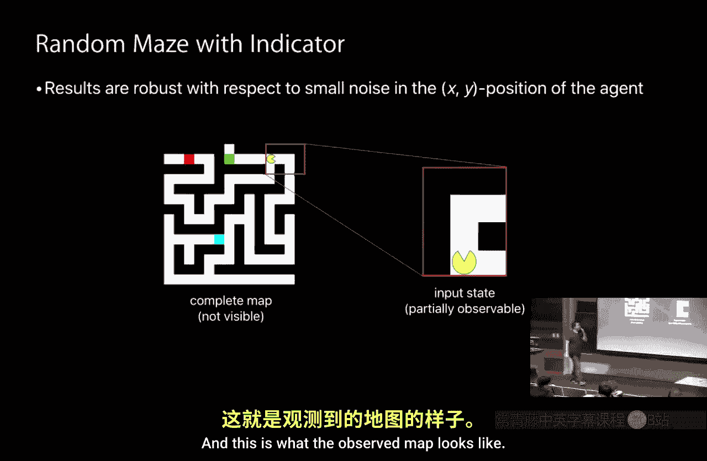

And so it's a random maze， it goes to the wrong target， it sees the wrong target， it backtracks。

And it explores the map up until it finds the right target。

So what's happening here is that when the agent was here。

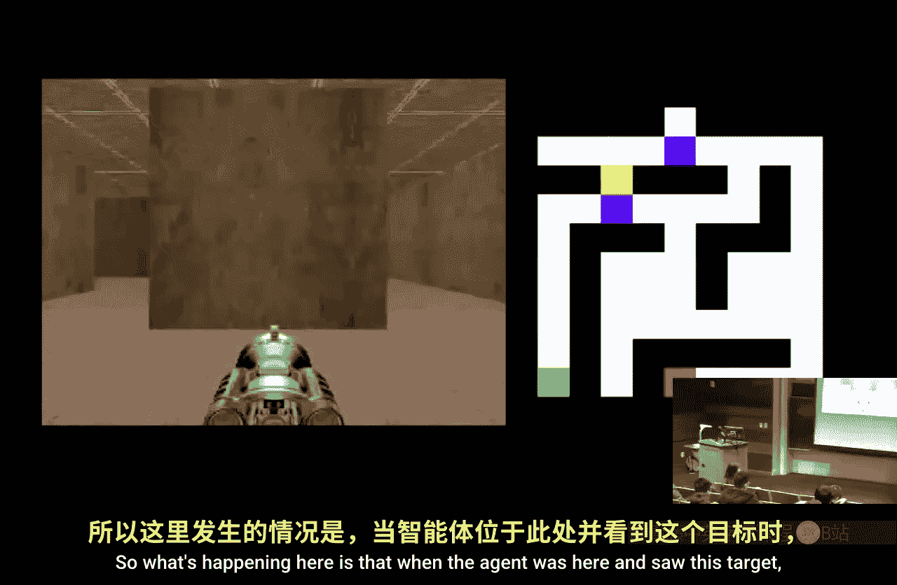

And so this target， it was able to correctly retrieve from the memory。

The state of the indicator and then take the action of go back。きてる？Yeah。

 because if it would hit the red， you will get negative reward。

But if the state of the indicator was a different color， then if would hit the red。

 it would get positive reward。 right So essentially it learns to kind of like and notice that the time that it takes to find it because it's a random maze。

 you know， there's a bunch of different mazes that we've tried for longer mazes。

 you can basically fail your standard R N based approaches。😊，Here's another example。

 and just see if it works。This is kind of like the indicator。And it sees the wrong target。

 It moves around the target。 So make sure that it doesn't hit the target。And it moves around。

 and it's pretty hard， right， I mean， that's a pretty crappy environment， actually， but。啊。

It eventually hits the right d it。Right。It's kind of funny because these are doom environments。

 they're easy to train with。 it's easy to simulate。

 but at the same time theyre so hard because you look at the images。

 there's just a bunch of walls and there's nothing around them。

 So it's very hard to localize and move around and such。

 So we kind of like when we were doing this work we kind of like we're shooting ourselves cells in the foot because the environment is artificially hard。

😊，And the task is hard， and then the reviewers are basically saying， this is simple environment。

 why are you doing this？😊，Right， because in more realistic environment。

 I think things would have been a little bit easier。Just because the walls and everything looks。

 looks kind of the same。 But there are a bunch of things that you can do。 You can。

 you can also do some tasks where youre exploring the target。 Once you find the target。

 you can come back to the original point where you started from and so forth。

 It's a bunch of different tasks you can do with。With a memory。嗯。You can also do， for example。Of。

You can obtain a map which is egocentric so the agent always writes to the center of the map and then the agent moves the time maps moves around you right so in this case you don't really need to know the size of the map you can keep writing。

 but it also seems you have perfect dormittry。😊，Right if you move 90 degrees to the right。

 making you know， you have to So there are some caveats to this as to how much you know。

 as youre navigating environment and the observations are perfectf。

Your location is not perfect and such you need to be able to localize and do these other things。

 So here we just work didn't worry about those problems。 did you have the problem as well？

How to allocate I suppose where you start the map and you start building it and the li it gets very big eventually it's not going to fit Yeah。

 that's right。 So you have to well， so the memory itself。So。

 you can think about the memory itself is， you know， we basically discretize the map。Right。

 and so the memory itself is a function of how， you know， what the discretization is。Right， and then。

In our case。No， yeah， yeah。 yeah， yeah。 I think that once you go to the continuous space。

 then it becomes much trickier。And this is where， because the memory is inherently discrete notion。

 right， if you want to store， if you go to go to the continuous space where the agent just continuously takes actions。

 you need to have some kind of a mechanism of。Either mapping the current position。

To some location and the memory。 So you need to have some， some mechanism of doing that。 So， but。啊。

Yeah， so there are a few challenges， there are a few challenges here。

 but the thing that I wanted to point out about this particular thing is that it helped us substantially to put this inductive bias when were writing in just one specific location。

As opposed to doing distributed writing。Kind of like writing everywhere in the memory and reading everywhere from the memory。

 which I think is far more unstable。嗯。Now， let me show you one other example very quickly。

 which is incorporating some price into language tasks。And so this is。

 there's a lot of work happening in a language domain where people are trying to say， well。

 how do I given some text show representation。How do I basically take some notion of the prime knowledge that I know about language？

And improve my representation of our current neural network。Okay。Well， here's one way of doing this。

 So suppose that I give you these sentences。 Mary got the full ball。 She went to the kitchen。

 she left the ball there。if I ask you the question， where is the ball？Obviously。

 well be in the kitchen。Right？T out that for machines。

 it's quite difficult to get that reasoning because you have to know something about Mary。

 She's carrying the ball。 she's going to the kitchen， kitchen in some physical location。

 she's actually place the ball like there。 And now if I ask you。

 where's the ball you have to associate that it's in the kitchen。

 it's not like you can look at one sentence and answer the question， right。

 So it requires some form of at least a little bit of reasoning。You can build an R N。

 which is what people typically do。 You know， you just basically have some hidden state and you pass it forward and such。

 And then I ask you， where is the ball， You sort of like， say， well， ball， I'm seeing the ball here。

 I'm looking some context around here。 Maybe I can answer the question。

But you can also use things like core references。 So whenever I say she， I really mean Mary。Right。

 it's not like some other person。嗯。And I also know that football and ball， they mean the same thing。

That's the prime knowledge that I can put into the system。

Because if I ask if I don't have this prime knowledge and I don't know that football and ball mean the same thing。

 if I ask you the question， where's the football？I don't know。 like Mary has the football， right。

 So there's no football appearing anywhere else。So I need sort of this kind of knowledge and there is a way of kind of constructing a memory mechanism where you basically have these additional links。

That you can。Put into the structure of the recurrent network。

 and you can basically have an update equations， standard update equations for recurrent neural networks。

 but with these additional links， and there is a specific way of incorporating those things to make it fairly efficient and you know。

 you can ask and answer questions more complex questions about the task。

So people in the language domain are also trying to incorporate some notion of memory。

 either through the prior knowledge。 It's almost like， it's almost like specifying。

 I need to store my memory these things。 So when I'm incorporating them into the R hidden state。

 I can actually read it from the memory。Right。嗯。And so， you know， ultimately。

 how can you build agents that can have external memory that can reasonably communicate with you。

 right， So there's a lot of work and people trying to basically figure out。

Can I build an external memory， Can I build some knowledge base， Can I get my agent， you know。

 to communicate in such。And maybe just in the last five minutes， let me show you one example of。

Something that's called language grounding Tu。So in the language grounding task， I give you sentence。

Such as go to the short torch。Right， and your agent has to figure out what that means and it has to go to this short red torch。

Okay。And you can train it using reinforce learning， basically。You know。

 this is the first attempt weve tried doing It's very ineffic。 It's more like。You know。

 I give you this sentence。I converted in a bunch of numbers， given those numbers。

 I condition those numbers to my policy。 my policy has to find the red torch。

 So through the process of learning， it basically policy just stumbles around。

 and then eventually it starts figuring out what is red， what is short， what is torch。

RightSo here's some examples of like 30 minutes of training and doesn't really know what it's doing because it has to explore the environment to figure out what that thing is。

But then eventually， it sort of like figures out things like spinning。

 Go to the tall red pillar or go to the green torch。Go to the blue short object。 So then things like。

 for example， tall or short or smallest is pretty difficult to to describe right and so go to the smallest blue object right and then there is like。

 you know， theres a certain proper death instructions。 Like， for example。

 you've never seen a blue short key at the training time and at the test time you're telling it go to the short blue key。

 So understands blue， it understands key and it understand short。

 but it've never seen this combination at the training time。

 and it's still able to figure out how to put these things together to navigate to the right。

To the right target。So these are sometimes called language grounding because to really understand the meaning of the word short。

 it's pretty difficult to describe。Right，And there are sort of some examples that I think the vendor has done。

 which is basically you have an environment。 you say go to the smallest object。

 you go to the smallest object。 You take this object， you take it out of the room and you say。

 go to the smallest object。 and it figures out how to go to the next smallest object。RightSo。

 of course， these are very kind of like constrained environments。 Ideally， you'd like to scale it to。

 you know， thousands of instructions with thousands of different。😊，Concepts。

 and the architecture here is kind of， you know， at the high level， it's fairly simple。

You sort of process your language instruction using a particular neural network。

 you process your visual input through the convolutional network。

 there is certain gated attention mechanisms that allow you to attend to the relevant parts of the language in the relevant parts of the input representation。

 and then you basically outputting the policy and the policy tell you what action you need to take。

Right。And there is a whole bunch of。嗯。There is a whole bunch of work now on visual question answering or embodied question answering。

 where you have some agent in the environment and you're telling the agent what is the color of the table。

So the engine has to figure out where is the table， has navigate to the table。

 figure out what the color is， So stuff like that。Which is。Which is fairly challenging。

 fairly challenging tasks， right？

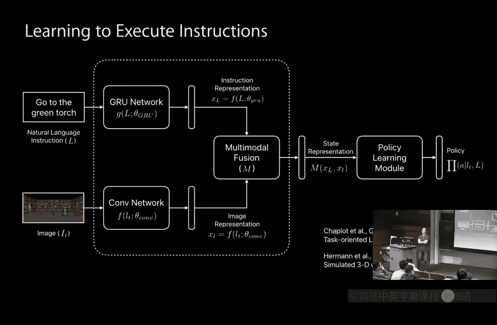

And and finally， the last other thing that I wanted to show you is this notion of localization。

 I think so localization is in my view， it's also a very important problem。

 right If I throw you in some environment。 and let's say I know the map of the environment。

 your goal is to actively localize。And active here basically means that you have to take a set of actions to localize as fast as possible。

Right， which is very different from kind of like passive localization where I show you a bunch of sequences。

 and then you have to tell me where you are in the map。

Here you basically have to you basically have to design algorithm， basically telling you。

 find me the optimal sequence of actions so I can localize as fast as possible。

 right And so we've been looking some examples of where the agent basically。

Here you're looking at the belief of where the agent is。 And here's the ground truth。

And so after a few。Setting， it basically localizes itself。You know， it's not perfect。

 but what effectively it learns to do in this environment basically wants to do like a 360 degree spin。

That's the most informative thing to do， at least initially， to figure out where you are。Right。

And so it's basically and then just a few more steps。

 And it figures out the relative positions of the walls and such。 And it knows where， where it is。

This was done using Unal Engine。 In fact， we found that localizing in a doom environment is way harder than localizing in this environment。

😊，Right， because the doom environment basically everything looks the same。

 You have no idea where you are here in like in officee scenes or if few outdoor scenes like。

 So here's I guess it's localization in the doom environment， but。Yeah。成長が？We have deep features。

When we were writing the right that right that's right so there are a few things that we've done here。

 and then there's this belief over the state where we're maintaining the probability distribution of where we are。

Right。And then we back propagate， so we also have a transition model， transition model。

 basically if I take a particular action， is there are four different maps where I am like if I'm facing north and I'm facing east and stuff like that。

 So there's a bunch of different things that you can do but here we're also back proping through so we're finding the right representations。

 the right features to do this to do this localization。

And hopefully that will also take us towards words。

Looking at a problem known as the simultaneous localization in mapping of slam。

 where we can try to identify differentiable versions of the slam。So we can learn how to solve slam。

 perhaps using。嗯。You know， oractive s。Where I have to take actions to figure out how do I build a map and how do I localize in the map。

But that turns out to be a far harder problem than just localization itself。

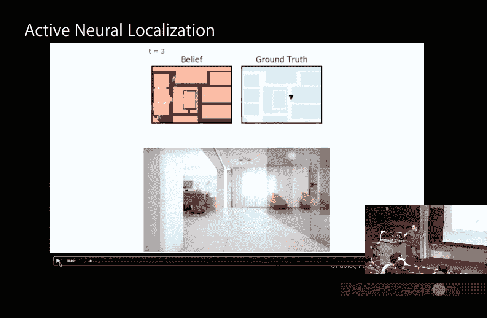

Okay， so just to discuss， let me just quickly say well。

Can we extend these examples to the multi agent domains， right？

Multi mileage is basically communicating through the shared memory。 so if I have a couple of agents。

嗯。How can they explore the map more efficiently right obviously you know one agent would explore one part of the map。

 the other agent would explore another part of the map。

 and as soon as one agent would find the indicator through the shared memory。

 they could both find the right target。So we've sort of tried working on this。 It's kind of funny。

 We sort of started hitting local optimum and the local optimum is basically we have two agents and they were agents。

 they have a SDM hidden states as well。 They have a shared memory。

 But what happens at the training is as soon as one agent finds the indicator。😊。

It stays at that location。Right， so it has these features of the indicator。

And just communicates to the out age， the states of its hidden state。 So it basically says。

 forget about the memory。Right， soon as I find the indicate， I'm gonna stay where I am。

 Well we had the agent explorers and tries to find the right target。

So that's a suboptimal behavior because the optimal behavior would be to write into the joint memory and continue exploring。

 right？So we sort of find these interesting examples where the optimization finds these other ways of solving the problem。

嗯。So here we also can we train an agent to learn how to simultaneously localize and map the environment。

 And so that solves the problem of needing an oracle to supply X Y position。

 So if we could actually have localization mapping， we could， you know。

 start building our neural map and start learning what we need to write and what we need to read from。

😊，And then we also were thinking about structuring these neural maps into multi scale hierarchy。

Right， so that each scale can incorporate longer edge information。

 This is particularly if you're not exploringing the environments that are much larger。Right。

 as opposed to。 And so this is where these examples of kind of like a multi scale memory of multi scale read or write operations can come into place。

Or can come into play。嗯。One final thing that I wanted to to。

 to mention is that I think that this idea of memory and the idea of separating compute。

From what you need to store is， is a pretty significant idea， I don't think。

These kinds of memory mechanisms have been very successful so far。😊。

And I think the reason why is because we just don't have the right algorithms。

To train them efficiently， right， What ends up happening right now。

 at least in practice is that people say， well， if I make my L SDM state be bigger。Right。

 or you know， larger have multiple maps， multiple hidden states， looking at different scales。🤧。

And that seems to， you know， solve， you know， some of the problems that we're trying to solve。

Right so that's what's happening right now， but at the same time。

 you can always break those algorithms by basically saying if what you need to store。

can take very long periods of times， pretty much any existing algorithm will fail。

Unless we have something that you can actually store。Like you know， copyM times。

 if I say copy it a million times without having a memory， there is no way you could do it。

Any sort of R N， N， LSDM。Will fail。So， yeah。sSo this active localization says that you are allowed to choose your actions to localize yourself faster do you think if we have active agents for s s will be a much simpler problem instead of us collecting data humans and then give them to an algorithm Yeah so that's one of the things that I think that it's ultimately you probably want to have an active s agent right you want an agent that takes actions。

To figure out how to build the map as efficient as possible。

 right so I think in terms of efficiency will， it will be faster as opposed to us providing the agent the algorithm。

 okay， well here's the path you need to take you know collect some data offline and then try try to do S。

 which is what a lot of， I guess， traditional robotics algorithms are doing。😊。

The issue with active s。In my view， is that to train these systems， you need some environment。

You either need some virtual environment that looks realistic compared to the real environment because what these agents are doing is they basically say saying。

 well， if I take this action。😊，Would I localize or would I build a s faster？Right。

 and so you need this notion of。Of。And it's hard to do it in practice because if I have a robot。😊。

Id better just collect the data using sensible set of actions as opposed to getting the agent to just explore because theses an explanations。

Yeah， and unfortunately， there aren't a lot of good simulators。For this task， yeah。

How else would you consider using traditional Islam？

Methods within this active loop instead of making a neural them to antient because in any case it's not differential Yes。

 yes， yes yes， you can， you can definitely there are you know some of the things that we've tried doing is we basically took the slam architecture。

 traditional flame architecture like graphs and such。And just try to make them be differentiable。

But we don't need to， because it's enforce now。Yeah， but the thing is， the thing is。

It's a reinforcement learning， but if my decision is to take action。Right。That's that's true。

 that's the enforcement learning。 But if within this decision somewhere inside。

 I also have to make a bunch of discrete decisions。

 then it becomes much harder problems Do you see what I mean， it's almost like in。😊，In the memory。

Because the policy itself produces that of action。 So I say go forward， turn left。

 But when I compute the policy， the entire policy is differentiable。

 But if I had to do hard attention for the reading， for example or the writing。

 then I would have to make some discrete choices inside my policy。And my that's right。

Two steps I different memory。 So it's harder。 It's harder。It's worth right。 Yeah， yeah， I agree。

 I agree。 It's worth checking it out。 I don't think in well。

 we've looked at some robotics literature。 mean， robotics literature， I mean。啊。

They don't have active slam yeah， but I think a lot of it is because you need a simulator or you need something to explore and to learn and such。

It's very difficult to do active s in the real world， right？嗯。Yeah。一。Any other questions？

I have one more question with my language grounding since the reward was。

 I reward you if you reach the right object， correct。

 so why don't this means that I know is the tall green storagerch？

Why don't I try and supervise the attribute classifiers for objects？Then I learned that， yes。

 you can totally do that。You can push bunch of auxiliary losses and have like a supervised classified one that basically says or even detectors。

 you can just say， here's a blue torch detector。RightYou can definitely incorporate that as an auxiliary task you can definitely and that's something that I think Divery is doing right now and it helps a lot in terms of the speed of learning。

 In fact， you can take off the shell detectors， put it into the system， right。😊。

And it can start learning things like if I have a table detector。

 It can start understanding theres something's called a blue table or red table and。

 and sort of like association with the attributes and such。For sure。 Yeah。

 that's a good way of incorporating prime knowledge into these into these for sure。Yeah。

I have sort of students who。Core R L students that basically say we can solve everything from ground up。

But obviously to make it more realistic and in practice。

 you definitely need to put the prime knowledge， you need to put auxiliary losses and such。

You definitely do know that this is a torch and this is a green and this is a red because at the training time。

 you have that data。So definitely can use it things ahalator loss。 and it will。

 it will help speed up。The training considerably yes。Yes。The torchwi。For example， if we have two red。

Smart watchch。As the agent to go to the small black porch。

 but assume we have to add the one is far from me and the other one is near from me So I would think。

The further one looks smaller。 so I would go there。The other I approved the smaller one。

 the other one， who I look back， I think the otherwise smaller。

So we are the agent like go back at first course because we are two things。

 Yes the beh basically learns to explore so if you have two torches， two red torches。

And you know this looks small to me， this looks larger to me。

 the agent through the process of training learns that it basically sees this thing。

 it thinks this is small， it navigates to this one。

 and this is is bigger it comes back to the original one。Right。

The two retortch are actually the same hat。Oh， if they're of the same height。

 if they're of the same height， then the mall just has to like find one of them。But I mean。

 the one is far from me。It seems like it's smaller learn is not to make those mistakes。Right。

 because it's， it's not like， so this would be a problem if I couldn't move。 if I said。

 heres a fixed frame。Which one is the smaller torch。 Then I would be confused This small the small。

 But because what I can do is I can like move， I can this。 I can come closer to it。

 then I can find the relative things。And here， when we look at the small， we had like small。

 medium large。 So it wasn't like they were different by like 1 millm。

 So you really had to figure out which one is smaller。

 Like you could identify one is smaller in another。 but because you take actions。

 you can disambiguate。And I think that's why working with settings where the agent can take an action。

Is pretty important because if I'm confused about like who's o what and how far things are。

 I can just like move here and then move back and I can disambiguate that。Yeah。So how far it you。

Having those robots out there to run this navigation parallel world。Oh， I don't know。 I don't know。

Maybe not I was wondering maybe you know， because you are an Apple。Right， right， right right， right。

 right。 Yeah， it's gonna take a while。 I think that it's。There's another question。Think的。

In real world application。So I think that when you think about like incorporating memory。

I think that。The main roadwalks is just the training element， it extremely ineff。So for example。

 to solve a simple task of navigating to the right target。Takes like a few days on multiple GPUus。

 And it's a， you know， fairly simplistic environment。

So that basically means that we even have to have better a losses。You know。

 reward shaping and so you know， as I mentioned before。

 I think that the notion of memory is pretty important one because it can store things over arbitrary long time periods。

But learning these models is extremely difficult。 And so that's why most of the successful applications of of memory is like memory networks and language。

 It's basically you story everything。 You don't， you don't learn what to write。😊。

You just store everything， and then you just do retrieval， differentiable retrieval， no mechanism。

As soon as you start figuring out what information you need to write。

And how this information will impact your actions long term into the future。

 that's an extremely difficult thing to do。Right humanss are pretty good at doing this， right？

You know， you put。 I had a friend who put like money on Facebook and the Facebook just watched collapse。

 And so he learned not to do that， right， And so， you know， you you basically。

 I think that humans are pretty good at somehow remembering things in the past and generalizing them。

 That's right and generalizing them very well。 like this one situation。

 Here's a completely different situation， but it's generalizable to this new situation。 right。

 And so。😊，Yeah。There was a question。か。Hyperparameter tuning for reinforcement learning is also kind of a reinforcement learning task。

 so I'm wondering you can use this neural map to store hyper like story a network architecture So is there isn't work right now。

 I believe like in the last couple of years， people are using be unfortunate learning to do hyperparameter optimization。

You know， they like just actions， you're choosing the parameters and so forth。

 the issue there is it's extremely unstable and difficult。To design the policy。

 and if you do design the policy， you want this policy to be generalized across different data sets。

Right， ideally。Here's a data set。 his policy produces the hypoparameter。I mean。

 that's what people do most of the time， right？Like yeah， sure， but it's still， you know。

 I can tell you that， you know what is what's the most important hyperparameter learning rate。

 your learning rate should be 0。01 or 0。001 period。Works about 90% of the time。Right。好的。

Yeah so you mentioned that getting better simulators is like an easy way to sort of improve the or like fix the problem。

 do you think just better simulators or improving the training of is going to be more I definitely improving the training elements and I definitely think including generalization like journalism。

Because。What you want to do is that it's almost like we need an I geneticette4l。

Where you try to solve bunch of different tasks and you try to generalize across different tasks。

I think we definitely need better algorithms。If you think about this， you know。

 supervised learning is hard， but we sort of。Been successful at solving it。

Reinforcement learning is not as hard as unsupervised learning。

But it's still hard because your rewards are sparse and， and， and。And as I mentioned， like。

 with the addition of the memory， it's just we don't have good algorithms right now。

 I think this idea of separating and compute from the memory is a fundamental idea。

That people will be exploring in the future。As you said right now。

 we don't have a good way of learning these。You know。On the other hand， you know。

 if you're watching like open， open AI， they had a game of data， which is， you know。

 ph sophisticatedistic game。 You have five players。And people thought that you need some notion of。

 I thought you need some notion of memory。 you need some notion of planning。

 you need some notion of strategy。And well， it turns out if you just big gigantic L STM。

Kind of works。 So， you know， you never know how far you can push existing algorithms， Right。

 So maybe just you need small computes。 So but what if this is the wrong evaluation of algorithms。

 What the right evaluation is what schema networks did That says， give me your algorithm。

 I'm going change time with the environment。 And let's see how well your are both works。 exactly。

 So maybe our evaluation is wrong。 Yes， I agree， I agree。😊，It's a fair point。

Thank you very much Ro well thank you。

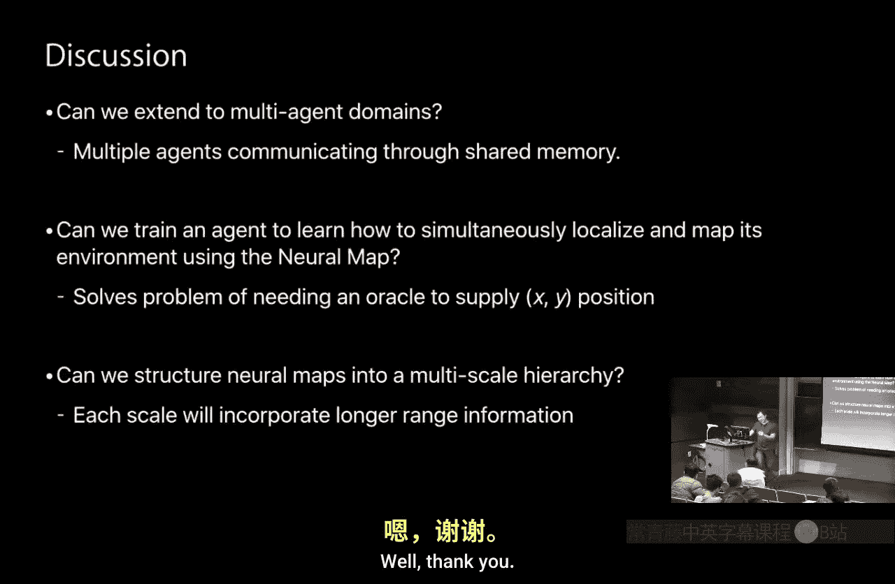