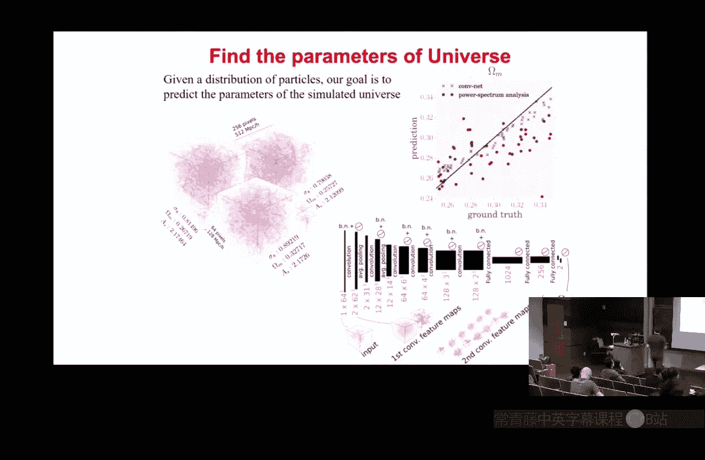
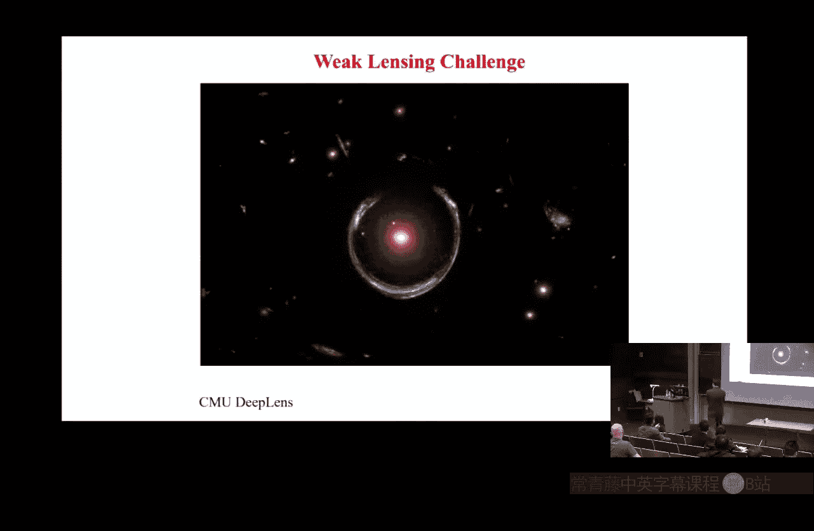
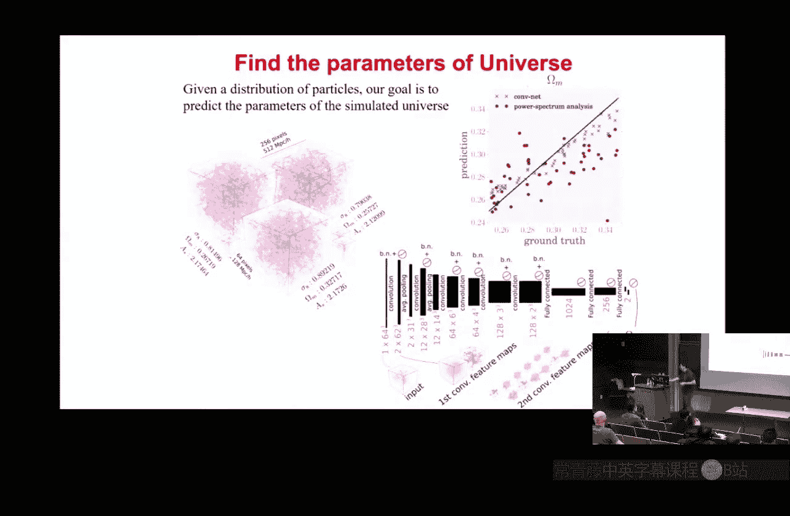
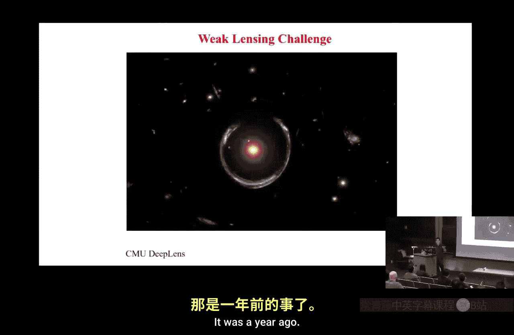
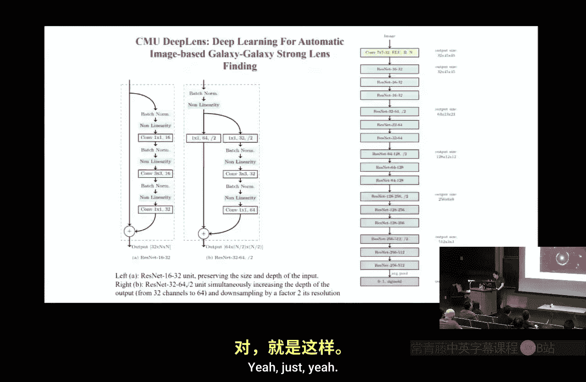
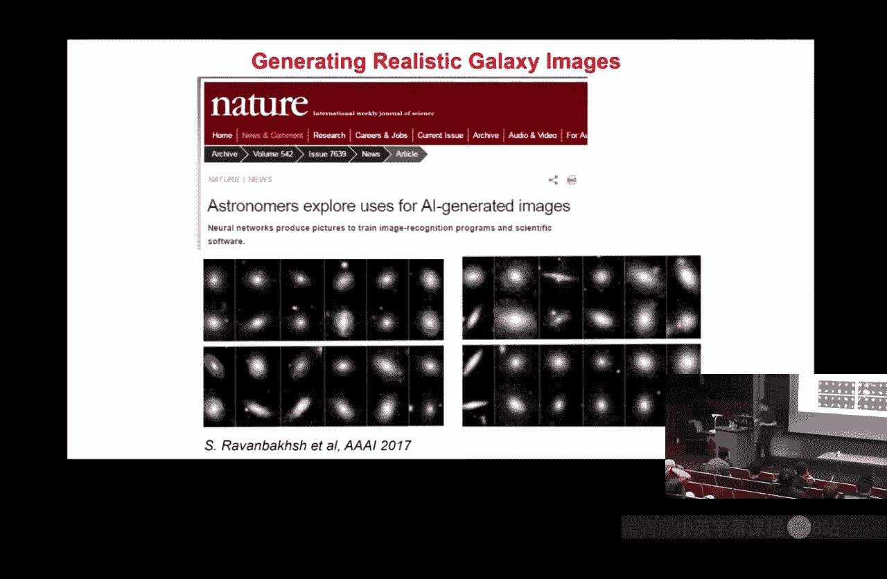
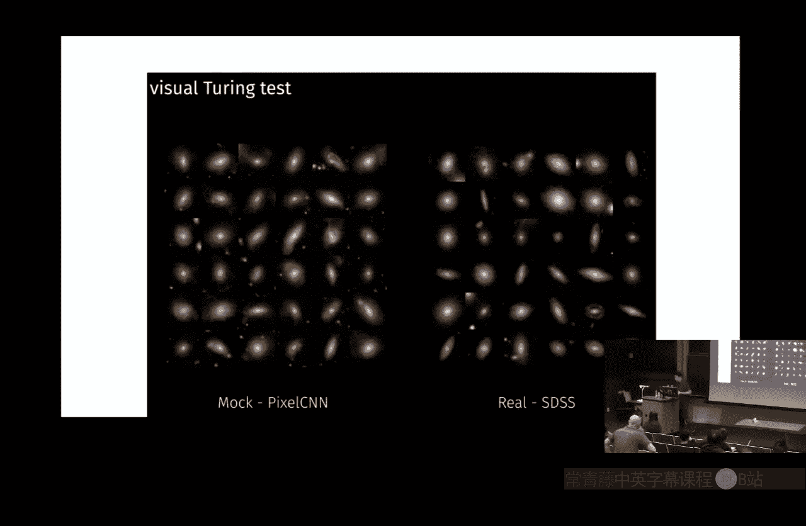

# 卡耐基梅隆大学【中英⚡深度强化学习与控制｜10-703 Fall 2018, Deep Reinforcement Learning and Control】 p23 P23 23  Machine Learning for Experiment Design Barnabas Poczos -BV1RyqPBbEJV_p23-

All right， hello everyone。 So indeed my plan today is to discuss couple of machine learning methods that could be used to have the life of scientists。

😊，And I would like to discuss a couple of domains like cosmology， chemistry video。

 if you have questions any time， please interrupt me and then we can discuss those questions with you。

The other thing I don't know much of your background， so if there's something everyone knows。

 you can just tell me that skip that ahead and then I can move on first。

So here are my collaborators on the machine learning side， who help。

Me developed algorithms for scheduling scientific experiments。

 Jeff Schneider is a research professor in the robotics Institute and also affiliated with the machine learning department and。

Billy Sammy and Biwidge theyR PhD students in the machine learning department。So， this is my。

This slide is about the goal， my goal， but I would like to do。嗯。

So the goal is to create collaborative。Asistant。Gral for science and for also for manufacturing and for daily life as well so this is the general framework how traditional scientists work they have a problem in their mind and then they have to design the experiments they have to think of what data to collect and how to analyze that data and I would like to help scientists to use machine learning for all of these boxes here so I would like the scientists to interact with AI and machine learning agents。

And help。And these agents should help the scientists to make automatic discoveries to find animalsomaities in the data set。

 find interesting events or find even new scientific laws that we didn't know about。

I also want these machine learning algorithms to recommend new experiments to run。

 and I will focus mostly on this today， and。😊，We recommend what data to collect and how to analyze the data。

 And ideally， we would like to reach that point when at some point。

 these algorithms are so useful for scientists that the scientists want to list。This。

 the name of these algorithm squ on their papers。 Okay， so we are not there yet， but that's the goal。

Right and here are some applications that Im working on so I'm working on cosmology problems and astrophysics problems。

 material science， high energy physics and particle physics。

 working on computer vision and neuroscience problems I'm also interested how to use these algorithmsine games。

 how to use machine learning in agricultural problems。

 quantum chemistry and recently started to use machine learning algorithms for art。😊。

As well to create art projects with machine learning algorithms。Alright， so in the experiment。

Design task， the goal is that given a collection of results from past scientific experiments。

 we want these machine learning algorithms to recommend new experiments to run。😊。

And some of the experiments are expensive in terms of time or money。Some are high quality。

 some are cheap and low quality， and ideally， the machine learning algorithms should consider all of these。

So they should consider the costs， and they should also consider the expected information that they might gain from that experiment and they apply tools that we are using。

In these machine learning problems， usually are Bayesian optimization， Gaussian processes。

 multifidelity learning， reinforcement learning， banded algorithms and active learning。

For some of the algorithms I'm going to present， we have code available。

 and you can check them out from this Github link。Okay。

 so we have a machine learning platform that's called Dr on fly that can be used for recommending scientific experiments。

😊，And。Many of these algorithms will built on Gaussian processes， but I don't know how many of you。

No Gaussian processes。 Well May I ask that who knows Gaussian processes and who， who knows it。And to。

 and who doesn't。So there's a major。 So let's quickly discuss Gaussian processes because I will need to build on them。

Is it okay。So you know regression right， because I think everyone took 601 or 701 or other machine learning courses and。

😊，How regression works that you have input output pairs。And from the input。

 you want to predict output。And。These are the regression argumentss you might know。

 linearar regression。 Do you know super vector regression。Do we know。Kar rena regression。

 or you can use multi pairy for regression。 One issue with all of these regression methods is that for any given input。

 they output only a real number or a real vector。 And what we want to do。

 we also want to output a confidence of our prediction。

And that's what Gaussian processes can help us with。Okay。Alright， so ideally， we would like。

To have regression methods where these are the input output pairs as you can see here。

 and instead of just outputting one function idea we would like to output functions like this green function with confidence and you can see these shaded areas as confidence。

😊，Oh。When close to the training data input output pairs， we have high confidence。

The answer of our prediction is small， but far from the training data， we have higher uncertainty。

 We are not that confident in the prediction。 But these will be very important。For us。Alright。

 so with Gaussian processes， you can。Handle these three different machine learning tasks。

 you can do prediction saying that given a training data at any given location X。

 you can say that this is my predicted value with this confidence。 That's one thing。

Other tasks you can do。You can predict。The expected function， that is。This would be the。

For any given location X that would you could check the confidence interval。

 And it would be the half of that confidence interval。

 And the other thing you can do with Gasian processes is that you can say that here are some possible functions that all look compatible with your training data that。

 for example， in our case， or the blue。😊，Green and red lines they all look reasonable。

Allright this is how it works in practice in this case we have three training points and with go same processes we can fit curves like this where blue would say that the most likely function and we can also put some confidence how confident we are in the prediction and as you can see far from the training data we are not very confident。

😊，Right。And if we have。More training points。Then the confidence gets bigger。That is。

 the confidence intervals gets smaller。Alright， so if increase the points。

 you can see that we are more certain about the predictions。 If the data is more noisy。

 then you can see that the variance is higher in the prediction。

 So this is what you can do with Gaussian processes。 Everyone is okay with this。😊，Okay。嗯。

So let's discuss the algorithm for Gaussian processes very quickly， how it works。For that。

 we need to know multivariate Gaussian distributions。 and this is my question for you。

 who has never seen multivariate Gaussian distributions。Some of you， Okay。

 but everyone knows what one dimension Algausian distributions that right。

So one dimension all we see and distributions just look like this。This is the a。

 This is the the Gaussian distributions have two parameters， so called mean and the variances。And。

This is their density function。Okay， everyone knows that。

 So it turns out that we can generalize Gaussian distributions from one dimension to multiple dimensions。

So， for example， a two dimension Ar Gaussian distribution would look like this。

It would still have two parameters， a mean and the covariance。

 but a mean in this case will be a vector。That is， what is the mean of this distribution somewhere here。

 And the covaris just indicates the variance。And covariance between the different dimensions。

 And that's a matrix。 And density of a multivari Gaian distribution looks like this。Where again。

 movie is a vector， sigma is a variancevariance matrix， and that's all we need。

Everyone is O with this。So this is called multivariate Gaussian distribution。

 We will need two properties of multivariate Gaussian distributions。

 One is that if you have a multivariate Gaussian distribution。

 then the margin of distributions are also Gaussian。That's one propertyity。

 And the other prop that we will need that if you condition。Some margin are dis。

 some random variables and the other random variabless。

 that condition or distribution will be also Gaussian distribution。Okay。嗯。So again。

 here is here are just sample points from a two dimensional Gaussian distribution。 As I said。

 the margin， our distributions are also Gaussian。 But it means that if you project all of these sample points to1 axiss。

That would have a Gaussian distribution。 If you project to these axises。

 that's the other marginal distribution that has Gaussian distribution as well。

 The conditional distributions are also Gaussian， which means that if you fix any point。

 say this point。 And just along these xs， you check the distribution of these points。

 that should be Gaussian distribution。 And similarly。

If you condition on this point and you check the distribution along this axis that has the big OusM。

Okay， so these are multi ghosts and distributions。Okay。

 the other thing we will need to discuss is how to generalize Gaussian distributions to even higher dimensions。

 So we discussed what are one dimensional Gaussian distributions。

 what are two dimensional Gaussian distributions。We could similarly 800 dimensional Gaussian distributions。

But we could even generalize this further and create infinite dimensional a Gaussian distributions。

Okay， that's the next step that we going to need。Generally。

 I have difficulty with visualizing code and distributions in bigger than。Two dimensions or three。嗯。

So， for example， if I want to visualize a dimension a Gaussian distribution。

 I don't know how to do it， to be honest。 what we can do is that we can create。Index set from 1 to 8。

 those are the coordinates of an a dimensional vector。 And for each coordinate。

 I can visualize the mean and the variance。So in each， for each of this index。

 I create a Gaussian distribution， just the one dimensional Gaussian distribution that has a mean and has a variance。

So， for example， this guy with index 5， which has a mean and the variance。This way。

 I created8 Gaussian distributions。 And another thing we can also do that we can introduce covariance between these8 Gaussian random variables and that I could represent with the8 by 8 covariance matrix。

😊，Okay。And now the question is how to generalize this even further。 So one generalization could be。

That instead of just having8。The index set set should be 1 to 8。

 Maybe the index set could index set could be all integers。 Why not。For all integers。

 I could associate a Gaussian distribution with some mean and variances。

And then what I need is just to tell you how these Gaussian distributions。 Now。

 I have infinite many Gaussian distributions， how they are correlating with each other。

And if we did that， then we can even go further and you can ask why just have index set of the integers。

 Why not have index set of all the real numbers。 So to each real number。

 I could also associate a Gaussian distribution with some in variance。And if you think that way， now。

 for each real number， there's an associated Gaussian distribution。

 And I can also sample from the Gaussian distributions。

 And when I sample from all of these infinite Gaussian distribution， actually。

 I just sampled the function。😊，Where for any real number， that would be a sampled。Value。

And if I set up the correlations， right。Saying that， for example。

 if the indexes are closer and closer to each other， then the correlation is higher and higher。

 I can even sample con continuous functions this way。😊，Alright， so。You can imagine that here。

 all is real。Numbers are just indexes for a Gaussian distribution and I can generate sample from those Gaussian distributions and then I can sample functions this way from Gaussian distributions and if I have two indexes X and z what I want to generate continuous functions is that the mean of these Gaussian distributions should converge so the expected value of F they should converge to。

F of x。 And again， if the index x and Z are converging to each other。

 then their correlation should be higher and higher。 And this way， we can generate。呃。

Continous functions。For each x。Index， I told you that there is a Gaussian distribution。

 The mean of that Gaussian distribution is denoted with mu X。 and for any X and Z index。There。

Covariance is denoted with this K function， K X。Okay。

 so that's just a very quick intro to Gaussian processes。

 And Another thing you can do is that we just。😊，R that for each number a Gaussian distribution。

 but we could do even further and for generalize that say in two dimension。

 where for each point in a two dimension， you could generate a Gaussian distribution。

 and this way we could sample surfaces， random surfaces。Not just random fundamentalal functions。

 So these are Gaussian distributions。嗯。Generally， they are parameterized with when we are talking about Gaussian processes。

 they are parameterized with the mean function M X， which is at the index x。

 what would be the associated mean and the kernel function K。

 which just described that between index x and x theilde was the covariance between the associated Gaussian distributions。

😊，All right。So this is how we can generate random functions with Gaussian processes。

And now let's see how we can use that for regression because that was our main motivation to use them for regression。

 And here I just describe being the pseudocode of Gaussian processes。

 and then we can discuss why they make sense。😊，So we have a input output pairs。

 say we have a training data of D dimensional points and we have N D dimensional points in our training data denoted with this set X。

Okay， so these are our training inputs。We also have some training targets。 We want to do regression。

 so we have input output pairs， and those training targets are dennoted with this y vector y1 by 2 yn。

 we have n of these points。This is our training data input output pairs。

We will use Gaussian processes as we discussed Gaussian processes have a parameter k。

 which is a covariance function we just describes that between two indices。

 what should be the covariance between these two Gaussian distributions。

 So this k matrix in this case。So this key function is a。So this is called Coance function。

 and it maps。Has two arguments。 Each of them is a D dimensionional vector。This is our training data。

 This is the parameter of our Gaussian process。 And what we want to do that when we have a test point in the test point。

 we want to output what would be the。Expected by， with some uncertainty， right， That's the goal。

And this is how we do it。So first， we will assume that Y X。

 your observations are just some function of x plus some noise。

 So there's the standard regression problem where the noise can have some。😊。

0 minus sigma squared goesian distribution。And okay， so this is the pseudocode first。😊，You。

 from the training data， you create a n bygram matrix。So remember， we had n input points。

 each the dimensional input points， you can create calculate the canal value between any of these X I。

 Xj pairs and you can create this D by D sorry n by n gram matrix。That's one thing。

 Another thing we do that we also create a n dimensional vector。That just contains。

 was the care value between the n training points x1 x to x n。And。X star test point。

Okay so we created this n by n matrix and this n dimensional vector。

Using these plus using these antial buys， which were just the。Dod get。Values in the training set。

We can calculate this alpha for n dimension our vector。

And then it turns out that the mean we can predict has this form and covariance in F star。

 our confidence is given by this expression。 So what you should know you shouldn't see why this algorithm makes sense。

 but what you should see that you can run this algorithm and then at any given point X star。

 you could create a prediction that would be F star and the uncertainty。

That's all they need at this point。Okay， so this is how you do regression with Gaussian processes。

Alright， any question about this。 So what you should see at this point again。

 we have input output pairs， and we can use this Gaussian process regression to output。

A prediction with some uncertainty。 That's all that we need。

And I have some slides why it makes sense， but I would like to skip that。

 It's not that important for us。 I just want you to know that we can use Gaussian processes for regression。

 where again， we can output not just the predicted value， but uncertainty as well。Overright。

 and here are some results on this function。 The circles are our training data and the Gaussian。

This dash line is the true function and the gasian process regression provides you this black curve as the mean function。

 and this is my uncertainty of the predictions。 you can see when I don't have training data。

 then my uncertainty is pretty big。Okay， that's all we need。

So that's the take home message from gous same processes that gos same processes can be used for non nonlinear regression。

 and they can provide confidence of the estimate。 That's all you need to remember。Okay。

And now I want to use these Gaussian processes for scientific experiment recommendations。

And the framework we will use is called Bay and optimization。😊，B an optimization， as its name says。

 it's an optimization method where we want to find optimize a function。

 We want to find a maximum of function or a minimum of function。

But we will deal with the case when evaluatingvalating the function is very expensive。 And typically。

 that's what happens in scientific experiments that the experiments might take。😊。

Long time or take lots of money。 So evaluating these scientific experiments can be very expensive。

Alright， the other thing is that。We will， when we optimize these functions。

 we will think of them as black box functions where even the gradient is not available。Okay。

 so we cannot just think of like neural networks that I can calculate the gradient and do gradient decent。

Allright， this Bayian optimization that I will discuss with you。

 it has been used for hyper perform tuning for several machine learning algorithms。😊。

Scientific experiment design that we are going to discuss。 It was used for online advertising。

 discovering new scientific clothes and so on。 Here is one specific problem that we are working on and。

This is a chemical。Problem， chemistry problem where the goal is that we want to find the best battery in the world and how we do it。

 that we mix different electrolytes。😊，And we test the propertiesities of those electrolytes。

 And we want to find that mixture that has say the largest， some chemical prop。

 say largest conductivity。Okay。The question is how to mix the difference electrolytes。

 Each mixture can be sort of as an experiment， and then we are done with the experiment。

 We measure the propertiesities of this chemical mixture。 And based on those results。

 we need to recommend new experiments。 That is what should be the new electrolytes to try and how much to mix them。

😊，Okay。So here you can see a platform that we built。

 So we have this platform that can mix different electrolytes and run some chemical experiments on this mixture。

 and then we combine this chemical experimenting system with our machine learning controller that we recommend new experiments to run。

 That is it will recommend new electrolytes to try and portions for them to mix together。😊，So。

 just once。More， so these are different chemicals that we can mix together with different portions。

 And after we are done with the mix mixing， then we check the properties of this mixture。

 And based on thoses， I， we will recommend new experiments。😊，Dran。Yep， and。Yeah， it's all automated。

 so。そうです。So it took like six months to build this。systemystem。

 and here we measured the conductivity of the mixture。 We got the result。

 and then the machine learning platform， we recommend you experiments to run you visualize。

But you're getting over time。So I yeah， I show somebody else but。So yeah， I will come that。啊。

So we will discuss that， but I want to mention another scientific problem where this is a so called wire cutting machine。

😊，Which has 20 different parameters。 And depending on how you set up the parameters。

 either this machine can cut aluminium very quickly。啊。Or very slowly， but with higher precision。

 And sometimes even the operators don't know how to set up these parameters。

 But what they can do is that they can make experiments with this and then collect the properties of the cut they made。

 And next time， from these training data。 based on what they want。

 we can recommend them parameters settings for these machines。😊，Alright， and finally。

 another scientific problem I want to mention is a cosmology problem， so。😊，For me。

 it's very exciting that we don't know anything about our universe or。😊，You know， very little。

 So I don't know if you have heard of dark matter or dark energy。

 So it turns out that dark matter and dark energy is like 95% of the universe。

 The normal matter is just 5%。 So when you look around here。Whatever you see， it's only 5%。

 there's 95%。 something else。 We have no clue what that is。

 but they are in the form of dark matter and dark energy。 And there are cosm models。

That can use dark matter and dark energy。 and these cosmological models have some parameters。😊。

And our goal is that using scientific observations from telescopes to estimate the parameters of our universe。

 Okay， so there are theoretical cosm models。 These models have some parameters。

 and no one knows the exact values of those parameters， But we want to know。😊，Like this yep。嗯，那过。

There's three problems that you're showing up。they share anything？

We will use the same tools for soul。So how did you know that you could use those same tools for office？

Right， so scientifically， they are very different， but they all share the same thing that at the end。

 there's some objective function that you want to maximize and evaluating that objective function is very time consuming。

 So， for example， here in the cosmology problem。 So this is the model that we are dealing with that the universe has some true parameters that we don't know。

The through those two parameters generate the real universe。

We cannot observe the whole real universe。 We just can make some noisy observations with telescopes。

 and we got some observations。😊，We can have some high particular parameters of the universe as well。

 and using mathematical models。😊，Assuming these parameters， we can create simulated observations。

 and then we can check how close our simulated observations are to the true observations。

 And based on that， we can tune these parameters。 We want to find the best parameters where。😊。

Sd observations are as close to the through observations as possible。But the difficulty is that。

Simulating universes from these parameters， this very time consuming。So again。

 we have an objective function that we want to optimize。 We want to find the best theater。

But this optimization is that it time consuming。Yep。ますあ。No， so you get。其实。Part problem。

 there is also this simulator or mathematical model， So that's a simulator。

 and we assume that the simulator is reasonable。So that's coming from the physicists。 Yes。

 but it's still very expensive。 it's very expensive to， yes， I see， yes。

 but but it can very well be that there is no such simulator。 Do you agree。

 and that you only can change your parameters， get the observed from a telescope and fit。

That objective function right So in this model， we assume that there was a simulator who can for the battery project and the battery。

Features and then conductivity， right， And we try to yeah them up。 That's correct。

But there the assumption was the scientific experiments that those are time consuming， right？

So we can last you get rid of。ExpenulatorSo not in the not in this cosmology problem。

 We don't have that simulator in the chemistry problem。 So it's just like aable selection。 right。

 yeah。Yes， so here， the assumption is。We have a co function。 We want to optimize that co function。

 but that's expensive to evaluate the cost function at each theta。

 We don't even have gradient in theta。And we want to find the best theatreta， somehow。

So what if we would eliminate the simulator and just have the first pathway。 we would do worse。

 of course， right right， So if you just have the first。

 So from the that's what the universe gives you that the universe has two parameters and you can make some observations。

 But then from when I assume some parameters， I should be able to I should have a loss function how to。

Like I'm here to learn。All the universe。Right， so give need the predictive model。

A pra predictive model。Right， and that's true that if you want。

 you can replace the parametric model instead of a similulator with something else。😊，Right。

 so that could be， if you want it could be a neural network。 But here。

 the assumption was that physicists， they already know something about the universe。

 So we wanted to use those simulators。And then they would try the observations exactly。Alright。

 and the trick here that what we are going to do that for each data， you can generate。 y。

 you have question。给你。So for each specific application， the Kner function has to be different。

So that then means。按装的。Either knowledge or you try any different ones and choose the best。Yeah。

 but there's no。When you see the best， that gives you better。Right。

 so the error is smaller say And you can learn the cameras as well。

 So there are algorithms for that one as well。今かにゅ正。嗰啲个或我即。mhm。Right。

 so you can either have monized constraintss， like for example。

 sometimes with the chemistry examples， some of the electrolyized might be more expensive than others。

 Those could be one kind of problems， but the other kind of con could be time con。

And there is a third kind of problem that I didn't mention that we have algorithms for。

Something called multifidelity learning problem where depending on how long you run an experiment。

 you can get higher fidelity， higher prediction， but it's more expensive as well。

 And you want to consider that one as well。 So， for example， with neuron network。

 if I want to find the best neural network， depending on how much training data I。

Use the more training data I use， the closer that I get to the true accuracy。

 but it's more time consuming。Alright， So， yeah， so back to this。 So what we are going to do。

 at least in this cosology problem that for each theta。😊，I can run a simulator。

And then I can check how good this data is。And I can do that for a few。So you hundreds of data。

And then I will have thes and as input and loss as output。

And then I can fit a Gaussian process on this。With regression， because I have input output pairs。

And now I can minimize my Gasian process because the Gasian process。

 that's just the function that my machine learning model give to you。

 I can very quickly evaluate the Gasian process。But I cannot quickly evaluate the real word。Okay。

 so what we do is that we try to approximate this map with a function。And minimize that function。

That's the mean idea。 Okay， so， for example， this is how it works in an abstract Here is a function that I want to optimize。

 In this case， I want to maximize this function。And there's once such algorithm that can do that that's called terms on sampling。

And what you do is that you start in a random point， say in this point。And for this point。😊。

With the Gaian process， you fit a curve。So that might look like this。

And then you find the maximum of this point， and you can do that quite quickly because， again。

 it's the Gaussian process that you generated。You find the maximum of that。Then。

You make a new evolution。You find the maximum of this new curve。Then in the maximum point。

 you make a new observation。You make a new observation in the maximum point， you fit a new curve。

Find the maximum of this function。 The maximum is here， so you will try this experiment。

When you tie this experiment， you will see that the function value is actually not this， but this。

You will get a new curve。You find the maximum of that new curve based on that maximum。

 you try a new experiment。Okay， so you tried this experiment。F the new。G。That has a new maximum here。

 You try this experiment， and you do this till， you convert somewhere。 And at some point。

 it will convert to the maximum of。Your function。It would beat the maximum of the curve despite the fact that you may have to of uncertainty。

 Exact。 Yeah， so this thumb on sampling is very naive， but that's what you do。

And you can prove that under some conditions， guarantees to get to the max。

That's still under some conditions you can。Com backs to the个。

Because you in each time you check the global maximum of the function of it。

 not just the local maximum。但 maybe。AlRight， so you can prove that under some conditions it have enough power to do enough exploration for you。

Okay。Okay， but indeed， this is very naive because it doesn't consider the confidences。 So there。

 there is an improved version， which is called upper confidence bound method for Bayesian optimization。

 And this is how it works。 Again， you have a function that you want to maximize。 Look like this。😊。

Instead of just fitting a Gaussian process as we a function with Gaussian process， as we said， yep。

No， they could be anything。 Yeah， they don't。 we don't assume independence among the features。Okay。

 and so there can be con。Yes， and indeed， if you have more knowledge about the features。

 you could do something better than this。Alright， so as we said， with Gaussian process。

 it has the benefit that you can also not just predict a  regressiontion function。

 but uncertainty as well about that tion function。 So we will use that。😊，So。Right。

 so say be out here。This is my point in the training data。 And then we go see and process。

 I can filter。Cve with some uncertainty。 And this is the。This shaded area is my uncertainty。

 and I will find when I optimize， instead of just optimizing the regression function。

 I will optimize the regression function plus its uncertainty。😊，And that will be that point。

So I will try this experiment here。I try this experiment as the function value。

 It reduced the uncertainty， but now I have begun uncertainty here。😊，So I will try this experiment。

And I'm here and now。呃。The coucian process regression provides this。Shaded area uncertainty。

 That's the point where the uncertainty is maximum。 So I will try this experiment here。

And you continue this。Toい convergence。And you can prove that this Bay and optimization。

 under some conditions， again， we defined the maximum point。Okay。

 so the take home message here that we have Bay optimization methods we discussed through。

 one is the Thompson sampling and the other is Bay optimization with uncertainty。Interrals。

 they can be used to optimize functions when function evaluations are expensive。

And they don't use gradient information。Questions about this。Yep。投。Right so one。

 if you have gradient， you might just comb only to local optimum points。

 but they can come faster to local optimum points than they would do。So it depends on conditions。

 though。And so yeah， so they could。 So it depends what kind of conditions you assume under some smoothness conditions。

 they are pretty good， too。But still grade and decent can be much， much faster than these things。

Question， so we have seen top on sampling for。on that。So。うデス。The other method there again。

 we have a budget network and every parameter is a Gasian and each time you sample and then we stashiate the network。

 right， right？And so the difference with Bayes optimization。

 the only is that you use the uncertainty from the Gaussian processes。Yeah。To sample， to sample。

 instead of。Rise to where to sample the next experiment，Alright， so another。Alrim。

 I quickly want to mention that we also generalized these Bayesian optimization algorithms to the case when we have multiple fidelity levels。

 So here the true function you want to estimate is F。

 That's what you care about that but that's very expensive to evaluate。

 And we assume that there are cheaper approximations of F。 say F1 f2 and F3。

 where Fs1 is the cheapest but lowest quality estimate。 F2 is a bit more expensive。呃。

And it has better quality。 F 3 is even more expensive。With better quality。

 And we generalized base and optimization to the case where the algorithm shouldn't just choose where to run the experiment。

 but it also should choose which function to evaluate。So we， on which function to run experiment。So。

 for example， you can use that with neural network training where at the beginning。

 you might just want to say you want to find the best high parameters for neural networks。

 And at the beginning， maybe you just want to try smaller training sizes。

And when you roughly know what is a good architecture。

 then you can increase the training size and try more expensive experiments。Al right。

 here is an cosmology experiment that we did with this multifidelity algorithm。

 So we wanted to estimate cosmological parameters such as the Huil constant。

 the dark matter fraction and the so calledled dark energy fraction。😊，And we had two fidelity levels。

 One is that we had the training data from。The training data were some observations from supernova and it turns out that supernova properties can be used to estimate these cosological parameters and depending on how many data point we choose that was one fidelity level。

 of course the larger your training set the higher yourcury is and the other thing is that when we。😊。

Wanted to estimate the parameters。 It turned out that we had to perform a numerical integration as well。

And when you do numerical intation， you have a grid size parameter。The finer the grid。

 the better the qualities， but the more time consuming the numerical integration is。

 so we had two fidelity levels here， one is how big is the training size and the second level is when we did this numerical integration how precisely we wanted to do that。

And here are some results that we got， so。Our algorithms is called B an optimization which continuous approximation。

 Boca。 And here is the standard Gaussian processes with thisar certainty interval that was this green line。

 And the point here that you should remember that when you have multi fidelity levels。

 then you can exploit sometimes that and you can do something better than the standard algorithms。😊。

We also used this approach to try to find neural network architectures。And。

This is a neural network architecture。 I just rotated。This sort。I guess this is the input。

 That's the output。 And that's what we learned on Scipher 10。Data set。

 it doesn't look like standards， you know， a network。Structures， it has some skip connections。

 as you can see， just like in residual neural networks。 These are convolutional book books。

 So what we did is that we allow the algorithm to use convolutional books， skip connections。

 but where to skip the connections that it had to optimize。😊，And the length was not fixed either。

 how to index parameter。 So it So So that was a maximum length， though， but it was not fixed to be。

 yeah。Yep。And here are some results on the。Yep。score was where should skip doing Yes。

 and got kind of And also whether you want to use convolutional blocks or you want to use batch normal。

 So there were a couple of these options。哦。Where to skip connections， whether from。

And the idea is that the outcome。If take we we're doing safer is kind of smooth over those parameters。

 so skipping to the1 and skip to the option bit nearby so that。The other。

 it was optimizing whether you need to match two of these blocks to one or you want to split them。

These were the opt。I don't remember。 So there were tons of these things， but。でパす。でな？そかラト。

It world like。So， the parameters were。So it depends how we count the parameters。 So we。

 we are talking about hyper parameters， not the parameters of right。 So in each。

Place you were allowed to use either convolutional blocks or other kind of blocks。

 whether you wanted to use batch normalization or not， these kind of parameters。

 So the number of actions were not that big， but you have multiple of these actions that you can take in each。

说们吃点。In your00 or 500， like oh， it's bigger than that's right。 Yeah。

 I think it's even bigger than that's right。We should check on that。

 but much bigger because then each。Location， you can either decide。

 do I want to use batch organizationization or not， Do I want to connect this through here or here。

Right， so it's turnss of。But it is。And so here are some results under accuracy。

Our algorithm is called this Nesbo， and。We found that this kind of architecture that looks quite ugly。

 actually， is better than CG G19。That most of 10 people。You so。嗯。

So it seems that still theres some place to improvement on the structure of these neural networks for image classificationification。

Alright。So the take home message from this is that we have algorithms for multifielity optimization。

 I didn't discuss the details of that algorithm to save some time。

 and they can be used for cosmology or neural network architecture search。

 and we have code available if you want to try that out。

These are still time consuming because you need to train those neural networks。

 but that is the organ can decide how much training data you to use for training。

The relation between this。Mhm。正も？More for learning of those actions。Ds of other people。

Consider where they sample an action， let's say batch on here。

 then they get the reward and they have this style。

 So let's do after a class because I want to show some a couple of other things first。

 and then we can come back to that。嗯。So another argument I want to mention is。呃。Myop pick。

Decision maker for design of experiments。And this is the setup that the decision maker chooses an action that will be your experiment that you want to run say in a chemical experiment。

 And then you observe an outcome of that chemical experiment。

And you also assume that what you observe is5 of x。 So， of course。

 it depends on the experiment you run， but it also depends on parameters that you don't know those areta star。

 And you want to estimate those parameters。And in rounds， you will collect data。

 So Xj is your experiment you run and y Xj is the observation of the experiment。

And the goal is to minimize the penalty function that depends on the data set that you collected。

 and it can have， for example， this kind of form。That， from the。Chemical experiments， iron。

 I want to estimate the solvevation energy。Of my mixture。

 I want to estimate the viscosity of my mixture。 and I want to find what was that experiment that had maximum conductivity。

 So you have multiple goals here put together。😊，One is for each experiment。

 I want to estimate its properties like the solution energy or viscoity。

 And the other is that for all of these experiments I tried。😊，I also want to know。

 what is that experiment that maximize the conductivity。Okay， so based on these three goals。

I can create a cost function。And the goal is to recommend experiments such a way that would minimize this cost function。

Does it make sense。So if you want to recommend an experiment that minimizes this cost function and the cost function has multiple go in it。

嗯。The other thing that's interesting here is that what we want to estimate， like solvevation energy。

 that's a function because for each experiments， I want to predict the solvevation energy。Similarly。

 the viscosity is a function for each experiment。 Like I mix different electrolytes for each mixture。

 I want to predict what would be the viscosity of that mixture and conductivity that's are。😊。

Value that I want to estimate is just a maximum of all of these possible conductivityivity values。

Okay， so in this goal。In this case， the goal is to estimate two functions and one real valued output。

 And I put everything into this function。Question。Yeah。

The joint function will complete these joint parameters and then will you know the joint search problem that both learns to predict so they have the same argument X and from that x the experiment。

 they would predict the solution and gender vicosivity of the same experiment an experiment is mixing different electrolytes。

And for any mixture， X， we want to predict itsservvation energy or its viscosity。

And they use the same drug。And表全。So we use the same， but maybe it's not optimal。All right， and。

This is how we did this。Maybe to save some time， I just give this algorithm。

 It was just a greedy algorithm that tried to estimate this expected value。

 which says that if I run this， I imagine I run this experiment。

I will try to predict what would be the result of that experiment that I would get。

And we use that in the optimization process。But what I want to show is that here are some results。

This is the cost function。 These are the number of experiments。The smaller discussed function。

 the happier you are。And。Randdom is just a random search method in the parameter space。 grid search。

 That's a grid search in the parameter space。 This black curve we can ignore for now as just a kind of theoretical optimum approximated in a weird Bay。

 But this is not a realizable curve。 And the blue is that what we propose。 So what you can see here。

😊，That if you use this myoppe experiment recommendation。

 you can do better that scientists often tend to do that they just do a grid search。Or random search。

Okay， so that's what you need to remember。That in many of these scientific problems using this Bayesian optimization。

 tricks you can do better than。99% of the scientists do that they just do a grid search kind of thing。

嗯 y。So given a drain。嗯哼。しち。value that's it。But the kernels are very important that's the whole point of representation learning Right so what does it mean to things be similar versus thes Right So so the can it depends a lot on the can which is like the of the which exactly so you can do it in a hierarchy but then of course。

 you need bigger budget。嗯。The other thing that Gaussian。

 the other drawback of Gaussian process is that。Everything is Gaussian。

Even the prediction is Gaussian。 and maybe the real life is just not Gaussian。

 but still it would approximate everything with the Gaussian distribution。

 So there's a new direction now to replace Gaussian processes with neural networks。

 where the neural networks would output a real number just as they do。

 But they would also output uncertainty how uncertain the neural networks things they are about prediction。

Okay， so the Gaussian process is just one way to do Bayesian optimization。

 but you can replace that Gaussian process with any kind of regression method that can output predicted output and an uncertainty。

So what do think is the basic。Communation that the why is。Yep， right， yep。I see。啊。Allright。

 so let me。Quickly， go discuss other things。Right， and I also want to mention another。

Kind of problem that was very important in many scientific problems。 and namely。Most of them。

 am we deal with regression or classificationification， we assume that we have input feature vectors。

The observations are just some vectors。And there are many scientific problems where that's not the case where the observ。

 the input is something more complicated。 So， for example。

 when I deal with we have scientific problems with astrophysists and cosmologists。

 some of the problem is to predict properties of the universe。 So predict properties of the galaxies。

 But when you look at the galaxies。 what the galaxies is is a set of stars。

 What the universe is is a set of galaxies。 and we need machine learning algorithms that can operate on this set of objects。

😊，Where some galaxy might contain these many stars and other galaxy might contain many more stars。

 So the set of the sizes might be different as well。

 And now we need machine learning algorithms on this。 And the question is how to do this。😊。

RightSo I want to have a machine and algorithm， either classification or regression that can take input sets。

 say， sets of factors。And then what to do。 So I'm curious about your opinions。

 what to do in this case。The problem is clear， right。

 So I want to create a regression algorithm where the input instead of feature vector。

It would be a set of vectors， and sometimes the set would contain0 elements。

 Sometimes it would contain 2300。Yep。The App is actually about predictive models and know they need to consider the objects in the scene and some things have more objects than others so we have talked about graphnets that you know aggregate。

 ettera， but I don't think we've seen as a forward model for physics， let's say。Right， so。

Here is one thing that we can assume that when we have a set of objects as input。

 you might assume that the set of object。Was sampled from a distribution P。

 We don't know that distribution P。 We just have observations set of objects。Okay， and。Generally。How。

Say how regression algorithms work。 you have two inputs。 somehow we need to compare these inputs。

 either calculate the Euclidean distance and saying if the Euclidean distance is close。

 the predicted outputs should be close to each other。 Or when we do with super vector machines。

 we calculate the in product。Between the inputs。And do prediction based on that。

 So when we have sets as observations， we need to introduce either a inner product between these sets or a Euclideon some kind of distance between these sets。

And again， the assumption is that each set， this set here is sampled from a distribution。

 This set is sampled from another distribution。 We don't know those distributions。

But if say the distribution of this set P， the distribution of this set  Q。

 at least I can define distances between P and Q easily。

 And then I can use my sets to estimate that distance， so。For example。

 this could be a Euclideian distance between two distributions， whether den citiesities are P and K。

This could be a cool but there divergence between P and Q。😊。

And this is the so called gene divergence between P And Q。 So P And Q add densities。

I don't know them， but I have some samples from P， and I have some samples from Q。

And the question is， first question， how can I use those samples。To estimate these guys。

Does it make sense， So you have some samples from P。 You have some samples from Q。

 You want to estimate these quantities E that you can see here。Okay， so for example。

 formal the range of divrgence estimationation problem is that we have n sample points from P。

 M sample points from Q。 And I want to estimate this guy here。Yep。

 so they have to behave well in some sense。Otherwise otherwise， we cannot do really machine learning。

 So， for example， with that distance you just mentioned， it's impossible to any reasonable algorithm。

 But the Euclidean distance， that's more reasonable。诶。So I don't know。

 So let's discuss that after class。 but let's start with something simple。

 So I already told you that this is the distance I care about。

 like the Euclidean distance or these range distances。 The question is still， how to estimate those。

Okay， so I don't know P。 I don't know Q， but I have samples from P。 I have samples from Q。

And the question， how to estimate this。 And I'm looking for ideas。Does it make sense， The question。

 you have some。Samples from P， some samples from Q。And。Estimate this thing。So， O。

 so here is an obvious approach。 I have samples from P。

 I could estimate the density of P with those samples。I have samples from Q。

 I could estimate the density of those samples from Q。

 and I could plug in the estimated densities here。And here， calculate this integral。 somehow。

 that's an estimate。The difficulty is that density estimation in high dimensional spaces that we typically deal with suffers from the curse of dimensionality。

And you might get a very bad estimator that way。So you might ask the question。

 is there a way to estimate this quantity？Without ever estimating PM and Q。Does it make sense。

 I don't want to estimate P。 I don't want to estimate Q。I want to estimate this， that integral。

Or similar in the Euclidean distance。 I don't want to estimate P。 I don't want to estimate Q。

 I want to estimate P minus Q integral square， yep。みのピ。이 don 거 필요。So you just have samples， samples。

 you don't know， you don't know Q。samplesles from Q into P。Where is entropy。

Or information but you need to estimate the entropy and how you would estimate the entropy。

So the entropy would be， I don't know， Inte P of P。 But again， you don't know P。Does it make sense。

So in statistics， this is called integral。Functional estimation。 And it turns out。

That you can estimate all of these quantities without estimating P And Q。

 And I think that's interesting， right， that you don't need to estimate P。

 You don't need to estimate Q。 Still， you can estimate these guys。And。Quickly， I just。Want to， yeah。

 I will tell you， tell you how to estimate this quickly。 But first。

 the motivation for this algorithm。 for example， I want to。Clify soccer players， good soccer player。

 bad soccer player。 And here are three soccer players。 And I collected where they try to score goals。

Okay， so over he tried to score this is an all data。 So Christian was in the Manchester United。

So On tried to score goals when he's far from the goal， as you can see。😊。

Rio only tries to score goals when he's close to the goal。Christiano， whenever he gets the ball。

 he tries to shoot。Right， so that's the data。 Each soccer player has their own dataset。

 And I provide some labels because I want to know who is the good player。

 who is the bad player or some experts provided some layers and they say they labeled。Good player。

 good player， bad player。And then the question is， when you've got a new set where a player tries to score goals。

 you have to predict whether that's a good player or bad player。Okay。

 so this problem is called distribution classification。And。Let me， just quickly。啊。Come to this slide。

 So as we discussed， for many of these regression problems， when you have inputs。

 you need to know the distance between the inputs。In our case， the true inputs would be densities。

 but we don't know those densities。 We just have samples from those densities。

And we want to estimate the distance between those two densities， for example。

 with this term integralte P to the alpha P to the 1 minus alpha。

And just want to quickly mention one estimator， because I think it's interesting。

So here you have some simpler points from P。Some other sample points from Q。

And I want to estimate this quantity integral P to the alphapha Q to the 1 minus alpha。

 This is what we do。We will use。K US neighbor distance estimators。 say you choose K to be 2。

And for each point。Among the blue points， you calculate their second nearest neighbors。

 So for this guy， I saying this would be the first， this would be second nearest neighbor。

 and you denote this distance stance we to I。 Okay， so for each point in your attain set。

Among the blue points， you calculate its second layer ana among the blue points。

And you also calculate its second nearest neighbor among the that points。

 So this would be its first nearest neighbor。 This is its second nearest neighbor。Okay。

 you do that for all blue points。And then you can calculate this row two and new two quantities。Okay。

And our goal is， again， to estimate this synte R P to the alphapha Q to the minus alpha quantity。

And interestingly， you can prove that this guy。😊，That's here。

So we have n points from P N points from Q。 These is the dimension in this case is 2。

 We want to estimate integral P to the for to the1 minus alpha。Gamma is just the gamma function。

 You can prove that this guy。Converges to this。If you increase the sample size。Okay。

 you don't need to see why it's true。 That's quite complicated。 But what you should see。

 we didn't estimate the densities。And still， it converges to the distance that we cared about。

And when we have a distance。We can use that in machine learning programs。 You can either。

Do can nearest neighbor regression， if you want。Can you tell me a can。

 your favorite canal in support vector machines。Gaauussian。

 so how is the Gaussian looks like exponential minus。X minus z squared norm。

 We can replace that x minus z squared norm to this distance。 just measure how far x is from Z。

And you might get a new kernel that you can use。 And then you can use super vector machines now on sets。

Question。Yes， there are methods for POV as well，So let's go like with a ratio estimation。Okay。

There are methods for entropy estimation as well， but I quick I。Don't show it to you now。

 But I want to show that。After。We introduced this distance。Between distributions。

 and we created super aor machines on distributions。 Now， we can use that for scientific problems。

 One scientific problem was that scientists cared about to estimate the mass of galaxy clusters。

It's very important for them because galaxy clusters are the largest gravitationally bound objects。

And if we know their mass， we can calculate the light in them。

 and we will know from that how much dark method is there。😊，So we somehow。

 we want to know the mass of galaxy clusters， but we cannot just walk to the galaxy clusters and measure them。

 right， So we want to predict their mass from observations。😊。

And what they did is that they generated simulated data that they trusted。

 so they simulated galaxy clusters with known masses。 This way we had input output pairs。

 simulated galaxy clusters。😊，Read Dar math。Each simulated galaxy cluster could be considered as a set of galaxies。

 and we can use this distribution。regressiongress problem on them。Okay。And here are some results。

This is the relative error。The predicted mass minus the true mass divided by the true mass。

 That's the predicted error， and。What we want is that we want this predictive。

 we want these curves to be as peaky as possible。So we want the relative error to be around 0 and with as small variance as possible。

And here you can see four methods。These two are the standard methods that physicists used in the past first。

 And these are two super vector machine based methods when we general super vector machines to distributions。

And you can see that these are more peaky。Then what physicists used。

And it's interesting that these methods don't know anything about physics， right。

 Still can do better predictions than physicists put together their knowledge。😊，In physics。

 So one lesson is that even if you don't know physics， if you have large enough data set。

You might be able to do better than what we can do with all our physics knowledge at this point。

Does it make sense， So we generalized support vector machines。To be able to do regression on sets。

And then we can use them for these scientificric problems。阿妈。Another thing we did that okay。

 we general super vector machines to sets， but your favorite models or predators are neural networks。

😊，So now the next question is， can we generalize neural networks to sets as well。

What it means is that neural network would get input as sets。In some form。

And I want that neural network to be invariant of parametermutation of the set。 So for example。

 the set could be a list of vectors。 But if I permute the element of these list of vectors because it's just a set。

 the neural network should predict the same thing。And we created neural networks with that proper team。

And。What we did that we use these neural networks to predict the parameters of our universe。

And what we did， again， that。No one knows the true parameters of the universe。

 but scientists can create simulated universe universe。With true parameter， with known parameters。

And here you can see some simulated universe。Each dot is a galaxy。O。

 this is one universe with some parameters， another universe with some parameters。

In another universe， with some parameters。And then we use these neural networks that was able to operate on sets and predict an output for regression。

So the input is going into this neural network。And it ties to predict the parameters of the universe。

And here， you can see the results。So this is the ground truthce， that's the prediction。

Ideally you want to be on this black line。 So you want the prediction ground truth to be the same。

 So you want the prediction to be the same as the ground truth。And。The blue crosses。

Those are the predictions that the neural network makes。And they're at dots。

The standard methods the scientists used before。And again。

 you can see that these neural networks do better prediction。

On predicting the parameterss of the universe。Then understand standard metal。

Although they don't know anything about physics。Right， we just had a large of data set。

 and somehow they extract information that's important to predict。Pro practice is。Yep。

I your own network designed using the same。Actually no。 So we just so we could have done it。

 but we didn't do。 So we didn't do hyper parametermeter optimization on this。

 but important part for us was only to generalize neural networks to be able to operate on these sets。

But you added that after that， you could even optimize the high parameterss for these neural networks。

 but we didn't。

Alright， finally， I want to mention I how many minutes I have left。To right。Okay。You have a question。

 Yes， So this previous slide we have data。 Yes， because yes。

 So the difficulty is when both we don't have good features and we don't have a lot of exactly。

 That's the problem right。Zim。Here slide。

The input， How do you unify the input， because。Either number of factors in so what we did that it was just the list of these coordinates。

 where there is a galaxy。There， and it was a long list。

 And we wanted to make sure that the neural network is invariant if you。Reshuffle the list。

Then it should still provide the same prediction。Another way to do it is that from these。

 you can also create a histogram。And then create a neural network that can work on histogram。

So in that case， we need to deal with 3D convolutional neural networks instead of。

2D that we typically use in images。You also want to mention another science problem。啊。

It's called the B cring challenge。So， scientists take。Millions of pictures of the sky。

 And some of the pictures will look like this。Where this is a galaxy。

There's another galaxy behind this galaxy。And that this starts light because of that。

 we see this galaxy like this。And scientists like those kind of images because they can tell information about the mass that's around there。

Because the bigger the mass。The easier you can get。C these Lansing effects。

 So that's called gravitational Lansing。And now， the challenge is that among the millions of millions of images that are taken by telescopes。

 how to identify those images that show gravitational learning。Okay。

And this challenge was so important that they actually made an official official challenge。

Where I don't know， many different teams try to compete with this for a year to get the best algorithm。

That can classify images， whether it's gravitation enhancing there or not。And。

Two weeks before the deadline， we realized that there is this challenge。 So we decided to try。It。

It's just image classification。And so the interesting thing was， so we only had like two weeks。

 But my students and some cosmos students， they decided to try it。😊，And we want a challenge。

And some of the cosmo got a bit mad that they were working weeks on this， but at the end。

 it was just an image classification problem so modified Resnet that we modified a bit with hyper perform tuning using BN networks were better than the standard Resnet that our competitors side。

😊，Yeah， so it made some， Yeah， right and。So。Since then they are using this。

 and this will be a method in some of the telescopes。just So that's what the competitors did， right。

 that either they didn't even know about Resnet or those that they knew about Resnet。

 They just tried the standard Resnet。That's。Yep， competition it was a year ago。 I see。

 And did you use also pretraining features what do you start from scratch， We started from scratch。

 So we just had these images in directly。 Yeah， I'm just， yeah。

哦。All right， and finally one more problem I want to pick re is scientists like to simulate the universe and they want to put simulated galaxies there。

😊，And。We can use adversary and neural networks kind of methods to generate more galaxies。

 So you have some galaxy images， and you can train Gs or other。

Generative models to generate more G images。 And now they work pretty well， so。

So these are real galaxies from a galaxy survey。And these are artificially generated galaxies。

 And it's。So even experts cannot tell the difference at this point now。

 and we can use these methods to simulate galaxy images much faster than they did in the past。

 plus with better quality。give you parametersAnd we can do conditional generation as well。

 So for example， you might say， hey， I just want to simulate elliptical galaxies。Yep。怎妈回。Right。

 so we so that's a good point。 So we and generate that's a issue with Gs， right。

 but we tried to look that with experts and it didn't look like a serious issue in this case。

 but that's a valid question to make sure that when you generate。

 you just don't just repeat your training set， for example， right。Right， so。

So there are some ways to check on these things。 And it was didn't look like a serious issue in this case。

RightSo for example， sometimes what people do is that they do interpolation in the hidden space and generate for each and see how whether that's changes smoothly or not。

So there are some tricks， but you are that people have to be careful。Yeah， it's even pixel CNN， yeah。

 yeah。嗯哼怀这的不接受吗？Experiments did you have to run to to to win。So it was not too bad。 So， again。

 we only had like two weeks。 So we just tried a few。

We didn't even need to change much the resnet to get that results， I would say100。

啊。Yep， so I should stop here。 Just want to mention one more thing that I didn't talk about that we also have a big data problem here。

 This is a telescope called LSSD。 It will collect 15  TB of images per night。

And then we will have each night，15 TB of new images。 And then what to do with that。 right。

 so no one will look at them。 So we need machine learning algorithms that can quickly classify them。

 find a more interesting event。 see there's something scientifically surprising。

 So that's what we are working on now。 So thanks for your attention。 If you have questions。

 then please contact me。 And I'm happy to discuss them with you。 Thank you。😊。

