# 卡耐基梅隆大学【中英⚡深度强化学习与控制｜10-703 Fall 2018, Deep Reinforcement Learning and Control】 p24 P24 24  Self Driving Cars  Speakers Jeff Schneider and Nick Rhinehart -BV1RyqPBbEJV_p24-

So today I'm very pleased to say Jeff Schider is here to give a talk about。

You can see learning in controlling dynamic systems， I have to tell you that I known Jeff for。

Maybe you。呃因。な笔。We've had a wonderful little company from the third。😊，Called Shenley Park Research。

 he'll Liates with。It was an AI consulting company。And it was a lot of fun。

 and I have to know Jeff pretty well。Over the years we've stayed in close touch recently he took some time off from CMU to go to Uber research。

The Uber Center here in Pittsburgh， where he's been involved a lot。色看。Uturn vehicles。

 he's back at CMU now， and so we're honored to here to tell us。三の。Perfect， thank you。Okay， great。

 let's see， so this class， you guys are here to study deep reinforcement learning and I'll make an editorial comment at the beginning that of course there's a huge amount of attention on it right now and some really cool successes we've all seen the different kinds of videos。

 things for various games and other AI gym and all kinds of other stuff。😊。

I would argue it still doesn't work because we don't have any huge commercial successes for it right most of the commercial so-called AI successes are basically just supervised learning so what I'm actually going to talk to you about is selfdriving cars and how maybe。

This could be the first big thing where reinforcement learning has a real win and what I'm hoping you guys will do is not let me get through my slides at all and just interrupt me with lots of questions or thoughts or comments about how reinforcement learning can tackle this problem because I'm really not going to say much about reinforcement learning。

 I'm mostly going to talk about self-driving cars anyway， let me just get started。

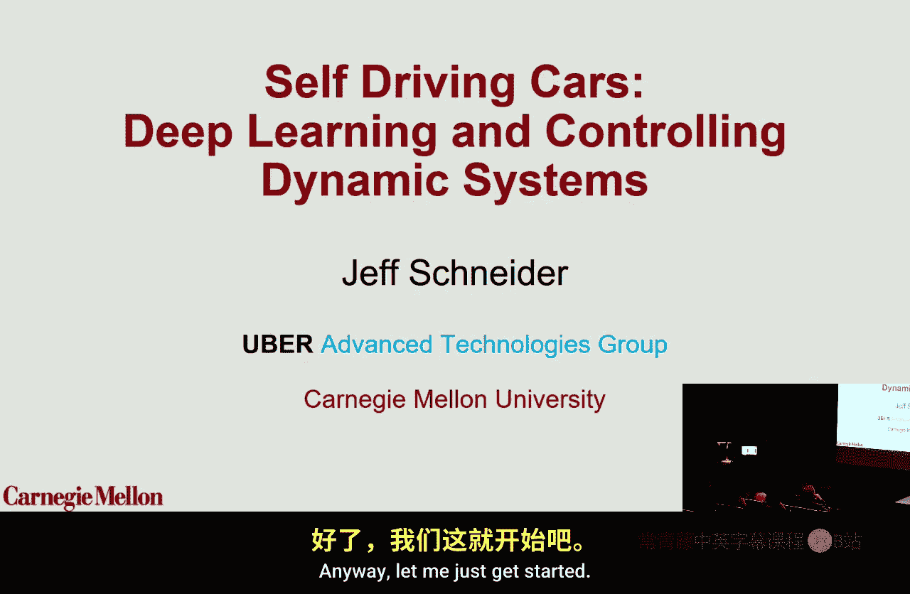

That's the outline we can dispense with that and before we get into technical details I thought it would be nice just to put some context。

 you know what there's many reasons that everybody's pursuing this， but actually this is one of them。

So oddly， after a long time of decline in the last couple of years。

 the number of deaths on U roads has been going up， so the number works out to about 100 a day。

 so that's whatever that is about six or so just in the time we're attending this class today and so that's one of the reasons that people really want to see this work。

 and of course those are US numbers if you want the world numbers just multiply everything by about 30。

 and that'll tell you how many deaths there are on the roads。And so。Of course。

 many people have studied this， including the US government and here's what they discovered。

 right I think we all know this picture on the left we found the problem。

And it's sitting in the driver's seat， almost all the accidents are just mistakes by the driver。

And of course， they further broke the mistakes down， there's really two major categories。

 one is what they politely label a recognition error。

And what that means is essentially you weren't paying attention and didn't see something that was quite important to what was going on。

 so that means you were thinking about the stressful day you had or the errands you have to go run or making plans with your friends to go out later and you just didn't see something you were supposed to see。

The other one is called politely， again， decision error。What is decision error well。

 mainly that means you were driving too fast for the conditions。

 you did something illegal or you just failed to understand what was going on around you and thereby made a poor decision about how your driving goes。

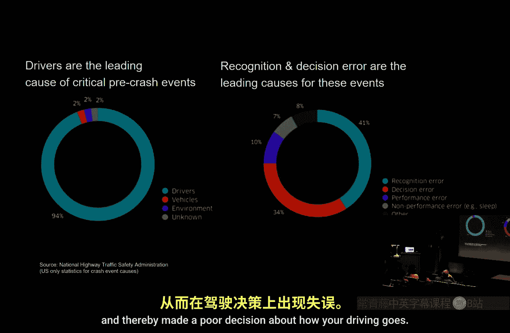

And so how do we fix this with a self driving car， Well， this is Uber's self driving car。

We start with the recognition problem and the way we do that is with lots of sensors。

 and so you can see on the very top you have LiIDA units on the top。

 so that's a spinning laser that gives you very precise 3D positioning of everything in the scene。

So that's great， you get accurate 3D position。Right underneath that is a ring of cameras that give you 360 degree coverage from those and so what do the cameras give you much higher resolution and you get three colors。

 so these help you not only find the position of things but actually recognize what they are。

So what comes next， you augment that with 360 degree radar coverage。

 and of course the radar is much coarser than the other sensors。

 but it gives you a direct measurement of the velocities of the objects。

So all these sensors together allow you to understand what's going on in the scene there。

 and just to give you an idea of the magnitude of this， when you turn all these things on。

 it's terabytes per hour that have to be processed。Of course。

 the car is also augmented with all the other normal things that a robotic would like to have on their robot。

 GPS， inertial measurement unit， wheel encoders， all of these things are on there as well。

So that's the recognition problem， the one we're more interested in here we're a little bit more focused on the decision problem。

 so where does all that happen， well all those terabytes of data end up here in the trunk and that's where there's a custom compute board of CPUs and GPUs and that has to process all this data in real time and figure out how to make smarter decisions。

 so that's the part I want to talk to you about。U。Let's see， before we start。

 I just always like to put this up for fun just to， I mean。

 this would be a boring video in any other context until you put yourself in the chair of the person who's got to write the system that's going to understand this and make all the right decisions right it's complete chaos。

 random actors going in all different directions， all kinds of signs and flashing lights and lines。

 some of which you should pay attention to and some of which you shouldn't， and so as an AI problem。

To process terabytes of this in real time， make sense out of it and make smart decisions。

 it's actually quite a challenging problem。And so。It begs the question of is there any hope。

 how can we even start on this？Well there's two answers。

 one is we'll break this problem down and I'm going to show you how that works。

 and the other is no surprise we're going to use machine learning extensively throughout all of this。

 so I'll talk about these two things。So this is the top level diagram for how Uber self-driving car works and really most of the other major efforts have a diagram that looks roughly similar to this。

 and so I'm going to talk you through all the boxes， so don't worry about them。

 but you see the main problem is you have all the sensors I told you about on the left along with presumably you've got a writerer here who wants to go somewhere and all of this needs to somehow get converted into controls that you take on your auators here on the right。

And so。Where the system starts is with maps and localization。

 so what it has on board is a map of everywhere it's going to drive before it ever gets there。

And so this is not the kind of map that you have， you know your Google map that you use to navigate with。

 right， this is a full 3D reconstruction of the scene and everything in it along with everything being labeled for what it is。

And so when you're driving around， what you do is you take your current data that you're measuring and you actually register it against this map you've got stored in there。

 and that tells you quite precisely where you are at all times。

Okay what happens next so now you know where you are next question is who else is out here with me and so what that looks like is something like this and so this is quite a chaotic video so I'll talk you through it so this is the self-driving car here you can see the video up there it's a night scene around a bar area and so all these blue boxes are cars all these yellow dots it's not noise those are all pedestrians so here's a herd of them crossing in front of us and all these pedestrians are tracked in real time in order for for this car to navigate here so you can see again it's quite a volume of things that are done there。

And of course， the actual tracking of these is done with supervised learning and in particular with deep learning。

やる。Okay， so the next thing that happens is you see who else is out here。

 the next question is where are they intending to go。

 since that will have an impact on where I'm planning to go。

 and so that's referred to as the prediction problem。

And what you see here is all these objects now again， this is us in the middle here。

 all these objects now have lines coming out from them and some of them have multiple lines coming out from them and so you can see here for example。

 these go off into two directions here and so what they are is predictions about where those objects are likely to move next and in cases where there's some uncertainty they may even have multiple potential predictions。

And so here we're again at a night scene and the important thing here is that you can see this group of pedestrians is getting predictions across these crosswalks but not across the other crosswalks and so that's very important for the car to drive right if it gets that wrong in this scene。

 the car is going to sit there and be stuck and never move even though it could go。And of course。

 the opposite scenario is even worse， right， the pedestrians actually are crossing in front of us and we decide to go。

So this becomes very important and I want to show you let's see if I can successfully back up here。

I want to show you something very subtle at the beginning， okay， maybe this is going to work。

You can see this little orange dot in the upper right。 So that's actually a bike。

The bike has come diagonally from that parking lot up there and it's headed at this intersection right where we're going to go here and of course。

 this is pretty critical right because if the bike stops， we're good。

If the bike decides to come across this crosswalk， we're good。

 if the bike decides to go across that crosswalk， we've got to stop right and so what you'll see。

 I'll try to do it by frames side I don't know if it's going to work but。

The bike actually heads toward the other crosswalk and then briefly we make a small prediction that it'll go there。

 but in fact the bike goes the other way and ultimately we get that right and let's see if I can scroll this across without。

Making a mess of its that gonna work Well I guess it's just going to move slowly so you can see we very briefly get that one and then eventually it comes this way and in fact we get this correct even before it ever left the curb and so these are the really subtle things that you have to get right or your selfdriving car just won it won't work。

嗯。Okay， so that's the prediction problem。So now ultimately everything comes together in the motion planner。

 and again， this is maybe yes， sir。Yeah。Prediction correctly you ready to get the pose。

 like where is the？Aha。Sa for the right， given the training data that right now in industry this is kind of the problem Yeah。

 yeah， so this is important。And it's hard， I would not say it's a solved problem， but yes。

 this is done with supervised learning and it uses a combination of just statically recognizing which way it's facing and a a tracker。

 so it ultimately goes through either directly through a Coleman filter。

Or through a deep learning imitation of a Coleman filter， yeah。Anality。

 Could you tell us some details about the architecture。

Sure yeah again there's yeah the multimodal predictions this is another really hard thing and again we actually do a bunch of things one is a more classical approach where we actually do。

😊，You could call it not quite generate and test， maybe generate and predict。

 basically we look at the map of the scene and predict all the possible。

Places that the object could go。And then we come back with a learned model。

And score them all and say， should we keep this candidate and that'll result in some number of them being kept。

 so that's one approach。And predict the young goal。Where are you。はいや。Exactly。

 so that's one approach and then the other approach is to put it all into a deep learning model and use some of the methods for multimodal predictions from deep learning to do that and it turns out it's a mix of。

Objects and conditions where one of those might work better than the other， yeah yeah。Yes。

 but is that is one of the big challenges， especially for the prediction problem that often you legitimately。

Even as a human， you legitimately have a multimodal prediction for what this actor might do and how do you get that right in a learned model。

 especially given that if you，If you over predictdict too many things。

 your car won't move because you'll just have too much stuff， so it's a really hard problem。嗯。Okay。

 let's see， so now you have that， so this all comes together in the motion planning system。

 which has to take all the information about the other actors and where we think they're going。

And our own goals for where we're going and to come up with some sort of plan for how we're going to proceed and so just to give you a cartoon example。

 this might look something like this so here's a case where we're cruising along this car next to us is actually going to shift over in front of us we would like to get over and there's also a car behind us so we have to ask ourselves can we get over in time to get in front of that car and give them enough room to slow down and so again。

 this becomes quite a challenging problem。And so。You put the whole system together and of course。

 the motion planner ultimately gives its commands to the vehicle controller。

 which then goes to the actctuator， and these are relatively more classical approaches to control to do that。

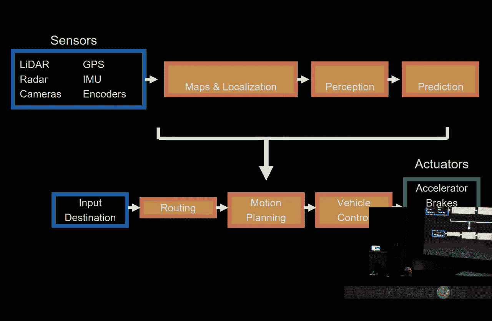

U。So what I'm going to do is show you what this is actually an older video。

 but it lets me just point out a couple of other things that are all part of this equation。

 one thing you'll see here is this whole system driving on its own。

 you see all these lines on the ground and all these arrows。So they all come from the map。

So you use those lines and the buildings and everything else around you to figure out where you are。

But once youve figured out where you are， you get to pull in all this information from the map as well。

 so these are known quite precisely and even the direction of travel and all of this can be worked out offline and just stored for you so you can figure out what to do。

The same with the traffic light， you see the traffic light at the top there。

 the color for the light is recognized in real time， of course。

But it has some help knowing where to look for it because the map actually tells it that there should be a traffic light there。

 and that actually helps it look for the traffic light without too many false positives。ふ。有。

Is there also a bugger on module that all that can tries detect traffic lights or you clean the？Yeah。

 that's again a challenge， you have to be careful not to over rely on the map because。

I think as many of us discovered in the process， the map is wrong much more often than you might guess。

 just the number of times there's construction or whatever other kind of temporary change in the traffic flow。

 just naively thinking about the problem you would think oh。

 it doesn't happen that often and I'll just stop whenever it happens。

 but actually it happens all the time。And yeah， so you have to do some merging there and you have to do assessments of when your' map's wrong。

 do you still have enough information to continue or do you actually have to stop and ask for help？嗯。

Someone else had a question here Tom Yeah yeah exactly so the whole plan has to be worked out in time and space and with uncertainty around all the actors。

Was there another question in the back， maybe not？Okay。U。Good， okay， so this is the system driving。

 this is actually longer than I've ever let this video go， but it's pretty good。

 it drives for a long time with no help from the human at all。Okay。

I'm going to fly through this part because you guys all know this stuff already。

 but it's really just a chance for me to remind everyone that。

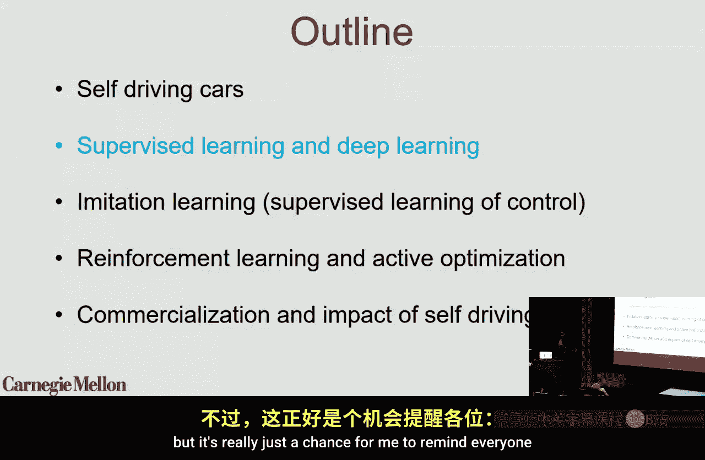

That supervised learning is a huge part of this， right。You guys all know how this works。

 you get labels often you get labels from just having people look at videos and label them for you。

 and when I say get labels I mean you know tens of millions， hundreds of millions。

 a lot of labels go into this to learn these things and this gets to your original comment right。

 especially when you try to recognize the more subtle things about posees and things like that。

 it takes a lot of labels to get those things right。

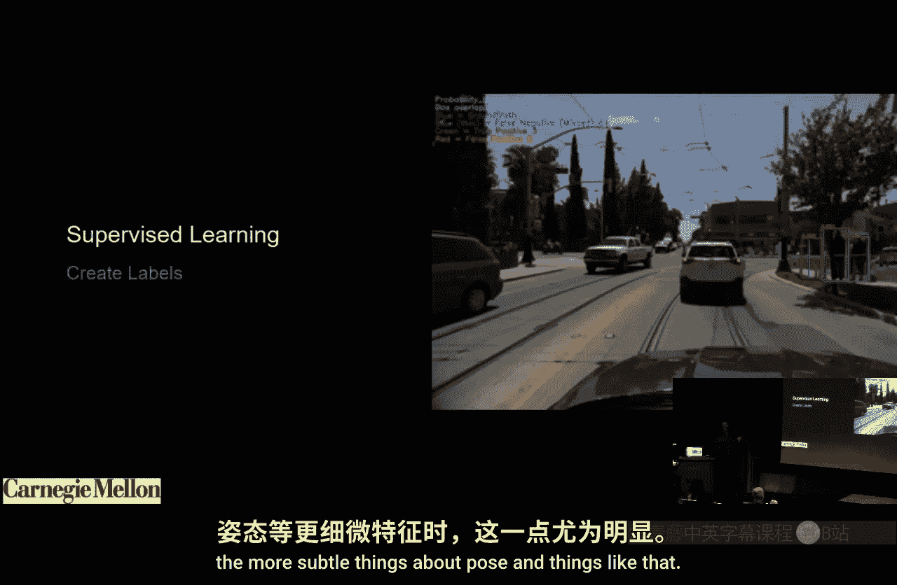

U。And of course， so you chop these all up in the training data。Use deep learning for this。

 this is used extensive throughout the car and you guys are aware of this for a long time。

 this didn't seem like a brilliant idea until roughly 2012 when the combination of lots of data。

 lots of cycles and some improvements of the training algorithms showed that actually this can result in successful learning and now it's used quite extensively。

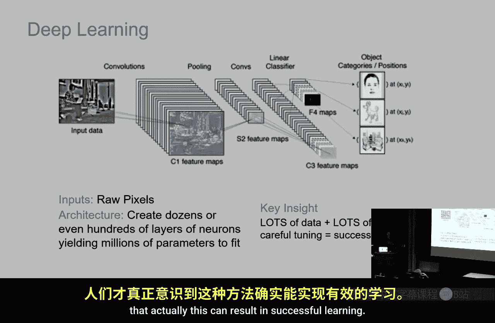

The result is you get some kind of video like this。

 which again you guys have seen lots of videos like this。

 this particular one is a pedestrian tracker。U。But the real point here is that that supervised learning is sprinkled throughout this entire architecture here。

 there's dozens of models in here， predicting all kinds of different things。

The perception ones are the more classical ones where you get labels for what you're trying to predict and just try to learn those the prediction's kind of fun because you don't have to pay people to label that so much right you get a lot of those for free because you collect logs of what you see on the road and all you have to do is take one snapshot from your log and what you need to predict is what you get by just scrolling the log forward as far as you want to make the prediction and there's your ground truth。

so you get tons of labels for that， you can also do all kinds of supervised learning in the motion planning part of it。

 these are all sprinkled throughout the entire system。Yeah。Yeah right。

 so assuming the tracking works really well， so you have， this gets into another issue here。

 which is the cascade dependence of all your supervised learning models。

You get in this weird situation， because your tracker is not perfect。

But your tracker is what your prediction system has to deal with。

And so you end up having a mix of this data you collect for free， but isn't always correct。

 and also some sort of corrected human labeled data。

Although once you hit a certain level of performance， you can get the bulk of it for free。

 that's the good news， it gets less expensive。有咁啲人正策。

I wanted to know a little more about what you can say about effective through occlusion。

 especially for congerian。Yeah， let's see。I can't say too much about that other than we do have to do it。

 and again， there's a mix of。sortrt of deep learning approaches to that to try to recognize them through the occlusion and some heuristics that you maintain state of things through more like a traditional common filter。

 and so it's a mix of those methods to keep things through occlusions。

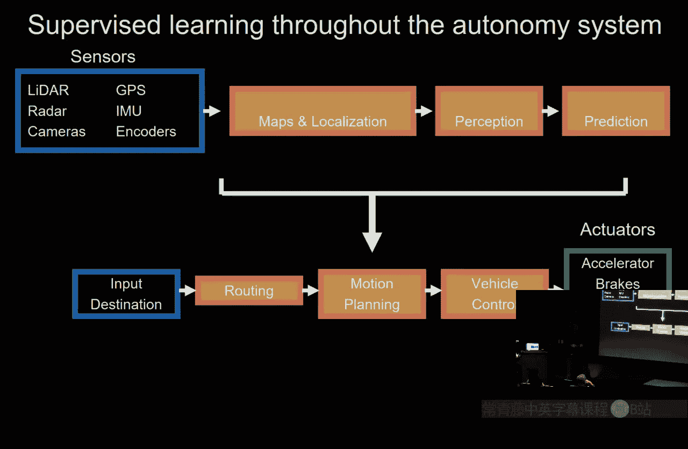

Okay， I'm going to switch gears now and just talk about imitation learning。

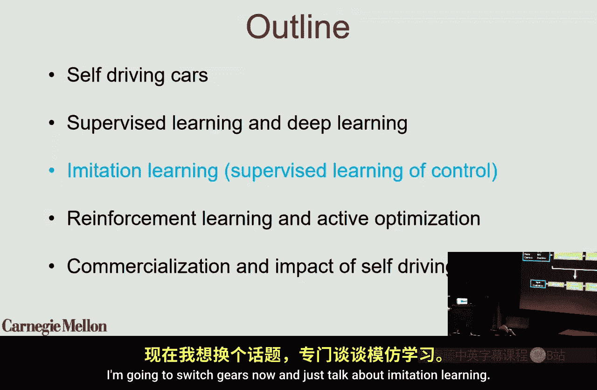

And so this picture， man， is so complicated， and I made it as simple as I possibly could。

 right every one of these boxes has another picture like this and many more inside of it。😊。

It's a big mess。Which begs the question。Can't we just do that instead and make this all easy？Right。

 and。So。It turns out right we'll just take these as input and just directly try to get those outputs and forget about all that other stuff in the middle。

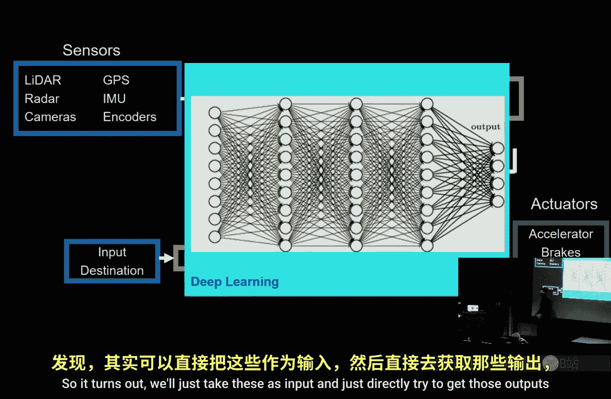

Turns out， yes， you can do that， it's called imitation learning。And so you collect some data。

 you just have a human driver drive around， and so then you look at what the sensors brought in and you look at what the driver decided to do at that point。

 and there's your labeled data for supervised learning。So you can do that， there are some catches。

Usually you have to do some sort of data augmentation。

The problem with humans is they're too good right all you do is get a bunch of tracks for driving down the middle of the road。

 but if you just train on that directly you'll get an unstable controller right because there' will always be some noise in the controls and when it just drifts off the center a little bit it can quickly get to a point where actually it doesn't have any data it doesn't know how to respond to that so what you have to do is artificially create some of that data to make the system stable。

So let's see what does that look like right so these are just some this particular one can you can feed LiDar into it too we didn't in this case we just use camera and radar and the problem I just described is this one all your data looks like this but just in case your car gets a little off center you'd actually like to know what you're supposed to do there and so there's different tricks for this。

AndVdia did some stuff and so have some other people where you mount a bunch of cameras across the front of your car all the way out to the edge。

 and so even though you're going to drive with the middle camera， when you're over here。

 you can take the image from one of the other cameras to or sorry， when you're here。

 you can take the image from this camera and get some idea of what the world would look like if you were farther over。

So lots of tricks， we did kind of a hack。We just synthesize what the image should look like using the other images and it's got all kinds of artifacts in it。

 but it worked fine， so you take an image like this， you just shove it over。

 use the images next to you to help you out a little bit。

And then you adapt the training signal to say， steer back to it。Steear back to where you were。Okay。

 this isn't important， all it is is we just。Made of Frankenstein model a lot of some common old architectures and hooked up cameras and radars to it and plugged it directly into the steering angle and the velocity。

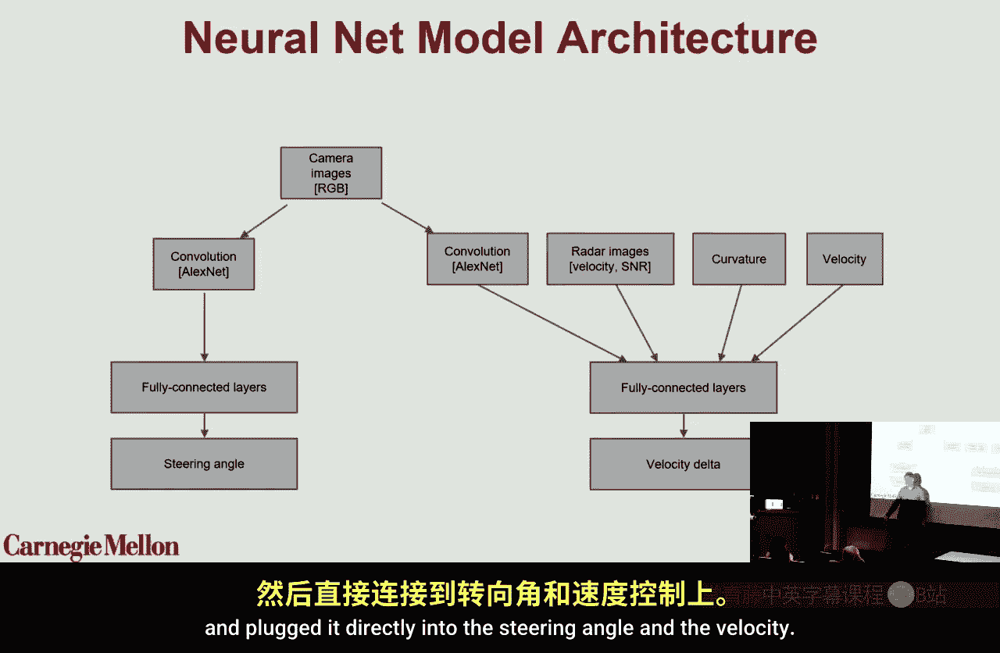

And it turns out people have shown this many times before， in fact。

 also at CMU going all the way back to really the early 90s。

 right Dean Poerlo did this a long time ago， and it turns out this works it's pretty easy so this green check here is what says it's driving in autonomous mode。

 this is headed to those squirl Hill tunnels it goes all the way down no problem。

This one this one just for fun， the video 3X so don't worry about the speed there。

 but it is highway speeds， and it is in the rain and this is the image it's driving from。

 which is pretty cool because it's all full of these raindrops and stuff that distort it and still it's fine you can see it it's in autonomous mode all the way through there We did verify that if you don't give it training data in the rain。

 it doesn't go so well so。It is important that it's seen this before。One of the。

I would say complaints about that kind of imitation learning is you can't do anything complicated with it that surely you can learn to follow a lane and maybe not hit the car in front of you。

 but that's it， but actually you can do more complicated things too so here's our car doing stop sign and this one's kind of funny because it's even before we have enough data to stabilize the steering so the thing's kind of jittering all over the place but you'll see nonetheless it follows this car up to the stop line again you can see the check here means it's an auto it gets to the stop sign now it's got a weight there's a car on the other side that's moving there and then there's a truck that crosses in front of us and then it goes through the stop sign so you can even do that kind of stuff with imitation learning。

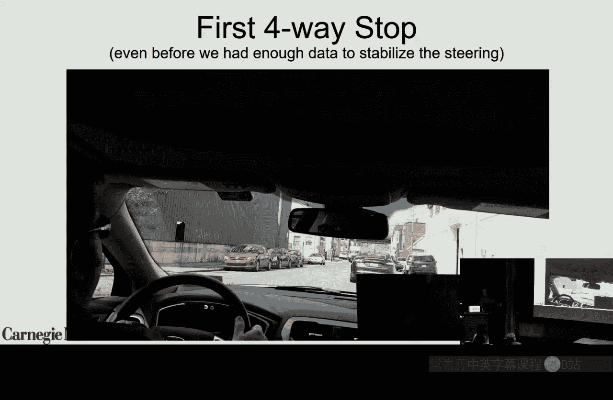

And I love this video because it's really imitation learning。The car never stopped at the stop sign。

It just sort of slowed down a lot like people do and then kind of kept creeping forward waiting for an opening that it could go for。

 and that's basically what it did。😊，Okay。So where does that leave us imitation versus engineered system well as I mentioned before。

 most of the current self drivingriving efforts including Uber are based on this engineered system。

 but why is that the case well the imitation learning the cool thing is，It's so simple， it's so easy。

 you don't even need many people to do this right this was a team of whatever maybe eight people that produced the car that I showed in those videos there because basically there's nothing there you deleted all the code for your system the only thing you kept was the connections to the sensors and actuators。

But still it wasn't really pursued because of the next two things。

 one is it's hard to understand the performance or really the reasons for the performance when things go well or don't go well。

 and the other is it's often been said that well， to solve the long tail of problems that you experience on the road。

 it might take in some sense an exponential amount of data， of all the combination of things。

 exponential in all the combination of things that you might see on the road。And so for that reason。

 most companies focus more on the engineered system。

 which is easier to understand and debug in ways that we're used to doing so。But of course。

 my reaction to this bullet， does it require an exponential amount of data。

 the question I have is given the engineered system and all those components and all the interactions between them。

 and given that there's an exponential number of possible interactions between the components。

 does it maybe take an exponential number of engineers to actually get that system to perform well enough to run on the road？

So that's an open question from my point of view。Okay， getting back to imitation learning， okay。Well。

 okay， hey， what if you don't have a perfect controller to imitate？😊，And B。

 what if you do have one you could imitate， but you actually want to do better than that one has ever done before。

 how are you going to do that？And so the answer of course。

 for this class is that well what we would like to do is reinforcement learning and again。

 you can ignore these funny pictures you guys have already studied these kinds of things in the class。

 right the good news about reinforcement learning is that。

You do have a chance to do this right you can build a better controller than anything you have before。

 and so this is now an old and an example that's one of many of successes from reinforcement learning。

You have the game of Go。You would love to， if it wastic ta toe。

 you would do your old alpha beta treese just like you learned an undergraduate or maybe even in high school by now class。

 but of course go， for example， has 10 to the 170 possible states so that isn't quite going to work and instead you do something like this。

Where you learn a policy network and a value network and you use it in self play or other things。嗯。

This is all awesome。If you have a perfect simulator。

So go is cool because you have a perfect simulator， right it's just the rules of the game。

One of the problems we have with self driving cars， of course， is we don't have a perfect simulator。

In fact， it's maybe not impossible to simulate the car， but the problem is the world。

 we don't have a perfect simulator of what you might experience in the world。

 and that's what makes that's one of the things that makes，Reinforcement learning。

 a struggle for real cars。So this。Brings up this question well okay。

 what are you going to do if you don't have a simulator so I'm going to I think I have just enough time for one more digression right there are things you can do if you don't have a perfect simulator。

😊，And one of them is to do active optimization。Or what you may have heard in other contexts is Bayesian optimization。

 I tend to use the word active optimization because there's nothing about it that needs to be Bayesian。

 but the idea is very simple， you've got an expensive black box。

And you would like to find the maximum of some unknown function。

 and the only action you have to try to find that maximum is to make some queries and get back an answer for the value of the function at that point。

 but you need to do it with a small number of experiments。And so that's active optimization。

Where does this come up， well classically a statistician would call this design of experiments。

 but it goes by many other names Bayesian optimization Baned algorithms， where do we see this。

 we see this in machine learning when we want to tune hyperparameters because there our expensive black boxes is just training the algorithm and getting back our crossvalidation scores and we would like to tune those hyperparameters。

But we also see it in systems that require real physical experiments or things increasingly that need to be tested via expensive simulations。

 and so it turns out this，Is also true of the car。 I didn't have time to go through our development process。

 but it turns out one of the cool things you can do when you write code is you write code before left you landed on the car。

 you could。Run it through all the logs of every mile the cars ever driven before and see how your change performs。

 see if it makes the performance better or worse。Of course。

 computationally that's completely intractable right。

 so the amount of miles a self-driving car effort would have could easily add up to hundreds of petabytes of data。

 so there's no way you're actually going to do the test you would really like to do。

 but maybe you can treat that test as a black box and try to optimize it。Okay。

 you guys all know what Gaussian processes are， if you don't just think nonlinear regression with nice confidence intervals。

 that's really all you need to know。嗯。And so what do you do， you do something like the UCB algorithm。

 you use the Gaussian process to obtain estimates， given the prior observations you have。

 you create some acquisition function， which may be the upper confidence bound of all your estimates and then you choose the new point。

Okay， sorry， I'm going to skip that quickly， what does this look like。

 it looks like here you have unknown function， that's your acquisition function。

You choose an experiment there。Now down your confidence interval comes down there。

 this is your new acquisition function， you choose the max of it， that goes there。

Now this is your acquisition function， another experiment， and you continue like that。

 and if all goes well， you get to the end and you see that you've sort of covered the whole function。

 but most of the experiments have been near the optimum there。And so why do I bring this up。

 the reason I bring this up， and I'm going to show you one video and just。

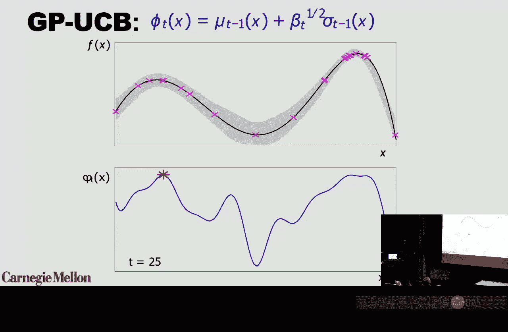

So this is a snake learning to get over an obstacle。Using exactly the algorithm I just showed you。

 so it's fun when you're in class to draw one dimensional function， but this works for real。

 so you're actually watching the learning trials of this snake as it learns to get over this obstacle here。

And the reason I and it's just using exactly the algorithm I showed you。

 the reason I bring this up is just for one small point。

Which is when you read a paper on deep reinforcement learning and you look at the X axis on the results。

 it commonly says millions or tens of millions or hundreds of millions of trials， right？Meanwhile。

 with Bayesian optimization with improvements that have been made recently。

 it's very common to see the X axis have hundreds or even less sometimes or you can do thousands。

 but not that many trials， and yet it's able to learn quite good behavior。

I'm running out of time so I'm not going to show you the whole video。

 but I'll just tell you another block， put another block on that and it gets over the block just fine。

 it learns quite a graceful motion does this one go slow okay yeah it's still learning I'm just going skip it。

😊。

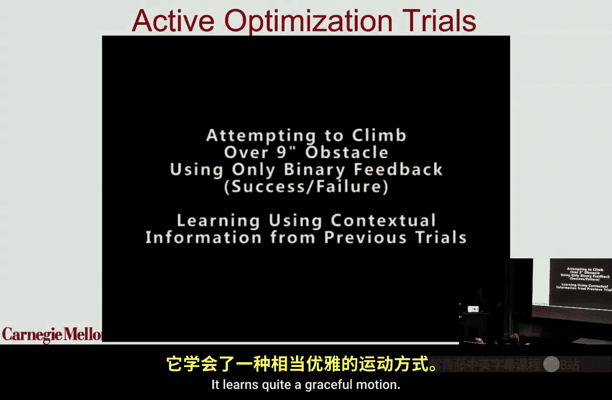

嗯。Okay， there's many tricks that go into making this efficient。

 you use additive models make to improve the statistical complexity of learning the model。

 you do multifidelity optimizations， this means you have an expensive simulator or maybe the real system but you also have a cheap approximation to it。

 and you have an algorithm that can switch between those you do parallel experiments when you can when they're on computers。

 you parallelize all this and you make smart choice of experiments there。

This happens with self-driving cars again when you want to do your simulation testing and you can optimize non-uclidean things too。

 so lots of cool stuff you can do there okay， I want to get to the end so you're going to get a blitz tour of what Uber did with this。

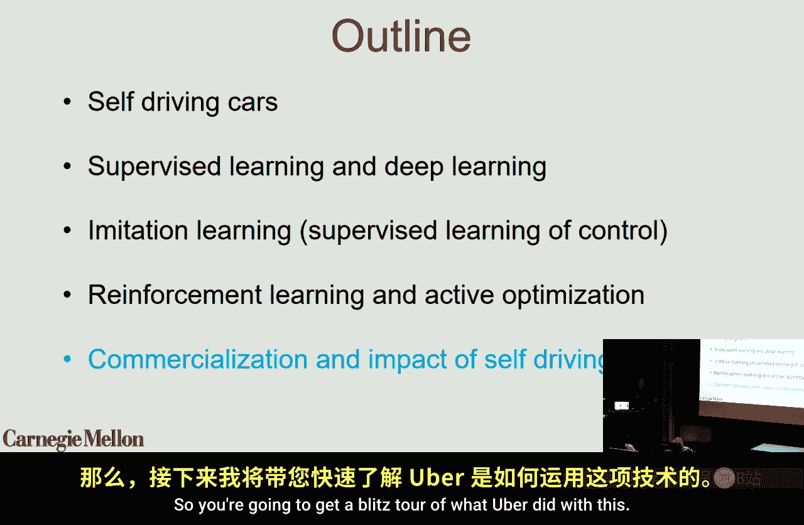

2016， they launched a self driving service。What it meant is if you got lucky and you called for an Uber。

 you would get this on your phone and you'd get a ride in one。When you wrote in one。

 you would see this in the car， so there's an iPad in the back that shows you what the car is seeing as you're driving。

 you can see the safety drivers still there to the cars not perfect， so they're still there。

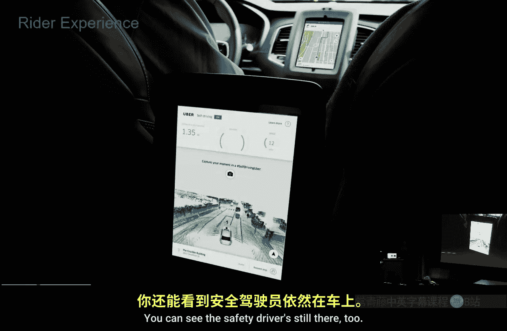

So you can see that this is our test track， I will skip that。U。Launched in Phoenix as well。

Just a cut to the end， everybody heard what happened in phoix right。

 there was a tragic accident there earlier this year and Uber pulled its cars off the road while it's doing a safety review。

 so they're making their safety improvements and they'll be back on the road soon as a result of that。

Let's see it's not only people but things that are transported， I'm going to my apologies。

 I'm going to skip all this stuff， can you can see my TDx talk if you want to see that stuff。

 but I really want to get to。What's left to do here。

 why would I even tell this class about this problem here， it seems like， okay， it works。

 let's just use it。Well， the reason is it's not done yet。So what's left to do。

 there's a long tail of rare events。And currently it's a very engineer intensive effort to check those things off right every time some unusual thing happens。

 you go into an extensive effort to fix it so you've solved that problem and make sure you didn't break anything else in the process。

It's similarly expensive to scale across many domains。

 so as soon as you move to new parts of your city， new kinds of roads， new cities， you know。

 forget about new countries， forget about taking the car from Pittsburgh and trying to drive it in Delhi right it's just it's not going to go well again。

 engineer intensive effort to make all this go。And the final thing is。We really haven't。

 we chose the engineered system over the imitation learning because it's easier to understand the performance to analyze it。

 but the reality is even the engineered system is based heavily unlearned models。

 and so we still don't know how to validate， verify the performance of AI and safety critical system。

 so this is going to be a big challenge。The sad reality is this， most of the AI successes are online。

 which are not safety critical， and most of the safety critical things don't really use much AI。

So how do we get there？I would say we have to embrace the fact that we'll have AI based systems and safety critical and safety critical systems and we're going to have to develop new methods。

 we're going to have to figure out how to verify their performance。

And this is where reinforcement learning comes in。I think we may actually have to ultimately make a cost effective scalable system。

 we may have to develop an AI centered rather than what I would call the current systems as AI sprinkled systems。

That top level architecture I showed you was developed way before AI had any abilities at all。

 70s even earlier right and all we've done is sprinkled AI into it。

 we probably need to go back and do an AI centered one which of course reinforcement learning would be a great example of that。

I'm going to skip to what do I think， okay， all that for me， just to say。

 what do I want you guys to think about in terms of deep reinforcement learning？

We need more sample efficiency。Most of the deep RL successes today are done on simulations that are online。

 so people really only care how long does the computer run。

And that's why you get tens or hundreds of millions of trials because each trial is so fast。

But once the trials become expensive， whether they're on a real system or a simulated system that takes a long time to run。

 those number of executions of the system are what's important。And I'm not talking about。

 can you learn to do lane following with less samples， that's not the issue。

The issue is all those rare events in the long tail。

You are almost never going to get any data relevant to those long tail events。

 so you're going to have to learn very quickly from what data you do get from those。

 you're just not going to have enough data to do it。What am I doing personally。

 I'm looking at how to emerge all those ideas that work so well to make active optimization efficient into reinforcement learning and try to make reinforcement learning more efficient。

What are the other things that we need so of course we can't run reinforcement learning directly on the car while it's on the road。

 we can't have it just off running experiments right so we need to be able to do good off policy algorithms。

 utilize simulations in some way。And use imitation learning。

 hopefully for more than just an initialization routine。And finally。

 we have to figure out how to say something about the safety and performance of it。Okay。

 so I'm going to stop there。I think Nick's going to come up and talk maybe well。

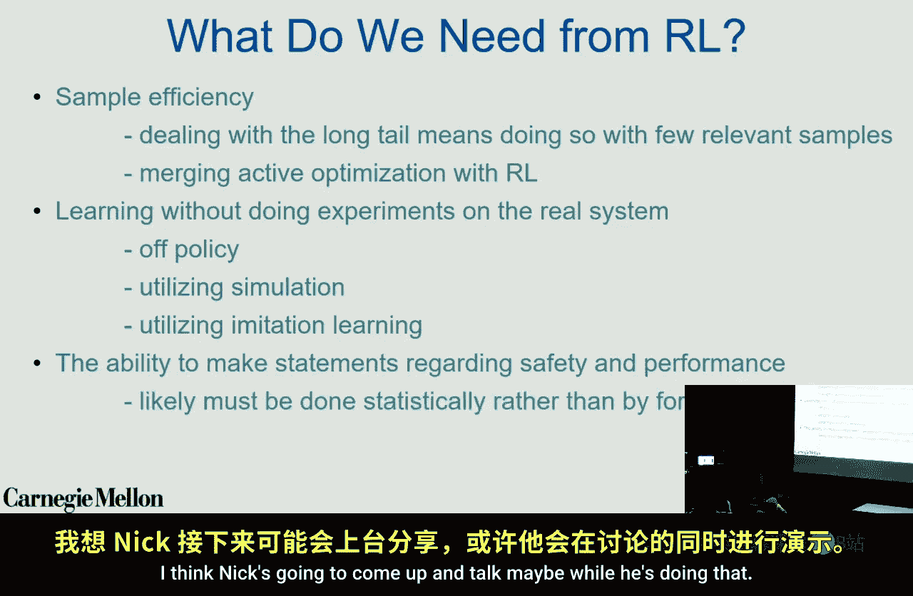

Maybe well， he's doing that。If you have any last questions， I can。所有。Like the。

We don't have a perfect simulation， but what we can do。

 so we do have the ability to replay all the logs。

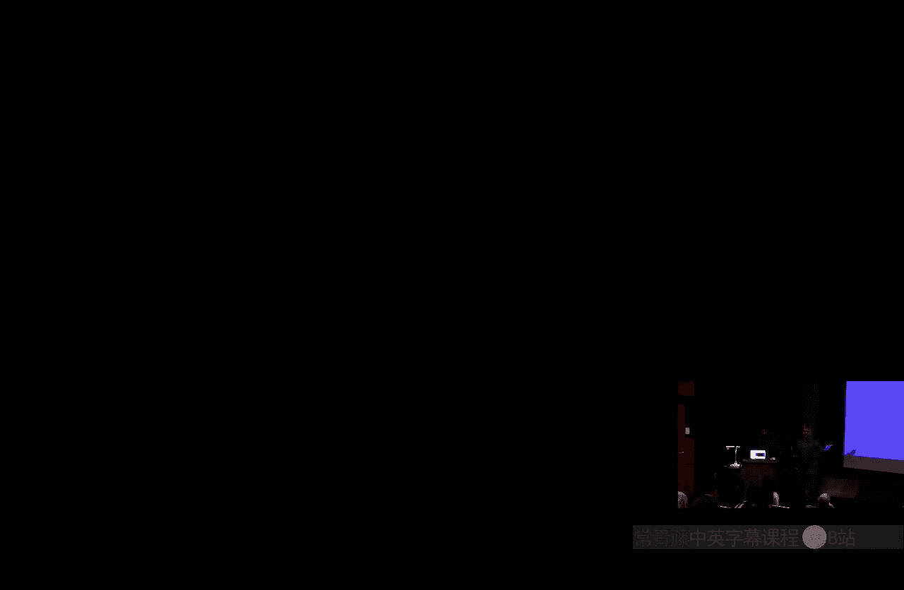

And we do have simulation， so we set up simulation scenarios。

SoAl we have far more simulation tests than we could ever afford to run computationally to test every line of code。

Right， but let me clarify because I said we have simulations， we don't have simulation。

 wait wait a minute which is it when I say we have simulations， we have a bunch of regression tests。

So we can go through and check a bunch of scenarios and say， oh， did you break this scenario。

 did this， did you break this scenario？But it's not sufficient for a reinforcement learner in the sense that you would like to run your reinforcement learner。

 which is I'm just going to set my learner off driving and whatever happens will be a valid you know a valid instance of the real world and it covers the entire real world。

 we don't have that simulation。And the other is in reference position， my book might elaborate。

What is the。Oh。Oh， I see in the， well in the snake， it's some control parameters of how to write。

Right in the policy for the car， it would either be discrete things like versions of basically dis that you want to land in your code。

 in finding the combination of them that actually makes your system better， could be at that level。

 or parameters usually of your planner。Yeah， yeah， so。ケノン袋ね受けばけフんだらちょっとあと受ケのくらいで。解释。Yeah。

 we wouldn't train a neural network with it， but the active optimization algorithms we have do work with hundreds of parameters。

 so you can do， it's not like the classical Bayesian optimization is like you can go up to six parameters and then forget it you're out of luck。

 but using the methods I show you can get up to the hundreds that works OK。

 so it does make it feasible to try it on some real systems。Any other questions before I hand over？

I somebodyにの veryま。我的身份件你没去。也是。把四。Humans and cars and have partitions in my architecture。

 and then a both of those requests to the al for， right？Yeah， absolutely。

 I think there's a sea of intermediate mixed solutions that。T。Yeah。

 and a good one with just what you said， why take your invitation learn her。

 why not just be at the output of your perception track？还有这二两。We didn't do that specific one。

 but there were lots of them。Thank we're review of an investigation。Perfect， thank you very much。

So we have Nick next and the interesting thing is that he will talk about safety at least the latest papers is about safety。

 how can you learn a model without ever me to run the car all computational learning and another thing I like in his this here has a very beautiful motion model correct and I hope you get into the details of thank you。

And because。Bs and stuff like a。Okay thank you， okay yeah。

 so I think that was a great setup for my talk so today what we're going to talk about is some more of these imitation learning style methods and in particular I'm going to describe to you a way in which we use a model used for forecasting or the prediction problem and in order to do control。

 so we're essentially going to build an imitation learner out of this model that's predicting the future。

😊，So you'll understand this video a little bit more later but what we're doing is we've learned this model to imitate the driver and this is in simulation and it's given these new goals at test time and at test time it's planning to these goals and what's specific to this model is these plans are expert like in the sense that we are planning them under an objective that rewards how close they are to expert behavior and that is measured by this distribution over the possible futures that we learn from offline data okay so you'll understand that a little bit better later again same goal for this application we want to train an autonomous vehicle to do three important things it needs to follow the rules of the road so stay on the road。

stay in the correct lane， etc cetera， we want to be able to generalize to new behaviors not seen during training because we're always encountering new scenarios that we didn't have in the training data and we want to generalize in useful ways that allow us to perform new tasks。

that were never seen during training and again， a critical component of this is that we want to do this without any trial and error learning。

 obviously it's not very feasible to have a great exploration method if it requires you to crash into a bunch of things first。

Okay， so what do I mean by number two what is this？

How can we generalize or maybe first I'll describe this figure so we have just for visualization。

 this is the frontal view of the car and an overhead view and on the right is this LiDAR map so we have simulated LiDA on top of this car and there are a few goals that are shown as green X's and what's going on is we are planning under a model that's used for forecasting。

These specific plans and because we have scores for these plans。

 we're allowed to we can essentially rank them by how sort humanlike and how expert like and how well they satisfy the constraints so you can see the most preferred plan in red avoids these obstacles up here on the right and basically achieves one of the several goals that are possible for the system to achieve。

 so that also will become a little bit clear soon。Okay so now I'll talk about you know interesting ways that we might want to generalize。

 so let's say we trained our vehicle with observations on perfect roads and there are no potholes and then we come to this new scene you can't see them in the images because they're just simulated in this LIDA。

 but we come to this new scene with a cost map saying oh you should avoid these regions but we've never seen any examples of how a human would avoid these regions。

 if we use this I'll show how we can incorporate this cost map into our planning such that we are balancing a few different objectives。

 we're balancing trying to achieve the goals， we're trying to have expert like behavior while achieving the goals and trying to avoid these potholes。

 so in these examples we're avoiding the potholes while trying to stay in our lane。

as much as possible， and basically in this setting， you can't quite see the image a little cropped。

 but the goals are around the corner and we have a few different plans of how we might achieve those goals and you can see this one in blue we don't like because the model has learned humans drive on the road。

Okay。So that is an example task that we want to be able to generalize to that we've never seen doing training。

So okay， so maybe let's look at what we could do， what are some other offline approaches that we could do？

So。One would be model based reinforcement learning。Wwhich can be flexible to new tasks。

 You essentially just need to learn a dynamics model and have some crafted reward function that rewards the behaviors that you want to see but designing this reward function is very difficult you essentially have to be able to know ahead of time and basically build a mapping ahead of time from perception to a reward function that will correctly yield will yield correct behavior。

 so that reward function engineering is very difficult when the situations are can be very broad so how about imitation learning it has this benefit of。

Basically， you can use demonstrations for it in lieu of a reward function。

 but it has a little bit of limited flexibility to new tasks。In the sense of。

 you know if you're asking it to drive， for instance。

 in this new region with new tasks that like avoiding potholes that it's never seen demonstrated you can't really really generalize to that you would have to use model based reinforcement learning instead to try to get some sort of generalization so if I sort of see three principal axes to the kind of approaches you could use from model free to model base。

 so model free imitation learning would be a direct mapping from perception to controls。

 theres offline to online I'm just using that as proxy for are you doing interactive exploration in order to learn the model。

And the last axis is imitative or non imitative， are you learning the behavior from demonstrations of good behavior or are you trying to learn it from scratch？

So in that taxonomy， the approach I'll talk to you about is there。Okay。

 so if we go back to our goals， let's look at what these MBRL and IL can do， so MBRL。

 if we craft the reward function very well， we can usually follow the rules of the road and kind of generalize the new behaviors although sometimes it may be difficult because it relies on the quality of our reward function crafting and you might be able to do it without any trial and error learning。

 although if your model is going to places where the dynamics haven't seen any examples。

 then it might not work very well。Okay， so we can sort of satisfy the three goals with MBRL with imitation learning。

 oh sorry， and with MBRL remember we have this very important assumption and it's kind of a bad assumption that we can manually craft this reward function well to be good in all domains in all new settings。

And so in imitation learning， you know can Jeff showed， we can。

 many people showed that you can sort of follow the rules of the road and get mostly good behavior in situations that you've seen before。

 but you have a lot of trouble in generalizing to behaviors that are not seen during training。

 so if the situation is seen during training and you're trying to do the same task。

 you're fine because your policy is trained to do that task。

 but if you have some new task you've never seen before。

 essentially imitation learning by definition will not be able to do that task。

And often in imitation learning， you actually have to do， as Jeff mentioned。

 some interactive data exploration， you have to let the model make mistakes in order to get the data to correct it。

But IL is good in the sense of the assumption that we have。

 access to demonstrations is a much weaker assumption than crafting the reward function well。Okay。

 so how can we get basically benefits of both？Which is what I yep， go ahead， sorry。Yeah。

And what we' learning here is where we have the perception system and our detection and our predictive models and emotion planning。

 and this contract the reward function， which we didn't start discussing。Right， yeah。

 I think you could frame that the engineering system as Jeff described， I mean。

 I'm not totally aware of what exactly they did， but you know if you have some tasks and you're optimizing your behavior under those tasks。

 you essentially have to。Have an ordering for how good the behavior is in order to choose the correct one or a way to score your behavior so right。

But Im going forward in。Yeah， right， right， yeah。Yeah yeah。

 the prediction models are sort of the dynamics model in MBRL， in a sense， you're right。不在是。

people also learn the rewards like what。Right， right， right， yeah， exactly， yeah。

Yeah that might be a good way to think about it yeah okay so we want good properties of both so how can we get the generalization。

 flexibility of MBRL so these engineering systems are reasonably reliable in some new situations but it requires us to yeah all the work of crafting the reward function are correctly perceiving what's going on in the situation that's very difficult so instead we want to learn learn from demonstrations instead and so that sets up the approach I'llscribe to you today that I worked on recently at Berkeley with Ronan Mcaleister and Sergey Levine and it's on archive now if you want to check it out。

So there's essentially three components to what I call a deep imitative model we have， again。

 that as input， all of the is high bandwidth。Observations is you can muster。

 so in this it's just some past states of our vehicle and some LIDAR map。And the frontal view here。

 you could use that as information for making predictions。

 but I'm just showing that for visualization。And then the first step is to learn this undirected trajectory distribution from demonstrations。

 and so this is what Jeff was talking about， it's a very difficult problem because you have to maintain multi modality over what could happen。

So you know if I'm at an intersection， I could go left， I could go right。

 I could go straight in it or you depending on the intersection there might be many possible behaviors that the expert might follow。

 and so we want to we want without knowledge of where the expert is going or their intentions。

 we have to be undirected in our modeling of their behavior。And then after we've learned this model。

 we want to do planning。Under that model and we are going to frame it as an inference problem。

 given some abstract goals G， and so I'll give you some concrete instantiations of what these goals could look like。

 but essentially we want to build a new function that incorporates our undirected model。

As well as some additional component that is reasoning about these goals。

 so that's a little abstract， but let's get into what that looks like。

 so if we just construct we say we have the same inputs and we say we have some arbitrary distribution under which we want to make a trajectory very likely。

 so max over this state trajectory， conditioning on the goals in the past information。

And what we're going to do is after application of Bay rule， you get these two terms。

 and we're going to use for the first term， our undirected model of behavior。

 and for the second term， we have this goal likelihood。

And so the goal likelihood is expressing how well we're satisfying the goals given our planned trajectory。

So again， this imitation prior can be learned purely from demonstration。

And then the goal likelihood is the new task at test time。

 it's the thing that our planner is given to accomplish in a new scenario。Yeah， yeah。 go ahead。就受。

There because of the rewards and because I can totally detect and predict innovation in the future。

All learning that without switching architecture architectures because of metrics。

 we will figure out how to do it。But the rewards these are hard。I didn't make it on the lane on time。

 but maybe I'll piece of the driver behind me who want to tell me about it。

 so I do need the human expert who to see how much time they'll leave in general。so right。

 you could put the other agents in the context， for instance。

 in order to make it a non-st world but yes this is the simplest setting of static world。

 there's no other other agents in the world， but you can include other agents as contextual information and then in some ongoing work I'm working on jointly modeling their future behavior but for now it's static world。

And yeah， so for your first question， right， it's generally an ill pose problem to discover the rewards that are motivating behavior。

 and so this is hinging on the assumption that you know if we have mostly if our expert is very good。

 then we don't need to discover their rewards explicitly。

Like like inverse reinforcement learning does。Okay so how this planning fits into a driving task。

 the pipeline sort of looks like this， we have this training phase。

 we have as input to expert demonstrations， we learn this imitative model and we construct this planner out of it out of two terms some test test task that we'll get later and and the model itself and the prediction model so given some map think of it like Google maps we have some goal and we are given like these waypoints sort of like breadcrumbs towards that goal。

 they tell us kind of like the high level where we want to go but it doesn't tell us how to get there or how to do it so it's just sort of these cues that we're going to treat as goals and by achieving each of these goals in series we are going to go to the goal。

The final destination。Okay so if I'm at a specific waypoint and I'm given this new waypoint then the imitative planner comes in。

 it's conditioned on this new goal， we plan a bunch of trajectories and then we just do some low level control to follow our best best plan trajectory so this is。

This can be thought of as like receding horizon control or。Or NPC。Okay。

 so that is kind of like the high level how you put all the pieces together and now I'll discuss first what these goal likelihoods could look like because again。

 this is where this is what's driving us， sorry this is what's causing us to be able to adapt to new tasks is each goal likelihood corresponds to a different task。

 so the simplest one is if we have some goal， G of T that's saying oh at T time steps in the future you should be here。

 we can just put a normal distribution about the last position in our plan and say essentially this is going to give you plans that are penalized from not ending up at the provided goal。

Because you have this entire trajectory towards that goal。

 you can actually supervise the last few states in the trajectory and say， oh。

 all of these have to arrive at these states in series。

 and so that can be used to control the velocity of the trajectory and of the agent at the last state and these higher order trajectory terms。

We can also use a mixture distribution to say， well， given many goals。

It's okay to arrive at any one of them or basically you have to arrive at one of them。

 but obviously you can't go to all of them， so if you just use a mixture distribution as the goal likelihood。

 that allows you some more freedom over。Over where the plan trajectories can go。

And finally we can incorporate a cost map， so a cost map is a mapping from the contextual information to a cost for each position that expresses how bad it is to be in that position and we can say well。

 the trajectory that we want to plan should is exponentially rewarded in terms of the negative cost of where it is and so in this first example this is k position planning where k is pen and so you can see we sort of plan this to arrive at the series of10 states and in this we have five option planning。

 so the third one mixed with costed planning， so we're achieving one of these five goals。

 we have plans that go to each one I'm only showing a few of them and we're avoiding a cost that corresponds to these potholes。

Okay， so by creating new goal likelihood。We are going to， if we go back to our objective。

 we can try to correspond to new planning tasks that we use our imitative model of how a human would or how the expert would drive in order to achieve that task。

 so it's this tradeoff between wanting to behave like the human or the expert and wanting to achieve the goals。

Okay so how do we learn that imative model， how do we learn this distributional trajectories。

 so what do we need， we need it to be undirected so we don't observe the agent's intentions。

 we only observe basically same things that they see， for instance， the LDA and the past few states。

 basically all of the information that's causally available at a specific time step。In this map。

 the vehicle is in the middle on the left and the expert is shown in these blue squares。

 so the expert is where the vehicle actually went， and we want our imitative model to say， oh yeah。

 we can go where the expert went but the expert could have also gone in these other directions。

A very key component， you know if you think about our objective is that the model must have a probability density function。

 so sorry GNs and VAEs， you're basically useless here， even if you could generate trajectories。

 you won't be able to evaluate the likelihood of a trajectory under your model。

 so we need a model that does it actually doesn't have to be generative。

 but the key component is that you need to be able to evaluate the probability of arbitrary points。

 arbitrary trajectories under it。And。This isn't required。

 but it's super useful if we have these gradients that exist in the objective or in the model。

 then we can do gradient descent based planning， essentially waring trajectories to the likely regions of the learned model。

So this is some other prior work that I worked on， which was learning these distributions Q。

 we used the same representation of trajectories as the sequence of positions or states。

 and our goal is to learn a distribution that approximates this true unknown distribution P of expert behavior。

And what's important is we only have samples from the expert behavior。

 we can't actually evaluate how likely the expert thinks any behavior is in general。

 so in order to learn this we frame it as divergence minimization as is common for density estimation and it poses two questions。

 so what divergence can we use， and then given that divergence。

 how do we design the model to be able to optimize it well。

So you can see this is not a very good model because some of the trajectories are going off the road and we don't want to allow。

Allow for behavior to be so unconstrained， we must be precise。Okay。

 so now I'll talk about the divergence that we're going to use。

 if you guys recall the KL divergence is a very natural one。

 but it depends on the input argument ordering。And I guess for the key component actually is the KL dirgence can be decomposed into two terms。

 a cross entropy term and an entropy and we just care about these cross entroies。

 so we're going to consider both forward and KL forward and reverse kL divergence。

 but specifically we're caring about their cross entropyies， this is reverse cross entropy。

from our model to our unknown data distribution， and the four across entrytroe from samples from the model are evaluated。

 samples from the data distribution are evaluated in the model。

So these two cross entro have different properties。

Kind of if you think about it in terms of information retrieval。

 the for cross entropy is very insensitive to false positives in the data so if you're generating here the example these。

Blue trajectories are coming from the data distribution。

 So these are what the expert could do or what the expert prefers to do and the red samples are samples from our model。

 So if we have this good reference model and we consider moving half of our mass off of the model to generate half bad samples we get a very small penalty in the forward cross entropy so that's not very good we're not the forward cross entropy does not penalize very much generating bad samples。

 however， it does have a good the nice attribute of if you completely remove。

Or if you almost completely remove and have epsilon likelihood of some expert behavior。

 you get a huge penalty， so for cross entropy penalizes what's known as a mode loss。

 essentially you're trying to have a diverse estimation of the behavior with for cross entropy。

Okay and now if we consider the reverse cross entropy， it essentially has complementary attributes。

 so remove if we push half of our samples away and then the expert distribution is looking at these samples and saying。

 know， I would never drive like that， I'm going to give you a huge penalty。but it's very insensitive。

To false negatives， as long as you land in a mode with your generated samples。

 you are not penalized by the reverse cross entropy because the expert says， yeah。

 I would drive like that， I don't care that you think that's the only way that I could drive。So。

What we're going to do is perhaps hopefully obvious now is just mix them。

 so we have the forward cross entropy which discourages these false negatives， discourages mode loss。

 and the reverse cross entropy， which discourages false positives。

And a huge point that I kind of glossed over was we can't actually evaluate。

The expert likelihood of any trajectory we don't have access to to their essentially their density function。

 we only have access to samples from it。 so what we're going to do instead is first learn this proxy in terms of a cost map in order to penalize samples and so the key point here is we just want the Ptilde or the proxy to be very simple and not likely to overfit so we just have like a three layer covenet and we're predicting we frame Ptilde in terms of penalize likelihood。

I should have just written the equation but。It's essentially going to penalize samples for going off the road is what it's learned from the expert data。

Okay。Yeah， the input to that is the same context， so just the LiDA。That's right， yeah， yeah。Yeah。

 you could use。You could use other sources， but yeah， we don't。Essentially because the。

The trajectories lie in this 2D ground plane， it's easiest to have your sensory data in that same space。

U。Okay。So now that we have our objective set up。When do we end， sorry。Okay。Got it， okay。Yep， okay。

 okay， so we essentially， in order to optimize these well， we first of all。

 need to optimize or need to be able to evaluate the likelihood of arbitrary data。

 and we want to be able to sample from our model and with low variance。

Or evaluate expectations of samples under our model with low variances okay。

 perhaps I'll just gloss over that the key point is we just use change of variables with and if you do this with an invertible generator。

 you get something that you can compute likelihoods of sorry that I'm。

Not going to have enough time to describe this， but okay。

 so we have this invertible generator that's mapping like in GNs and VAEs。

 some noise to some output space， the key component and the key difference between GNs and VAEs for this generator is that it's invertible so we can not only map noise to the output space。

 that can map samples in the output space to samples in the input space。

And the form of our generator is this sequential process where we take noise Z at every time step。

 and we warp it with some predicted sigma and some predicted mu。

 and these are neural networks basically make them as expressive as possible to only key required thing is that this sigma be invertible。

O。Oh yeah， yeah， I mean， so it's just the conditioning of the output and like if you what we actually use is the matrix exponential。

 but there are other ways to do it basically you have some outputs from the neural network。

One thing you can do is just form a matrix out of it and do that matrix times that matrix transpose I think that that is always invertible。

 I may be wrong but what we actually did was matrix exponential which is always yields full rank invertible matrix so here's just an example almost done with telling you how to learn the imitative model and this is just showing it on a sequence of data we have these Ptilde cost maps that are penalizing what are perceived to be bad areas in the LDA and so our samples from our model are diverse and that they estimate you know many possible futures and precise in the sense that they usually are lying on the road。

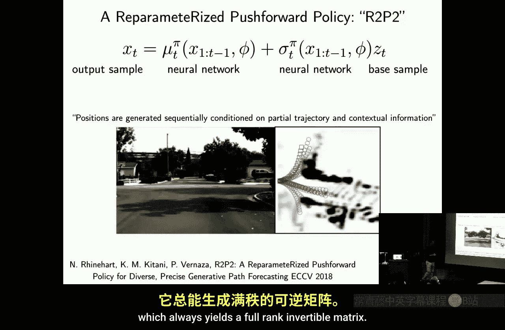

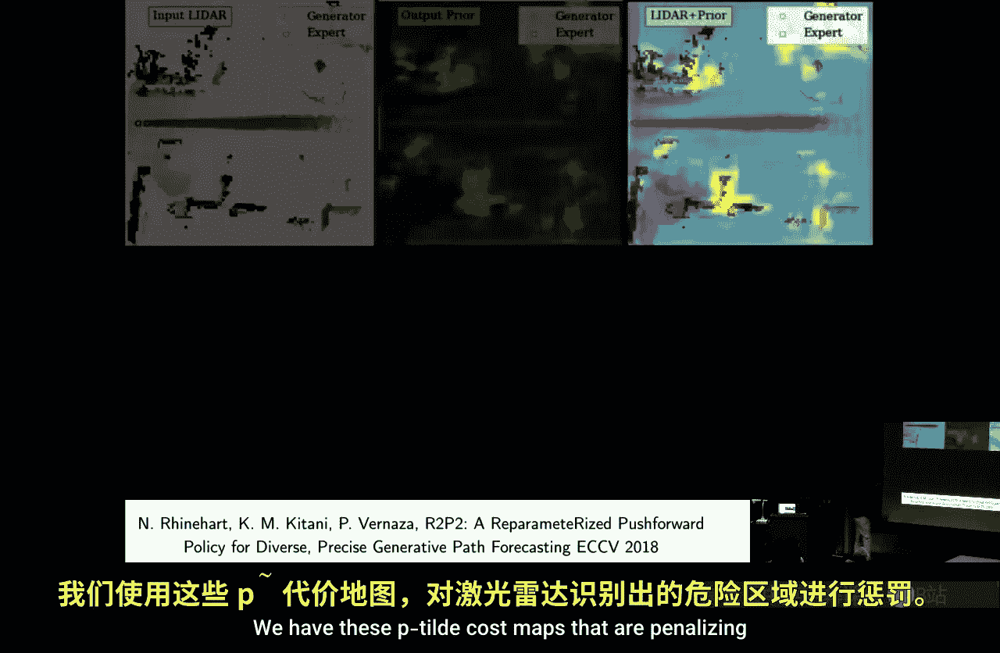

Okay， so that solves- that's an implementation of the blue box up there。And we。Evaluate our model on。

A few different settings， the most interesting experiments are how well we can generalize。嗯。

So if we started incorporating potholes， we don't want our vehicle to crash much more often than otherwise。

 so you know if you don't pay attention to potholes then you hit a lot of them if you incorporate this cost map。

 you can still drive mostly successfully while avoiding them so what it does is it dips into the other lane and then comes back because the plans under the model。

 have learned that the expert preferers to drive in the correct lane。

Another interesting thing is if we give it noisy goals， if we give it noisy waypoints。

Can we still plan and get useful behavior so you might have noisy waypoints if your GPS is wrong for instance。

 and this is also a really good way to introspect the model and see if it's really learning what what the expert prefers so if you have waypoints that are off the road。

 the expert a human would say oh no there's no way I'm going to go there I'm going to prefer these other waypoints and what we observe is。

That that essentially happens， we prefer waypoints that are on the road。

 so if we take the waypoints and pro behalf of them。

 we see we don't like when they're not really what the expert would do and another experiment we do is we put the waypoints on the wrong side of the road。

And we our forced plan with these， and we see that our plans are still going on the correct side of the road。

 essentially we're still able to achieve what the goal task was kind of intending us to do while staying on the road。

 which is kind of this constraint that we've internalized in the model by observing the expert。Okay。

 so I claim， of course， that we achieve these three goals in the system。

 if we have access to demonstrations， a couple useful attributes are the user specifies where and not how to travel。

Perhaps common across all autonomous approaches， we plan paths that it thinks the expert would prefer。

 so it's nice that we don't have， we're not predicting controls， we're predicting plans。

 so they're much more interpretable and each plan comes with a scalar score。

 so we have an idea of how achievable and how good each plan is。

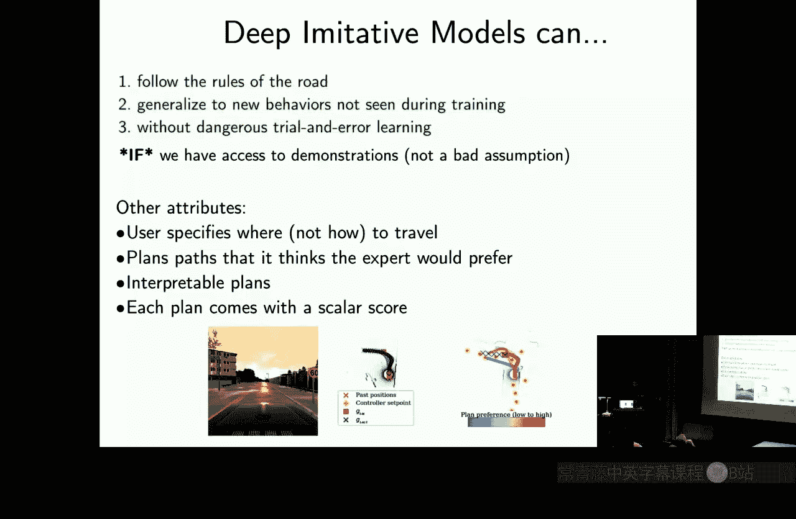

Okay， so hopefully now this video makes slightly more sense to you。

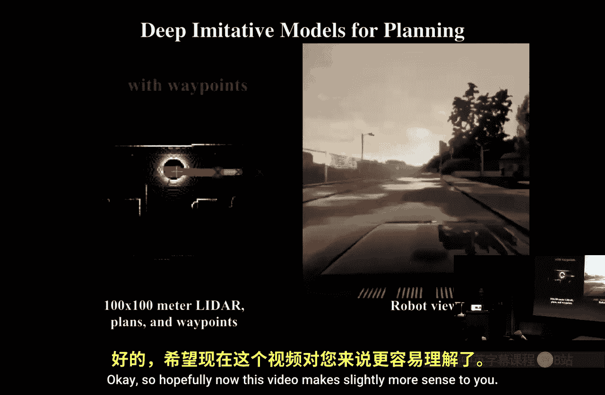

And I guess since I'm out of time， I'll just move on thanking my collaborators。

 Rowan and Sergey on the first work and Chris and Paul on second work。Y。

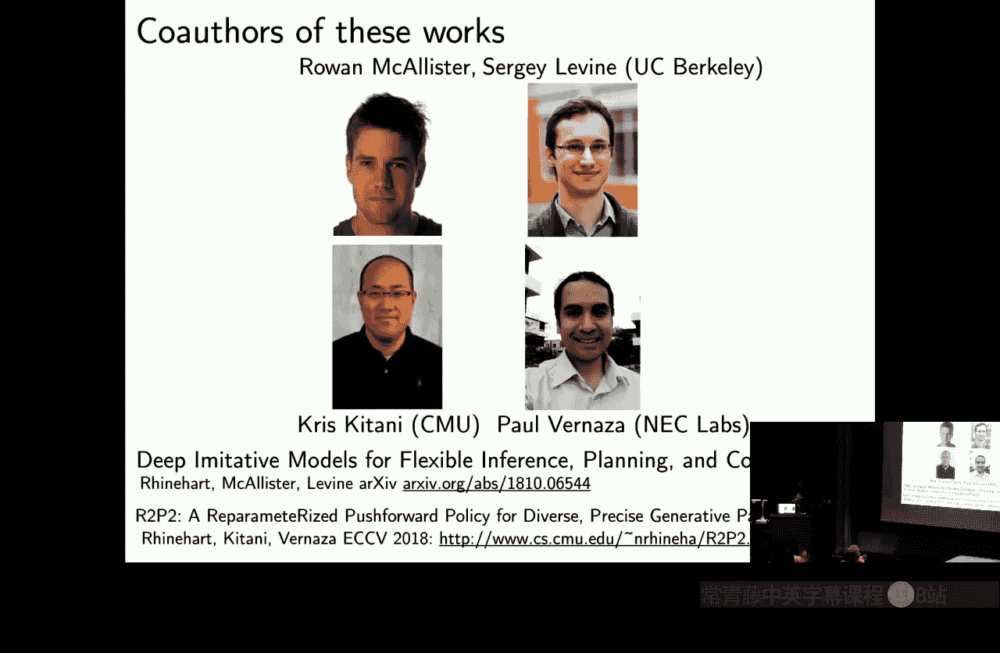