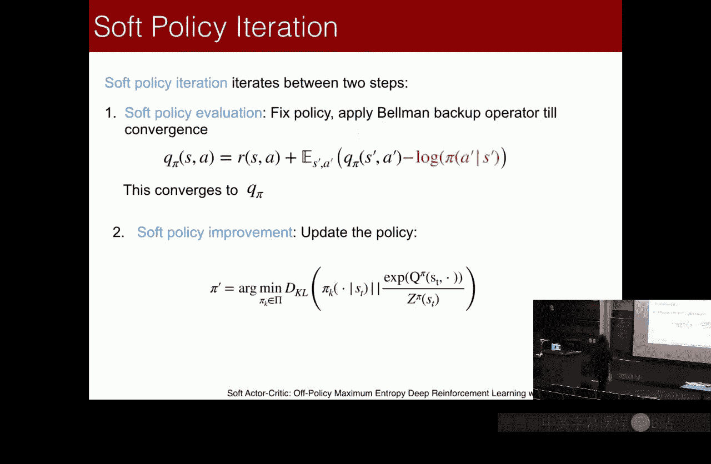
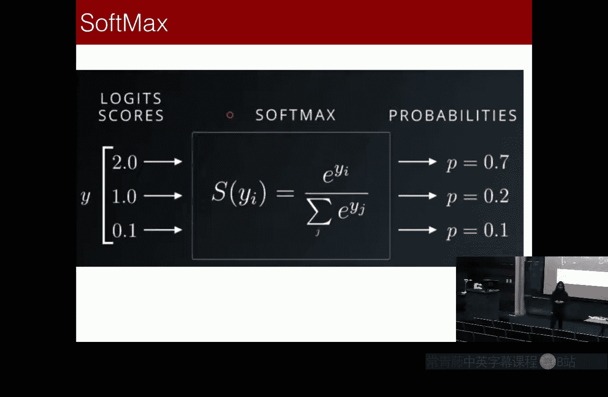
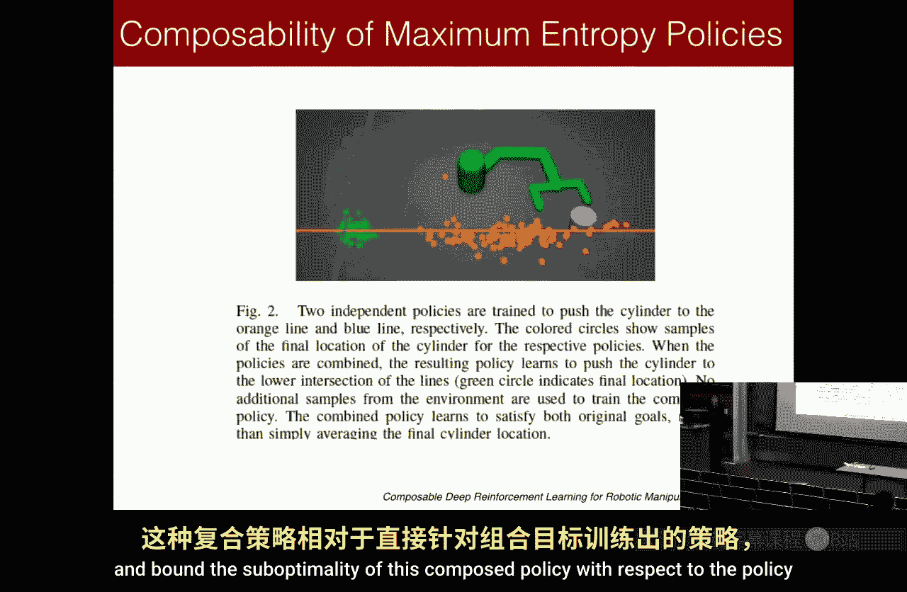
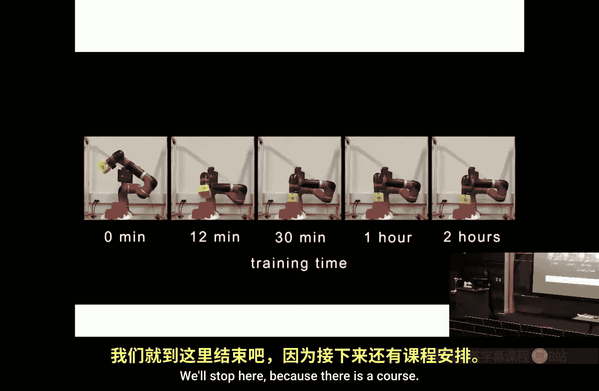

# 卡耐基梅隆大学【中英⚡深度强化学习与控制｜10-703 Fall 2018, Deep Reinforcement Learning and Control】 p25 P25 25  Sim2Real  Katerina Fragkiadaki -BV1RyqPBbEJV_p25-

Welcome， we have two very interesting topics today。 We're going to start from simulation。

 How do we bridge a simulation to reality gap。😊，And after we're done we're switched to a completely different topic。

 Max， how do we learn maximum entropy policies with reinforcement learning？

It's just that each one of these topics can be covered in a small amount of time。

 so that's why we have these two topics today together for the second topic I've been mentioning in many。

 many lectures and overall it's very exciting， there are very recent results。

 very beautiful theory and very very interesting properties of the resulting policies that I'm going to show you。

嗯。But first， we're going to talk about simulation and why simulation， well。

 because all the enforcement learning or most of the enforcement learning algorithms we've seen so far require many。

 many samples。Such samples are possible to acquire only in simulation。

 and indeed the big breakthroughs of reinforcement learning has happened in simulators 9 so far。

 playing Alpha go， playing At games， etcter。 Allright。

 we have not seen we have seen really limited the use of reinforcement learning or modly at delivery reinforcement learning on real robotic platforms。

 okay。And more and more people believe that we do need to invest in simulation。

 we do need to invest on building simulators that not only are photoistic。

 so the visuals are matching in reality， but also the dynamics， the physics。

 much reality now no matter how much we invest on simulation there will always be a discrepancy between simulation in reality。

 how can we train algorithms that we can bridge this gap， all right。😡。

There are many simulators available， nowadays most of people use one of those， Mojo or bullet。

 gazebo， et cetera。嗯。The problems simulation， as we say we can afford many， many more samples。

 you can also parallellyze the simulate experience very， very easily， very， very cheaply。

It's safety concerns。 We don't want to deploy half trained policies on real robots and。

To let alone nearby humans， but also probably we're going to break the robot right if it's a half train policy。

 same with a cell drive car， we don't want to deploy half train policy on a real car。

 so it's better to train in simulation， okay。Avoids wear and tear of the robot。😮，嗯。

I do believe that the progress， let's say in the field will come from how good simulators we have。

 how good and how cheap robotic platforms we have that can， let's say tolerate us using them many。

 many hours per day， right now the robots that are available if you use them too much they break very easily。

 they're very very bttle， which is another thing that does not facilitate training policies on them rather than only testing policies on the robots。

 okay。😡，And so far， the simulators are good at modeling rigid multi body dynamics。😊。

Now the con of simulation is the fact that we cannot model the world area world is very very complex。

 there is wind， there is dust， there is a lot of things that we will never be able to model although requires a very。

 very big engineering effort to model okay and it's not just the visuals， the visuals is easyis part。

 the physics is the hardest part okay。Even if you model them。

 you need to identify the right parameters of。Of those the coefficients of friction or inertia or whatever you're going to put in the system。

And as we said， both the visuals and the dynamics will always be different than the real world。

 and if you train policies on particular simulate environments and you just deploy it，😡。

On a real robot or a real car usually they will not work so in this lecture we're going to see what people have done to bridge what they call the reality gap okay simulationim to reality now here is a big big problem of simulators it's very hard to model de formable objects or at least currently is very expensive there are simulators that model fluids using particles okay and people use them and learn from them but you know it's a limited limited use right now。

So there are， a lot of research efforts in this topic。😡。

What I'm going to talk today is what has shown to work well so far it's interesting that the same lecture I gave a year ago I couldn't use more than let's say 10% of it because these have changed。

 things change very fast， what appears to be a good idea today is not a good idea tomorrow the simulators change the robots may change become cheaper so there are all these factors that will how to say influence whether you guys are going to use real robots to train or not and which simulator you're going to use and whether it's a good idea or not okay。

😡，But what has shown to work， Do randomization has shown to work。 What does this mean？

It means that instead of training in a single simulation world。

 you just assume samples of simulation worlds。😡，You vary wildly the dynamics。

 how heavy the object is， what is the friction， the textures of the object。

 you also wear them wildly。And the reason it's called randomization。

Other than just domain augmentation is that these variations you're going to do they don't even need to be realistic。

😡，Okay， they really， like if a human sees them or if a human feels them。

The doesn't need to appear real to the human， it still is very useful to train your policy in them to generalize to a real world。

😡，And。The idea is that with enough variability in the simulator。

 then the rear world would just appear as one variation。

 so you cover the space in which your policy need to work。Now。

 second good idea is the following this。AhThis was a good lecture。Hi guys。

 doesn't matter if we're not going to finish here we're going to do this lecture on Friday so what are we going to do now we're going to stop to go away。

Probably yes okay， very careful， everybody use staircase， don't use elevators， obviously。Guys。

 so let's continue please I'm going to start by presenting you some very simple ideas which works surprisingly well on real application I think you're going to like a lot of the particular papers we said the first idea is domain randomization randomized textures randomized dynamics they don't need to feel real or look real to be useful The second idea is don't fit pixels in the policy network your training fit something higher level like label maps why because label maps or object maps look more similar between simulation and real world as opposed to lowle textures and we're going to see what we mean by this similarly in your policy network don't try to predict low level。

Tques or low level steering wheel signals because those low level dynamics are also very dissimilar between simulation and the real world。

 try to have policies predict something in a more higher level。

 for example where should what should be the translation or the rotation of the end effector or where should the car go and then let a controller or a low level controller trained on reality to get the robot from the initial condition to this nearby waypoint so learning should happen in a little bit more high level to be able to bridge the reality gap。

So let's be concrete， here is one paper that showed one of the first that showed how domain randomization works and is effective。

 imagine you have a robot， a boxxter robot that wants to detect the objects in front of it okay and you don't want to grab this real data and send them to human annotators to annotate them to train detectors。

 what you're going to do you're going to set up a simulation environment like here on the left。

You're going to show different objects， you're going to texture them in all crazy ways。

 and because you're in the simulation， you know the ground roof。

 you know where the objects are and you know their segmentation， does this make sense？😡。

That in simulation， we know the world， that's the value， we know the ground truth of the world。

 where every object is and where its extendant， Okay， so then you're going to train。A detector。

To detect these objects in simulation and there are this large variability of textures and you're going to fire this detector in the real world and it's going to work。

😡，Okay， does this make sense？Okay， this is for object detection。

 but what about a more fine grain task， for example， pose estimation？

Poose meaning what is the orientation of the object， the3D orientation of the object here。

 the object we care about is this cuoid。Well， you can still do the same your goal is that you have a backxter robot or any robot is looking at the table in the table you see this cube and you want to be able to estimate its pose and you don't want to take real images and send them to human annotators to label the pose so you train in reality at the cost of requiring human annotations。

 how can we explain simulation to do that。Well， you're going to go in simulation and you're going to put this cube。

 here is the cube。You're going to put the cube in all different orientations against random backgrounds with tons of crazy objects being around。

 including the cube to be able to handle occlusions， ettera， et ceter。Do you see the training date？

Okay， so because you' are in the simulation， you know the ground truth， which means what。

 you know the orientation of the cube， you know the corners。😡，Of the 3DQ void。

 so then you can ask a network。You can train a network that takes us input the crazy image。I mean。

 here is not crazy， here it's from the real from the Bauxter robot and predict where the different vertices are。

 and you're going to have the same network feed， simulated images。

 and then going to feed real images and you hope that it's going to work without any fine tuning in the real world because you don't have any annotations。

😊，So how does this usually work， a domain randomization， you start by randomizing the domain。

 and then you fire your detector and you see how well you did。😡。

And here you see that you did pretty well。And then a little bit you dim the illumination and you see that your detector fails。

 so then you go back as an engineer and say， oh， I need to randomize a little bit more in my simulated environment。

😡，Does this make sense？So what does it mean randomize a little bit more。

 I need to change the contrast and the brightness of my data。

And continue training with these extra augmentations and then hope now once the network I trained on these crazy textures and illuminations。

 it works under there this dim image without any real world fine tuning。😊。

And what is the surprising results that it can even detect corners of an object that did not rain on？

😊，Does it make mistakes， Yes， of course it makes mistakes like for example here。

It thinks that the corners are of different objects。

 so under lots of clutter are of course going to fail the previous image。

 if you remember the cuboid was a little bit isolated from its surroundings。Okay。

 so this is an idea that is very， there's a lot of excitement about this domain orization idea。

 here is a recent paper from NVDdia。😊，What do cell driving cars companies care about while they care to train very good car detectors。

And then of course， of course， they sent tons of real data to annotators， to annotate the car。

But in particular because self drivingiving car companies don't care just about where is the 2D box of the car。

 but rather the 3D bond box which is harder to annotate even a human can make a lot of mistakes of the exact arrangement of the 3D box。

 we do like to have such simulation data。So what is the idea here。

 the top data set is called people in the computeruter Vi community know it and it's called virtualual Kity Kitty is a real world data set of cell driving of scenes of a car driving around in a city Viual Kity was built by engineers to be in the simulation but to be similar。

😡，To the worlds in Kitty， the idea was that you will be able to train in virtual kitty and do well in Kitty。

And now this paper on domain randomization says， I don't want to have engineers and artists that that's the problem。

 you cannot use your graduate students to build the virtual Ki。

 you need to use artists that know what they're doing。

 building the world and the models and everything。And they say， I'm going to give up on realism。

 and I'm just going to do。 I'm just going to generate。

Sces that don't make any sense there are cars in them with all crazy textures， all crazy backgrounds。

 et ceter。What do they do， they take random background images here， you see office spaces， et cea。

 they take different models of a car， you can find those models。

 they're fantastic company nowadays that sell 3D models。

That sell 3D models of cars and tons and tons and tons of other things because these are needed for movies。

 so basically they're fantastic 3D synthetic models that you can use to train policies。

 the synthetic models were not designed to train policies that rather designed for movies， etc。

 just to create the visual effects for people， but you can as well take them and use them in your simulator work with physics if you like。

😊，So here is just car detection， we just still look at the training detectors and bridging the reality up。

 so you put these different models in different poses。😡，Different scales， different orientations。

 different occlusion relationships， and you trade。 And the question is。

 how will your do if you do this？So here is the results。😊。

If you don't have any real images to do any fine tuning and you just train from simulated images and then you fire on the real kitty dataset。

 on the real scenes， then the virtual kitty。No sorry you always use real images so here we compare with a baseline that only trains our real images。

 so the virtual kitty will do better than you and here from left to right we show how much real images we use to fine tune the models the car detectors that were trained in simulation。

😡，So you see that when we use very little real data， here zero， indeed。😊。

Those that trained on the well。A beautiful dataset virtual Kity will do better than those that train on domain randomized dataset。

 but as you increase the number of real images where you do fine tuning。

Then eventually the domain randommization wins and the question is can we do better than 98。

5 or is there an upper limit， this is not clear because usually to publish a paper we just need to beat the competitor by a little bit。

 I'm pretty sure if you push the limits of this domainmization you can squeeze even bigger performance let's say all now the important thing here is that in this detector when you start to fine tune。

 you have pretrain the weights， one in virtual kitty one in this domain randomized data。😡。

In this other， for the red column that only uses real data， you start from random weights。😡。

And then as you go， you fine tune with more and more real images。That's it。 So this another。😊。

Proof that， you know， you may not need。A great deal of realism to do well。嗯。

Now so far I talked about randomizing observations， images， the same holds for randomizing dynamics。

 what does we mean by dynamics， well the masses of the objects that you manipulate or of the agents that you have to learn different policies。

 the frictions， etc。😡，Here's a paper called Learning robust neural network Pol using model and samples that does exactly this。

😡，It considers a distribution over simulators， not a single simulator。

 Imagine have an enemble of simulators where each simulator has different masses。

 different frictions， different physics parameters， okay。Here in this particular paper。

 we'll consider no visuals whatsoever。 So we're only going to be talking about physical parameters of masses and nutias。

 et ceter。😡，So we'll then on the distribution。And we will show that you'll do much better than if you train on a single simulator okay so this again shows the power of randomizing the simulator。

 not only we will train on an sub of simulators but we do hard world mining。

 we will try to find the simulation model on which our policy has the lost reward and sample it more often to make sure that our policy does well even in this hard world okay。

😡，And second， instead of just fixing this distribution over simulators。

 we're also going to adapt it to come closer to reality。Two ideas。

 So this is not just domain randomization， but there is also this additional step of bringing the distribution of simulators closer to reality。

😡，Now to bring them close to reality， this means that you have a chance to see some real world trajectories。

 if you've never seen the real world， there is no way that you can adapt your distribution。

 the ideas that you have access now to the real world。😡，You you get some few trajectories。

 few trajectories， and these few trajectors help you to adapt the distribution over simulators。😡。

So how exactly this is done？😮，Well， here is the objective。😡。

Inside the bracket you have the standard maximizing of the expected discovery word objective and were in reinforcement learning outside we have an expectation over simulation parameters。

 expectation over different simulators， so we don't care about a single world。

 we care about training one policy that does well in a lot of worlds。嗯。So that's the idea。

 The second idea is hard world model mining。 We will be sampling。

Those simulator worlds based on the performance iteratively。 So we sample， then we train a policy。

 then we resample， we train a policy， etter。 How do we sample well we'll consider the world。

For which our policy doesn't do well。And you need to understand why this is important， hard mining。

 hard negative mining is everywhere， even when you train object detectors。

 when you train your policy， et ceter， why this is important。

 because if you sample examples for which your policy does well already。

 you're not going to get any gradients， gradients you get when you correct your policy。

 if your policy already knows this world and solves it very well。

 if you sample it you don't get anything so that's why hard model mining is important。😡。

Is that clear for everybody？Now a detail is that we don't start by sampling difficult worlds。

 we sample by considering all worlds， and during training we focus more and more on the hard ones。

 all right， not to make our policy not to find a solution if we straight away sample hard worlds。😡。

Okay， great so。So this is how the algorithm works， we have an iteration at each iteration we sample simulation parameters and with sampled trajectories。

😊，And based on those trajectories we compute words for the different worlds that we have sampled。

 we keep the hardest ones and then we put here any reinforcement learning method that you want that considers also only those hard simulated worlds and trajectories of those hard simulated worlds to track gradients and update our model。

 you can choose your favorite RL method at that point okay。Reinforce actor critic whatever you like。

😊，What does this show， So this is the Hopper is one of the benchmarks of open AI G。It shows that。

If you consider one simulation， one simulation world。Then your policy， we have high rewards。

 notice that the color denote the reward。😮，Dark red means you get high word， fade。

 white is lowerri word， so you will get high word only for a particular choice of friction and torsso mass。

 all right for that hopper agent。If。You do。And sampling of worlds。

 what we say to consider distribution， you see that you get a reward in match in an area that covers wide range of torsom masses as well as frictions Now if you do hardly negative mining of those worlds。

 you get an even wider area okay。That's all it shows。Now， how do we sample so the second idea？Yeah。

 the second idea。😊，This is so far all about anomization and hard negative mining。

 How do you sample from distribution， The second idea is that you can adapt these distribution over simulators to come closer to your reality。

To do that， you need to have access to reality。 So in particular， this trajectory is there。😡。

State action next state have been collected on the real world。

 and how do you choose which simulation environments are good and which are bad？Well。

 you see which of those make those trajectories highly probable。😡，Okay。

 so the simulations that make the real trajectories probable。 and we know what is a。

Probability of a trajectory is the multiplication of probabilities of the individual state action transitions。

 al right。Then you prefer those worlds， for example， if in the simulation。😡。

I push this with a particular action， and it moves。

And I have a simulation world where this is extremely heavy， so it doesn't go anywhere。

 then of course this trajectory is highly improbable in that simulation world and the weight of that world will go down so that I sample world that are closer to my current real conditions。

😡，Okay。So far， we don't have any visuals。And this is how you start from a distribution of frictions and masses。

 And then because you do this。Ittereration by going the real world as samplingling trajectories and resseling the simulation parameters。

 essentially eventually you get it to where the red cross is， which is your real parameters。

 for example， all right。😊，That's it。 and here are some more。A plots that show that。

Here is when you train with a mass of three， six， and nine。And you test in a range of masses。

 Then the resulting policy will help high reward only when the mass match the training conditions。

 When you train on an ensemble of worlds， it does well on the full range of torso masses。

Authors note that。 You know what。Yes， the policy needs to handle a much harder problem。

 it needs to do well and under a large variability of worlds。

 we did not see degradationd due to this hard requirement，😡，Here next is a recent paper。

 which I think you're going to like a lot。😊，嗯。Similar ideas， the question is。

 can I learn to drive in simulation in a way that if I deploy this policy on the real world？

I will do well。Without a fine tunic。For now， okay， without any fine tu。

Now we'll combine two ideas that we mentioned that they're good。

The first idea is that my policy will not be exposed to raw pixels because I know that no matter how good the artists are there will always be a difference in textures between simulation and the real world。

 and the second is that the policy will not be exposed to low level dynamics of the car。😡。

Here is the most straightforward architecture that you can train， you take an image， convolutions。

 convolutions， fully connected， fully connected steering wheel comes as output。

 you can train this policy using， for example， imitation learning。

 somebody' is training is driving the current simulation and you can train this model。

The question is， does this model transfer in the real world？What what do you say？

This is the most straightforward thing we could do Lord that， right， do you agree？

So actually one of the authors of this paper came in CMU like a couple of months ago。

 so if you had got the chance to go to see this robotic seminar Friday。

 I think either  to30 or 330 I don't remember then you would have the chance to know the result already the idea is that no this policy doesn't transfer because as we say the pixels are very different and the low level controller is very different so what he proposed is that。

Instead of training your policy on low level pixels， train here a segmenter that take the image。

 predict label segmentation maps， here is your driving policy that takes those label maps and does not predict low level controls but rather predicts waypoints where you want your car to go。

 okay？And then there is this controller which is learned or it is designed that is really on the real car dynamics that will take the sequence of waypoints and will take the car from one waypoint the next so then all this knowledge here can be transferred to the real world safely now they didn't do that what they did is they trained in one。

Town。And one particular weather condition， I'm not sure if the projector is good enough for you to see the difference between two towns and the two weather conditions。

嗯。Yeah， it seems to me that town too has way more skyscrapers and the weather you can understand。

 It seems to me the second weather is way more rainy and。Wet。The question is， if you train。

 so we don't want to deploy the pulse in the real world， how can we simulate that well。

 we're going to train a network？😡，On town1， weather one。

And we'll see how this driving policy generalizes to town 1， weather2， town 2， weather 2， town 2。

 weather 1。Okay， obviously。😊，Which of those four scenarios the hardest to do well if the policy was traineded on town1。

 weather one？Exactly， because both the town is different and the weather is different。

And let's see the results， they have very beautiful alations here。😊。

All those models that I'm going to show were trained on T1， whether  one。

 the difference between them。And they were tested on all these four combinations， all of them。

 Now the difference is that what architecture we use to train those models。Liten。😊。

Ems to control is the first architecture that we showed that takes raw pixels and predicts steering wheels。

 or low level dynamics and is the one that yes， if you test it on the same。

Conditions that it was strained on， it will do really well。

But on the other conditions is not going to do well， do you see， is this very clear from the result？

Okay， now image to control plus means that you're also going to do some augmentation。😡。

What is this augmentation， well， brightness all this brightness changes， random cropping， et cetera。

😡，This is what they call augmentation。Now， image to waypoint。

Does not predict low level dynamics predicts waypoints and then rely on this PID controller to take from the pair of waypoints to what should be the steer wheels that we get the car to the right place and you see that。

It generalizes better than image to control。😡，Then we have segmentation to control。😡。

Which is the other way around。 I predict low level dynamics， but I take as input segmentation maps。

 so I don't have the problem of the pixel being different。It generalizes better。

And what they call us ours is that you take both segmentations as input and predict waypoints as output and it generalizes the bestInterestinglyly。

 here is plus DR plus domain randomization， so you help this model by randomizing the domain like crazy all these ideas that we described earlier still encapsulating this policy by not align to see pixels and not align me to predict lowle dynamics helps so these are all good ideas。

😊，Yes。Yes， what do we mean by waypoint？So it's right here。

Wpoint is essentially you are somewhere as a car and I tell you go to plus 30 minus 20 in the 2D plane and rotate in that direction。

 so I command you by telling you your future rotation and translation same as if you command a robotic gripper by telling it this rotation translation as opposed to what perks you need to apply。

To get to the desired location。 Okay， so you have a policy operating on this higher level of abstraction。

 and then you have some low level controller to take care of how do you go from。

One place to the next。 by the way， this is a good idea。 Other people have also used it for。

 for example， getting。I think now robot to stand up again in simulation， they trained。

In terms of waypoints， and in real time， they fine tuned a low level controller to take care of the dynamics of the robot the real world。

 thist makes sense。 So you give up on trying to model the low level dynamics of the robotic system over the car in simulation very well。

Okay。Yes， if I'm understanding this correctly， they're sing this into three modules and they're only seems to real time for the middle one。

诶呢位。training the first I see。 So we didn't discuss a lot the perception module。

 So the perception module is essentially。Segmentor。That takes as input。

 both simulated images and real images and adapt to label maps。And you can train this。

 People have such label maps on real images。 they have the annotated。

 basically people have spent the time to annotate， so we do get such label maps on real images。

 Okay we can predict them simply because people have spent time already。

On collecting such human annotations on real data。 now， of course， they make mistakes。

 and if you train your perception model with perfect label maps and simulation。

 still you're not going to transfer well because you're going to have perfect label map simulation and err use label maps in the real world。

 so they train in simulation。😊，Okay， and then the perception module。😊。

Yes so that's why so you don't use the ground for segmentation map you use the output of the perception module simulation now on top of this they said that they really had to do things to make those segmentation maps look more like segmentation you get maps you get from the real world by dropping pixels and changing the brightness essentially to make this perception module to fail more in simulation so that you are robust to such failures once you get them in the real world。

 but the benefit you get by using this perception module is that we do have some labels of predicting labels of pixels in real worldord images that we have collected from humans。

But like it seems like it kind to make sense。If you makeと。to real transfer。要到他的。Yes。

 I don't think it's a surprising result I think the surprising result potentially is the following that you manually engineer what will be exposed to the policy。

 for example， I manually design that I'm going to label all the road pixels as road and I'm not going to show you where is the middle line for example well maybe me as a car I want you to know where is the middle line as well do you see so then you say okay maybe I'll show you also the middle line so with this interface the engineer decides what to divide between pixels and the labels that are going be exposed to the later policy and if you hide too much information for example if you decide that both sidewalk and road are the same label I'm sure your policy will do worse so your labeling needs to be so that it preserves the important information necessary for learning to drive。

No， I don't think there is anything surprising here now the interesting thing。

 what is the interesting thing here， these people from Intel spend a lot of effort on making the simulator。

 they call it Kla so the hard part is to put effort into making a simulator that later you can use if the simulator is available of course this is an obvious idea but you know thinking that you know yes this works well it deserves to put the effort or whatever month a human months to build a simulator so it' like can train such a system I think this is them。

😊，Important decision。As opposed to fighting with real world all the way。That's it。

 this is what I wanted to discuss about Cmtorial Ga。

 it's an active area of research and it is very hopeful if there are no other questions I want to discuss now about learning maximum entropy policies with reinforcement learning。

Yes。What is the plus Yeah， is some date documentation？They say this。

 they do this data augmentation to help essentially the perception module handle the fact that。

From simulated images you may， because there are just so many simulated images。

 you have a lot a lot of how to say annotations， you have very good label maps and the fact that those label maps will not be exactly the same as the real world。

 maybe the real world has wider roads than all the roads that you've seen simulation。

 so they had to do some data augmentation on the images basically。 like dropping pixels。

 changing intensities， et cetera for the perception module to see a wide variety of label maps during training。

So far we've considered policies that maximize the following objective。

 the expected sum of future rewards， and if we have infinite time， we also put a gamma there。

 make sure that this sum doesn't explode。😊，What maximum enttropy reinforcement learning does it augments this objective with the entropy of the policy。

What does this mean？It means that not only I want to find policies that have high reward that land me in states with high reward。

 I also want to find policies that landm in states where the entropy of the policy will be high。

A policy have high entropy when multiple actions are possible。

 the uniform distribution maximizes the entropy and the point distribution where all the masses in one point minimizes the entropy。

 so I want to find policies。That land means states where I have a wide variety of options。ok。

And this should not be super surprising we have seen in the previous。Well， okay， let me just say why。

 well， first of all， if you have policies that are not deterministic and you have a lot of options。

 potentially by sampling during training by sampling those options，😡，You will explore better。

Mostly because the alternative is eps greedy， which is pretty terrible alternative，😡，So here。

 if the policy tells you， I like this and I like this， then you'll be able to explore。

Better as you post the Epsilon grid that tells you oh there here here here。

 so basically Epsilon grid， either you have the way to go and all the other options are equally probable with maximum policies you don't need eps grid anymore to train。

 you just sample from those options that you have。😡。

Naturally available to you because you are training a stochastic policy。Now。

 why is it important to have alternative ways to complete the task。

 this super important for generalization。Imagine that I want to reach the particular object and I only learn this deteristic policy and at test time an obstacle comes in front of me。

 that's it， this policy dies because while if I had learned a lot of alternative ways to reach。

 then I will be able to generalize better okay。😊，And we'll see at the end of the lecture another super important characteristic of those stochastic policies a maximum the endtro that they can be composed。

 but I'm not going to mention here， we're going to see it in a few minutes。😊，Yes。

 and we set also better generalization。Now we should not be super surprised about max entropy。

 maximizing entropy， because we've seen about the principle of maximum entropy when we discussed about in reinforcement learning。

 we said， as long as we match the expert， I don't want to overcomecomit a particular policy。

 I want to be as random as possible。😡，And here what we're saying is that if policies give similar words。

 I don't want to overcome it to one policy over the other。

 I want my policy to keep all the options open。😡，All right。And。

One thing that I think is interesting is that there is a SLR paper 2017。😊。

Which says that if you put the maximum entropy is completely irrelevant to our topic。

 but just to see how maximum entropy is important， if you put the maximum entropy。

When you train a classification image classifier for example， and you say you know what。

 try to classify the image， but at the same try to have high entropy。

 essentially don't be super confident that there' is just a chair。

Then this acts as a regularizer to our network。 It will be able to generalize better。

 So we don't want them offer confident predictions。 Okay， so enter becomes in all possible ways。

 So let's look。So are we happy with the motivation or？Okay。

Now I want to remind you here we have this slide when we discussed about a synchronous advantage actorritic。

 it was an aritic method that was using multiple threads to collect experience and naturally explored simply because it had many different threads and each thread was updating the Q and the policy function in a synchronous way that's why it's called the synchronous A3C。

 the synchronous version called A2C。😊，Now， interestingly， there is a paper。

 there is a line in the paper that says this。😊，And this line does not even appear。

 essentially the content of the line does not even appear in the algorithm box because it's the hack that many people do without putting it。

 let's say as。😊，Yeah， without showing it into the algorithmic box。

 what does it says is we also found adding the entropy of a policy P to the objective improved the exploration。

😊，Okay。So here we have discrete actions， our policy takes as input the image or four images and predicts a softmax over those actions。

 and they said you know what adding the entropy of that softmax also helped。

 so essentially when you take a gradient， the gradient of your policy is not exactly like that。

 remainss a gridd log P multiply with the advantage right so this reminds us very well of policy gradient。

 but rather the policy gradient look like this。😊，You have a reward combined with the entropy of the policy on that time step。

😡，So people have used in many， many， many occasions entropy as a regularizer when you train a policy。

 now this is very different than what we showed in the previous。

 this essentially maximizes the enthroppo policy over the current type step。

 it doesn't lead you to find policies。😡，That will have high endropul in future time steps。 Okay。

 so this is not maximum entry policy。 This is just regularization for your policy not to be super deterministic。

 and it might be for some of you A3C didn't work for the manipulationulation project。

 It might be that such an endpargularization was missing and。😊。

The policy was over committing too early， basically somewhere in some solution。嗯。Yeah。

So here is our objective。 So basically， my point is this objective is not similar to the hack that different papers have put so far when they take policy gras and adding that entropy。

 which by the way， this。Add of that antropyter was known since 1991。

 as we showed in the previous slide。Great， so here is an objective and the question is how can we optimize this objective？

All right。Let's recall the Belmond diagrams。😊，The Bel diagrams were computing state action， Q values。

And remember the dark dot was when I was taking an action。

And why we have different branches coming out because of the dynamics on the environment that can be sent in S prime or a different S prime or different S prime because the environment is not deterministic。

And then I land in a state， and this is an empty white circle。

And then once I land the FY server again， I take actions and I have multiple branches coming up because there are many options that I can take。

 many actions I can take and why the buildmon diagrams were good where did help us will they help us to come up with this。

Bllman equation to know how to add things， essentially to figure out what you should put on this app node。

 you just need to sum whatever comes down on the tree，😡。

So basically the cu of a particular state and action is the reward that you would get once you take that step。

 the reward question depends on the current state and action can also depend on the next S prime。

 next state doesn't matter。B gomma。Transition dynamics， where I'm going to land。

 This is the stochastic of the environment。 What action I'm going to take， my policy stochastic。

 where I'm going to land there， I add the Q of the resulting state in action。

And we said that this is a about an equation for state action values， do you agree with this？

Does this remind you of something？Okay， great， so we have this recursive relationship。Okay케。

And the only thing I want to show is that along with those rewards of the task。

 now we have also the entropy， we need to add it in in our equation。😡。

And this entropy term can sit on the white dot on S prime as the entropy of the pulse on that S prime step。

 if you like。😊，But because we know that the entropy， the definition of an entropy distribution。

 is essentially a summation。Multiply with the probabilities of each of the outcomes of distribution minus the log of there。

😡，Of the the probability of the outcome。 Okay， so it's exactly this。

 the expectation under my actions。 of log B prime prime I a apologize is I think expectation under a prime。

Is it weight that some， does this make sense？So since it can decompose over different actions instead of having this term sit on the S primeme。

I can take each of those minus log probability of alpha prime given as prime to be here on the black dots。

😡，And then my summation goes like this。😡，Instead of just considering the cube。

You should also add this mine log。😡，Be all forgiven S。Okay。So we just added the entropyer。Alright。

 so what Bel diagrams allow us to do is how do we compute the summation of those expected discounted future reward。

 al right， that's all they do。Now here， instead of just this reward， which is from the extrisic task。

 or if it can be also your interesting reward， you also have the。😊。

You also try to maximize the entropy and these entropy terms sit in the diagram。

 once you take an action， each action gives you a log P a prime given a prime， all right。

And so then they enter in the equation in this way。So again， you have a Belman equation。

 but you call it soft。😡，嗯。Belman equation。 It's soft because you don't have we call it soft just because we have this anthtropyter。

 Okay， we're trying to promote stochastic policies。And compare it with Dman equation。

 they look pretty similar。😊，Now， Bel equations are useful only when the dynamics of the environment are known。

 this capital T that you see there， when there are no no， what do we do with sample。😡。

And not only we sample， but the equation becomes。An assignment operator。

 and we have this iterative way of estimating the Q function。 you remember guys？It there地。Balmon。

 Belmon operator。Great， so we start， we have our table of states and actions。

 we start with some Q values and we derivativeatively update。

 and we said that this Belman operators a contraction。😊。

And that's why if we3 apply this double operator will converge。Somewhere， okay？Yes。

 we're discounting the future in of actions。Yes。I there new reason for that。So why we discount？

Future and actions。Say why we discount it？ Yes， so it's the same。

Motivation is why we discount the rewards of future time steps don if you have an episodic task。

 if you have an episic task that is for example， 20 time steps long。

 you don't need to discount we just add this gamma because if you don't let this gamma you have an infinite sum the sum is going to explode。

😡，Okay， so yeah， so I would not put too much emphasis on the gamma。

 this is just for things not to go to infinity， right？Okay。Very nice。

 so the only thing I'm trying to say here is that we things don't change too much from when we didn't have the entropy of the policy in the inner our objective。

 we just need to add this little thing here。😡，And things still converge if you just do this iterative Q update。

😊，This is good， and now you may say but why they convertver to well because this update can be seen。

😡，As you you can rewrite the word in this way。And then you end the old。Belmont operator， so。

This is the Q update that we just came up with by looking at the diagram and by rewriting this a little bit you see that it is the reward and the entropy of the next state。

 you don't need to go through the equations we just show this in the diagram right before decomposing the entropy to actions you can have the full entropy sitting on the next state you can add it wherever you like you can add this time wherever you like and you can rewrite the reward in this way so now you have the reward of the soft reward let's say it's like this and then with this new reward。

 you can just go and do your old Belman update operator to estimate the Q function and because the old Belman operator is a contraction then here again you have a contraction。

So things con this is good， so we're going to use this。😊，Well。

 we're going to use it to do some soft version of the policy duration。😊。

So many algorithms that we've seen is a variations of policy duration。

 which is what you have a policy， you estimate its value。

 and then you maximize you update the policy to maximize this value， okay that's what we've seen。😊。

And here we have the soft version where the queue is estimated with this soft Belmon operator。😡。

And now the interesting thing is how we improve the policy。Here。

 if you remember before in the term municipals we had Argonms。

 you remember that we would for every state， we would look at the next Q。😊，Where I'm going to end up。

 and I choose the action that maximizes the Q of the next time step。

 You remember the deterministic version here I have this projection。😊，At this projection。

 using thisKL diverges at the distance。😊，I have my policy being， for example。

 a deep network which Gausian predicts the mean and the variance。

 and I'm trying to make it as close as possible in the KL divergence term to this policy that essentially takes the cues is an energy based model where。

😡，You take the cues， the queuees don't need to form a distribution， and you apply the softmax。😡，Okay。

 so what Qs， Qs are the values of the different actions。Okay케이。They don't sum to one。

 so you fit them into the soft operator， and we know what is a soft operator is an operator takes a vector of scores here are the YIs。

😡。

Puts them in the exponent and then normalizes with sum of exponentials。😡，And in this way。

 now the E to the。Now， the resulting。The resulting normalized scores form a distribution。😊。

And this is going to be your policy， all right？And because the policy network that you're training may not be able to exactly match what the softmax will give you。

 that's why we have KL。 I'm just trying to get as close as possible to this output， al right。😡。

我 for have continue 싸。Yes， that's precisely why we use this scaleL because if you had discrete actions。

 you don't need anything， you just take this output and you say that's my policy all right so there you need not need KL the KL we need exactly because we may have continuous actions。

😊，嗯。

我往才。So the queue there。The Q will still be， you still have the Q of the S comma alpha right。

 you still can estimate the values， all right。So you're saying how do you minimize this。

 so we're going to go into details， just give me one second to see how this becomes a practical algorithm。

 okay？😡，So this is a softm。So we said that the Q converges。😮。

Now the second thing we need to say is if we use this operator to update our policy， does it improve。

 and yes， there is a proof in this paper in the appendix。😡。

It very much follows how we proved the policy improvement theoryorem for deter deterministic policies。

 you remember we essentially iteratively opened the expectations and we applied the fact that at every step the update policy is the Q is higher than the V of the previous policy so it's very similar。

 so that's why we say that this leads to the s of policy with monotonically increasing Q values。😡。

So far we've discussed about tabular methods， state and actions。

 you see there is no function approximation so far。

 we assume that we can enumererate all actions and again enumeral states and now we're going to go to your question。

 what happens if I have large continuous state spaces， large continuous action spaces。

 how can we use approximation for these soft policy duration。😊，Well。We need three things。😡。

We need the state value function， the state action value function， and the policy。

And remember that the value。Is related to the Q in this way。 So in principle。

 you can tell me that did I put it， I'm not sure。嗯哼。😊，So， this。Is exactly the value。

 the state value function， the sum。I think I put around to show it to you guys。Yes。

 so this is exactly。The value function。Q minus log p。

 So if you have approximation for the Q n for the p in principle， you don't need the value function。

 Okay however， we are going to explicitly keep also the state value function。

 We're going to introduce bias but we're going to trade bias for variances So how we' going to learn those three approximations。

 well。See how simple it is。We have three objectives。

 one for each here is the objective for the state value function。

 the state value function need to be similar to the Q minus log of PP of alpha and this is exactly the regression objective under for which we are going to trade this value function for now if you don't mind the policy network just think about it as something that takes the status's input and predicts a Gaussian has a mean and some variance right so you can evaluate PP of alpha。

😊，So this is the target essentially that I keep fixed and I'm trying to make my value for a particular state to go close to that target all right this standard regression so we're good here right so if I give you policy and Q you know how to take gradients to fit the state value function so this is easy。

😡，Here is a second objective， also very easy for the queue。😡。

Very similar to the Mel and backbraators that we had before。What is the target。

 The target is the reward， because I unroll trajecties all the time， right。

 So I take rewards plus the gam epsilon of。V， this is TD learning， So I bootsrap。

 I use the resulting V that I have estimated， as opposed to using Monte Carlo return。Alright。

 so then what I do， I take gradients。 this is my target。

 and I try to make my Q to approximate r plus gamma V。😡。

This is very similar to what we had in actorritic， this is how we trained our critics so far。

Nothing has changed。 and this V was the baseline essentially。 you remember that we said okay。

 it's good to also have a function approximation for the baseline。 This exactly the baseline。

 the value function， Okay so so far， the only thing that has changed from the previous actor critics that we had。

 I would say is this minus log of P P of alpha。To estimate this the。Now let's go to the action。

 so this is a new objective， indeed。We're trying。Epsilon ofDD means you sample states from your experience buffer。

 so this is the experience buffer， and you try to make your policy close to the softmax of the cube。

 all？😡，That's what you're trying to do。 Now， let's try to write out this KL。 Indeed。

 is the expectation under the policy。Of the log of the policy divided by the softm， You can remember。

 how is the KL of P。From you。The expectation and P， log p divided by  Q。

 that's the definition of kl divergence， all right。

And you want to take a gradient with respect to fee。 does this so far make sense？

I just expanded the KL。 This is how the KL looks like。 So so far， we're good。 Now， please note that。

This z theta of sigma T。 What is it， Well， it's just a summation， right。

 It's just the summation is a big summation over all the actions of exponent of Q。

 and it is independent of Phi。It is independent of it does this make sense。

 It does not depend on the policy， So what can we do， we can take the log ofnominator。

 minus log of the denominator and because it doesn't depend it becomes zero so I can throw it out so let's throw it out。

😡，So are we good so far。So we're good so far great， now here's the problem guys。

 we try to take a gradient， with respect to a parameter and then we have an expectation and we had a whole lecture regarding taking derivatives of expectations right and we said that if that parameter is inside the expectation you're good the gradient just enters the expectation。

 if that parameter is inside the distribution you're not in good shape。😊。

But we have learned to do the reparization trick。So what does this mean is very simple here。

It means that。It's inside the distribution here is what we're trying to estimate we're going to make our policy a deterministic function of some random variable which is sampled from a fixed distribution that definitely this a fixed distribution does not depend on Phi or anything like that。

😡，Okay， so this is schastic network， you sample alpha and you take the state and this enter some deep net predicts some new and some covariant sigma。

 and you have this。😊，嗯。You have a different epsilon for every。Dimension of the policy。 but basically。

 if you do this reparametization。😊，Now， the distribution here is sampled based on this。😡。

Epsilon variable as opposed to your action， and your action is in here。😡，Okay。And essentially。

 now you know how to take the gradient of this expression。So that's how things work basically。

 And please thank you for staying。 but basically， I want to show that。 here is the video。

Let's see if the video is going to play。嗯。啊。Here its learning。

 here it's learning this little agent needs to learn to go fast。

 you see with very few episodes this is moving for other policies you would have a much。

 much larger number of episodes here okay？😊，This is learning to move very， very fast。😊，啊。This。

Method called stochastic stochastic ac that's much better than DDPG for example you know DPG many of you have implemented it look how fast it's running Now the other interesting thing is the following DDPG is very brittle。

 you sample different random see， you have different results。😊，Here。

 the authors are showing the worst random seed。 So it has much less variance over the random seat if you grow with stochastic policies。

 which is a huge win。 And you can see this by the shaded region behind the dark line。

 So for the orange， which is the stochastic a it's much smaller than for， let's say， the DDPG。

 which is the green or。Let's say what is the other？So yes。

 it is much smaller variance across the random seat。

Another super beautiful result of those policies that maximize enroppy is the following。

 and I hope you appreciate we just need a couple of minutes。😊。

If you have trained to pause this for two different objectives， for example。

 I want to reach this object。😡，And I want to avoid this obstacle。And you have trained those policies。

 then you can just achieve the composed policy that both touches the object while avoiding the obstacle without training。

Anything else just by summing their Q values， okay？

And this you can theoretically prove and bound the subopity of this composed policy with respect to the pole that you would train under the combined objective。

😡。

And I have a video here。 It seems that we may not have time to show the video。

 but please go on the slides and。So I'm going to upload the keynote so maybe you can see the video at home if you wish here is one policy that puts this on the on the left here is puts on the bottom and without training anything just by composing their cues okay and using this combined queue you just go to the。

Bottom left part of the workspace without training anything else other than the two constituent policies。

 Allright， so this is a big gain of those maximumal policies。 So thank you very much。

 that we'll stop here because there is a course。

