# 卡耐基梅隆大学【中英⚡深度强化学习与控制｜10-703 Fall 2018, Deep Reinforcement Learning and Control】 p26 P26 26  Guest Speaker David Held -BV1RyqPBbEJV_p26-

All right， so let's get started my name is David Holld I'm an assistant professor in the robotics Institute and today I'm going to be giving a guest lecture on some of the research that I've been doing lately on safe and efficient robot exploration so before we get started let me first plug a course that I'm going to be teaching next semester called deep reinforcement learning for robotics。

 so the idea behind this course is we're going to dive deeper into different methods in reinforcement learning and we're going to figure out what we need to do to bridge a gap between the theory of reinforcement learning that has been demonstrated on various examples mostly in simulation and real intelligent robot systems in the real world so it's basically going to be a seminar course where each class we're going to read papers and discuss them each class will read one robotics paper that will show a really impressive。

A robottics result that doesn't use deep reinforcement learning and then we'll also read a deep reinforcement learning paper and we'll compare and contrast these and try to figure out what's going on。

 how did they achieve this result in robotics without deep reinforcement learning。

 why is a deep reinforcement learning paper not being applied yet to the real world and whether we need to bridge that gap to bring deeper L to robotics and achieve more impressive results in the real world？

Okay， so diving into my research what I'm motivated by is how do we bring robots into our daily lives so here are some images showing some environment in which people work or live so how do we bring robots into our homes。

 schools， hospitals robots that can operate in disaster zones or robots that can assist people in assisted living facilities so you can see each of these environments are pretty messy。

 the robot will need to learn a diverse of tasks operate in these different environments and so how do we achieve this so how do we get to this stream from where we are today today most robots are confined to operate in controlled factory settings or in applications like a robot vacuum where the amount of environmental understanding that they need is fairly limited。

So so why is what are the reasons for these limitations so one way you can look at it is that most methods today for robotics assume that objects in the world are well separated with minimal occlusions and good lighting conditions。

 whoever the real world isn't so simple， they heavy occlusions。

 objects can be in contact with each other and there can be poor lighting conditions and so the approach that that my group is taking to this is that when people encounter the world we don't just look at static images like this。

 we actually are able to move about the environment and interact with it and through our motions and through our interactions。

 we're able to actually learn more about the world and figure out how to operate in even these difficult settings so what I mostly investigate is how do robots learn through motion and through interaction。

As another example， suppose that you have never played tennis before you want to try to learn how tennis works so one thing you could do is look at some images of people playing tennis and from these images。

 maybe you'll figure out a tennis involves standing on a tennis court holding a racket and some different poses if you look really closely you could see a small yellow thing in the air。

 that's maybe a tennis ball and that's what you know about tennis unfortunately it's probably not enough to actually play tennis so maybe a better thing to do is to actually watch a video of people playing the game and now you can sort of see how the sequence of events roll out and this gives you some more information about how how the sport actually works but the first time you actually pick up a tennis racket there's some extra information that you learn which is relating to the effect that your actions have on the environment and so that's going to be。

The focus of today is how。how can robots understand the effect of their actions and right so generally how can robots learn to perform complex action sequences in this class we've all been learning about deep reinforcement learning so the journal paradigm that you're all familiar with you have some policy pi theta parameterized by some parameter data the policy observes the state and takes an action。

 the action has an effect on the environment and which causes it to enter into a new state。

 robot receives a reward and you try to maximize the expected sum of rewards the main approach I'm going to be using throughout the different projects that I'll describe today is policy gradients which you also I believe are familiar with but just to review at a very high level policy gradients typically assumes that you have some。

😊，I have stochastic policy that chooses actions conditioned on the state。

This policy outputs a distribution over actions， will sample actions from this distribution。

 will then take one of these actions， receive a reward and based on this reward will'll update the policy parameters to increase the probability of actionss with high reward and decrease the probability of actionss with low reward and repeat until conversion so that's pretty high level description of policy gradients and this can in fact be used for very complex robotics tasks such as standing up so。

So in this talk today I'm mostly going to be talking about how robots can learn through exploration。

 so as some inspiration， let's start by looking at how people learn through exploration so here's an example of a person who doesn't know how to walk so we can observe the strategies this person tries。

 try to figure out how to walk better so we see all the different strategies maybe leaning forward。

 could help flapping arms up and down， turning turning in a circle。

 let's watch okay so next she's going grab onto a chair that seems not to be super helpful so maybe standing on two feet could help turns out thats that's not the right thing either laying on the belly could be helpful so she tries that。

Let's see there are a few other strategies that she explores。Maybe going on a knee。嗯。Okay。

Okay turning the circle and eventually she figures actually that flapping your arms is actually the way to move and so through exploration she's discovered different types of locomotion strategies that you might have even thought of in advance but she discovered these strategies through exploration so using policy gradient robots can basically do the same thing so we see this robot is trying to figure out how to stand up from a lying down position and so we give the reward based on the height of the head and so it try different actions and sees which ones lead it to stand up and after much trial and error it's actually able to completely stand up from a lying down position so this works pretty well in simulation。

 how do we actually get this to work in the real world。

 there are many challenges one challenge is the following so let's just look at some of these examples where reinforcement learning has achieved success so far。

😊，reinforceinforcement learning seems to work well in some Atari games。

 achieving superhuman performance go in which Alphago beat a grandmaster go player and on the bottom we see robots have learned how to move forward and this other robot that we just saw that's learned to stand up from a lying down position so what do all these examples have in common one thing they have in common is that they all have a very wellspecified reward function so for the games the reward is just the score for moving forward。

 the reward is the velocity and for standing up the reward is the height of the head and the important thing to note here is that if the robot just follows the gradient to optimize this reward then it。

Will' figure out how to achieve the task given enough training so for each of these tasks if you just follow this predefined reward the robot will learn the desired behavior but that's not actually true for all tasks in the real world and so how can we guide the agents to learn complex robotics tasks in the real world and so today I'm going to be discussing for approaches to help robots guide their exploration that I've worked on in my group so the first one is reward shaping using prior task knowledge this is building off of some previous work in reward shaping they'll discuss the second is using a reverse curriculum the third is using adaptive variants to respond to changing environments and the fourth is how robots can learn safely if there are sort of safety issues involved in exploring in the real world。

 how do we take those。And to account what the robot is learning。

So I'll start by describing reward shaping using prior test knowledge。

 this is work that I did with Ignasi Clavera who's a graduate student at Berkeley so just as an illustrative example。

 let's look at this task of learning to push this block to a goal position that's marked by an X on the table here to make the problem seem a little bit complicated。

 we're going to assume that we don't know anything about this block， we don't know its mass。

 the friction between the block and the table， the friction between the block and the robot arm etc。

 and we want to try to learn how to do this task using reinforcement learning so this is pretty much the simplest robot manipulation task you could probably think of and let's see how reinforcement learning works in this case so one thing you might。

Ting to do is okay so we want to use reinforcement learning。

 we have to define a reward function and so one reward function you might write down is if you want to push the block to the goal。

 let's measure the distance between the block and the goal and give the robot a negative reward based on that distance and add those up and thats our that's the objective that the robot is trying to optimize and so any guess is what's going to happen if we try to use reinforcement learning to optimize this objective。

Yeah。多片。有文。为什么。Oh， it'll sort of smash it， you mean， okay。

 so that's possible any other thoughts on what the robot might do if you just run reinforcement learning with this objective。

🤢，No。It can't move the goal， the action space is just the robot's joint angles。🤢。

The angles of the row arm。Ibs only end when the black。Are there。

The episode ends when the blog reaches the goal or 100 times steps， whichever happens first。Yeah。

Any other thoughts？Okay so let's just see what happens so this is the robot trying to optimize this objective so it's initialized with the random policy。

 the robot takes actions and measures how they affect the distance between the block and the goal and then using the policy gradients method I described。

 it's going to increase the probability of actions that have a good reward and decrease the probability of actions that have bad reward Now the problem here is that these random the block is sitting on the table and most random actions don't even touch the block and so there are no actions that have better rewards or worse rewards。

 all actions basically have the same reward which is to keep the block in its place and not interact with it so the robot waves its arms around for a very long time and never actually learns anything。

Does everyone understand why this happens？Have any questions about why that happens？Yeah。

 so basically the robot is initialized with a random initial policy and it's taking action sampled from that policy and you can see what these random actions do most of them don't touch the block so in order for policy gradients to work what you need is for some actions to get a higher reward than others and then policy gradients will basically update the policy so that the good actions are more likely and the bad actions are less likely right here we see none of the actions are good or bad relative to each other。

 they're all bad basically and so the robot has no information to figure out the reward function doesn't give the robot and the information as to which of its actions are better than which other ones so it just keeps waving its arm and the arm in the air and never actually learns to。

Achieve the objective。这保。Oh yeah， sorry， I'm randomly placing after 100 time steps I randomly placed the block in a new position。

 so I just kind of reset the episode and place the block somewhere else。

 but you can see the robot arm isn't actually touching the block in any of these episodes。Yeah。

 any other questions about why that occurs？Okay so so okay。

 so that's now we've I guess seen one of the first problems with reinforcement learning。

 if you just try to define the objective in a native way。

 it doesn't always give you good gradient for guiding the agent as to how to update the policy parameters。

 so any thoughts on how we might fix this yeah。Just add a award that。

It looks at the distance from the robot arm to the block so that it encourages the robot to get closer to the block first。

 and then it'll make contact and do something to the block at the point。Yeah， great idea。

 so let's do that。 So we'll add some additional reward terms。 Here's a couple that I came up with。

 you can measure the distance from the robot end effect to the object you can also maybe even look at the angle between the end effector。

 the object and the goal so in order to push the block these three things should kind of be in a line end effect on the opposite side of the goal of the object from the goal okay so we can add these additional terms so how should we add them so this is sort of the most common thing that people do is just take your reward function or not and add in some extra stuff phi okay so that's if you were to just kind of think of off the top your head what should you do that's what most people do is they add in these extra terms here it turns out that's actually。

That can sort of help but it actually leads to suboptimal policies and the reason is that this is now a different objective。

 so you wanted to optimize the objective with reward or not now you have a different objective are not plus p right and so in particular in this case the robot might be overly focused on keeping the end effector right next to the object that might not it might not learn to move it to a different side of the object if it needs to push it from a different side。

 so by modifying the reward function， you're helping a little bit but you're also you could end up with a suboptimal policy with respect to the original objective you're trying to achieve。

Does that make sense to everyone okay so the right way to add in reward these extra reward terms if you're going to do this is to use a result from and in in 1999 called reward shaping。

 you create some function phi that's a function of your state and you add in gamma phi is prime minus phi S where。

You're giving the reward for some tuL state action next state S prime。

So it turns out that if you add extra terms in this way。

 then you can help speed up learning without actually modifying the objective。

 meaning that a robot that optimizes this reward will still actually optimize the original reward so why is that basically you can sort of see what happens if you add up the discounted sum of this reward function。

 so this is the discounted sum we just put a gamma to the K out in front and some from0 to infinity。

 so what we can do is break these three terms apart and now we can do the following so the first sum。

 that's our original discounted sum of our original reward function are not so that's just the original objective that we are trying to optimize the second term where sum。

From0 to infinity， but the variable here is k plus1。

We can rewrite that as a sum from one to infinity of k so that's just a symbol of change variables and the third term here we can separate out phi s n and then sum from one to infinity so we're just taking the first term out of this sum and now we see that the second term the fourth term are the same and they're going to cancel out and you're left with just r not minus phi s not so at a high level what's happened here is in this sum we have telescoping its called I think it's called a telescoping sum basically each term cancels with the next one except for except for so ignore this part if you just gamma p prime minus phi s minus phi S each term cancels with the next one up to infinity。

For the very first term phi S， all the other terms cancel in the sum。

 And so you're just left with the original objective minus phi S。Does that make sense， different。

 So essentially， P S n is just a constant。 So that means that the actual expected some discount。

 some of。Rewards will be。R nod minus5 n。 And so' it's the same as optimizing just R nod directly。

 which was the original objective。 So， right， so if you add an extra reward terms in this way。

 then you will end up with a policy that's actually optimal with respect to the original objective。

So that's the right way of doing it there's other kind of variations that you can do on this so in our we came up with a variation of modifying this discount factor。

 this discount factor should basically be this term gamma here they use to modify the reward function should typically be the same gamma as the discount factor in your MDP。

 but。In our version we change gamma in this reward function over time so it starts off at zero and as you increase the number of iterations it converges to the discount factor and so this converges to the theoretically correct modified reward function so here's what that looks like so now we add in this extra term to the reward function and now the robot is incentivize to actually touch the block so you can see the robot kind of pushing the block around in different ways and now it can actually see which of its actions are better than which other actions in terms of affecting the block。

 sometimes it moves the block further， sometimes it moves it closer and it can increase the probability of the actions that move the block closer to the goal and decrease the probability of actions that move the block further from the goal and after enough trials here we can see the final policy it's learned to move the block。

Pretty well towards the goal， so。So is our first strategy just modified the reward function with these extra terms。

 and I've described how to do that in atheically correct way。

So very briefly we tried to get this work in the real world。

 we didn't spend too much time on symmetryal transfer。

 but you can more or less we more or less got it to work so it's kind of moving it in the direction of the goal and sometimes it overshoots then it goes to the other side and pushes it back from the other direction so how did we do that without too much effort the way we do this is the following instead of just having a singletrain policy from images to motor torques。

 we broke it down into a vision component that estimates the object pose and combines that with the robot joint angle。

 the robot joint velocity and the object goal position and then instead of outputping motor torques directly。

 we output target joint angles and we learn a low levelvel position controller that we tune in the real world to map from joint angles to motor torques and so that allows us to very quickly adapt from simulation to the real world。

The main point though， of this section is just that the simplest way to guide exploration is to shape the reward function using prior task knowledge。

But what if that's not possible in all cases， So the next thing I'm going to describe is how we might use a reverse curriculum to learn to achieve a task without much prior task knowledge so here's another example of a manipulation task we have a robot holding this ring with a little hole in the center and we want to try to put it on the peg so let's define a reward function for this。

 so the first reward function we might think to define is a sparse reward we'll give it a reward of one if it gets the ring on the peg and zero otherwise any thoughts what's going to happen if we optimize this reward function。

Yeah。Yeah， great。 Same as before。 I don't have a video of it。

 but I just gonna wave the ring around forever and never learn to put it on the pe。

 So no learning will happen。 Okay， so that's not gonna work。 Let's try to shape the reward functions。

 So let's define a reward function that looks at the distance between the center of the ring and the bottom of the peg and we'll add up these negative distances and。

😊，And we'll try to optimize that。 So any guess is what's going to happen if you try to optimize this reward function。

Yeah。Very exactly。 so yeah， that's what happens。 It tries to smash into the bottom of the peg。

 It reduced the reward function compared to the original random policy。

 so it thinks it did a great job we of course know it did not do a good job because it didn't get the ring on the peg which was what we were trying to get the robot to do so so what we found here is that if you write down a bad reward function you can lead to poor learning and also modifying the reward function can lead to undesired behavior or actual reward function was the task getting the ring on the peg and we tried to define some kind of fancy distance function that we thought would help but actually it led to some undesired behavior。

 So the question is can we actually learn from sparse rewards。

 So let's just say we have this one zero reward one if the ring is all the way in the bottom of the peg zero otherwise。

 can we learn from this reward So instead of trying to change the reward function。

 can we change our algorithm to。To learn from these sparse rewards。How are we going to do that。

 So our observation is that it might be hard to specify a reward function。

 but it's easy to specify a goal state。 So here we'll define this goal state。

 This is what it looks like when the robot is has completed the task and now the robot needs to learn how to complete the task and their insight is instead of modifying the reward function will modify the start state distribution。

 So we're going to change at every iteration where we start the robot from and trying to learn how to achieve this task。

 So the question is how do we do this in an automatic way。

 how do we automatically learn to achieve where we should start from。

To to optimally achieve the task。 So so our objective is going to define this problem more formally。

 we'll have some objective， which is we want to maximize performance on the task starting from some target start state distribution。

 which is basically starting from pretty much anywhere in the environment So that's our actual objective。

 but during training we might choose to start from some specific start states row I iteration I and we'll choose these start states so that are learning progresses at the maximal rate。

 So the assumptions that we're going to make for this work are the following first we'll assume that we can arbitrarily reset the agent to in the initial state that's probably the biggest assumption this can be。

Sure of maybe removed if you learn another policy to move the agent to these different initial states。

 but for now we'll make this assumption， the second is that at least one goal state is provided that's kind of just the definition of the task itself and the third is that random actions will have some probability of reaching any state in the state space from any other state so a special case of this is that if actions are reversible。

 but they don't have to be reversible you just have to be able to get from any state to any other state so most quasit environments are even many dynamic environments have this property some that don't are say pouring from one cup to another cup there's not if you are only controlling the cup that you're pouring from you can't really take actions that cause things to jump back into that cup so so it doesn't work for every possible task but from many many environments it does and so how do we choose which。

stateates we want to start from each iteration， so our hypothesis is that each iteration what we want to do is train from the set of states from which our policy receives an intermediate level of reward so if you were to run the policy from those states then and look at the return that the policy achieves you want it to be in some intermediate range for maximal learning and the intuition here is that if the return is too large starting from some state that that state is probably too easy for a policy we already know how to get to the goal from that state so we don't need to train from that state anymore。

If the returnturn is too small， starting from that state then that state is too hard for our policy and that's sort of the case that we saw before where we were just waving the ring around in the air or waving our armor around the air instead of pushing the block if we don't achieve any reward then we won't learn anything so we can only learn if we get some amount of reward but if reward is too high we probably already know how to do this task from that state and we don't need to learn from that state anymore so any questions about the intuition。

Okay so one thing question you might ask is we have these two parameters to your arm in arm max has you set them is that kind of hard to tune in this case it's not because we're considering goaloriented tasks with the binary reward of1 if the agent reaches with an epsilon of the goal and zero otherwise and so if you were to compute the expected return with these binary rewards where you get a reward of one at the goal and zero otherwise。

 that's actually just the same as saying what's the probability of getting to the goal。By our agent。

 incorporating stochasticity from the environment and from our agent's policy。

 and so the criteria that we described before where we had our min and R max can be rewritten as just P min and Pax so essentially we just need to choose what's the minimum probability we want for achieving this task and the maximum probably so that's pretty simple to define you just pick some high and low numbers between 0 and 1 so we use 0。

1 for P09 for pMX so we want to find the states that we can get to the goal between 10 and 90% of the time。

Okay so how do we find these states so in our case we do it by bootstrapping so the way we do this is we assume that the user place the robot at the goal to start but the robot doesn't know how to get there from other states in the state space and the robot can take random actions near the goal and that gives us a good set of states to start with and then for each of these states we will evaluate。

The policy and we'll see which states fulfill this criteria of being between Pian and PMX。

 and then we will train our policy on those states and then after the policy improves we will take random actions from these states to find nearby states that also fulfill this criteria so we have。

The states we trained on in the last iteration our policy improves so we can remove some of these states from our set of initial states that we're starting from because some of them we've already learned to achieve the goal from and now we're left with a smaller set of states and now we take random actions from those states to kind of expand that set a little bit and then repeat so you keep kind of training the policy that contracts the set of states that you should start from。

 then you take random actions that expandends the set of states and you keep contracting and expanding the set of states until it grows to the entire state space yeah。

The sameme from。That International state。Right。

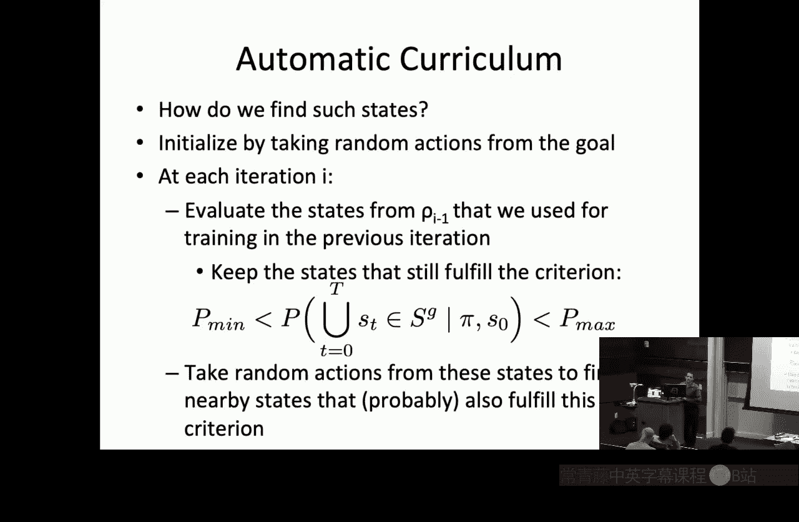

Ideal eventually。

経済？Right， so I guess in our case。You the agent does actually learn how to get to what is going on。

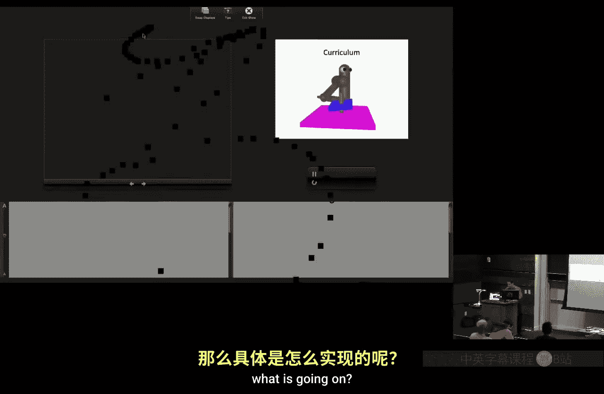

A thing on pad。So lift it off the peg and then put it onto another。

Start at the peg you're supposed to go to that it be to get off the peg。

 but then getting on the peg Right， right。 So that's kind of the reverse。 So right now。

 we're sort of just saying， let's say we want to get onto a single peg。 And so getting。

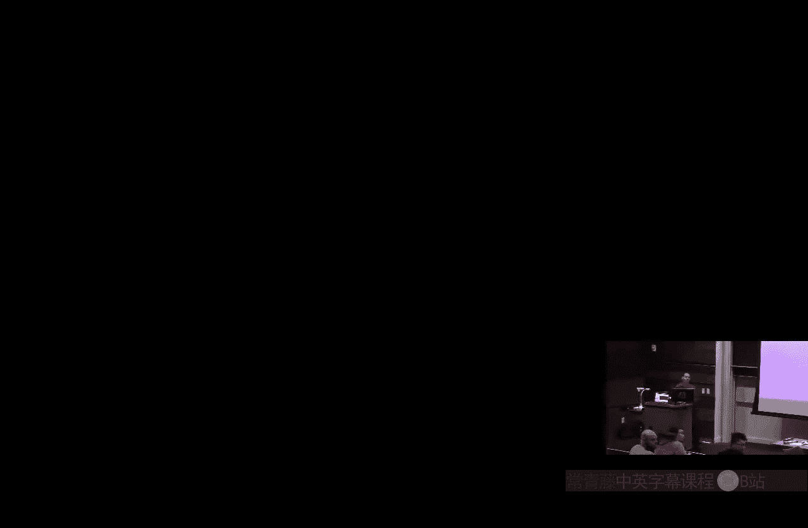

Off of a peg， I guess， in our case is fairly easy。 but yeah， so essentially for that。

 you would have to sort of stitch two policies together or have some some other way of doing that。

 So， yeah， so that would be an interesting extension to the work is to figure out how to do an even longer sequence of actions。

That might involve sort of training multiple policies or something。 Yeah， it's a good question。

 right。So in our case， we just have a single peg that we're trying to figure how to get onto。

 so we start initially pretty close to the bottom of the peg and learn how to reach the goal from these initial states later those states become too easy so we take random actions and find these other states that are slightly further away and we learn how to get to the bottom of the peg from these other states and then finally once those are too easy。

 we take random actions again and get off the peg and learn how to reach the bottom of the peg from any state in the state space as you point out any state that we can reach through our random actions。

 so in this case that would be pretty much in any state。

 but in another environment it might not include every possible state but I guess the point here is we've learned to get on the peg from many different initial configurations。

In a way that you wouldn't be able to using standard reinforcement learning with rewards with a fixed initial state distribution。

So right so this is the policy we were able to achieve here's another example。

 let's say we want to try to put this key into a hole and we try to use a reward based on the distance between the key and the bottom of the hole which is somewhere over here。

 so the robot I tries to minimize this distance by jamming this key into the table which doesn't actually achieve the task we're intending and so we。

Do this with a curriculum where we start with the key almost in the hole and it learns to put it in。

 then it learns from slightly farther out and eventually it learns how to get the key into the hole from any initial condition so again using this method for automatically generating a curriculum starting from the goal and taking random actions to discover states further and further away at the rate given by the performance of our policy。

So here we can sort of visualize what's going on in a simple 2D task。

 So in this case we have this agent， which is this yellow ball ands trying to move around this G shapeped maze to get to the goal。

 which is this red point on the top right and eventually we want to try to get to the goal from any initial position in the maze and recently we don't have the agent doesn't have sort of the map。

 It just sort of takes actions and can see whether it has reached the goal。

 So this is a fairly contrived task。 It's mostly just for illustrative purposes so we can see or clearly whether algorithm is doing so。

As before we'll start near the goal and take random actions to find states that are close to the goal and so the agent starts off learning at these states。

 they are close to the goal here you can see a map of the performance of the agent blue means it doesn't know how to get to the goal from those states and red means it does so initially the agent doesn't know how to get to the goal from any state except or extremely close to the goal after 20 iterations of training it's learn how to get to the goal from half the maize and we sample states that are right at this border between states that knows how to get to the goal F Roman in states where it doesn't。

These are the states that fulfilled the criteria that we described and so we see that our algorithm is able to find such states。

 and then after 300 editions of training， it's learned to get to the goal from almost any place in the maze and it's sampling states from the parts of the state space where it still needs extra learning。

Any other questions on this method？い。For funding you start this what you choose？They are between。

Instead of starting。that already achieved。嗯。So。The reason is that let's suppose in this case right we've learned to get to the goal from most states in the maze except for some at the end。

 so if you take the states where we've already achieved the goal that would be pretty much any red point in this maze including points that are very close to the goal already and so if you sort of take random actions from those then you'll end up with other states that you've already learned to get to the goal from right so those will be less useful to you whereas states are in this intermediate range or probably close to other states in the intermediate range and so you can more efficiently find states in the range you're looking for by starting from those as that makes sense。

Any other questions？Okay so okay so that's another way to guide exploration to teach a robot how to achieve a task is using reverse curriculum Next we'll look at adaptive variance。

 which is an approach that my students Shiing you developed to teach robots how to respond to changing environments so。

So the problem that we're going to look at here is when the environment changes during the learning process and this can happen in many cases。

 so as an example， suppose you're teaching a humanoid robot to walk and in order to be safe you initially train it in the forest which has sort of soft grass that the robot can land on or some dirt and then after it's done training。

 you try to bring it into your home or into the city。

 into a lab and have the robot walk around there it might not work because the environment is changed。

 the friction of the ground has changed and so the interaction between the robot and the ground is not going to be the same and then the policy learned might might not transfer。

As another example， suppose you train the robot in simulation and then you bring it to the real world there are going to be some differences that the robot will need to adapt to and just in general。

 anytime you bring a robot into whenever you train the robot and then deploy in the real world you can't expect everything to always stay exactly as it was during training there might be something in the environment that changes in an unexpected way and the robot needs to learn to adapt to these changes and it turns out that traditional reinforcement learning techniques do not handle these changes due to a lack of exploration so why is this so basically if you think about policy gradient methods and how they work they're trying to optimize the expected return and specifically they try to optimize both the mean and the variance so what is that。

So the mean gets closer and closer to the optimal action and the variance initially starts out pretty large because the agent is exploring so you I guess as a system designer。

 initialize the variance of something high， but then as the policy gets better and better。

 the variance will shrink because to optimize the expected return。

 the best thing to do is to only take the optimal action。

 and so as the agent learns more and more what the optimal action is。

 the variance will start to shrink around that point。

 and so that's something that you would observe if you run any standard reinforceable learning any standard if you run policy gradient methods on any environment。

 you'll observe the variance shrink over time which is typically good because that means the agent is going to achieve more reward on average。

 but that creates a problem when unexpected change occurs because the variance。

Will shrink down to an extremely small value and then when unexpected change occurs。

 the agent will not be exploring very much， so it will have a hard time figuring out how to adapt to this change Now。

 of course， if you're using policy gradients， the variance is going to continue to adapt and so it might eventually adapt to this change but it could take a very long time yes。

🤢，the same as like。Yeah， yeah， essentially you can think of it like that， yeah。

 you've overfi to your training environment。I guess a difference。

 a small difference with overfitting is that in this case， the agent。

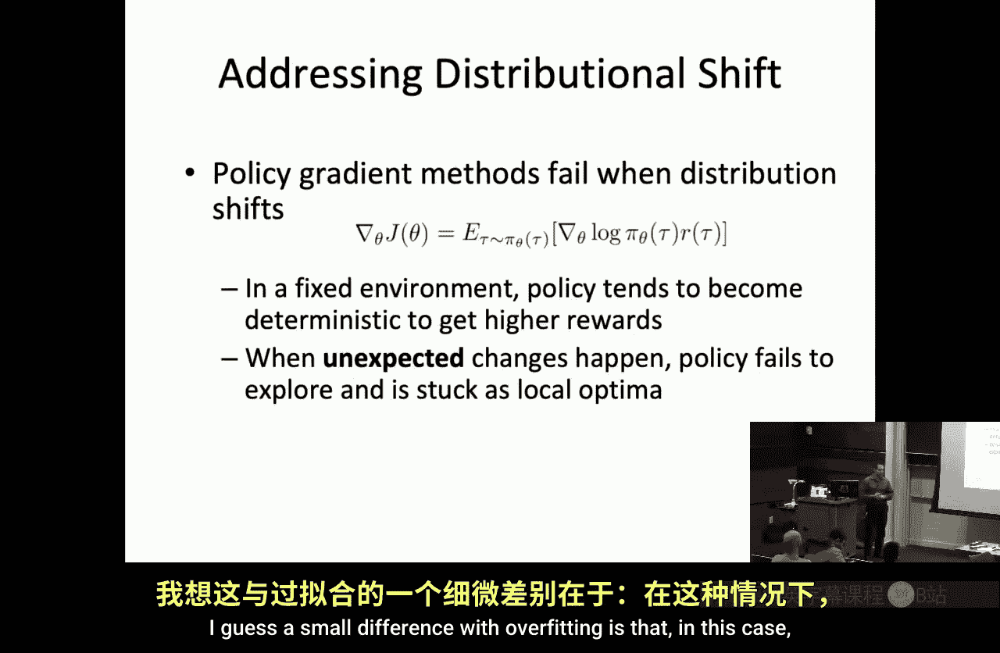

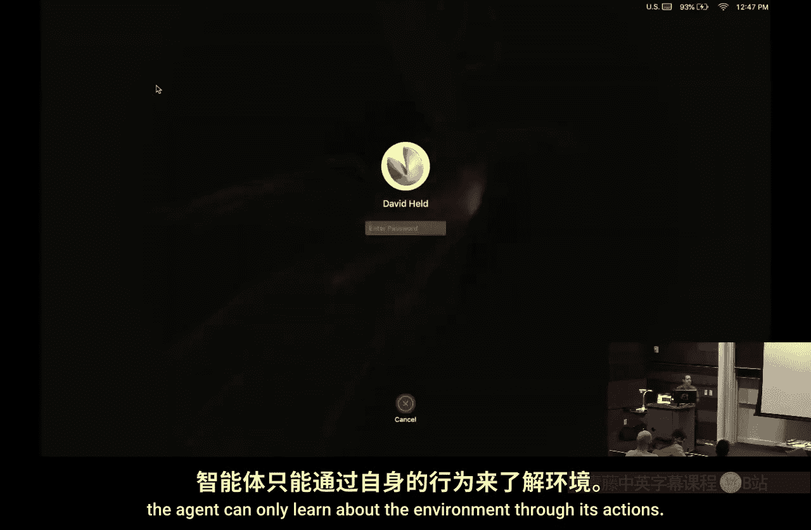

Can only learn about the environment through its actions， and so if it's not exploring。

 then it's not even learning what what new actions it should take。

 so even though it's continuing to get reward， has a hard time figuring out the rewards are all going to be very small。

 so it'll have a hard time figuring out how to adapt。🤢。

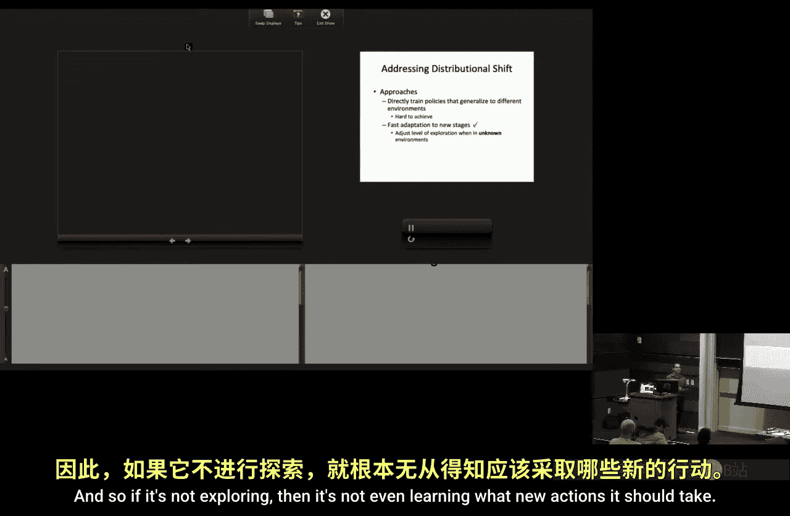

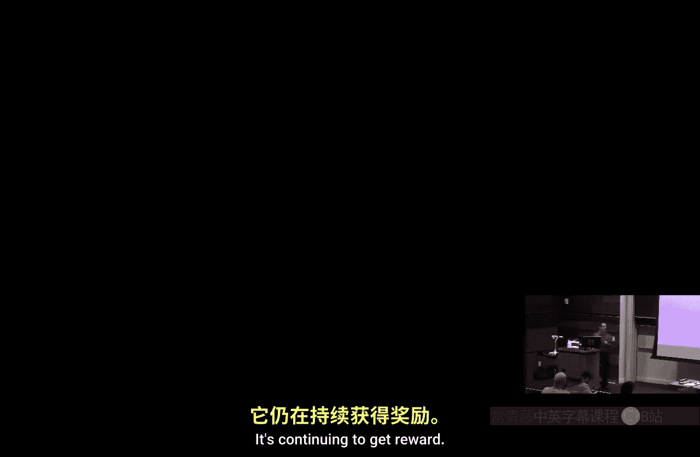

Yeah。嗯。Well I guess you'll talk about what you confused him a second but I was just thinking could it techniques similar to what you're used to prevent over？

Good question Okay so how do you normally prevent overfitting so normally there's a few approaches you can use so one is adding more data to your training set。

 So let's say you're training a cat dog classifier and you only see cats and dogs you only have a small number of cats and dogs you overfit to those you can sort of add more data so so you could try to add more data here。

 but I guess the assumption is the environment could change in an unexpected way。

 So if you add more data from the forest and then you bring the robot the robot wanders out of the forest and starts wandering through the city。

 adding more data from the forest isn't going to help with that。

 other things you can do prevent overfitting you can train a smaller networks there's fewer parameters overfi you can do early stopping yeah none of those things are actually going to help in this case but there's an unexpected change so。

Yeah， I guess it's closer to like distribution shift where you have say data from the internet and that you want to train an image classifier and then apply it to something in your home so the data comes from different distribution So there's methods to kind of adapt the parameters usually in those cases you assume that you have lots of unlabeled data from the second set and then you try to sort of match the distribution of features or something like that。

 So reinforcement learning is a little bit different because you're generating your own data through your actions。

 Yeah good question though So right， so what are some approaches to deal with this。

 So one approach is to directly train policies that hopefully will generalize so many different environments So you could say let's try to randomize are training procedure so that it will be robust to。

Any new environment it's going to encounter that can work in some cases。

 but as a general strategy that's not super reliable because you have to somehow ensure that you've randomized your training sufficiently that any new environment that it encounters has been included in the set of training environments。

 and it's sort of hard to guarantee that you've thought of every possible environment that the robot might encounter the approach that we're going to take is to try to design a method that enables the robot to actually adapt quickly to new environments。

 So essentially what we want is the robot to discover when it's in an unknown environment and to recognize that and change its exploration accordingly so we don't have to rely on knowing what the。

the new environment is going to be an events。 Okay， so other related work in this area。

 there are different strategies to for exploration usually under the intrinsic motivation。

 So if the robot is somehow trained to optimize some intrinsic reward that that just says I want you to explore a lot then it will than it might get out of this local optimum of。

That's caused by the fact that it knows how to achieve this specific task。 So as an example。

 you can do count based exploration so you could say how many times has have I visited each state in the state space and I want to make sure I visited every state equally So this works best in a discrete state space with continuous。

 you can try to bin the state somehow and do count space on that。

 but that's that's sort of hard to figure out what's the right bidding strategy you can also try to。

To use predictions， you could say if I'm going to try to predict what's going to happen next and if I can't predict it well。

 then I'm going to try to explore this state more so we compared to that that's a decent approach doesn't always react well when the environment makes a sudden change but but eventually that can help another thing you can do is try to estimate the environment parameters but as I mentioned before the environment parameters might change in ways that you didn't anticipate in advance。

 so your method for estimating these parameters might not take into account the specific way in which the environment is changing and then you'd be out of luck meta learning kind of makes the same assumption that you have some known distribution of task or environments that you're going to learn from in advance and then。

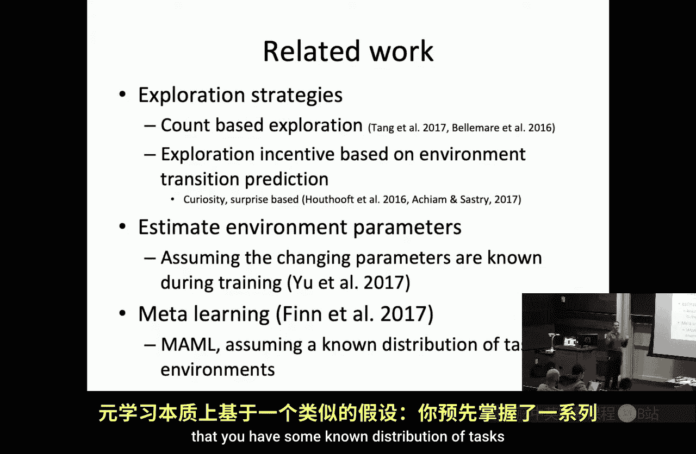

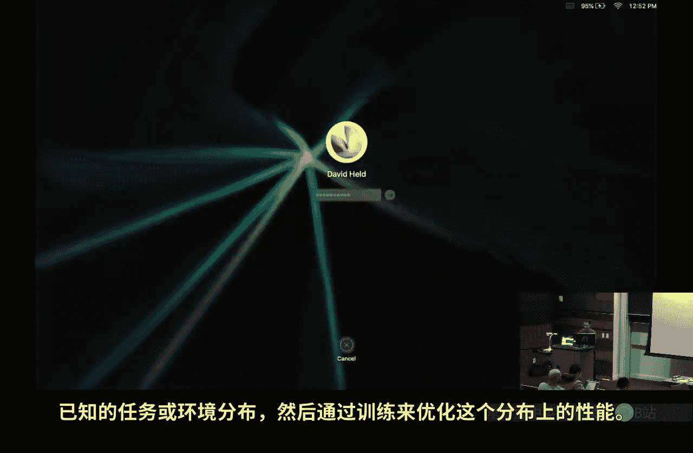

Trains to optimize over that distribution。

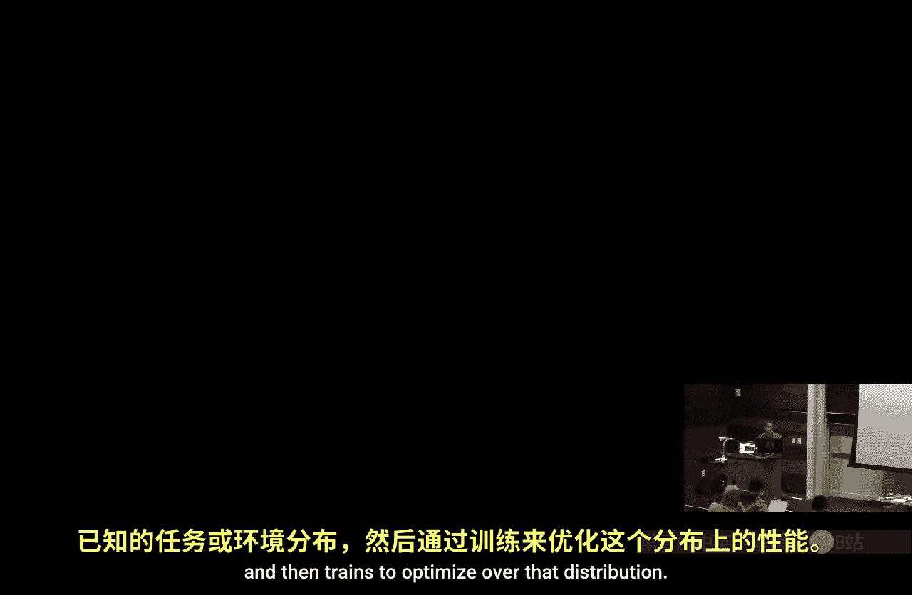

Sorry。Okay。Right， so metal learning， yeah has the same fallback that the environment changes in an unexpected way it's not going to help you。

 So what we're going to do is use what we call value dependent exploration so we're going to assume again that we have a sparse reward environment。

 many tasks have this sparse property we look at two of them earlier where we have a bounded reward function it could be10 or it can be just something maybe it could even a continuous value where the reward falls within some range but it's most of the time zero and the episode is going to end after a single reward and we'll train an undiscounted value function that we'll use as a measure of success。

 so we'll look at the return and see if it's high or low and we'll use that to see if our agent is being successful and then we want to learn a mapping from the success to the variance。

 so loosely speaking if the agent is successful。It should have a low variance and if it's not successful。

 it should have a high variance， so that's a fairly simple idea。

 it was originally introduced in 1990 but without any theoretical justification。

 so there was so the author of this paper came up serve an ad hoc mapping from the variance to from the value function to the variance we show a。

Sort of theoretical justification for what this mapping should be so first as an overview here is how our method works。

 we're going to start with some initial policy， we'll compute the undiscounted value function。

 we'll also have some function， the maps from the value function to the variance F。

 and so execute this procedure we'll start choosing actions sampled from this distribution given by our policy and with a variance given by this function f applied to the undiscounted value function。

 and then we'll learn the policy as well as this function F using policy gradients and then we will update the value function based on the performance of our policy。

So okay so what should this function be mapping from the value functions of the variance。

 so first let's look at the simple case where we have some policy which is a Gaussian distribution centered it's a mean and has some variance and in the sparse reward case will assume that the reward is usually zero except for in this narrow range with width of w we'll get a reward of1 and because if you assume maybe that the environment has changed。

 the place where you get a reward of1 might be far from the mean action of our policy and the distance between those is going to be given by some distance D。

And so it turns out that you can analytically compute the optimal variance in this case to have optimal learning and。

So if you work out the math and make the assumption that this distance is much bigger than the width W。

 which is pretty similar to the sparse reward， the assumption of sparse rewards。

 then the optimal variance can be written in terms of the value function using this inverse relationship。

 So W is the width here， that's unknown， but we'll see how to deal with that in a second。

 square of 2 pi E or just constant and V is the value function that you can measure empirically by running your policy。

 So basically if you knew W， you can just plug in these numbers into this formula and you would get the optimal variance as this inverse relationship with the value function。

So that's the first theorem。And that's in the continuous spendits case where you assume that you just take a single action and then the episode ends what about if theres a sequence of actions that you need to take。

 so in that case there's this other theorem that we proved which shows that if certain conditions hold then it's still an inverse relationship meaning that the optimal variance increases when the value function decreases。

 so we didn't derive the exact formula for it， but we still show that there is an inverse relationship even in the MDP case where you have to take multiple actions。

Yeah， where you take a sequence of actions， each one dependent on the state that you entered from the previous action。

So okay so that's basically our method， so let's see how this works so first let's look at the simple 1D example and we're going to use the talk about the continuous spin case first。

 so the environment here is going to have two stages so in the first stage you get a reward of1 for any action between negative 10 and negative1。

And then after 2，000 time steps， the environment switches and you'll get a reward only if the action is between  one and 10。

So we have to figure out how to get the the policy has to figure how to respond to this change in environment where it gets a reward for taking actions in a different part of the action space than it had previously Everyone understand the setup。

Okay， so。We'll compare two approaches。 The first is vanilla policy gradient where we're going to learn the mean in the variance just using gradient descent and the next is value dependent exploration。

 where we will learn the variance using this inverse function here and W is a learn parameter that we will learn using policy gradient as well。

 So in the second case， we learn W from policy gradients and plug into as formulas I get sigma and we also learn the mean from policy gradients。

 And in the first case， we learn the mean and the variance directly by policy gradients and so here you can see what happens。

 So in stage one。So the environment is initially fixed。

 we see that both methods learn to achieve a high reward。

 they both learn to execute some action in the sort of negative。

Side of the action space and the variances of both。

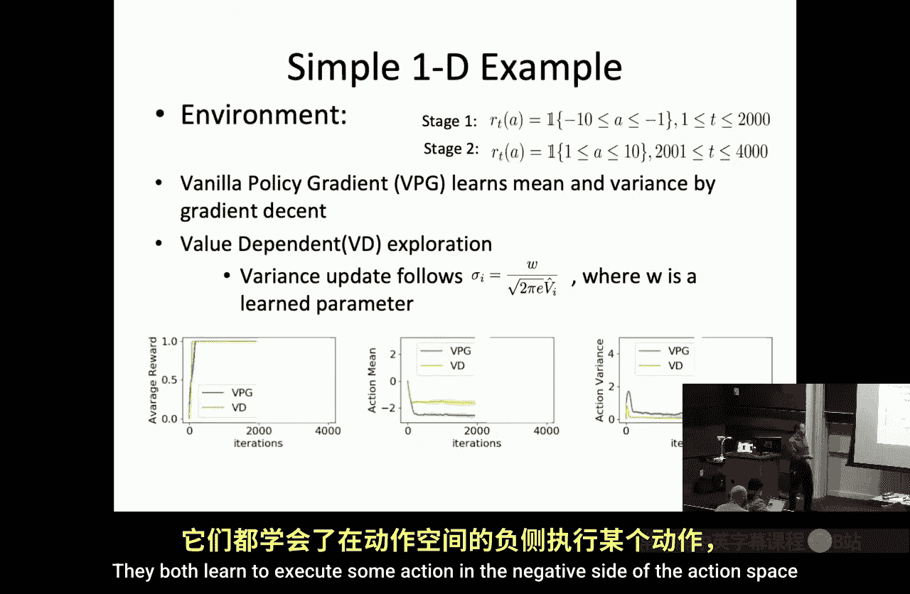

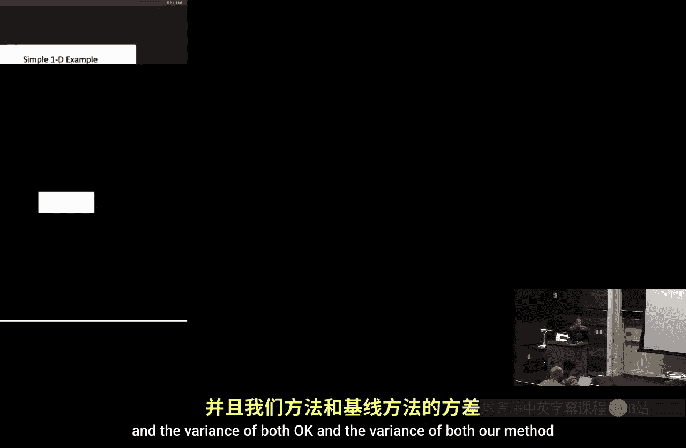

And the variance of both the method， our method and the baseline converges to a small value。

 but then at time stepp 2000， we see the environment changes so now you only get a positive reward for taking a positive action and so we see that the reward of both our method and the baseline initially shrinks down to zero because it's taking the wrong actions and but the difference is that our variance immediately shoots up because our variance is inversely proportional to the success rate and since the success rate is small。

 the variance is going to be very high and so then we can see that our method quickly learns to achieve a high reward and learns to adapt to take positive actions and then the variance shrinks back down again whereas policy gradients is sort of stuck taking these negative。

And has very low variance。 and that's essentially because since the variance is very small。

 most of the time it's receiving zero reward and it's kind of like the cases that we showed before when the agent receives zero reward。

 it can't figure out how to improve。 so rather than learning the variance through policy gradients。

We're sort of baking in the fact that the variance should be related to the success rate in this inverse relationship way。

Any questions about that experiment？We're computing the variance based on the success rate。

 so this is the formula sorry。No， the variance is a function of the success rate itself so the success rate V that's the value function。

 so that's the function that is the expected discounted sum of returns okay so I see what you're saying so in this case there is no state we're talking about continuous spendit so it's just sort of a fixed environment where you can choose different actions but there's no state in in this case Yeah but yeah generally speaking the variance would be the value function would be a function of the state Yeah sorry。

That was your question。 Yeah， yeah， okay， great， yeah， and the other questions。

Okay so okay and we can also see that if we run our algorithm then W that was sort of the width of the sparse reward we're learning that with policy gradients。

 it actually converges to the true W and as that happens the variance that we execute converges to the optimal variance in this case we kept the policy mean fix to sort of show these results more clearly but eventually the point it converges to do the optimal thing here you can see what happens if you use our method for more complex manipulation tasks where you have to take a sequence of actions so here we in that case if you recall the theorem that we proved is that the variance and the value function should have an inverse some kind of inverse。

Relationship， and so this is the function that we defined to have that property and our method is shown in orange。

 You can see that all methods do well at first， and then the performance drops at the。

Place where the environment switches， and then our method quickly adapts to the environmental changes much faster than the other methods。

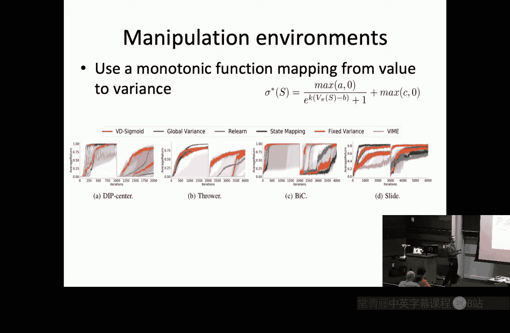

So here you can see what that looks like for some different tasks。

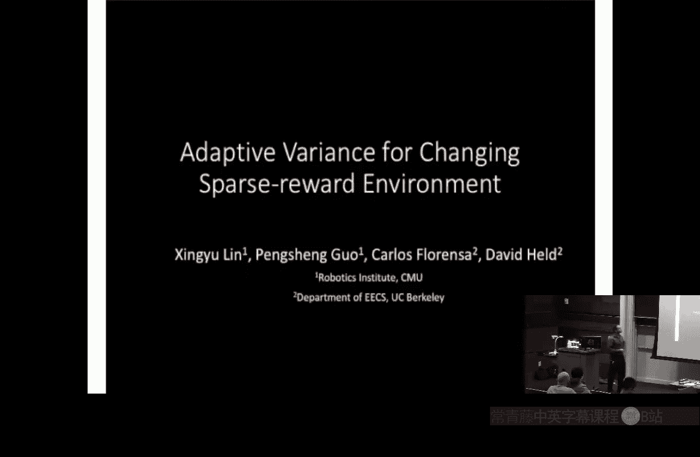

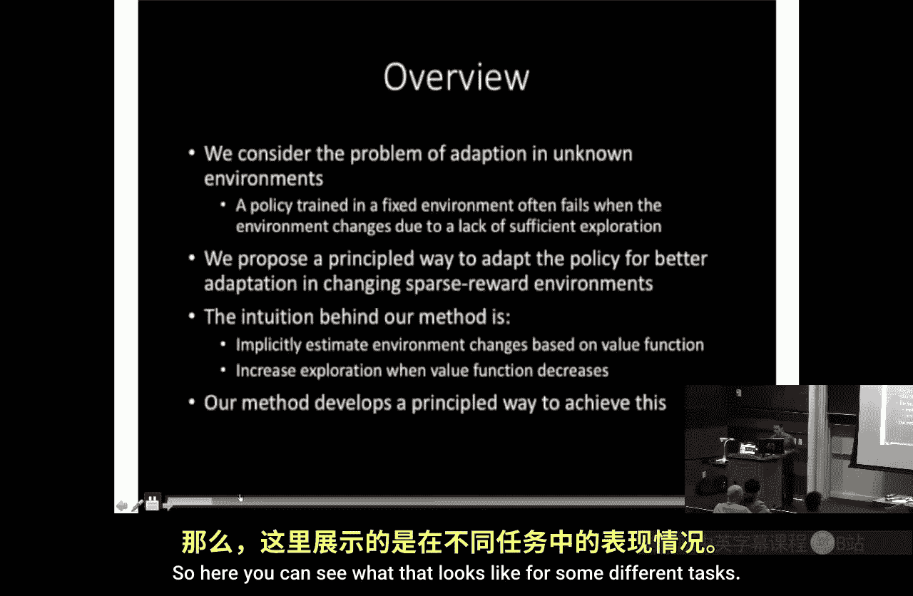

So here's one task where the agents are trying to learn how to push a puck to the green line and at some point the friction of the table changes now all the policies gets stuck but then our policy in the top left and very quickly learns to adapt whereas the others adapt more slowly here we're trying to learn how to swing this ball into this cup and at some point the cup changes its orientation and all the policies get stuck our quickly adapts here's a third one the agents are learning to throw this ball to this school location and at some point the robot gets bumped and moves to a new position and again our policy learns to adapt to that much faster than the other policies。

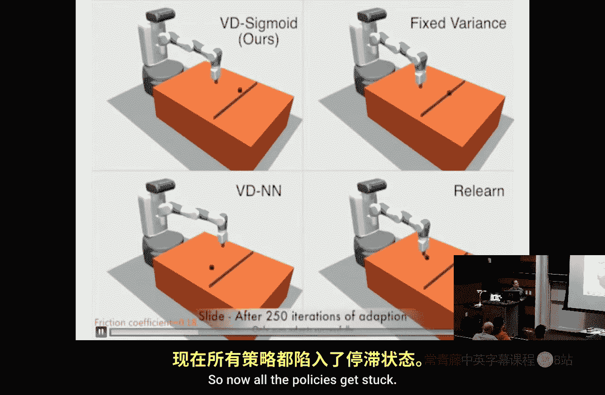

So。

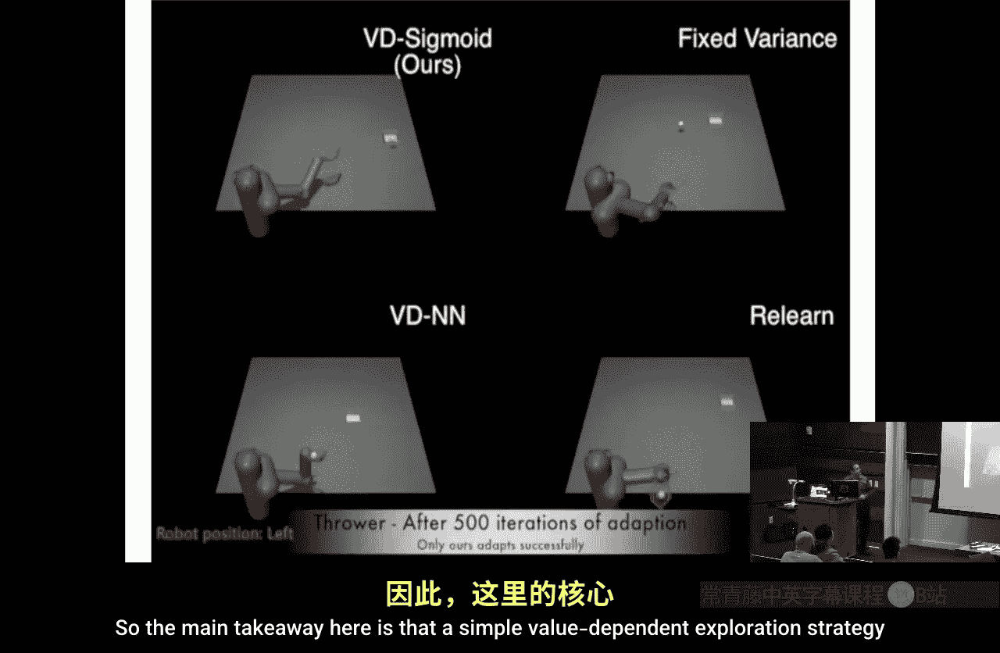

The main takeaway here is that a simple value dependent exploration strategy can enable fast adaptation to environmental changes in the Sp reward setting。

 we analytically compute the optimalvari mapping function and we also give a practical solution in the。

That performs empirically well on some different environments so we tested Any questions about this？

Okay， great， so next let's talk about safe learning。

 So we've talked a lot about how to adapt our learn optimally。

 but what about cases where the robot might do something unsafe。

 So this is very common if you are actually trying to achieve a real robotics task such as a time is driving or robots interact around or with people in these cases if the robot is exploring through trying different actions。

 it might do something very dangerous and that would be bad So you don't just want to learn optimally you want to learn in a way that it's not going to explore and say I wonder what happens if I run over this person we get a higher reward whoops I didn't then that's not very good。

 So we want to avoid avoid the robot avoid the case where the robot takes dangerous actions while trying to explore。

Similarly， if the robots fragile objects or doing something work can damage itself。

 we need to find a way to train a robot for these tasks where it continues to be safe throughout the entire exploration process。

 So previous approaches to this would typically involve training the robot first in a cage where it can't hurt anyone and then once you think the robot is completely safe。

 you stop learning take off the cage and then you're done。 But as we mentioned。

 sometimes something unexpected can change in the environment。

 you need a robot to be able to adapt even outside of the cage how do we do that。

 you can also try training the robot simulation。 and then once this learning bring to the real world and stop learning then too。

 but that would have the same problem is I just mentioned So the main problem being that the training environment might not represent the test environment。

 you still might need to figure out how to adapt in the test environment but you have to do it safely。

 So our goal is to develop a。Policy learningear algorithm for constrained MDP。

 meaning that you'll have some kind of safety constraint that you have to obey and you want every intermediate policy during the learning process to still satisfy these constraints。

 So every policy still has to be safe throughout the entire learning process。

 So I'm going to discuss two methods。For reinforcement learning， the first one you've seen before。

 it doesn't have to do with safety， but we'll build on it so we'll review that quickly TrRPO and the second one is our extension to TrRPO that incorporates safety called CPO constrained policy optimization So let's start with a review of TrRPO I believe you've seen TrRPO before。

 Okay great so review it though So emphasizing certain points that will become important for for our safety constrained algorithm。

 so both of these are examples of model for reinforcement learning。

 So model for reinforcement learning just means that we don't explicitly have a four dynamics model where we try to predict the next state from the current state in action。

 and this can be this is sort of the setting where you don't know everything about the environment and maybe it it's hard to learn it so。

That doesn't mean that there's not parameters that you have to tune that might depend on the dynamics。

 but you don't explicitly try to learn this forward model。

 and so TrRPO is a specific model for your reinforcement learning algorithm upon which our safety based method will work。

 So we'll show that we can actually be safe even if we don't have a model of the environment。Okay。

 so how do we do this So first let's start with TrRPO so with TrRPO。

 we have some policy that we want to train and and after you take in action。

 you're going to enter into a new state based on the unknown transition function and at each step you'll see reward and you want to optimize the expected discounted sum of reward so that's the normal reinforcement learning setup So okay so in TrRPO we're going to assume that we're performing an iterative optimization process So we have some initial policy pi and we want to update it to a new policy pi Tilda and we're going to apply some procedure many times until the policy converges so the first thing that we will write down is the relationship between the objective obtained by the new policy and。

In real。In relation to the objective obtained by the old policy。

 so here you can see the relationship， so。Eda is the objective and so the objective of the obtained by the new policy can be written as a function of the objective obtained by the old policy plus this term here where row tilde pi is the discounted state visitation distribution so basically that tells you what's the probability of visiting every state in the state space if you were to execute your policy in the environment that's pretty hard to actually compute analytically so well。

呃。And thatll become important in a second。 Pi Tilda is our new policy。

 and a is the advantage function of the current policy sorry， the advantage function。

Of this action over the action that policy pi would have taken。 So basically it's Q pi Sa minus v pi。

 So essentially it's a difference between the return that you would get if you were to start with action A and then policy pi versus the return that you get from just following policy pi from the beginning。

So， so that's the relationship between the objective of the new policy pi Tilde and the old policy pi。

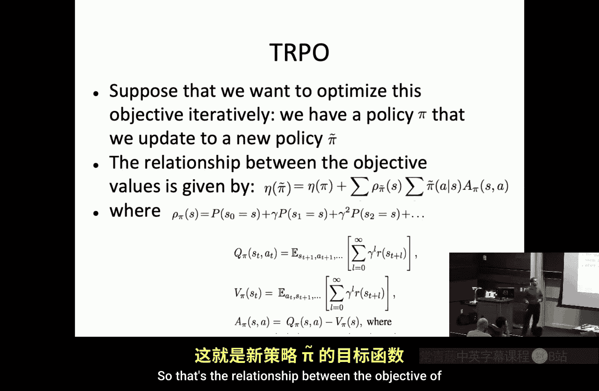

Okay and so what we notice here is that to maximize this term on the left eta。

 we need to maximize this term on the right so meaning this term here， ata of pi is fixed。

 that's the objective of old policy we're not changing the old policy we're just creating a new policy pi tilde so we just have to maximize this term here on the right so what is that term so pi tilde that's the new policy that we're maximizing over so that's the thing' we're searching over basically in our optimization。

 a the advantage function is something that we can compute empirically from our old policy。

 so that's just the function of the old policy pi the tricky thing is this term here rh pi tilde。

 so what that is is that says for a new policy pi tilde。

 what's the probability of visiting any state in the state space in this。Couned some。

So that's pretty hard to include in your optimization because you're trying to search over different policy parameters。

 different policy parameters， and for each policy parameter there will be a different state visitation distribution and you don't really know what it is until you actually run the policy so including this in the optimization makes things very challenging So okay。

 so everyone kind of understand why that creates some difficulties。

doesn't understand why it creates difficulties。Okay， so。Okay， so what。

 how are we going to deal with that？ So instead of optimizing this objective with the state visitation distribution based on the new policy。

 we'll optimize this one。 We'll use just the state visitation distribution based on the old policy。

 That one， we can compute because we really have the old policy。 You can run it and you can serve。

Compute the save visitation distribution。Essential， this accounts amounts to just using expectation。

 but it can be incorporated by just running the old policy。 And so that's pretty easy to do。

 The problem is， okay， so we've just changed the objective。

And okay but so let's look at what we've done， so we just need the distribution from the current policy。

 all the other terms are things that so now there are no terms that are problematic here so right the main problem though is that now we've changed the objective。

And so how have how much have we changed it and how do we deal with the fact that it's now a different objective。

 So here's the objective we actually want to optimize with row Pi Tilde。

 Now here's the objective that we're going to actually optimize with row pi based on our current policy and how different are these and how much of a problem is that going to cost。

 So the first thing to note is that these two objectives are actually the same to a first order approximation around the old policy or around any policy。

 including the old policy。 So basically if you were to sort of fitddle line to these functions around the policy around the current policy。

These lines would be the same。So so basically to a first order approximation。

 you haven't created any new problems and so what that means is that as long as you take a small enough step so that this first order approximation holds then by improving the new objective。

 you'll improve the old objective so you fit the line very locally around your old policy as you move away from the old policy then a align no longer describes this function。

 but very close to the old policy a line is a good fit and and these two objectives are actually the same so as long as you can take a small enough step so that this linear approximation holds。

 then you'll be optimizing the right thing so how do we make sure that we take a sufficiently small step。

So that's where TrRPO comes in and shows that the difference between these two objectives can be bounded by this term which where alpha is the maximum kill divergence between the old policy and the new policy and epsilon is this function of the advantage that you can compute from the old policy。

 gamma is the discount factor。The intuition is that the K divergence tells us how different these policies are epsilon tells us how much these differences can affect the advantage。

 and so as long as the K divergence， so these two things。

 the k dirgence and the advantage basically tell us how much the difference might be between these two objectives。

So。So this bound here between these objectives can be then incorporated to give us a guarantee of improving the performance of the policy。

 and we're going to use a very similar thing to also guarantee safety。Okay， any questions about that？

So okay， so basically based on these bounds， then the TrRPO algorithm works as follows and it guarantees that the policy will improve performance。

 so basically we're going to optimize this objective L。

 which is the one that that includes the state visitation distribution from the current policy that's the one that we actually know how to optimize and then we'll add this penalty term here to account for the difference between the objective that we're optimizing and the actual objective that we wanted to optimize and this penalty term includes the KL divergence between the two policies so essentially it says that。

As long as the kale divergence is small， then by optimizing this objective。

 you will optimize the true objective because you're sort of penalizing the kale divergence。

 so if you optimize this penalized objective， then you're guaranteed to improve performance on the original actual objective because of the kale divergence penalty。

Okay， any questions about that？So okay so that's TrRPO so in summary TrRPO gives us a theory that guarantees the policy will improve on every iteration by penalizing the the modified objective with the KL diversionence in practice you make three modifications to TrRPO to get work even better in practice。

 the first is that instead of using a penalty you'll often use a constraint。

 there are a couple of reasons for this the main one is that even though the policy will be guaranteed to improve on every step it might improve very slowly。

 and so maybe you want to take a slightly larger step where it'll improve much faster but it might not have the same guarantees。

 but for practical purposes you need to actually optimize the policy in the finite amount of time so maybe we'll take a slightly larger step and we'll do that by。

chaning the objective to have a constraint on the kale divergence instead of a penalty。

 the next thing we'll do is instead of submiting convert all states in this optimization。

Like computing the k divergence and in computing the objective。

 we'll just sample set of states to compute these terms and we'll also replace the max scale dirgence with the mean k dirgence in the TRPO paper this is just kind of done in a handwavy way in our paper we actually derive why this is actually a theoretically sound thing to do。

Okay， so the green and blue curve show the performance of TrRPO。

 these are sort of different versions of it based on how you do the Monte Carlo sampling of the states and you can see that they significantly outperformed the other methods in theory they should be monoettonically increasing in reality you can see that they are a little bit bumpy and that's because of the approximations that they made when converting the theoretical or TRPO algorithm into the realistic ones so it as the three points that we had on the previous slide。

Okay， any questions about that Okay， so now quickly going to CPO。

 which is our model for reinforcement learning algorithm that guarantees safety。

 We're going to build off of and expand the results from TRPO so。Now。

 instead of just optimizing the objective， we'll also have a set of safety constraints。

 so here's the objective J that we want to optimize。

 but we want to optimize it only searching over the set of policies pi that satisfy these constraints given by pi C and these constraints say that there can be any number of constraints and these constraints are all functions of the policy and each of these functions has to be less than or equal to some constant DI and where these functions take this form of being expected discounted sum of cost functions。

 so you can define some arbitrary set of cost functions and arbitrary constraints for each one and you want to optimize your objective while satisfying the constraints that the expected discounted sum of each cost will be less than equal to the constraint value。

So that's constrained optimizationization， and you can define these cost functions in a way that relates to safety。

 and you said DI based on kind of the requirements of your application。So recall in TrRPO。

 we had this guarantee that if you update the policy based on this algorithm。

 then you're guaranteed to improve their performance on each step even in the model freeee case where you don't know anything about your dynamics。

 yes。Yes。嗯。So you can define your constraints in it's up to you how you define them。

 So if you're doing autonomous driving， you would typically just say something like I want to stay a certain distance away from any pedestrian。

 I mean， there are only so many ways an autono car。

 ano car has to actually be near a pedestrian to kill them it doesn't have like lasers or something like that right So yeah。

 I guess in the more general setting， you you have to find some way of includingcoding safety in in mathematical terms。

 Yeah that is true right So okay， right So in TirapoO， we have these。

This guarantee that if you add this scale divergence penalty to the objective。

 then you're guaranteed to improve performance on each step in our case。

 we use the same balance from TrRPO in the safety case to say that if we penalize the objective in this way and we modified the constraint in this way then the new policy will be guaranteed to improve the objective and also satisfy the constraints。

 this is assuming that you start with an initial safe policy so if you serve with an initial safe policy and you run our algorithm you'll be guaranteed that each new policy will have better performance than the previous one and will still be safe so you can do online learning with this method。

 optimize the policy in the real world with the cage off and you'll still be guaranteed that even as a policy changes it'll continue to be safe at every step。

So。In our practical implementation， we also replace the KL dirgence's penalty with a constraint。

 and so that leads to some minor constraint violations， just like TRPO led to some minor policy。

Places where the policy became worse and here we prove how much the policy could become worse。

 it becomes worse by this amount， which is proportion to the screw root of the step size。

 the k dirgence contraint。 So if you said that parameter to be very small。

 you can limit the worst case constraint violation， but then you'll。Update your policy more slowly。

 So here you can see the performance on the range of different tasks。

 So let me walk through what's going on here。 So on the bottom row you can see how well each of these methods holds to the constraint。

 So the constraint is a dotted line our method is shown in blue。

 And so you can see that our method kind of does the best job of sticking to the constraint sometimes it goes over a little bit due to some of the approximations that we made。

 but it overall sticks pretty well to the constraint。

 and it also has pretty good performance as well。 So as。Another example， say on the first case。

 you can see the purple line is much safer than us。

 but the performance is about zero so some of the so you can sort of go through each one and you would see here that in many cases the performance of these different methods might be。

Will be worse if they're safer， our method achieves a good balance between safety and performance。Oh。

 okay。Oh sorry， okay， great thanks， so I'll just and there as a reminder。

 you should sign up for deepRL for robotics to learn more next semester， thanks。

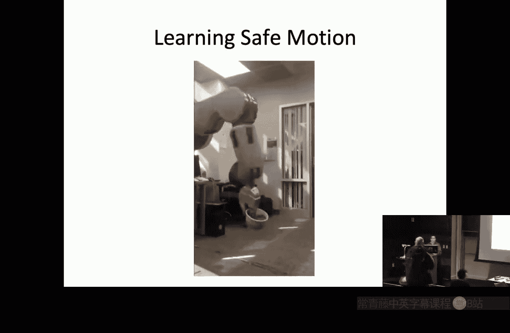