# 卡耐基梅隆大学【中英⚡结构化机器学习｜10-418 2019 Machine Learning for Structured Data】 p01 p0 10-418 ⧸ 10-618  Fall 2019 -BV1eJRsYBEaK_p1-

We guys we want to know about。But I think that's pretty much。我们这个可业招可以了。Okay， so welcome。呃。です。

Is the smallest classroom I have ever taught in at CMU。I am so thrilled about that。

 I guess I should be standing in front of this camera。 sorry guys。

 So there's all these other people online， thankfully not too many of them。

 these are some of your Ts here。😊，And honestly， I think the thing that I am most looking forward to this semester。

 aside from the actual material of this course， is getting to know you guys。

 because usually I'm teaching courses like 601 that have 500 students and most of my like efforts in terms of learning names of people goes towards learning the names of my TAs because theres not too many more not too many fewer of them than you guys here。

 and so this course is and it's an advanced topic and it's intended to go sort of well beyond what we see in your typical intros a machine learning course。

And along with that， for 618 students， there's an assumed project component。

 which I think is where we get to sort of interact technically the most in terms of this course。Oh。

 I guess I'm so concerned with making sure that everybody online could see。对个。

I didn bother to help you guys with that。그。嗯。So。诶。G us the second one。Okay， so today。

 what we're going to be talking about is roughly sort of a couple different pictures of the big ideas of this course。

And towards that end。We'll we'll think about。The actual problem that it is we're trying to solve。

We'll think about at a really high level some of the mathematical tools that are going to be involved。

 and we'll look at a bunch of different examples of the kinds of tasks that we're going to be concerned about。

So。This course is fundamentally about structured prediction。

 and in some sense we actually considered calling this course structured prediction。

 but that word is sort of an or that technical term is a little bit nuanced and it depends on which field you're in what that actually means。

And so in this course， we're going to use the term structured prediction to talk about cases where you're actually making predictions where the output is structured。

So what do we mean by structured Well， if you go off into industry and you interact with non machine learning people。

 there's this clear distinction between what people think of as structured data and what people think of as unstructured data。

And so structured data examples consist of database entries。Well。

 transactional information could often be represented by database entries。

 but it might be coming from somewhere else。啊。Wikipedia info boxeses are a great example of structured data。

 knowledge graphs， hierarchies， so all of these share properties。

 which is that there's some strict organization of the actual data。

 and typically there's also some schema that specifies how the data should live in that particular structure。

So unstructured data is sort of everything else。So written text， right。

 be it in Arabic or English or whatever language， images， videos。Spoken language， audio。

 but it could also be music， it could be sensored data coming from a variety of different sensors。

So all of these are different examples of unstructured data。

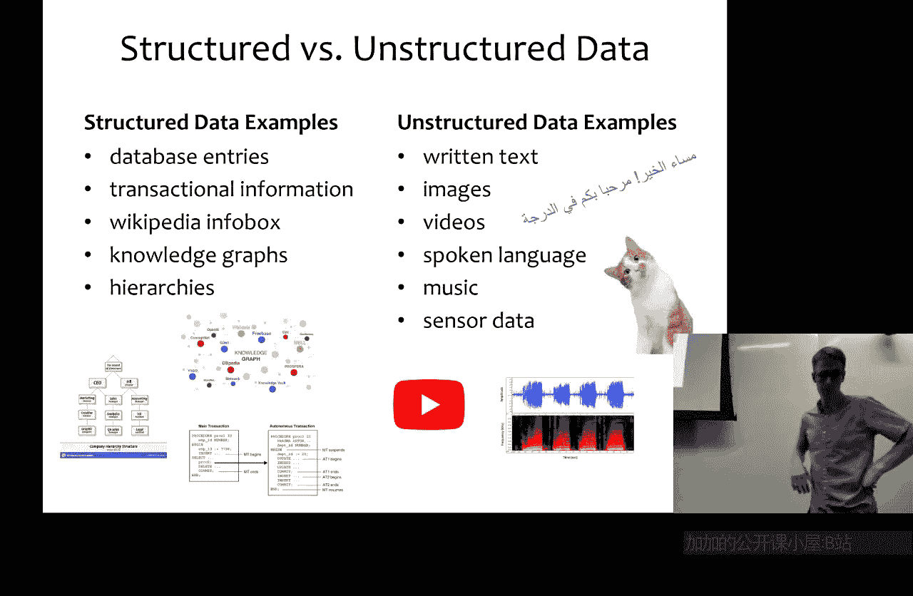

Okay， so。So a quick quiz here， which of the following are structured data？

So easy question spreadsheet， XML data， JSON data and mathematical equations。

 so select all that apply okay so take a second and turn to your neighbor and discuss what you think the answer should be here and then we'll get some responses okay so take 60 seconds to do that first。

Well you should probably introduce yourself to whoever iss sitting next to you。

 So if you don't know them， maybe start。Yeah。要把管了。あれ。あのま。すら。か。そ这个。好好。れ就是。一下。没有别没事 about。あ。ま。います。

这个上次是查询。所上没。2023年。ぐれです。おわす。Okay， so seemingly simple question。

 but you guys already had a lot to talk about so why is there so much to talk about here。

 what are people chatting about does someone want to offer an answer？

Is there a good answer or there no good answers？What do you guys think？Yeah， yeah。

 we think XM and Jason are definitely structured data， but we are not sure about the squarehe。

 it could be structured data and it also could not be structured data。Okay， this is a good answer。

 actually， so this would be a good moment for us to ask the people on the live stream。

IfThey can hear anything， so I think there's probably like what did we guess like a minute delay or something。

So why don't you go ahead and ask them whether they heard？

Whether they're hearing me and whether they're hearing anything that other people were saying。

And just a real reply on chat。So this is a good answer， does anybody disagree？Yeah。

 so without otherwise， without spreadsheet， is's really definitely the structured data because El least is right over your growing column。

 whereas XL and JSON， even though they're structured， they're highly flexible。

 you can almost squeeze anything。So in that sense， we're not sure whether it is is a structure。Right。

 okay， so I think I kind of also agree with that so did anybody talk about mathematical equations？

Yeah， yes， where。诶实嚟我。We're structured on that and they asked。

Thinking about it sometimes can decomp like。Theration seems like a graph。

 in which case you can think of the last。Yeah， so we could actually imagine there's lots of different representations of mathematical equations。

 so the way that we tend to write them。Pretty much everywhere in the world involves， you know。

 say putting a plus sign between two numbers， but there are other conventions where you put the plus sign before the two numbers and wrap that in parentheses when and now that actually looks kind of like like some sort of graph representation So yeah so mathematical equations。

 Yeah， it sort of feels like well， there's flexibility there。

 but there's also a very wellspecified semantics to mathematical equations。

 but you know the flexibility that exists in say handwritten mathematical equations certainly would allow you to kind of move into that unstructured space。

 Okay so why don't we get these difference of opinions on the other ones Well， so。

I think it's true that XML and JSON do have a well-specified schema right there's a proper way to write an XML file and an improper way to write an XML file the challenge there and thinking of it as structured data is that you could pretty much represent anything in XML data just the same way that you could represent just about anything in a spreadsheet。

 you could kind of you could take an entire document of just pure written text and you could pack that into sort of one element。

 one single XML element okay well now yeah technically you have some structure there。

 but all of the real content is sort of unstructured。Okay， and so similarly with a spreadsheet。

 you know， you might have some of your columns say say you even had something as simple as as a setup where the rows of your spreadsheet corresponded to to records in a database and the columns corresponded to fields。

 Well， if those fields themselves were sort of simple data like binary values or multi-class values。

 then sure we have something structured。 But as soon as you open up the spreadsheet to allow arbitrary text in it or even know pasting the binary representation of an image into a cell。

 well， now we're back to unstructured。 And so in general， these kind of correspond to。

Seummistructured data and。We'll see whether I can actually view。呃。Okay。

 so slight glitch is that I don't actually know how to get to hidden slides while also screencasting so there's a hidden slide in here that says something about semistructured data。

 but it's not terribly important and it would have just pointed out that semistructured is kind of this term that people typically use to refer to a bunch of data that consists of some structured data and some unstructured。

😊，But I think that， you know， in our case， that term could sort of be generalized to also capture these sort of。

Funny middle cases where well it's。Sort of structured， but it's sort of not structured。

Yeah question doesn't also a definition of whether structure or instruction structure depend on。

 for example。鱼死。So then in that case would it be okay to say that in irrespective。

 every single one of these is like。What you call it semistructure。Yeah， in some sense。

 we could probably just say everything is semistructured and call it a day and in some sense。

 the point of this is that you know there are these somewhat artificial distinctions that we like to draw between different types of data。

 but the point is that they are kind of artificial distinctions and so what we're going to be concerned with is formalizing this notion of structure in a way that we can work with it mathematically algorithmically and conceptual。

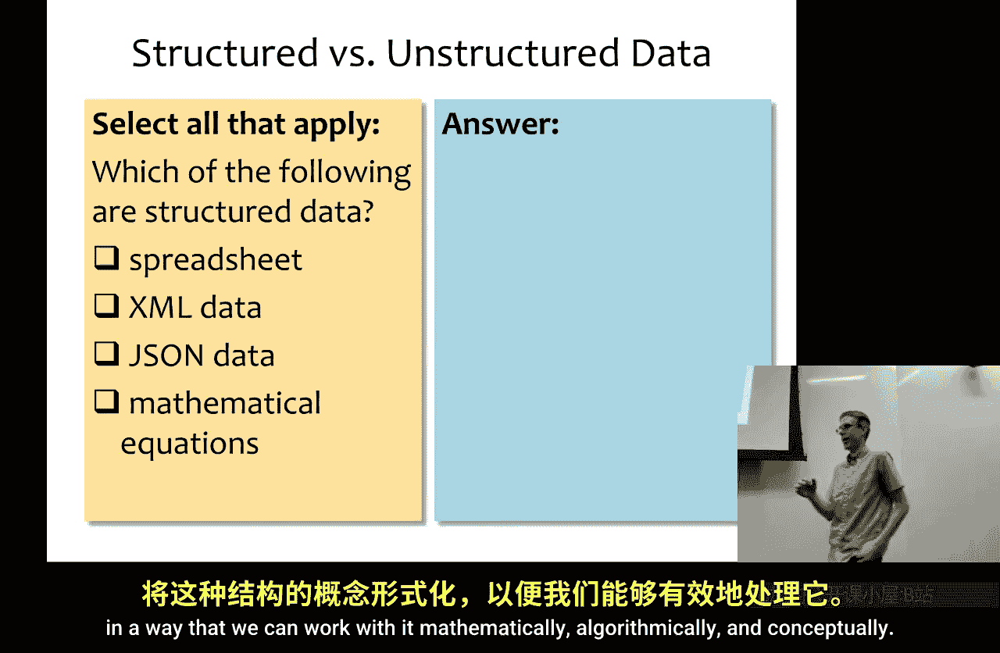

So。So we can get there really quickly if we just think about classification versus structured prediction so in your typical intro to machine learning course。

 you see all these different models for classification and the goal there is to predict some label Y from some vector of inputs X。

And then。What we're saying is that in this course， we're going to be concerned with problems where you have that same kind of input。

 some vector X， but now we're going to predict a vector that is our output。Now a vector doesn't。

Sound very interesting except that a vector can represent all sorts of interesting structures。

 so as soon as we've gone from one number to say J numbers here。

 we now instantaneously have a setting where we're able to actually reason about things like graphs and trees and Wikipedia info boxes and。

Electronic health records and any sort of interesting structure that you want to encode inside that vector。

So this is actually a good moment。For me to pause and just ask among the people in the room。

 so how many of you took。嗯。A course that covered graphical models in， say。

 two or more with like two or more lectures on graphical models。You get raise your hands。Okay， so。

And then how many of you took 315？Okay。And then for those of you okay so interesting yeah so I'll send out a survey to kind of get a better feel in this。

 so what I know is that there are people coming into this course with different backgrounds and so I'm going going to try to figure out how best to handle the fact that some people who say have taken 601 with me have seen a little bit more of baysnets than those who haven't and so actually the beginning of this course we're actually going to be going off and talking about sort of structured prediction in the context of deep learninging which I think is going to be this area that nobody has in this room has really studied heavily so anyway we'll figure out exactly how to deal with sort of your differing backgrounds when we get there。

Okay so。So I wanted to paint this picture of a contrast between classification and structured prediction。

 and really I guess what's up here could also be sort of generalized to be talking about regression as well。

And。这记呢。Swap this。Let's see what I just did。Yeah。All right。So when we're talking about。

Classification， we usually think that the input can be sort of interesting semistructured data。

Same thing goes for the structured prediction。And as we just said。

 the output in classification and regression is just a single number， in real。

 and the output for structure prediction is a sequence of numbers representing that structure in some way。

Okay， so at least in linear models， we'll talk about a lot more interesting models than just linear models。

 but in linear models where we have features， features can be sort of arbitrary combinations of input output pairs。

 this is actually a paradigm that we often sort of gloss over in your typical machine learning course。

 this notion that the feature extraction can actually look at the output label and have interesting features on the output label。

But this is not something that's unique to structured prediction and it's a distinction that I'll kind of draw later in the course and so that same thing actually can happen in structured prediction so that's not a difference between the two the real big difference is that you know in classification of the output space is tiny。

And or typically tiny， I guess there's this case of extreme classification where we're working with typically on the order of a million labels or something as your output space。

 and technically we still talk about it as classification。

 but it's sort of rapidly approaching the states of structured prediction in many sort of aspects。

And so for structured prediction， one of the typical defining characteristics is that we think of the output space for predictions as being exponentially large in the input space。

And so where classification and regression inference is trivial。

 that the actual prediction that you make at the end is usually just some dot product and then you find some R max over a small set of numbers。

Here， inference is going to be the key problem that we look at that in general。

 the inference problems that we're concerned with are either NP hard or sharpP hard。

 and they often require approximations as a result。Okay， so。

We'll mention a bunch of examples of structured prediction。 Here's a handful。

 let's just jump into some of them So so this first one is。

It's one of my favorites part speech tagging， where we can think about a sentence likeTime flies like an arrow。

And this sentence has all these sort of different meanings depending on how you interpret the part of speech tags for the sentence itself。

 so in the first sample， time flies like an arrow is the colloquial meaning where you know time moves really fast in the second example now we have these things called time flies it's a noun phrasese and they're kind of like fruit flies and they have this strange affinity for an arrow。

So you the same sentence can actually get part of speech tag two different ways。

 and we get two samples as a result of that。And then we have other sentences fly fly with their wings and with time you will see。

 and it seems like know in this funny case， all of the vectors that we're working with。

 both input and output actually have the same length。There's five words in every case Okay。

 so we could actually work with a setting like this of length five sentences and we could construct a data set where we distinguish sort of our x's and our Y's by random variables and the random variables here are depicted by circles and their values are the actual value shown in that circle。

And so now a sample consists of vector x of words and a vector Y of part of speech tags。

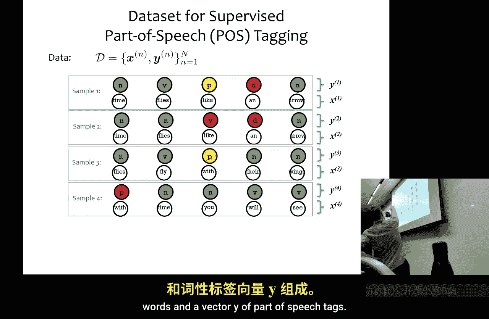

So here's another example of handwritten。DigOrLetter recognition。And so again， the input is this。

Sequence of little pictures and the output is the appropriate corresponding letter。

Corresponding to that little image。And。And so the key point that we can take away from an example like this is that often there are actual letters in here where the handwriting is so sloppy that you couldn't possibly understand what that letter meant。

 what that letter actually was if it was entirely by itself。

 and it's only when you actually see it in the context of the entire word。

 that it's obvious that it's one letter。So like。Particularly， like， whatever。

This letter is。诶。A strange looking thing next to the bee。It's an， oh， we all know that。

 but it has some， you know， funny extra little bit hanging off the top of it。

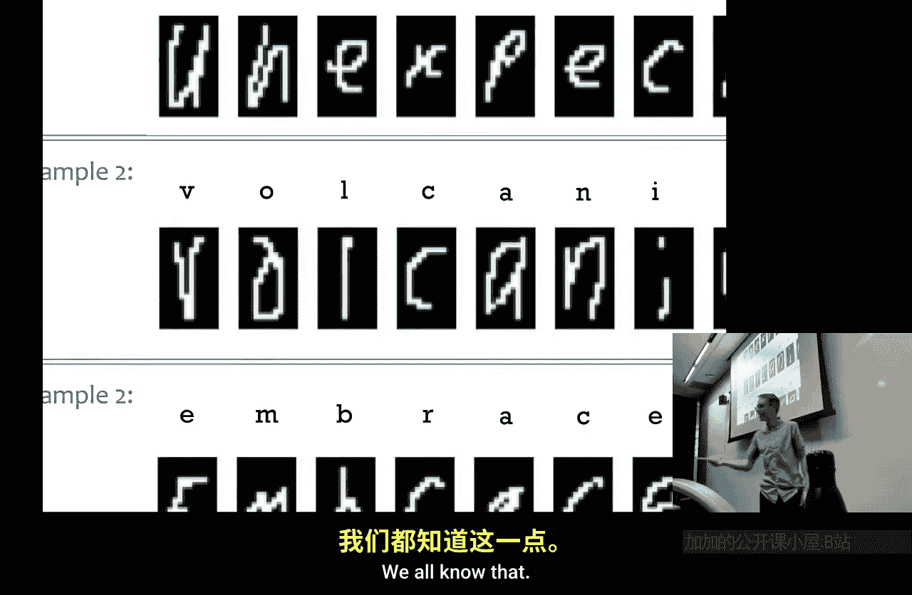

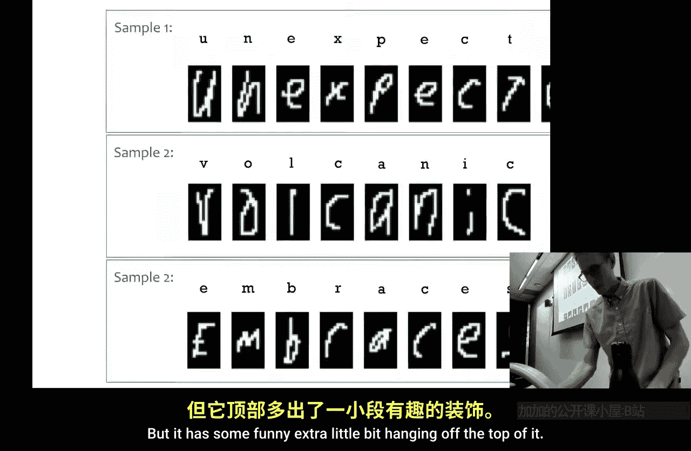

So。Speech recognition is this interesting case where suddenly the input is a spectrogram。

And a spectrogram， if you're not a speech person， you could just think of it as some image that is capable of representing the actual acoustic sounds of speech。

And roughly the Y coordinate corresponds to different channels and the y axis corresponds to different channels and the x axis corresponds to time。

 and so each little window here corresponds to some 10 milliseconds of audio。And。

And the outputs here are phonemes or representations of little bits of same。

So just like before our output is now some sequence。

 but now there's there's this interesting challenge that results， which is that。

The input might have totally different length than our desired output。If you think of， you know。

 each。テクソを。As a time step in X。The number of horizontal pixels here is dramatically more than the actual number of phonemes that we want to predict。

And so there's going to have to be some sort of alignment that we somehow infer between the input spectrogram and the output phomes。

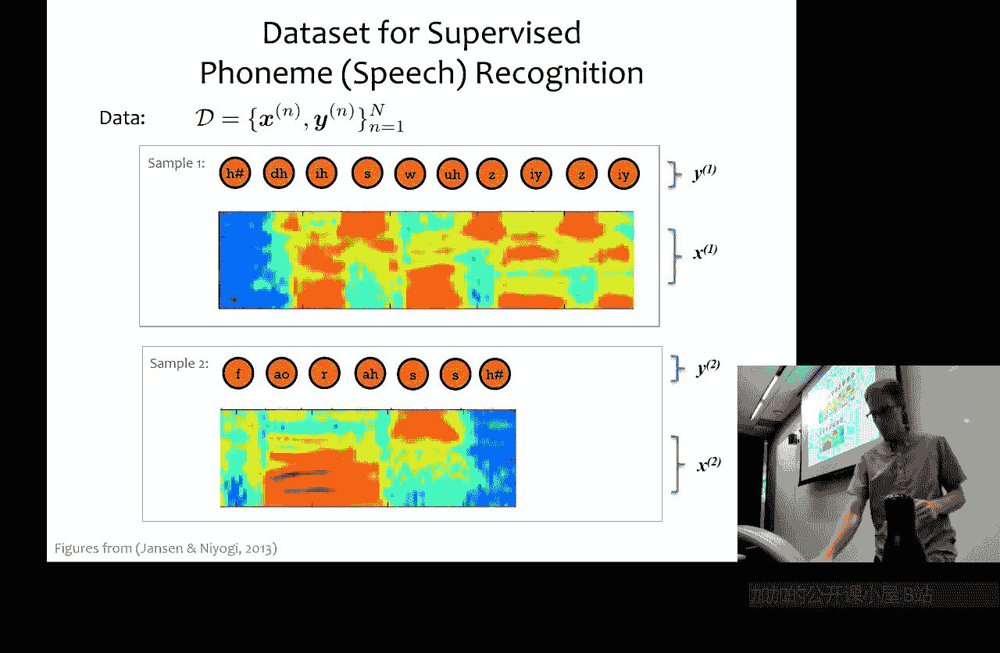

So we could also think about problems like object recognition。

 and here we might be in a setting where we have images and we're trying to predict labels for them。

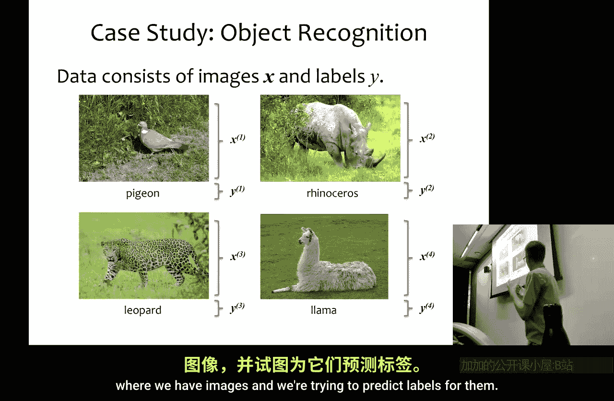

啊。But we could。Trying to make the problem a little more interesting by decomposing the actual image into patches。

And from there， we could actually posit that there's some latent labeling that describes the actual object's parts。

So now we don't just look at this image and see， you know。Magically a label of a leopard coming out。

 but rather what we do is we build a model that first tries to says say， well。

 this outer patch seems to be grass。And then that yellow patch there。

 that seems to be a head and a green patch that seems to be a body and these four blue patches are legs and there。

And so with this in mind， we could start to attach random variables。

To both the underlying patches of pixels， we could call our X variables。

 and we could also attach these Z variables being a label for each one of those patches。

And we could say that if you want to predict that this is a leopard。You're not just going to predict。

The leopard variable direct from the pixels， but rather you're going to first try to figure out what these labels of the patches are。

 and then once you have some sense of what those labels are。

 you're going to connect them up based on proximity because you'll be concerned with their proximity to each other because there shouldn't be like a leg above a head usually if it's a leopard。

 I guess a leopard could be like laying on its back。

some but usually legs come below the head right and so there would be some notion of directionality and proximity with these labels and that would actually inform how we learn about them and then we could connect all those labels up to our final Y variable that's giving the label at the image and this would help us because if we。

If we see that all of the patches correspond to。See something like the parts of a tree。

 then it's pretty unlikely that the final image is a leopard。

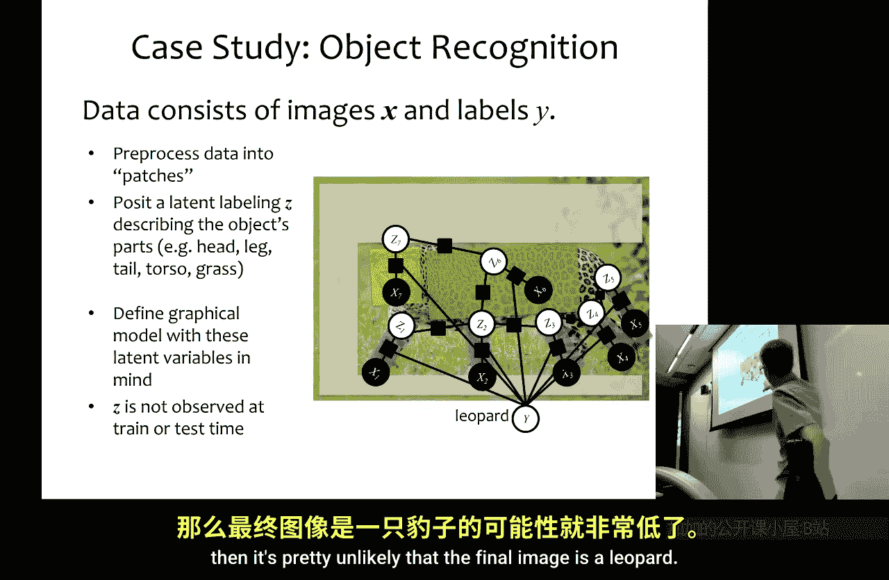

So why is this going to be hard？When we want to predict something？If we're just doing classification。

 then the final step here is usually to predict some white hat。

Which is the highest probability label given our input。

And maybe white hat here comes from the set plus one minus。

But if we're trying to do structured prediction， then what we're concerned with is。

Predicting this vector Y hat。Which might be exponential and there might be exponentially many of them。

In the calligraph line from which we're considering possible vectors。So even if you just think。

That X and y are both length and binary vectors。Then already we're in this situation where the number of possible output binary vectors。

Is exponential in it。There's two to the end possible binary vector。So if n is large。

 you're not going to want to write a for loop to iterate through those two to the n possible y vectors。

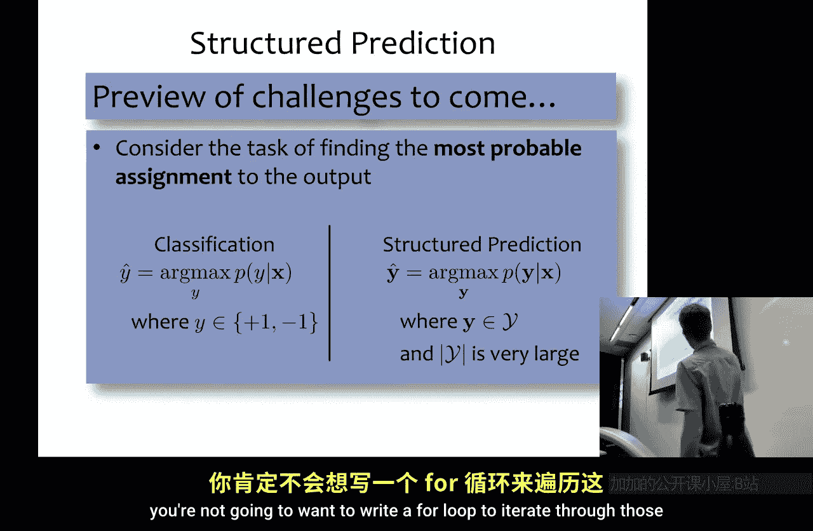

Okay， so fundamentally， it's useful to think about structured prediction。

In terms of sort of these four components。The first one is the actual data that we're working。

The second is the model that we're going to build。And I guess there's this funny question of where your objective function lives。

 you know is the objective function fundamentally part of the model or is it part of learning。

 and I prefer to kind of attach it to the model， but if you like to think of a different way you could also think of the objective function as being sort of。

And then inference is going to solve problems for us like predicting the most probable assignment to the labels。

 but also giving us marginal probabilities for the label or computing the partition function for the actual model。

 and those are going to be used as subroutines within Learn。So。These three problems。

 finding the best structure， finding the marginals and finding the partition function are critical problems to the success of structured prediction。

 and we'll actually spend a good chunk of the semester thinking about how it is that we can actually compute those things。

We'll also spend a good bit of time thinking about how we can design learning algorithms that can actually handle these exponentially large search spaces。

And then as well， we'll also be talking about how to define models that are appropriate for particular tasks and data。

So in your homeworks。You'll actually be building out。Examples of all of these different facets。

And I think one of the things that I tend to think is extremely important is that you'll also be building them out on real tasks that people care about。

 so we'll be asking you to do learning to search on some sort of sequence to sequence block。

Where you'll be thinking about。dessigning the actual learning algorithm that is appropriate for learning in a space where inference looks like a search algorithm like a greedy search or a beam search。

嗯。And so this has the feel of not something out of graphical models， but out of deep learning。

 but then we'll also kind of step somewhere in between deep learning and graphical models and we'll think about how can you build deep learning modules？

They're actually。Essentially doing graphical model inference。

So that the predictions that we make at the end of the day are better。And so in this context。

 you'll be thinking about， say， building out modules that are essentially an algorithm like say。

 loopy belief propagation on a conditional random field for， say， a computer vision test。As well。

 we'll be thinking about other learning algorithms like the generalization of support vector machines to the structured prediction setting。

 which is they're called either M3Ns or structured SVN and we'll be thinking about how you can use tools like integer linear programming to actually。

Provide you with something like black box inference。

Such that you can effectively come up with really efficient solutions to these inference problems and then utilize them during margin based learning。

嗯。The fourth thing that you'll be thinking about is building a Gib sampler。

 which is a particular way of doing approximations of these inference problems and we'll talk about your homework assignment there will actually be looking at the problem with topic modeling。

And then lastly we will be the last homework assignment will be about variational inference。

 which is another approximation method that views inference as an optimization problem。

 and there you might not actually do any implementation but maybe more focused on sort of the mathematical side of things But the point is that in those other four cases。

 the homeworks are going to be really handson at looking at how you actually build these things to solve real problems like speech recognition and computer vision problems。

 natural language processing like topic modeling。And hopefully something with medical diagnosis。

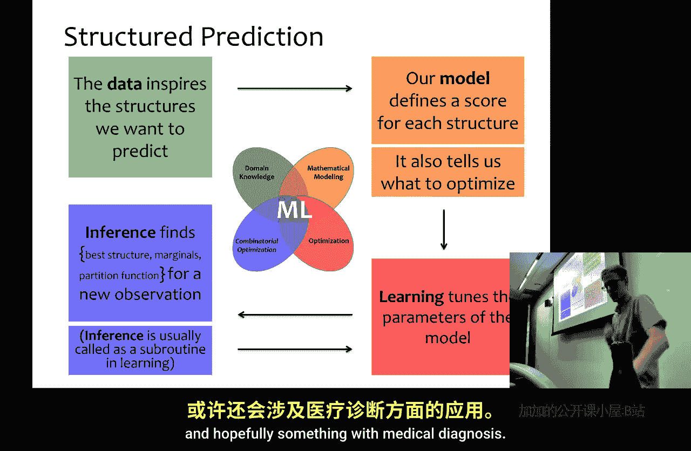

Okay， so why is it that we want to divide structure into its pieces Well there's a lot of reasons one of them is that。

This division into pieces makes things amenable to efficient。And。

It's also going to enable sort of more natural parameter sharing during learning。And then finally。

 we'll also allow a easier definition of sort these fine grain loss functions。So typically。

 when we think about loss functions。We kind of just look at a task， if it's a classification task。

 there's just kind of an obvious loss function， which is like error。If it's regression。

 usually we think about， well， maybe we're going to have a squared error or maybe we're going to have like some mean absolute error。

 but there's not that many options available to us。

Once we're thinking about structured prediction though。

 suddenly there's actually a lot of options available。

 and so thinking about how to actually craft loss functions becomes an important challenge because sometimes you can actually make your learning algorithm loss aware in a way that capitalizes on what it is that your downstream task actually is。

So another nicety of decomposing a structure into its pieces is that it's going to provide us with a clearer depiction of our models uncertainty。

And it also is going to make。The specification of interactions between those pieces is a lot easier。

And then lastly， it'll hopefully lead to sort of more natural definitions of the actual problem as a search problem。

And basically， this notion of sort of decomposing a structure into pieces is going to be that。

Sort of fundamental step in formulating a task a structured prediction。

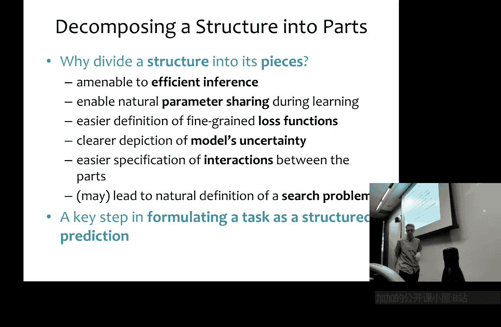

Okay， so。What do I actually mean by decomposing into pieces well let's think about it through some examples。

 so if here's the first one then this is seen understanding。So here。

 you could imagine that what we're trying to do is take in an image and not just say， you know。

 is this an image of a leopard or not， but we want to have labels on all the different components of the image and predict all of them simultaneously。

So here is actual system output on this image， and you can see that it's actually doing two things here。

 one it's actually segmenting into different regions。

And then the other is that it's labeling those regions。 And so what we find is that。

The for the most part， these labels actually look pretty reasonable right so here's a human and there's some rock behind it there's some sky up there in a mountain the system thought this was a tree。

😊，Pretty sure that's some grass on the mountain but I guess it could actually be like a bunch of trees off in the distance so maybe my own classification algorithm needs some more image data than is available in this picture。

There's certainly not water hanging on the rock。The system made a mistake there。Okay。

 so what is its notion of decomposition here well for one。

 there's going to be some variables that are decomposing the image into separate regions。

And then the other is that it's actually going to come up with tags for those regions。

And the question is， what are the interactions that exist between those variables？For one。

 there's this question of sort of semantic plausibility of nearby tanks。

And then another is the sort of continuity of tags across visually similar regions。

it sort of wouldn't make sense that you would have you know this very uniform surface where all the pixels on the rock kind of look somewhat similar and you're kind of gradually transitioning between lots of different labels。

 you know， maybe rock on this side and then some water right next to it and then some grass right next to it if all of the pixels are looking kind of the same then those variables that are close to each other should probably have the same。

Okay， so what about semantic plausibility， Well， this particular system output was taking semantic plausibility into account。

 Here's what happens in a system that does not take that into account。So now we have a human。

Which is atop a horse， which is a sailboat， which is sitting in some snow。

So like this is completely unreasonable to any human that sees these labels。

 but the system doesn't actually have。The capacity to model the kinds of interactions that we think are just totally obvious。

And if you look at the data， the data actually supports this notion that sailboats usually don't sit on snow。

But because the model isn't aware of the fact that there's a snow label below a sailboat label。

 all it's doing is looking at the image to produce these labels and so it can make this sort of stupid mistake。

So。There's a sense in which。You know， you could do all the feature engineering in the world and you could build the most complex sort of convolutional neural network。

And yet， if you're still making independent predictions of labels。

 then you might still make this mistake。And so structured prediction says， well。

What we should be aiming for is a model that's able to account for those actual interactions in the output。

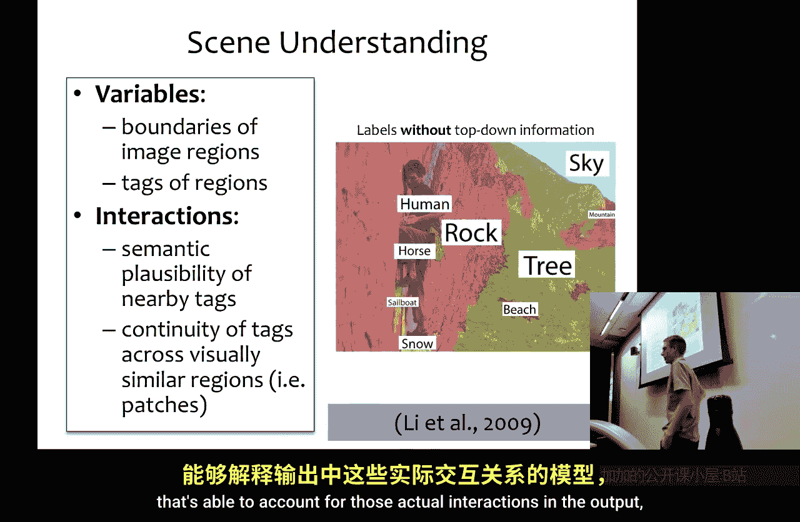

So that we don't make these sorts of stupid mistakes。

So this is another example of that's closely tied to machine translation。

 which is that often we're concerned with aligning two sentences。Or in this case， sentence fragments。

 so the English sentence fragment in the past two years and then a mandarin sentence fragment that corresponds to it。

 and so what we're looking at is now slightly a slightly different representation where we're going to say each of these squares corresponds to a random variable and its value is on if it's shaded in and it's off if it's not shaded in。

So what that means is that we now have 20 random variables for each possible alignment。

Between each pair of words。And the model is going to try to predict which of those are most likely。

Okay， and so the kinds of interactions that we would care about are things like word fertilities。

 right it sort of doesn't make sense if you have one word in the English sentence aligned to all of the Mandarin。

or you usually don't want too many discontinuities right。

 so we typically tend to see that in most languages at least left to right languages。

 the actual interactions tend to be or sorry， the actual alignments tend to be monoonic。

 meaning that there's not a lot of sort of crossing or jumping around of words in the sentence。嗯。

So we won' we won't go into the other ones， but another example would be congressional voting where you could imagine trying to capture sort of all of the different。

Goings on of Congress with some random variables right and some of the random variables might capture the actual representatives vote。

 so those are the white ones。And then the dark shaded ones could represent the actual text of all the speeches for a particular representative。

And so that would mean that you can see for each of the white circles here。

 there's some attached dark circle that's connected to it。

 indicating that the speeches for that person interact with the actual votes that they're making。

But then there's other。Sort of interesting variables here corresponding to the sort of local contexts that exist between pairs of representatives。

So maybe we know something about how these different pairs of representatives interact with each other。

 there's a lot of public information about how conpersons interact and so we could say then that if you look at those local contexts and that pair of representatives。

If you know that they go to breakfast together every Tuesday morning at 8amm。

And you know one of their votes。Do you think you also know the other person's food？Probably right。

 like the guy that sits down with the other guy at 8am。 every Tuesday。

 they're probably going to kind of vote the same。And so these sorts of interactions if you can。

Predic what if you can identify what they are， then you might be able to actually properly model what's going on in these sorts of complex problems。

Now， this particular problem。Is an interesting one that captures something that we'll talk about briefly in later parts of the course。

 which is that congressional voting is sort of an example where there's only one training example。

There's and really only one。And the test example is the same one。

 there's not this notion of you know like Congress has been around and there's these long-ter interactions between people over many years。

 and so to even create training examples， you would need to think about how to decompose the real problem of congressional voting into something containing sort of artificial distinctions like individual years of Congress or something like that。

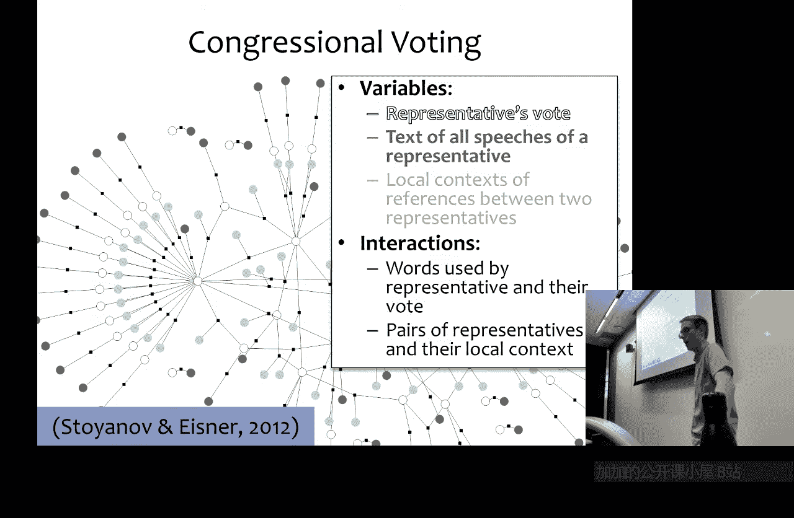

So medical diagnosis is an extremely complex problem。

 but it's a place where machine learning has great potential to have huge impact。

And so what we're looking at here is actually an example of an electronic health record and so you know there's a lot of。

Sort of typical things that when you come into the doctor's office that you get like your temperature and your blood pressure。

 but then there's also this assessment that happens often。

 you know by the nurse who walks in and they ask about say you know whether you have been having any sort of pain and whether it's gone or not and whether the pain with。

Worse with the breathing or not。And and so on， and there's also other things like symptoms that they could check off if you exhibit them or risk factors if they can identify anything in your social history。

And。So the variables here are kind of obvious， right。

 they're just you know the content of each text field， the check marks， the dropdown menus。

 the actual values of these things， but then the interactions to even figure out what they are。

 you might need to actually talk to a doctor to figure them out they're going to be sort of groups of related symptoms。

 maybe ones that are predictive of certain diseases。

 they're going to be things like connections between social history and symptoms or connections between risk factors in some lab results。

These are the sorts of things that you're going to actually have to kind of tie together if you want to be able to make some medical diagnosis。

ok， so。I to do another quick exercise here， which is centered around Wikipedia info boxes so here what we're looking at are four different Wikipedia info boxes。

 I think these were the ones that happened to pop up on。

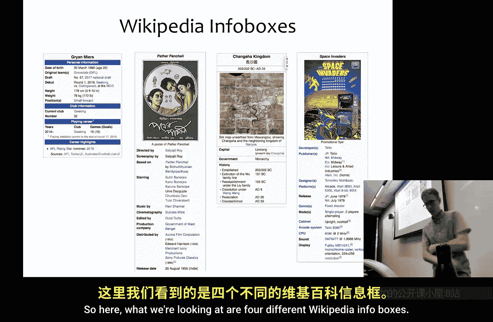

Todays。Random selection of Wikipedia pages， so here we have an Australian football player that I've never heard of。

And equally obscure。

Bolllywood movie。No possibly a classic， I think it's from 1955 some some a page about history that。

And even a page about a classic acade game。So what you can see is that sort of people have come up with ways of taking。

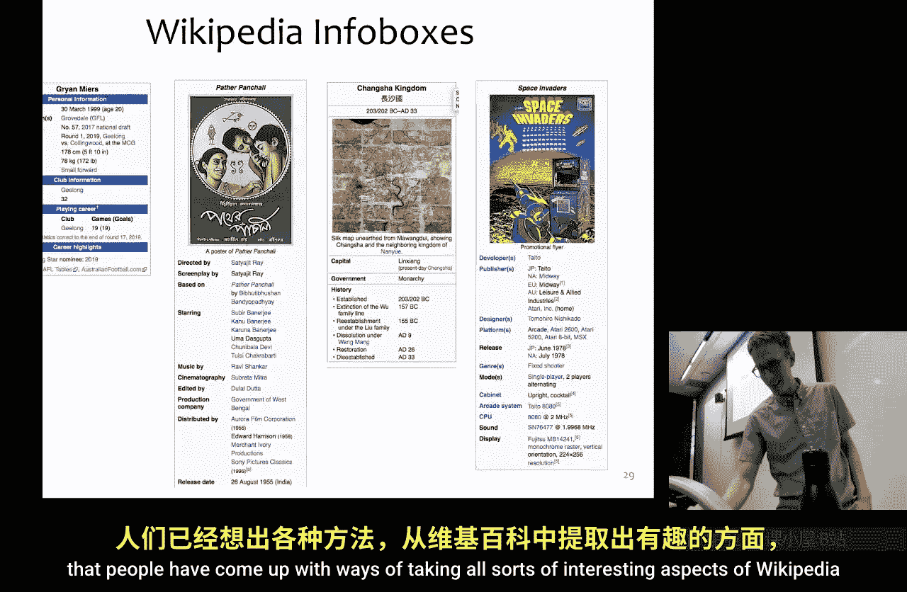

All sorts of interesting aspects of Wikipedia。And articulating these little boxes that are really structured data about the content of the Wikipedia page。

So common things that show up on info boxeses for people are things like the date of birth。

 and if they're a sports player， what teams they're a part of， maybe what years they were there。

 height and weight， I guess if they're sports players。And then of course。

 the obvious things are kind of attached to movies。だんだ。

something like a kingdom I wouldn't have actually expected to have。An info box。

 but clearly people have kind of come up with these sort of structured fields。

 like what kind of government want。A monarchy， what year was it established 2003， BC and so on？

And even for something like an arcade game， people have kind of come up with schemas that actually kind of succinctly describe different aspects of that arcade game。

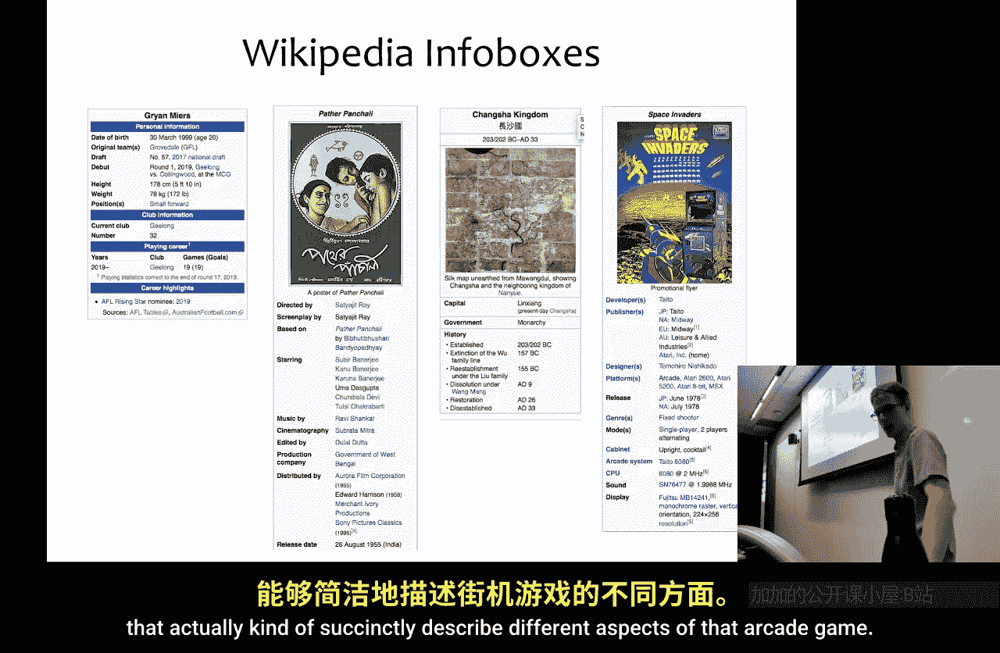

Okay， so suppose you want to populate some missing info box fields。Okay。

 what are the variables and what are the interactions？Okay。

 so take another 60 seconds with whoever you're sitting next to and particularly I think the variables there's not too much to talk about。

 but I think the interactions there's a lot to say so go ahead and take a second to think about that。

全这です。は。美丽在讲。偏第一，我才。真取啊。Yeah。大。それ。是。客上要大家嘅嘢所就。で。はさ。家是。そてい。そて。非常。这子。他说了。L。上先。呀。他会在。And they very。It。

就是那。在他们这个出。あ。し。よしよろしくお願いします。好嘅。来会解续。Okay， so。To what variable。If here。Building this model。要人。

Missing info box fields。How would you start to cast this？As a structure prediction problem。

The entire input text。们8出去。Yeah， so we could say that this entire thing。

Is like one random variable and maybe has the name X or something。Yeah。

 so so that would be a fine variable to have and in fact we would say that the entire text is always going to be observed and by convention when we have these observed random variables we're going to shade them in。

 we'll talk more about this particular visual not later but。So yeah， this is a good variable to have。

 what else？Yeah， thiss already a mean。Yeah， so we probably want a variable for every little detail already in the info box。

 Okay， so that means。We could have a random variable for the Central Park task force and for 1980 and for the founders。

 maybe we have separate ones for each founder or maybe we have one that's a list valued random variable or something like that the location gets its own random variable and so on Okay so so what other variables could we have。

Aus with the missing data Yeah exactly so we need random variables for the things that we're going to actually predict because these are also shaded in right we actually know what these values are。

But then we need all the things that aren't on the Central Park Conservancy info box。

 what on earth goes on a Central Park Conservancy In box。

 I guess in addition to they already have location coordinates， who hates these things。

So you can think of yourself as doing a great service to the poor person who filled in the Central Park Conservancy。

 Wikipedia info box， maybe like founded is on there。Budget， great。 thank you。 So this is missing。

 and so we could have a random variable。Can call it Y by one Why sub budget。

That we don't know the value of okay and so then we could also have say another one that's like number of trees that they are responsible for or something and that could be wise sub trees you know and so we're going to have a random variable for each of the the fields that is missing what about。

A field for the date of birth for the Central Park Conservancy， would we have that random variable？

Well probably not right it doesn't really apply right this isn't a person so it doesn't really have a date of birth and so there's going to be all of these fields that we are not filling in and so the interesting thing that we'll have to take into account here is the fact that there's going to be sort of way more possible variables than we would actually want to include and we're going to have to take into account the fact that you know different types of Wikipedia pages are going to have different types of fields attached to them。

Okay。So what about interactions between these variables Yeah I have a different question Chip。

 so how exactly is a structure？这gan。Like why is this a structured problem？

Because so it doesn't have to be。If we say that there are no interactions between these variables。

 then sure it's just a classification problem， right you have。

If you just are predicting the budget for this particular page。

 then you could just treat all of this other stuff as sort of fixed input data。

And you could just predict the budget and be done。So the point at which it becomes a structured prediction problem is the point at which there are interactions between the actual output variables。

Okay， so thoughts on what the interactions could look like。

You don't have to stick to the Central Parks Conservancy example。

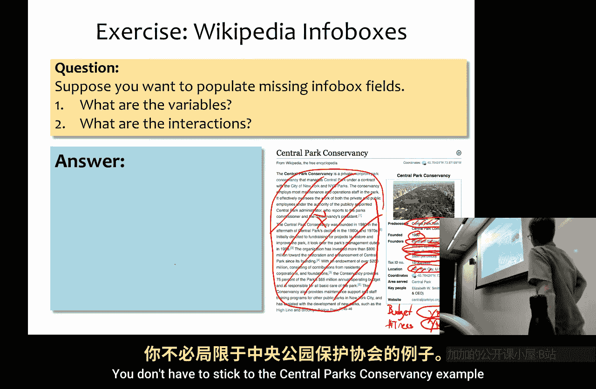

If it's easier to think about these。What do you mean by interaction system？

So I guess what we're concerned with are cases where。The different random variables。

 we tend to have some insight into the fact that they interact or that they sort of move in tandem。

 right？

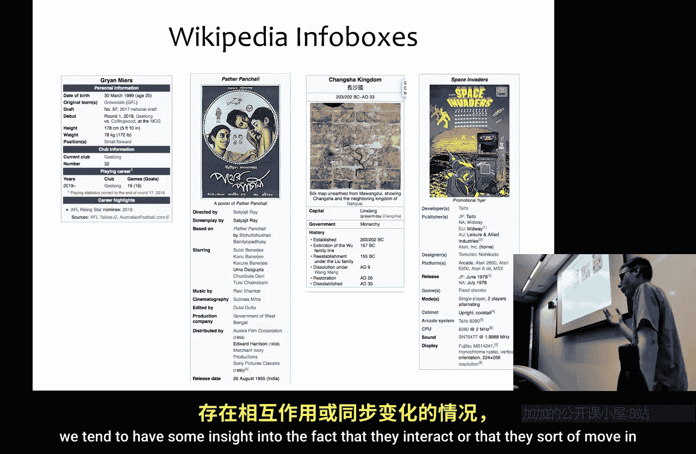

So if we go back， right？嗯。So what we tend to have is things like。呃。

If you're trying to diagnose a disease。And。And at the same time， you're concerned with。

Sa filling in the symptoms。So now simultaneously， we could be concerned with。呃The actual。

Interaions between oh， sorry， I guess I have social history and symptoms here。

 Do we be concerned with the fact that。If you know that the person is a smoker。

 they're going to be more likely to already have coughing as a symptom。A priori。

And so the data will actually kind of bear that out。

And so if you were just looking at filling in different aspects of the electronic health record in isolation。

 then you wouldn't be able to capture that in。

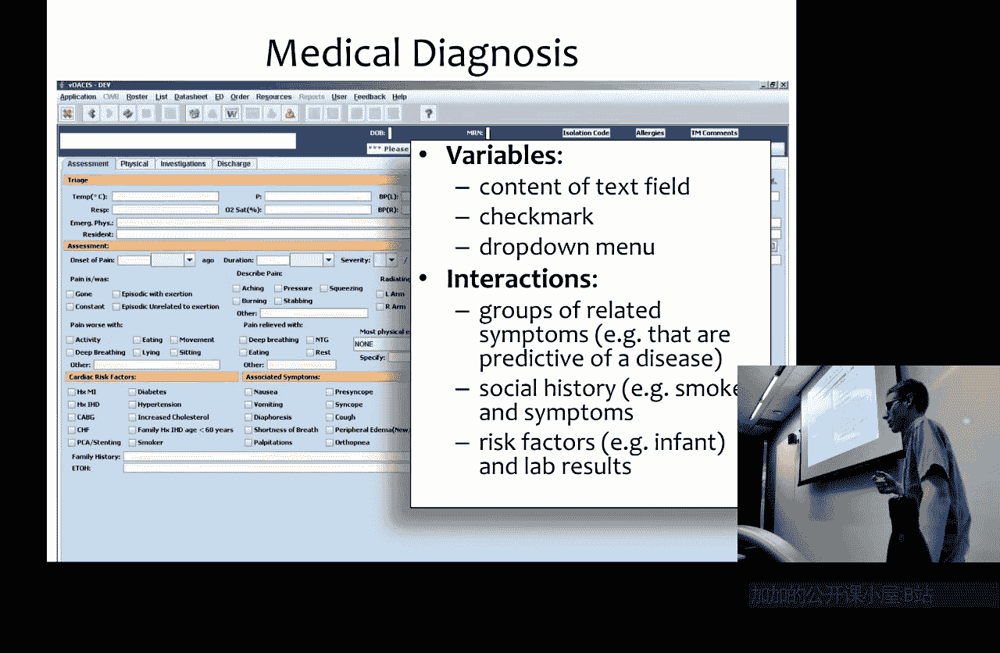

So here。呃。An example would be。嗯。So see we were trying to fill in different aspects of。So both。

 for example， we didn't have any information about grime myers。So。呃，The。

The sort of simplest possible thing that we could be concerned with here is if we were jointly trying to predict his height and weight from the text。

So if you just try to predict them。呃。Independent of one another。

There might be like a couple different heights mentioned in the article。

Both of his height as well as some other players。And so to figure out which is his height。

 youre going you might have an advantage if you also are able to predict his weight simultaneously。

So like it's sort of anatomically。Ilausible that his height would be， say。

 the length of a football field。And so if you know the sort of typical relation between height and weight。

 then you might know that how that ratio usually interacts。

And so if you already kind of know what his weight is， then you might do a better job of predicting。

So that's an example of an。Okay， so any other， can you think of other cases where we're trying to fill in multiple。

Missing fields at once and sort of what kinds of interactions might exist。Oh， sorry。

essential party sample。to。Yeah， exactly right， so if you know that the location is New York。

 then suddenly you have a lot of information for the coordinates。Similarly， or yeah。

 did other people have other examples？I should be like， if you have the missing。但咧啊。The text。

When you see the boundary。We hypoographyly that topic here site。あそうです。Oh sure， yeah。

 so now we could actually so here we kind of did this this really coarse thing。

 which is that we took the entire inputtex and we called it one。

But a much smarter thing to do would have been to sort of decompose that into smaller random variables so that we could actually isolate the interactions。

Between the missing outputs and individual components。Yeah。

 so those are interactions between sort of input and output。

 and they differ from interactions like the location and the coordinates only in that it's going to be sort of computationally more difficult to work with the kinds of interactions that exist between pairs of output right now。

Yeah， so maybe the RK的 machine example you know。IfYou're missing a bunch of information on the machine and you just know what the system is。

So you might know a lot of the components， yeah， absolutely。Okay， so。

So where are we going this semester？There's all of these interesting contrasts that we're going to start to paint and I think one of the fascinating parts about looking at this sort of broader picture of machine learning problems is that we can talk about contrast that we couldn't even talk about in sort of a basic machine learning class。

 so some of them will actually be familiar， things like a generative versus discriminative distinction。

But then we'll also talk about things like global versus global normalization or the tree width of these graphs。

 whether it's high or low and how that affects the tractability of inference we'll think about。

sicity or ascyclicity of an actual graph representing the thing that we're trying to build we'll talk about sort of different kinds of models in terms of sort of exponential family model where everything is kind of clean and nice and neural networks where suddenly everything is not so clean and not so nice but works really well and then if we're looking at sort of a neural case。

 we could think about deep versus shallow。In the context of inference。

 we'll talk about exact versus approximate inference and particularly like which aspects of those model contrasts admit。

Exact inference versus approximate inference we'll think about different types of inference algorithms right practically whether they're solving by dynamic programming or sampling or optimization。

And we'll also talk about possibly maybe some familiar inference problems or maybe some new ones to you。

 like the map inference problem， marginal inference and the partition functions。Within learning。

 we can think about distinctions between whether we have full supervision or partial supervision。

 we'll talk about whether the supervision is lost aware or not。

Whether our learning is sort of probabilistic or non probabilistic and even things like whether we're viewing learning from a frequentist perspective or a Bayesian。

Okay， so this is a lot of sort of keywords， and I thought it would be useful to kind of paint this picture of sort of the kinds of contrasts that exist here。

 but through a simple example。

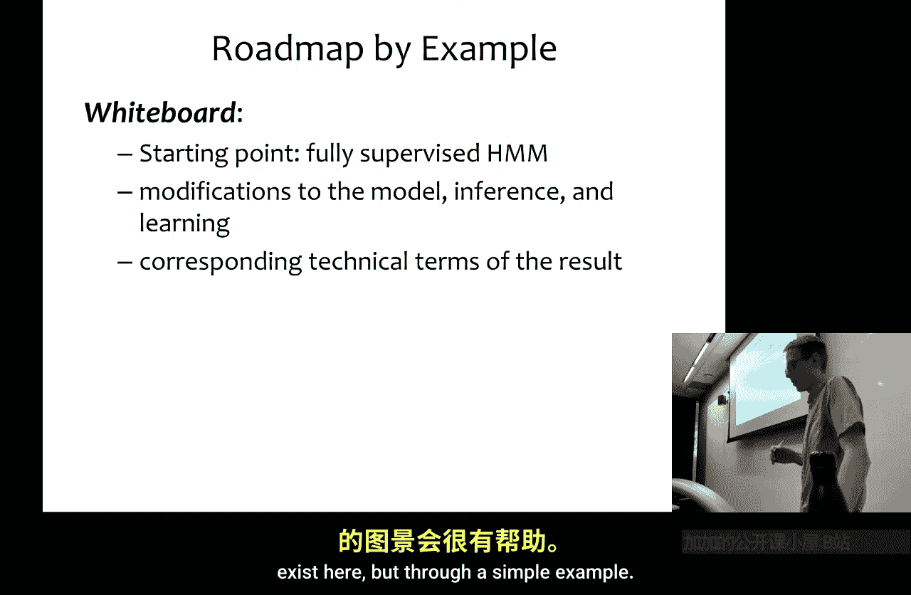

Let's actually take a look。And one of my favorite。Pines of examples here。Which is。

That of thinking through an HMM。And。So here。This roadmap， by example。We could say that。

That we're going to start。by。By thinking about just the HM model。And。

I guess what we're going to do is we're actually going to have some structured representation of the HMM concept right okay。

 so I'll put its name in a little box and then I'll kind of put it inside this little circle。

 I'll put an actual picture of it。Yeah。But then HMs have these properties。

So HMM stands for hiddend Markov model。So one of the properties is that it's a locally normalized model。

Another is that it has a Markov assumption。A third is that it's a probabilistic model。And。It's also。

Trainable in a lot of different ways， but I want to think about the case where it's trained in a fully supervised way。

And。Then we could say that this graph representation of the hidden Markov model doesn't have any cycles。

 so it's an acyclic model and that the particular fully supervised way that we're going to be training in HMM is by a maximum likelihood estimation。

 which is kind of a frequentist。Approach it。So。Okay。

 so how can we get something more interesting Well the first thing we could do is we could say， well。

 instead of having a global locally normalized model， we could have a globally normalized model。Okay。

 so if we did that， now we could talk about a new kind of model， namely an MRF。Or a CRF。All right。

 let's call it just an MRF here。And in MRF， we would draw a slightly different picture。

 which looks almost the same except that there's no eras。

 there's just these little edges connecting all those circles up。And here。

 the distinction of locally normalized versus globally normalized would just be that， you know。

 if we have some joint distribution over， say A， B and C。

The locally normalized version would decompose。 So it might be something like， you know。

 the probability of a times the probability of， say， B given A times the probability of C given A。

 And it's just the product of， say， a sequence of。Normalized probability distributions。

But if we want something globally normalized， well。

 we could instead define that to be something like the score of A times the score of B and A times the score of C and A。

And if these scores were just arbitrary real numbers， we wouldn't get back in probability。

But if we said， okay， these scores are now going to be non negative numbers and we're going to have something called a partition function。

 Z that makes sure that they sum to one for all possible values of A B and C。

Now we have a globally normalized model。So another change that we could make there。As we could say。

 well， this MRF is actually。What's called a generative model。And we could instead come up with。

A discriminative model。Which is the discriminative analog to that generative model。

 and that discriminative model would be a CRF。And it would look almost the same as the MRF。

Except that we would。Have to treat the actual emissions as observed， and so we would shade those in。

 Those are part of the input always in this case。So there are other sort of。

Little changes that we could make along the way。 So a markov assumption assumes that you kind of have only access to。

 say， the previous random variable in time。 But you could say， well。

 let's take infinite context instead。And if you did that。You would no longer have an HMM。

 but you'd have a different kind of model， any thoughts on what it might look like。

We'd just take those circles and we'd change them to little rectangles。

And by changing them to rectangles， suddenly。We have a graphical depiction of。An RN。nice。Okay， so。

 you know， we could keep playing this game where we say。You know。

 we're we're going to change from probabilistic to non probabilistic and fully supervised to partially observable and acyclic to cyclic we'll draw that one out because that's a fun one So if we went from acyclic to。

Say a cyclic graph。Then we could have something that's like， say， a skip chain。H and m。

And that skipcha HMM would。Sort of have some of the familiar arrows from before。But it might add。

Some connections that。嗯。Skip across random variables like so。Okay。And。You know。

 if we wanted to do inference on that skipcha HMM， well。

 we would probably be needing something like a loopopy belief propagation algorithm。

Which itself is a message passing algorithm。But。We don't need to stop there because we don't have to use message passing algorithms。

 we might instead prefer something like sampling algorithms。And so if we did that。

 we could keep the same model， but now we could work with a Gib sampler for inferences。

And but keeping the model exactly the same。 And again， if we didn't want to do message passing。

 but we wanted to do， say， inferences optimization。

Well no problem now we just have variational inference。So we of a different variation。

 but on the same model。あ。And so we can kind of start to fill in all of these different contrasts and each of these different contrasts kind of leads us to sort of a new topic for discussion of how do we actually build you know the non-probabilistic version of the HMM Well。

 we're going to need something like structured SVM， how do we build the partially observable。

 not the fully supervised but partially supervised version of the HMM well we're going to need something akin to the EM algorithm or variational Bayes。

 and if we don't want to be frequentists， well we're going to have to think about how to actually do Bayesian inference where we infer an entire distribution over the parameters？

Okay， so so we'll fill this sort of beginning of a diagram out more once we actually know what kind of these different terms are。

 but they'll allow us to conceptualize all of these different ways of。

Of sort of building models and inferences。

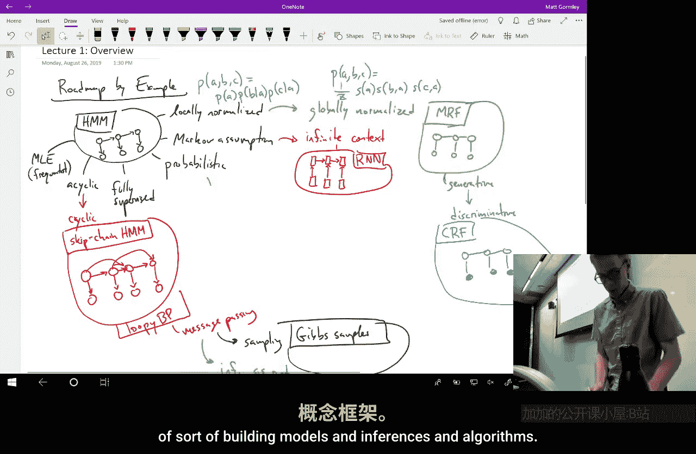

And algorithms。So。Okay， so I want to end with just sort of the highlights of the syllabus。

My assumption is that the course policies which are posted on the website are required reading。

 so all of you should go to the website and just。Read all the policies。

 it took care to rate them out for you。And there's sort of two ways that you could get there。

One is 418。mlC。org， the other is 618。mlCse。org， they'll both redirect to the same place。

So the highlights are。Are posted here so the first one is there's this distinction between the grading breakdown between 418 and 618 specifically 618 is the same course essentially as 418 except that it also has a project。

嗯，So啊 you'll find them the。In order to account for that。

 the homework and the final exam are sort of reduced in their。诶 so诶。Essentially。

 you'll still participate in that final exam， but its sort of final impact on your grade will be a lot less。

The midterm exam is going to be on Thursday， October 3rd， and it'll be an evening exam。

And then the final exam will be scheduled by the registrar。The homework there's going to be。

I guess actually sorry， I said about four， there's going to be really five assignments。

And the sort of tentative deadlines for those， you can actually look on the schedule page for they're kind of roughly sketched out there。

And that also includes estimates of deadlines for the project components。

There's going to be six grade days for homework assignments and you also get partial credit for submitting late。

 but no submission can ever be submitted after four days late without an extension and an extension request is really to handle emergency situation。

 so the kinds of emergencies that I'm talking about are kind of do build on the actual syllabus。

Reitations will be right here in the same place and time will announce ahead of time when they're happening that already on the course schedule page。

 there's a tentative schedule for those recitations。And roughly。

 there's sort of one for homework and per exam。嗯。And then for the people in the online section。

 our assumption is that you in the online section will be joining in person for this。

So the readings are going to be required and they'll be online my recommendation is to read them afterwards there's there's definitely going to be some readings where you know like the the actual coverage of the reading goes sort of beyond the scope that we actually want to cover in this course and so。

We'll kind of highlight where that's the case when that comes up。嗯。And then。

We'll use a couple different technologies。 I think the ones that。

So we'll definitely use Piazza in grade scopepe and I think we'll evaluate whether to use AutoLB or GrScope for programming questions that's actually certainly not decided yet。

And then on the academic integrity front， we really want you to be collaborative in this course that's really encouraged。

 but on the programming assignments in particular， we want you to when you collaborate。

Essentially we want you to work together， but not by sitting next to each other and coding。

 but rather by standing at a whiteboard together and talking about the problem at a high level。

 and then erasing the whiteboard， going your separate ways and coding up solutions separately。

And this is really fundamentally about sort of providing a good opportunity for。For you to。Invest。

Actual time in really deeply understanding what these algorithms are doing and how to go from the math on paper to something that actually works and solves the problem。

嗯。Okay， so office hours will post on the Google Calendar page， I think there's none posted as of yet。

 my office hours will typically be just right after lecture and we'll probably we're taught in here。

 maybe we'll go just sort of to a nearby table up there。嗯。

So during lectures you should feel free to interrupt and ask questions and when I ask you a question。

 I actually am looking for an answer I'm not asking rhetorical questions here and basically there's all this educational research that shows that interaction improves learning。

 so this is really， really important that you interact with your peers both in class and then also out classs on homeworkmarks and on projects and so on。

But there's a textbook that you could go get， it's a great reference textbook， but it's。えちょ。

Pretty thick textbook， I wouldn't expect you to read through the entire thing and I won't actually assign readings from it。

 but if there was one textbook that you got for the semester I would recommend this one。

 it'll cover a lot of the really sort of intensive topics that we hit on。the prerequisites。

 I think are pretty clear from the syllabus， an introductory machine learning course。

 significant programming experience in college level math and the。

The expectation is that you will be proficient in the basics of Python such that you can pick up Python for the homeworks where you need it。

And then the last detail here is we have a。Projects for 618 students only。

And this will be conducted in teams of two or three people。

 and the goals are really to present some empirical comparison of say， competing methods。And so。

I was kind of careful in framing this as the expectation is not necessarily that you will be producing you know Ns or ICML or top machine learning conference level research。

 but rather that you'll be kind of headed in that direction through through empirical comparison and so what I'm more concerned with is actually that you're doing that level of empirical study。

 but not necessarily that it need be some totally novel thing that you're going to go turn around and publish immediately。

 I think it's also fine if you're already kind of doing research to kind of think about how you can interface real novel research into your project as well and we can talk about that。

But it's not entirely necessary here。And they're sort of typical milestones along the way。

And with that， I think we'll wrap up。 And if you have any。

