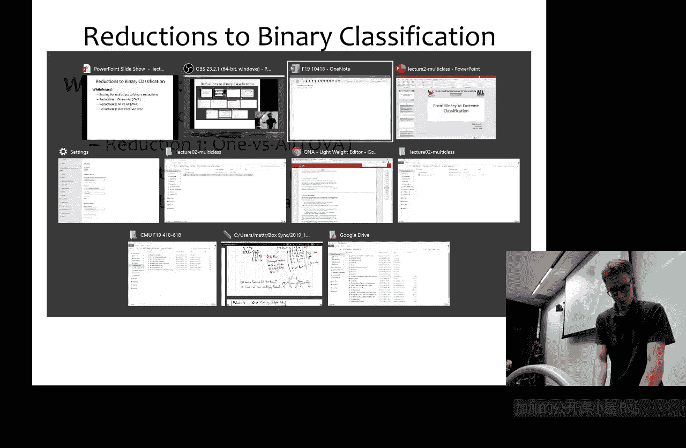
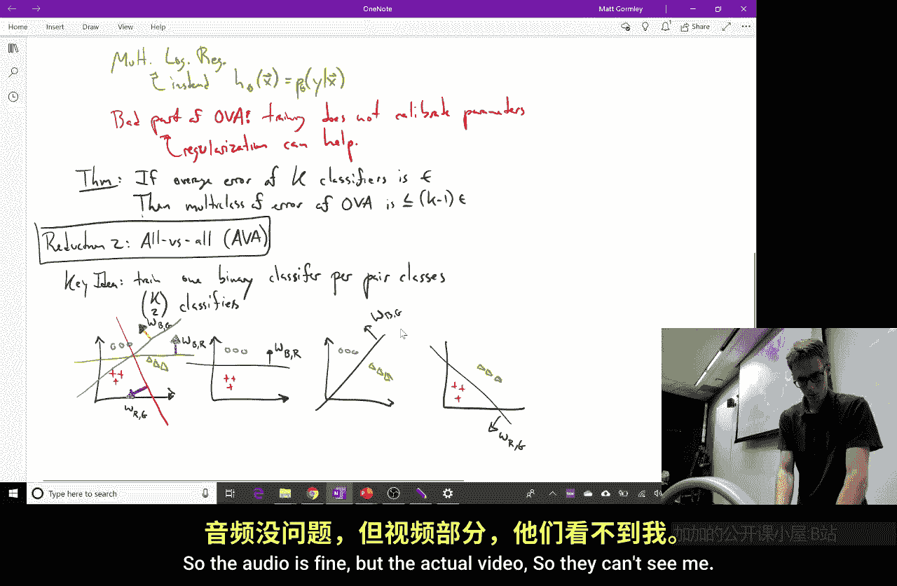
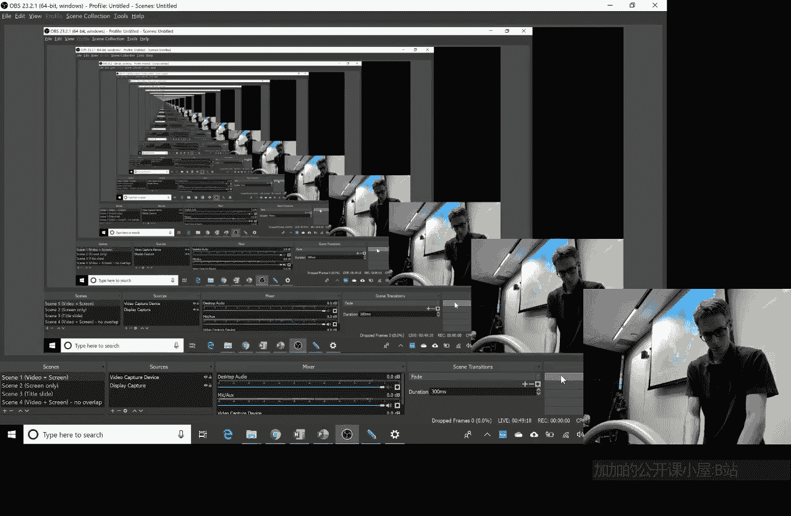
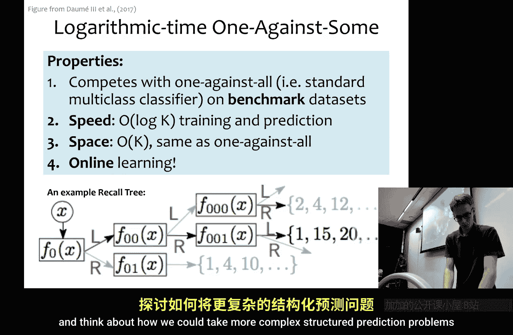

# 卡耐基梅隆大学【中英⚡结构化机器学习｜10-418 2019 Machine Learning for Structured Data】 p02 p1 10-418 ⧸ 10-618 Fall 2019 -BV1eJRsYBEaK_p2-

Great。Welcome back to 10，418， 618。Structured。Prediction。Through the lens of graphical models。

Learning to search。Deep one in。So in this course。We're going to be looking at all of these different sort of views of structured predictions。

 these different ways of conceptualizing what it means to do machine learning for structured data。嗯。

But need to start somewhere。And。系。Would like us to actually start at one of the simplest places。

 which is classification。So。Before we get into those details。

 let's just do some quick Q&A because last time we just kind of rushed through some syllabus highlights and I didn't really give you guys a chance to throw questions at so any questions that came up from last time？

Just about how the course is structured， where we're going。F the team project to。

Look forward to weeks by ourselves or do you assign us for？呃，呃。that I've actually。

 let's say I'm undecided。So there's a lot of research that shows that if I randomly assign teams。

You all will learn better。Yeah。There's something about like you do a team with your friends。

I don't know exactly what goes wrong， but something。So。

The two formation isn't going to happen until much later in the semester。

Let's say it's undecided for the moment。But I'm happy to either way。

 we're going to be happy to help form teams。Okay so this one I had to pose as a question that you might ask because I actually had it wrong on Piazza。

 so I figured this all out back in July and what we really want you to do to join the online section is email Dorothy Hol and Maley at this email address stating that you would like to join the online section and part of the reason for that is this is not professional video recorded and so for anyone who decides to join this online section we want to make sure that you know what you're getting into。

嗯。And hence the extra step。Okay， so another question will I get off the waitlist。

 don't be on the waitlist， just email Dorothy and get on the online section instead I think that's actually the best solution and then another question can I move between 10418 and 618？

Yes， I think this is extremely easy just email know Dorothy， basically if you're catching on。

 I can't actually do anything for you， but Dorothy has incredible superpowers。This one。

I don't have an answer for when is the last possible moment that you can move between 14 and 618。

 still trying to figure that out， but I'll get back to your one piazza。Okay。So。Okay。

 so I want to pose one more question that you could have asked， which is。

So why is it that these interactions appear between variables in this Wikipedia Introbox example？

Just from some of your questions after class， I was realizing that I think what I was saying wasn't entirely clear。

 and I think I put my finger on what I was thinking about in this problem that you might not have。

Which is that I was thinking about the test time setting。So specifically at test time。

 and author writes a new article， we'll call that an a vector。And the info box is completely empty。

And so a machine learning system has to populate all the fields at once。what？

And so there were interactions that were seen among those random variables representing those different fields in a Wikipedia info box at training time。

And those are unobserved at testile。And so the point is that we want to model what those interactions are。

 we want to learn about how those random variables are interacting with each other。

 such that when we go to populate a completely empty Wikipedia info box。

 we're able to simultaneously reason about multiple fields that。So that is really critically。

 I think we've kind of had some questions around this notion of whether the interactions are happening between。

Sort of observed and under unobserved variables， and critically this is a setting where you can have fully unobserved。

Fields。Okay， any other last questions？Okay， so。We left off in our discussion of content last time at this notion of a roadmap for this course and so I guess there's this question which is you know today we're going to be talking about classification。

 so how do we get from classification to structure prediction？

We're purposefully starting here with the simplest possible setting where you could think about decomposing a problem into something smaller。

And then we're actually going to formulate structured prediction as a search problem。

And there we'll be thinking about how you can。Treat。

The actual structured prediction problem by decomposing it into a sequence of decisions that you make。

And then after that， so that'll roughly be the content of next lecture after that maybe the next two lectures really because we'll also be kind of talking about this in the context of deep learning and so we'll be building up some tools in our toolbox there。

Then we'll actually start to get to the framework of graphical models。

And so I think that this is actually a great way to get where we're going and so graphical models are about decomposition into parts and。

😊，You know， we could think about what it's like to have a joint distribution over many variables。

 you know， if you have a sentence test flies like an arrow and you're trying to predict what it' called a speech types are。

 one way it would be to draw samples from some joint distribution。Now。

 did anybody bring a distribution over part of speech tags for this sentence？No， no one， oh， okay。

 I happen to have one。So here is the first sample okay。

 and here's another sample and here's the third and the fourth and the fifth and the sixth Okay。

 so conveniently I have this ability to sample from distributions over part of speech tags for this sentence。

😊，And once we've done that， we could actually do interesting things。 if you had enough samples。

 you could actually say that an approximation to the marginal distribution of this random variable。

Is given by the actual observations that we've sampled。

 so we could say that about two sixths of the time it verb and four/6s of the time， it's now。

If we had enough samples， we could count how many times each sample appears。

 and we could say that the one that appears the most times。

Is the most probable assignment to these tags？We would need。

 a lot of samples to pull that off though。So there's lots of different sort of joint distributions over multiple random variables that we could have。

 and the graphic model is actually going to tell us what。

We are what interactions between those variables， we are capable of modeling and learning。

 and that's what these different connections between those circles， which our random variables are。

So we could draw many samples from a distribution over basic6 random variables like this。

And you'll notice here that their connections， their apology in this graphical model。

 look quite different。And so we could also say that the graphical model is itself a joint distribution over both tags and words。

 and so in that case our joint samples from that distribution would look like pairs of tags and。

And so a probability distribution here could actually tell us something about the probability of the sample flies fly with their wings。

And so what we're actually looking at here， and this is just sort of a preview of what's to come are factors。

 and these little black boxes， each one is going to look at the values of its neighboring random variables。

 and it's going to have an opinion about how much it likes or dislikes them。

So it'll so this factor here is going to look at the pair x2， x3。And if they're a good pair， like。

 say， a determiner followed by a noun。Then it'll be happy。

But if it's something a little more unusual， like a determiner followed by a determiner。

 it'll be somewhat set。Okay， and so。We actually draw these little things as squares because conceptually we're going to be thinking about them as tensors or unnormalized distributions over tags。

And we're going to actually true。Choose to reuse factors。

 and this will sort of lead to a discussion of parameter time。

And so if we wanted to specify a joint distribution using a factor graph like this。

 what we would do is actually sort of pick out the entries in these factors that correspond to the variable assignments that we're concerned with。

 and then we would multiply them all together。Okay， but there's a problem there， which is that。

If we just multiply these numbers together， we get something that's greater than one。 Okay。

 so what we do is we add in。对す。This factor， which is1 over Z。

 whereas Z is what's called the partition function。

 and it makes sure that the normalization works out。

So if we had this joint distribution over tags and words。

With these factors that could take on arbitrary positive values。

 then we would call this a Markov random field。And the factors aren't necessarily probabilities。

 but if we made the factors so that they were locally normalized probability distributions。

 then we'd actually have what's called a hidden Markov model。Just a slightly different month。And。

So you can see that the hidden Markov model doesn't actually need the partition function。

 or we could say that the partition function is always one for a locally normalized model。

 this is also called a Bayesian network， a hidden Markov model is a special case of it。

And then a conditional random field is going to specialize each of these little factors that was touching one of the words and say that it's now specific to a word。

 so it's kind of like we took a column out of the markout random field specific to that word so here we're going to take this column corresponding to time and we'll get rid of all of the other columns。

And then here， we'll keep the column corresponding to flies and get rid of the others。

And so this will give us a different distribution， a conditional one。

 which is now the probability of the tags given the words。

No longer is it a joint distribution over the two。So samples from this distribution。

Would just be a sequence of tax。Exactly， what is the partition function to function off？Oh。

 it's actually， it depends。So in the Markov randomum field case， it's actually just a constant。

But in the conditional random field case， we'll talk about this more later。

 it's actually a function of。The thing that you're conditioning。

 so in this case it'll be a function of the sentence time wise again。

So if we talk about the partition function that shows up in logistic regression。

That's also just a function of x， it's the constant that makes sure that logistic regression sums to one。

Okay。Okay， so this is where we're going。That's like the five minute hand wavy preview of like the kinds of models that we'll be able to talk about once we get to graphical models。

 we're not there yet today。I'm going to do something simply。Binary classification。

exceptcept we've all talked about binary classification before。

 you know there's like these linear models and you know you have some red points and some blue points and you want to find some hyperplane that separates them in high dimensionional space and so you try to actually learn that hyperplane and once you've learned it。

 then you know you just have this nice easy prediction function which looks at the parameters of the hyperplane theta takes its dot product with your feature vector X and says that we're just going to return the s plus or minus1 of the dot product。

Okay。And you know， this shows up all over the place， right， Perceptron。

 the physical regression9 days， SVMs， many more， if we wanted to do perceptron。

 you know it's usually talked about as an online algorithm where we have this stream of examples coming through and the predictions are that same sign of theta transpose X and then learning is this iterative procedure where we get get an example that shows up one at a time。

 we make our prediction with it And then if we've made a positive mistake。

 we add the feature vector if we made a negative mistake we subtract it。Okay。

 so binary logistic regression， it looks kind of similar。

 We have these data points that are X Y pairs。So the x's are these continuous vectors of length M and the y's are maybe not plus1 minus one。

 but by convention zero and1 for binary logistic regression。

And the model that we all hopefully know here is that the probability of y equaling one is just the sigmoid function applied to theta transpose x。

Okay。And then learning is just a matter of maximizing the likelihood of the data。

 we do that with things like gradient descent or stochastic gradient descent。

 and then we predict by outputting the most probable class。Okay。

And we could talk about SVMs and we'll actually come back to SVM later later on。

 Here's just sort of the usual formulations of。Binary support vector machines right so we have a hard margin version version that assumes that the data is linearly separable。

 we have a soft margin version that adds these slack variables so that we can actually account for。

Nonseparable data， we could take the duall of these so that we can come up with more efficient algorithms for learning。

And of course， you know there's always decision trees。

 you can have a di classifier out of a decision tree。

 though it's easy enough to get a multiclass classifier there as well。Okay， so。

We know this setting right supervised learning， we have these pairs of training examples。

 binary classification is's going to be this plus one minus one labeling multiclass classification。

 which is where we're going today is going to be this labeling。From one decay。

B K is the number of possible classes that we could consider。Okay。

So are we all kind of familiar with all this stuff， I know it was a long summer。

 maybe I haven't seen this too recently， but hopefully this stuff is all is all not too。

Too far gone in your memory， right， Okay， so what are we doing today， Well， today。

 what we want to do is we want to think about how we could reduce。

The problem of multiclass classification to binary class。O。And we're going to look at that。

 we're going to look at four different such reductions。

 one versus all versus all classification trees and error correcting output。

Actually just my quick show of hands， how many of you have seen any of these before。

 so how many of you have seen one of these reductions？Okay， great， maybetdy He。

 and where have you seen them？在。What you that funders investment pleasure？Yep exactly， great。

 and then let's do it more fine grape， so how many of you have seen one versus all？All versus old。

Classification trees。And Eric correct they help with good。我都你。

And then we're also going to talk about multiclass classification。

 hierarchical classification and extreme classification。

 how many people know hierarchical classification or thought about that？

And extreme classification Okay， great so multiclass is like the simplest possible structured prediction thing and so the key insight is that we're going to find these sort of simple ideas in these reductions that are analogous to the sort of later less simple concepts that we'll be talking。

😊，Okay， so for those of you who have seen these before， you can nod along， but it'll also help us。

 even if you have seen them before to start to establish some shared terminology and notation。Okay。

 so。So to jump in， we want to talk about reductions of multiclass di binary， and to do that。

 I want to paint a picture of the actual setting that we're working under。Which is。

A sort of funny setting。If you have never thought about this before。

 the first question that you should be asking yourself is， why on earth would we care？About。

诶。Reductions of。Multiclass not D it， and so part of the reason is a historical one。Which is that。

There's this sort of past setting that existed。That came up because there were a lot of binary classification algorithms out there。

And。So。What we're going to do today is we're going to suppose。That。呃。You're given two things。1。

A binary classification algorithm。Okay， and then that's going to look like sort of two things。

 We're going to say that we have some。Function called train that takes in our data set D and gives back some data。

And then we're also going to assume that we have something that gives us a Y hat。Which is。

Given by some H theta ofX。And then we're also going to assume that we have。A multiclass。

Classification problem。And that problem。Is going to consist of a data set D。That consists of。Pairs。

 X， Y high。Where。We assume that each of these Xs。Is a real value vector of life P。And。

Each of these y eyes is a。Integer label from one to K。

And so what we're going to be assuming here is that。呃。

That we're really solving the multiclass problems。And so， you know， we could say that for。K equals。

 say three。And M equals two， you know， we might have a problem that just looks like。

Say three circle points。Maybe four plus points。And a couple triangles。

And our goal is to actually learn how to separate them out。Okay。

 so the first reduction that I want to look at。Is that a。呃。1 versus old。This is reduction one。嗯。

We're going to say that。The way this works is pretty simple actually， so the key idea here。

Is that we're going to train。K， binary classifiers。And。Each one。Is going to actually distinguish。

One label from all the other。This is a pretty simple idea。And we'll actually predict by voting。Okay。

So。So what do we actually need here Well， for one we need an assumption。

 so here we're going to assume that each class。Is actually separable from all the others。And。

Armed with that assumption。We can now come up with a training and prediction procedure Okay。

 so training here is going to be。That we're given our data D。

And then we're going to iterate through each of our plausible labels， so this will be for L。In one。

Up to case。We're going to say that。呃。We're going to define some data set D。

That consists of all of the。呃。sorry， some it is that DL。It consists of pairs。X i and let's say z系。

Subscript down。And the kind of的。呃。啊。The size andzebel， which is the number of。Oh， sorry， N。And。

So this data set is going to be the same size as our。And the question is。

 what do these Z's look like？So we want the。Positive examples。

To be all of the cases where the true label is L。And the negative examples to be all of the other examples。

Okay， so we could just say that VIL here。Is plus one。Yeah。喂系呢个系。And minus1 another one。Okay。

 so now for every label， we have this data set。That actually。

Dvieies everything up into whether it has that label or it does not。And from there。

We can just learn a set of parameters， we can call them theta L。

Which are going to be what we get when we train our binary classifier。好。This data set。

So what is that function train that function train is just。

What we assumed that we were given in that binary classification algorithm， right？So。Okay。

So far so good， what should we do when predicteding？Okay， so assume that you're given。A new instance。

And we'll call that instance X。And the question is， what do we do， How do we actually come up with。

A label for that instance， X。Any ideas？D这方。这个是 trying。Yeah， so how should we combine？谢谢。か？

I know you've seen it before you raise your hand on it。So let's see if do you have another idea。系嘅。

If you you run a training example through this， and then for every instance that shows a positive。

 you somehow figure out a way to break the time between all those。Yeah， so so if we ran。

 we could even say that we're going to do something like a for loop over all the L labels in one up to K and so for each one we're going to say come back with。

A score sub L。Okay， let's just call it SL。And SL is going to be the output of the classifier， right？

H theta of x。喂。And so then we could return。Say the Arg Max。Over all possible labels。L。

In one of the county。Of those asbels that we just computed。Okay。

 and then the key caveat here is that we're going to have ties。Boy， ties are annoying。

 so let's just break ties randomly。Okay。This has some convenient theoretical properties。

just makes it proving a little feelinging a lot easier。That's not a particularly good idea。

So is it as civil as only customer？The phrase。こらててオケ。So it's really just looking at。

 so if SML is just plus1 or minus1， I mean， we're really just taking。

 you know which of these classifiers actually said yes。And there's going to be a lot of times。

 so let's actually look at this victorially because when you see the picture。

 suddenly this seems like kind of a ridiculous thing to do。

And and I'd actually prefer that you think it's ridiculous。

 so this is going to be one versus all with M equals two， so we have two features。

 we have three classes。And our binary classifier。We're going to assume is a linear model。Okay。

 so that just means that why is。Sa you're going to get the label plus one。 So in a linear model。

 when does it get plus one？go to the themselves。But we don't even need to tuck or well， yeah。

 so what is the logicion？Ccross。找不。Fature room。Yeah， yeah， exactly so we're just going to have。

So something like W transpose Act。What' a bias？And if it's greater than they are weird。

And then we just return minus one。Okay。So what this means is now we could actually draw some pictures。

Because we could think about this as。Essentially。It's not gonna work for me。

So we're going to have some data set where as before。We have some blue points up here。

And some red points down there and some green points over here。

And the first thing that we're going to do is we're going to say， okay， well。

 we're going to create our blue data set。So let's call that B sub B for blue。

And it's going to have the blue points up here， but then it's going to have all so these are going to be our plus points。

 so we should probably show them as pluses， so we have these blue pluses， one， two， three。

 and then all of the other points， these three red points。

 those are minuses and these three green points， those are minuses。Okay。

 so when we actually train our classifier here， what do we get back， but a linear model。

That looks something like this。对。Okay， so far so good。

 Now we can do this two more times once for the red points to get。The red data set。

Where now we have three pluses here and then minuses everywhere else。

That we had green and blue points， and so when we train our classifier， again。

 we get something like this。And lastly， we'll have our green data set。And here we'll have。

Our plus points in this corner and our minus points everywhere else。And。

We'll learn some linear model。O。So when we put these all together。What do we actually get back？

We get back。So let's actually now combine these back on that original picture of the data set。Okay。

 so we're going to have one linear model here。We're going have another linear model here。

And a third linear model。At the bottom corner。So。What portion of this should I actually shade as blue？

What is our classifier going to classify which points are going to be classified as？エちのこ。回当时对哋先那么多。

So the whole region。Its the one we is not。Yeah， it's actually gonna to be downloaded by。

It's going to be bounded by。That's red。 and that green。Because only in that region。诶。

Do we have two minus1 from the random green classifier and of plus one from the blue？

And then similarly， only this region。Is going to be categorized as green and only this region is going to be categorized as red。

And everywhere else。So in here， in here， in here and in here。All of these。Are going to have time。

TwoA or three way5。Threereeway in the middle。And so what we did。

I's sort of something a little bit disappointeding？Because now。

We don't even know how to properly classify in those regions， okay， so how could you fix this？

oneに呼びの。If you have key minus one。You much one this space。She saw the。诶。

I don't think I'm following what your idea is， so you're saying we have three classess here。

 so you're saying we have two classifier。And。So in that case， we would never have。Yeah。

I don't know if I agree with you because so here， if we just had the resume blue classifier。

 there's still going to be regions where they both say yes or they both say no。

You could construct them。So that they did not ever come。But they don't know about each other。

Remember this step up here。When we trained this thing。In。Step two。

We said that theta L is just from some training algorithm that just gets to look at one binary data。

 it doesn't get to look at the other classifiers。So。Can anyone try to fix this。Yeahや。If for instance。

 forcing the random。Maybe you can calculate the distance between these。And each line。

And cheese like the nearest。Great， so what we could do is to actually fix this， we could say。

Use scores。Stud。Of sort of just plus one。慢点说。Great。So in particular。

 does this look kind of like any other algorithms that you know？Yeah。

 it looks just like multinomial logistic regression， right so the connection there is。呃。

That multinomial logistic regression。Is instead。Sort of defining something like we could say that H theta of x。

Is the actual probability or the score？According to your model， right？

And then in multinomial logistic regression， it's pitting against each other these different probabilities from these three different hyperplanes。

And as well， sort of the bad part。Of this one versus all thing。Is that？

Training does not calibrate the parameters。Across the different classes。

So when you're training one versus all， the one classifier doesn't know anything about the other classifier and so the scale of the parameters might actually be totally different in one classifier versus another and so if you aren't using probabilities if you're just using scores those scores might not even match up to each other or even the probabilities。

 the confidence of one classifier may be sort of absurdly high compared to one of the others。

 so regularization。Can sometimes help with this problem。But in general。It's sort of。

A disappointing way to actually work with this， Okay， so that said。It's not completely hopeless。

 There's actually some theory that goes along with this， which is that if the。Average error。Say of。

The key classifiers。Is epsilon。Then。We have the multiclass error。Of the one versus all approach。Is。啊。

Less than or equal to k minus1 times epsil。So啊。Does that。Sound good。No， not so good， why not so good。

 so easy how why all causes。Yeah， if you have a thousand classes and your error is like 10%。

Then the multiclass error bound here is actually something much greater than one。

So this is a little bit disappointing。So the question is， can we actually do better？

A different decomposition。That we could look at is。That of one versus or sorry， all versus all。So。

Let's just do a quick sketch of what all versus is。So it's the same idea。This will be our。

Proeduction number two here。Okay， so in all versus all。We're going to build。

One classifier for each pair of classes。Okay， so。So this is a little bit different。嗯。And。

We have the downside， which is， it's one binary classifier。Ppaair of classes。

So how many actual binary classifiers they？Okay choose two。Okay。

 well that doesn't sound helpful I mean before at least we only had K classifiers now we have K choose two classifiers and so if you were thinking about that same data set as before right where we have our blue examples and our red examples。

And our green examples。Then here we could actually look at。You know， the first classifier。

 which is going to look at just the blue points。And the red points。

So the classifier that you learn here would be something like we could subscript ourW here with。

Blue and red to indicate that it's just。Learning to classify the difference between those two。

And then we could。Learn a separate classifier that just does。Sa the blue。And the green points。

And here。We're going to have one more。Which is to differentiate the red and the green。And。

So at the end of the day， in this sort of tiny example。

We actually have the same number of binary classifiers that we learn。To accommodate three classes。

But as the number of classes grows， this is going to。End up。

Growing pretty rapidly so what what would we say prediction actually looks like so we could actually again sort of translate our classifiers these three back to our original data set and so we would have one classifier here。

Which is we'll give that。Different looking color here， So this is the red versus blue。

This is the blue versus green。And。The red versus green。

So now we have these three classifiers and again， we're going to want to do some sort of。

Voting between these classifiers。So this time， what should our voting actually look like？

How can we piece this together into something that we'll actually make for？

So each class take the capable as one classifiers to concern。The sports integrate。Yeah right。

 so we could say that so here this is our W。Blue versus green， this is our。诶W。Blue versus red。

And this is W。Red versus green down in the corner here。

And so if we wanted to figure out what should be classified blue？We could say， well。

 everywhere that blue。Get。More votes than read and。O。So， here。呃。Where are the places where blue gets？

啊。Then red and green。I should call this a bit grateful。Some arbitraryaries。

So these colors now have no correspondence。呃，这个来说。Clspy itself。But now we can talk about them。

So what's going to get classified as blue here？Okay， you guys seem unsure。

 so why don't you take a moment， talk to the person sitting next。

 is this like too obvious or not obvious？so why don't you talk to the person next to you。

 if it is incredibly obvious， then you can all just make jokes about how obvious it is if it is not then actually you should come up with an answer okay。

你系嘅。や。

せな。しす。

そで。You know how long it goes？て。不。や会。よ。じじ。So they can't see be。Yeah。

 that's like that line kind of because you know that everything can VR。内家是。Okay。

 maybe I won't actually touch anything。Yeah I think because I'm not important to this video。Okay。

 I think let's just let it roll through could you just let them know that were working？非。the rate of。

最。オケあ。So good discussion， how many of you think you have an answer？Okay， a handful of people。

 good enough， let's see among the people that have an answer。Yeah。

 so anything about the blue lane and about the green lane。みて。It be blue， right。

 because in this region。It should be the case。嗯。Up here。This region is going to get。Blue and green。

And this region is also going to get two votes from blue and region。But it's only going to get up。你好。

くれます。哦。Yeah， so it's only going to get one vote from this red class。

And it's not going to get the vote from this red class。The same thing goes for green。

 so in this region it's going to get the vote from this green classifier。

 but it's not going to get the vote。Okay， so here we're doing this sort of。

This voting scheme that's just sort of 01 voting。Which again， is kind of。A foolish thing to do。

 I mean， after all we have scores from these classifiers and so if they're at all reasonably calibrated with each other。

 then hopefully we could do a little better by actually relying on those scores。So。

It turns out then that we can also make sort of a simple theoretical statement。About this one。

 which is。Sort of if the average。Bary classifier。系。Or the average binary error。Of the K classifiers。

Is epsilon。Then。The multiclass。Error。呃。嗯。All versus all A VA。Is less than or equal to oh。

Two times k minus1 epsilon still not very good。 Yeah question。those like the line will intersect on。

So in this case， I kind of drew them in such a way that they did。

 they don't necessarily need to and we could actually have like a funny gap in the middle。

And does that a region is actually tied， Yeah， yeah， exactly。So you can't actually see that region。

Maketure here。Okay，Okay， so this is bad。In fact， this is worse。Than our original idea。Okay。

 so the question is can we do anything better than this。

 you know it just sort of feels so disappointing I mean we had this one decomposition that didn't really get us anywhere we had this other decomposition it seemed like you know maybe it was going to work out but then you know it doesn't really give us much better theoretical guarantees so okay on to our third reduction here。

嗯。And our third reduction。Is going to be for a classification tree？And a classification tree。Is。

Kind of a simple idea。So。Suppose we're just going to jump straight to an example for this one because these are simple enough that I think the example is actually going to make them clear。

 but's suppose that the number of classes we have is8。And in that case。Our tree。

Could be something like this。So at the root node。It's going to try to divide。

Whether our new instance。Is。From the left set of labels or the right set of labels。Okay。

And we could actually say then that the classifier that does this will label it as age zero。

So this is a classifier that takes an account。And just tells us。

Whether it's going to be from this set or that set。Okay以。So if it goes down the left branch， then。

We're going to have another classifier。The tries to tell us。Weather。It's from the set one， two。

Or from the set3，4 on this side。And on the other side， whether it's from the set five six。Or。呃，7even。

And to actually get those classification decisions， we're going to need two more classifiers。

 H00 and H01。And so H0 zero is going to further subdivide into。1 versus 2。

And three versus four and one versus two will tell us whether it has labeled。Y equals one。

Or y equals 2。And three or four， whoops， I guess we need a classifier name down there。

 So one versus 2 is going to be H0，0，0。And this will be y equals 1 versus y equals2。

And then three versus four， we'll say the classifier there is  zero，01。

And it gives us y equals 3 versus y equals 4。 And then the tree is going to keep going on the other side in exactly the same way。

 So here we'll have 5 versus 6。6 versus7。And we'll have classifiers like 01， H010 and H011。

And these will give us why will inspire。six。三分月。大事。对。

So now what we've done is we've decomposed this classification problem with eight labels。

Into a collection。Of seven classifiers。Okay， so。呃。Here's where things get interesting。啊。

We can actually。Get sort of。More theoretical results here。And namely。If the。Average binary error。

Is epsilon？Then。呃。The tree classifier error。Is going to be。Less than or equal to。Lg base 2 of K。

而 well。The ceiling of that。Times Epsilon。Finally。A mildly reasonable looking result。O。

So how is it that we now got some linear？Can anyone think of sort of a short proof？

That the tree classification error here would be log base2 of k。Time's epsilon。How could we。

 How could we show this。Is it something that as we go down the tree， the error gets reduced？

我们的种司需要设计。So you should be thinking about。you said。We handle much better。

So you should be thinking about going down a tree。But here we want to be thinking about。

The length of the。And its impact on our potential for making error。So we带。

See how we can make sort of a proof sketch。The heightigh of the tree is small。So for each data。

 it will go。G away？Like from top to the， I will。呃。Go through like。Bary。That's right。

 so it's going to go through log K binary classifiers。

And so the statement that we need is something about the tree classifier error。

In terms of those potential errors we could make。For each example。

 consider the number of classifiers they need to experience before making a decision。

 So the previous two models， O V A or A VA， each， each example is to experience like。

Came out as one to two times， came out as one a class life， but this one went into experience okay。

Right， exactly， it's a question of how many of these binary classifiers。

Need to be right in order for us。To make a correct classification。

So we could say that roughly the proof sketch is something like there are at most。呃。Log base to。Okay。

呃。Classification errors。That we could make， right？This is the actual pathway。And。

We would make each one with probability epsilon。So if we're trying to predict y equals three。

There's epsilon probability that we make the mistake。At H0。没。From there。

 there's then epsilon probability that we make the mistake at H at zero。

And then there's also epsilon probabilityr ability that we make it at H001。And so， in the end。

We would say that。The tree classifier error should be less than or equal to the sum of those epsilons。

Are those excellence the same？Oh， just because we assumed that they were。

We didn't want to be here all day。We've got more important things to talk about。

 So let me make another note here。Here， there's really a key question that comes out of this。

And that key question is。You know， there are many。诶。Possible trees。

How many in terms of the number of labels？Polynomial are exponential。

This is a question like how many of you have heard of the Catalan numbers？

I would think that's like standard fare in like 15251 around here so there's there are exponentially many the Catalan numbers are。

Are the number of parenthesizations of a sequence？And that's how many possible that's related to the number of possible trees that we have here。

So we could say。So which？Do we choose？And。So I'll leave sort of as an exercise to actually design something reasonable。

 but what's an intuition for how we might want to choose the labels on this tree？政さなさい。てや。

Just an intuition， what would you want at the root now？Divide into two groups of labels。Yeah。

 two groups of labels where in which。大ワ。The deadline take together。Not too separate the first。

The' be come。Yeah， exactly right so you asked this question why would we assume that all of the errors were the same along the way。

 well， if we were the ones designing the tree， then we could actually choose the label sets such that the error at the top of the tree was as small as possible。

RightBecause if we have higher air at the top， that's going to be bad for all of the other decisions that we subsequently。

So we could kind of take that intuition all the way through it。Okay， so。好 see。I'll leave， leaving。

As an exercise for you guys to actually sketch out。Sort of a picture corresponding with this。

 we'll skip that detail。Okay， so。So I want to talk about hierarchical classification。

 this is a different setting。嗯。And it comes up all over the place。

 so the setting is you're given a hierarchy over output labels。

And we could say that otherwise this is the same as multiclass classification。

Because each leaf is just going to be a label。Okay， so this is the image that data set and。

One way that we could set it up would be that the leaves of this hierarchy over possible labels are the actual things that you care about。

But we have the side information， which is that。a hen， and a nestster and a night。

 and an Albert of passage， these are all different types of birds， which are types of retebrates。

 which are types of cor dates and so on。And so these labels actually live within a hierarchy。Okay。

 so。It comes up other places if you're trying to say work with a data where you have pairs of occupation descriptions。

 and then their SOC code。So this is a real problem that the CDC cares about。

 so the input text is something like rigging up man or Miniographer or doctor。

tometry or woolpressor compressed machine operator， that might be a typo that they put in there。

 a pretzel packer。So I guarantee you that the words pretzel Packer do not appear anywhere in the standard occupational classification。

 which is a set， a hierarchy of codes。But if you're an epidemiologist。

 you actually probably want to study， what are the hazards that pretzel pack？

Faces in their day to day work。And so figuring out what code or what class of occupation they're in is important。

So。So we could think of the label set in hierarchical classification as being the leave node on this hierarchy。

A tree is actually given to us。And so one way that we could actually solve hierarchical classification。

Is by decomposing。The actual multi class classification problem into a sequence of， say。

 in this case， binary classification problems。Where。

The decision of what the classification tree actually looks like。

Is given to us by the hire that somebody else conveniently already wrote down for us。

So here's an important question。If you're doing hierarchical classification。

Does the hand engineered hierarchy？Say from the standard occupational classification or from INe。

Does it actually。Give you。A better classification tree than if you had come up with。

The tree on your own。By a sum Albert。Does anyone have any guesses for how this usually plays out in the real world？

Doesn't it depends like sometimes if people create the hierarchy already， it's more understandable。

 but if you have like something that's more。That's a model you might have to fine grain of a classification so you might need to adjust Yeah。

 so it might be that the hierarchy is actually interpretable by a human， but that in feature space。

 the hierarchy is not actually making the decisions easier for you。

And so often what people find is that， you， it entirely depends on the particular task and the particular hierarchy that you're working with as to whether sort of a machine generated classification tree or a hand generated hierarchy is actually going to give you better results in the end。

OkayBut what's fascinating about this is that it kind of exposes a possibility， which is that there。

Are there sort of a structure handed to you versus a structure that you could learn。

 and both of them might have different advantages？Okay。So。お？Okay， so。Air correcting output codes。

Our our sort of our reduction number4。And。And what we could think about is that。Tree classifier。

We could write out sort of its behavior。By a matrix。

Where we' would say the matrix has rows corresponding to our labels and let's say that the labels are A。

 B， C， and B。And。We have some binary classifier for these where H zero is going to divide up， say。

A and B down one side of the tree and C and D down another side。And then for the A and B labels。

We're going to have。H00， which is a classifier to compliance。A and B， apart from each other。

But it doesn't actually look at CD at all。And then H10。

Is going to be a classifier that just looks at CMMD。And doesn't look at A and B。Okay。

 and so in this setting。We could actually use this matrix to conceptualize sort of how the tree classifier is functioning。

This is just sort of a schematic representation of what it's doing Okay。

 so I want to take that same schematic and now I' want to generalize it a little bit namely。

We're going to say that we have our same labels set ABCD。

And now we're going to have classifiers like H0 that's say divide A and B。Versus C And D。

But then we're going to have an H1。That completely independently looks at dividing up into。诶即。A。

And C versus B And D。And then H2 is going to come along and it's going to have yet a different scheme。

Like maybe plus one here， minus one there， plus one。Plus，1。And H3。그啲。Sa plus  one， minus1。

 minus1 plus one。And H 4 could be。Plus one plus one plus one minus。So here， the point is that。

In all of these cases， we're going to have these different classifiers that look at all the labels at once。

And we know that you really only need three classifiers。To get a。

To get this decomposition into four labels。But we can just keep adding more and more classifiers here。

So if we keep adding more and more classifiers。Then what we're really doing is we're essentially saying。

That we're kind of。Going to assume。These are actually noisy。And then。

We'll have these other classifiers。That。嗯。Essentially， allow us to have。An ability to withstand。

More errors。Okay。Okay。呃。So I'll just give the punchline here。The error。Of。

They're correcting output codes。We can say is less than or equal to two epsilon for that same epsilon that we've been talking about。

 the average binary error。And the best possible， you can also breathe。Is epsilon over two？

So what we're looking at is only 4 x worse。Theyre optimal。So as well。

Maybe we should throw some homework questions on about this。

 you can think about how to capture those other reductions that we talked about as special cases of error correcting cops。

So we should definitely through。Lovely little exercise。Okay。

 so I think I've started late and so I'm going to impose two more minutes on you。

Past our usual ending point， so I want to just briefly mention sort of our punchline here。

 which is extreme classification。So imagine that you're building a facial recognition。Okay。

 how many of you can actually recognize these six different faces？AnyCan anyone do it？

I think we have。Newell and Simon or Simon and Newell actually。We know hintinton and Tring and Hopper。

 these are all you know。Incredibly important computer science and many of them touring award winners。

And yet if you think about facial recognition， suppose you were trying to build a facial recognition system。

For everybody who was ever photographed。How many people have been photographed since the invention of the camera。

 probably billions， right？Okay， so extreme classification。

 the setting is that the output label set is extremely large， millions of labels。And otherwise。

 it's the same as multiclass classification。 Okay， it's just multiclass classification but。

With huge numbers of labels， so there's all these example tasks， large scale facialr recognition。

 predicting Amazon product categories or Amazon items， Wikipedia tags， Flickr image tags。

 language modeling， all of these have output spaces in the millions。Or maybe more。

And so I want to highlight one algorithm for you， because this is just it kind of pulls together all these ideas that we've been talking about。

So logarithmic one against some， the idea here is that you build a recall tree where each leaf node contains a set。

Of possible labels。Okay， but that set of labels， this is actually an example of a recall。

Is going to have size less than equal to log base2 of k。

And the depth of the tree is going to be less than or equal to log base 2 ofk。

And so the idea here is that you can actually learn one binary classifier per internal node in this tree。

And those are going to route you to one of these leaves。Okay， in the classification tree。

 when you get to the leaf， you just know what the label is， but here， when you get to the leaf。

 you get back a set of long k labels。And at that leaf， there is a multiclass classifier。对。

Predicts between that subset of the labels。So the idea here is that the recall tree is essentially filtering each instance down into a subset of sort of reasonable labels for that particular instance。

 and the power of this algorithm is that even on a massive label set，For one。

 it competes on sort of important benchmarks with the sort of standard one against all multiclass classification set up。

 like a big neural network that just gives you a soft max over the entire output vocabulary。

But the speed is order log K in the number of labels， both a training time and a test time。

So you don't even need to create a score for every possible output label。

 you only need to get from the root down to one of these leaves that takes order log K binary classifiers。

 and then at that leaf you're doing a order log K computation to choose among the log K possible labels。

Okay， so the space is the same as like the big giant neural network where you have one output node。

 say per face， the per billions of faces that you can possibly predict and it also comes with the ability to do online work。

Okay， and so you know on these sort of benchmark tasks。

 we find that it performs almost as well as one against all sort of the big standard like linear model or big neural network。

 but it's dramatically faster， so here this is showing the speed of one against all versus the。

Loarithmic went against some and this critical axis is a logarithmic。

Infer time but it's logarithmically scaled。And so。So this is sort of a beautiful place to end because it's taking all of these ideas that we had just looked at and it's putting them together in this sort of fascinating way that allows us to really treat。

A huge multiclass classification problem as a structured prediction problem where we're trying to find some path down to an appropriate leaf。

We make a sequence of decisions through this recall tree to get back our set of possible labels。

So here this example X came in。It could have gone left or right， it went left。

Here are the decisions followed by a Mo。でょ？And so next time we're going to pick up and think about how we could take sort of more complex structured prediction problems and treat them as a sequence。

