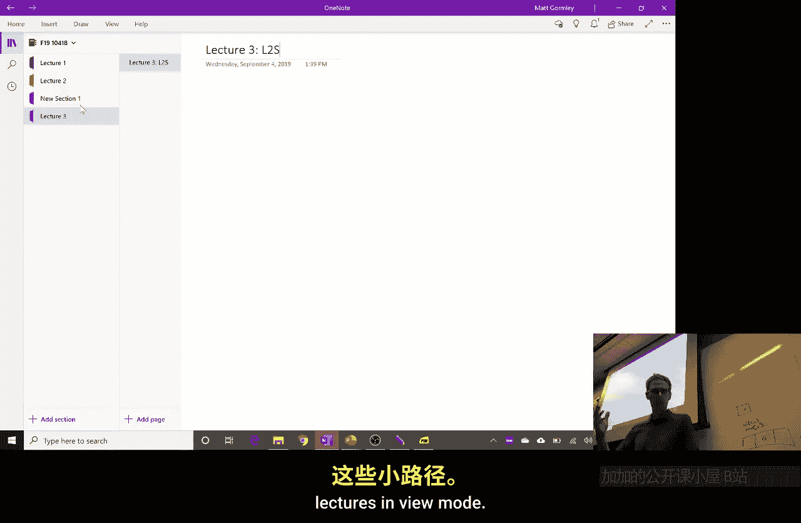
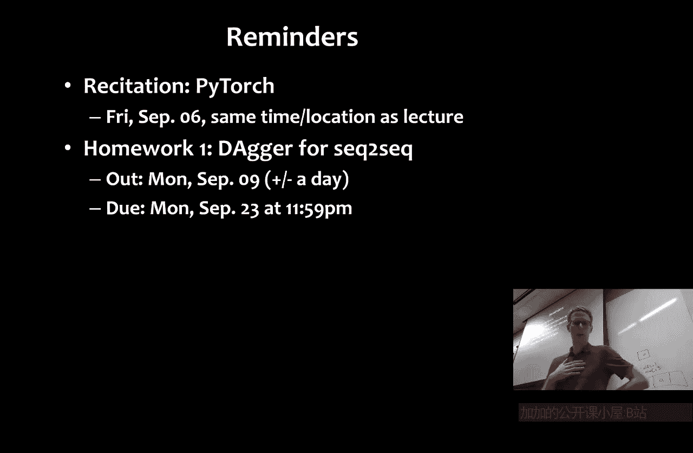
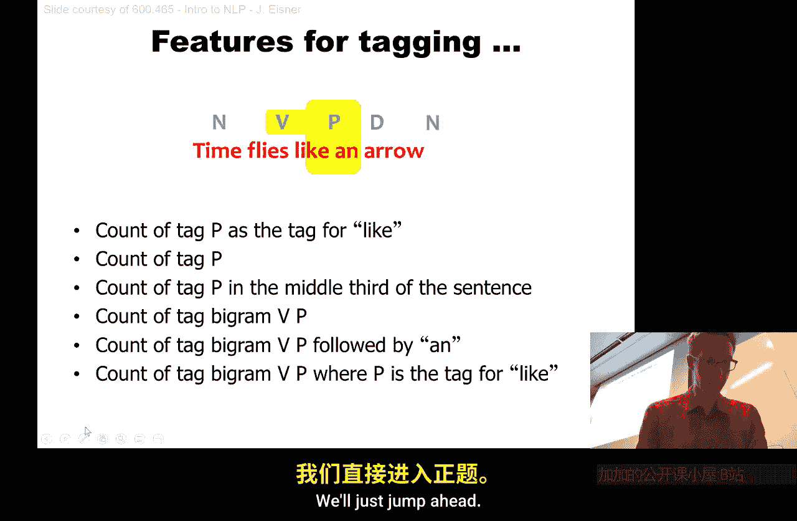
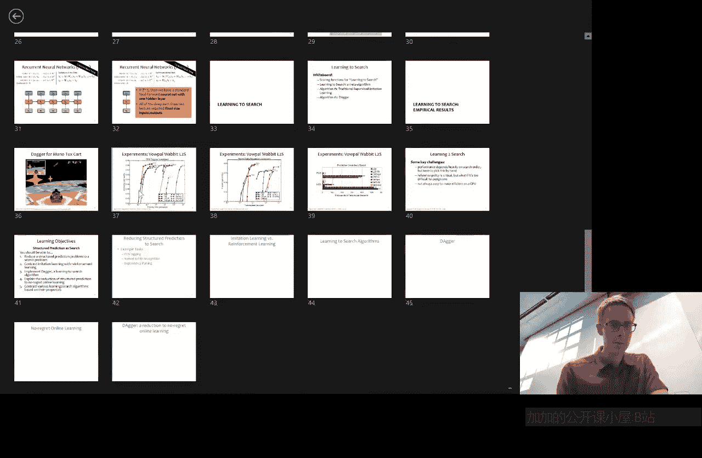
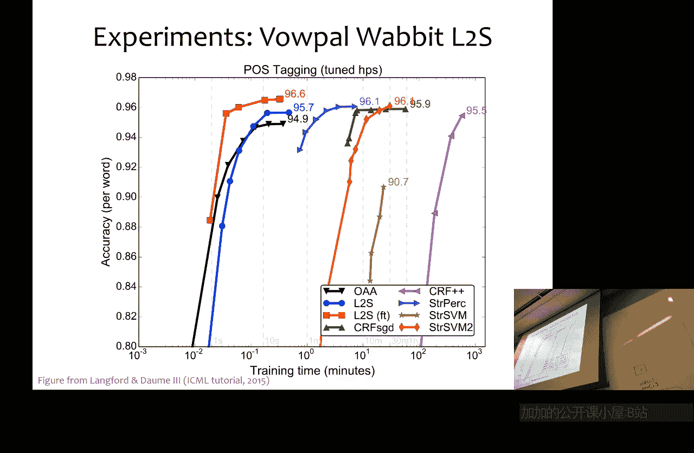

# 卡耐基梅隆大学【中英⚡结构化机器学习｜10-418 2019 Machine Learning for Structured Data】 p03 p2 10-418 ⧸ 10-618 Fall 2019 -BV1eJRsYBEaK_p3-

Okay。啊。Welcome back to 10418-618。あ。Finally， today。We get to some real meat of this course。

 we get to talk about structure prediction。A search。And。嗯。This is going to be， I think。

 a particularly fun topic because the way that we're going to discuss it is actually today to get really into kind of the technical side of。

How to actually formulate。Just a very simple problem。

 part of speech tagging as a learning to search problem。And then next week。

 we'll actually come back and we'll look at sort of the broader impacts of what we accomplished in the context of the models that are claiming the state of the art in all sorts of different tasks。

 and so there specifically we'll think about see tose models encoder decoder models that are deep neural networks that lend themselves really well to providing scoring functions for learning to serve。

And so。Today we'll sort of be able to talk about this without going into the details of those scoring functions and next time we'll be able to see kind of the broader implications。

O。So。Any questions from last time？Okay， I won't pause too long because we're getting a late start。

 so this is one question that came up， can we have handwritten notes from the lectures？

Okay fine you can have them， but there's a condition one you never tell anyone that you have them Okay so I actually for pedagogical reasons think it think that it's actually a bad idea to give you handwritten notes I actually think that sort of。

Forcing you to handwrite your own notes is actually a really good practice that said because this is a first offering of course。

 I kind of want to you know give you all of the。Tools that will ensure your success here and so I think it's actually helpful for all of you to be able to say you know go back and look at what I wrote and say。

 oh that didn't make sense was there some error there or I wrote down this and you know it's actually I think kind of helpful for sort of stimulating the dialogue around what it is that we're actually doing in each of these lectures Okay so this is probably the last offering of this course or you guys will have access to such lecture events。

嗯。O。And by the way， this link is just a link to the actual OneNote file that we're using here and so you'll get access to all of these little paths corresponding to each of the lectures in View mode。

 and then you can export them as PDFs or whatever you want。

Okay。Some reminders， this Friday we have our first presentation and it's actually going to be on Pytorrch so you might be thinking of yourself a minute Pytorrch I thought this was structured prediction。

 not deep learning right but we're going to rely on some deep models in this course and so we actually do want you to be able to sort of do the basics of deep learning and you will actually in your first homework launch and so this recitation is going to kind of go through some of the mechanics of Pytorrch and look at how to build basic computation graphs and then in homework one which we release roughly sometime around Monday some Saturday9 here you'll actually go in and and implement a model in Pytorrch that then on top of which you'll implement sort of two different learning algorithms。

 one of which，Learning to search algorithm and so we'll talk about dagger。

 the algorithm that you're going to implement in there and so so this recitation is sort of to facilitate actually getting up to speed on that so if you've already seen pietorrch before this is sort of a this is going to be a lightweight tutorial in the recitation so you're also welcome to you read tutorials online and and get up to speed in whatever way you want。

Soum。2。SoLet's talk about learning to search， but to do that。

 I want to begin by actually identifying what the problem setting is that we're working within。

The problem setting is really。呃。Going to be sort of best facilitated by a running example and so our example here is going to be that of so this will be。

Really。Just running example。Of part of speech tagging。Okay。

 and this will sort of show up throughout our discussion here and so in the context of part of speech tag。

 we're going to assume that we have。XY pairs。That consists of。Sentences。And corresponding tag。

Or sorry rather hate hanging。And so an example of a sentence would be something like。You know， flies。

Like a plant。And one possible tagging of it would be something like noun。Vb determiner now。

And we could sort of further decompose this to say that x consists of really a sequence of random variables。

 x1， x2， x3 x4， and y here。consists of a sequence。Y one y two。Why 3， Y 4。And。

So now we can sort of articulate our problem setting。Where our problem setting。Is going to be that。

We're given some data set， so we'll say。Our data set is some D。And D is going to consist of。呃而。

Excellent hairs。And we'll say that we have none of them。

Except that this time we're going to say that。Each instance， X。

 I comes broadly from some input space calligraphic X， and each output Y， I。

Comes from some outputlet space。So this input space。And this output space are going to be important。

Because they'll actually allow us to。I define。어。Specific search spaces that are sort of induced by those。

And what we'll often do is we'll work with an additional space， which is。A set say Yx。

Where this is the。嗯。The possible outputs。For a given input。Okay。

 so what does that look like for part of speech timing？Well， for part of speech tagging。

We could say that Yx。For this specific lies like a plant X。Is。the set。all length。4our heads。

So what we have then is that Yx is always some subset。Of our output space。

So the other thing that either we could say we're given or we choose is。嗯。Is a loss function。

And our loss function is going to be some。L that takes in。A true why and a why hat。

And it's going to map from。That pair。十三大。So this is just sort of like the usual loss functions that we have for classification or regression。

 but they might be specialized to the actual problem。So for part of speech tagging， maybe。

Our loss function here could be something like ham loss。So。Finally， we can talk about。呃。

Our hypothesis space。And our hypothesis space， we just need to be careful to say that it's going to be some set of hypotheses such that。

For all。Hypotheses， we have this property that。H of x。Is actually in。Y x。For all things。

So what we're doing is we're just saying that。The actual hypothesis。

Is going to specialize to a particular x， so it's not going to be just any old function。But rather。

 it has to be sort of a proper function that only returns candidates that are actually valid for the given input。

Okay， so why do we say that we just， we don't want a hypothesis that you know。

 you feed in a forward sentence and it returns a length six tagging。

And for more complicated structures， you could imagine the actual constraint here might be more couplings。

Okay。So this is mostly a problem setting， I there's sort of one more detail， which is that our goal。

Is going to be to minimize empirical risk。And。In general。This is sort of a high level goal。

 it's not just specific to the problem of learning to search。

 but when we're trying to minimize empirical risk， roughly what we're trying to do is find some hypothesis which we can describe as some each hat and that each hat is going to be。

One得。Actually minimizes。Our。어。Expected loss。Over the actual training sample that we have。

So what does that look like， well， it's a search over all the possible hypotheses。For。

Something that minimizes。Say the average。Loss over the training sample。

 which is just going to be the loss of。Why high and。Each of them excellent。

So this is sort of a standard goal， right？It's what we do when we're trying to find。

Say a good neural network。For a classification problem here， all we're doing is。

Just sort of saying that it generalizes to the case where the loss function is dealing with possibly structure。

And so the other way that we could write this is we could say， well。

 that hypothesis is actually going to be parameterized。

So what we're really doing here is searching for parameters that minimize us。The same thing。

But where。I think quantum of this is is now。Orandized by some data。And so in that setting。

 now we're searching for the actual parameters of the hypothesis rather than the hypothesis itself。

Okay， so we can hopefully pretty easily transition back and forth between these。

 it's kind of like saying， you know， are we actually returning a so you think about a linear model building。

 are we returning the actual linear model itself or are we returning the theta vector corresponding to the weights of that linear model？

And there might actually be multiple different weight vectors that give rise to the same decision function。

Okay。So。What we need here next are。Some bad ideas， not entirely bad ideas。

 but just some ideas that won't quite live up to what we're really going for。

 which is structured prediction of search。So I guess the third of these ideas I don't think it's bad since it's actually going to be a major theme of this course。

 but the other ones aren't terribly great， so idea number one here so we could say these are possible solutions。

And。We'll say that idea number one。Is completely independent predictions。

So if we make completely independent predictions。This is an entirely。

Bad idea it could actually work out pretty well in certain cases so again。

 let's kind of think about how this would work in the context of part of speech happening so what we would do is we would define。

A scoring function。And that scoring function。Is going to give us。One tag for time step。Okay。

So here we could say that we could define the scoring function over possible values of the variable Yt。

And it's going to take in some。Value for the vector。X。And we could sort of even say that。

The actual value of x is going to be。Sort of conditioned on rather than。

Sort of the thing over which the function ranges。So we'll use a semicoe in there。

So one way that we could do this would be we say we're going to have a linear model here where we have some vector of parameters data。

Subscripted by the actual part of speech campaign。And we just take the dot product of that vector of parameters with some features of。

Thanks。Okay， so。You know this。This sort of works except that。You know。

 maybe exactly what that feature function should look like is unclear。

 so maybe we could be a little more specific and we could say， well。

 we're really going to work with X T minus2， X t minus1， xt， xt plus one。X d plus2。

Okay so now we have a feature function that looks at a specific subset of the inputs。And。

So what we'll do there is we'll say。It Thanksgiving giving me trouble。So。

How do we actually define a scoring function like this well we can talk in more detail about what those features might look like。

 we'll do that later on， but roughly you know sort of schematically what we're doing here is we're saying you know we're trying to predict one the tag for one word。

Given。Some left and right context， right？So here we have words that appear to the left and right。And。

And so we actually have access to all of the words in the sentence。

 and so when we're predicting the TA tag， we can look at sort of any arbitrary window of tags。Okay。

 but then the catch here is just that。呃。If we're predicting each tag independently。Then。

Our actual hypothesis function， right， the way that we get Y hat T is going to be。An Arg Max。

Over possible values of Yt， say from the set T of all possible tags。And for each one。

 we're going to say choose the value of Yt that maximizes this scoring function。Where X is fast？

So what's wrong with this？So why should I dislike this？有来提升个。然后呢去。有打到呢整。Yeah。

 so it's probably unrealistic to say that adjacent tags are independent。

 which is what this model is saying。And so we can't really another way we put that is you。

 we can't capture。Coorrelations。In the upper tax。So that's a little disappointing。So as well。

You could sort of rephrase that same statement that we can't capture correlations as a statement that we can't optimize。

呃。A joint loss。Over the output tanks。So specifically what I mean here is that we're not going to have any mechanism for。

嗯。For defining a function over which we optimize right， like some loss function that looks at。

 you know， sequences of tags all at once。 So hand loss is just looking at individual tags。

 but we're not going to be able to。Sort of reasonably optimized to have the loss be something like a 01 loss that is trying to give us all of the correct tags at once。

So。So this is the sort of。Problems that arise here。And。嗯。Yes。And so。

We'm going to actually try something different。嗯。So instead， what we could think about is。

We could think about trying to capture some。诶。Correlations in the input。

So we could say this is going to be some idea number two。And idea number two here。

 we're going to say is。Multiitaask。呃。Learning or。Somehow sharing parameters。So in this setting。

We're going to。Now， define。A scoring function again。And but this time。

 that scoring function is going to be based。On some hidden representation。Okay， of the input。Okay。

 so here we could say that， you know， we have some scoring function and it's going to take some fancy。

Neurural net。And that fancy neural net will read in。Our vector x。

And it'll give us back some new vector that captures all sorts of interesting properties of that entire sentence right so now we're not just restricted to some little window of x's。

 we can look at the entire thing all at once and boil it down to just you know 100 numbers encapsulating everything in that little vector and then we can take its dot product with some weight vector。

And we can now define our scoring function to be based on that where we score Yt。Given。That vector X。

Using this fancy neuron。Okay。So the prediction is going to be。呃。The same as idea number one。

And so now the question is， you know， here。Can we do better than idea number one。

 is this actually like taking us？Further along here。I have a question about step one。

 so the input extract vectoror， it can give any answer。So。

 the expected vector that you feed to the neural network。 now that can give of any。

It could be a any like the same game of any like yes。So let's assume that， yeah。

 we don't know the length of an exile Priory。So I guess the question is。

 can we counter correlations in the output in this case？So did someone say no。

 you want to kind of run that through because like the score you get where Y？他什么问题。

This watching as well。Right， so we might be able to capture some interesting aspects of correlations at the input that would better inform our individual independent predictions。

But at the end of the day there're still independent predictions right the scoring function。

 the form of the scoring function is exactly the same。

 it's different it's just a different fancy neural net kind of feeding in okay so the cons here are the same as idea number one。

Okay， so。Idea number three。We could。Possibly。Do something like a graphical model。Okay。

 so what would that look like， well， at a really high level。

 we could say that we're going to decompose。Our scoring functions。Into parts of Y。Okay。

 and then from there， we're going to predict。How are we going to predict probably via some dynamic programming algorithms？

Because。Hopefully， our actual decomposition made it so that solving that a max problem over possible outputs is now efficient to do。

So。This is a little bit different， so one pro is that it can capture output correlations。

But it comes with its own cons。 So some some problems are that。It's often going to require。

Approxims because。Although there may exist a dynamic programming algorithm。

 that dynamic programming algorithm might be horribly inefficient。As well。

 the actual sort of assumed。Independence assumptions。Whoops， that's redundant。

 the assumed independencies or the decomposition， really。

 what I was calling a decomposition might be wrong。😊。

it might just be that you made the wrong decomposition。

 and so you're not actually capturing the kinds of correlations that your model would have if it had more flexibility to capture correlations。

Okay， so。So don't worry this idea。Isn't going to be all bad and in fact what we'll see when we get to graphical models is that we can kind of marry idea number one and idea number three and get back something that's really good at capturing correlations in the input with the fancy neural net and good at capturing at least some in the output。

By either dynamic any programming， if we can do it。Intractively saying call it anial time。

 or if we can't via some approximations， yeah question。

Or do you rather in composeose this whole function。

So I guess in some sense I don't really want to talk about that today。

 so maybe I'll just completely defer that question because it's sort of maybe beyond the scope of what we're talking about today。

 so we're going to talk and we're going to talk about a specific kind of decomposition as it relates to search today and sort of what we have in mind there is going to。

Actually base the actual decomposition on some visual representation of dependencies between variables that we call a graphicma。

So we'll get there today that we're going to use a different kind of decomposition Okay。

 so idea number four then。Is structured prediction as search？

And that's what we're going to think about next。So。What is structure prediction as search Well。

 again， it's kind of useful to have。嗯。Some notion of。Of an example here。So。

What we're going to do is circle back to。The really examples。

This is just like my day for like all technical things not working。Camera fail。OneNot failing。

Maybe OneNote knows that I gave you guys。Access to view access to these and so it's it's not plain nice no that would actually be hilarious if right now everybody was accessing these notes and it was like messing up all the syncing okay。

So what we need here is to return to our little B tagging example。

 so we're going to say that x is this vector and here we'll give it length t so what we have is。

Is actually。You know， flies。Like a plant。And this is x1， x2， x3。Thanks4。Really and。So。呃。Great。

And what we want to do is actually have a search space that is induced by this X。

so here's what I mean。Our induced search space。We're going to refer to it as。

A directed acyclic graph。And that directed acycl with graph。Or a day。Is going to be denoted by， say。

 G sub x。And it's going to consist of a set of vertices， vs sub x， and edges， E sub x。

This is nothing terribly creative this is sort of usually how we talk about graphs what's interesting here is that the actual topology of the graph is given by the problem that we're trying to solve so we could say that。

We're going to have some start state。And。That start state。I。

Not going to correspond to any one of those words now the first set of neighbors of that start state。

Are going to be possible tags for the first word， okay so flies could either be a noun or a verb。뭐 안。

Now。The word light。This one is a bit more interesting， so note the correspondence here。别 종인。です。

Call them in that word。So like could be。Say any of。诶。Creposition， it could be a noun。

 it could be a verb。There's probably actually other things that could be。

 I think it can be in aver we don't want to get too crazy here。Regardless of which。Cag。

 we pick for the first word， those same possibilities exist for the second one。

 so we need to have options。Greposition noun and verb for both the end case and the weak case。Okay。

 so this column corresponds to the word like。Now， the word A， I think even it could be ambiguous。

 but we're just going to say for simplicity that A can only be a determinist。

Kind of cleans up our graph a little bit。There's just not that many。Neighbors now。

 and then the last detail here is that plant could also be a noun or a verb。

 And so here we're going to have。Both noun and verb options for every single one of these。So。

What you can see is that as we draw this search space out。It exposes a couple interesting things。

One is that。What we're looking at here。😔，Is really just。그。The space wise X。

For the given X flies like a plant。And。And we even constrained the possible set of neighbors for each node based on the actual word that we were looking at。

So there's some more interesting things， so we could say that there's。Some sort of。

 we can say some correct why， right？Came with our training example and knew that correct why was。嗯。

Was the Y corresponding to noun verb？Determinary that。

And that corresponds to a specific pass through the search space， namely we could follow this first。

To take the noun， and me follow this edge， to take the herb。 and here the terminalr and then this。

けてね。And so what we're seeing is that。In addition， each。Leaf node。In this graph。Is some specific？

Vectctor Y1 to T。So further， we can define。A cost function。And let's say that the cost function。Here。

呃。Is going to be hamming loss。So in that case， our cost function is going to be c of y1 to T and y hat。

1 to。And it's just going to count up。The number of。for t equals one of the capital T。嗯。

YT does not equal Y happens。好。So this is just the number of tags on which we made an error。😔，Right。

So。What we can do then is actually evaluate the cost at every leaf node。

 so that would be like a little column here that says okay。

 we know what y1 to t is right that's given in our training data and then we're going to all。

The value of the prediction because each one of those。

s some leaf note in actually let me modify this ever so slightly to say that this is really a white hat。

 right this is like one of the possible predictions that we can make。Okay， so now。

Think of filling in a little vector here of all the costs。Okay。

 so can anyone tell me like one of the costs up there？Of want pick a cost of any we。

Your favorite leaf。我是村中国动。first one。Is going to have costs， oh I would have said。要错什。

So where is the actual error， is' in the second column， it said P when it should have said B。Okay。

 so the one just down from it is going to have cost of two because now in the last column we said B。

 when I should have said n。And then the third one is going to be， so this is the cost here。Here。

Here we're going to have cost again。嗯。Just one。So we make a mistake on the end。

And then this is going to be a constant too。Now here。

 finally we get a nice cost of zero because this is actually the true gold trajectory against our training example。

And the one below it is one okay， so we could go all the way down here and we could fill in the cost for every leaf node。

Okay， so now we need a couple definitions。So。One of them is that of a trajectory。

So we're going to say that a trajectory。Is。呃。Simply。A path。Through the search space。And。

What we can use that definition for is to say that each state in the search space。

 so we'll say that each state is some vertex V。And。Be specific about that so each state。

Which is a vertex v in the set Vx， right？What's Vx。

 well it's just the set of vertices in the induced directed acycl graph。So each of these states。

Corresponds。To a partial trajectory。可以。Because for any of the actual。States in the graph。

We only have sort of part of the output built up。Okay， and so。

That partial trajectory is actually starting。诶。Say initial states。V0。So of without loss of geneity。

We could just say that there's one initial state if you wanted a search space that had multiple initial states。

 you could just add an extra state and connect it to all of your initial states and so now you're back to one。

And so the key thing here is that sort of a partial trajectory。

Is going to correspond to some partial prediction。Right for some。呃。

Value of little T that's less than or equal to capital T。Okay， so I mean。

 we're putting a lot of words。Here in a lot of math， just to say something incredibly simple， right。

 if we circle this vertex。That would be there。It corresponds to the partial tagging N V。

 we have actually tagged the remaining two words。So this is like some vector where。

Y1 equals noun and y2 equals B， but we don't have values for y3 and y4 again。Okay。So。All right。

 so now。We get to a slightly more interesting definition。So we can say that。

The optimal completion cost。Is going to be a function。That we'll call C star。

And that function is going to map。From a vertex Vx。2。A number， some real value number， a score。

And or sorry a cost， so higher is worse。And the way that we define it is we say that。

This optimal completion cost is going to it's going to essentially be induced by the Xy hair。

We can't actually have an outside of a specific training example。

 and what it'll do is it'll say for a particular state V。This optimal completion cost is the。

The best possible。诶。Value。Of any reachable leaf node。Okay。

 so what do I mean by that we could write this as。A min over， say。States V prime in the set。

Say p of V。Where we compute。For each of those。For that Z crime， the value CEO。Be proud。Where。Here。

P of B。I。The set。嗯。Reachable。Terminal， or let's say。Terminal nose is a bit of a mouthful。

 reachable reuse。From me。Okay， so let's go back to our circle V in the center here。

So that's a state right in the middle of our ground， but from that V。

 we can actually reach two different leaf mills， right， we can reach both。Thisすね。And this。

So what is the optimal completion cost of the V that we circled？Zero， right because。

The best we can possibly do would be to continue along。

That green pass that we highlighted and we would get。That would be one of the nodes in the set TV。

 which is the reach leaves from D。And we would get a cost of zero for that leaf node。

 so the state coming before it is also going to have cost of zero。Okay。

 so what that means is if instead， say we wanted to ask。

 what's the optimal completion cost of this node at the top P？But one， right。

 because the best we can do is hitting that top leaf。Okay， so。All right。

This notion of an optimal completion cost is going to be how we define what we'll call sort of the oracle policy or the reference policy and this is really what's going to differentiate what we're doing here from reinforcement learning okay so actually how many of you have had some discussion of reinforcement learning in？

Some in out。Okay， most people good so here we might circle back to this sort of this contrast of imitation learning and reinforcement learning。

 I don't know if we'll have time today。So I want to talk about policies and so a policy。

It's just a function that maps。From。The things that you've observed， like all of the observables。

Or say observations。Two actions。And。What we want is some definition of an optimal policy。

We're graph like the one that we just set up for party speech testing。So an optimal policy。

Is going to take。OrWell， we'll say it's some function we'll denote it by pi star。And it's induced。

You should by by this point be sort of rolling your eyes yes of course it's induced by a training example so here again this is going to like the cost function be induced by a labeled。

Training example。And we could say that that's some X Y。Such that。而。Pi star function。

When you pass in some state V。Is going to return。你的。The action。

That has lowest optimal completion cost okay， so what are the actions when we're talking about a search space like this？

So we have this search space。What does it mean to take an action when you're at a state in the search states？

Another addition。Yeah， it just means， you know， predict the next tag。 So。

 so what we could do to write this in sort of a general fashion is we could say that our optimal policy。

Is going to take。啊。Sort of as an action。A next state。From the set of neighboring states。

 so NV here is just going to be the set of neighbors。For the current state。And V prime。

 we can say is really actually， it's another state。

 but we can sort of say that there's this one to one correspondence between actions and neighboring states。

So here we can say that the policy is going to return one of those neighbor states。

 specifically the one that minimizes something， which so is how do we fill this in？Yeah。

 it's just going to be。What's in our notation， how do we fill this in？Yeah I see stars of what？

Of the price。One of the possible neighboring states。Okay， so。It's kind of like。Well。

 so let's be specific here， so this is。You know， neighbors。Of state V。And。诶。You know。

 sort of paraphrasing this， this is sort of choose。The lowest。诶。Choose。The neighbor。With lowest。

See Starva。Or lowest optimal completion costs。Okay， so。So now。

We can ask sort of a fundamental question here。Which is。You know， what is the actual goal？Of。

Learning to search。So we had outlined that the goal for structure prediction at a high level is to minimize empirical risk。

 so our goal here。Is。Broadly。Going to be。Just that we want to find a good policy。O。

So here is kind of the key question。呃。What does it mean to find a good policy？I mean。

 this is sort of something really abstract。Find a good policy。

 it sounds like what reinforcement learning is trying to do with here。

 but what we've just set up is an environment in which we can be very specific about what it means to find a good policy。

So any thoughts how we could do that？So remember， a policy is just some function。

 we describe the specific one， the optimal policy， but a policy is just some mapping from observations to action。

So how could we say find a good policy？Ideally， that policy， when you buy on the start state。

 will always be。你て虽道们这么。Right， so an ideal policy， okay。

 would take in the start state and then just always return。A zero cost solution Okay。

 so I guess what we're going to want here is some notion of what it means to go from sort of a policy to an actual say full hanging right so what we could say is that。

We can define。A trajectory why hat。A complete trajectory as being sort of sampled from our policy pie hat。

Starting at the initial start steam。OkayAnd we could say then thatop sorry。

The Y hat here is going to be what would happen， it would be the leaf node that you end up at if you follow this particular pie hat。

All the way from the start。State to whatever leaf node you end up with。Okay， so this is good。

 so now we have some notion of getting from a policy to a structure。

So how can we go from here to a definition of what it means to find a good policy？

Even given the past， it has a quality today。The next list。呃。Yeah， so given the past trajectory。

 the policy should predict the next best。That's good。

 but I want something that kind of looks like an objective function。

Whereas what you're describing is more like a description of。就怕佢冇发事。

So remember that our original goal was to minimize empirical risk。

Could we do something that looks like that， but in terms of a policy？Okay。

 so what if we said our goal？Is to find。Some tie hat。That is。The pie。

Which when we iterate over all of our training examples。And compute。Say the cause。嗯。wifi。

Versus something else。It will be as low as possible。So what is that something else？

What's the prediction that we get when we run our policy？On the graph。That we induce on act。

So notally， we could write something like， this is for the Y hat or is really vervoly here。

That comes from。Following the policy。P hand。The。We'll subscript with Xi。Because。

We're saying that the actual pi hat is sort of specific to the graph that you instantiate for that particular excide。

And so when we look at this graph up here。This is the graph for the specific sentence。

Flies like a plant。But if you have a 23 word sentence。

 then your graph is going to be much larger and the actual sort of application of your policy。系咩。

Or rather， I guess this is just fun。We're searching over possible。Is going to be。

Depenent on the actual input X。Okay， so。So now the kind of key question is。

How do we actually go about that？So this is sort of our。High level goal here。And。So one way that。

We could go about that。Is。By doing sort of one of our favorite things in machine learning。

 which is define a scoring function。Over states。And we'll say that scoring function is some s theta and it takes in a vertex and the set of Vx and returns a score。

Okay，What we can do then is we can now define a greedy policy。As one。啊。

That is specifically a greening policy for。Some specific scoring function。来てた。

And we could say that that greedy policy is going to be some pi theta。

That takes in a state V and returns。The highest scoring state in the set of possible neighbors。

So now。This s theta of v prime。Is going to provide a score for each of the possible next states that you could land on。

And the greedy policy is just going to pick the state that has highest score。So。I mean。

 this is a really simple idea。Choose the。Highest scoring neighbor。That's all we're really doing。Okay。

So。There's a question of what should these scoring functions actually look like？嗯。And。

But don't want to spend too much time。Getting bogged down there， so examples of scoring functions。

Could be。诶。You know， a linear model。It could be a neural network。Maybe a feet forward Mer that。

It could be an R&N， we'll talk about those next time。

So there's lots of different possibilities for what that scoring function is。

 but the point is simply that it's going to provide us a way of actually giving a parameterized score to each state。

There seems to be very little difference。often voice and the degree ones。Yeah。

 so what difference is there between the optimal policy？They're purposefully analog。그那就这。

to policy for things that both predict。呃。So I don't quite like that statement。

 we only know the open policy for things that we're about to predict。嗯。

Does someone want to try a slightly different graraing that that？Yeah。

 is it that one of them only looks at the use of the final outcome the other one looks at。SoYeah。

 so the kind of key thing here is that encoded inside C star。Is access。To the true sequence， why？

Okay， so how was it， let's go back up。How was it that we actually came up with C star Well， first。

 we computed this giant vector of the costs for every single leaf node。How did we get those costs？

So we looked at。The actual sequence， y1 the T。So then the optimal completion cost C star。

 we actually hear， I maybe you kind of got lazy about it as we went along。

 it was subscripted by X and y。So if we kind of trace back through here。We'd see that。

So here when we're talking about。啊。Optimal completion cost， we should subscript it with。ex来。

And then down lower。When we're talking about。The optimal policy here。Again。

 we need to subscript with。explain why。Okay， now， though we get down to。嗯。

A description of the scoring function and the scoring function is going to be a little bit different。

So the scoring function。Is really just a mapping from Vx to the real numbers and so we should really define it as a function of x。

 but not of y。So the scoring function only gets to look at the actual input。Okay。

 so this is the key difference following the oracle policy is kind of like following a cheating policy。

It's like the policy that you would follow if you already knew what the correct answer was。

The greedy policy is saying， okay， we just have some model that tells us。

Based on some parameters data， how good or bad each of these states are。And based on that model。

 we're going to pick which the next best state is。Okay， so the other like minor difference here。

 so that's the key difference is that C star has access to Y and S theta does not have。

They both have access。So the other difference is just that。

The scoring function is higher as better by convention。

 and the cost function lower is better by convention。So hence the arc max versus argument。Okay， so。

So now。Sort of the remaining question is。How can we actually learn something in this set？And。

To do that。嗯。We're going to think about a meta algorithm。So this meta algorithmgori。

Is going to allow us to define two slightly different algorithms。So。

The first thing that we're going to do is。Say that there's。嗯。A collection of training examples。

 and so we'll say for each。X， Y pair。In our data set D。

 we're going to run through the following steps。Okay， so step one。We're going to induce。GX。

Which is the gram myth。From X。And then we'll do a couple more on that same first step。呃。

The scoring function， as theta。Which is that mapping from。States to scores of states。Chrome Gx。

Andthe。So note that we are not using Y to come up with their scoring function。We'll also induce。

Our cost function see star， which is another function mapping from Vx to a real number。

 but this time using。The pair Xy， right， so we had access to both。Or we can say。Using GX。And one。喂。

So。Okay， so this is sort of setting up all the things that we need。So next we're going to gather。

A trajectory。Through the actual search space and this trajectory will be something like V1， V2。

 up to say Vt。Of states。Okay。And。Step three， we're actually now going to construct some training examples。

Okay，Now this should feel a little odd。Because at this moment， you were thinking， well。

 we already have our training example， it's an X Y pair。

But remember that what we're trying to learn here is actually a policy。

So the policy takes in a state and produces an action。

 so we need training examples of state action pairs。Okay， so where could we get those？

So we need to construct training examples。Okay。So what could our training examples be here？

Different leaves of the value start to the of the。散不程。So let's see。

 so the training example needs to consist of a state action error。So if you're a the leave。

What is the actual state action fair， No I mean， each trajectory from the start to 2030。

 every state and the action we take up that state？Would be aware， And you would sample and touch。

Great idea， okay， so then the question is。There's many possible actions， which one should we think？

optimal policy Yeah， the one given by the optimal policy okay so step three。

 we actually just gathered a trajectory so why don't we just use that trajectory rather than all possible ones because there's there's so many states I mean there's exponentially many in the the length of the input so instead let's say what we're going to do is we're going to have say T training examples。

So for each of these states that we just gathered， let's take BTV。And。High star。Means X and Y， right。

到V机。And this will be our training example， and we'll say that we have T of them。

 but would we not also need to know what policies are bad do we only need to sample good policy。担书。

Oh， so what we're trying to do is set up something so that we know from a given state。

 what action we should actually。就。If you think of the policy as sort of in by analogy to reinforcement learning。

 what we want are examples of what the behavior of the policy should be from a particular state。

 and so this optimal policy is kind of like a form of supervision it' saying when you are in state VT。

 the right thing to do，Is to follow the optimal policy for the next step。

So that's the sense in which we have a training example here。Okay， so step four。We could then say。

I didn't even really leave room in the subscript here。If the actual policy。

Was parameterized by some theta。Then we could say。アて。The parameters data。诶。By training。四。系。SGD。

On what we'll call say， D prime here。Which is the set of。

State action errorss that we just came up with。Okay。

We're sort of 10 minutes shy today because of technical difficulties。

 so I can't quite get to like the beautiful punchline of dagger here。

And so I'll leave you instead with this question。Which is。呃。Which policy？Should we use？To collect。

This trajectory。特に？So it's step two。I just said we're given a trajectory。

That means like one specific path through this exponentially large search space， and then I said。

 okay， you have that one path in mind and now for each step along that path。

You should train so that you' making the right action for that particular step。And the question is。

In which states should we actually look at？There's so many of them。Okay， so next time。Yeah。

总 you have school你都觉得。你先有跟佢国家呢。Well， you could， but I there other options。

And that actually is taking the correct sequence， is that actually a good idea？

Or could it result in problems of its own？So these are kind of the fascinating questions that result once you start to cast the problem as a learning to search the problem。

And next time， what we'll think about。Our two approaches。

 sort of a traditional supervised approach and then dagger probably not and then we'll also look at some empirical results and I think the thing the picture that I'll leave you with。

 the punchline that I was，嗯。That I was going for here。We'll just jump ahead。

呃。

Is a picture of speed accuracy trade off？So fundamentally。Okay。

 so this picture is actually horizontalrr needed and I'll throw in a bunch of caveats about this。

But the fascinating thing about these results are that on X axis we're looking at training times on。

 the Y axis we're looking at actors for part of speech type。

And what we see are that the red and the blue here are learning the search methods in double webbin。

You can see that not only， okay they happen to be achieving the highest things on this plot。

 these are not state of the art， these learning to search numbers are not state of the art。

 I'll get more to that later， but they're certainly the fastest among the bunch。

And so one of the key things that we buy。By going to this learning to search methodology is the ability to do greedy search and greedy search can be lightning fast compared to a lot of other methods out there。

Okay， so next time we'll delve into the details of how to flesh out the rest of that meta algorithm。

 well at examples of applying it back to part of speech tagging and then we'll。

