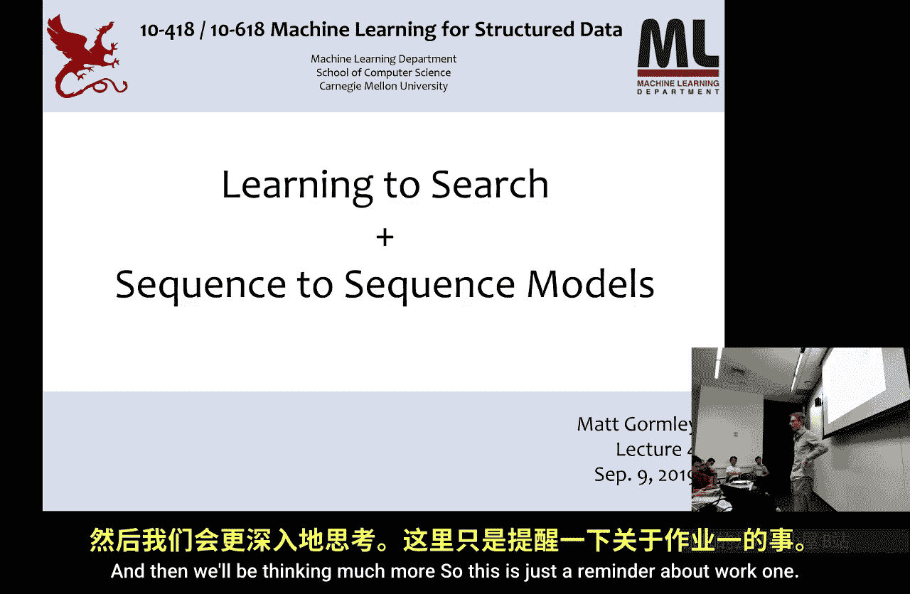
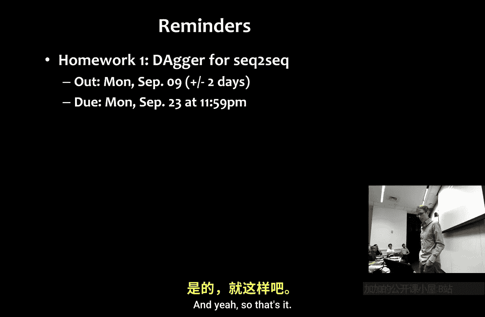
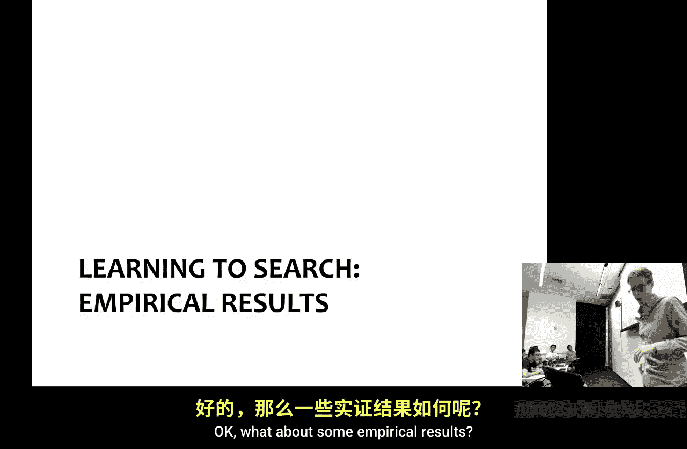
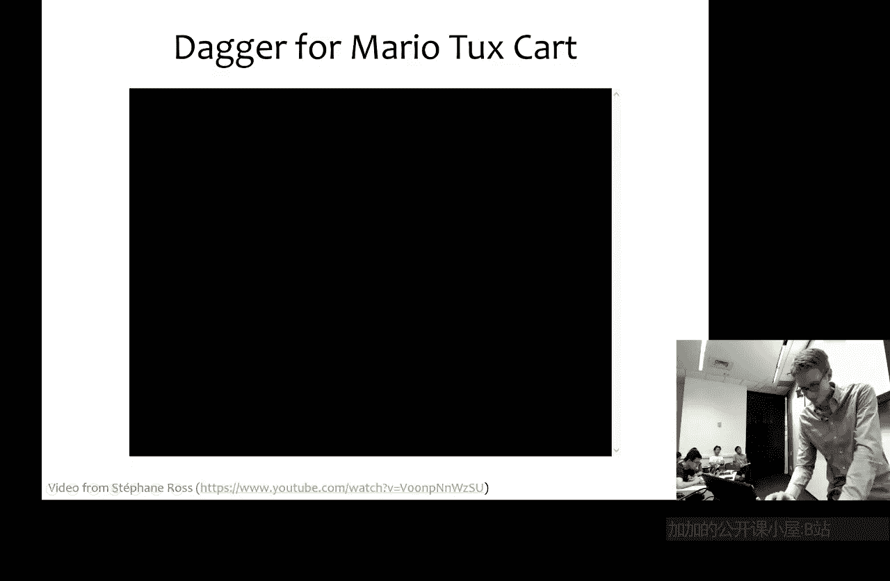
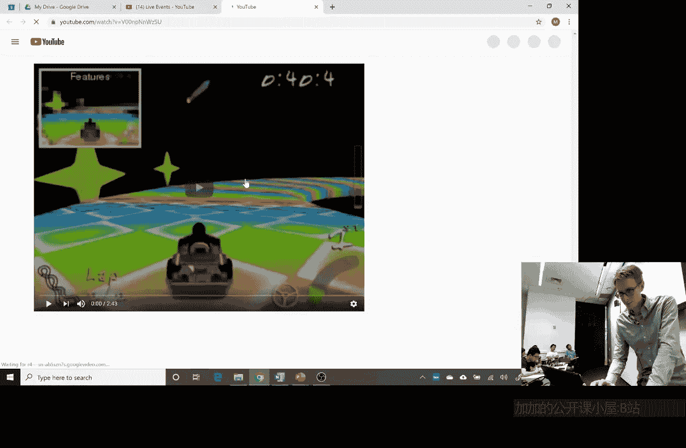
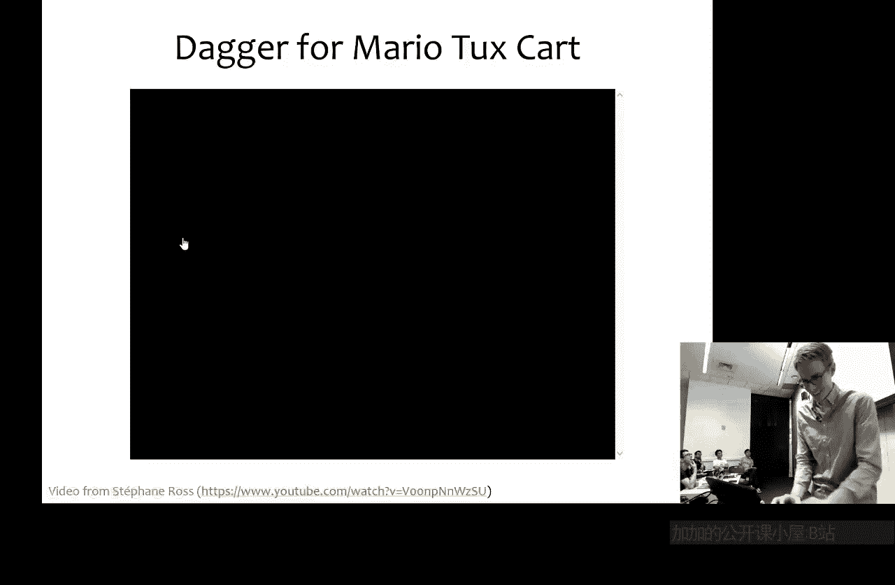
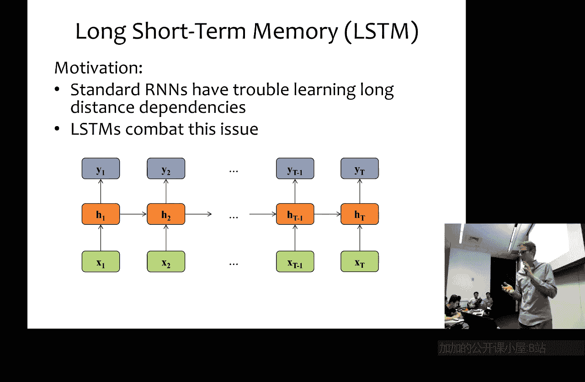

# 卡耐基梅隆大学【中英⚡结构化机器学习｜10-418 2019 Machine Learning for Structured Data】 p04 p3 10-418 ⧸ 10-618 Fall 2019 -BV1eJRsYBEaK_p4-

All right。Welcome to 1014- 618。Today we're going to be picking up where we left off。

 which was sort of mid sentence in a description of learning to search algorithm。

And so today we'll be sort of wrapping up that。あら。That meta algorithm that we kind of began our discussion。

And then we'll be thinking much more in detail about the possible scoring functions that we could actually use。

Within such a meta algorithm。

Okay。So。This is just a reminder about the work。I'm probably not going to get all the way through。あ。

The remainder of learning to search all of R NNs。modelss and secrecy models today。U， if we do。

 maybe we'll just release homework on today， since I probably won't we'll probably pull off until releasing it on Wednesday。

嗯。Yep， one detail。

And so I want to turn back to our discussion of。Learning to search here。And in particular。嗯。

I want to circle back to a topic that's really important。

Which is how to actually construct scoring functions for the running example that we've been using。

 which is part of speech tagging。So we'll get to a fancy way of constructing such scoring functions。

 but it's useful also to have in mind what people were doing say before SQ to seekq models became prominent in sort of the early 2010s。

And that was a relying on linear models， okay， so before we even jump in here。

 let's actually just look back at what we were doing last time。And。

So you'll remember that we had this picture of sort of a search space。For part of speech tagging。

That was specific to the actual input right so it flies like a plant was our input sentence and we induced the search space。

 which was a directed basically graph。Where each state represented a partial tagging of the sentence。

And so the question is， how could we construct a score for one of those partial tests？

And one way of actually going about that would be to use a linear model。

Where we have some features of that path。And then we just have a weight vector。

And so if we get the score， we just take the do product of the features with the weight factor。

Simple idea。 Now we just need to come up with some features。 So what could those features look like。

Well。For this sentence， that applies like an arrow。One thing that we could do is we could say， well。

 we're going to look at the number of times。That the tag P appears。As the tag for the word like。

And we could say that。There's going to be some weight。Attached to that particular feature。

So if you've seen HMs before， this should ring sort of very familiar because you could think of this as like an emission probability on an HM。

Okay， so the other thing you could do is you could just have a feature that is the number of times that P appears right count of the tag P by itself。

You could also do something fancy， which would be the number of times that the tag P occurs in the middle third of the sentence。

 so we could count up the number of words， we could figure out where he is and how many times it's appearing there。

We could also start to count tag vis like we could look at because remember if if we're at a partial。

Tagging of the sentence， then maybe we've already seen this entire sequence of tags， right。

 This could be like some path through our search space and of course we can see the entire sentence right because it's not changing as we're moving through the search space。

So you could then have the number of times that the tag bygram VP appears。

And this should sort of also feel familiar if you've done HMMs。

It looks kind of like a transition probability。Okay。

 but then you could have those transition probability like things。

 also look at the sentence simultaneously so you could have a feature that fires if there's a VP and it's followed by the word and。

 sorry the highlights a little off。Okay， and then we could have the tag diagram where P is the tag for the word like right this is kind of a combination of an emission and a transition probability into one。

And maybe something that looks at whether the words are lowercase right and so this goes on the count of trigrams。

 NVP， right？We'll actually talk about Ngram models I'm going to kind of skip that you could also have the number of postverbal nouns right this is sort of a linguistic notion of nouns that come after some verb and it's natural to actually have lots of these in languages that are in subject verb object order so it's a reasonable feature。

And。Let's get this discussion of finance state transducers so you can think of。Essentially。

 these attributes of the tag sequences in the sentence。

As being computed at each position in that Xy pair。

 and in our case you could think of it as being computed on any of the partial tagging that you've seen so far。

And so。If we think of this。In terms of a particular tag at position I。

 then all of those examples that we looked at， we could articulate via some template。

 some notion of a template that looks at the full name of the tag， the first letter of the tag。

 the full name of the previous tag， the full name of the word， at that position。

 the last two characters of the word， the first four characters of the word and so on。

These are sort of getting suffix and prefix features right that actually understand something about how verbs are conjugated or something like that。

Orlemmas of words。Okay， and so all of these would provide you with potential features that could fire。

 and then we can actually combine individual examples from that previous list。

And can joinin them into feature templates， so you might want a template that is a feature that fires on the previous tag。

 the current tag， and say， the suffix， the last two letters of the word that's coming。

And so all of these would allow us to kind of build up this rich feature set。

So that we can then use these templates in the actual sentence where wherever we are in our search space right。

 So if the template was looking at say。This previous tag， the current tag and the suffix。

 then you could look for， say， the first one。啊 now。By the previous tag。

 current tag and then the next。Where is the word what？Again， so our highlighterers off。

So the point is that then once you have all of these features， you can， for each feature that fires。

 you can multiply in its corresponding weight in the linear model， and that gives you a score。

Of the quality of that path。Okay。So very quickly you could easily end up with millions of features here。

 and this is just supposed to be our simple example of part of speech tagging。Okay。

Imagine if we were actually doing machine translation or acoustic speech recognition or image captioning。

 the examples that we're going to get to later。Okay， so back to learning to search。

 now that we have some notion of how we could actually score these paths。

 let's think about that meta algorithm that we had introduced and how to specialize it so that we can get two algorithms that we'll talk a lot about which are are the traditional supervised im learning and depth。

Okay。So here's our meta algorithm from last time。And so you'll recall that。In this meta algorithm。

We said that。We have some training data set。And。It's going to consist of。XY cares in the data that B。

And the first step of the learning algorithm is going to be to induce our graph from。

And then we're going to come up with some scoring function。

Like that linear model that maps from particular states in our search space to scores。

We'll also have some cost function， C star。That is our oracle completion cost function that tells us。

From any state。What is the best that we could possibly do in terms of costs from that stage？Okay。

 so then we'll gather a trajectory of the states。We'll construct training examples that consist of pairs of states in our search space with。

The oracle action that would be taken at that state if we had perfect knowledge of what the correct answer was。

And then we'll update our parameters of our scoring function so that they do a better job at imitating。

That oracle parts。So this whole algorithm is sort of a meta algorithm for imitation mark。

And the notion of imitation here is that we want the policy that we learn。

 which is going to be based。On that scoring。To do。Almost the same as the oracle policy。

In terms of its behavior。So we're going to update the parameters of the scoring function so that it matches the behavior of the oracle policy as well as possible。

 Okay so now let's actually look at a concrete example with part of speech tag。

So we're going to say first talk about algorithm number one， which we'll denote by。诶。

Its a traditional。Supervised approach。And here。We'll say that。What we're going to do is。

Let that' step4 above。Be done。呃。With the oracle policy。다 시작。Well。

 and I guess I forgot kind of an important detail here， which is。

What does this meta algorithmgori return。Does anyone have any thoughts on。

What should we write here that the meta algorithms actually returned？Sa again。

The parameters the and what if we wanted an actual policy， which policy should we return？来说。

So the scoring function is going to tell us。The actual scores on the edges。But我。

Would a policy be that could rely on that scoring？can make the。Yeah。

 the policy that makes the score biggest， so one of the policies that we had talked about last time was this notion of a greedy policy。

Which chooses。Highest。Scoring nearest neighbor， right？

And so we could say we return the greedy policy。Induced。By。we could call that。So this greedy policy。

If as theta。We're。The negative of C star。Okay let me actually write that down。

Tricky little question to say I not so if。呃，S datata。Equals negative C star。What is P hack？Yeah。

 it's just the optimal policy。 It's the oracle， right？Okay， so。In general， we won't know。

What C star is， except on the training example。So at test time。

 our S theta won't equal negative C star。But hopefully we hope that people have learned to do to behave similarly to。

C star and we'll predict something that at least close to P star。All right， so。

The first algorithm here is we're going to let set 4 be done。Bye。The Oracle policy。

And so we could say that as an example。Consider P Os tagging。And so you could think of， again。

 that sentence lies。Like I planned。Corresponding to a search space that has some start node。

 And this time we're not going to draw out the entire search space。

 we'll just look at some salient parts of it。 So namely， flies could either be a noun or a verb。

And what we're going to be concerned with is the actual path and the search base corresponding to the ground truth。

 right？So the ground truth here is noun verb。系。Determiner。没。So。This path。cororresponds to。

The ground truth， and we could actually think of how to use that path。

To generate our training examples。So according to the meta algorithm。

We've just collected a trajectory， right from。Start to end a verb to determine where to now。

And the question is， what do our training examples look like for this case？What does step。我今这你の问分来是。

Yeah， exactly it's just the nodes and the actions that we took so so the first training example is just going to be。

This start node。Followed by NA。And then we could label some of the other states so that we can actually refer to them properly。

 so we could call this S1 and this S2 S3 and S4。And so then we'll have another training example that is。

S1。Andver。Where this is state that formed。And then we'll have another training example that is S2。

And determiner。And then we'll have another， that is S3。And now。And then we done。And if we wanted to。

 we could have sort of an extra end state。Just so we're a little bit more symmetrical。

 And then in that case， we could have S4。When you say step four。

 do you need step two like gathering the trajectory？Oh yeah， sorry about that。Step2。So here we're。

We're trying to decide how to actually collect。The trajectory。

And so we're just saying that the way that we're actually getting gathered the trajectory。

By using the work。Okay， so。Once we do this。We can now train that scoring function so that it does a good job of predicting a high score for the corresponding action right so when we're in the start position and the sentence as far as like a plant。

 it should have a high score， we should update the parameters the。So that whatever our features are。

 they give higher weight。じえ。Rather than be。And then when we're in state S1。

 we're going to update the parameters to give high weight to。To action V instead of N。

 and so on down the line so that we're gradually increasing the scores of。

On these edges and so if you actually if we actually wrote in you know maybe what the scores were as we were going along。

 maybe initially this is actually a low score， so maybe this has score negative three and this has high score。

A fourth。喂。And say over here， this has。L score and high score。对。T scoress。And then this morning。いです。

当すか。And so you can see that the actual model， based on those scores。

 if it were using the greedy policy， would have actually made errors at several different places along the way。

It would have made an error here， and it would have made an error here。

 and it would have had to sort of randomly break a tie。In these three in the middle。

 so there's lots of places where it would have been making these little errors and the question then becomes。

 you know， how do we actually update the scoring function to give higher weight to，They're correct。

And we can do that once we actually。Training data in which to update the scoring function。Okay， so。

This seems like a pretty simple learning algorithm， but there's just one main issue。系。

Can even think of what that issue might be？We aren't learning anybody。对。你 this system。

Where it hasn't been received that。哦，几欢。えマ変の。Yeah， so in particular， we could say that the model。

Or the classifier。Let's say the scoring functioning them。Meaning S theta。Is never。Exposed。To。

Its own mistakes。So at the beginning here， it looks like。The model really wanted flies to be a verb。

So if a new test example came along。And we hadn't updated the parameters enough to give N high weight over feet。

Then the model would have immediately gone down this B patch。And at that point。

 the model might have no idea how to actually recover。 Okay。

 so this is such an important problem that it has a name。 This is called exposure bias。

And one way to actually kind of conceptualize this is to think in terms of a totally different example。

 which is Mariio K。We'll look at this example in more detail in a moment。

 but basically you can imagine in Mario Car if you wanted to learn。A policy that was able to。

G来 a little cur。Through a course。depiction of a course。

 and you could imagine that maybe the Oracle policy would just stay in its lane。

And drive correctly through。The rope。Okay， but what if the model's behavior was initially similar。

 but then it kind of like veered off。So at this point， at this moment。

 the model might actually have no idea。Which of these paths。

 these sort of completions of this trajectory， are the best。Because。If this is pie hat。

 it might have never actually seen this sort of blue behavior before。

And so we could say that in this case。Pie hat。Never learns。What to do。When it's near an edge。

It's just not even sure how to actually recover。So。How do we actually solve this problem？嗯。

The answer is just to。Replace step two with a slightly different。Option and the Oracle policy。

so here's algorithm number two。And this is dagger。Which is sort of a funny abbreviation for data set。

Aggregation。And so in this algorithm， what we're going to do is we're going to say let's step two here。

Be done。By not the Oracle policy。But。Bye。Our models。Current policy。Which we could call pie hat。

And just so we're abundantly clear here， what we're saying is pie hack is going to take in。A state。

And it's going to return。The artrc Max。Over all， possible actions。Scored by。

Our scoring function that takes in the state in action panel。So our action is from some， say。

 set of actions。So if we do this， we can。Kind of think about the example that we were just looking at。

And。And sort of consider how。The behavior of this algorithm gives us a different set of actual training examples。

So， namely。We could say that。チーとすかね。Now what we want to do is just update this picture。With。

How it would actually behave if we were instead using our models pop。So what we could see here is。

Our training example， we can sort of remove those old。公司最的行为。

And we're also going to have to flesh out a little bit more of the actual。Graph here。

RightBecause our model is not going to behave the same way。

 So specifically the first thing that our model is going to do differently is。It's going to。

Take a step down this。Because it has higher score。From there。

 it's going to have a couple options in front of it， like noun and verb。And then。From。From there。

 let's suppose that it selects verb。Well， then again， we have the same options as before here。

 noun verb determiner。And if it selects Der， then it'll have。Options and and V Okay。

 so so here what we're looking at is that the the model policy is selecting。different。

Way and of actually。Completing this path。And so what our training examples could look like here。

Would be similar to what we had before。 but let's actually come up with some new state names。

 So let's say that this is state S1 prime， and this is S2 prime。S 3 prime and S4 prime。在审。

So now our training examples are going to be slightly different， right， we're going to say， okay。

 as before we have that same start。And training example。Okay， but then we're now。

 because we're going to follow the models policy， we're going to have an example as one prime。啊。难道你。

First。And then we'll have a student guide。Theter面。And。That's three crimes。从包你。For crime。という制で。出さて。

So here， the collection of training examples has changed。

Such that now when we make the initial mistake。Of labeling flies as a verb。

 we can recover and still do well at tagging the rest of the。And remember why this is important。

The scoring function is going to have features that look back。

And all of those other aspects of the path up until now。

 so it's going to be counting things like the number of nouns that occurred before。

And so it's actually without this training thatday。

 it would be really difficult for the model to learn that when you have this verb here。

For flies and you see the light， it's actually difficult for in English to have two verbs following each other so we're going to actually have to learn that sometimes our model makes mistakes and we might need two verbs following each other in this particular form to actually correct for that mistake。

Okay， so there's a couple really important things going on。 I guess one is here where it learns。

The correct action。Even if it。Makes a mistake。And then second， it's going to。

Sort of through all of these other。Training example， it also learns。To correct for its mistakes。Oh。

 sorry， I actually have my hair is wrong。 So the the place where it's going to。

Learning the correct action， even if it makes a mistake is in this first case。

So the place where I made a mistake was the model predicted verb。But the actual thing was now。

So the training example still contains the action of the oracle policy right because we know what the true sequence is right in this case。

 we have some Y star sitting here。This is our vector x， and this was our training example Y。

 and so we know that N。The determiner was the correct sequence， and so we're going to try to imate。

As well as we possibly can。O。So。呃。The last detail is that。So the actual algorithm。Is going to。Use。

A stochastic policy。That mixes。Pi star。And pie hat。So what it will do is in the end。

Sor of behaves somewhere in between the oracle policy。And the current greedy policy。

And so I guess the last detail here is that。Sort of the main takeaway is that this algorithm is going to have theoretical guarantees that it will learn a policy that has sort of low regret in hindsight。

So the theoretical guarantees are actually quite strong here， so let's look at those。Okay。

 so here's the first sort of important detail， which is about the notion of stochasticity that we have here。

So dagger is going to assume that we follow a stochastic policy that flips a weighted coin。

Where the weight on that chlorine is some beta I at time step I。

And it will use that weighted coin flip to decide between the oracle policy and the model policy。

So we can write this in。sort of this notion of sort of a mixture of two policies to say that the policy pi I is our policy at time step I。

And it will be if beta eye here was 70% oracle。70% of the time it's going to follow pi star and 30% of the time it's going to follow pi hat。

And so the requirement。Is that。That sequence of beta 1， beta 2。

 beta 3 all the way through each of the time steps of our learning process。

Is chosen so that the sum of that sequence goes or sorry。

 the average of that sequence goes to zero as the number of training iterations。标し位。So， this is。

Number of training durations。Okay。就啊。Okay， so we just need some mixture of these two can you guys come up with some actual sequences。

 some mixtures that would give us？This nice property。Sp is equal。どし？Right， so one half and fourth20。

 so can anyone articulate that sequence as in terms of I？エクスねジ的。Yeah。

 so we could have this exponentially decreasing sequence right。

 so we could raise say some probability like 0。5 to the power I。

 and that would give us back exactly one half。if we started with one hat。So that's a good sequence。

 any other sequences we could use。あペしか。Say it again。So if you have a term that is one over I squared。

 that would also。Ensure this。Any really sort of stupid simple sequences that we could use？

I want you to observe just how lenient this。Requirements。The simplest possible sequence we could do。

Yeah， we could just have beta i equal to zero， we could just follow our model policy the entire time。

Okay， here's another one and in the some of the experiments that we're about to look at。

 we're going to actually use this， so this one is beta。1 is equal to one。

And then beta t is equal to zero for all t greater than one。Okay。

 so you could use the oracle policy first say the first。Maybe epoch of training。

And then we could switch to the models policy after that。

So all of these are valid policies according to dagger and the question is why do we care about these Well the reason is that dagger comes with these really strong theoretical results and that is the part of the reason that we're talking about this particular algorithm as opposed to the sort of myriad of other learning to search algorithms out there so one is the first point to make is that the theory kind of mirrors the intuition that exposure bias is a bad thing and so we can sort of see this played out by looking at two theorems。

 one for that supervised approach that we just look like。And one for dagg。

So the high level picture is that for the supervised approach。The theorem that we get shows that。

That learning algorithm performs。O。And that is。When we're using the oracle distribution over states。

And by okay here， we mean that it's。Going to actually give us。

Sort of the number of mistakes is growing quadraically。

With the length of the actual decision sequences that we're making。

 those sort of the lengths of the pads， let's called that T。

And the actual overall classification error that we see on our training。So here。

 what we're looking at in this theorem 2。1。Is an expectation over。Sts。According to some distribution。

 D pi star。The pi star here is just the distribution over states if you were to follow the oracle policy。

So there's something kind of tricky going on in this theorem。

Which is that their notion of a distribution of states is also tied。

To a distribution over pairs or over instances x right so we kind of have to assume that the x's are sampled from some P star。

And then we induce。GX。From X。 so this is step one， step two。Step 3。

 and then induce this distribution deep pipe star。呃。From GX。And。Some label or some ground truth， why？

Where B by star is what we should have done on that example。Okay。

 so even if the distribution over states is exactly the same。As it is at training time。

We still kind of get this lousy bound that。We're only able to bound the number of stakes。

 the number of mistakes that it's making quadraically in the task horizon， Okay。

 so by contrast for dagger， we have a similar bound。But here there's no t squared term。

 we're actually linear in t。And not only that， this second theorem。

Is for the case where our distribution over states is our test time distribution over states。

And so what we're saying is that at test time， the number of mistakes grows linearly in the past horizon and the classification。

Okay， so how they actually get these results is kind of interesting。

I'm not going to go into great detail here， but I just sort of want to highlight。

The general approach， which is that it actually relies on a reduction of structured prediction。

To no regret on learning。So it turns out there's a lot of people who have sort of studied in great depth。

 this general problem of online learning where you sort of make a decision， you take some action。

 and then based on that action， you receive some loss。

And so there's this general class of no regret online learning algorithms。

 one of them is hopefully an old favorite of yours， which is called online gradient descent。

 you all know it by the nametochastic gradient descent。And if you use an algorithm like that one。

 you can ensure that you'll get back a sequence of。

So or sorry this is actually a statement of defining what a no regret online learning algorithm is。

 so the idea is that it will produce a sequence of policies pi1 pi2 of IN where you could think of these as the policy after one training iteration after two training iterations。

34 and so on。And it's going to ensure that the average regret with respect to the best policy in hindsight goes to zero as the number of training iterations goes to zero。

Okay， so this is actually an incredibly strong statement。 What it's saying is that。

The difference between the actual average loss。And bang by。The expected loss。他爸忙。And so long as。

We are following the actual distribution induced on that search space by our model。

Then we get that no regret online learning guarantee。Yeah， the capital Pi。

 how do we interpret that is going to a collection of sorry about that so capital Pi here is the set of all possible policies that you could that exist in the world right so for a search space if the search space itself is finite in size。

Then you could actually enumerate。Every possible policy。

 right because there's finitely many states in that search space and for every state in the search space。

 the policy has a specific action that it takes。So if we also so those are for deterministic policies。

 there could also be stochastic policies where at every state we have a distribution over possible actions。

 so this is considering every single possible policy that exists。Right。

 we can't actually enumerate them， but。What we're saying here is that the theoretical result says this sort of unknowable quantity。

Right。The difference of the knowable quantity， which is our average loss。During training。

And the unknowable sort of best we could have done is going to go to zero。

So that's actually an incredible result。Okay， what about some empirical results？

So。videoThis lecture would not be complete with a Mario Txs cart。Video。

 so let's see if we can get this to work。

Okay， so。This is Mario Tscart。 and this is at first， going to be a。

A sample from an actual expert trajectory。 So this is someone who's really good at this game playing it。

 Okay， And okay， they're going to do really well。 They're going to stay on the track。

It's kind of uninteresting。Let's jump ahead。So， now。We're going to look at what happens when。

We take that supervised approach to training after 20 laps of training okay so this is the supervised approach it was only trained oh it fell off okay it's back on let's see if it does a little bit better here oh and oh it's near the edge oh it fell off again okay now it's going it's going to do a little bit better I think this time because you know。

It's got a little bit of training okay it's staying centered pretty good。

 looking good and so at this point， you know seems pretty good oh except it went near the edge again and it didn't know what to do because it had never been near the edge so time again this policy gets near the edge it freaks out because it has no idea how to behave and it does terribly okay so now let's jump to the performance with dagger。

Smile is a different， learning to search algorithm。Okay。

 so this is dagger after  20 laps of training and here again it's not going to be perfect。嗯。

I think it'll make a mistake。media woman。So you can see I also didn't mention this。

 but up in the top corner you can see what the actual features are。

 so they're using sort of a pretty simple model based on the actual sort of like pixelated version。嗯。

Of the frame that we're seeing up in the top corner。 Oh， actually， it is doing amazingly well。 Okay。

 well， it didn't even fall off， right， So daer is this amazing algorithm where Mari Txcart never falls off and。

😊。

If you write anything on your computer advertisements。

So what we care to see is sort of maybe going back to our running example of part of speech tagging。

 this is the results that I presented before where。嗯。Again。

 I want to like throw tons of caveats on this picture because。

This was sort of like from the tutorial that was trying to sell Val Wbit。

 so of course it's doing better than its competitors， but even at the time the 96。

6 up there pretty is not even the state of the art for this task but the point that they were making with this slide was that it was dramatically faster then these off the shelf tools for things like conditional random fieldss structured perceptron structured SVM。

 all of these are topics that we'll get to you later in the course。

 and so even though I think in practice these methods actually can outperform。

This particular learning to search model on this task。

 they cannot match its speed and the speed comes from the fact that it's making these greed decisions right these other algorithms are actually going to be doing say marginalization or search over the entire exponentially large space of possible paths。

And learning to search is just following a greedy policy through that search space。

So it is incredibly fast here， This is another task named entity recognition where it's trying to do。

In sentences， you the occurrences of people or locations or organizations， and again。

 you see the same sort of trend where learning to search is just doing really well。

So this is actually the。Number of thousands of tokens per second that these methods are giving us。

 and you can see here that。So。On the part of speech taggging task。That 404 would be 404。

000 tokens per second， so this is a lot faster than the competitors。Okay， so there's some challenges。

 though is。The performance of these algorithms depends really heavily on the search work。So。I mean。

 why did we tag the sentence？From the left。Do the right。

Why didn't we take the sentence from the right？Back to the left， right？Well。

 if if you're tagging in Arabic you should absolutely be doing it in reverse order。

 the only reason that we did it in English is because we read left to right so it just felt like the natural thing to do right。

 but why didn't I you know I could also do other things I could have started tagging from the middle and kind of like working my way out you know maybe I could actually identify what is sort of the key verb in the sentence and start tagging there and then worry about all that other stuff around it。

RightSo I mean， I just gave you one search order because it felt like the easy one。

 but there's lots of other options there， and you could imagine that if we were doing something more complex。

 like reducing syntactic parsing where we're generating an entire tree down to a linear process。

 there are even more options in front of us。And so in fact。

 one of the examples that we'll get to probably not this time。

 we'll get to it next time is that of sort of state of the art machine translation。

 and in 2014 there was this use of the sequence to sequence models that we talked about and they realized that it was actually beneficial to decode to basically do the actual search for the sentence that you were translating to in reverse order。

And so the models have sort of since come around to actually compensate for that。

 and I think maybe we're back to left to right now， but this order is extremely important。

Another thing is that the reference policy is critical to success。

But what if we don't even know what the reference policy should be？So okay。

 for part of speech tagging， it's sort of obvious that you should just complete the tags with。

You know。The correct tags， whatever the beginning tags。Okay， but what if。

We're doing machine translation。And。You know， I give you a nice sentence。

And then I give you a partial translation of it。So。

And then I ask you to complete that translation as accurately as possible。So啊。For example。

Maybe the sentence that we're actually trying to translate is something like。

Could you please give me directions to the nearest train station？

And then the beginning of the translation。Is something like。エスタス読んでるドライン。

And now you need to complete that Spanish translation。不。

We've already kind of gone down some strange path。That puts the actual train station at the front of the translation and we need to figure out how to complete that sentence in a reasonable way。

 having an oracle that does that might not be obvious。嗯。And then lastly。

This does pose some difficulties for making things efficient on a GPU。

 which will be important for the。Deep network scoring functions that we're about to talk about。Okay。

就啊。These are sort of learning objectives， outlining kind of some of the things that I hope that you'll be able to walk away from this section of the course with with the caveat that number three is sort of only relevant if you actually already have seen reinforcement funding。

O。So I want to talk about seek to seek and to do that。

We're going to have to step through a number of topics。But I want to begin。With the question。

 why are we going to talk about sequence to sequence models？So。

It actually took me a while to generate this slide because I had to remember back to 2009 when I was starting my PhD。

 how people were doing machine translation and acoustic speech recognition。

And I say that it took me a while to make this slide because it was so convoluted the way that we were doing it back then that it actually。

You know required a really dig deep in my memory to remember how these actually worked so state of the art systems for machine translation and ASR had all these different components so for machine translation there would typically be a first step that was unsupervised word alignment of sentence parallel corra so Giza plus plus was sort of one of these methods once you had words aligned between parallel sentences。

 the English sentence and say the French translation。

 then you could build up these phrase tables that were little phrases that kind of translated to each other。

 the same way that you can imagine having a phrasebook for your favorite language when you're going on vacation I don't know Greece and you don't actually know how to speak it so。

Here。These would actually then rely on all of these other tricks like prefix trees and non demand loading。

 because these phrase tables would be so huge that they wouldn't fit in memory。

And then you wouldn't just represent the words by themselves。

 you would want other features like part of speech tags and lemmas and morphology。

 and you would have other systems that were actually feeding into the machine translation system。

 all of that stuff。For each of the words in your。反正。

You would go off and you would look up you sort of the best state of the art language model at that moment。

 which maybe was SRILM， and you would build a language model that told you how sentences in French。

If we're translating to French， actually look well。

And then you could combine that language model with some phrase based decoder。

And you could train the whole thing via a minimum error retrain。If you're doing ASR， well boy。

 you definitely needed to spend a whole lot of time doing feature extraction。

 I guess you still actually have to do that， but once you had those features。

 then you would build an acoustic model based on Gaussian mixture models you would have a phonetic model that was using hidden Markov models and then you'd have an Ngram language model。

 three separate models trained maybe entirely separately。

 and then you would actually combine those in some say weighted finance state transducer toolgit like OpenMSD。

 and you would decode from a confusion network， like a latticex from thatW。ふは。Oh man。

 this is what we were doing in 2009。 Today， we just use a sequence to sequence model。 Okay。

 here's how it works。The encoder reads in the input。

 say one token at a time or one acoustic frame at a time。And as it's going。

 it's building up and adaptively changing a vector representation of that input。At the end。

 you get one vector representing the entire array。The decoder then starts with that vector that you just produced as context。

And it decodes one token at a time， so it outputs the first French word。

And then it takes the Frenchware that it just output and it feeds it back into itself so that it knows。

Actual current state。But the state is actually represented by another vector。

That is adaptively updated so we predict the second French word and then feed it back in and update our vector state again and go down the line until we produce our entire French sequence and we output a special token and website。

And we use this for machine translation， we use this encoder decoder model for acoustic speech recognition。

 for image captioning， for things like。Hwritingrating recognition。For optical character recognition。

All over the place where you're trying to generate a sequence。是。Simple idea for a model。

Has come to work incredibly well。But there's a lot of good questions around this area。

So one of them is， what do these models actually look like？We'll talk about that other。

How do you actually effectively train these models we've already talked about？

You use learning to search methods we'll explain how it all kind of fits together as we go。

 but essentially these methods are really just。Fancy models that replace that linear scoring function that we have been talking about up until now。

Okay， so to get there， we're going to talk about recurrent hal net。Iron and language bottles。

And then we'll talk about sequence sequence models and then sort of as part of that we'll discuss learning to search in the context of C to C。

And at the end， we'll release homework one and we'll ask you guys to actually implement in just what a couple hundred lines of code。

 a simple seek to seek model that is able to do acoustic speech recognition on a benchmark data set。

And you'll train it in a couple different ways using sort of the standard supervisorvised approach and dagger and its variance。

Okay， so recurrent neural networks， how many of you have actually seen RNANs？

Let's say in some detail in your introL course。Cool， and what introl course were you？

Just you can shut it out。这这离子。Oh， was this picture of this course？Is that where most of you saw？

Okay yeah and okay， yeah that makes sense Okay so I think for the rest of you we are going kind of go through this a little more slowly and for you guys who have seen it before this will be a little bit redundant。

 but hopefully the stuff is fun that has lots of pretty pictures so you won't publish okay so recall we have these data sets that are you know things like part of speech tagging handwriting recognition and speech recognition。

And in general， what we want to do is we want to work with time series data， so one question is。

 you know， if you had a neural network that could only take fixed size input and outputs。

How could you model a prediction task with variable length？

So what if you wanted to replace that linear model we were talking about for search based structure prediction？

With a neural。What could that look like？Any ideas？不。One thing that we could do。I we could say that。

This word time。Is going to give us some vector。 We'll have a vector representing that word time。

Then we'll just feed it into our usual neural network。

 right so H1 here is probably some nonlinear function like a re applied to W transpose x1 plus a bias。

And then y here is going to be some maybe softm。你可。Over。呃。W transpose H1 again， plus a bias。

 And these should probably be different parameters。 So we'll say this is W prime and B prime。

So this is a very， very simple neural network， in some sense it's actually probably going to do worse。

Then the linear model that we had come up with before。

 because the linear model looked at the entire sentence。You know。

 where was this word in the you know positionally in the sentence。

 what were the tags that had come before here， this stupid neural network is really just looking。

The current work。Okay， and so then we could do this at each time step to predict the tag for each word。

So here， the oddity about this。Is that if we think about the search space that this results in。

See we're going to have scores like three here and minus three for noun versus verb then。

Think about a search box that then has three edges for each of these like preposition determiner noun。

 preposition determiner noun。Well， the scores here on this edge。On this edge and this edge， 1，2。

3 are going to be the same as the scores on edge A， B， and C。

Because all it's looking at is the current work。Okay， so well we could do a little bit better， right。

 We could connect this up a little bit so that you're not just looking at the current word。

 you're actually now feeding in maybe the word to the left and right。

 And if you need we can have sort of a special start vector here。 Okay， so now each of these h's。

Is going to get to look at three words。H not bad， right？All right。This is pretty good。

OkayAnd you know， now maybe we'll be able to do slightly better。嗯。But。

Then you could go a step further to actually just keep drawing pictures here and you could say， well。

 here when I'm predicting， say， this softm， right？When I'm actually。Computing that。I presumably。

 have already。Committed to the first two taskss。So we may not know what this is。

 right we're about to predict。These three， so we don't actually yet know what they are right don't think of your training data。

 think about this at predict prediction time， but we've already predicted noun and verb， Well。

 we could feed those in to our hidden state as well。

So now we're looking at the current window of words around us。

 and we're also looking at the previous two tags。Okay， so this is actually a reasonable model。

 if you built this right now for part of speech tagging it would work surprisingly well。

 but it turns out that the still has the same limitationnotation that our linear model did。

Which is that it can't capture infinite left context。

So here I'm saying you can feed in the previous two tags。

But if your neuro assumes a fixed size input， then you cannot feed in just arbitrarily all of the tags that came before you。

So。A recurrent neural network。Instead is going to try to give us some representation of the entire context。

And so what we actually do here is we define a neural network。

That uses the hidden state that was computed in the previous times。Okay。

 so let's look at so the first time step is going to be exactly like that feed forward neural net that we were just looking at and you can see here Ht in that first time step。

 Ht minus1 won't even exist。So it's really just going to be some weights times the input x vector plus a bias。

 and then Yt is just that hidden state。Times of weight matrix plus a bias。But now， for time step 2。

We do actually have a value for the vector Ht minus1。

And so we could say that we're going to compute this vector H2。

And it is going to rely both on the value of x， the current word， but also ht minus1。

 which is ostensibly going to be a representation of the entire input of a en toma。

So at time step three， we're going to feed in H2 and x3。To compute this new vector representation。

Time step4， five， and so on。So what we're getting here。

Is this sort of chain of hidden states where by the time we get to the end， like at state age5。

 it actually depends on all of the words that came before it。So to produce our。

 say output score vectors， these y's。Okay， so actually。

 I guess I didn't pass the Y through a softmax， so I had been writing scores as sort of arbitrary real value numbers on the edges of our search space so that's actually consistent with what we have here。

 which is that you know we're going to take that hidden vector H we're going to multiply it by some matrix add a bias and we'll get back。

Some vector that gives us an unnormalized。Well， an arbitrary score for every possible output tag。

Okay。So。Here you can see that the actual vector Yi is of length K where k is。

 say the number of part of speech tags if we're doing part of speech tagging。Okay。

 so this particular form of an RNN is called an Elman network。

And it's sort of as simple as they come， and if you were to use it。

 you would probably find that it's actually quite difficult to train。

 it would require some very careful initialization tricks。Otherwise。

 you might not really have it learning much at all。

And but it's nice because it's so simple and clean。

 and so we can see that if t is actually equal to one， right， the total number of time steps is one。

 then we really do just have that simple feed forward neural net。And then basically these。

Are going to allow us to move beyond fixed size neural networks to arbitrary length inputs and out。

Okay， so to train this thing， we're going to use sort of the usual recipe for machine learning。

we have some training examples， we're going to choose a decision function and a loss function。

So a decision function is going to be say that recurring neural network。

The loss function might be something like cross entropy。

And then we'll define our goal to be minimizing the cross equity on training examples。

Where we take the output f theta of Xxi to be the output of that recurrent neural network。

And then we train with stochastic gradient descent。

 where at each time step we're taking a small step opposite the gradient of the loss of one of those training examples。

Okay。So。Essentially， recurrent neural networks are just some decision function。

And they're just another differentiable function。 And so when we want to compute the gradient。

 we can just use back propagation now the particular。

For of back propagation that we use when applied to a recurrent neural network。

 we often call back propagation through time， but there's nothing different between this back propagation through time and just standard back propagation on that unrolled graph that we were looking。

The reason that we call it back propagation through time is that another way that you could have sort of visually represented this recurrent neural network was to actually show H as a function of both itself and X。

And under this visual notation， now we actually capture the recurrent nature of theelle。

And so to get back what we had before， we would actually have to unroll this recurrent neural network。

Through tough。And so the sort of key point here is that we can actually share parameters across mindsets。

And that's what is sort of allowing us to accommodate arbitrary length input and output page。

So there's all sorts of applications of this stuff we'll talk about those later。

 but so here's another picture of a recurring neural network where you can see that BT is a function of both A。

And then also， but it's also a function of x。2。And those together produce B2， which we use to get x3。

Unrolling again， we get B3 and x4 and then maybe at the end some Y。Okay。

So this is an old idea that dates back to the 80s， people who have known how to do this for a long time。

 and once you've unrolled this recurrent neural network。

 you're just running back propagation through that unrolled network。So if you want though。

 you can now think about how to sort of go beyond that simple element network。

 and you could also have a bidirectional element network。Here。

 now you can see that theres sort of two recurrences。

 one with an H vector that's going to feed the right and another that's going to feed the left。Okay。

 so unrolling that through time， we can see that the first sequence of Hs is going to build up left to right。

Gradually consuming one input at a time。And then the next sequence is going to consume the input right to left。

Okay。And once you have both the right arrow H sequence and the left arrow Hc。

You can use each pair at a given time step to compute the output y。So why is this nice Well。

 if we're outputting， say， a score for each possible part of speech tag。

This H3 is going to sort of encode everything about all of the previous words。

And this H3 coming from the other direction is going to encode everything about all of the following words。

 and so that putting the two together and feeding them into Y three here is going to be some representation of the entire sentence all at once。

So this is just that picture again。Okay。So if you know HMs， this should look awful familiar。

Since it's kind of akin to the forward backward algorithm。Okay。

 so we can take this a step further and we can come up with deep recurrent neural networks。

 which are just going to。Repeat this idea， but in many more layers so now the upper layers can have input from say the two previous layers。

And so whereas。嗯。So we could then unroll this through time to get a many layered。

Recurring neural network。Okay， so next time， when we come back。

 we'll sort of briefly touch on Aliceter cells。sort of address a particular shortcoming of。

These element networks that we were just talking about， and then from there。

 we'll move on to thinking about RNNLMs and eventually see to seat levels and how we can actually train them。

次は。

