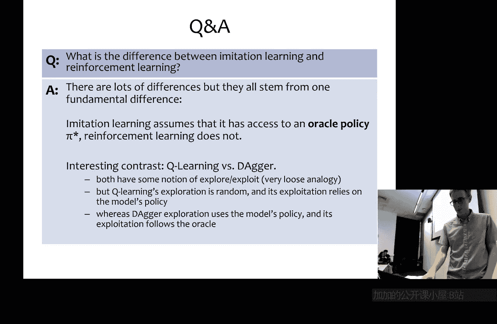
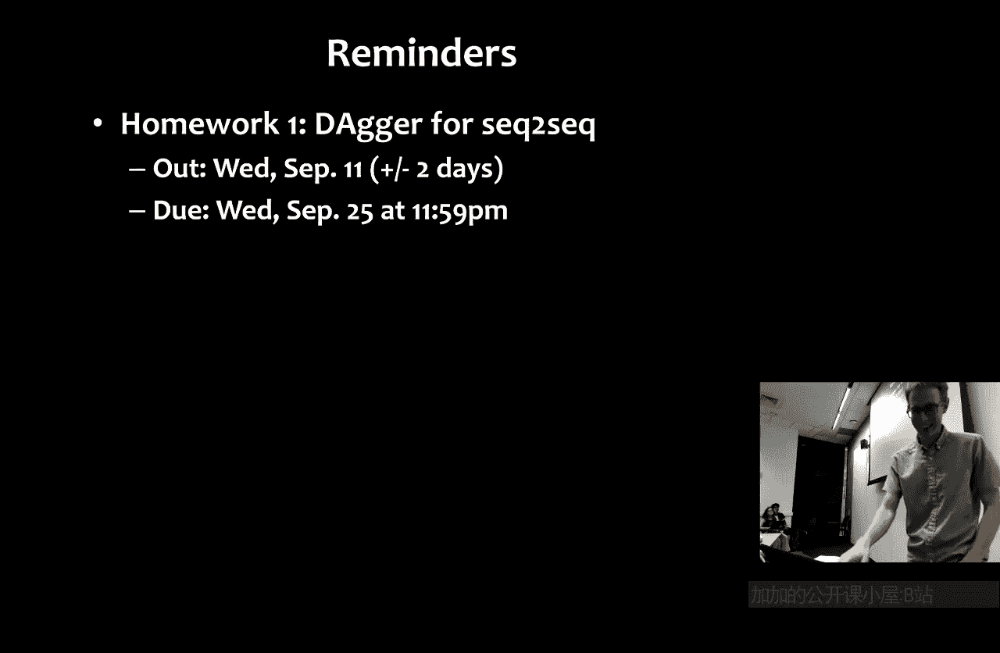
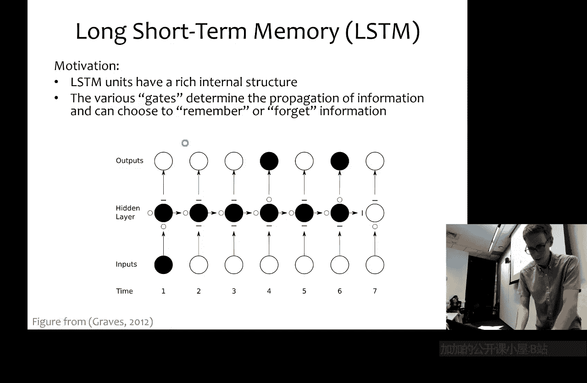
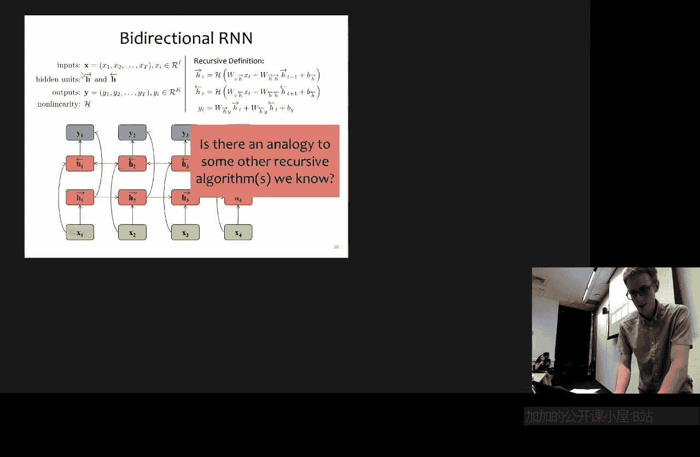
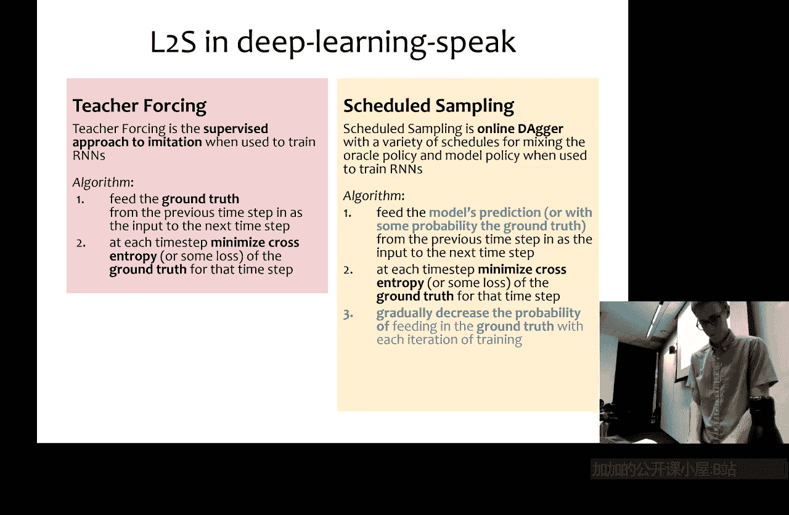

# 卡耐基梅隆大学【中英⚡结构化机器学习｜10-418 2019 Machine Learning for Structured Data】 p05 p4 10-418 ⧸ 10-618 Fall 2019 -BV1eJRsYBEaK_p5-

Okay电。machine learning infrastructure。Today we're going to be talking about。

The continuation of what we had begun last time。Which is sequences to sequence violence。

 So last time we kind of looked at。Just standardcurrent or that。嗯。

We focused specifically on El network。So we're going to go beyond that to sequence to sequence models。

And then。We might kind of just get started on basements。So。One question you might have is。

 what did the results of that survey be。Okay， so。Responses are still coming in。

 but there was actually enough of you had responded by the time I was putting that figure together。

 I think 39 of you at that point， that already this clear trend had emerged。

And so you can disregard these actual percentages， they aren't meaningful。

 what matters is that 30 out of 39 people have seen his markout model。Okay。

 so what that means is I don't really want to spend。

A lot of time on a topic that 75% of you have already seen。

So what we're going to but I think it's actually still an important material so I'm going to come up with some way either like a video lecture or recitation or something that kind of creates an optional way for you to see this picture of models if you haven't before but then。

We'll ahead of talk， so maybe half of you about 24 out of 39 have seen bay nets。

 we'll talk sort of about bay nets， but we'll move quickly so that we can get to kind of the new stuff like conditional lineup。

Okay， so that's sort of the plant we need to talk about these things。

Because we want to be able to draw connections them。

 we want to be able to tie everything together into a cohesive framework。

 but we can be somewhat flexible in terms of，How we use your time in class。ok。So any other questions？

Sure。So one good question that came up。After class。

Was kind of pushing me on this what is the difference between imitation learning and reinforcement learning I still don't get it okay so again according to the survey。

 only like half of you have actually seen reinforcement learning that's fine。

 I just still want to kind of make this point so there are lots of differences but they all stem from one fundamental difference。

Imitation learning assumes that it has access to an Oracle policy by star。

Reinforcement learning does not。Because of that assumption， they go in very different directions。

As subfield So for example， they're one of these。Contrast that I thought was particularly interesting。

That we painted in office hours was between K and dagger。Where we said。

 you know both have some notion of exploration and exploitation， okay， this is a very loose analogy。

 but you could say Q learning， if you know it， it does exploration in a random way。

 it has a random policy， so it explores the space of possible action using that completely random policy。

And then it does exploitation by relying on what it has learned so far， it modelss policy。

By contrast， Dagger is also doing exploration and exploitation。

 but the exploration happens more through the model's policy。

And the exploitation happens through following the order。

So I don't think that the imitation learning literature would use this exploration。

 exploitation terminology to actually refer to what it's doing。

 but I think the actual connection is kind of interesting just to see it。

Okay so this is the s slide as before with just the release data deadline pushed back by two days we're still within our plus or minus two days of releasing we'll see whether I need we need any additional plus or minus there it's never minus it's always just plus let's be honest we never release early okay especially in not in a new class Okay so let's talk sec to seek so we went through you know why are we talking about C to C it's just this powerful framework that allows us to capture all of these different tasks and so far we just kind of got through part of recurrent neural nets and I wanted to pick up at the point of LSTM。

So LSTMs or a long， short term memory。Models are motivated by the fact that。

Elman networks or standard recurrent neural networks have trouble learning long distance dependencies。

So this is extremely disappointing because the whole point of using RNN is to learn long distance dependencies。

 that's what we wanted， we said we want to get out of sort of the standard feature world where we can only go back you say a fixed window of words and we want to move to something where we can get arbitrary long- distance dependencies and so LSTMs try to combat this issue。

So。One of the things that is particularly。Problematic and RNs is the vanish ingredient problem and so what we're looking at is actually a figure that shows the sensitivity。

Of the gradient to the input at time t equals 1。And so what you can see here is that。

The actual value of the input at time t equals one。Is going to have less and less effect。

As the time steps go on。So what does this mean？If you want a long distance dependency。

 that's kind of like saying， you know the first word in the sentence was critically important。

 say you're doing translation and the first word in the sentence is critically important to getting this translation right。

You know， it's something like。You know it's the word no。You know， without it。

 the entire translation goes wrong， like I like this food。No。系 응。We know always works。

So can someone correct my example here？I mean， we need some sort of like modality on the verb， right。

 I want to like this food。No， I want to like this food so no here is like the critical word that's telling you which direction things are going and so as we have this critical word feeding in。

 we see that gradually as the sort of node becomes less and less shaded。

 the effect of that word is having less and less of an impact。😊，futureture units in the network。

 okay？So what an LSTM does is it basically just has these little gates。That can allow information。

To flow through a lot more directly。Or to get stopped completely。So if that really important word。

 how we're all going to remember this example of no， I like this food。

 it's going to be this great example of RNNs that doesn't make any sense at all。

So if you imagine that word know being fed in and at every time step。

 instead of being passed through， let's actually jump back here to。嗯。

To our definition of an Elman network since。

We haven't seen it for a couple days here。

So what we want here is。So definition of the re。And so you'll see that Ht is defined as some matrix times xt。

 some matrix times Ht minus1 plus some bias term or intercept term。

And it's passed through some nonlinear function。Here calligraphic tape。

So let's suppose that that calligraph h is something like a sigmoid。

And so what's going to happen is that。Calligraph H。

 that nonlinear function is going to be sort of squashing down the influence of whatever is going through it。

And so that's exactly why。We end up。In a situation。Like this。

The impact of that unit is just getting squashed more and more every time it goes through that signal。

可以。Okay， so how can we fix this？M is going to say， you know。

 sometimes it's going to pass through the non nonlinearliarity。

 but sometimes it's going to go through this gate that lets it just sort of sail right on through。

And so you can see vily what's going on here is there's these little circles and these little lines。

 and these are sort of supposed to indicate whether or not a gate is open or closed。Okay。

 and so here we have an open gate and an open gate and an open gate and an open gate。

 and so the information from the input at time one is just getting shuttled along down the line but these gates which are would be accepting the input at time two。

 three， four， five at six， those are actually closed and so they're not getting let through so the information is able to propagate really well and it's not distracted by the other words in the sentence。

OkayAt this point， it gets to time step six and there's an open gate on the top that allows that information to flow out the top Okay。

 this actually already also happened at time step four as well。But then finally。

 we hit this closed gate and the information from time step one doesn't continue to flow through。

Okayケ。So this notion of gating is used all over the learning。

It's become sort of prominent within individual cells of say a recurrent neural network。

 LSTMs are just one example of this， I'm not going to talk about GRUs。

 but they're another popular one and it's also been used to sort of capture the ability to pass information through different levels so if we have we'll look in a second at a multilayer LSTM。

And we can also have this sort of skipping of information that can allow it to pass through in different levels of the LSTM as well。

So here we can kind of draw a picture。Of an RN with LSTM cells。And it looks just like before。

 but now there's just sort of some additional complexity captured within each of those cells， right。

The actual hidden information at time step 2 is still a function of x2 and the information at the previous time step。

 but we have some additional mechanics in there， these gates that are actually allowing it to flow through in a slightly different way。

Okay， so。So this is an actual depiction of one of the cells。

So here you can now actually see explicitly the different gates that we had mentioned。

 so there's an input gate， a forget gate and an output gate。

 and so these are corresponding to the input， the forget gate and the output gate。I of T， F of T。

 O of T。And the gates themselves are actually going to control the information flow through this cell。

Okay， so。嗯。As well。We have this sort of new term CT。

And CT is sort of the part of this whole thing that we need to be a little bit careful of to make sure that our picture actually reflects sort of what's going on here。

 so CT is sort of an additional vector within the cell。

 in addition to what we usually think of as its output， which is HT。

And CT is going to store essentially some mixture of the input and forget gates right so you can actually see that happening here right where it's using both the input。

And the forget Gs。And。What that means is that the input gate。Is is actually just。Affecting。

Sort of this part of the equation that looks identical to the Elman network that we had before。

So you can think of this as。Essentially。Putting some weight on how much we want to take from the previous sort of standard setup of the Elman network。

And the forget gate。Is。What's taking directly from the previous cell？And so the extent to which， oh。

 and sorry， this this isn't if this might not be obvious， so the input gate is a real number。

 as is the forget gate here。And so what we're doing is we're actually weighting these two vectors。

 the CTt minus1 and sort of the traditional component。

And so the cell is essentially trading off between those and the reason that this can combat the vanished ingredient problem is that the forget is actually allowing direct。

Information to flow through without any nonlinear。And so it can essentially pass right through that gate without being squashed by some function like18 chy。

Okay so。With these little cells， we can now build up an RN just as before。

 where now each of these cells corresponds to。The the content of this cell。

 what's really going on in this picture， is sort of two vectors。 One of them is vector C 1。

 and the other is。Vectctor H1， and that goes for each of these。

Where we now have vector C2 and vector H2。And so on down the line。

So information is then flowing through these cells， but oh so in general you'll see these depicted。

 we kind of think of them as now， you know， these are just sort of。Two halves of the same coin。

 and so victorially we tend to draw these LSTMs as though C1 and H1 were just sort of one vector all concatenated together。

Okay， so just as we could build up multiple layers of a regular element network。

 we can also build up multiple layers of an LSTM and so here we just have LSTM units。

In the individual hidden layers。呃。And what we find is that these tend to be a lot easier to learn in practice。

So I have this comment， but there's no additional representational power over a DbarnN。

So a deep bidirectional RN， there tend to be these statements that we make about deep neural networks。

 like a neural network is a universal function appximator。And。诶。

They tend to be true of a lot of the kinds of models we talk about so long as you give them enough parameters。

 so I tend to think these sorts of representational power theorems that we have at the moment are not terribly informative so but what is terribly informative is in practice time and again we've seen LSTMs repeatedly outperform ElM networks。

Okay， so there's a paper I love that came out in 2015 and what they did was essentially neural architectureitect search over many different possible cell architectures akin to those found in an LSTM。

And what they what they did was they just basically took the notion of。Of an LM cell and said， okay。

 well， there has some gates。So nonlinear functions。

 but what if we just searched over the space of sort of possible arrangements of these variables。

 you know， maybe you have two gates， maybe you have one gate， maybe you have five gates。You know。

 whether you use sigmoids or CA H's or res， you could try all these different things out and connect them up in all different ways and then evaluate each of these cells on a bunch of tasks and that's exactly what these guys did。

And after looking at 10，000 different LSTM like architectures。

 they found actually there was a bunch that actually worked just about as well as an LSTM and sort of exhibited similar properties。

And so the GRU is just sort of one example of one that has become popular。

 partly because it's computationally more efficient。Okay， so when we're using RNNs。

 one of the things that we tend to rely on is mini batch stochastic gradient descent。嗯。

Most of you have probably seen this before， so gradient descent is computing the true gradient exactly from all of your end training examples。

Sttochastic gradient descent is approximating that true gradient by the gradient of one randomly chosen。

And then Mi batch SGD is approximating the true gradient by the average gradient of K randomly chosen exam。

So mathematically。We can think of this as all of these are of the same。General form。

 this is another meta algorithm right so the meta algorithm is while not converge。

 update theta to just be theta minus some step size lambda times G。

And the question then for the meta algorithm is， well， what is G for gradient descent。

 G is just the average gradient over all the examples， for SGD， it's the gradient of one example。

 and for mini batch SGD， it's the gradient of say S。Training examples randomly chosen。So in practice。

 the way that this is written。We just said that。The mini batch。Would maybe be。Itsse randomly sampled。

呃。Every single time， so there's like a different collection of examples every time in practice。

 what we often do is we just take our data set and we divide it into mini batches and we just keep reusing the same set of mini batches over and over again and this tends to work okay。

Okay， so。Training RNNs can be a little tricky， and so it's worthwhile to have a few tricks up your sleeve。

And essentially all of these tricks extend from the fact that when we're building these models。

The key component of them is essentially just matrix multiplication。

And so one of the most important of these is mini batching with masking。And here。

 I think Austin isn't here， but I think you guys are probably going to talk about masking and recitation one for the homework and it's also called padding and essentially what I want to highlight is just the notion of the size of the mini batch can have a really dramatic effect on the speed of your RN。

 So here what we're looking at are some。Some results on。An NLMs。

And we'll talk about recurrent neural net language models in just a moment。

 but they're just sort of a flavor of RNA。And in this table， each。

Each column corresponds to a different deep learning toolkit。

And the rows correspond to the same model， but with different sizes for the mini batch。

So when you have mini batch size one， let's focus here on Dyocs C++， which is diynette。

Implemented in C++， they also have a Python。But in the C++ case， let's first column。

 you get 190 words passing through this RNNLM per second。

If instead you go up to a mini batch of size 64， you get 2，440 words per second pass through。

And this is a training。So one thing to note is that 190 words per second。诶。

That's actually pretty bad。Just in general， that sounds really slowed and yet。

 if you remember back to， for example， the other speech tagging results that we were looking at for greed learning to search。

Those were operating at something like。Two to somewhere in the range two to 400。

000 tokens per second， and now we're just talking about three orders of magnitude slower for training。

This one。So。So here， what we're seeing is。But just the mini batch size has a dramatic effect。

So another note here is just that。诶。Sorting into。Buckets of similar length sequences can help a lot。

 So imagine if you have。A machine translation data set。And some of your sentences are really short。

And some of them are really low。What we find is that if you put all the short ones together in the same mini batch。

 then the masking and padding trick that we just talked about ensures that you can kind of save a ton of computation time just by keeping all of the short sentences together and keeping kind of all of the long sentences together。

And then the last trick is truncated back propagation through time。

And this applies when you have really long sequences。

So you could imagine if you were trying to process Wikipedia articles where sometimes the Wikipedia article was actually too large to fit in your GPU memory。

So in this case， a common trick is actually to divide your sequences。Into chunks。

And then you can use the final vector of your previous chunk。As the initial vector for the next ch。

Okay， so what does this look like well if you have。An R and N。Like， so。We can。Say that。Essentially。

 it's going to feed along forward until you get your final vector， okay。

 but let's say that that's all that fits in memory。So if that's everything that fits in memory。Then。

What we can do is say that the sequence actually continues for another， say， three words。And。

We could just start over from scratch。And build a completely distinct R&N here。Or。

We could take the last vector from the previous chunk and feed it in as the initial vector for this one。

So now you should be asking yourself。嗯。How does this solve anything， right。

 Doesn't this just mean that。We're back to a situation where we need to fit the whole thing in memory and the trick is。

 well， not really， because we don't actually back propagate through the second chunk。

Back into the first jump。We should。But instead， we're just going to pretend that for the purposes of back propagation。

 this era didn't exist。And so it stops there。And so this allows us to fit in memory of these long sequences that we otherwise。

Now there are further tricks where you can actually you can actually back propagate through this and it just requires another forward pass through the first chunk。

 we can talk about that offline if you're interested。Okay， so。Essentially。

 RNNs form this powerful tool for working with sequence data and what I want to talk about now is applying them to a particular problem。

 which is that of language modeling。Okay， and essentially what we're going to be thinking about here is how to take two really big ideas and put them together。

The first is that of neural embeddings。The second is recurrent language models。So。

The first thing that we need to have in mind here is what it means to actually build a language model。

And essentially， you can think of a language model。As defining。A distribution。Over。呃。Sigma star。

So here， Sigma star。Sigma star is corresponding to a setting where we say。Let's sigma。

Be a vocabulary。Say， you know， this could be characters。Where it could be words。And。

What we want to work with is Sigma star。So the question is what on earth is Sigma star？

Does anyone know the name？Of this little scar。That we're using here。It's an asteriskster。

But it has a mathematical name when we use it in this way。I even recognize the syntax？

Maybe what's the use in algebra。我整年二修车。放放呢选择。Yeah， so it does make an appearance in algebragrad。

 I was thinking of its sources。I think that its use in regular expressions is related to the out。

So in a regular expression， star has a specific meaning。And so specifically a star here。

ItRefers to what's called a cleaningy star。And it just means that we have zero。Or more。Occurrences。

Of strings。In sigma。So this really is just sort of the most basic regular expression syntax that we can come up with。

And what we would say then is that a language model。This is there definitionition of the thing。

Gives a distribution。Over Sigma star。So what we could say further is that we're going to end up with some probability distribution。

That is a joint distribution over。Elements X。For all。Elephments x in this set Sigma star。

So what does this imply about XT？What's its tank。So if a vector xes from Sigma star。

Then what is one element？That factor。Yeah， it's just an element of sigma。

So what we're doing is we're defining probability distributions。Like this one。And if we wanted to。

 we could actually decompose this using the chain rule and we could write you know。

 if the length of this vector is capital T， then this is going to be the product P of x given x t minus1。

All the way down to x1。Times。The probability of x t -1。Given x T -2 all the way down to x1。

And this product would continue。All the way down until we get to something like probability of x2 given x1 times the probability of x1。

This is nothing but the。Jainru。Of probabilityability。And。

What it allows us to do is sort of decompose。A language model into。

Probability of sort of one word at a time。So already， we should be looking at this。

Think yourselfhThis seems to hearken back to scoring functions that we had been talking about and learning to search。

In what way did we use a language model in learning the search？日本买。仕望とおえとです。んですも。Re it to be the。

Yeah， so what is the so maybe putting the question another way。

 what would be if we wanted to use a language model and learning to search？What would this。

Vectctorors。X's correspondent。In the learning to search。What would be like a trace。Yeah， exactly。

 it would be a tracer。Through the learning to search tree。

And maybe you don't actually have the full path all the way up through your capital T。

 maybe you only have some partial sequence。From。You X。Up to say， t minus1。Well。

 we could just multiply those lower terms together。

 and that gives you a score a probability for the probability of the part of the sequence that you've seen so far。

And so essentially， each of these little probability terms is kind of like one of those scoring function terms。

It's conditioning on every part of the path that it has seen so far。O。What is capital？

OrIs it the size of the diction？Oh good question So here what I'm using capital T to denote is the length of the sequence。

So， you know， number of， say， words。In the sequence。Or let's rather than words。

 we could even just say tokens。Before a language model， we are predicting you。Do we know something。

So a language model， let's make sure we have our definition straight here， so a language model。

 what we're defining a language model as is just a model that gives a distribution over Sigma star。

So for any element of Sigma star， it gives a probability to it。

So there's a separate question of how will we use a language model， will we sample from it。

 will we use it to score paths for a tree？There's lots of different uses of a language。

 maybe do we combine it with some other probability distribution so that we can get。

Improvements in machine translation or a prettic speech recognition there's lots of different uses of a language model。

 but we haven't really said like how we're using it。

 we're just saying that it's a model that gives a distribution over。

So that's an important distinction that what we're talking about here is just the model。

 not the inference task that we would。Do with。Okay。

 so now we can look at this little example where what we're seeing here is。A bunch of different。

So conditional probabilities from a language。So what this language model is giving us is the probability of some target word WT。

Which is one of these。Given all of the words that came before it。In a five word window context。

And so for the same context， the cats SAT on the。Or sorry， for this incomex， the cat sat on the。

There are many different possible targets。on the satAT robot printer。

And what our language model is doing is giving us scores for each of those different possibilities and so among those possibilities。

 it gave the highest probability to。买。But it also gave pretty high probability to r。

So if you were trying to build a speech recognition system。

 a model that can tell you that those are high probability words。

 given the prefix the CAsat on them could actually be really useful。

Because maybe your acoustic speech recognition system is working in a noisy environment。

 and so someone's speaking into their phone and they're saying something like the cat sat on them。

But。Right at the moment when that critical word came you couldn't really hear it because there was some background noise right and so in that setting it would be really useful if you knew a lot about the language that is being spoken such that you could make an educated guess about what was likely to come next。

The person probably didn't say that cat sat on the。Maybe they did。

 maybe they stuttered because they dropped their bottle。You know。The cat sat on the dog right again。

 this is just sort of a low frequency thing， right， I'm sure there's a YouTube video of that。

 but it's unlikely。Okay， so。One way that people built language models was using NGM models。

And the whole idea here was that you had a fixed window of context。

Specifically N words that came prior to it。And so the trick then is sort of coming up with。诶诶。

An actual probability distribution based on some data。

 and so one way of actually doing that is by looking at。

 say the number of times that a particular target word appears。

 a target word could be cat or it could be rug or mat or something like that。

And then the context is going to be whatever came before it。 So in this case。

 what we're looking at are just is a unigram model。meaning one because we have one word of context。

 so what we can see then is that we're going to count up the total number of times that in our data set the word chases appears and that would be a sum of all the entries in this column。

And to get the probability of cat following chases。We would say， well， let's just take。

The number of times that cat follows the word chases and divide it by the total number of times that we see the word chases。

可以。So。嗯。What this allows us to do is then define that language model。

 which is a joint distribution over any strains in a much more compact form。

So we no longer have infinite contacts we have。A window of size n for context。And。诶。

And what that would look like or sorry， a window of size n minus1。So sorry here。

 this is actually a bygram model。So this is a bygram model because we actually are modeling pairs of words。

Bgrams。A unigram model would only model one word with zero words of context。

So this is a trigram model。And you can see it has n minus1 or two words。Of context。

And so what we can see then is that the joint distribution of W1 up to WT。

We can first decompose using the chain rule。But then we say that， well， the probability of say。

 word six， conditioned on word5，4，3，2，1， we're actually going to approximate it by just the probability of word six given the two previous words。

And likewise， we're going to approximate the probability of word5 followed by the four previous words by just again。

 the two previous ones Okay， and so when we multiply all of these together， we have。

The probability of。This full joint distribution。So。This is nice too。

 because if you want to store a trigram model， at worst you need well， a finite number of parameters。

Do you need if your vocabulary is of size B？びきでき。So for every triple of worries。

 we need to store one parameter， the probability of。The third word following the previous two。

In practice， do we actually need all V cubed parameters for， say， a model of English？No， why not？

You one actually appear Yeah， many， many sequences of three words are just never gonna appear anywhere。

 And so if you're actually building this probability distribution using some data set。

 many of those tris just won't appear。 So you only need to store the ones that do。 Okay。

 but this is still inherently limiting because we're restricting ourselves a finite。

So how could we get back？To sort of this chain rule setup where， you know the probability of that。

Is actually able to look back at all the words that came before it。And the answer is。To use an R&N。

So。😊，The sort of first key insight here is that we want to be able to represent。Each individual word。

 as effect vector。Okay， so how do we do that well， if you've ever built a naive B model or something like it for document classification。

 you've probably had to think about how do you take words and turn them into vectors。

And so what we've done here is just to take each word and represent it as a one hot vector。

Where the vector consists of all zeros。Except for a single one corresponding to the index of that word。

Everything else is zero。 Okay， so the index of the word cat happens to be all the way up at the top here。

 and so we have this。1。In the cat position and zero is elsewhere。

 here we have a one in the satAT position of zero is elsewhere。And so on down the line。

 and so when we see the again， it's the same vector as we had the first time。Okay， so if we take。

One of these one hot vectors and multiply it by a matrix。

 essentially what we're doing is we're picking out one row of that matrix。

And so that's what these little V's are。Or sorry use here。

They are little vectors representing the type of each word that's being fed in。

And they're going to be much smaller where the length of those initial one hot vectors is the size of our vocabulary。

 so maybe like 10，000 words， the length of these little U vectors， these are maybe only you know。

 300。Or something like that。And so， the idea。呃。Then of a language model is that we could。Use。

These vector representations of our words as input to an RNAN。And。What we could get out at the end。

Is a vector。 So these little Z vectors are connected together by an R&N。And at the end。

 we could get out some。诶。Some representation of the actual context。And finally。

 if we just define a little distribution over words。

 say a probability of a word given its context as a soft max。Over。This final z vector， say z5。Then。

We can recover a probability distribution over our entire vocabulary based on this vector Z5 that is an encoding of all of the words that we've seen so far。

Okay。So。呃。So basically， so what we could say then is that here's。

A picture of this R and we're going to build it up sort of one state at a time。

 And so you can see that what we have is sort of the。

Something that looks just like an Elmon network here。Where we take Z here is the hidden unit state。

And so we're multiplying Vt minus1 by some matrix， and then we're multiplying that one hot vector WT times some other matrix。

Those are going to have the same dimension and we add them up。

And we pass them through some nonlinear function like T0 H。

So this gives us the hidden unit at the next time step。Can you just go back with。Oh， sure。Yeah。

 sorry this。So the slides notation is using C to denote the contact。AndW the next quarter。So here。

 C is really shorthand。For W1。W2。W 3。W 4 and5。Is that right。And this is really a W6。

That's what I should agree。So it's a distribution over the next wordW6 condition mono all the previous。

O。So here that is actually that's actually made a little bit clearer， right。

 where we're actually now relying on。Recursive definition of how it is that we fold in the context of all the previous works。

 right they're folded in via this dependence of ZT on both Zt minus1 and WT。

And then the distribution over the next word is given by a softm。Taken of a matrix times。So。

So what we do then is we start with。嗯。Some input words， W1。And some initial state vector say Z0。

And we。Multiply W1。With you。And z0 with W。We add them up。We pass them through that tan0 H。

 and that gives us Z1。Okay。And we can use that Z1。By multiplying it with another matrix B。

Passing it through a softm。And the result will be a distribution。Over the entire vocabulary。

So next we feed in word W2。 Now we already have Z1 from the previous work that we just did。

 and that's going to give us Z2 and a distribution again over。P of W3。Okay。

So we can walk down the line and we get a distribution at every time step。你他睇啲几样准啲知几蚊准。我哋。

Would it be the distribution of。SoYeah， it's a conditional distribution。

 so let's jump back here so this again。Is really what I was writing before right。

 so it's the probability of W3 given W2 and W1。Okay， so always this final distribution is giving us。

The probability of the word at time T， given the word at time t -1。

 the word at t 2 all the way down to。Word one。So we always have that complete distribution。Okay， so。

Now the question is just， how do we actually train this thing？So we want to do sort of the usual。

Emirical risk minimization thing or the maximum likelihood estimation thing。

 and so we want to say that we're going to maximize the log and probability of our data or the expected log probability under the distribution over。

Word sequences are word vectors W given by our data。So。啊。So then the key idea here is that。啊。

We're going to。Needs something that actually is。Target。So if we want to train。This vector， Okay。

 so now we've switched from。Here's these were Z0 and Z1， these are now h's。

For our hidden unit vectors。And what we want to do is train in a way that we maximize the likelihood of the true sequence that we observe in our training data。

Okay。And so what we could do is we could say， we're going to。呃。Feed in the word the。

And we'll get out a distribution right here， a distribution。Over our vocabulary。

And so during training， we're going to choose to maximize the likelihood of the next word that's about to come。

And then we do the same thing。 Now we feed in the next word。

And we get another distribution over the vocabulary。

And then we train to maximize the likelihood of the third word。And so on down the。

So every time we're training these hidden units。So that they take on values that are good at predicting the next word that's to come。

Again， we kind of raise this question on why are we doing left or right Well。

 you could go right to left just as well， maybe it depends on the language that you're actually working with。

Okay。So now suppose you actually wanted to sample， oh question， you trading just on the next query？

How is it like？How does it first sort effect？Oh， sure， so。So in this picture， the。

The distribution we could think of so here I was kind of drawing in these little pictures of probability distributions and the question is。

 you know in practice， what are these distributions？So if we look at these words as W1。W 2， W 3， W 4。

 and W 5。This distribution。Is giving us the probability of W 6 conditioned on W 5 all the way down to W1。

So how does it get the dependence on all of those words？Well。

 it depends on them through these hidden vectors。So this previous distribution is really just the probability of word five。

Given word four all the way down to word one。And so on all the way back。

Until we get to the probability。Of word two， given word one。And so if we multiply。呃。

These five probabilities together plus some prior probability of the word one。

Then we get back a joint distribution overall。就暗。We can draw samples from an RNNlM。And。

Here is where you get a performance of Shakespeare。

 so I'm actually going to read you a segment from as you like it。

 so why Salas Berry must find his flesh and thought that which I am not axs。

 not a man in fire to show the reigning of the raven and the wars to grace my hand reproach within and not。

それはい。areくで second。Read's kind of weird。Is that the as you like it or is it that way？shootot。

 I have both sidess in here I don't know actually so wait， which is the real Shaspeare here Okay。

 so if you look carefully， the thing on the left， it actually has like some weird things going on in man。

呃，这。I'm pretty confident Shakespeare would not have written。看。

But it comes across sounding rather Shakespeare。Whereas on the right。

 we actually have the real as you like it， Charles and Tstone。And they also sound， you know。

In usual Shakespeare form a little bit incomprehensible。

 but what we're looking at here is actually the output of an RNMLM that was trained on Shakespeare characters so here。

sigma。Was defined to be the set A， B， all the way up through Z。Plus some punctuation。

And so it's not even modeling full words。 It doesn't even know what a word is。

 because in addition to these， we also need things like。A space。Which is in our vocabulary。

Period in a comma。These are all elements of sigma， and so Sigma star is then all possible strings。

And you can see that the RNNLM， when trained on Shakespeare， is able to realize that in general。

 we like to start Shakespeare with all caps， names of people who appear in the play。

And follow those by a colon。So it figured out that structure of the actual Shakespeare。

 and then it also figured out how to produce things that look really like words and also some things that maybe are not actually words at all。

 like APS， but you know， it was plausible， I was able to pronounce it。So。

The RNNLM is able to do an incredible job modeling data in this way。

 and if you look at essentially perplexity， which is sort of the standard metric for evaluating language models。

 what you'll find is that over time the state of the art models，Have essentially been。呃。Dominated by。

Deep recurrent models。So at present， the sort of state of the art。As of today is a model called GPT2。

 which is technically is a transformer network， but if you kind of trace back the origins of this network。

You'd find that it would kind of lead you back to the earlier recurrent neural network language models that were introduced in say 2003。

And so these have come now to kind of dominate the space。And are used all throughout。

Sort of real world applications of language modeling， so things like。いや。さ。

How is the generation happening did you price separate？Gger and。关 that。按这个。Yeah。

 so this is a great question， so how would we sample from a language model okay so one way that you could actually think about it is to think of the language model as defining a policy。

Okay，So at every step along the way， it's going to condition on all the words that's seen so far and then choose a next action。

So the next action is。The next character that it's going to generate2。

FctuationAnd so among those 36 characters， we're going to randomly pick。

According to the probability distribution over those next characters。

And then we'll feed that back into the language model as is sort of our next output and then repeat again。

So it's just like stochically following a scoring function through a learning to search。So。

That connection is so strong that I actually want to。

Take a moment to look at what it would look like to actually use an RNNLM to score a path through a tree here。

Aspen device。So。Okay， so if we want to think about an R and NlM， then。It's useful to see。诶。

How to score。诶他。In a search space。And so what we could think about here is that what we care about is something like our part of speech tagging example。

 where we have some start state。And then we have neighboring states like noun。And verb。And from verb。

 let's suppose that we pick verb。We can choose among reposition nounner verb。

And then from preposition， we can choose Der。And then from。The termr we could choose now on our verb。

And let's suppose that the path that we're interested in。Is this one。So。

The picture that we want to have in mind here is how an R and NlM could actually score that particular path。

 So we could say that the R and NlM is going to have some。Initial vector。And。We're going to feed in。

Some token like start。At the first timet。And then we'll get out some distribution over our vocabulary。

Of in this case part of speech tags， okay so we could actually show this complete distribution because in this case。

 we're only talking about nouns and verbs， so there's some probability of noun and some probability of verb。

Okay。And at this point。We can。Actually。Proceed along where。We're going to feed in verb。And。

We'll get another probability distribution this time over three options。Preposition， noun and verb。

And。So each of those have some probability。And we'll just continue on along our way。

This time feeding in a preposition。And getting a distribution， in this case。

 it's kind of completely uninteresting， it's just a distribution overder。

Because our search space has kind of been restricted。

And then we'll feed in determiner to get a distribution over noun and verb again。And finally。

Will feed in。Our selection of noun。To get a distribution， say over。Something like an end token。

And also， you know， noun and verb。Which would allow us to continue along。So。

So what we're looking at here is if we wanted to do prediction。嗯。

For each of these probability distributions。We would take。An Arg Max。And if we took an Arc max。

 then you know， maybe in this case， we would。Get lucky and we would say， okay。

 V is the correct thing， so it's going to be fed in back here。Okay。

 and then we take another arc max over this distribution and we get lucky again， we get the P。

 and so P is going to be fed in here。And then here there's really just one option。

 so the Hg Maxax has to return D。Okay， and then here， oh。

 the Arg Max didn't actually return the correct thing now。It actually returned。

Some other thing like verb。So now， if we were predicting， we might actually end up feeding in。

Verb here instead of now。Okay，And that would actually correspond to the score for。A different path。

And then finally， we get some end token。And 난 경 진짜。Okay。So this is nice。

 it shows us how to do prediction。But we could also look at how to use this network if we wanted to train the network。

So if we were concerned with training。Then。We could。

Build up a little bit more of the computation graph。And we would find that we have our gold sequence。

 right， we know what the true sequence of tokens was， that's like our Y star。Okay。

 and it consisted as。Say for our sentence。Is something like。Time。Or sorry flies like a plant。

 is our running example here。Okay，And so the true sequence is actually noun verb determiner， noun。

And so what we could do then is we could construct。A cross entropy。For each time step。

By feeding in the true prediction。And。The probability distribution over the vocabulary。

And then likewise， if we wanted the。The probability or the long probability of。Verb here。

 we would just need again， that distribution and the correct one to pick out the corresponding probability。

And so again， we'd feed these in all the way down the line。And I guess all the way。

 including an end token here。And at last， we could then take all of these little cross entropy terms。

And。Add them up。And the result could be the value for our loss force。So once we have that loss term。

Now we have a computation graph and we can just back propagate through it。Okay。So at this point。呃。

We could also raise the question of how do we actually sample from a language model and if we wanted to do that well。

We could just have another procedure in here， which is sampling。And sampling。

 just instead of doing arg max。Does sample。And it just takes this distribution。

 and it gives us one of the possible outcomes， maybe we randomly pick an N and then we feed that N。

Back in down here。And then we randomly pick。Say another one and then wein and then we feed that back in down there and so on on the line。

So mechanically， it looks kind of like following a greedy policy。

 except that instead of taking an art max， we're taking a sample at every step。Okay。

So I guess the remaining question here is。What about？The sentence。Okay。我。Unfortunately。

It's currently ignored。So that's not good。Because what we want is a model that actually takes the sentence into account。

Okay。So。The key idea here would be。Maybe we could encode it。As a victory。And then feed it in。

Right here。Right now， the model only looks at the tag sequence。

 but if it had an initial vector that knew all about the sentence that summarized the sentence。

Then maybe we could actually condition on that whole sentence。Okay， so this leads us。

To the notion of sequence to sequence models。And the motivating question there is how can we model the input output pairs when the length of the input might be different from the length of the output？

And so to do that。What we rely on is this notion of an encoder decoder architecture。

And an encoder decor architecture or a model， it's used all over the place， I mean。

 you know for acoustic speech recognition or machine translation or image captioning。And。

In all these cases。The architecture kind of looks the same。 You have some input。

That is fed into your encoder。And。What comes out at the end is some vector。That represents。The input。

And then。You feed that vector。Into a decoder architecture。That spits out your output。Okay。

 so if we're doing speech recognition， then the input is speech。And the output is a transcript。

If we're doing machine translation， the input is， say your source language。

Maybe English and your output is your target language。Like maybe Spanish。And then。

If you're doing image captioning。Well， then you can feed in as input your image。

And your output could be。The actual caption for that image。So。Oops。

So how could we actually build one of these things？What we could do is we could say that。

We could build up some architecture。That just puts together。Sa two ingredients。A bio Sm。And。

A recurrent neural net language model。And so the model that would result。

Say we were doing something like machine translation。Would take as input are x。How are you？

And it could feed in。Those word vector representations。And then。It could send them through。

A bidirectional。LSTN。Okay。And what it could then do， let's actually make that a little more precise。

So here， the inputs also feed into this。Second layer。And then we can have some vector。

 let's call it z0。That represents the entire input。

 and it does that by taking the last vector of the forward LSTM and the first or last。

 however you want to read it， vector of the backward LSTM。And then here's the fun part。

 it feeds it into a recurrent neural net language model。And so now we can just do as before。

 we feed in a start symbol。And we get out a distribution over our vocabulary。And。

Then we feed in and say outcomes。If we take an Arc Max。Some translation。And we feed that back in。

And get another distribution over the next word。Which might come out。Ass go on。

And Comomo is fed back in。To get another distribution over the vocabulary。From which。

We predict as thus。And， finally。We get。Our last distribution。Which yields our last question mark。

And so what we're left with here。Is the。Bio SM。Encoder。And an R N。Lm。Decoder。And。

The sort of key remaining question。Is how do you actually train this thing？Well。

 essentially all you're going to do is you need to build up a loss function for the RN NLM。Good。

So what does that look like Well， it looks just like what we did here。

So there's one last detail that I have to leave you with， so I'm going to run two more minutes over。

So there's two training algorithms that you should know。One is called teacher forcing。

Teacher forcing is really just the neural net deep learning way of saying supervised approach to imitation learning。

Okay，And so the approach on re currentrent neurals is you feed the ground truth from the previous time step in as the in to the next time。

And then at each time step， you're minimizing the cross entropy of the ground truth。

And scheduled sampling。Is the deep learning way of saying online dagger？So。

What you do is you feed the model's prediction， or with some probability， the actual ground truth。

From the previous time step in is the input to the next。And then at each time step。

 you minimize the cross entropy of the ground truth for that time。

And the last detail here is that you gradually decrease the probability of feeding the ground trees with each iteration of training。

 this is the beta schedule that we saw for Dggary last time。And so if you look at scheduled sampling。

 what you'll find is the reason that it's called scheduled sampling is that you can have different schedules like the ones that we talked about for a different。

Sequence of beta values， trading off。The mixture of the oracle policy and the model policy。And。😊。

You can see the red line is showing the exponential decay that we showed if you use that。

 it gets you back exactly an instance of dagger。Okay， these other ones inverse Sigmoid， linear decay。

 well then you need to double check that they actually satisfy whatever other schedule you're using you need to make sure that it actually satisfies。

The dagger requirement that the average sum is decreasing to zero。And if it does。

 you get the theoretical guarantee， if it doesn't， you don't get the theoretical guarantee。

 but as you'll do on your homework， you can actually evaluate whether it still works out， okay。

 in practice。Any点 one。So when we pick up next time， next week。

 I'll talk about some actual examples of seek to seek for machine translation。

 acoustic speech recognition， and image capture。We'll say a little bit more about sort of some of the fun details that make these things work well。

So thanks for staying a couple minutes late， we'll see you guys next week。

