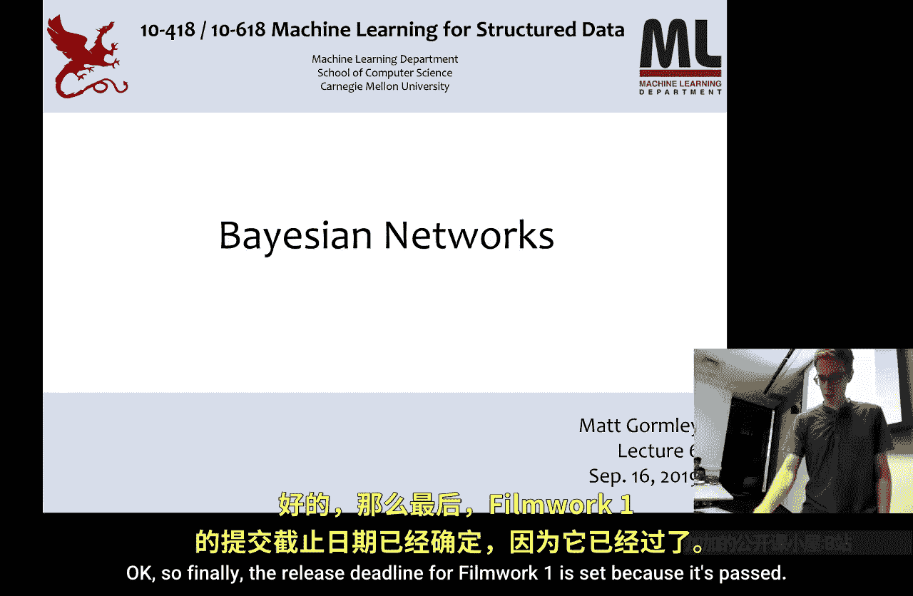
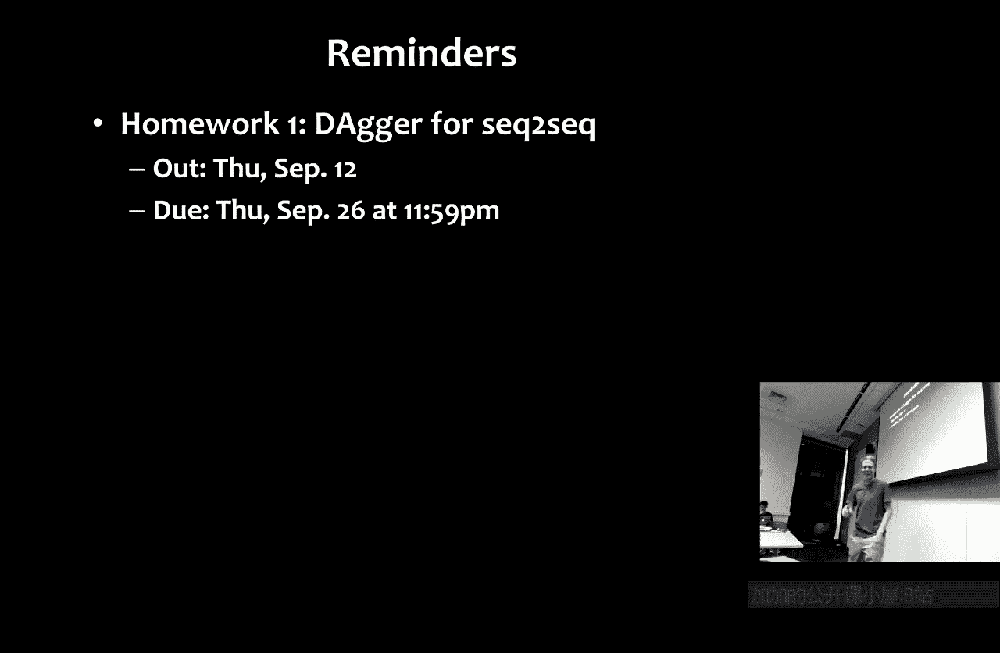
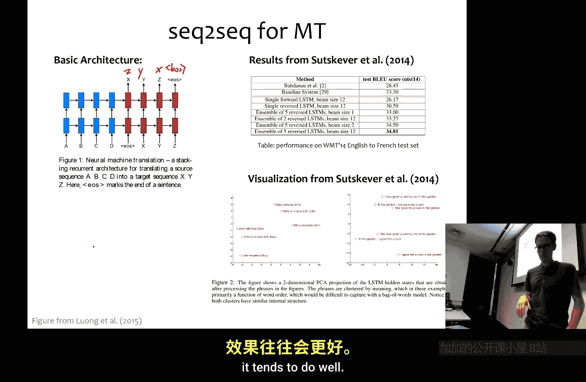
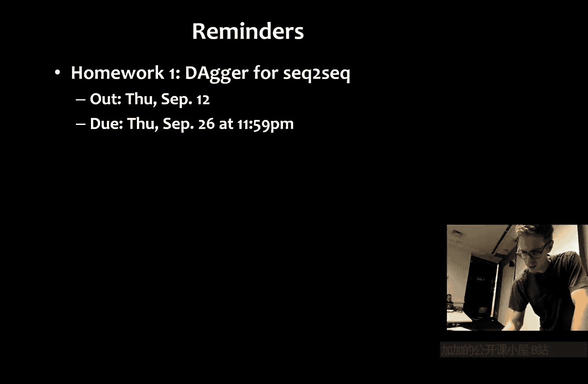
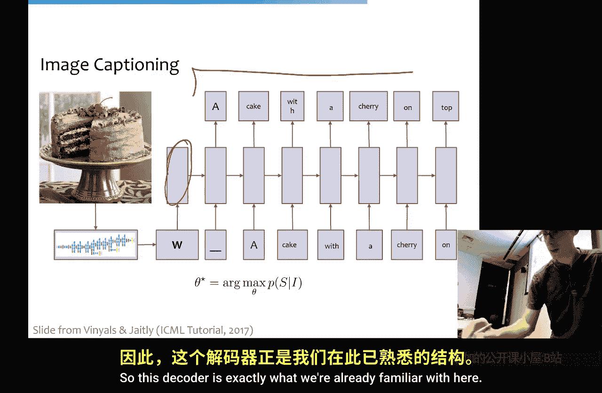
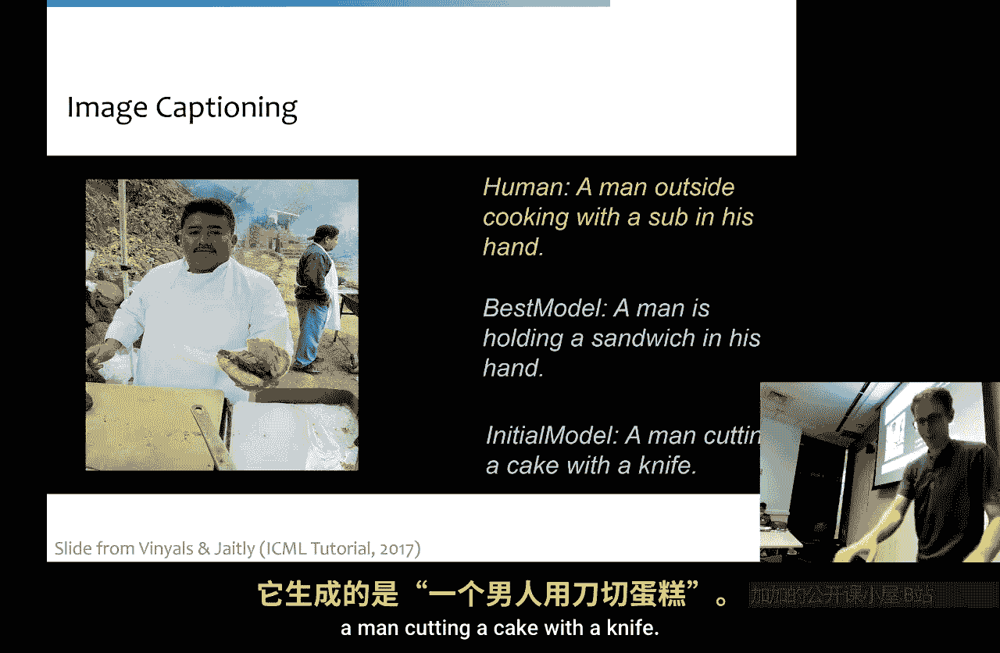
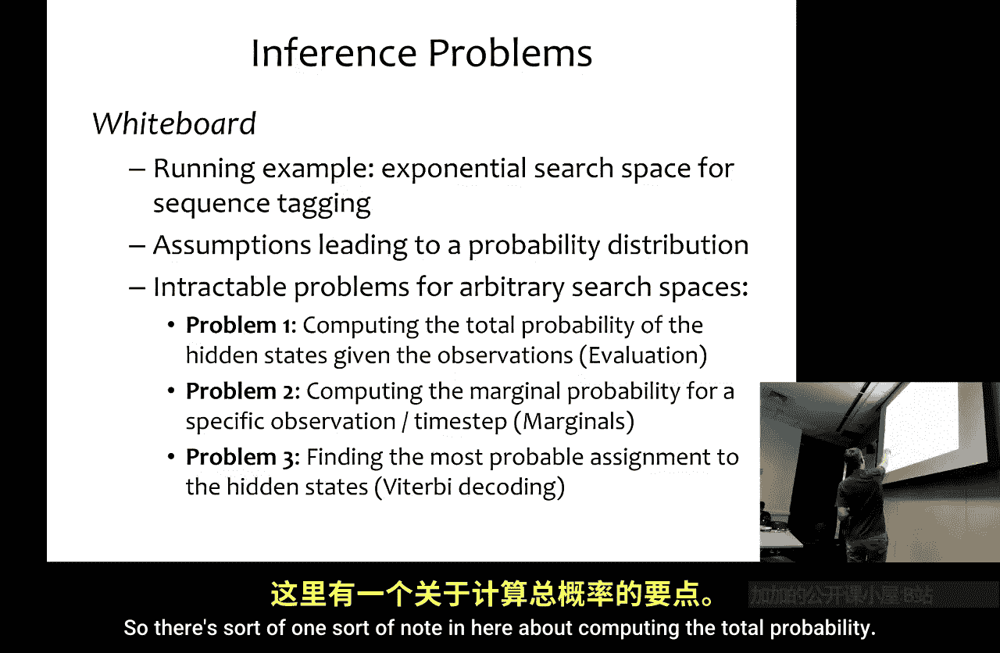
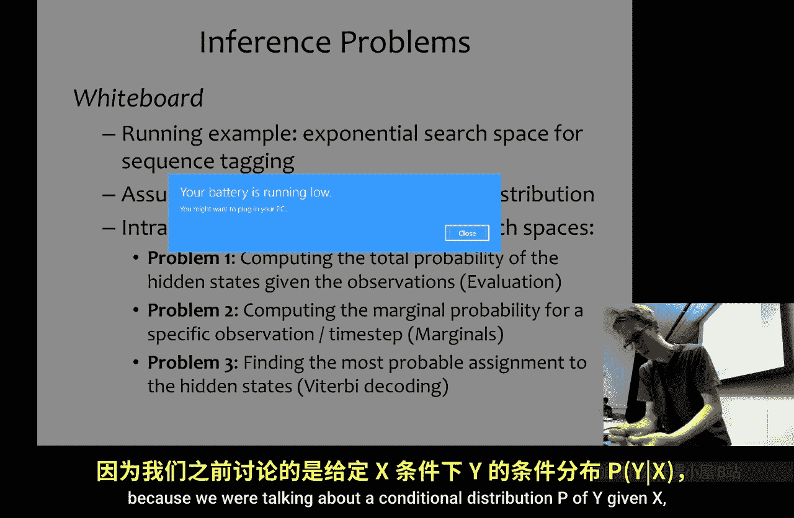
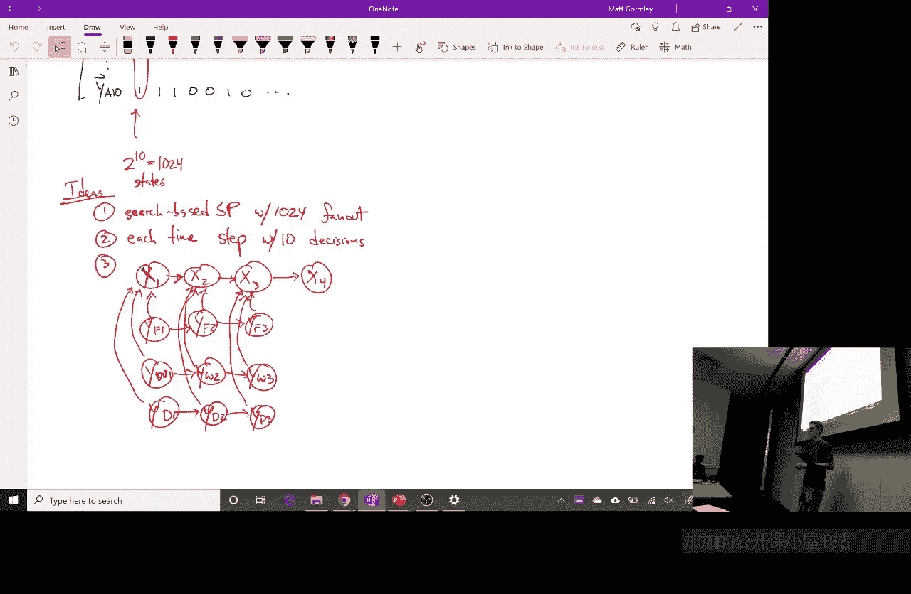

# 卡耐基梅隆大学【中英⚡结构化机器学习｜10-418 2019 Machine Learning for Structured Data】 p06 p5 10-418 ⧸ 10-618 Fall 2019 -BV1eJRsYBEaK_p6-

这。Okay welcome back。Se18 618。Today we're going to be talking about sort of a new paradigm for。

あ thinkingがか。Structured prediction。Where our notion of decomposition。Get away from the search base。

Require some ordering。To a new setting where we think about dependency between different components of whatever it is。

ど噶。Okay， so。

Finally， the release deadline F one is set because of。

And the deadline is two weeks later on Thursday， September 26th。

嗯。And so before we jump into Baynet， I wanted to wrap up with a brief discussion of applications of C to C models。

 because it's useful to kind of see how these are appearing in state of the art advocate。

So the first of these is machine translation。Machine translation。Has。Now， for a。

Good number of years seen a lot of different people trying to apply models。That were。それか。

So some of the early ones were happening in 2013。And in 2014， that was。Well。Well received paper。

Even it all 2014。想好的。呃。The basic model that they looked at was not too different from the same flavor of seek to seek model that we've been talking about in class。

The two exceptions to sort of what what we've seen in terms of sort of basic LSTNs is that they were as their encoder。

 they were using。Sort of a stacked LTM。 So it was reading in with sort of four LSTMs at a time going left to right。

And then their。Maybe it's four or eight。And then their decoder did something funny。

Which was that it translated the sentence in reverse order。So it。

It actually here there's this sort of cartoonish picture of sort of a basic。

Neural machine translation architecture， right， where you could imagine we're translating some source sequence like AC into a target sequence X。

 Y。And what they did was instead to translate to。Something that was ZYx where。The reason for this。

 and then I guess a begin of sentence rather than an end of sentence。

The reason for this was that those LSPM cells were ostensibly supposed to be good at capturing long term。

Interactions， but in practice what they found with us， well， when you feed the source that it's in。

 say the English sentence。It remembers a whole lot about the end of the sentence。

And so if you just immediately then start translating。To the end of the sentence backwards。

 tends to do what。嗯。

So here。Oops。

So these results。I can't zoom in on。呃。A sort of representative of how we were doing in 2014。

 and so you can actually see。诶。That they kind of explored a bunch of different。

Architectures for this task。And the actual data set they were working with was sort of a standard WMT 14 English to French data set and they were comparing with。

呃。Some prior work。And though， in this particular case。

The sort of state of the art machine translation systems were。This was still not it。

There were still other systems on other maybe broader collections of languages that were able to do better。

But this was able to capture。This clear improvement over some really strong baseline。And so here。

 what we're looking at are blue scores， blue scores are essentially this metric commonly used in machine translation because。

In machine translation we have this really tricky problem， which is you have this reference pen。

Ostensically， that's what you should be translating to。啊。关。

To say that a similar translation that doesn't exactly match the reference。

Isn't also a good translation？So the idea of blue score is that， well， at least in Engram space。

 like an Engram overlap， there should be a lot of overlap between。

Whatever the output of your machine translation system is and whatever the reference。

In the actual test data set。Okay， so this is sort of known to be a big problem with machine。

Translation in general is that automatic evaluation of these systems is really difficult。

But in this case， so more overlap is better and so higher blue scores are better and here what we're seeing them are。

There's sort of these different settings that they actually looked at for their own model。

 this bottom section of this table。And what they also did was they took。A some of。

Collection of their。Train models where each of their own models was trained with a different random of seed。

 and so when you took each of those individual models。

 they might actually make slightly different predictions。And so by ensembling them together。

 they were able to get something better than the individual list。

So another point to note here is that we've been talking about inducing a greedy policy from a scoring function。

That's not actually what they did here， they induce what's called a beam search policy from their scoring function and beam search is something that we'll probably talk about later in the course。

 but essentially it's just this notion that you're doing sort of multiple greedy searches in parallel and so the beam size is sort of how many different hypotheses you're in entertaining at any given moment。

OrHow many different candidate sequences here？So the last thing to note here is that they did some interesting visualization and they。

Essentially， took。These。Hidden state representations of sentences。

 and then just used PCA to project them down to two dimensions。

And so here we can look at some of the input sentences in their example。呃。

And so you can see they kind of took some toy sentences and fedted into their system and then wanted to see how do they actually relate to each other in this really low dimensional space。

So what we find is that sentences like Mary admires John and Mary is in love with John。

 Mary respects John。All kind of clustered together in one corner。

 whereas the inverse of those John admires Mary， John is in love with Mary。

 John respects Mary are kind of in another corner。So syntactically， these look very different。

But semantically。They share a lot of。Howp do you produce badding for this sentence？Oh， sorry。

 so the embedding for the sentence or the vector representation of the sentence was just the output of their head。

So what they did here was。So let's look at this little picture again。So they fed。呃。

John admires Mary in as the source sentence。And then， they took。So I guess that would have been。

You know， John admires Mary， and then the D here would have been end of sentence。

 and so they would have taken these two vectors as the representation of John admires Mary。

So that last hidden state was all that was handed off to the decoder and so the whole model was training。

s that those little vectors there were working for well。

 all of the parameters of the model were working really hard to encode this entire sentence in those short vectors。

And so their theory was， well， if we just project them down to two dimensional space and then sort of visually look at how they cluster。

 we might find some interesting patterns and that's what they found。

So to anybody who has studied language， in some sense， this isn't surprising at all。

 that the model would need to make sentences。Similar setic。Here in similar parts of this。

This high dimensional vector space is sort enough。But the fact that it actually worked maybe was what was surprising。

Okay， so。呃。For acoustic speech recognition at the moment there's。诶。

There's a lot of different architectures that。Have been used in a speech recognition。呃。

The one that I want to kind of mention here is。Is one that's a little bit different than the See to seek models that we've talked about till this point and that's because just like what we've talked about。

 it has an encoder and a decoder， but it also has this extra module called attention and attention it's not something that I want to talk about today except that I'll maybe give the 3 second version of it。

 which is that you could think of attention as an extra module in your computation graph。

That allows the decoder to look back at。The entirety of all the vectors that came out of the encoder。

 not just those last two。The actual mechanics for how that works。

 there's lots of different ways that we can pull this off。

 but all of those mechanics kind of fall under this umbrella of attention under this notion that you probably don't want to attend back to all of those vectors at once you want to kind of allow the model to focus on some specific ones。

So then the key idea here is that we're building up based on our input X。

 some hidden state representation age。And then we're gradually decoding。One token at a time。

And at every time step， we're now looking at， you know that entire hidden state and attending to different parts of it as we spell out a transcription of the actual speech signal so you use attention。

I would like NRN with attention， giving you the same performance or better。さのわ。

So you could use it on sort of whatever your encoder is。

 so we'll talk about CNNs at some point and we are sort of using vision as applications。

 so you could use an LSTM， you could use a CNN， you could use in just sort of a basic Elman network the point of attention is just that rather let's actually just jump back to this picture。

Rather than saying there's only these two final vectors that feed into the decoder。

 The decoder is now allowed to look at any。Of these arbitrarily many input or hidden state vectors representing the input。

And the attention mechanism is going to focus in on some specific subset。

And typically that happens by taking the simplest possible way to think about this is you could imagine taking a weighted average of all of those vectors。

You know， cause we have。Then time steps of vectors。

The length of the input and we're going to take a weighted average of those and the question then just becomes。

 how do you actually come up with the weights for that average？

So that's what's being done here and I mean we could spend an entire lecture just sort of talking about the different ways that you could do attention。

 but the basics of it are essentially fundamentally the same as all the encoder decoder models that we've talked about up till this point。

Okay， so this is just sort of the the。The more nuanced picture， which is that okay。

 well even their encoder is actually sort of slightly more interesting than I let on so here we can actually see that。

They actually have this pyramidal。Bidirectional LSTM， so they're taking in。

Something like a spectrogram representation of the actual audio。

So you can think of this as taking the audio signal and representing it as an image。

And then they're kind of taking individual columns of that spectrogram and feeding it in back and forth and gradually kind of condensing down the audio。

啊对。To fewer and fewer concepts of representation。嗯。

And then once they've sort of cosened it down from capital T time stepss。

 I guess we need to zoom out from capital T time stepss to V time stepss。

 then they have that actual attention and decoding。Okay， so。

So here are some results from Park at All 2019， which used this Listen attendance spellll model。

 and so this is on Lib speech， it's 900 60 hours and。And so at the top。

 you can actually see some sort of classic machine learning approaches that are actually relying on hidden Markov models。

And these are extremely strong baseline and so these these。

Speech recognition systems are all we're going to just focus on the side with LM。

 which is the setting where they were using a language model。And in that setting， you can see that。

 again， and let's focus in here just on the setting where the speech was clean， okay。

 so they were kind of distinguishing clean speech from not so clean speech。

 meaning you maybe lots of background noise。And so in the clean speech setting。

 the lowest word error rate that anybody gets is。Here， 2。97。我 actually yes。There's actually 2。

95 here， so maybe let's just for the sake of example。

 let's focus on the noisy speech so I think this this is going to be the winner。

 is that true on the second column？750 here。Yeah， so here that 7。50 is the best in this column。

So this is sort of the classic system is actually beating all of the other ones in this noisy speech set。

And so。This。Have been the case。For quite some time and all these people had been trying these sort of fancy end to end speech recognition systems that trained connections temporal classification models and listen attendance bell models。

 and nobody could beat the classical system。Until this paper came along。

And figured out how to do it and not only that they like blew everyone else out of the water。

 so it dropped from like you know the state of the art being 7。5 to the following morning being 5。

8 and so。The way that they actually pulled this off was not to actually improve the model。

 it was the same listen attendance spell model， but they figured out how to actually augment the data set synthetically by generating a bunch of new fake training examples from the existing training examples such that they were able to do a much better job of actually training this model。

And subsequently kind of changed the state of the art。Okay。So maybe a point to make here。Is that。

You know， all of these researchers had spent all of this time trying to get the model to。

 you know just finding the right way of connecting up the little pieces of the model and it was really kind of someone who stepped back and took a totally different look at the problem and said。

 well， maybe we should be worrying about our data that that was what allowed sort of this great step forward。

From where things were。Okay， so then this last one is a little bit sort of this is a little bit of a premature example application because the input here is not actually a sequence。

You know， when we think about。You know， translation as sort of a model that gives the probability of an English sentence given a French one we could say。

 well， by analogy we could also think of you know getting the probability of an English sentence given an image and so image captioning is sort of exactly that task where essentially the encoder looks a lot different okay so now the actual input is you know this。

Rectangle of pixels and so the actual neural architecture that gives rise to this encoder vector。

Or the output of the encoder is going to be a little bit different than sort of the LSTMs that we've seen so far。

But then the actual decoding process is exactly the same， it's just another RNN language model。

 so this decoder is exactly what we're already familiar with here。

Okay， and so here are some actual examples， so up at the top is the human caption of this picture。

close up of two bananas with bottles in the background。

And the best model was a bunch of bananas and a bottle of wine。R you know。

 is not too far off and then I don't know why the bananas are making such a strong feature in these examples。

这个是。Another one where the model seemed to do better。

And then here a man outside cooking with a sub in his hand is the actual human transcription and then come in is holding a sandwich in his hand is the best model transcription and so here I mean。

 you know there is this little bit of a nuance that the human captured that the model didn't right this difference of you know calling this a sub because the bread appears to be sort of like。

诶。呃。Whereas the model just called you this？And yeah。

 at the bottom is sort of a different model that was not doing so well。

 a man cutting a cake with a knife。

Okay。So there's a bunch of examples in there。Okay， so we're walking away from seat to seek models。

 armed with an incredibly powerful tool that can address a lot of different problems and so the actual sort of learning objectives for this course I think are pretty clear from what we've seen so far。

Okay。So at this moment， you should have been expecting daian networks to show up on the next slide。

 but I want to make a little bit of。诶。A diversion here to talk about computational complexity。

 How many of you have studied computational complexity。

 have I asked you to like prove that big O of two to the n is greater than big O of。Log in。

 you could write up a little proof of that。Okay， maybe。Half of you。

 okay so I just want to kind of brush up on some terminology here。

 so when we talk about analysis of algorithms。Given a single algorithm， we might want to ask。

 you know will it complete in a given on a given input in a reasonable amount of time and space。

 and then another question we might want to ask is given two algorithms which one is better？

So here what I want to do is just sort of plot some some curves that you should have in mind for basically sort of every aspect of this course going forward and so what we're looking at is sort of a big o of1 curve where on the X axis we're showing。

And。And then on the Y axis， we're looking at sort of an example of a curve in the set。

 say big O of1 and big O of log n。So。嗯。Okay， so here we're now looking at two curves。

 one of them is in big O of login and one of them is in big O of n。

And so this big O notation is used to refer to a set of functions。And for that set of functions。

 we have。呃。The property that if you took。A particular value of n。Call it M0。

And a particular constancy， then you could ensure that。啊。

Or sorry that there exists some n0 and some constancy such that whatever we're taking the big o of。

Would domin or be larger than？呃。C times that function for values of。And greater than n0。

So these functions that we're looking at are sort of representative of these cases。Okay， so。

Big O of N is sort of the。kind of algorithm that we're sort of most familiar with this is you know algorithms that have to look at every bit of the input to give us any sort of answer。

 big O of log in there algorithms that we really like because they're subline。

 meaning that we can actually get away without even looking at all of the input to get an answer。

So n login is just going to be larger than linear and squared is going to be larger than that and cubed larger than that。

 and then we have one of our favorites which is order2 to the n。Is that a mistake on our plot here？

Something they were problem。Yeah， so we didn't zoom out enough。

Functions that are in order2 to the N are going to dominate functions in order in cubed。

 but you need to zoom out sufficiently far to make sure that they cross paths okay so if you zoom out far enough。

Functions in order two to the end， make everything else look as though it's basically order one。Okay。

 so we are going in this class to be working， oh do I have more no， yeah。

 we're going to be working a lot with。Cases where the computation that we want to do。

Is exponential in the size of the input？Okay， and so if it is the case that the problem that solving the problem takes time exponential in the size of the input。

 well， then that's fine。If the input is really small。But if the input is not small。

Then the computation time is going to be so completely high that we just never would be able to complete it。

In our lifetime。Okay， and so。What we're typically going to be concerned with is sort of。

Byfurcation of these。These different names for computational complexities into two categories。

 one is things that are polynomial time。And then everything else。

And things that are polynomial time tend to finish。Reasonably fast。

For our purposes okay so in terms of complexity classes it's useful to know of a few。

 so an algorithm runs in polynomial time if it' runtime is a polynomial function of the input science for some fixed constant k that would be something like order。

And so we saying you， the class P consists of all problems that can be solved in polynomial type。

so in this picture here， we have some set。P of polynomial time problems。

So a problem for which the answer is binary。Like a yes or no problem it's called a decision problem。

 and the class NP contains all decision problems where yes answers can be verified or approved in polynomial。

So what this means is just that。You don't necessarily。呃。

Need to answer so what we're not saying is that you can find out whether or not is a I guess or tell answer in callal time just that if someone gave you a。

Proof of the answer。Then you could verify it as corrector。So we say that a problem is so。

So this is that slightly larger circle here。So a problem is NP hard。Yeah。You were given this。

This sort of magic box that could solve it。They order one ton。If that would mean that。

Every other problem in NP can also be solved in polynomial。

By reducing it to something that could be solved by that little black box。Okay， and then lastly。

 and be completete is that it belongs to both classes and。Okay。

So it's going to tend to be the case that we're concerned with mostly problems that are things that are NP hard。

And then we'll think about how could we come up with approximations that are in the？

Now I didn't even bother looking at this picture， maybe because I have this bias that I tend to think that p is not equal to NP。

 that these are two totally separate classes， though nobody's ever actually been able to prove this。

 so we're still not sure， and so if we draw a Venn diagram like this。

 we actually also have to drive this Venn diagram， which is sort of in the hypothetical world where someone have actually prove that they're equal。

Okay， so why do we start here well what I want to talk about first is not so much business themselves。

 but thinking about how this search a structured prediction gives us insights into the computational complexity of some hard inference problems。

So。To do that， let's。Think about our running example。Which was this part of speech tagging case。

Where。This time I want to consider that you we have a sentence like。嗯。Find preferred。フクス。And here。

In this sentence， Im prefer tags， we could say that each of the words in it。Are actually。嗯。

Could either be a noun or a verb。And。And so the search space that we're going to work with。

Is going to as usual have some start symbol， and then for find， it could either be a noun or a verb。

And then for preferred。This could either be a noun or a verb， so that would be。Now。

Followed by noun or noun， followed by verb。Or ver followed by noun or ver followed by。

And then likewise， tags could also be。A noun and a verb， so that would be less no noun。

Or downtown ver。Yeah。G her down。And this would just kind of continue along the way until we got the eight possible pans of the sentence。

So。So where the last one is Bber。So what I want to think about is suppose what we said was that。诶。

To get a probability distribution over these possible tag sequences， we use the scores on the edges。

 okay， so this should feel familiar， so what we're going to do though is we're going to say that all the scores on the edges are just some non-ne real numbers。

And so you know， this might be seven， six。Three and one。To。And so if we want to get， say。

 the score of a path， then we're going to multiply together all of these numbers on the edges。

So7 times  three times one is。21。We would say that the score。That first path leading to NNN is 21。

Whereas the scores of the。Has the none number ver。Are going to give us。

Score of 42 and so on down the line。Maybe down here， we have six times。So it's two time。3。

And so the score of this thing is 36。Okay， but then if we want a probability distribution。

 we're going to say assume。嗯。The probability of a sequence y， given our sentence X。

Is proportional to。The score。So then what we're saying is essentially this is the score of that sequence y and the probability distribution or the probability of that sequence y。

啊。Is going to be based on these scores。 So if it's proportional to the score。

 how do we actually compute？Save the probability for that first。Yeah。

 normalizedize by all the scores， so down here we could say we're just going to add up。

All of these scores。And whatever that is， we'll call it C。Okay。

 so the probability now is going to be 21 over Z and then 42 over Z all the way down。To 36 over。

So now we have probabilities for each of these different paths。And。嗯。So， at this point。

We could start asking some questions。One question that we might want to ask。Is。嗯。我这是。

What is the actual value？Of Z。Okay， so if we want to compute Z。How could we go about that？

Some are possible。Were we doing any better？What if we just like， you know。

 thought we had some trick where we could maybe just leave one out？And maybe， you。

 we just leave out one of those scores。But we would get pretty close， right？I mean。

 then we wouldn't have to compute them all， at least。So好。Bad of a problem could leave anyone healthy。

Is it going to be a good approximation？対なで最初すの。Yeah， it totally depends on the one that we left out。

 so suppose we left out something like this EDM。And maybe you know over here。

The score on this particular edge was something like  a，000。Okay。

 well now all of a sudden this thing is。2不 timeす。And so if we had left it out。

Our approximation to z would have been terrible。Great， so so question one。

 it seems that in order to compute that， we're going to have to。

Do something that looks at every single week。How many leaves are there as a function of the size of our input？

就知道。Yeah， two to the end， if we have this setting where everything can be down or over。So。

That's not correct。Because that means that this is going to be exponential time。Okay， so okay。

 question two， let's see if we can do something that's a little easy。What if instead。

We wanted to compute some marginal probability， say the probability of some Y2。あや。So now。

 we don't want。To compute all of the probabilities。

 we just want to compute this marginal probability。

 which is going to sum over possible values of y1 and possible values of y3。For。The sequence。PY one。

I do and like。Well。You know， it would be nice if。If we could somehow compute this more efficiently。

 because think about it， we probably don't even need to look。

 say we've made it even a little more specialized where we just wanted to compute it for a specific case。

 like the probability of Y2 equaling n。Given x。Suming overall path prefixes and path suffixes。Okay。

 so how many？Yeah。This was ordered two the end。How many paths would we need to look at？

In terms of the length of our input。If we wanted to compute。Say。

 let's call thepy the length of the input T rather。说的是说去。

So if our input has length T and we want to compute a marginal probability。

And let's generalize this a little bit to say， not necessarily two。

 you might want to compute the probability of y sub little T equally now。Then呢。系。

How many pounds do we actually need to look at to compute that？Do minus1。Yeah。

 that doesn't sound good either， So it's still exponential time。

It's just that all we did was we said， well， now we're only going to look at paths that have。

Y 2 equal to n。So we only need to consider paths that pass through those two yellow cases。

But that's still going to be order。To the。T minus1。To still exponential time。結こ thatちま。All right。

 well。What about question three here， which would just be。Is。The highest scoring pack。Okay， well。

 maybe here we could use something like greedy search。And I started that， right。

Then that would just be linear type。Does that sound like a good plan？

We do greedy search to find the highest scoring path here？What would greedy Search give us back？

Let's fill in the rest of these numbers。Just for convenience， I'll make these all ones。就。

What is the highest scoring path according to greedy surf？Let's remember how greedy search works。

It starts off at the beginning and it says。Which of my neighbors has the highest score？Oh，7 or 6。

 Well，7， obviously， so let's go this way。And then says which of my neighbors has the highest score。

 oh， three or one， well， naturally， let's go this way， three。

 which of my neighbors has the highest score， two or one， two。

And so the final thing that it comes up with。Is N and V。What's the actual highest scoring path， well。

 obviously this one。With the thousand at the end。So the only way that we could know that that is the highest scoringing pack is again。

 if we actually look at the scores of all the leaves。So here again。

Solving this problem is going to require exponential time。

So there's a sense in which everything that we're about to do with graphical models is going to come from the perspective that we want to be able to solve these problems and a couple more。

In power your time。And the way that we're going to go about it。Is by assuming that。

Some of the scores up there are repeated。And by doing so。We're going to essentially be able to。

View this exponential exponentially large search space。In a polynomial size representation。

And so once we can sort of collapse this exponentially large search space in on itself。

Into something polynomial size， then we can come up with algorithms。

They capitalize on that polynomial size representation to solve these。

Exact problems in polynomial time。So while the See to seek framework and the learning to search spaces is sort of an incredibly powerful tool in our toolbox。

 it doesn't actually allow us to sort of solve many of the problems that we would want to if we want to work probabilistically with our models。

And so if we want to reason about。Aspects of the model that。That are probabilistic。Mre。So。嗯。Great。

 so there's sort of one sort of note in here about computing the total probability。

もな。There's one。ButTo problem one that's listed there。

I didn't really set things up properly didn talk about it。Because。嗯。

We were talking about a conditional distribution P of Y given x。

Whereas we would need to be talking about a generative distribution over both x and y in order to see the evaluation problem。

 so we're not going to be talking about that one just yet。嗯。So in general。

 when we're talking about exact inference for graphical models。

 we'll often be sort of decomposing into the three problems that we just looked at。

Wwhich are computing marginal probabilities， computing the partition function。

 which is the sum of all those scores and computing the most probable assignment。

 which is the problem of math inference。And。啊。So we put a statement that was sort of loose on those。

 we said， okay， in this learning to search setting where the scores can be whatever they want in that search space because our scoring function can look at arbitrarily large left contacts。

嗯。Then we're going to have these the solutions to these problems are probably going to be exponential time。

And in fact， we can make that a little more formal and we can say that so finding that most probable assignment is really an NP hard problem。

Now， solving the other two problems of marginal inference。And computing the practitioner function。

 we can't say that they're NP hard because that would mean that they are decision functions。

Their decision problem， but they have a yes or no answer。

Or can be cast as that way Sharpie hard is sort of the the equivalent class of。

It's the equivalent class that corresponds to problems where the output is some real valued function or some real valued number that we care about。

So at the moment， I'm sort of purposefully alighting。All of the notation on this slide。

 this is something that we'll return to once we've made sort of what this notation is referring to Mark crisp in our discussion of conditional and Markoff fields。

Okay， so now let's talk about Bayesian networks。Okay， so。If you took 601 with me。

 this is like one of my favorite examples， I'm going to actually force you to go through it again and or maybe you'll fall asleep I don't know。

 and I think most of you actually haven't seen this example so we're going to jump in with it。

So imagine that you work at a 911 call center in Dallas， Texas。Okay。

And so you receive six phone calls telling you that the emergency weather sirens are going up。

So what do you conclude from this？Yeah， what kind because you're in Dallas。く関じしたね。然那个。Yeah tornado。

 right， that's what's in the slide title。You probably didn't guess。嗯。

See this is the problem with I don't have presenter view I still haven't actually figured out oh there we go。

 okay I can very slowly click you probably didn't guess that hackers had come along and broken into the Dallas emergency weather system and set off the alarms waking up tons of people at 1143m on a Friday and all the way through 120 a when they were finally shut off。

😊，Okay， so。So what went wrong here well you guys just lacked you know a proper Bayesian network to draw the right inference。

 okay， so let's remedy that。To do so。What I want to start with is a description of。嗯。

Of some variables。And。The actual variables are going to line up with this problem。

 so we're going to think about these tornado alarms。And。Specifically。

 we're going to have binary random variables that represent。The occurrence。Of。Some event。And。

So we'll have five of them。 We'll see that one of them is。T， and when T is equal to one。

That implies that tornado occurs。So we're going to have another variable H。

Where we'll say if it has value1。Then those hackers successfully compromised。The alarm system。

The Dallas alarm system。Okay。The random variable a is equal to one。

 then we're going to say that 150 or more tornado alarms。Just went off in Dallas。

And if C is equal to1， then that's going to be a variable that's indicating some threshold like 100 plus 911 phone calls。

We're just made。Now， there are other plausible explanations for why。

100 plus 911 protocols would be made， one of them might be， you know， there's a major fire。In Dallas。

So the key question here is。How do we actually represent？

This joint distribution over these random variables， namely we have。TH。A C and F。And the question is。

 how do we actually represent that joint distribution？三。

What if you were to use sort of the learning to search paradigm that we had just come up with？

How could you decompose？That joint distribution。그。Okay。

 so we could consider all of them to be independent， right。

 so that's definitely one possibility here。就。Here we could say。This idea of independence。

We could actually sort of write it out as the probability of this joint distribution。Tha A Cf。

It is equal to the probability of T times the probability of H times the probability of A times the probability of C times the probability of f。

Okay。就。I want to tie this back to our search space。Paradm。

Because we could now say that for every random variable， TH。C还F。

We could now have the two possibilities so we could have our starts state here。

So that's our start state then。く value you。Zero or one。And then。For each of those values。

 H could have value zero or one。Same thing with A， this could be zero or1。0 or one。0 over one。0。

 or one。And suppose I told you that the scores on these edges were say。仲有黄山仲有黄山。Here scores were。

My 7。3。And then here， the scores were 0。1。我家。Okay and so if you want the we'll just maybe we'll just think for a second I don't really want to keep drawing the search base out for CNF here so let's just think of the joint probability of the first three TH&A So if you want the joint probability of TH&A。

Being 000， you would just multiply it together 05。7。1， right？And that would give you the joint of。

What are the scores on the other edges that I haven't drawn in？couldcer。Yeah。

 because we just made this independence assumption。We actually know now that this is also 0。

1 and this is 0。9 and this is 0。10。90。10。9 because they don't actually look at the left context here。

 right they can't， the probability of a is just a function of a it's not a function of what came before it same thing for the probability of H these have to be 0。

7 and 0。3。Or here 0。1， 0。9， 0。1。So。So you can see already that just by making this independence assumption。

 we now have a polynomial size representation。Of our exponentially large search space。

 because all we need are the red。We don't actually need all of these blue numbers。Okay。

So that's a good possible solution here， does anyone want to give another possible solution？

Book of fuel events together。Religion but in general， severed。Okay， so。Let's see group them together。

Into。Related。But sort of separated。By sort of clusters。Let me actually maybe draw a picture of that。

 something we could say would be like。嗯。You know， the event of。A tornado occurring。And。

So the event of a tornado occurring。And。诶。The alarms going off。And then there being 911 calls。

 those should probably all be in a group， so let's actually connect those up。With edges like this。

So they're all connected to each other。Okay， and then let's say as well， we want a group around。嗯。

Let's see， what are our other ones fire？Ral men missing factors。Well， hackers definitely affects。

Whether or not the alarms go off， so we should probably connect those two。Call them in a group。

And whether or not there's a fire， that probably affects whether or not those phone calls are in。

 so we should probably connect those up。So。We can say that。

The notion of group here is given by fully connected components。Which in this case， there's actually。

啊。One connect point here。Component there。And then the third connected component is these three。

And if we were to take this idea to sort of its natural conclusion， we would get to。あ、まかな。

But we're not going to get there yet today。So话。Via three。Do you have one？In of con。

 instead of considering them exhibit we can。Consider those probabilities to the conditional proities。

The given tea has happen。 What is the probability of。Hピ強。Yeah， so we could do something like。

Sa the joint probability， THA。C and F。Here is going to decompose by the chain rule right we could say something like。

Maybe the probability。Of see。Given F。え。T and H。And then times the probability of。F given。8 and H。

Times the probability of， say。A， given T and H。Oop， sorry， I have all these equal things。

You guys can yell at me when I am doing things。Ts the probability of。TH。Probability of H。

So now we could actually kind of conceptualize this in that same search space motion， right。

 because now this is kind of like a。Agon N language model kind of thing right Everything is conditioning on everything that came before。

 So the order is imposed by the order in which we did the application of the probability chamber rule right。

 So our search base must put H at the beginning， then T， then A， then F then C。

 and it's going to fan out。嗯。In that way。Great， now in this case， when we have a score。啊。

This is our start out on an edge way at the end here。Like the edge on。This particular。

Whatever score we have on that particular edge。It could actually depend on the entire path leading up to that point。

 and so now we're actually back in a situation where all of those computations that we want to do are going to be exponential time。

So。Apply the chain rule。Sort of what this idea is。And。

This is really no different than having a giant table。

With a different score for each possible leaf node in the search space。

Because in order to really represent this full distribution， we're going to have to。Spell out。

Every single node。And this enormous surface。Okay， so。Feels like。We need one more idea here。And。

That idea we'll say idea number four。Is that we're going to base it sort of on。The 가。

Notion of how these different events are really。Okay， so we're going to take。This。

This chain rule that we just wrote down。And。We're going to reuse it。By。Leaving some of the terms out。

So what I mean by that is that。就。We're going to say， well， here。Where。あ。

Where this event of whether or not those 911 phone calls was made。

The probability of that certainly depends on whether or not there was a fire。

But it doesn't really depend。On whether or not the hackers compromised the alarm system。

So why would I say that well， what I mean here is that。If the hackers compromise the alarm system。

They're not going to actually。To have any effect until they actually turn on the alarms。

 but we already have a separate random variable。So we don't need both of them。

 right the real causal reaction is the alarms go off。

 people hear them and then they make the phone calls。

So same thing we could say with a tornado is usually like tornadoes are way far out of the city。

And then， you， some weather guy notices the tornado is on its way and he sets off the alarm and then people get nervous and they start making phonecoms。

So we could actually drop both of those from this right-hand side and we could do that for a couple other ones。

 the fire probably doesn't depend on whether or not alarms are going off or whether or not tornadoes are occurring or whether or not hackers accomplished anything and likewise whether or not there's a tornado happening。

 does not really depend on whether or not hackers compromise and alarm system。

So now that we've done this， we've just sort relaxed some of the dependencies that were in that original decomposition from the chain。

But note that crucially。We had to pick。And ordered。For idea number three。

 and I actually borrowed that same order down here。Okay。

And what it gives rise to is our first example of a Bayesnet or a Bayesian network。And specifically。

 what we see is that。We can draw a picture where we say， well。

 H doesn't depend on anything and T doesn't depend on anything。

But the alarms going off depends on both H and T， and so we'll say that it's causally related to them where the arrow is indicating the direction of causality。

And then we could say further that the。呃。The calls depends on whether or not the alarms。

But it also depends on。Whether or not。The fire is occurring。So。What we'll see is that。

Collection of independence assumptions。That we obtained by sort of crossing things out of the chain rule。

We can represent as the graph。But we can also go the other way if you have the graph。

We could have written down how this joint probability distribution decomposed。So。呃。

So what we have then is that our actual definition here of a Bayesian network。Is just that。Bsnett。

Or base。Basian network。Consists。Of。A directed。Acyclic。Graph。T can call G。And。

Conditional probabilities。B。Over。Randdom variables。That we could call， say， y1。Up to Y J。Such that。

The following。Representation holds。We're going to say that the probability。嗯。Why 1。Up to Yj。

Is going to decompose。As a product。Say I equal one up to capital J here。

Over all of those random variables where for each one。It's going to be the probability。Of why and I。

Given all of the parents。Of Yi in that graph G。So here you can see that this is exactly the property that we have in the decomposition above。

 where the parents of A are T and H and。One of the terms in our joint probability is the probability of A given in parents TNH。

That holds for all of that。Random variables in our graph。So。

So a Bayesian network generally has this form where we can decompose some joint distribution over say five random variables based on the actual topology of the graph。

So5 has one parent， so there's a term for x5。The conditions on its going parent X3。

And x4 has two parents， and so there's a term that conditions on its two parents， two and three。

So you can see there's one term per。Random variable or node in this graph。Okay。Great。

 so here's our definition again。Okay， so the question is， you know， we have these kind of two parts。

 a qualitative specification that captures these causal tendencies between。

Cards and then a quantitative specification。So。Where does the actual qualitative specification come from well。

 it could come from prior knowledge of something about those causal relationships。

 it could come from some prior knowledge of modular relationships。

I think this notion of modular relationships is sort of what you were talking about with groups where we'll actually sort of talk about that notion in more detail when we get to our discussion of undirected graphical models。

 these ones are directed because the arrows actually because the edges actually have arrows。

You might just get some assessment from experts or you might get some information from data。

 or maybe you just like a particular architecture like an HMM because everybody likes HMs。

Okay that's not true， the reason people actually like HMs is that they admit polynomial time inference。

 you can solve all those problems that we have just been talking about in polynomial time because the HMM admits a polynomial space representation of the exponentially large search space。

So there's lots of different forms that a Baysnet could actually take， so we could say。

If we have discrete random variables， then the。Quantitative part of the specification is going to be actual conditional probability tables。

 right where for the probability of a taking on value a0 versus A1。

 we actually have this little table that is B of a。And then here， we have P of B。

And then here we have the probability of C given A and B。And for each。呃。

Possible of the four assignments to A and B are here they're binary we have two numbers representing the distribution over the two possible values of C so you can see that each of these little columns。

Actually sums to one。In this conditional probability table。Okay， and at the bottom。

 the F ofD you get and see。And so the joint decomposes into the product of just different entries in these actual tables。

But things get more interesting if for example， we have continuous value random。

Because then we could say that the probability distribution over their values comes from some probability density function like that of a Gaussian。

So here the distribution function for A is given by a Gaussian with mean Ua and variance sigma A。

And then here B comes from another Gaussian with different mean and variances。And then C。

 the interesting one has mean that is the sum。The value of a plus the value of B。

 and then its covariants are some parameters。And then D actually has both dependence on some parameter。

 mu D， and also the random variable C。But the decomposition that comes from the graph still looks the same。

Of the joint distribution。And then we could also have sort of some interesting mixture of sort of a combination of discrete。

And continuous very。Okay， so one more detail here is that in a graphical model we shade nodes to indicate that they're observed。

 meaning that their values are actually given， so if you want to talk about the distribution of x2 and x5。

 given some particular values for x1，3 and 4， you could draw a picture where x1。

3 and 4 are shaded in。Okay， and we'll do this pretty regularly。Okay。

 so the thing that I want to leave with today is not here。

So suppose you were trying to build a model。And this particular model。You wanted to have some。

Solve some problem。私せ？Is that of energy？This aggregation。So this is a fun problem。

 what it is is you assume that you have access。So your observations are so continuous。Values。For。

whole house。Electrical。So imagine that you go down into your basement and the big wire。

 that' ring all of the electrical into your house， you connect。Some sensor up to it。

And then you go out to each of your outlets， say corresponding roughly to a。

An appliance in your house like your refrigerator or your washer or your dryer and what you want to do is actually get a sequence for each of them so you'd have Y sub。

Fridge。And that would be sorry， this is continuous values for whole house electrical over time。

So you could think of this as roughly。Something like。You know， a plot or something like this。

That represents。Your whole house complicated。这个个。But then you have a sequence of times when you think that your fridge is either on or off。

So most of the time we hope this course， and we could say that this is going to be further subdivided into little intervals。

Just for simplicity。Okay， and so we're going to have for the fridge values of one or zero as to whether or not it's on。

So maybe it's just on。Oh， ways， except for that one moment where the power went out。

And then it's just on again。But then you're going to have another sequence of signals for。

Save your washer。And that's only on some of the time。Good。And then same thing with your dryer。

Except that with your dryer， it's always on after your washer。So if the washer was on。

 then the dryer comes on right after it。So。You could imagine then what we have here is。

A collection of random variables that we're trying to infer。And there's actually going to be。

 you know。Some interactions between them like the washer and dryer case。

And let's say that you know we have this for。You know。maybe。

Many different appliances all the way to you know your tenth0th appliance， appliance1。Okay。So。

 in this case。If you think about for any given。Moment in time。

How many different possible assignments are there？诶 two。All of the appliances， if we assume that。

Here there's。Say10 ofclock。So how many different states are there。就是说。Yeah， to the power  ten0。So。

Two to the 10。Just like what 1024？Different states。

So one way that we can actually represent this problem。

Would be using search based structure prediction。Where we just say that。Every step along the way。

 you need to predict all 10 of them at once。Well， that sounds kind of bad because this is going to be an enormous search space。

It's going to blow up really fast。It's going to have fan out of 1024 at every step。Okay， so。

So that's just one possibility we could say。So search based。Structured prediction。With 10，24 F。

Another thing that we could do is we could come up with some order。Im sorry。

So these are different ideas we could use to solve this problem。

 we could come up with some specific ordering。Of these random variables。

And we could first say predict the state of the fridge， then the washer。

 then the dryer all the way down to appliance number 10。And then we can circle back up。

And do the next time step。Great washer dryer our appliance hand。

At time step two and then at time step three， okay， but that means that each state。Or each time step。

诶。Would require 10 decisions。One for each appliance。So now your search base。

The columns of your search space don't correspond to time anymore。

 you actually have to grow them out horizontally。So that's going to blow up the search space in sort of a different way。

So the third possibility here is that we could actually say， well。

What if we just thought about the actual sort of behavior of this data， Well。

 practically what we have is something like。We have。嗯。We have some x of time1， X of time two。

 X of time  three。And we also have。Something like。Whether or not the fridge is on。At time one。

Time to and time。And so the actual electrical output is going to depend on the state of the fridge at the corresponding timet。

But then we're also going to have the state of the say washer at time one。Wher at time 2。

 Washer at time 3。And the dryer at time1。The dryrier at time two， the drier at time three。

And those are also going to influence。Casly。The actual。Sor of current。Value of electricity。ok，不。

Just knowing what the actual state of these devices on isn't going to tell you much about what's coming next。

 so what we could also do is we could say， well， if you want to up sort of get a sense of what's going on。

 you should probably also。I some connections between these variables and some connections between these variables。

Because。Now， what this allows us to say is that， the mag of the whole electrical system is kind of related to what was going on in the past and the whole electrical system。

But also within a little sequence here， the behavior of the drier， whether or not it's。

Depends on whether it was just on or not。

And if you have some notion of。