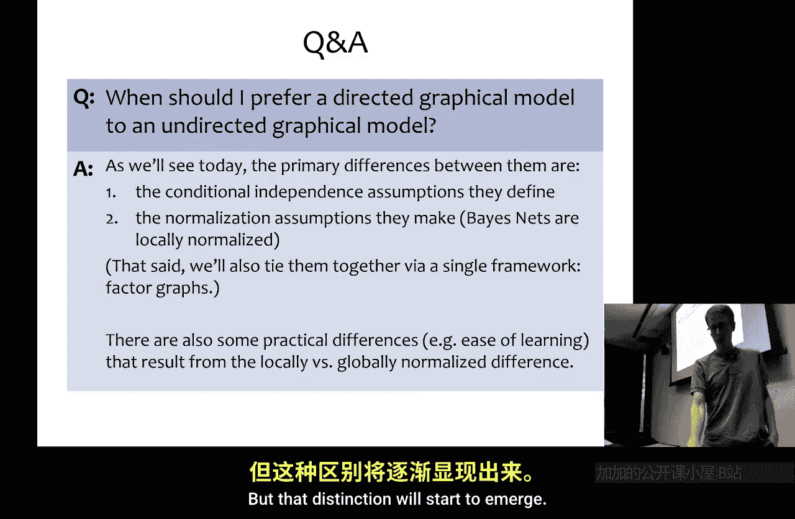
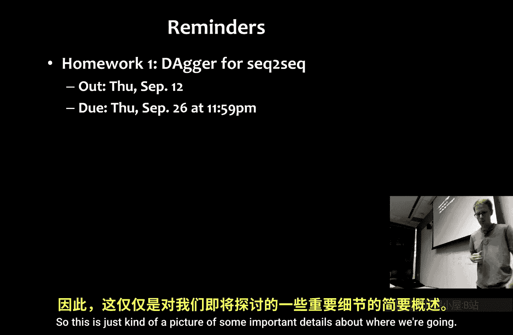
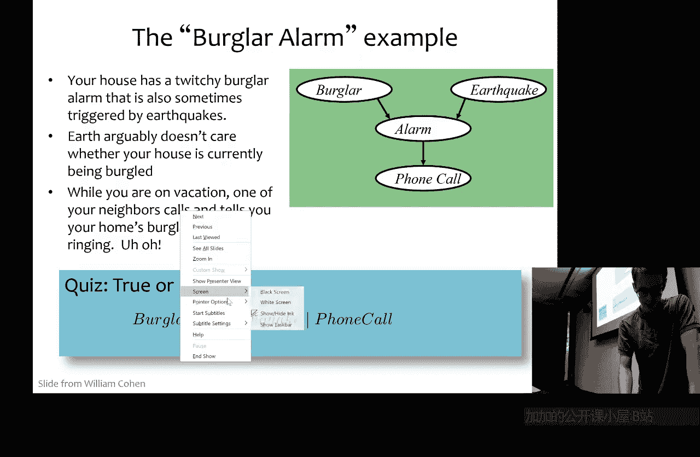
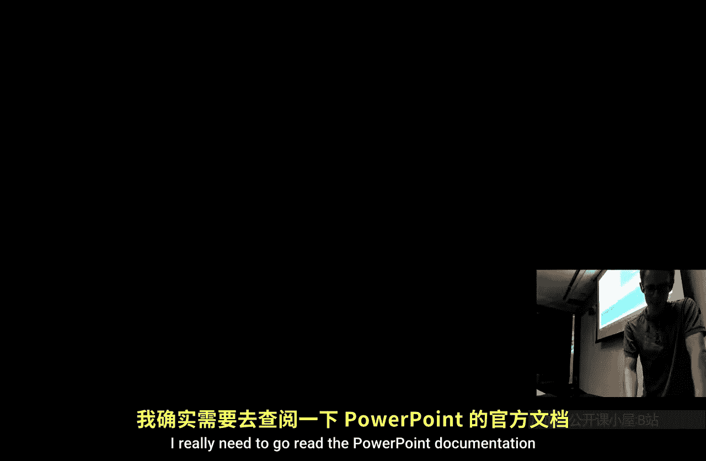
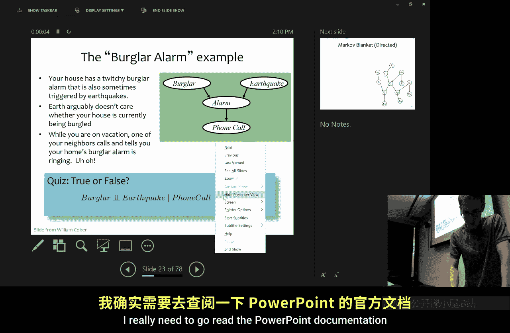
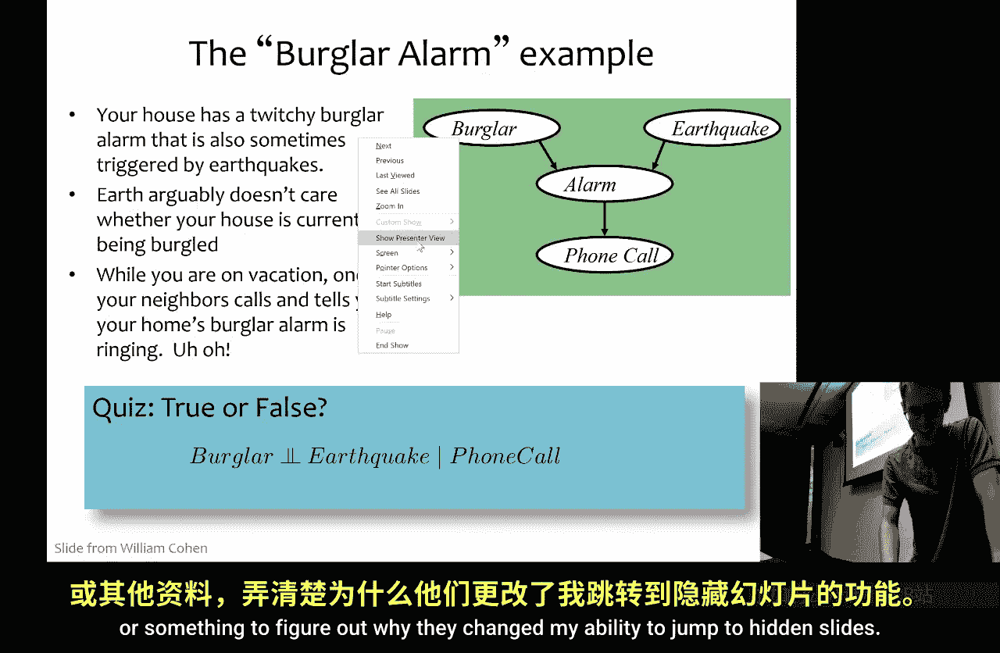
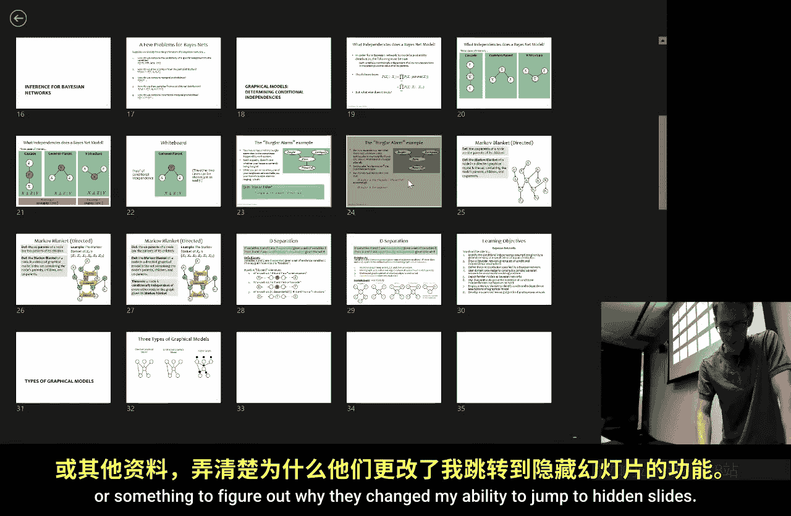
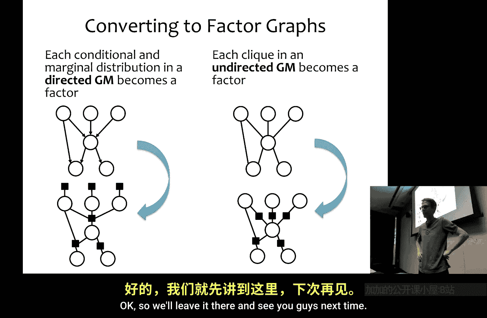

# 卡耐基梅隆大学【中英⚡结构化机器学习｜10-418 2019 Machine Learning for Structured Data】 p07 p6 10-418 ⧸ 10-618 Fall 2019 -BV1eJRsYBEaK_p7-

Okay， welcome back to the machine learning forspec data。Today。We get to finally。

Start connecting a bunch。Together。Andto something that。这是这个。

I think we'll emerge into a really elegant。Way of representing a lot of different models。

So so far we've just kind of been going through video networks， but we're going to move beyond them。

Just start to talk about。😔，Families of models that include Markov random fields and conditional rent。

So。Before we get there， I do want to kind of wrap up a few details with Baysnet stuff。嗯。Oh yeah。

 so does anybody have a question？そ社です。Okay， you warned me of this，ana had solved it。So。

 according to my。Gripped。I have thought the slide。诶。What。O。We have some sort of。や后。Sorry about that。

Thanks for agree that。In general， anytime something like that happens。

 definitely just let me know because I usually don't。

So one question that came up was how long there in those 5% participation points so very gradually there will be like a few small aspects of the course that will involve your participation。

 maybe more if you're in 618 during a project and we'll attach some participation points to them that said you might not actually use the whole 5%。

 it's just useful to kind of hold out。Some space in case we need it and in that case we'll just say that you get points for being you and the whole class gets curved upwards。

Another really good question that's a little bit early is why would I prefer a directed graphical model over an undirectal。

 we had sort of scribbled a picture of an underdirectdirected graphical model we haven't yet defined it。

 but what we'll see today is that there are some really big differences that you should be watching out for between these kinds of models。

And the two that I want you to keep an eye out for are conditional independence assumptions。

And a distinction of how the model is normalized。How do we ensure that it actually gives probabilities that sum to one？

Okay， and。呃。What do you sell。Some nice tying together of these two kinds of models into factor graph。

But I guess the real answer is going to be that there are going to be some practical differences like the ease of learning for different kinds of models and different kinds of settings。

啊。And a lot of those stem froms。Whether the model is locally or globally normalized。

 so we won't actually see that difference until。Maybe a lecture or two from now when we really。

Get into the meat of。How it is we learn underdirectactive graphical models。

 but that distinction will start to emerge。

So this is just kind of a picture of some important details about where we're going。

Okay， so there's a reminder about the dagger homework。Okay。

 so I want to just sort of briefly highlight how can you go about supervised learning for a Bayesian network。

Okay， so。There's lots， what we'll find is that there are lots of ways of learning。阿。

And here I just want to highlight how we could do maximum likelihood forest。Of a Bayian network。嗯。

So this is just sort of a standard recipe for maximum likelihood estimation。

 we say that we're going to assume that we have data points。That are。These are X vectors。

 and they're drawn from some distribution d of x given thing。No。

 if you are someone who really wants to do sort of conditional predictive modeling， right。

 you really like that running part of speech tags for example， then you could think of this as well。

 we're also conditioning on some additional side information like a description of a sentence in order to obtain。

呃对。Exile。Or we might be in a situation where our model actually defines fully where。

The entirety of our data comes from。So for example。

 maybe we have a topic model that describes where each individual document in some large collection of documents came from。

 so each document is now some XI and what we want to do is actually write down。

Some log likelihood of the actual data samples that we have。

 which is just the sum with a lot probability of each example。Okay， so then from there。

 we're going to assume that our parameters， theta are some vector。

And so we're going to compute partial derivatives。With respect to each parameter in that vector。

theta one data two like data。And you know， if we just put little brackets around those partial derivatives。

Well， then great。Now， we have a gradient。Okay， so this is just now the gradient。Of the。啊。

Likelihood with respect to that vector theta。Okay。And。呃。We could then set that gradient。

 which is a vector equal to the zero vector and solve for。And the resulting theta。

When we do this would be the maximum likelihood estimate。对。To that late。And。

So there is this kind of important question， which is， can we even solve analytically for theta？やろう。

And。So but assuming you can， then you could also then compute the second derivative and check that the log likelihood is concaved down at the point you just found。

All right， so this is just a generic recipe that hopefully you're seen before。

Are there somes that you don't have。跟 condition。On any kind of。嗯。Are there models？

Where you don't condition on any sort of parameters。Sure， here's one。嗯。后面也这。That's。We could say。诶。

Yeah， but even but random so the example of it's see let's start getting examples here。

 so for example， the thing that immediately came to mind that is not a good example all is we can say。

 you know the value of access sample from uniform history。😊。

OhBut we need to say what it's uniform over。Well， maybe like a coin flipping distribution， you know。

 but then that Bully distribution， it always has that parameter。

So does anyone have a distribution that truly has no parameters？What history。So the histogram。

 the actual， you know so we could draw like a little picture of the histogram。

And say that the values are either gay。B or C。But really。

 this is actually equal to a multinomial distribution。Pameterized by some vector phi。

Which tells us the height of each of those little bars。

Like what if you have like lot of data and you just stumble from that data now you're not dataizing your distribution you just have。

Yeah， so here now what we're sort of saying is。Let's say that x is sampled from a uniform distribution over a set D。

 it doesn't even really matter what that set is right and now this is a essentially nonparmetric distribution because we're saying that。

The actual distribution is defined by some set。So。So in this case。

 we've kind of achieved sort of what what an algorithm like say Can nearestist neighbor does。

 which is it doesn't have its own parameters， it's a non parametric model， but it relies on。

An actual data set。So there always needs to be some specification though。

 of what the actual distribution is， and there was actually there's actually a typo in here in my assumptions。

We're assuming that these Xs come from certain distribution。ち？

additional bit of notation that we throw in here。We usually want to flag the fact that this theta here is not just any theta。

 it's like some unknown theta， maybe it's called theta star。

 or if we didn't want to call it theta star， we could have talked about some distribution P star from which these examples were drawn。

But the point is that the actual distribution from which we're。Sampling this is unknown。

But here we're assuming that the actual model family or the actual model itself is maybe the same as that of our。

The model that we learned。If you know the model time then why is why the。

 Why do the directors not have a。Oh， it would no no function form。

 but there should be a great question。 So can anyone think of a functional form or a probability distribution for which we can't come up with a closed form。

Solution。Allsome。そこは。Nive dayss would not be an example。Will they write it down as a basement？

Something else。我这个的 space。Proper distribution as we defined， so。这で。Tition。Yeah， so yeah。

 this is a fine example。 it wasn't quite what I was thinking of so if it's a piece wise distribution then。

嗯。I guess the catch there is we may actually。We might actually be able to still identify it in closed form。

So I was thinking of a different situation。Yeah， a deep neural network， that'd be a great example。

 doesn't need to be that deep， though we could also just have said binary logistic。

This is a model for which we knowigma sigma is the sigmoid function of theta transpose x is a model that。

 we could write down and we could assume that the data came from it。

 but there's not going to be a closedform solution to its maximum the maximum likelihood estimates for its per。

So啊。So this is yeah， but the red be says it's going to be a combination expensive this application。

So yes， yes。So。Yeah， so I guess in general。We might be able to write down a closed form。

We can't actually。Comput it， for example。Okay。So。What if we wanted to apply this recipe to a bayt？

Then what we're really trying to do here is you know doing the parameters of the model such that we get good parameters where the definitions of good comes from our definition of our objective function being maximized the likelihood of the data or the log likelihood equivalently。

Okay， and so you know， this is one recipe。But maybe a more general recipe would have said something in step four。

 instead of solving close form， we could have solved by gradient descent。

The point is that we're just trying to optimize some objective function。Okay。

 so but the reason that I gave the example in closed form is because for a BsNe。

 you often can actually solve this learning problem in a really easy way。

And so the goal here is to actually learn the parameters of these distributions。

And so there's sort of an interesting point here， which is that we need to actually identify what is the parameterization。

Of our Bayesian network。 Okay， so what I mean by that is。If we're talking about。Prameterization。

Of our baynet。Then there's actually a lot of options available to us and you know one of them is。

Some conditional。Probability tables。But we could also do other things。

Say parameterization that assumes maybe all of our variables are real valued。

 so this would maybe be appropriate if we have。Discreet valued。Variable。

But then what if instead we had real value effectiveness this？How could we parentize？は生こです。感没。Yeah。

 maybe you could just pick your favorite probability distribution mine today is Gaussian。

And so we could say we have Gaussian distributions。我啊。But you know， maybe you don't like Gaussians。

For some reason。And so instead， you know you still have real value random variables and you know。

 you're just the kind of person who wants a lip loss distribution。

For each of your variables or maybe some mixture of these things， right？

So there's lots of different options available to you when you think about the actual parameterization。

 but what we want to identify here。Is whether the conditional independence assumptions of the graph inform how learning decomposes。

可以。So let's look at what happens， so turns out that with a fully observed Bayesian network。

So now the important point here is that。When we say fully observed。

 what we mean is that our training examples。Actually include all the variables in the graph。Okay。

So when our training examples include all the nodes in the graph。Then。

Learning the entire graph is equivalent to learning， say， a collection of independent graphs。

And you can get those by decomposing into one graph per term in our joint distribution。Okay。

 so there's one little graph for the term corresponding to x1， P of x1， there's one for x2。

 which is P of x2 given x1， there's one for x3， there's one for x4 and one for x5。Can。

So if we can just figure out how to independently learn in the parameters for each of these little graphs。

Then whatever we come up with will actually be the correct answer for the whole graph。Okay。

 so why does that work Well what we can see is that if we had。Exactly one training example， okay？

Cresponding to a single assignment to these five variables。

Right then the log likelihood is kind of boring It consists of just one term for that one training example。

 right so it would be that you know the。I guess I shouldn't call this theta star。

 I should call this theta hat right。Maximum likelihood estimate。

And we're going to say that finding the parameters that maximize that is equivalent to finding the parameters that maximize the sum of the log probabilities。

For each of the terms in our joint probability distribution， right。

 we just took the log of that product on the previous slide and then the log takes that product and makes it a bunch of sums of logs。

But if the parameters decompose such that there's parameters unique to each of those terms， right。

 there's a parameter for the x5 term， there's a parameter theta 4 for the x4 term and so on then。

The maximum likelihood estimates are just。Those which maximize。

The likelihood for each of those individual terms。So。

What's interesting about this statement is that it has nothing to do with the parameterization that we chose。

This is true whether these probabilities are defined to be Gaussian or to be。

Conditional probability tables or the plus distributions or whatever your favorite distribution is。

Okay， so now let's come back to that。Tornado alarm example for last time， and we can see here that。诶。

We have as before， some random variables where I guess I dropped one corresponding to whether or not there was a fire just to kind of clean the slide up here。

So we just have whether or not a tornado occurred， whether or not hackers's compromising system。

the alarm went on and whether or not there were 100 plus 911 calls and the way that I actually parameterized it was to say that this H variable。

Comes from。An actual Bernoulli distribution with parameter Eda。

And then the T comes from a Bnooli with the parameter town。A comes from a Bernoulli with parameter。

With actually four different parameters。Okay， why does it have four different parameters？Yeah。

 so A depends on the value of H and T。So whatever the value of H and T are is going to give you a different parameter health。

So if they're both zero， then then you get back alpha zero zero。

 if one of them is one and the other is zero， then you get back alpha 10 and so on。Options there。

Okay， and lastly， the random variable C here has no parameters。 It's just a function of。

The random variable。Okay， so draw a uniform from one to six and a times a uniform from one to six。

Okay， so we could draw from P star。P of啊。The probability distribution with theta star。

 a collection of training examples here I drew2 of them。And now that we have this data。

 each of these is a separate training example， and if we want to come up with the maximum likelihood estimates。

 then what do we do？Go through that same process that we just saw in the fly。

 We write down the log likelihood， okay。And then from there。

 once we actually have the log likelihood， we can substitute the joint distribution of THA and C with the four terms。

So what that means is that now the log likelihood consists of a summation over the 12 training examples。

 but then there's one term for each of。The individual distributions。

So what we want to do is find the values of Eta tau and alpha that maximize this。말 거。And to do that。

 all we need to do is take the value of a a hat that maximizes the log probability of H given AA。

Were those 12 different training examples。Okay， so let's think about what that would be。Here。

We're saying that we want to maximize the log probability of。This Berulli valued random variable H。

And we have training examples that consist of this column of values。Okay。

So this is just maximum likelihood estimation of a Bernoulli valued random variable。喂。

So the maximum likelihood estimate in this case。It's just going to be。The number of times that。

The random variable sta that backwards。Yeah， looks's like I have that backwards。

That the random variable。H。Is equal to one。Divided by the total number of training examples。びっくり？

Pretty simple。The exact same process gets us the value for tau。T hat here。Okay， so for a to hat。

 if we actually counted these up， there's 12 examples and one， two， three， four of them are。Ones。

 and so ada hat must be for12s。Which simplifies to one third。And then if we look at the T column。

 half of them are ones， half of them are zeros， so cow hat as one。

I also had is a more interesting one because now we don't just look at one column。

 we actually have to look at three columns together。Okay。The T， the H and the A column。

And in order to find alpha hat here。We need to find the four parameters。

Ofpha T that maximizes long likelihood。 and to get that。

We're just going to count up for each value of T and H。

The number of times that a was equal to1 for that particular value of T and H and divide by the number of cases。

Where TNH took on that value。And so the result is， say。

 if we wanted to take an example when t is equal to zero and h is equal to1。It looks like。We have。

Three such examples right in here。For that case。And of those three examples， one of them。

Has the value a equals1？Okay，So we get one third。For that break。Okay。

So basically learning a Bayesian network。Boils down to some。

Very simple maximum likelihood estimation。 And as long as you know how to do。

Maximum likelihood estimation for the conditional probability。

That you chose in your parameterization， then it's easy to actually solve this maximum likelihood estimation problem for your base。

So。Does anyone know， say I had changed one of these random variables to be real valued？

Like say we changed C to be。doesn't really make sense， but a Gaussian random variable。

 I guess maybe we can have 911 phone called Caing away or something if they're negative。

 and so if that were the case，Then what would the maximum likelihood estimate look like if we just had this？

Thiss Gaussian distribution for？Yeah， we would just look at the empirical mean and the empirical。

Scanandard deviations are there。And that would give us back。Your appropriate parameters。

And maybe if it conditioned on A， it might have two means and two variances for the different values of a。

For example。So the Gaussian doesn't really make sense because we can go negative。

 does anyone have a probability distribution that they'd prefer if we were trying to have a model that captured the number of phone calls？

Yeah， like a Poisson distribution would be nice right so now we actually get an integerrate number of phone calls and it's going to be also a non negative number from which that we sample from that Poisson distribution。

Okay， so we'll talk a lot about inference， I just kind of wanted to highlight some problems that you might want to solve once you have a Baysnet。

 okay， so one would be how do we actually compute the probability for a specific subject for the variables？

Another would be how do we draw a sample from the joint distribution？

Another would be how do we actually compute the marginal probability of a specific random variable where we sum over the values of all the other ones？

We can also ask， how do we draw samples from a conditional distribution region where we've observed some of the variables。

 but not all of them。It's going to prove to be very important。

And then how do we compute conditional marginal probabilities？Where we observe some of them。

We marginalize over the others。So these are going to be problems that will solve。是。Okay， so。

For baysnets， it's useful to be able to kind of identify what the conditional independences are。

 But what's funny about this is we just spend all this time defining Bayesian networks。

 but we did so by articulating what the graph structure was and then what the joint distribution was based on that graph structure So now we're going to talk about conditional independence assumptions。

 and so the first thing to note is just that。So。By the very definition of the basnet。We have that oh。

 so this is just sort of a。Papo on the slide， so we have that the joint distribution of the variables x1 to Xn is given by the product of the probability of X condition on the parents of Xi。

And what that's saying is that。Assuming an appropriate ordering of the variables， x1 to x of N。

We have that。啊。XI must be conditionally independent of all of the。Ancestors of Xi。Given its parents。

 so what does this actually look like？呃。So， if we had。Some Bayesian network。That looked like this。

And。And what we wanted to know was。The conditional independence assumption that applies to this center variable。

Okay， let's call this A。Then we could say that if these are BC。E， F and G。We could say that。嗯。A。

Is conditionally independent。Of。The set D， E。F and G。Given the values of B and C。Okay。So。

If we know the values of。The parents， then A is conditionally independent of all of its nondecept。

Okay， so there's sort of three cases that we care a lot about， which are this cascade of variables。

 this common parent configuration of the V structure。

 and what we find is that if you know the value of y，Then in this case， x and Z are independent。

 and in this case x and Z are independent， but in this third case， they're not。So here。

 knowing why actually decouples the values of Xency， whereas here knowing why couples them together。

So we're going to skip the proofs of these and what I want to highlight is just that there's this interesting case that arises。

 which is。That of explaining the away。So let's just think about this for a second。

So your house has a twitchy burglar alarm。Sometimes it's triggered by burglars and sometimes it's triggered by earthquakes。

 right， and so we could say that Earth arguably doesn't care whether your house is currently being burg。

And so while you're on vacation， one of your neighbors calls and tells you that your house alarm is actually going up。

So what do you conclude？Well。嗯。We could look at this from a conditional independence perspective。

d like we could specifically ask the question， is burglar independent of earthquake given about that phone call？

So how many of you would say？Yes， this conditional independence holds。

And how many of you would say no。It does not hold。How many of you didn't raise your hand because you're not sure？

so。呃。So what's going on here is this property of explaining away。And。对吧。

I really need to， I need to like go read the PowerPoint。

No。

Like the PowerPoint documentation or something to figure out。

あ。Why they changed。My ability to jump to hidden slides。

嗯。Okay， so now I want you to imagine that your're。You're looking on Twitter and you realize like all your neighbors。

Are also talking about this earthquake that just hit your neighborhood。And so。You know。

 you take this sigh of relief and you say like， oh， it must not have been a work。Okay。

 so what's happening is as soon as you know about the earthquake。呃。It's sort of explaining a away。

The possibility of a bird。This is actually a technical term。

 this notion of explaining away what it's saying is that it must not be the case that burglar and earthquake are conditionally independent given the phone call。

We would say that。The burglar and earthquake random variables are independent。But not when you know。

The value of。そ call。す。But you can also have like。And。都都在各查里面。In that case。

Like still independent the month。So having an earthquake is not exactly that now。

So the point is that once you know that the earthquake happened intuitively anyway。

 your distribution over the probability of a burggling has changed and so that's what we care about here。

So you might be wrong， right， it's entirely possible that like you know the earthquake happens and then like you get home and you know your big screen TV is gone because there was actually some nonzero probability that the burglar happened to be burggling your house at the exact moment of the earthquake。

Smart burglar。So， okay。So。I highlight those three cases because they allow us to start talking about the conditional independence assumptions that exist in。

The Bayesian network beyond what we can just infer from this simple notion that we're conditionally independent of。

The non descendants given the parents。So specifically。

 what we find is that one notion of conditional independence comes from the Markov blanket and we find that。

 oh， so a quick definition， the co parentsent of an node or the parents of its children。

We can define something called a Markov blanket， which is just for a specific node。

 it's the set containing the nodes， parents， children， and co parentsents。So for example。

 if we wanted the Markov blanket of x6， that would be its parents， x3 and x4， its children。

 x9 and x10， and its co parentsent， which are x5 and x8。And once we have this Markov blanket。

We can actually say， well， a node is conditionally independent of every other node in the graph given its Markov blanking。

Okay， so。So far， we've seen sort of two cases here。

 one is this sort of explaining the weightamp example， or I guess we've seen three， right。

 one is the explaining away， one is the three cases and one is the Markov plan。

But what if you wanted to sort of find all possible conditional inencies in a basement net？

Figuring them out is actually nontrivial to figure them out。

 you need essentially an algorithm to do it or at least a very algorithmic definition。

 and so here we introduce this concept of de separationparation to get at exactly this set of conditional dependencies。

So we say that if。Through random variables， X and Z are desepar， given a set of variables each。

Then X and Z are conditionally independent given the set。Okay。

So now we just need a definition of de separatedpar。

 so essentially what we have is variables x and z are desepar given a set of evidence variables E。

 if every path from x to Z is blocked，And by blocked here， we essentially sort of mean that。嗯。

Once you know the set E。It sort of prevents。Information flow。

 but from one side of the graph to the other， from the x side to the Z side。

Oh so going back to the coupled example with the burger and the alarm。

 there was no path from the burger to the alarm and yet when knowing the phone call they became coupled。

So like can you kind of explain that in context？Yeah。

 so let's look at a very specific notion of blocking here。So we say a path is' locked in three cases。

 these correspond to those three little cases that I just have highlighted on the slot right the first one is the。

The single parent case， the second is the cascade case， and the second is the single child case。Okay。

 so what we're looking at is。A path is blocked between those two nodes if there's a common parent configuration on the path and you observe white。

It's also blocked if there's a cascade configuration， and you observe why？It's also blocked if。

 and this is the funny one， there's a V structure where Y is not observed。Okay。

 so now let's jump back to our explaining away example。So here。

 what we said was we're going to observe phone calls， so this is shaded in， but alarm is not。

And so what happens is if we want a path from burglar to earthquake。

 it's going to have to go through along。Well， those three random variables form the V structure。

And in this case， we did not observe alarm。And so。The path is blocked。Okay。

 so back to de separationation。Here， we're basically saying。

There was only one path it corresponded to this third case。And it was for。So now。The question is。

What would happen if we had？Observed the actual alarm of it。So let me just make the st。

If we don't observe the alarm event。We say that。呃。X and Z are de separated， the path is blocked。And。

So then。They're conditionally。sorryrry， the other way I went。So。If here our set of variables。

 E is the phone call。Then， in that case。呃。They are deseparated。So they啊。啊。千円ですか。

So if we observe the set of random variables E。Corresponding to the film call。Then the path is。

Let's go back here。Here we go so if this is E。Great， and this is X。And Z。So if we observe E。

 the path。Is。不忘了。So。We got a minute。Do I have this backwards or something？So。我跟你。Yeah， yeah， yeah。

 I'm missing the word not on this slide。So。啊。We say that I guess X and Z are d separated given a set of evidence variables。

P from x to Z is。你个呢做时两会。In the post two cases are blog and the last cases。

The phone call opens up the path because it's a descendant of alarm。In the first case。

But then we still don't have an actual path except through aR。

RightSo according to my definition here， then we have the actual fee structure should be blocking。

Phone call from Bler from her。非ラと。For quite a bit of truly。 and that's a。明。So when we observe。

That case to known for。Oh， oh， sorry。 you're saying because。

There exists a why on the path such that yes， thank you， I missed the key part of this definition。

 so there exists a why on the path such that。Why and the descendants of are none？So。

So the key that I was missing is that。If you observe。Let's just draw it on this slide。

So if you actually observe， so let's say this is E。And this is why。And this is x。And this is C。Okay。

 so what we're saying is。If you observe E， now E is a descendant of y。

So this third case doesn't apply。Because one of the descendants of why is actually in that。Thanks。嗯。

So the point of this。Is that。These nets have these like completely non intuitive conditional independence assumptions。

Even to like get get them right， you need like this long explanation on a slide just to describe how you could possibly compute conditional independence assumptions so the reason for that is that we started with the graph and we came up with the joint distribution and then we had to kind of backtrack to come up with some complicated it's actually not that complicated it's a nice little algorithm for finding these conditional independence assumptions but。

You would sort of retroactively need to prove that this notion of blocking is actually giving you back conditional independence assumptions。

 it's a nice little exercise okay。So here's another definition of de separation。 Okay。

 so we say that variables X and Z are desepar， given a set of evidence variables E。

 if there does not exist， a path in the undirected ancestral moral graph without E removed。 Okay。

 so what on earth does this mean So the ancestral graph is where you only keep X Z and E and their ancestors。

 So here our example， query is going to be A is independent of B given D and E。

 So that means we get to drop F。Because it's not in thencestral graph。

And then we moralize it by adding an undirected edge between all pairs of each node's parents。

 this comes from， I guess the antiquated notion that one should only have a child in wedlock。Okay。

 so now we're moralized。And。Finally， we converted to an undirected graph by making all of those。

 just taking the arrows away。And lastly， we delete any nodes in E。

 this is exactly the case that I was missing in the previous definition。

 and this is how we end up with the conditional independence。In that previous example。

 the burgllar example。Okay， so two totally different ways of coming up with de separationation。And。

So on the one hand， I want you to be convinced that like figuring out these conditional dependdependencies is actually pretty easy。

 you just kind of need to remember these little tricks， but on the other hand。

 I want it to feel a little bit complicated。Okay， why is that because undirected graphical models make all of this so much easier？

So let's talk about undirected graphical models。To get there。

 we're going to jump from directed to undirected， and then we're going to come back and talk about factor graphs。

 which will tie the two together。3。Okay， so in general。

 the key concepts that I should keep in mind here are that a graphical model is defining a family of probability distribution。

And that family shares in common a set of conditional independence assumptions。

And by choosing some parameterization of the graphical model， we actually obtain a single model。

From the family。And the model could either be locally or globally normalized。So for a basenet。

 the family of probability distributions is just this notion of p of x is equal to the product overall very this is some vector X of P of。

Xi given。X sub， let's say pi I， where pi I is the set of parents of I。Good。

And then the conditional dependencies， well， they come from something complicated like de separationparation。

An example parameterization， well， we talked about a bunch， conditional probability tables。

 maybe some Gaussians。Something else and here normalization， these are always。Locally normalized。

Models。Okay。So。呃。What we can do is fill this table in for undirected graphic models and factor graphs。

 But we but to do that， we actually kind of need some notion of what they are。 Okay。

 and what I want to highlight here is that for。Directed graphical models。

 we started with a definition of the family and then figured out the conditional independence assumptions for undirected。

 let's start with the conditional independence assumptions and then go back and define the actual family。

 the joint distribution。ok。So。To do that。We're going to need various different definitions。And。

So this is going to correspond to undirected。Graphical models。And first。

 let's just kind of sketch out like a little anglem of graphical model so we can refer back to it so it will say that we have random variables that are。

X's and they're subinded by numbers， so we have x1， x2。3。Ex4。And then。X five。X six。連絡くさ。

And so the first thing that we want here is actually a definition of conditional。

Independence assumptions。We could even say conditional independence semantics for。This particular。

Type of model， an undirected point。Okay， so the first thing that we want to do is。We want to say。

Just a little bit of notation here。Which is we're going to。purely notational。

But useful to have in place。We're going to say what？7 F。Deote all variables。呃。With indices。

In the set。Maybe S could be some little calligraphic S。So。

The reason that we want to do this is we want to now define， say three sets of indices。

 so we could say let a。Or maybe calligraphic A。Be an actual index set。啊。And we'll define it。

As some subset。嗯。The integer set one。Two， three。U to。所以。T。

The number of actual random variables in our box。So up here， we're going to say t is equal to7。Okay。

 so now that we have this notion of。This index set A， we could also come up with an index set B。

W whichch has the same properties。诶C。Oh I guess and when that catches that。Both B and C are also。

Subsets of。The same indexer。Okay， so。For an undirected graphical model。

We say that the following is true。So。Going to have that。The set of random variables， X a。

Is conditionally。Independent。嗯。The set X。Given。X C。If and only if。X C。Separates。X a。From Xb。

So what do we actually mean here by separates？All we mean is that。

So separates is just the usual sort of graph theoretic notion of separation， right。We remove。Like C。

呃。There is no path。From。呃。A node。In X A。To one。In X B。喂。So this is a pretty simple notion。

 we could say， for example that。你个。In our graph up here。Yeah。This little blue set was。Xc。

And this little green set up here。Rread said。我对B。Then we have the。

The conditional independence between X A。An XB holds given that set exceed seat。

Because as soon as you remove that set。There's no pass between nodes on one side。Okay， so。嗯。

There's something kind of nice going on here， which is that the notion of conditional independence in an undirected graphical model is incredibly simple。

This little statement is。Is going to capture all of the conditional dependencies。

Does this mean every node that X should be dependent on？Like are the most in Xy languagepe。

We could have done。A totally distinct set。So it could have said x2， x3， and x5。2。

So now if we did that。Right。These three。As Xc。明。When you remove those。Any sense of node X A and X B。

Remaining。That are disconnected from each other， for which there's no path between them or conditionally independent。

And theres different now there's lots of different sets A and XB that could give us exactly that profit。

So here， the conditional independence semantics are actually really simple。And。What we want though。

 is an actual definition of a joint probability distribution。

That preserves these conditional independent setics。Okay我 what's thatけど。Well， to get there。

 we actually need some graph terminology。So。Go one。Two definitions here， the first。

Is that of a cleeique？And a clea。Does anyone remember what a clek is？Yeah， it's just a set of notes。

That are fully connected。か。This course。So here now。In our example。We have。呃。

So in this particular example， all of the pleas are actually pairwise。

So let's go ahead and add an extra edge here。It ends between x2 and x3。

And now all of a sudden the set of cliques just got a lot more interesting。So for example。

 the set x1， x2， x3 is a clique。They're fully connected。The set x2， x3x4， also a。

What if we take the union of those two sets？X1， x2， x3， x4。Is that agree。No。

 because we're missing the connection between X1 and x。Okay， so。

Our other definition here is that of a maximal tweakak。So a maximal clique。Or。Is a clique？呃。To which。

Adding a node。Adding any node。Make it。No longer a clickique。

So it's just a clique where if you pick any other node in the graph and had it。Thats sent。

Then you don't have a fully connected setting。So in the case of our example here， x1， x2。

 x3 is a maximal tweakke， right？The set x1x2 is a clique。It's a fully connected set。

 but it's not a maximal set because we can add x3。And get back x1x2。So here as an example we have。

Both the set X1。Exex two is a clique。And also， say。Next1。X2， x3。But down here we have。X1。X2， x3。

But not。X1， x2。Okay。So now we're getting close with these definitions。

We can move a little bit closer to。The joint probability。Under an undirected。Graphical model。So。

We define the joint probability for an undirected graphical model。To be。A distribution over。

Variables x1。U Tuesday X。诶有。That joint distribution is equal to。1 over。Z。Where we take a product。

And here's where things get interesting over all cliques see。In the set。Calligraph sea of cls。

And for each。Of those cliques。We have something called a potential function or a factor。Index by。

That's true。 Let's index it by C。诶 takes in。A set of variables。For that set， C。So。This definition。

Works。If we say that。This is true。Were the case。That calligraphic C。呃。Is the set？呃哦。Maximmal。Cleicks。

And I want to add a little caveat here。And。An entry in that set。So one of the actual cliques。C。

Is an index set。Meaning good。C is a subset of。One update。So。嗯。Now， let's actually。诶。

Jump back up to our example here。So if we want to write the joint distribution。For。

This undirected graphical model。We would need to write in all the terms for all of the cliques。

So we could say that p of x here。For x 1 up to x 7。There's going to be a product。

Of one term per maximal clique。So let's see if we can find them all。

Someone going to start rattling off maximal cls for me？So what's the first term？Yeah， x1， x2， x3。

And then。ち。谢。2 x3 x 40。What else？X5 x6。怎么样。Anything else。For and发。For instance。嗯。Okay， so。呃。

My error here is that I just read all of these as Ps。And。In fact。

 we can actually prove that what I just wrote is actually completely impossible。Okay。

 so if we wanted all of these to be marginal distributions。This couldn't possibly work。嗯。あそる。Okay。

 we actually really do need。诶。To write this in terms of。Potential functions。

So it can't possibly that。It's got to be potential function of x1。X2， x3。

And potential function of x2。3 x4。5ive and six。4 and5。Ex4 and X。

But we're still missing something here。Which is。We want that。Term1 over Z to multiply all of these。

So。To fully specify this， we need to get a few more details in here。So one of them is。We said that。

We have these。These terms。Okay， and。They're called。Potential functions。 And we have。One。Factor。

In this product。Which is also called a potential function。Per maximal clique。And。There's sort of。

Another key observation here。Which is that。あ。三种方。Must be non negative。

So the actual values of the potential functions。Have to be。诶。Always zero or greater。So for any C。

And Xy， we have that。This is greater than zero。Girl C at X C。可以 저는 then。The last bit here。

Is we have this thing called oh question。Oops， sorry， no I wrote。Positive。

 but it is actually not negative here， so it's greater than or equal to， thank you。For the most part。

 people actually tend to consider cases where it's strictly greater than zero。

 and we'll give that case a specific name， what we call a Markov random field， but in general。

 we actually want to define this civic。Eier。Okay。So。呃。This Z term。Is called the partition function。

And。The fact that we have it。Is what gives us a globally。Normalize blood。So。In a bay net。

We defined these conditional probabilities。And those little conditional probability tables had the property that locally they summed to want。

Here we have something different。We're saying that。嗯。

This distribution jointly over all of the variables is going to sum to one。

 but you need the partition function to ensure that that happens。So to get there。

 we actually have to define Z。To be a sum。Over all the possible values。

That that vector X could take on。And we could say this is over。Some calligraphic x here。

 which is all the possible values that x could be。And for each of those。We're going to have。

This inner term。Which we could call， say， the score。Of a particular aspect。So in here。

 we have to score。So writing it out completely， we get a summation over。All of the values of x。

A product over。All the cliques， maximal cliques， rather。そうすこ。Okay， so。嗯。Sorry。

 I jumped pretty quick there， so I'll give you guys a second just to interrupt that。Any questions？

I' wrap up with two more statements。你些应该。Oh， yeah， so maybe we'll make this a homework problem。

Because I don't want to go through it right now， but can you please just make a note it's a great homework problem that this is impossible。

 so marginal probabilities for potential functions。Make that note in Slack or something。Okay。

So this was the Markov blanket for a directed model。The Markup blanket for an undirected model。Just。

呃。Here's a typo。Is the set containing？诶。The node's neighbors。Okay。

The Markov blanket for x6 is just x3 x4 x minusx。And we have the same property that un node is conditionally in event of every other node in the graph。

一。B。And so from our original statement， this is totally obvious right。

 we're just saying if X6 is the setxA， all the white nodes are XB and the blue nodes are Xc。

 obviously if you remove those blue nodes， X6 is now completely separated from everything else in the graph。

So the notion of conditional independence in these models is。Really what drives their definitions。

But what's fun about them is that for the direct graphical model。

 we started with the joint and then took some work to actually figure out what the conditional independences were。

For the undirected graphical model， we started with the conditional independence。Semantics。

 and then it actually takes some work to show that the joint distribution that we came up with is the one that corresponds to those conditional dependence。

So the point that I want to leave on is。That there is a non equivalence of these two kinds of models。

 so specifically this directed graphical model does not have an undirected graphical model equivalent。

And this undirected graphicappl model。family， a collection of models。

And it does not have a directed model equivalent。And so what I mean here is that。Specifically。

 the conditional independence assumptions for that this given directed model just could not possibly hold for any undirected model over the same set of variables。

And vice versa for the underdirect model。So we actually do have some important differences and what we're going to do next time。

I look at。诶。A notion of factor graphs。Which will allow us to talk about how you can take a directed graphical model and obtain a factor graph representation of it。

And an undirected graphicel model and obtained。Factor graph representation of this and once you do this now we can just throw away all this silly notion of arrows and undirected edges and we can just work in the space of these factor graphs and we'll be able to unify our inference algorithms over both kinds of original model and we can just work。

打不出来东行。So that's where we're going。Okay， so we'll leave it there and see you guys。

