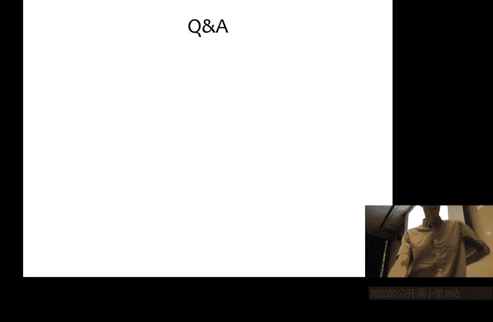
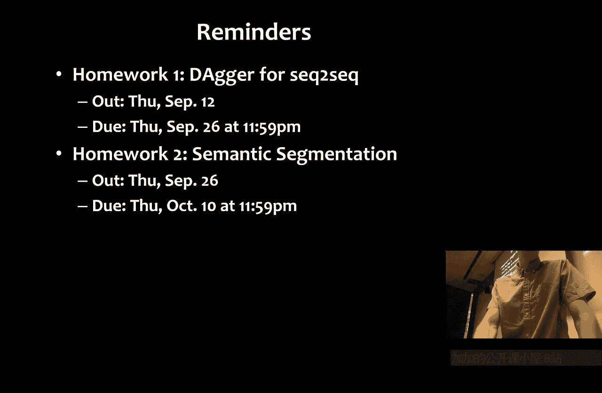
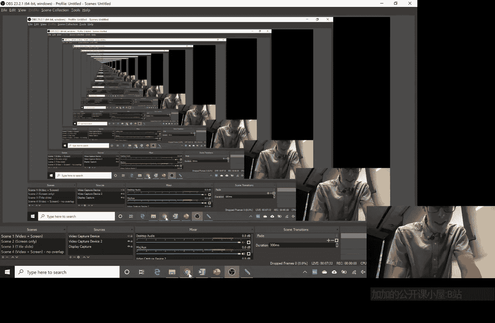
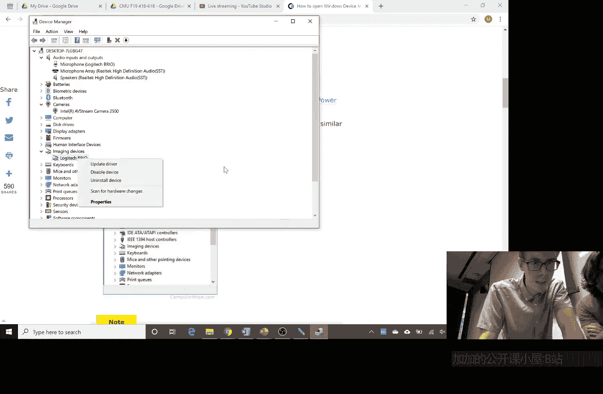
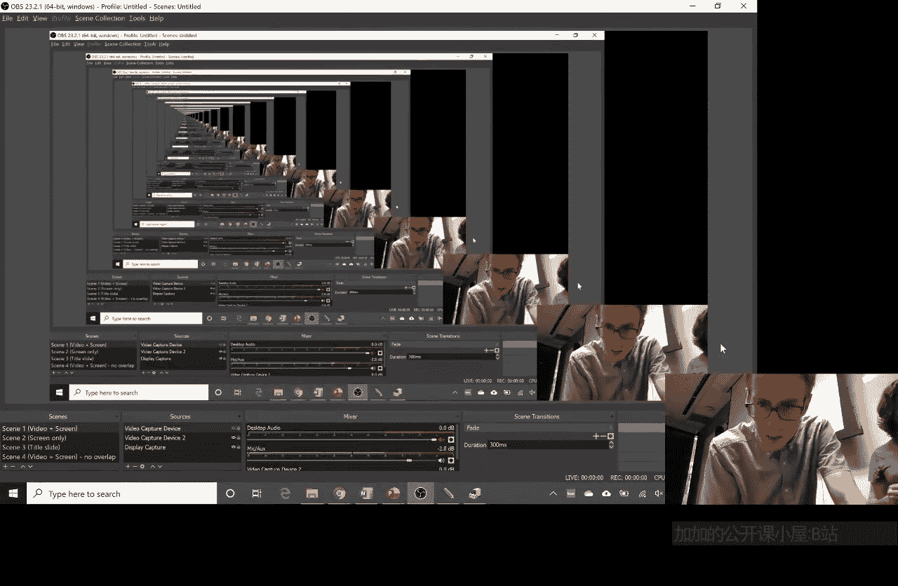
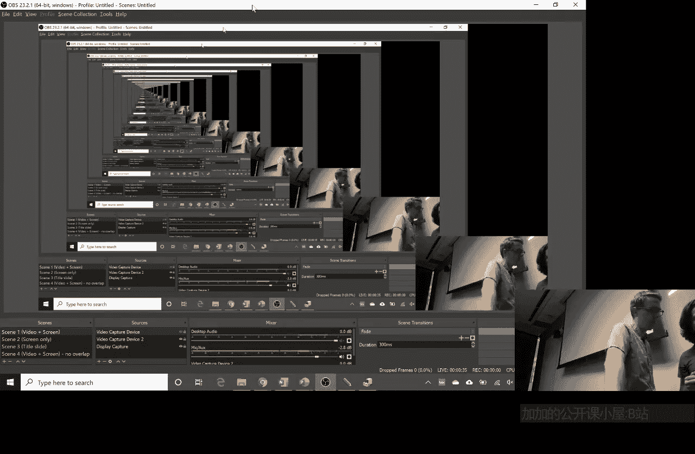
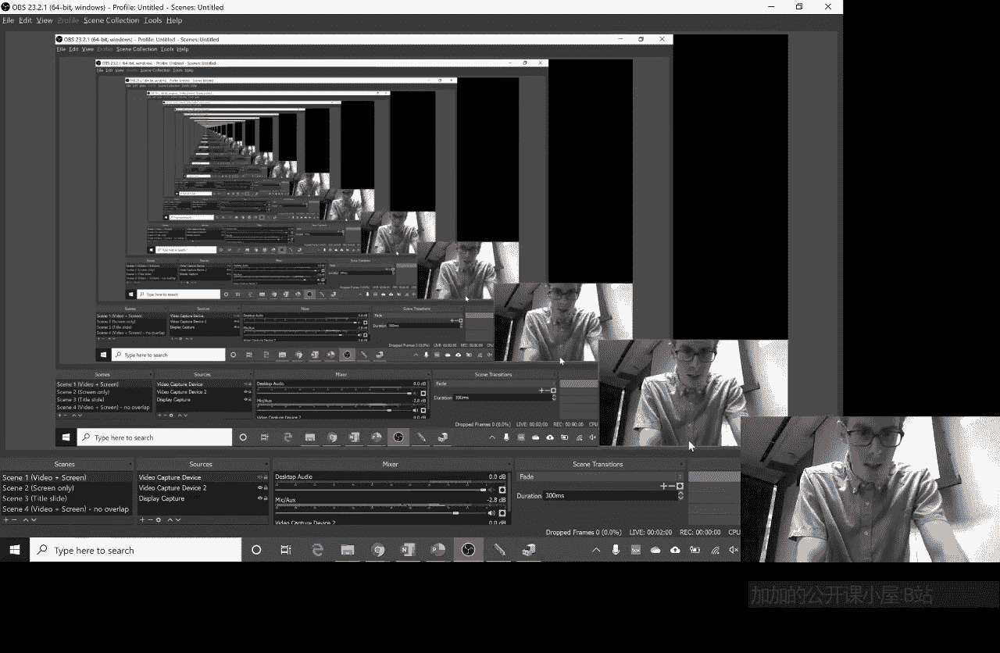
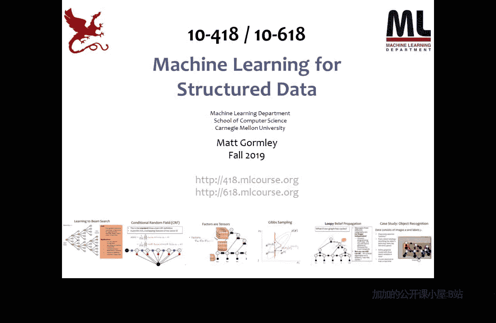

# 卡耐基梅隆大学【中英⚡结构化机器学习｜10-418 2019 Machine Learning for Structured Data】 p08 p7 10-418 ⧸ 10-618 Fall 2019 -BV1eJRsYBEaK_p8-

，Okay。Yeah。Okay。ち。So。全。Okay。Okay。Okay。Yeah。我是个鞋子。

Okay。So。We other。这上我的。这是。A like is correct。Okay。

什。Okay。M。 you。Okay。For example example。Yeah。借我司。It just。Okay。What were thinking about。Yeah。Yeah。Yeah。

Okay。差。Destruction。Okay。差我。The should have self recorded。

私？So。这个吗。So。I。Yeah。They're actually。YeahYeah。Okay I just cards。えす。Okay。I a video。In section， okay。

 so。Thank you。どか？Yeah。这个。Yeah。sure。So。Yeah。嗯。Yeah。give。So。这。It what is。second自。Yeah。Yeah。

So。Yeah。I。

Yeah。Yeah。Okay。Okay。Yeah。Yeah。Yes。Yeah。Yeah。Yeah。Yeah。Okay。What。你你给给我干嘛？Yeah。Yeah。Okay。Okay。Okay。

Yeah。Yeah。Okay。Okay。Yeah。ある？Oh。Yeah。

Yeah。

Yeah。Yeah。Okay。

Yeah。わか？

Okay。Yeah。Yeah。

Yeah。

，Okay。Yeah。Okay。Yeah。Yeah。Okay。Yeah。Okay， so I just don。And like dropped it up and then came back。

So I wonder if it was using， I might have just finished my car。Or something。Great， well。

 now I'm not even sure， so， we're good then。I stronger grab your vision in for like 30 seconds if it's not。

 youre still not working but I think that sounds like。

Okay。表咩我俾。さんと。三件。です。佢正多哋己。哪。Okay so hopefully they weren't exactly like you that weren't really disappointing if exactly the same interests and there was no cross pollination of ideas but at the same time if you were sort of two sides of the same coin and have similar ideas and maybe you're actually more likely to end up working together。

 so I think either way that works out well so I think we have likely fixed。

The online section issue so we're going to jump back into things here and we'll just plotlo through in worst case。

 I think at this point if things are still failing， I'll figure out a way to like rerecord them。Okay。

 so a paraed microov random field just makes a specific restriction on a graphical model。

 specifically an undirected graphical model， so if we had one that consisted of say four variables like this。

Then we might have undirected edges connecting them like so。And the general MRF formulation。

Would assume that we're working with the maximal cliques。

So if I ask you all for the probability of x1， x2 up to x4。啊，包括 that地。What are the terms？番。や。说的错。

S for experience。Yeah， so there's there's going to be。诶三。Potential function for x1。2。4。

And then some other terms for next to。It's three and minuss four。And what呢位。

By the partition function， exactly， so we divide this full thing by Z。Great。

 so here's a different way of actually defining。A probability distribution based on this graph and specifically this is the pairwise MRF way of doing it。

In this case， what we do is we restrict。To edge potentials。

So what this looks like is we define the joint probability over these same random variables。Based on。

Poentials that only look at where their engines， so we would have a phi for x1 x2 sorry。

 these are psi up psi for x2 and x3。For。What else do you have， X 2。哦哦 x1 andX four。And。아 뭐。

Thanks to the next for。你的声音。这个也是。re and export。I think that's all the edges。

 there should be one2 three4 five edges and five verms here。

 and then we divide this whole thing again by Z to make sure it sums to one。

So these are not equivalent definitions of the joint distribution right the original sort of standard MRF formulation is actually more general。

So this is sort of a restriction on our original definition we could still take the。I get this right。

 so the terms that involve two， three， and four。Would be this one。This one。This one。

And we could say that the product of those three that involve two， three and four。

 if you take that product， you get back。One of the two times。 And then if you take。The product。

Of the remaining two terms， you get back the first one， potential function。So more generally。

 what we can say is。If you want a general。Pairwise MRM。Then。

You can define that to be a joint distribution over some random variables x。

Where this is defined to be a product from， say I equals1 to T。

 let's assume there's T random variables。And for each one。

 we're going to have a urinary potential function。Or that random variable。

And then we're going to have another product over pairs I J。要3意。And for each of those。

 we'll have a potential function。Over ex。Thanks J。We're here。That said。

That these IJ pairs are coming from。s something called E， and that E。Is an edge set。おお。So。

When we define it this way， we're essentially saying that there are sort of two pieces of the puzzle。

 but first。Is呃。This term in brackets。Which。嗯。We refer to as。いね。

And then the second is the second term in brackets in brackets， which we refer to as Ed。

And so we have these two terms。You can see that in the example that I gave you。

 I just left out all of the unary potentials， and I only gave you the edit。

So this is another way that we could actually specify kind of a specific form for a Markov random field。

嗯。把 potential functions。フシフン sameあレなて。So。Yeah， this is a good question so you know what is the actual form of these things Well that's a question that I'm sort of pushing up。

So in some sense at this point all we care is that there' are some functions that give us back some numbers okay。

 what are they actually going to come from well they might be tables okay if they're tables then they might start to feel a lot like the Bayesian networks that we were defining with tabular or conditional probability tables okay if they're not tables maybe they're functions of some features and some parameters in that case they can actually feel a lot like a linear model。

Except one that kind of decomposes。What you guys are eventually going to be working with is a setting where these。

Little scores are actually coming from a neural network。

And so there's lots of different ways that we're going to be able to get these functions and that will have implications for how we actually train the thing。

 but for now they' they're just I think the best way to think of them at this moment is just think of them in terms of a table of numbers。

And the question will just be where does that table come from？

So I'm not going to go into these there's lots of sort of famous Markov random fieldss like the Iing model。

 the hot peelel network， the plots model， these are sort of specific types of parameterizations of those functions and we'll be looking at something kind of into a pots model for image segmentation on homework too。

Okay。So。What I want to move to is a discussion of factor graphs。

 and this is going to allow us to capture both directed graphical models like Bayesian networks and also the undirected graphical models that we've been talking about these Markov random fields。

Okay， so。Remember， we kind of talked about how you could imagine having， say。

 a joint probability distribution over some variables X。

And you can imagine drawing samples from that joint probability distribution Now we have various graphical models that can specify a joint distribution。

 but we're going to see how we can come up with a factor graph representation like this one from those existing definitions。

So these are the factor graphs that we've actually seen so far。

 let's actually figure out what it is they're doing。So factors。So a faster graph is going to consist。

Again， of variable and edges。But now there's going to be a new kind of node。

And they're going to be these little black boxes that we're going to call factors。

And so if you think carefully， we actually have a bipart graph。It's hard to see it。

 but imagine if I grabbed all of those little black boxes and pulled them up to the top of the slide。

What would be left on the bottom is all of the variables。Now keep all those edges connected。

 and you could imagine further that there wouldn't be any edges。Between variables and variables。

Or between factors and factors。So it would be a bipartite graph because each of the factor variables connects only to variables and each of the variables connects only to factors。

And so when we say that factors have local opinionsminions now this starts to give shape to some of the ideas that we've been talking about in this abstract notion of these potential functions。

 we can start to think of potential functions as factors in a joint probability distribution where they express some preference locally for the values of the variables that they're touching。

So what we're going to build here is a correspondence directly between factors and potential functions and factors and conditional probability tables where potential functions are coming from undirected graphical models。

Conditional probability cables are coming from directed or Bayian networks。

So here you could imagine that maybe we're trying to do part of speech tagging again。

The factors that connect， say a tag variable and a word variable。Were going to be a big table。

And for each possible value of the tag， like a verb， an out a composition position or a determiner。

They're going to have one separate row， and they're going to have one column for each possible value of the word。

Time flies。You're going down withzebra。And so we can see that here。嗯。

So flies has a high score for being a verb or a noun。But it has a really。

 really low score for being a preposition or a determinant。

So this particular factor is expressing an opinion。That if。The x1 variable is a determiner。

 and W1 is the word flies。It's going to be really upset because it's given a really low score。2。

Similarly， were going to have these edge。Factors where the edge factors are actually also expressing local opinions。

 but about a pair of tags， signals 1 and x2。So this particular factor gives a really high score to a verb followed by noun。

 a score of six， and also a noun followed by a verb， a score of eight。Okay， so。

In this particular case we chose to kind of reuse some of the factors in different positions right this factor has the same tabular values as the second one next to。

So now。If we want to define a joint probability distribution over both the tags and the words。

Then we can do this just by picking out the corresponding values and the factors。对。

These are just potential functions in an undirect graphical model。And here we say， okay。

 for a particular assignment to the variables， we've now filled in the variables with their values。

 when this is down and this is time， we pick out four， and for a noun followed by verb。

 we pick out eight for verb followed by ver position。

 we pick out three ver flies five and we start multiplying all those scores together。

And what we get is this product of these local opinions。So。

You can think of this joint probability distribution。

As sort of happiest when its individual factors are locally happy with the assignment。

And then of course， if we want this to actually give us back a valid probability distribution where if we had summed over all of the possible assignments to these variables。

 we would have gotten something。Unormalized， so we need this term1 over Z to make sure that it is normalized properly。

Okay， so a Markov random film is just going to be this joint distribution over tags and words。

And the individual factors aren't necessarily probabilities。Okay， so in a Bayesian network。

The only change。Is that well one， we got rid of the little factor tables。

 the little factors in the picture and we switched to directed arrows， and two。

 we changed from unnormalized tables to normalized tables。

And how they're normalized is actually important。So you can see in these two top tables that the rows are normalized。

 not the colors。And so what they're defining is a conditional probability。

 the probability of verb following that。Or column following row。And similarly here。

These are probability of word given tag。And so the columns， sorry by the way around， the rows again。

 sum up to one。And now because each of these conditional probability tables is locally normalized。

We're ensured that we have a valid probability distribution， even without Z。But another way。

 the partition function for a Bayesian network is always one。

And so we don't need this global normalization term on a Baysian network。Okay。

 so here's our Markov random field again， and we can make a small change to it and obtain what's called a conditional random field。

 so to get a conditional random field。We're going to assume now that we're no longer defining this joint so both of the Markov Rom Field and Bayesian network are joint distribution over were tags and words。

 a conditional random field is now going to define distribution over tags given words。Okay。So。

The actual form of the distribution is now conditioned on。すサす。So。What changes here？NotThat much。

Okay so nowですね。This little factor is now just touching a tag。

Because the sentence is essentially given its condition done。

So the possible values that this factor can take are just。

4our different values for the different values that the tag could take Okay。

 where did those values come from， Well， if you look at what I did， I actually just said， well。

 if the if the if the sentence we're conditioning on is time flies like an arrow。

 then we're just going to snip out。This column。From that table， and then this column。From this table。

 and those will give us the CRF factors。That's where it games。Okay， so。

This is sort of feeling like everything on this slide looks exactly like everything on this slide。

But there's something subtly different。About them too。 Anyone see what。

What is actually different when we're defining these two probabilities？I mean。

 sure one's conditional， one's joint。But should do they have the same value？

The answer is going to be no。Here's a joint probability we're using some set of numbers。Yeah。

So this is going to be a joint probability and it's going to be a different value right。

 this number here is going to be a different number than this number。

But I just said that all the numbers in the tables are exactly the same， so what's different？

But you in。That's a good question， so there is actually a difference in independence assumption here。

 specifically centered around the Act。But that doesn't yet account for。

So but those same conditional independencies that existed in the Markov random field。

Are also going to exist in this particular conditional random field because I took the numbers directly from the Marov random field。

 so there's something else。That is going to change to account for the difference in these two possibilities。

Exactly what is different about the part approach？So there was5 different。这本 happened。Exactly。

 so the partition function for the Markov random field has to sum over every possible assignment to tags and words。

Not just for the sentence time flies like an arrow， but for every possible sentence， or well。

 I guess maybe every possible sentence of length5。Here。We're only summing over the possible tags。

For this specific sentence。So the actual number of sum ends in the conditional random field is dramatically less。

 and the term one over Z is going to be。Much small。嗯。是。O。

So both the factors and this partition function Z are now specific to the sentence。

And that's what gets us a conditional random field。Okay， so。

Factor graphs are we're going to spend a lot more time talking about conditional random fields。

 but we're going to do so in the context of training when we're actually thinking about how we define these potential functions。

So factor graphs can be used to describe Marov random fields， conditional random fields。

 Bayesian networks， and inference is going to treat all of these interchangeably so that you can convert your model to a factor graph first and then just run the inference on it。

Any questions？So。There have been for quite a long time strategies for exact inference in these sorts of models。

 one of them is belief propagation， we're going to talk about this one。

 the junction tree algorithm is another one which tends to be in sort of less prominent use at the moment in the world and so we won't actually focus as much on it。

 but it's good to know that it's there。Okay， so what we want to think about is this factor graph notation and how we can move from factor graph notation to general purpose inference algorithm okay。

 so what we have in a factor graph are variables。And factors where factors are really just a potential function。

And so the joint distribution defined by factor graphs looks very similar to what we were doing with an undirected graph。

An underdirect graphical model。The only real change is that now instead of these potential functions being a product over say all possible cliques in the graph。

They're just a product over all of the factors in the graph。

So the factors are now making explicit what was sort of implicit in the undirected graphic ofal model in the undirected graphical model to actually look at the graph。

Fure out which are the maximal cliques of this graph。

 I mean it's a little graph problem and you actually had to solve them here the actual graph itself。

 because these factors are already present， encodes what the things we are multiplying together。

So let's actually look at。An example。Of。I have a factor graph here。So。Here。

We want to think about sort of a simple factor graph。And we'll do so in the context of。

A factor graph。Over binary variables。And。So let'll just say this small example is going to have three binary variables。

 A B and C。And。We'll say further that。There's a factor connecting。啊A and B。

There's a factor just touching A。So can sha these in。

And there's a factor connecting A B and a C altogether。So we could actually label these factors。

 we could say， okay， this one that only touches a is Psi A and this is Psi A。And this is P AB C。

Where the subscript of the psi isnoting is just showing which of the actual variables it's touching。

Okay， so now we can actually look at what these little potential tables hold。So opening them up。

 we can see that。Side A。It's just a。Cable over the possible values。

Little A that the random variable A could take on。So little A。

 the value could be either say zero or1 because it's binary。And so setting a could take on values。

Say two， seven。And then we could have another table here showing。Sine A B。

And that would be a table that ranges over four different values， so it's 0，0，01， 1，0， and 11。

And for each of the four different values of little A and little B。

 we could actually fill in the potential table so it could do something with。For。3。6ix and two。Okay。

 so then we need one more table here and the last table。Is going to be。For。嗯。The last。For。Where。

We could say the last factor。Is going to range over all possible values of A， B and C。And here。

That's going to be values like 000001010 and then let's just allied a few of them and we'll jump down to 111 and so the actual values that we'll look at are just going to be some six2。

 one and，5ive again， where we're kind of。都话你我。下げ。So。So each of these tables。It。

Representing one of the。Little factors in the ground。

We can now kind of conceptualize how they're coming together to form a joint probability distribution。

So specifically， what we're doing is we're defining， say， the probability。Of。

Randdom variable A equaling little a。B equaling little B and C。

So this joint distribution is defining， say， a probability mass function。因为你是。

And what we're doing here is under the factor graph model saying that that takes value1 over z times。

Psi A of little A， Psi A B， of little A B and Psi ABC of little ABc。

And then here we could also say the last three terms。The Psi A term， the Psi A E term。

 and then the Psi ABC term are going to define for us some score。Where the score is just。Going to be。

Some function of A B and C。And so， with that。Then。Sort of compactly define Z。

To just be a sum over the possible values of a。Itll be little C。First， the score of。给你史。

So this is just。Sort of a more compact way of writing out Z where S of ABC is actually these three terms multiply together。

Okay。Okay， so。So we can actually think of this joint distribution as itself coming from some big cable。

I mean， what is that big table look， well， it's going to have to consider the possible values of the random variables A B and C。

And those will be like zero， zero， zero。0，0，1，0，1，0。And then again， like the third factor。

I'm gonna kind of a lie。A couple of rows， and jumped down to。1，1，1。

And what we could do with this table representation is now we could actually write out all of the different components。

 so Psi A is going to take on values according to the values in the first column。Okay。

 so how would I fill in the column Psi A when we're looking at all the values of ABC。

 what would those values B？我这个把这个。Yeah， so what is the value of Psine a for the first row？Yeah。

 two and then。Do again。Do again， and it's not seven until that last row where we get8 equal one。Okay。

 so we can do this for each of the factors， right， so now we're going to have。Sorry。

 this should be a capital A Psi A B here and there we're going to look at the values of A and B so A and B are00 in the first row so we can solve our little table so that meanssi A B would be giving contributing four。

And then here there's 0， zero again， so it'll contribute four， and then it's going to be 01。

 so that would be three， and then at the bottom row it's one1 so that's going to be two。

And then Z AB C， well。This one is the one that we didn't actually even write them all out。

 so we can just copy that down， six， two， one， and five。Where again， we're。

Aligning everything English。Okay， so now we can do something interesting which is。

We can now say that the score that we were computing。

 that score is actually the product of the three values from each row。

So the score of the first thing is two times four times6， which is something like what 48。

And then two times four times two。16， and then two times three times 1，6。

 and then seven times two times5，70。So now we have a score for each possible configuration of the random variables。

And further， we could also think about having another column， which is the joint probability。

For all of these。How do we get the joint probability？こし。Delighted guys。哦。嗯。嗯。No。

 we had one of the variabless and then divide it by。Yeah。

 so we need Z if we want to compute the probability， so what is Z？

It's just the sum of all of these scores in this column plus all the ones that I left out right so there's a whole bunch。

Right in here， and if we added all of these up。没有一国。The value of Z。Once we have Z。

 now we can come back to that definition for the probability and say。

 this is just 48 divided by whatever Z is， and this is 16 divided by whatever Z is。

6 divided over whatever Z is and 70 divided by whatever Z is。Okay。So okay。

This feels a little bit like。Okay I get it with a table， we can expand it out， that's nice。

 but this is also exposing some really important computational implications。

Going for going ahead okay so specifically notice that。In order to compute the probability。

 we have to compute something for every brain。But if all we want is the score。

Then we only need to look at a single。The score only depends on the values of its own row。

 it's only the probability that depends on Z， which needs to compute everything。

So this starts to expose why computing that partition function is hard。And then as well。

 why even evaluating the probability for one of these models？Okay， so。

What we're seeing here is that factors are actually just tenss。And so depending on what。

Or how many variables the？The factor is actually touching， it's a different size tensor。

 right so if it's just touching one variable， then the factor is a vector。

 which is a one dimensional tensor。If it's touching two variables。

 then it's a matrix which is a two dimensional tensor。

 if it's touching three variables like this one， then it's a three dimensional tensor。

And so indexing into it requires the values of all three variables。Okay， so。Now finally， to get to。

WellOne of the punchlings， which is that we can convert a Bayesian network。To a factor graph。

 and it's really straightforward。To do that conversion。

 each conditional and marginal distribution in the directed graphical model。Becomes a fact。

So remember for the Bayesian network， there was one term in the joint probability distribution for each variable。

And the term was， how is it defined？It was the probability of that variable conditioned on。

It's parents。So for this。Little Baysian network up there， we would have had one two three。

 one by six separate terms。One for each variable addition of parents。

 and so we would take the same set of six random variables， but now we would add in factors。

That show what those conditional probability tables were actually involving。

So for the first variable。Which had no parents。 It's a urinary factor that only touches this variable。

Okay。But for a more interesting。Variable like this one that had three parents。

The factor has to connect。To each of the three parents plus。The variable itself。

So the actual values for this factor。Are going to come from the conditional probability table that was。

 if this is， say， variable A， and this was B， C and D。

 the values for this factor are given by that conditional probability， P of A given B， C， D。

Looks deep。Okay， so。So what we're looking at。For the directed graphical model。

 converted to a factor graph is just a sort of a one for one of those terms for the undirected graphical model。

Each of the individual maximal cliques would become a factor。So here。

 the way I did it was not just the maximal cliques， but also the sort of non maximal cliques。

So in this case， we can have there。Say here is a clique， and it also happens to be a maximal clique。

 and so it gets converted to a factor between those two variables。Okay。

Over here between these three variables， we have a maximal clique。And so we get back。

This factor that touches all three of them。Okay， so。

We can take this further and start to talk about both。Directed and undirected trees。

Where we can see that any undirected tree。Can actually be converted to a directed tree。

By choosing a root node and then directing all the edges away from that root。

And then adirected tree and the corresponding undirected tree actually end up making the same conditional independence assumptions。

And the parameterizations are。Mostly the same。So so here's the directed tree， okay。

 let's start there， where we have some variable that is the root。

And then we have a bunch of other edges， a set y of edges。

 and we have conditional probabilities for each of those edges in the tree。

Converting that to an undirected model， we would get back potential functions。

That looked kind of like a parawise MM。Except that there's a further restriction。

 which is that we define the actual potential functions to be their locally normalized counterparts from the Bayesian network。

Which gives us that the partition function is going to be one。

And I guess and then also the unary potentials for everything except for。Okay。

 so here's a bunch of little examples， so this is a factor graph over five random variables。And。

So we could take each of the probability terms。咩得 and。Map them to some factor turn。And the result。诶。

Or well， and then if we just think about this factor representation。

 we could draw out the corresponding graph， and that would be this one。

we have a factor for each of the terms in this product。If we had an undirected。

Example like this example two。Where it's already a product of three factors。

 then the conversion to the factor graph is。Really straightforward。

The interesting bit is that if instead we had parameterized this undirected model in terms of its maximal clique。

 then that would actually give rise to a different factor graph。

So this is actually why I dislike undirected graphical models， Yeah yeah。

 I know that it takes less ink。To draw the underdirect graphical model。

 and it's easier if you're trying to like actually put one together in Tixie and get it into your PDF paper。

But the factor graph is much more specific， it's actually encoding which of these two factorizations you actually meant when you drew this particular factor graph。

哦。So essentially， the undirected graphical model is ambiguous。

OhSo and I was just going to ask about this。 So you're saying that you can have two different parameterizations for the same graph。

 but they build the same。Our firsts were would be。I guess the key point is that。

So think about the actual numbers that you would encode in these tables。

RightThe way that you actually encode so you can encode。

Any representation that you have in this first， this topic， Gr， you could encode it in this one。

Right， so it's not that you。So this one is general enough that it can capture any encoding of that other。

Pactterization。But it's nice that the factor graph actually distinguishes which one of these you were really talking about。

The other thing to keep in mind is that we're going to run inference on these things and the number of variables that your factors are touching is actually going to have computational implications when you're running an inference zone。

Let's say just we given to a factor graph。One that can be the in game from an or。佢想嚟紧嗰度得佢。So。

You could， I think like。We usually don't even think about doing that sort of because once you've converted to the factor graph。

 like there's not。So you can easily go back to an undirected graphical model。

 the challenge is that you'd also need to know how the actual factors were parameterized to know whether it's even possible to get back a directed graphical model。

Or how we actually define these factors？If these factors don't actually admit a。

Locally normalized model， like if they're all unnormalized factors。

 then we can't go back to a Baysing that。Okay， so there's another interesting thing that happens here。

 which is that so you can have these sort of tree like structures in underentographical levels that are not trees。

 right， this is not a tree it has a cycle。But when you convert it to a vector graph。

We get rid of the cycle。Okay，Similarly with a Bayesian network。

 this is a poly tree and we can actually convert it to a factor graph。

 which is itself an undirected tree。So this is a poly tree because it has multiple。

So why do we like this well there's lots of reasons， but one is that。

Factor graphs can turn these tree like structures to factor trees。

And if your factor graph is a treaty。This guarantees that when you run the belief Proagation algorithm on it。

 you'll get a guaranteed correctness and essentially a usually efficient exact inference algorithm。

Okay， so now let's talk exact inference。Okay， so remember， we kind of said that， you know。

 there's a lot of stuff going on here is understanding what our data looks like they're defining our models which we just spend a lot of time on。

 we're going to come back to learning next time and here I want to focus in on inference。

So we said that there's a bunch of problems like marginal inference computing the partition function and mapping。

And that the first you are Sha P hard and the map inference is NP hard。So。

I want to give a really simple solution to solving all these problems because conceptually this one just is。

Kind of nice。We kept on thinking about taking samples from this joint distribution， okay。

 so now let's actually suppose this is the joint distribution that we have it's a factor we actually know what the values of these tables are and so let's imagine that you draw a sample from this distribution。

And then another one and another one and another one and another one and another one until you get a whole collection of these and then you say。

 okay， now that I have a bunch of samples， I want to estimate a marginal probability Okay。

 so what is a marginal probability， maybe we should actually。嗯。

Maybe we should take a moment and remind you all what a marginal probability looks like。

For one of these factor graphs。So suppose。What we had。Was。

I'm going to give us a slightly more interesting factor graph here。

 it's going to look almost like the one that we just worked with。

 but we're going to add a couple variables， so it's going to have a。BC。D and also E。And again。

 we're going to have a factor between A and D， we'll have a factor connecting A B and C。

 we'll have a factor connecting C and D， one connecting B and D， and one connecting D and E。

And one more thing about。And so if we want to talk about a marginal probability。

Then one such marginal probability that we might care about is the probability of random variable A equaling value little a。

 so that's sound probability mass function P of a。And to compute it。

 all we need to do is sum overhaul the possible values of A。都唔使。All of the possible values have。电线。电。

同意议。For the joint of A， B， C， and D。オ。We can also compute other marginal probabilities。

 like probability of。B。And to do that， we would sum over。

A different collection or a different subset of the very。Everything except for B。

 so we'd sum over the values of A， C， D。And意。Adding up all of the。Probabilities from the jointt。すごし。

Oh， thanks。Yeah， so here， this is I've joined over a lot of things。

We're supposed to feel like a lot Okay， so we could also compute other interesting marginal probabilities like for example。

 you might want to compute the probability of A， B and C。Marginalizing over DNE。

So that would require summing over the values of D and E for the joint。Okay。

So these are all marginal probabilities and the question is just which variables are we marginalizing out？

So here we say we marginalized。Out。第一。And意义。So I'll use this technical terminology。

 this notion of marginalizing out some variables。To mean the variables that are there in our joint representation。

 but that we have gotten rid of by summing over them。All right， so now。

What we can think about is how would we compute marginals on this factor graph？

You have a bunch of samples。Where could you get a marginal probability？

You can have more samples if you want。It makes you feel better。

Same with the marginal probability of x1 summing over all of the other ones。아 그래게。那个。The地方。There。

We could make a table， we'll do that in a minute， but you' got these samples sitting there。

 can someone put them to good use？两个数。So 액 on forward。And we look at all the samples， which has。

the number of times。Yeah， we count the proportion of times that x1 took on value n， right？

We could say that we could estimate the marginal in this case as。46 of the time， it was N。

 and two6 of the time it was V。Okay。All right， this feels like a pretty coarse estimate to the marginal。

 but now I imagine that you didn't just take six samples， but that you took 10，000 samples。Now。

 suddenly it's some proportion of the 10，000 samples that you took。

 you're count out how many of those were nouns and how many of those were verbs。

And so for the next variable， you could do the same thing。

 well three out of six times it was noun and three out of six it was verb here， four。

 sixth preposition， oh okay， this one wasn't terribly interesting。

 it was just 100% deterr and here this one was 100% now。Well gosh。

 now it sort of feels a little silly。You know， maybe maybe there is actually like some verb use of arrow。

 then you know， maybe it's just not like popular knit， you know。

 but people are going to start using arrow as a verb and it'll have some cool online meaning that all the kids think is great and so maybe if we had more samples。

 we could actually find out that there is some small probability of it being a verb。Okay。

 so what if you feel uncomfortable with this solution？Because as it turns out。

 it's generally not easy to take samples from one of these factors at。Okay。

 sampling from one of these factor graphs。ItsIn general， also an NP hard problem。Okay。

 so if you have samples great， you can estimate the marginals。

 but getting them is hard so let's think instead about a very direct algorithm for computing something like a marginal probability and that's going to be variable elimination。

And this is sort of general exact inferences for graphical models。Okay， so first step。

 take your baysnet， your undirected graphical model， whatever it is。

 convert it to a factor graph okay now proceed like this so we're going to have some specific graphical model here where we're going to suppose that the range of each X is01 or two。

And so k equals3 is the size of the range at the variable。

And the distribution factorizes like I've shown。So naively。

 we would compute the partition function as a sum over each of these。Variable， adding up P of x oops。

This should be。See what my notation will be。Oh， okay， that's just a mistake in the slides。

 So this shouldn't be P of X。 This should be。S of X， right， This is the score。Of x。

 And what is the score of x。It's this thing。So the score is just the product of these scientists。

OkaySo we can represent。啊。Oh， I see what was okay， so over here。嗯。Yeah， okay。

 so we could represent the score table。With three to the five。Entries。In a giant table。

 and then if you wanted to add another column here。Which was B of x。

 you could do that and you could do that by adding up all of the entries in the S of x column。

And then dividing the score by value。Okay。So the question is， can we do better？

So the variable elimination algorithm is a cute trick and what we're going to do is basically just capitalize on the actual factorization。

Of this graph。And the whole trick here。Is that you need to realize that summmatians。Can move around。

If you have a sequence of summations like this one over x1， x2x2 x4 and x5。That X five。

 it's up the front， right？But。We can muck with the order of operations here and actually slide this x5。

Summation all the way in so long as the term that we're moving it past。Doesn't involve x5。Okay。

 so let me give you a quick example of this because I think it's harder to see in that case。

So suppose instead I had a summation。Over。A variable x。Okay。

And the terms in the summation were six times  seven。Times oh whoops， I shouldn't use that for time。

These are different random variables， S the summation was over y， and it was six times seven times y。

Does anyone feel uncomfortable with me just， you know， sliding this summation in， not at all。

 it's just six times seven。Times the summation over y of Y， right？Totally fine。 Okay。

 so now let's jump back here。 That's all we're doing。 right。

 We're just saying that x5 is not involved in any of these first terms。

 The first time it appears is right here and right here。

 And so we can slide this thing all the way up。To sit right in front of these last two terms。O。

As soon as we've done that。Now we can say， okay。If we wanted to。

 there's only three squared additions that are needed to marginalize out the variable x5。

And we can actually make a little table。Corresponding。To。All of the work。

That would be done in order to marginalize out x5， right？So this little table is going to consist of。

The possible values of x4 and x5， and then all of the scores， sorry this p of x is wrong again。

This is again， S of x。For the values of X4 in that spot。So now。What we can do is。Replace。

So let's make this。A little clear。 So this， this entry， these entries in these tables。

 we're going to call。M5 of x4。And this is going to be。The value。Suming over x5ops。Or sorry。

 each of these is going to come from this term。嗯。So note that M5 of x4。Is a function of x4。

But it marginalizes out x5。It's not necessarily a probability， though， it's just another factor。

But this time， the factor only depends on x4 because we've marginalized that out。Okay， so now。

Oh here we go， there was very time。So M5 of x4 is defined as a summation over x5 of this product term。

And this thing takes three squared additions。Okay， but。

This doesn't solve anything because if we just expanded things out into the big table。

 we'd still have a three to the four entry table。So what we could do then is repeat this process over and over each time sliding our summation out as far as we possibly can。

 and then collapsing down a term for each of those summations。So the first step。So each of these。

 so let's actually look at each what each of these is doing the first collapsing oh so let's look at the first line here so notice that we。

Moved the summation for x5 as far to the right as we could。

 Then we moved the summation for x4 as far as we could and x3 as far as we could， but then for x2。

 we couldn't actually move it anywhere because the first term involved x2。

So our first step is going to be to collapse this whole thing。Andto a single term。

And then we're going to collapse this whole thing。Into a single term。And then this。And finally， this。

그게。Okay， so the first collapsing requires three squared editions， why is it three squared editions？

你时间。Because to very。We define the range for our variables to be 01 or two。

And there's two variables involved here at4 and x5。And so if we want to create the table。

 the table is going to consist of three entries for the three possible values of x4 to fill in each of those table entries。

 we have to sum over the three values of x5。So that's three times three。

That's where we get our three squared Okay， this next one collapsing it is going to involve three cubed additions because we have。

Three squared table entries， and each one of them has to sum over x4。And then again。

 we get three cubed additions here and three squared there。And then finally。

 three additions to get the partition function。Okay，If we just create the giant table。

Of the three to the fifth entries。And then add them all up to compute the partition function。

 we need 243 entries in the table and 243 editions。

But variable elimination can do it in just 75 divisions。So。

We can use this same trick to compute marginal probabilities。

So you would just choose the variable elimination order such that whichever one you're trying to marginalize comes last。

So you can see here if we wanted the marginal probability for x1。

 we could use that same order as before， but we're not going to sum over x1。

 we're just going to return one over E times。Two of as one。Okay。

So it's the same amount of work because we're still filling in the same table entries。Okay。So for。

This is just the same statement。Much times okay， so here's the here's sort of the。

Visual depiction of what's actually happening。So the first。

Term in the first row there corresponds to the yellow parts of the factor graph。

And variable elimination， the reason we call it variable elimination is basically just removing that part of the factor graph and replacing it with a new factor。

That new factor is going to have a different name， though， it's not going to be calledsi anything。

 it's going to be called M5 indicating that it was the new factor that we。

Essentially got by marginalizing x5 out。And putting in the resulting factor。

So the first step of variable elimination here。Is just removing that part of the factor graph and replacing it with factor M5。

Okay， the second step。Is going to take all of those terms Well that corresponds to x4。

 but also Psi 23，si 234 and5。And it's going to replace it with another factor。

 that's a function of x2 and x3。So that whole yellow part of the graph gets replaced with M4。Okay。

 so this would proceed all the way down， gradually replacing these things by marginalizing out little parts of the graph at a time。

And the key thing that we're capitalizing on is that the only reason that we can move these summations in like that is because we know how the joint probability factorizes。

Okay， so variable elimination for marginal inference。嗯。

The actual input is the factor graph and the query variable。

And then the output is the marginal distribution for the query。

And so if you want to implement this thing， what youd do is you'd actually run a RE first search。

 starting at that query variable to obtain some ordering on the rest of the node。

 a topological order。You'd then reverse that order that would give you a reverse topological order。

 and you would eliminate each variable in that reverse ordering using algorithm2。

So algorithm two is just how do we eliminate one variable， well。

 then inputward is the variable to be eliminated and the output is just the new factor graph。

With the variable marginalized out。Okay， so find the input in its neighboring factors and call this the eliminated set that was the yellow stuff that we saw on the previous slides。

 the parts that you were about to eliminate。And you replace the eliminated set with a new factor。

Where the neighbors of the new factor should be all of the neighbors of all the factors in the eliminated set。

And the new factor should assign a score to each possible assignment of its neighboring。

And set scores should just be identical to the product of the factors。怎会事？

Summing over the eliminated variable。So the same thing works for the partition function as we saw。

Okay。We' over times we're going to skip this last little exercise here， but it kind of。

Interesting to see how the computational complexity works out here。

 and so we'll actually pick up with this next time。

And what we'll do next time is we'll actually look at。

Another general exact inference algorithm called。I over。That can publish the same sort of。

But even more efficiently。なはつまりの。Okay， see you guys on Wednesday。Am we passionate about the homework。

