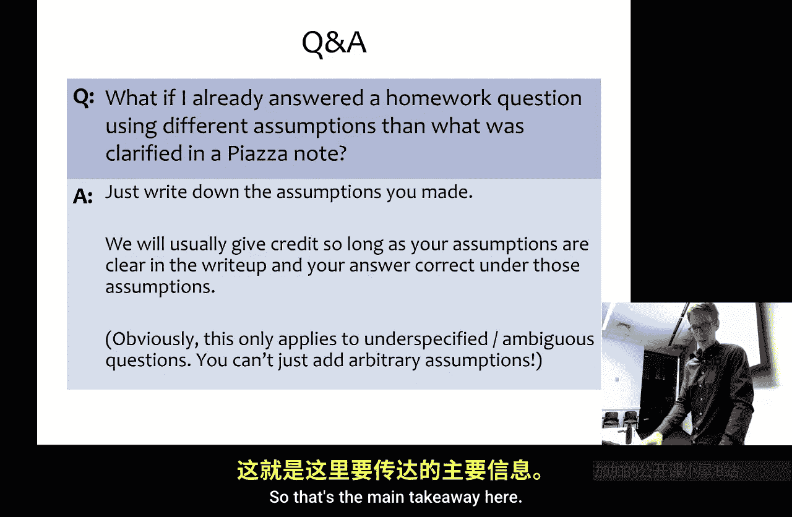
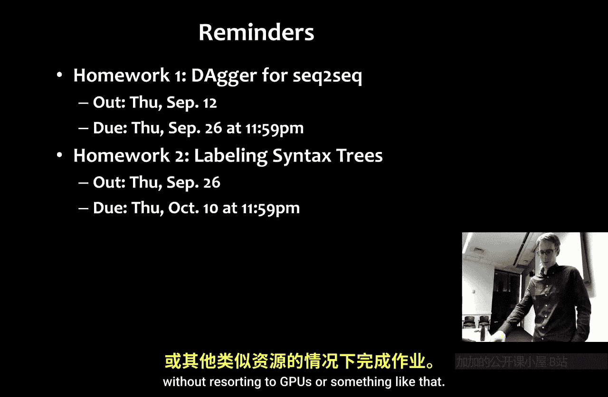
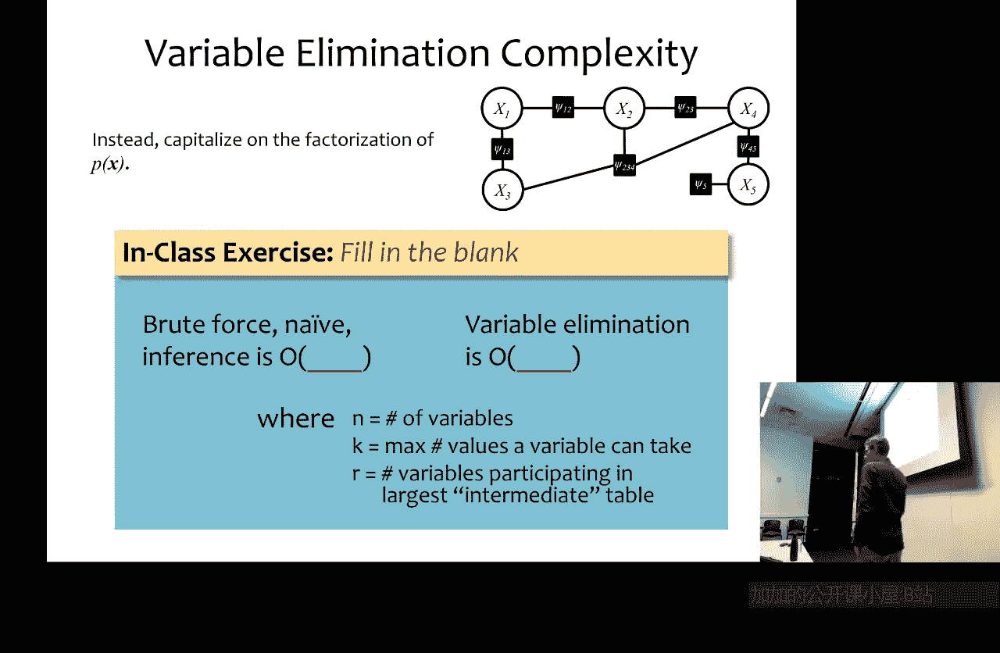
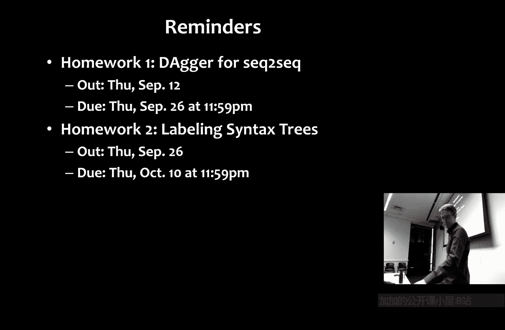
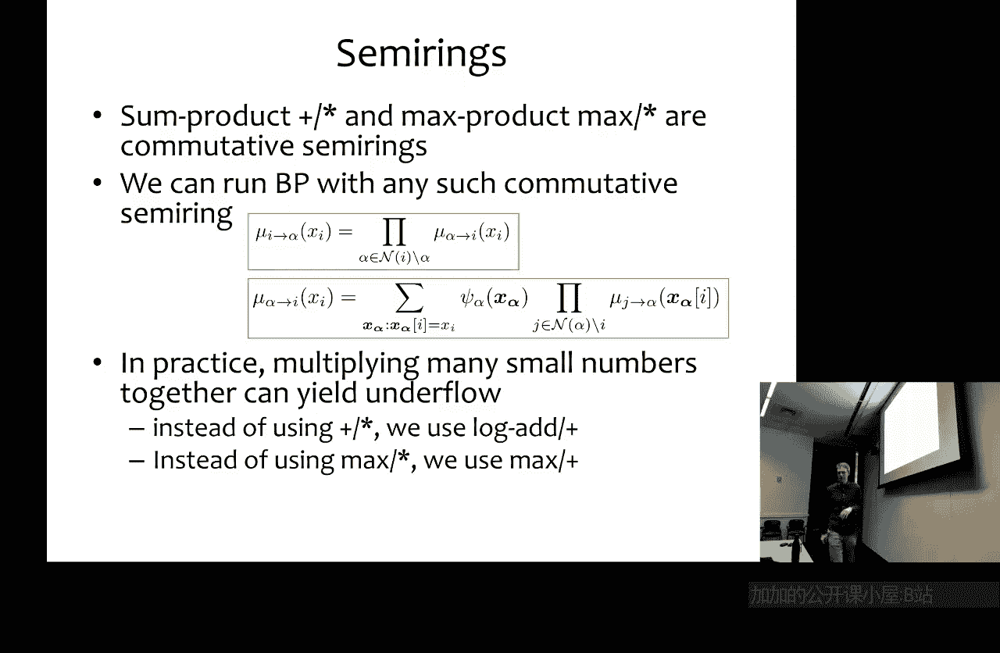

# 卡耐基梅隆大学【中英⚡结构化机器学习｜10-418 2019 Machine Learning for Structured Data】 p09 p8 10-418 ⧸ 10-618 Fall 2019 -BV1eJRsYBEaK_p9-

いや。Ting the max over the。Okay， welcome back the machine learning。

Today we're going to be talking about another exact inference Albert。你们有一。This one will go beyond。

a number of big ways。はい。这是很。我的嘅。没有。诶It also。Generalizes。

Maybe some algorithms that you're familiar with。Like forward back where there maturity。And。

Overall it。It lends itself to just。And it think about how we're actually。

Taking the exact entrance product。Treating it as。Something to be solved。So。なかし。So before we jump in。

 any questions？What should the scope of？Yeah， so okay， so the question was， what is this。

Sort of the right scope of our final copy。And。Essentially， the way that you should think about the。

For this course。Is by looking。The percentage of the total grade that it accounts for， which is。

Somewhat small compared to say。Project based course， which might have， say 40 or 50% of the grade。

Being derived from。And so with that in mind， so as a contrast。

 there's a similar course offered in the spring to this one called 10708 probabilistic graphical models that covers a lot of the material that we cover here and there 40 or 50% of the grade is coming from the project。

And as well， many of the projects that result from it are then just turned around and submitted as。

Papers to say the next machine learning conference。 So in this course。

Our expectation is not that you walk away from this course。W。

An eight page paper that's ready to be submitted to a machine learning conference。However。

 if you do that， great。But our expectations are are。嗯。Maybe that you walk away from this course。

 having done something。That is a substantial。A substantial。Experiment。Around。

The use of structured prediction is some way on some。

And so what that means is you don't have to have。Research experience to complete this project your project doesn't need to ensure that everything that you are doing is completely novel and has never been done before。

啊。And sort of the key outcome of the project is going to be some。

Comparison of structured prediction methods。So that's really what we want you to walk away from。

 And so the big difference there is that。You'll see that something that we do on the homeworks is we don't necessarily。

We don't necessarily require you to。See a performance state of the art level on a benchmark attack。

So why do we do this， we do this because we want the experiments that you're running to actually complete in a very short period of time on a laptop and so that you can actually sort of see some interesting result without waiting around for hours okay so that said what you're actually implementing right now for the seat to see model if you added a few fancier layers to。

Your LSTMs and we gave you the rest of the training data， you would find that。What you've built is。

Basically a few steps away from being state art。Of course to。So similarly。

 we're going to do something like this on homework too。We probably will not give you an。

Hier data set。To work with。The models that you're building are going to be quite sophisticated。

So similarly。That on the project， there's lots of different ways that you can kind of push beyond what we're doing in the homework so that might be like。

Growing the actual scale to accommodate a real benchmark。

It might be kind of combining different elements of the course that weren't combined in the homework in interesting ways in general。

 I guess my last thought here is just that one of the sort of interesting side effects。

Of deep learning， I mean， having like completely eclipsed every other aspect of machine learning is that。

A lot of the techniques that were。Learning about here。Haven't sort of been brought。From。

Pre deep learning heyday into common use again。And I don't think that's actually because they're not incredibly useful。

I think it's because people。Many people right now don't actually necessarily know how to put them together with deep learning。

 So you guys will。 And so I think one。Very clear opportunity for projects here that does push into that novel space is these sort of applications where you're combining elements of deep learning with elements of。

Strucion prediction graphical models learning to search。

And so there's a lot of things in this space that just haven't been done， that haven't been tried。

So it is entirely possible that you might choose something that is sort of a smaller scope。

 but by nature of the actual methods that you're using ends up being on。There， any other questions？

That why系系 body。You have to write that down。I figured no I would read it。Okay。So。

Another good question that surprisingly no one has asked yet is what if I already answered a homework question using different assumptions than what was clarified in a piazza note so there's one problem in particular。

 1。25 that you know just needed a bunch of very like clear clarifications on cases where the actual question was underspec this is the the downside and the nice part about a first offering of homework because so in these cases where it's unclear because it's our fault write down the assumptions that you did make and we usually give credit so long as your assumptions are clear in the right up and your answer is correct under those assumptions。

So obviously this only applies to underspecified questions you can't just start adding。

assumptions like let's assume that all the variables are zero or something like that to any question but in general。

 know we don't want to penalize you for our mistakes and the homework so that's the main take here。

So homework two， we've actually changed the application。

 the actual sort of topic that you'll be focusing on is the same。

 which is that of implementing belief propag。As essentially a high torch module。

 but the actual task will be labeling syntax trees and we're going to save semantic segmentation for later in the course。

 primarily because of issues with runtime and us wanting to be able to ensure that you guys are able to complete the homework without resorting to like GPUs or something like that。

Okay。

Oh yeah， know I' like GPPU， so for the final project。Because like scope buyt that。

 well then should we。LikeI guess we don't have like AWS time。Oh， we can get you AWS time。

 we can get you， there's like these coupons that we can get。

 which add up to be fairly substantial when you have a team project。So if you want that。

 we can definitely get that for you and again that totally just depends on like what it is that you're actually building。

 whether you would actually need that， but again， it's not a requirement。

Okay。So for variable elimination we left off at this point of computational complexity so before I actually jump into computational complexity。

 I do want to take sort of one more moment to just look at sort of one final example here of variable elimination so we're going to go back to。

呃。It to be just a small example。And we're going to go back to an actual factor graph that we had depicted before。

 which consisted of variables A。いう。C。一。And。We said that there were factors between A and B， A， B。

 and C。C人啲。边你。やね。And we're going to have one more offer。So this factor graph， we could say。

Is really comprised by the actual factors themselves， and so writing a few of these out。

 we have this factor for E。Where the values ofsiee， or sorry， I guess following our not from before。

 we'd have the values being lit。And so they could either be zero or one and then。

This could be three inch。And then we'd have another factor that is for。Make sure that we're。まい？

So then we also have this factor between D and E。And so， here。嗯。This factor is a function of both。

And so。What are the four possible values。And we'll say that they have values here at  one， five。1，4。

And。And so what we want to do is think about what variable elimination is actually doing。

When it removes a variable from the graph。So。So what we could say here is that we're going to。

Marginalize out。It's yellow portion of the ground。And we're going to replace it with some new factor。

And that new factor will call。M sub P since it's。The factor that marginalized out。

So M subb is a factor on the variable D。So what's its size？shape。

It's going to be the result of eliminating variable E so what that？Any3。这て。Yeah。

 it's just the dimension of B， right， So in this case， we would have。They two possible values。For D。

01。And the question is。What are the values that we actually fill in？Our little factor table for。

This new factor is replacing that yellow region when we eliminate it。So what we need to ensure。

Is that。The yellow region and this new and E factor are equivalent if we're marginalizing over E。

So what this looks like is if we were to actually start filling this table in。We would say。

That I'm going to give myself a little more space here。So for the first row。We're going to have to。

Take into account both the fact that we're eliminating both。Si E and Psi D。And so， for。The first row。

We're going to say， well， we have two possible values of E， zero and1。

But we only have one possible value of D， right， It's the value of D。But we're currently。Considering。

 which is 0。And so what we're filling in this row。We're going to look at what Psi D is for D equal to0。

异议。一こと自。And then for that case， there's going to be another factor。的赛衣在售。Which is where意 is。

And then to that， we need to add。The other case。Where。Side DE takes values zero，1。

And deciding he takes value。So what we've gotten back here is the value。Of ME E。

Which is equivalent to the part of the graph if we had marginalized out。

So then the second row is going to look similar。Where we're going to say we have Psi D。

 but this time， D always has value one。In all of these。So E can range over zero at one。喂。那月份第一。

Remains fixed at。So the terms are。Almost the same except。呃。The first value of。下意。

So you can see these are。These are the terms that are actually changing。選びできます。So at the end of this。

 what we get back。Is this new factor？Where。Have that。So writing this more generally， we have that。

LED。Its always going to be equal to。A sum over the possible values of little。

Wch are just zero and one。呃。The factor。就系啲。诶十。Okay。そういうべき。So basically， the main point is just that。

The actual process of elimination here is somewhat mechanical。

 we're just sort of spelling out what the different possible values of the variable work。

Plaacing is and then collaxing it now。So now that we have created this new factor， this glue factor。

We can actually。Go another round of this if we wanted to and we could。And eliminate the variable D。

So if we eliminated the variable D。What parts of the graph would be in what we were calling the elimination set？

The things that are over。最嘅。So he is already good。So in fact。

 we don't even really talk about it as part of the elimination set because it's a kind of alreadyy gun。

Okay， so the variable D is going to be ripping。不过呢。最的。Yeah，si of BD and Psi of C， and one more thing。

 ME as well。So the next elimination set would be。呃。Everything highlighted in blue。

And so if we were to then eliminate it， we could add some new red factor。过嚟。ち。

And this new red factor。Would be defined as。A function of now two variables。B and C。

And we would obtain it by marginalizing over the possible values of C。

And multiplying in all of the factors that we just mentioned， so BD。And个。C啲。And also， the new factor。

And so you can see that we don't have any unbound variables here， right。

 the value of D is given by marginalization。And the values of B and C are actually given by their entries in the tables。

So we could similarly， we won't do that right now， but you could imagine stepping through as a nice little exercise filling in。

The actual table。Corresponding to this new factor。M D PC。For the different possible values。嗯。Of BMC。

And it would look kind of similar to what we were dealing with。

So I go through this example because it's going to kind of come back around when we talk about belief propagations。

Okay， so but before we get there， I want to hit one more point。

 which is the actual computational complexity of variable。So啊。This is a nice little exercise。

 so what we're doing is filling in the blank。The first blank is for brute force naive inference。

 this is where you create that giant cable。Of all of the possible assignments to all of your variables。

And then it has some computational complexity， and the variable elimination has some computational。

So why don't you take a minute to pair off here？And see if you can come up with one or both of these。

And then report back。是这个声。Oh， and let me just define these terms so that we're also here。

So end is going to be the number of variables。K is going to be the maximum the group。

Value is the variable take， right， so you could think of this as。If there were a urinary factor。

 a factor that just touched that variable， it would be the size of that factor。And then。

R is going to be the number of variables participating in the largest。Intermediate table。

That's produced as you step through in a area。こネを？So R is sort of the variable。

That makes this problem。A lot easier as you're kind of thinking through it。

So fire should not appear anywhere。For。这批这。Okay， so does anybody have an answer？

Compational complexity for group forcing。个。So let's see K to the power N。呃。to the K or K to the end。

Let's see。 Do you want to just try to justify your answer Maybe I'm thinking backward rates。

 I don't know。你确定个。这个。風け？endOkay yeah， so that sounds right， I think I was thinking backward。

K different possibilities， so if k was state 2， these were binary variables。

 then there would be2 to the end。Possible entries on the table。Great。So this is K to the power N。

Okay， so what about variable elimination？So the trick to this one， if you've didn' look at it。

 is what we're trying to do is figure out。This。So if you remember in the last time。

The last lecture we had this picture of how many additions we needed to do for each of those intermediate tables。

 so the question is what is the size of the largest intermediate table？So that's the first question。

We create this new factor， how big could it possibly be？随 again。So it will be。

A in the sense that there's going to be are possible variables involved。But we need K here。

Because we need to think about the maximum number of possible values each of those variables could have so now let's go back to your brute force stable explanation right。

 we said we have n variables participating in that giant table and each of them could take on most K values。

 so this was ordered K to theN here we only have our variables， each of which take K values。

Go for Q K and minus。めます。Yeah， so they're yeah， but we're not coming exact editions。

 we're doing the on notation， so we don't need to worry about one。Okay。

 so here we're going to says there's the biggest possible table is going to be K to the R。

And how many big tables could we have？Order N of them。 So this is only order N K to the R。

And so what you can see is that the computational complexity of variable elimination actually depends。

Liineally on the number of variables and the max number of， values that are variable。

And the only thing that it's exponential in is the number of variables participating in the largest intermediate table。

So what this starts to expose， we'll talk about we going talk about treewood later。

 but what this is exposing is sort of a property of the actual graphs and also the order in which you select variables。

That will give rise to something that dramatically affects the computational complexity of variable elimination。

Okay， so。Variable elimination， know it's nice because it can compute the precision function of any factor graph。

And they can compute the marginal probability of a query variable at any factor。

But it has some limitations， namely that it only computes the marginal for one variable at a time。

Meaning that you would actually need to rerun variable elimination multiple times if you wanted the marginal probability of each variable in the factor graph。

The reason is that。Whichever one you want the margin of needs to come relax。So as well。

 the elimination order， the order in which you eliminate things actually affects runtime。

 right because the order that you eliminate things is going to affect the size of the largest intermediate table。

Okay， so belief propagation is what we're about to talk about， and it has some similar uses。

 namely that it can compute the partition function of factor graphs， but not any factor graph。

Only of a cyclic factor。So ones that don't have cycles。

So it can compute all the marginal probabilities at once。For both variables and factors， but again。

 only for acyclic factor graph。Okay so one of the limitations is that it's only exact on an asI like factor graph。

 though you can actually run this thing on factor graph with cycles and when you do you get an algorithm called loopy belief propagation and that's something that we'll talk about later in this course and we're talking about variational inference。

As well， just as elimination order affects runtime for variable elimination。

 the message passing order is actually going to affect belief propagation。

 though it turns out there's going to be sort of an obvious ordering that always works。

And so we're sort of saved by that。Okay， so now that we kind of see at a high level what belief propagation is giving us over variable information。

 not only that we can compute all the marginal probabilities at once。

 let's find out what it actually is。Okay， so to get there。

 I want to start with a little example that。That is useful both for introducing forward backward。

 but I think it actually is a better example for introducing the belief propagation algorithms。Okay。

 so here's the idea you could imagine that you're。A soldier in an army and。

Your captain wants to actually count how many soldiers there are。

 but this is a tricky problem because there's so many of you and you're all lined up in some big grassy field doing some sort of drill and。

And so at roll call。Your captain being rather intelligent comes up with。

An efficient algorithm for counting that avoids her having to manually go through let say 1，2，3，4，5。

 And so here's what she does。 she says， okay， everyone is going to line up and then the first person in line is going to tell the second in person in line how many people are behind them。

 there's just one and then the second person in line is going to tell the third person in line how many are behind them two and so on down the line until it gets to the cabin she'll say。

 well there's one of me， there's three behind me so there must be four people behind。Okay。

Lets sort of a nice algorithm。Okay， but there's a problem because at the end。

 the only person who knows how many。People are there is the last person。

But the captain's in the middle， so she says， well， not to worry。

We're just going to run the algorithm in the opposite direction。

So this captain obviously has some computer science background。

 and so she finds out now how many people are in front of her。And says， well， there's one of me。

 and so there must be three people in front of the next person。And at the end。

She's only able to find out about these sort of incoming messages， there's two before her。

 three behind her and one。Her， and so she says， well， then there must be in total six of us。

And so we could think of this as two incoming messages。End of a week。

And we're going to map from this conceptual notion of messages and beliefs when we talk about belief propagation。

Okay but the interesting part about this is that everyone now shares that same belief right this person got a message four behind them one in front of them is one of me so six total。

And， you know。嗯那。In the military everything is arranged hierarchically so you know theres there's not like you know the lowliest person in the army is not reporting directly to the captain there's a whole chain of command that they have to go through and so it makes more sense to actually arrange by sort of this。

Command hierarchy and have the lower people in the hierarchy reporting up to the top and in fact。

 the same message passing algorithm works so long as you know the person in the middle finds out that there's three over in that subgraph and seven over in that subgraph。

Because they can say then that， well， there's one of me。

 and so there must be 11 of us over in this subgraph and pass that message along。

And you can do this for any direction， two messages coming in this way， plus a belief。

 give you that message， two messages this way， give you that message。

And if you wanted the belief about the total count of the number of people in the graph。

 you just need to add up all of your incoming messages。And you get the total count is 14。

So this breaks if you add。A connection that creates a cycle。

 because suddenly now the messages would just loop around and we would just count off to infinity。

So as long as the tree is a cyclic。We get a lovely。

 really dynamic programming algorithm working here。So。嗯。All right。

 so let's think about belief propagation。In belief propagation。

We're also going to be sending messages， but they're going to look a little bit different so namely。

We're going to say we have some variable x and some factor connected to it。And。The variable。

 let's say it's part of speech stagging variable。It's going to happen。

Some belief about its current state and it's going to be able to send messages to other factors about its current。

So it might， for example， say that。诶。It knows that it's other factors。IThink it's a noun。

 and so we could send a message to this factor Xci stating exactly that fact。

But the factor might say back， well， okay， that's all well and good。

 but my other variables over here and I think that you're a verb。And so。

The notion of where these messages come from is just like in the soldiers example， right。

 there's going to be incoming messages from one side that reduce the messages going across。

And similarly， to get the message from the factor to the variable。

 you're going to need incoming messages from those other variables。

Saying what they think that theyre about。So。Essentially。

 both of these messages on this edge between a variable and one of its factors are going to actually sort of judge the possible values of that variable x。

But they're not going to judge it in absolute terms。

 they're going to judge it sort of probabilistically right so the message you could think of as an unnormalized probability distribution。

Great。Okay， those don't add up to one if we add one， six and three。

 but we could normalize them if we wanted to， and we could get back a probability distribution of over verb down an adjective。

Okay， so the notion that my other factors think I'm a noun comes from the fact that nouns scored highestats？

And so the other message coming from the factor could be a different message with different values。

Okay， to get a belief。You're going to look at three incoming messages。

 namely the three incoming messages。From the factors。

And you're going to construct some belief about what your values are。So， in fact， if we took。

The point wise product of those three messages。Remember。

 they're all just sort of unnormalized distributions over the possible values of x。

That is what we're going to call the belief。So the notion of sort of combining these messages is。

Through multiplication。So if one factor has a really strong opinion。

They might be able to outweigh the other factors multiplicatively。Okay， so。So， the key connection。

To variable elimination here is that。When we think about eliminating this yellow part of the factor graph。

What we said was we want to boil down all of that information。

By marginalizing over E and then send that and then。Information into this new factor。Well。

 what we're going to do in belief propagation is say， well。

 let's just take that ME not to be a distinct factor that replaces another part of the graph。

 but rather a message summarizing the belief that this little yellow subgraph has about the value of D。

Okay， so operationally， oh yeah， did you say what you just said？有。So。

It'll probably become more obvious the further we get alongs。

 but I think it's a useful point to make the connection now。So what we're saying is that。

 if you imagine。A little subgraph。Defined by。Everything inside here。What I claim is that。M意义。

Summarizes。All of the sort of opinions that that little subbath。About the。How did we get there。

 we marginalize over the possible values of E together。

And so what we're going to do is we're going to in belief propagation。Say that that ME factor。

Is going to function like a message。From everybody in that yellow part of the graph to D saying this is what we believe your value should be。

But we're going to do this many times。You can think of this like eliminating different parts of。

The graph。Such that we get many different messages all kind of converging on the same variable。Okay。

So operationally， this is going to consist of。A few interesting components。

The first is the actual computation of beliefs。And so here you can see that what we're breaking down is we're going to end up with sort of these four really important equations at the end。

But conceptually， what's most important is conceptually understanding why we have these four equations。

So one of them is going to correspond to the computation of the beliefs for the variables。

OkayAnd we're going to get that by。Taking us input those three green messages to produce our belief。

The other is going to be a belief at a factor。And it's going to take messages from three variables at once。

To produce the belief of that factor。And then。Without loss of generality。

 we're also going to have this notion of messages， but they come in two types。

 one type is that that is sent from a variable to a factor。

 and it'll take all of its incoming messages from factors to produce one outcome message。

And the other is going to be a message leaving a factor and it'll take all of its incoming messages from variables to produce the message。

So。The first one of these is the variable of these。And here's the equation。

 we'll unpack that in a second， but the math is really easy to understand once you know what's going on。

 so let's look at the picture first。Okay， so we have three messages coming in。As you can see。

 they're all distributions are the value of the variable x1。And。For each of them。嗯。

We're going to take a point wise product。Over。There are possible values。

And so that's the resulting belief that we get。 Okay， so look at the first value here。

 So if we take 01 times 1 times 4。That's 0。4。喂。Okay， so that's the belief of。

How likely it is that x1。Is a V relative to the other ones。

 And then if we take three times 2 times 1， that's going to give us 6 and one times 2 times 0。

 that's going to give us 0。So this is a really interesting case because。

You can see that just by one of the factors saying there's zero chance that this variable。

Is a preposition， it completely nuified the opinions of all of the other factors。Okay。

 so mathematically， what are we writing here， we're saying that a belief is going to be a little vector here or a tensor。

But for a variable， it's going to be a vector。And it can take on the different possible values that that variable can take on。

So you can think of it as a function of the values that variable takes。

And I've indexed it as B just to say that it corresponds to the IF very。So this is sort of。

The function B1。And we write the。Now this is going that one of the values in that little。

Fctor is just going to be the product。Over all of the neighbors of I， so this N of I is just。

The neighbors of I。Of variable I。And all those neighbors are going to be factors。

So we'll let alpha be。The name of a factor here。And for each of those， we're going to have a message。

ニュー？Where the name of this particular message is。Is given by the source and the target。

 So this is a message from factor alpha to variable I。

And which of the entries in that message do we want， Well。

 we want the one with the same value as whatever we're computing。

Any questions about this is the easiest of the equations。对。Okay， so now。

We want to compute a variable message。 And this is actually a little bit easier。

 So we have two messages coming in。 The message going out is just the point wise product of these two vectors。

 right， So here 01 times 1 is 0。1。Three times 2 is 6， one times 2 is2。Okay。So similarly。

 the equation for the message from variable I。To factor alpha is just going to take the product over all of the neighbors except for alpha。

And here we're going to range over all possible alphas。

 So here I guess I'm kind of I'm overloading alpha， so we really should write this as。

Some alpha prime。So these alpha primes are all of the neighbors except。

The alpha that we're sending to。Okay。Okay， so now we're going to do a factor belief。

 a factor belief is a little more interesting because a factor belief is going to give us a score for every possible combination。

Of values that these variables could take on。Okay， so what I'm showing in red here the is not the belief。

 but rather the actual factor table。We said that factors are really just tensors and in this case it's a matrix because there's just two variables attached to it。

 and we would say that variable x1 can take on three values， Pd and N。

 and variable x2 can take on two values v in it。All right， so we see the messages coming in Okay。

 and I purposefully actually chose the the values to be。Often。

 if you were really building a say part of speech tagging system。

 all of the variables would take on all of the values of the part of speech tags。

 but here it's actually sort of illustratively useful to actually have distinct。

Value sets for the two variables。So if we want to construct the belief here。

 we're going to take the message from x1 and the message from x3。

And we're going to compute the belief。By looking at。

The product of the message values and the factor value。Okay， so what does that look like， Well。

 when x1 has value P and X3 has value V， we can just pick out the different values from the table。

 So that would be 4 times 01。Times 8。And that is 3。2。Okay。

 now going down the line here if we wanted to compute。This value of 24。We'd say， well， x1 is a D。

And here we multiply that one by three。And that by eight， which gives us 24。

And then if we wanted to do a value in the other column here。We would say， well。

 that's going to be four。Times 8。Times。2。Give us6。So， okay， mathematically， what does this look like。

 Well， we have some definition of of a belief here where now。A belief ranges over。啊。

These little vectors， x alpha。So the key idea here that we're going to use is that x alpha。

Is going to denote。The collection of variables。That are participating in this factor alpha。

So here that would be x1。Anddex 3。So。You can then think of this function B alpha。

 I think it's preferable to kind of think about representing this table。

As you know showing the different possible values of x1 and x3 as。You know， P and V and D and V。

N and V。P and N and so on down the line。 And then the different possible values。That Psi1 could take。

 as well as say。The belief could tick。Okay， so how do we actually compute one entry？呃。In。

In this table， well， we multiply in。The value of the factor。So that's just going to be picking out。

A particular row here， and actually we could make this even more explicit。

So we can also have in here the values for the messages， so let's call them just for simplicity。

 let's call them U1。And mu 3。1 and me 3。And so。The values for Psi1， we can just copy down as 0。

1 and three。And one， and 8。And then for mu 1， we would actually just look at the value of x1。

 So that's going to be like what we were doing when we were spelling out the different factors in a giant table。

 So that would be 4，1，0。 and then 4，1，0 again。 And then for mu 3， that's going to be。8，8，8。

 and then 0。2，0。20。2。And so if we want to compute the belief。B。

Then we're just going to multiply it together。Those three values。So the first 3。1。

4 and8 is going to give us 3。2。And then three times 1 times 8 is going to give us 24。

And so on down the line。So operationally， we're just showing that。The product。

So I think it's also useful to realize sort of that when you have。

This setting where the factors are just touching two variables。

 you can also think about this as sort of working in the space of tensor multiplication。

 or in this case， vector matrix is a vector multiplication。Okay， so a factor message。

Is going to look just like a factor belief， except that we're。嗯。

We're going to sum over some of the values of the actual variable。So。This side of the equation。

It it's almost identical to what we were just doing。In the previous slide。

And the only difference is that now we're marginalizing over the variables that we don't need。

So let's see how this looks in pictures。So we get an incoming message。Over from variable x3。

And we have our factor。Which expresses opinions about x1。For different values of x3。

So when we want to actually compute the outgoing message from this factor。

So let me just point out that I just I clicked a button that says do not disturb and it says when do not disturb is enabled。

 calls and notifications will be silenced， it's not silenced， so I apologize anyway。

Here to actually come up with these values， all we're doing is essentially sort of。

 you could think of it kind of like we're computing a belief。That's leaving out one of the messages。

And then we're going to marginalize over。Good one of you guys figure out how to make this shut up。那。

That seriously not disturb， I don't know。So here。If we had to just turn that。嗯。

So what we're actually going to do is we're going to say to compute the value for P。

We have to look at both of the possible values of x3 right so we're going to say this is kind of like what we were doing with variable elimination right。

 except that now we have kind of this extra this extra message involved right but you could kind of think about。

The actual marginalization that we were doing in variable elimination as sort of spiritually related。

 So what we're doing is we're saying eight。The value of V。Times。Point1。Is going to be 08。Okay。

So that's for one possible value that x3 could take on。And then 02。Times 8。Here is。16 or sorry 0。16。

And that's the other value。So essentially， what we're doing is we're multiplying together the message with the factor。

And then we're marginalizing over。The actual values for that fact。

So here you can see that mathematically where we're saying we're going to multiply in all the values from all the incoming messages except for the one that was going to I。

 which is where we're actually sending the message to。

And we're also going to multiply in the actual factor， the red factor。And we're going to sum。

Over all the possible assignments to variables， x alpha。With the restriction。That the Iath。

Variable in X alpha takes value XO。So to get the second row， we're just going to do  eight times3。

 which gives us 24 and 0。2 times 0， which gives us zero。We add those up。That gives us the margin。

Now strictly it's not a marginal because a marginal would really be a probability。

 but we often think of these things as marginal probabilities because one way that you can actually work with belief propagation is to actually normalize the messages as you go。

 we won't be doing that。For a very specific reason that we'll see you momentarily。Okay， so again。

 if it makes you more comfortable， you could just think of this as we're multiplying the matrix and the vector。

 and then we're just summing over the column that we didn't need。Corresponding to the variable。

 the x3。And that gives us the result。Okay， so why do we have to write it out？てかだけ way。没タす。

Why didn't I just write it as major Time vector？Because you have to do it all。Yeah。

 so it's only major expector if the factor is touching two variables。

If the factor is touching three variables。Well， now the factor is actually a three dimensional tensor。

And so we want to sort of。This definition to fall back on。So in fact。

 we can define all of these operations as tensor operations。

 but I think they actually are sort of more confusing written out that way。

 I think this notion of just thinking about the actual scrs that we're multiplying together is a little bit simpler。

Okay。So here is the oh question so what do you mean times like if there is another vector like going into。

Would you just keep adding on to the T's and D's？Like you just keep summing over。Yep， yeah。

 so stay there was another variable here。That was x2， so it would be sending in a message。

To the same factor。And maybe the values of x2， we could say x2 comes from the set preposition noun。

And so it's message。Would have values for preposition， and now。Maybe something like three and two。

But。For this to make sense， we now also have to add a third dimension。To this tensor， right。

 And that third dimension is going to have the values of this this new random variable that we introduced。

P and at。So there will be sort of two matrices， two layers of。

Of this for the different values of P&N。Okay。So here's the whole algorithm。嗯。

So the input is a factor graph with no cycles， and the output is going to be exact marginals for each variable and factor。

And the algorithm is that we initialize the messages to the uniform distribution。

So all of the messages start out as all ones。Or vectors of all one。

Then we're going to choose a root note。It can be your favorite root note。

 it doesn't matter which one。And then you're going to send messages from the leaves that result。

All the way up to the root。And then messages from the root all the way back down to the leaves。

So when you do this， you're left with messages that。Let followed the two equations that we set up。

And at the end， after you've done that process of sending messages。

 then you can compute the beliefs which are basically unnormalized marginal probabilities。

For both the variables and for the factors。And if you just normalize these。

 which just means add up all of the entries。In that little marginal。结五。

That beliefie table and divide by that sum。Then you get back。Exact marginal probability。Okay。

 so this is just a summary of。We have these two equations and we can compute beliefs。

 and we have these two equations and we can compute messages。Okay。So now， actually。

 so how many of you in the room have actually seen the forward backward algorithm before for HMs？O。

所以点。So this is the moment where if you haven't seen HMMs before。

 it's totally fine because all we're doing here is just an example of some product belief propagation。

And for those of you who have seen For backward before， great。

 you can try to connect this back to how you think about the forward backward。Okay。

 so we're going to say we have three。Oh， and so if you took 601 with me then you've actually seen a version of these slides before。

 but it was a little bit different， I showed an agentome， not a factor。

So then if you look back at the slides， they're identical。

 except that there would be actual  errorss here with no factors。

So fine perverb tags is our sentence and fine can be a verb or a noun。Preverb can be an active verb。

 and tags can be a nounner verb。So if we want to。Think about forward backward。

 We can think about it like a message passing algorithm that is going to compute a belief。

At each variable。And it's going to take messages from either direction。

And in forward backward language， we call those the outside of the beta。Probabilities。

And it's also going to take into account factors at each fair。To compute beliefs。

And those beliefs are the marginal probabilities。Okay。

 so the forward algorithm is going to just do message passing with these matrix vector products。

 to get messages that go along and the backward algorithm is going to do the same thing。

 but in reverse。And then you get beliefs out at the end。So if we sort of expand this picture out。

 we can show all the possible values for each of the three variables。

And this is a trellis representing sort of all of the。Possible values you could consider。

 and we could highlight a value for each variable， and this is an assignment to all three variables。

Okay， so we could also ask then what do the seven factors actually think about this variable。

 well we would get that just by multiplying together the value that each factor shows for that variable。

So whatever those values are。We just pull them out of the factors and multiply them all together。

 and some of them are going to be from what we're calling unitary factors that just touch one variable and some of them are from binary factors that touch two variables。

And the most probable assignment would be the path with the highest product。

So we'd say that the probability of a particular assignment is going to be one over the partition function times the actual weight of one path。

So here。We can say that the marginal probability is going to be the total weight of all paths through one of those values。

Okay， but we can say that same thing for each of these individual values for the variable x2。so诶。

In former backward terms， we would say alphapha 2 n is the total weight of all of these prefixes。

And beta 2 n is the total weight of the path subes。诶。

And we found those by just doing those matrix vector products。

From left to right or from right to left。And further。

 if we say that the total weight of the path prefiives is a plus B plus C。

Corresponding to the weight of these three paths。B and C。

And that the total weight of the path sx is is given by x plus y plus c。

Then when we multiply together。A plus b plus C and an x plus y plus C， which is the values of。

These two scrs。The product gives bank the total weight of all possible paths through that assignment node。

Okay， so there's one detail， which is just that we can't forget about this unitary factor。

Its attached at the bottom。And makes a contribution as well when we're actually computing the belief。

 so this is actually the total weight of all pass， right。

 it's going to be the combination of the two messages coming in plus that uninary factor。

So that would be the belief that x2 takes value and the belief that xt2 takes value V and the belief that x2 takes value A。

可以。So if we got numbers， those would be something like 1。8 and 0 and 4。2 and then if we wanted to。

 we could add those numbers up and that would be the value of the partition function。

 which is the total probability。Of all。And the trick is this is going to work not just for forward backward。

 but for any arbitrary factor graph So if you' defined by the total probability Z and you get back to the marginal。

So now we can actually think about this more generally as a dynamic programming algorithm。

And so we can think about a factor graph like this one where we have， say time flies like an arrow。

 a sentence， and what we're going to try to do is actually label what's syntax tree for this sentence。

And so we could say that we're going to pick any node to service the root。

 and I'm going to pick x8 because it's at the top。And then we're going to send messages from the leaves to the root。

And then。We send messages back down from the root to the leaves。Okay， but。

The key thing here is that a node computes an outgoing message along its edge。

 but only after it's received all of the incoming messages along its other edges。Right。

 so we can't actually send。This little message， until we've computed this one， and that one。Okay。

 once we've sent messages from leafs to root， now we can go back down。In the other direction。

We can send a message top down。Working our way through。And just as before。

 we can't compute this message until we have its two incoming messages。

 one of them was computed on the way up and the other was computed on the way down。Okay。

So here we kind of connect back to essentially what we were doing in variable elimination。So。

If we ran variable elimination。Such that we eliminated that entire blue part of this vectorogram。

We would be left with one little blue factor， say some new blue factor that we call。

 say M8 or something。That。呃。Marginalize over the values of these three。And。Similarly。

 if we had eliminated the green part of the graph， we would have been left with a little factor that captured that and if we eliminated the red part。

 a factor that captured that part。And in fact， what we're doing when we compute a marginal probability is we're really defining a sum over all possible values of all the variables。

 except for the one that we're computing the marginal for。Okay。And so we can think of。

Taking that summation。And in a variable elimination sense， we can sort of decompose those summations。

Into three separate terms。Right， so this is just an order of operations trick， right this summation。

Is actually many summations one after the other over the different variables right。

 if this is you know， variables， A， B， C， D， E。F。G and H， right。

 This is a summation over all the possible values of。Ohoops。

All the possible values of a and of B and of C and of D and of E and of。FG and H。Right。

But we can rearrange those summations and group them together by the part of the subgraph that they correspond to。

So this。Is going to look at。Only the terms。Involving。Factors in the subgraph H。

And this one is going to look at only the factors involved in subgraph G， the green one。

 and this one in subgraph F。And so when we think about what belief propagation is doing。

It is sending a message that corresponds。To。得。The part of the marginal probability。

That considers only the factors in that subgraph。So that would be through the red one。

 the green one considers only the factors， the sum of all possible assignments。

 but only considering variables and factors in the green subgraph and so on for the blue subgraph。

So we can think of。What belieflocucasian is doing as decomposing this into sub problems。

Where this subproble is doing inference using just the factors in the subgraphra H。Okay。

So here you could imagine getting rid of everything in the factor graph， except for this。

And if you did so。The message， that blue message that's being sent to Xi。

Is the marginal probability of Xi in this subgraph？

The same thing would go for the green sub problemble and for the red subproblem。Okay。

So here's where things get really interesting。What if you wanted to send a message from that variable over to this green factor？

Well， that is just like multiplying together。This red term。 and this blue term。And if you did so。

 you would be summarizing all of the information in the red and blue subgraph plus that variable Xxi。

Okay。And so we say that the marginal of XI in that smaller model。

 the purple model is the message sent by XI out of that subgra。O。So how is this actually possible。

 well， it's a little easier to wrap your head around if you think about what's going on when we send messages from leaves up to the root and then back down。

So if you want the marginal of some variable Xi， where Xi has degree K。

 you can think of that as a summation as a product of K marginals computed on smaller subgraphs。

And each subgra is obtained by cutting some edge from the truth。

And so what the message passing algorithm is going to do is use dynamic programming to compute the marginals on all the small subgraphs first。

And then work up to the big one。Okay， so let's see that。So here we have a message coming from flies。

 this is a trivial message to send because it's just the value of the factor。Okay。

 but then once we send this other message， the screen message。

 now it's going to rely on that blue subss that we already computed。Okay。

 now once we've computed on these two little subgras， the marginal for x1 and for x2。

 we can send that information along along with the information from this factor as a marginal over xn。

And then we can build up to bigger and bigger pieces。

Where now we take those two blue pieces to get the screen message。And these two blue pieces。

Get this message。And gradually can work our way down。So。What's fascinating about this is that。

Essentially， all we're doing here。Is sort of playing tricks with summations and orders of order of operations。

And the tricks that we're playing， you can only really conceptualize properly if you are thinking of rearranging those terms in a way that is given by the actual structure of this graph。

Okay， so。So there's one more sort of note here， which is that the so what we've been doing is called some product belief propagation。

 and it can be used to compute the marginal probabilities and to compute the partition function。

 but this whole time I've been leaving out the fact that there were actually three inference problems that we set out to solve the third one was to compute the most likely assignment to the collection of variables。

And so here are the original messages the original。

 this is the original setup for some product belief propagation。

 this is how you send messages in that case。And observe that we have this summation over all the possible variables。

If you just。Replace that with a max。Instead of a sum。

 you get back the max product fabrication algorithm。

And what we actually end up doing is computing not beliefs， but what are called max marginals。

And these are essentially unnormalized probabilities of the most likely assignment under the constraint。

That the variable takes on a specific value。And so once we compute those。

If we run this on an acyclic graph， we can just read off the most probable assignment to all the variables just by looking at these local beliefs。

So namely， you would just look at for each variable， what is the value of that variable？

has highest sort of belief。And that when you dig it for all variables， you correspond to。

The joint maximum assignmentment to all of the variables at once。Okay， so if we run this on an HMM。

 what do we call the algorithm？So you问 then。Yeah， this is just the vitubi algorithm。

It's the more general version of theturby。But just the way that Viterbi is replacing the sums and forward backward with Max。

 here， we're doing the same thing。Okay。Okay， so。I'll leave this sort of final note so there's also deterministic ofneing。

 so it turns out you can also smoothly transition back and forth between some product and max product。

And the way that you do that is you incorporate this inverse temperature parameter onto each factor。

And then you send messages as usual with some product relief propagation。

 So if if your temperature is equal to one， then you get just the standard some product algorithm。

 but as you lower the temperature， you're essentially。

Boosting up the values of the factors more and more， and as T goes approaches zero。

 you actually are approaching the result of the match。And then to get back the right answer。

 you just need to take the resulting beliefs and raise them to the power T so that you're sort of canceling out the effect of the one over T。

And so when we talk about this distinction between some product and max product。

 what we're really talking about is a difference of symmetrygrade。

This is sort of beyond the scope of what we'll really talk about in any great detail。

 but it's useful to realize that we can。Practice replace the use of plus and times when we're implementing this thing。

啊With。Wgue addition。Plus。So basically， this is like instead of working with probabilities。

 we work with log probabilities。Where if you have a log probability and or sorry。

 if you have many small probabilities and you multiply them all。

 which is exactly what belief propagation is doing， you might get under flow。

But if you have many log probabilities。And。You want to take the log of the product of those probabilities。

That just equates to taking the sum of all of those。Log probabilities。

 which are a bunch of negative numbers and so in that case you don't get under。Okay， so all right。

 so we'll stop there and。And next time， we'll pick up with a look at。Finally， how we can。

Now down parameterizations。Of these factors。And those will come iphone。

They say a linear model or they'll copy from， say a neural story in touch of。Yeah。

And then we'll look at how we actually train these things via。

See allder。