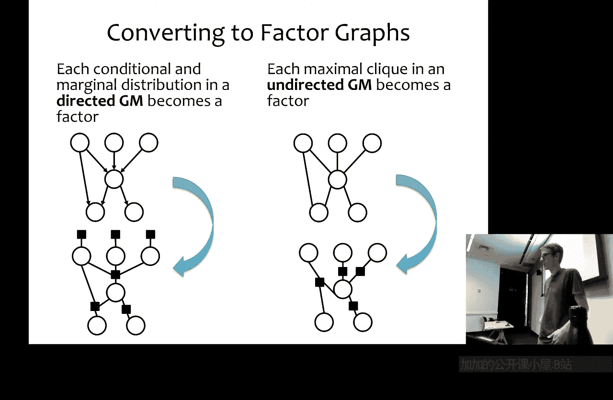
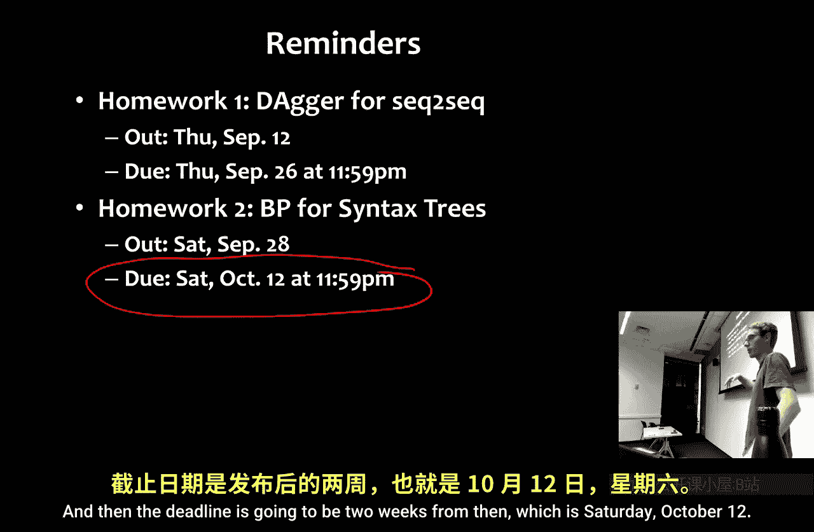
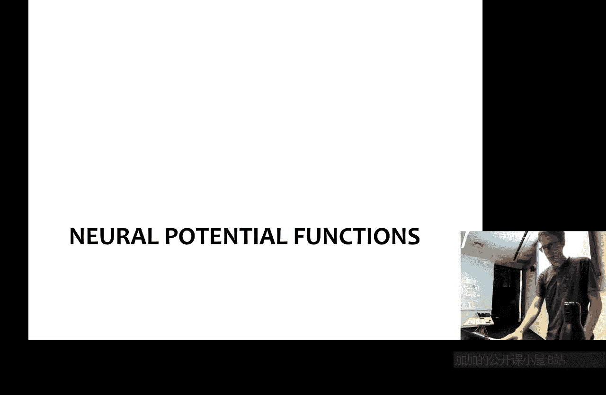
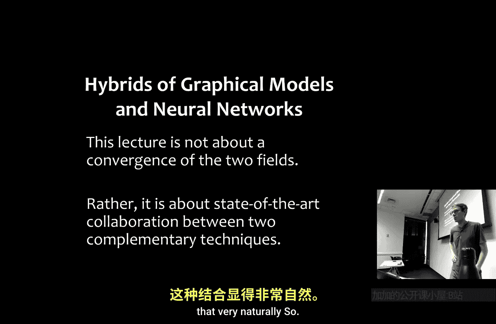
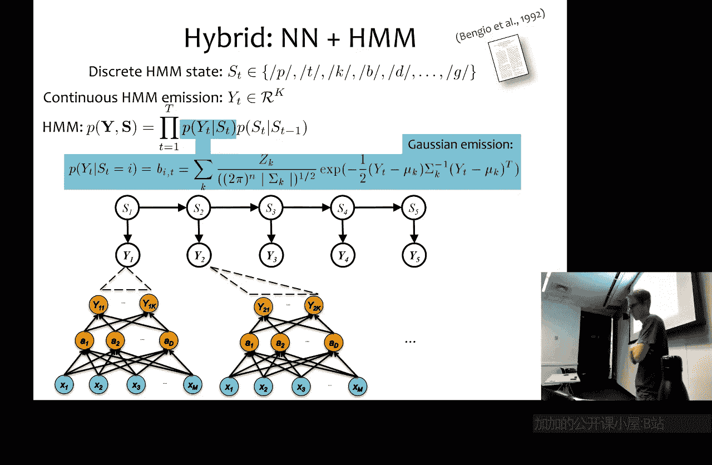

# 卡耐基梅隆大学【中英⚡结构化机器学习｜10-418 2019 Machine Learning for Structured Data】 p10 p9 10-418 ⧸ 10-618 Fall 2019 -BV1eJRsYBEaK_p10-

Wee to1  for 18618。We thinking about learning。And。We have a lot to say on this。嗯。嗯。In some sense。

Really， all I'm getting up here to say is the word。I could just stand here and tell you。

 just learn these models that had propagation and we could all go home。

But it might leave you kind of wondering exactly how this all works out and so what we're going to do is we're going to spend the next events just thinking about。

The implications of。What it means to apply backropag is the kinds of models that。

And what we'll find is that。As usual， we're just going to be working with some gradients。

And we'll be working with familiar training or optimization algorithms like stochastic gradient descent。

嗯。And things will work out elegantly because of the conditional independence assumptions that we've made inside our model。

So。As well， sort of the basic on the key here is that we'll get to also be able to talk about what it looks like to。

Essentially。Use a neural network to come up with。坚确方面。

And doing so sort of falls out directly of thinking of the actual graphical model and the likelihood that we compute for it as some admittedly kind of complex loss function。

Okay， so before we jump in any questions？It's about where we are so far， where we go。

You guys have been actually asking great questions in office hours one that came up with。

 how do we convert undirected gramal models to factor graphs again？

So there was this mistake in my slide。And so here was the here's the corrected version。

 the broken version showed。That we should also， I think I had an additional factor like this。In here。

So。To convert an undirected graphical model。To a factor graph。

 we would say each maximal clique in the undirected graphical model becomes a factor。

And I had interjected this extra。Red factor， which now we're correctly removing。

But so here you can see that。I have one factor per max clique。In the original。

Okay， so also one additional clarification here， so homework two is out and the date on the PDF。

Was sort of stale， it hadn't actually been updated。

 so we released it on Saturday and then the deadline is going to be two weeks from then。

 which is Saturday， October 12th。

So we're going to begin our discussion in talking about learning for mark covering in the fields and this is essentially just to sort of paint the big picture and then we'll kind of dive down into specific details so the idea is we have some data。

Exsisting of。In this case， for a Markov random field。

 there's just a bunch of variables that we're calling that。

And so you have a bunch of samples from some unknown probability distribution。

 and that comprises your data setD。And to train the model， you maximize the likelihood or sorry。

 you define your model as usual。That's the product of the potential functions with a partition function。

Im sure it's normalized， and then your objective function is just the lot of probability of the actual data that you observed。

And。So。Here， I guess on this slide， this example is sort of silly。

 but we've been talking about part of speech tag， so I'm just using it as a running example here。

 so if we were building an MRF for this， our training examples would consist of。诶。Tgged sentences。

And so， our。Variables， X consist both of some W variables that are words and some T variables。

Okay so why does this sort of feel like a silly？Moel the。

Does anyone have any notion of why this feels like a silly model to talk about？

Markco random field in this way。Something really wrong with it。And in fact， it's kind of the。

Globally normalized version of a hidden markup。The thing that feels funny is the CRF。

Is going to just。Basically accomplish the same thing， but it will do so in a much more flexible way。

 so we'll kind of review CRFs shortly to see that。😔，Okay， so this is our model。And then。诶。

Our objective function is just going to be likelihood where we assign high probability to the things that we observed and low probability to everything else by tuning our parameters accordingly。

 and so learning is going to be tuning those parameters。To maximize that objective。And。

The goals for today are to consider different parameterizations。

So definitions of how we're using the to get potential functions。And then。

How to actually optimize this objective function。And inference tasks here are still really important。

Because we're generally going to need the partition function if we want to compute something like a probability out of this model。

 if our our likelihood inherently requires the partition function to even compute it。And as well。

 we'll find that all the gradients that we're working with are going to end up relying on。

Variable marginals and factor marginal。And you can equate these in your mind to the normalized versions of the variable belief and factor belief that was the output of belief property。

And if you want to do at the end， after you have trained this，min， your last function， map inference。

 which is just choosing the assignment that is most probable。

 may or may not be the best option for decoding。Okay， so this is the big picture。

So what we can think about now is。A few assumptions。

 so one is that the actual graphical model structure is given。

So we're not going to assume that you are say learning the actual structure of the graphical model。

Though this notion of structure learning is sort of its own sub field we could talk a lot about it Another important assumption is that every variable is going to appear in the training exam。

We can also relax that assumption。Doing so would give us hidden state models。And not surprisingly。

 we can marginalize over things that we don't observe and still do a lot of what we're talking about today。

 so we'll come back to that point later， but these are assumptions for today just to keep things simple。

And there's a couple of questions that you should have in mind so one is。

 you know what does the likelihood objective actually accomplish？Another is。

 is the likelihood objective actually the right one， is it really capturing what you care about？

A third one is how do we actually optimize the objective function。

 even if we did sort of agree that it was the right thing？

And then another one that you should always have in mind is。

The actual guarantees provided to you by your optimization algorithm。

Give better guarantees than others。And then the last is。Well。

 maybe this really should have been our first question， which is， what is the mapping from。

Your actual data to some model。And。TheAnother question here is you know。嗯。Given some problem。

 how do we actually come up with an appropriate model， right。

 we assumed that the graphical model structure is given。

 but we would hope that somehow you had domain knowledge about the actual。

That you're working on that informed what the actual structure of the graphical model was。Okay。

 so there's lots of questions to address and as well。

 even if we're just thinking about Markov random fields。

 we're also going to talk about conditional random fields。

There's lots of different ways that you could actually train all of these also apply to conditional random fields。

 but we're not going to talk about every sort of possible way under the sun。

 there's a number of ways up here like iterative proportional fitting and generative iterative scaling that people used to use when these things were sort of first invented and have since sort of been supplanted by gradient based method。

Sttochastic gradient descent and Adam out ofgrad， et cetera。And so。

The other thing to notice here is that what training method is appropriate might actually depend on how you parameterize your potential functions。

 So when we say， when we talk about this notion of parameterization， What we mean is。

 how are you actually defining these potential functions， right。

 I it defined as just something tabular。An actual cable of parameters。

 or is it defined as some log linear model like this one we'll talk about。

Or maybe is it defined by some neural network？And depending on how you choose。

 you'll have different options in front。Okay， so let's talk first about this trivial case。

 which is where we have tabular potential functions， I guess it's not a trivial is maybe strong。

 but the easiest case， and we're going to think about sort of a simple example where we can work through how we would come up with the maximum likelihood estimates for some simple models。

So。The first one that I want to think about is， so this is essentially maximum likelihood estimation。

By。And。Here， what I mean by inspection is that you know， we're actually going to like。

Look at what we come up with and determine retroactively whether or not。Correct。

 so this will be sort of a guess and check methodology here Okay， so here's example one。嗯。

And this is going to be just a linear chain on three variables。X1。X 2。3。And this is some。

Factor graph。Where they're connected accordingly in a chain。And so we have that the probability of。

X one。X 2 and x3 is given by Psi 1，2 of x1 and x2。Times s of 2，3。that two eggs。Okay， so here。Well。

 actually， why don't we just， before we get too far here， Why don't we just get rid of。

These Xs and use some simpler letters here。Just be annoying， hard to read。

Let's say instead that we have。Random variables A。B，C， so we have probability of A B and C。在 baby。

s of b c。That way you don't have this link quite so hard to see the subscripts Okay。

 so same model as before of an easier notation and。So now what I want to say is we're going to have。

嗯。诶。s sortt of an important condition。That we're aiming for。So。The condition is。That the。I's true。

Of the maximum likelihood estimates。We don't know what they are。

 but it's true of the maximum likelihood estimates for any model that。If we have。嗯。Some random。

 sub some arbitrary。Subet of the random variables， x alpha。Then， it holds that。The actual count。

Of the number of times that。The assignment X alpha appeared in our data divided by the total number of examples。

嗯。That is going to。嗯。Be what we define as。So this is actually sort of a reverse definition of something here。

P tilda。嗯。Xy。Okay， so this is sort of a general statement about any graphical model。

And now what we're going to do is we're going to make our our sort of。Are not so random guests。

As to what the maximum likelihood estimates could be here。Okay， and so our guess is going to be。

That P of A， B and C。Might decompose。As the the。Pete Tilda of A And B。Times Piilda of B and C。

And here's the important bit。Where we divide out。By Pete Tilda of B。Okay。Now。

 it's important to note that。I've cheated， I already knew what the right answer was。

So this wasn't an entirely random guess， but we're further going to see that this first term is what we're calling。

si of a B。 and the second term is what we're calling psi of。BC。So。嗯。

So now we have some notion of what our potential functions are。Here we can。Now。

 check whether the condition actually holds。Oh， so let's see。 So this is。

The number of samples in our training data set。And。This。Is a number of times。X alpha。It is observed。

おな。Exci photos so student is angry。The assignment， it's the assignment to some particular set of。

So sorry， so this， I guess I left out there。The crucial thing here， which is。

For all alpha and all X alpha。This has to hold。For any maximum from like pestine。

What be to have like an effect on the normal issue。嗯。So， here。

What I've essentially done is I've just said that。I'm actually defining psi of AB to be this P tilde AB。

 which is like the empirical marginal， so we just count up。

The number of times that we observe that particular assignment to A and B in the data set。

And then Im citing this。But P of a time of daycountancy is supposed to have like。Oh， oh。

 I see what you're saying， sorry， I just missed that。Thank you。 so this whole thing。We can divide by。

Thanks。Any对来的。あ生大臣。哦诶。So。诶。We should we should check what the value of Z is at the end of us。長。Okay。

 was there one more question？So。All right， so here now what we're going to do is。Vify that。

Conditions for。And so to do that， we can just say， okay， well， the first question is， what is。

We have that P of x1， X 2。Is by definition， equal to a sum， oops sorry。This here。A Bs。

 So P of A and B is equal to a sum over T of P of ABc。を伺いでや。

And then here we could actually substitute in。Our notion of。P ABC。So we'll have that。We get。

Until the of。Next1， oops。Eventually， I just can't make the leap。I wrote down once ago。

Here they be times。一周的呃BC。Good拜对拜。你周嘅佢。And。So now what we get is。We， we can say。That。呃。Here。If we。呃。

Move the summation over C in。Then what we get is P Tilda of A B。Times， a summation over sea of Pilde。

嗯。B C， divided by Piilda。呃闭。Okay。So。What happens to。This some。Yeah。

 it should just be one because it's really just the empirical estimate。诶。P of C given be。

 we can give that a。That it's like an empirical estimate of that。Okay， so that means that。

This whole thing。Goes to one。And we have that。With equality， this is equal to the empirical marginal。

Okay， so the first condition holds。That the empirical marginal for A B is equal to。Or second。

 the true marginal for AB is equal to the empirical one。

So now we can actually go through the exact same steps for P of BC， but you should see that。

 you know， this is exactly symmetrical， right if we did that whole thing exactly like we did here。

We would have all of these steps just repeated， but for the other half of the grant and we would get back that。

P deta of BC is equal to the true marginal PdFD。O可以。So so。What we get here is then that。呃。Our Pilda。

Is or sorry， I should be careful here。呃。Our definition。Of。This size。

Are equal to the maximum likelihood。So。So I want to do one more example before we go back to the slides here。

 which is。A slightly。Itll be example number two。그게 안。Oh yeah， oh sorry， so yeah。

 sorry I just forgot to go back to this， so I think Z should be one here。

I'm not 100% sure we'd actually have to double check it。あね。Think that。

We should be able to actually verify it pretty quickly。诶。For。てざす。AIt's the sum of ABC over these。

Quities。And。And so we're going to have counts of the number of times we saw IE。

the number of times we saw BC。Dived by the double count that happens on D。

So there's going to be so what you see going on in。In our definition here。Of our。

Choice of potential functions is that we're counting up a number of times。

So let's actually write this out。This term out。だか。These count variables so this is going to be n of AV。

I was and of。Divided by。And a B。Times。Right， because there's actually two。

Two terms on the numerator that divide by it and one of the denominator。

And so one of the end terms cancels out n squared。End of B。

So it's the number of times that we observe that particular value of B。

And so I think if we showed that we should be able to show that summing over all values of A B and C。

So if we sum over。A， B and C here， we should get。That this is important。

So this is like more of a combinatorial problem than I actually don't know。

Exactly the path from this little summation to one， so I'll skip it for now。This is where it goes。So。

Okay， so example number two here is。嗯。If we instead said， let's consider a model where we have。

Random variables。第。本第。And here， let's actually think of this as now an undirected graphical model for convenience here。

So here。What we're looking at， so this was a UDM。And。What we can do is we can actually take。嗯。That。啊。

而。Our sort of guests here。Would be that。呃P hack就 the。The actualual。

Empirical guess at what the joint probability will work out to be is going to be B of A， B， C， D。

Is equal to。P of ABC。Times B of。B c d。Divided by。The of。呃Bnc c。

So essentially what we're doing is we're looking at this graph and we're kind of breaking it up。フいは。

So the first part。We could think of as sort of subgraph。

And this bottom part we could think of as subgraph E。

 and then there's this part in the middle that we could think of as some separating set。

That is the overlap。Between A and B。So。In fact。What we would find here is that。

So if we have a graph that's decomposable。And then it can be。

cursively subdivided in the way that I just divided that one up so that you have a set A and B on either side separated by some set S in the middle。

Then we can get the MLEs sort by guessing。If the following three conditions so one。

 gra model is decomposable like defined， two， the potentials are defined on say maximal cliques or factors。

 and three， the potentials are parameterized just as if they were tables。So there's no you。

 if you know which sort of index of the potential function you're thinking about。

 which factor you're thinking about， and the value of the variables for that factor X C。

 then you're just looking up the value in a table。Theta CX。Okay。

 and step one is set each clt potential to its empirical marginal。

And then step two is divide out every non empty intersection between cliques exactly wrong。

So this is exactly what we did。Great， we said。We multiplied together Pda AB， P tilda DC。

 and then we divide it out once by the overlaplay down here we were doing the same thing。

By multiplying together。The two sets and then dividing out by their overlay。

And we could show again that the conditions for maximum likelihood estimates hold in this case。So。

So how is this different from learning a business？Sort of similar， but。

So think about a tabular Bayesian network， we're parameterizing it by some tables。

 these are just conditional probability tables。How did we learn？都都是在过。So for a Bayesian network。

All we did。Was step  one。We just computed empirical marginals。

Co it up the number of times each configuration occurred。And divided by the number of times。So。

So essentially， the only difference here is that we have this overlap that we needed to take into account and divide。

ビ。嗯。So I mean， baynuts， by definition， are directed graphical models。So yeah， so wegg is， no。

 by definition。Okay so。So this is if you want just tabular potentials。

 but I claim that you probably don't ever really want tabular potentials。

 it's nice to have this connection between the two。

 but in fact you probably want something richer and in general most of the times when we're talking about Markov random fields and conditional random fields。

 we're actually thinking about a log linear parameterization， something that looks like this。

Pi of x c is equal to x but thehita f。And here， so you know we have some arbitrary general graph conditional random field。

 it's the product of a bunch of potential functions times one over the partition function and one way that we could actually define it for a CRF would be in this log linear form and so in fact。

We could could also do this for sort of the simpler case of a。Of a Markov random field。

And for a Markov random field。What we would have is。So this is going to be Markov random field。

It' feature based。Potentials。So we would say that we're going to assume that。We define each of our。嗯。

Potential functions。Sa of some Xc。As。Of。Some vector theta。Dot product with。

A feature function that is specific to that clique。what c。

And I'm even going to put a little vector over top of that feature function to indicate that the value returned by Fc is itself a vector。

 right it's a vector of features， so it's telling us all sorts of interesting information about the actual little configuration of random variable。

Okay。And so often then， it's further the case that。This。Breaks up so that we have this do product。

Maybe必。For some。四。If we had。And different features。We could add a little sum from m equals 1 up to M。

这个嗯。그。Eth， actually。In this feature vector。嗯对。So here。Once we've actually。

Gotten the definition of the model in this way。 Now we can actually do sort of the standard。

Steps that we would use to find maximum likelihood estimates so we could write down。Say the average。

Bg likelihood。And that would look something like。L of。Our parameters is theta。Given our data set D。

And。This would just be the usual one over n。Of a sum from i equals 1 to n。a log。OfThe probability of。

这个。哎呀。Simple， so that would be some X。given our。对。Okay。And。呃。We could then。嗯。

Push our definition of the actual potential functions in to get some specific long likelihood for this。

And from there we could actually come up with。The actual partial derivatives for this thing。

So once we had partial derivatives， then we could actually optimize that log of likelihood using something like gradient descent。

So now let's look at conditional random of。So for conditional random fields。We're going to say。对。呃。

Before we get there， let's keep spelling this out just a little further。So here。嗯。

I that we can better paint this contrast。嗯。We can actually think of。呃。Of now defining our MRIF。

In terms of output variables， why？And doing so is going to allow us to kind of more clearly see。

The connection to。To what we're doing with。Conditional rate。So what we'll say is that。Our data。For。

An MRF。Is going to consist of。Just these instances， Xi。Where we have N。And then。

We'll leave space here to come back and define the CRF in just a minute。And then our model。

For the MRF。Is going to be。The probability of。诶Y i。Given data。Is the product over？Or sorry。

 let's do the partition function first here。So it's going to be one over。Our partition function C。

Times of product over。啊。Ts or factor， C。Of Psi， C， Y C。Where。Sax feeds are defined。And then。Here。嗯。

We can say that this。Average log likelihood。Cheet and copy down。Is what we're going to work with for。

For both the MRF and CRF。So for the MRF here。It's exactly what we had already written。

And then the last detail， so there's going to be。More facing。그 CR。

Is just going to be the actual derivatives。And to get the derivatives。

We'd actually have to sort of step through some calculus， but。For the MRF。

The derivative of the likelihood， L of theta。Given D。With respect to one of those parameters。

 they decay。Is going to work out to have。This interesting form。That depends on。呃。

The actual feature counts， so specifically what we'll have is。1 over n。Times。A sum。

Over each of the training instances， so that's I equals1 to n。Times another sum over cleeek C。

And for each of those， we're going to。Add up the number of。呃。Features F。Here。Subined by。Say K。

 the parameter with which we're taking the derivative with respect to。Of。系。The actual assignment to。

The Y variables from that IF training instance。So that's the first term， the second term。

Is going to be， again，1 over n。This time， we have three summations， one from I equals1 to n。

One over the clek C。And one over the possible values that the clique could take on。

 So we'll call that y prime。Subsy。And so。For each of these， we're going have the probability。呃。

Why prime C？Times， again。FCK of。Y C i。So。What we did in the end。Is。

It's goinging to be this difference。Between the actual number of times。That we observed。It feature。

With the number of times。That our model expected to observe。The kth feature。So here。This is just。

An expectation under the data distribution。So we could actually write this as an expectation。

Where the。The actual value。That we observe here。Is。

Sampled from an empirical distribution over the data。呃。That particular。Feature value， FK。Of why。

And then over here。This is。That same expectation。But this time。

Where the Y isn't sampled from the data distribution。

 but where it's sampled from our model's distribution。Of。Of course。So， essentially。

Here we're getting the actual accounts by just looking at the actual data。

 but here we're getting the actual accounts by taking into。ACocount the actual marginals。

That we would obtain。Byy some algorithm like BP。So we need some inference algorithm to actually collect。

These marginal pro。But you actually even say something away from the model distribution。

So remember how we had these pictures of， if you had a way of sampling directly from the MRF。You。

 we kind of joked well you， you could throw those samples up on the slide one at a time， right。

 if you were able to draw。Samples from the actual model distribution right so this would so later on in the course。

 we'll actually define algorithms by which you can。Sandle from。The model， a particular why。

data isn like data star that's just the current data。

 That's the actual current data that's president That's not the。Right。

It's the current data so I mean this is I mean this equation is true and I'm just rewriting this particular。

Term as an expectation。 and the thing to observe is that what we're trying to do is we're trying to make。

The expectations， the empirical expectations from the actual data。Nch。The empirical sorry。

 current model expectation。And if they don't match。

 then it means we haven't yet found the rate values of the parameters。Okay， so now。

Let's think about this Oh yeah， I just have quick question。

 just just to clarify the first part is like what the training set actually empirically is and the right term is like what your model is currently coming。

Yeah， there's also， sorry， there's also a。Egregious error here， sorry。

 I was trying to switch us to Y here。Which will make sense as soon as we start writing out the CRF。

So here up there， the data is why I say。You were saying。あ対しらです。

The right term so the left term is going to be like what you expect。What you predict for。

And then the right is like what your modeling。someeration of the training set that's right so I mean putting it another way。

 this is what you actually observe in the data。Couning up the actual values for these features on the data。

And this is the expected value of that feature using the marginal for each of the。私が。Basically。

 this is say for some case term in your parameter， then the left term is what you compute。

 like what you expect that feature to be in the right term is like for each of the n examples like what you predict for that case feature。

That right。Yeah， so maybe this would have been almost cleaner， I mean。

 you could also imagine rewriting this entire thing by taking the one of end terms and these two summations over。

And pulling them out。 And then what we would have is just for each， not just an example。

 but for each。Factor in each example， we would then be。

Taking the difference of the actual feature value with。An expected value。Just this inner turn。

For that particular fact。So it's like we're trying to take the actual feature value and make it。

The model's expectation of that value。And when those。Two expectations match。Then at that point。

This partial derivative will be zero and so we' have converged So in practice。

 how do you actually use this derivative Okay， well training。For the MRF。And the CRf。Oh， thanks。

Is just going to be stochastic gradient descent。Or your favorite optimizer。Okay， so。

Does the second one mean the sample of all possible bias？So。嗯。Yeah， so if you're thinking it。

 so whenever you define an expectation， you need to say under what distribution that expectation is defined。

And so here on the left， we're saying， this is sort of like an expectation where the distribution over Y is given by whatever you have in your data set。

And the expectation on the right is given by the current parameters of the model。

So that's what we mean when we have an expectation of the subscript why sampled from。

P and so you can think of that as if you were to take the empirical counts from an infinitely large sample from your model。

 that's what this would be， and yet we have a way of if you already know how to compute those factor marginals。

Then we already have a way， sorry， these are factor marginals。Of。Exactly computing that expectations。

We don't actually need to do any sampling here。Okay， so now。

Let's think about what it would look like to make this model conditioned on some X。

So we want a conditional distribution P of Y given an x。And just as before。

 we're going to define our potential functions。As a function of y alpha and x， but this time。

 remember that x is conditioned on。Feature function has alpha。

We can have it depend fully on all of X。Okay。So。Here's a picture of our part of speech tagging case。

Where why alpha？Is going to be， I guess this slide is a little misleading。呃。This is really all of y。

 and this is all X。And the particular assignment say this was alpha equals1。So we would say that。

A particular assignment to these two variables， that would be y alpha equals1。so if they were known。

In verb， that's one possible assignment。So that factor alpha equals one。

 can look at that noun and that verb， but you can also look at all of the sentences in this sentence。

Because we're conditioning on X。Okay。So similarly。So this is the same typo。This is why。Ex。

So if we had some more complicated factor graph。Some sort of tree。We could also。

Expressed the whole thing in the same way。So I mean。

 a particularly common case is that of linear chain CRFs。

And these are closely related to hidden Markov model， so if you know a hidden Markov model。

It captures the dependencies between each state。Which are the Ys and the corresponding observations。

 which are the X's。But there's， there's sort of some problems with that， which is that。In practice。

 it's sort of silly to think that。啊。All of the information about a particular tag。

 like Y 2 is encapsulated in。Just one word。 X，2。So for example。

You might have a case where the value of Y2 should actually depend on a window of five words to either side of it。

And the HMM doesn't have any way of capturing it。Okay， so conditional random of fields by contract。

And actually。Condition on that entire sentence。 And they do so by defining these。

Potential functions that actually look at the sentence。 and so the。The actual question then is。

How do we define those potential functions， and so one way of doing it is to say we're going to have two kinds of factors。

We're going to have these red ones， which we'll call say， emission factors。

And we'll have these blue ones that we'll call。Transition factors。And the transition factors。

Are going to be pretty simple。 They're only going to look at。啊。A pair of variables， Y K and Y K -1。

지问 been。哎，这。頑ぱ。まずる走ってる時。Yeah， sorry， it's also dependent on。This tag as well。这个。可能外不他。So yes。

 but the actual parameterization doesn't like when you're。

Now you're actually thinking about the value of Y2。

All of the information that the model captures about in the H&M is encoded in Y1X。

As long as you know those values， you have all the information。Like you don't need that small。

You我 is not。诶。Oh， sure， why one is not observed， yes。Next one is also going to play a role。

So in that case， yes。Joint distribution sets， so I mean essentially what you're saying is。That like。

You're sort of making the point of this entire class。

 which is it's helpful to have a joint model over your outputs。And the HMM does capture that。

 but the actual model， when it's described， the actual direct sort of preference for the value of y2 is coming very distinctly from a transition and emission probability that only look at Y1。

So that's the deficiency that I want。Okay， so at first I don't want to fix the deficiency。

 I just want to draw a picture that looks kind of like something you may or may not have seen before。

 which is an nature， so here the transition features are only looking at a pair YK and YK minus1 of adjacent。

呃。Tag variables。And then the emission is looking at。The tag variable and the corresponding word。

So so far， all we've done。Is we've basically got the same thing as an HMM here。

 except that it's globally normalized。So this is identical to an HM except that it's globally normalized。

But。Oh， and so it's useful here to sort of stop and think。What does this actually？Look like like。

 are there other models that we've worked with？That looks similar to this sort of model。Okay。

 so obviously the H ofM shares some similarities。There are other models up here that kind of share。

Similarities to what。This particular parameterization。

So think for a moment about doing something completely ir。

Imagine that you just cancatenate it together all of the tag variables into a long string。

Call that string your label。If there were only two possible tags。Then you have。

Two to the fifth different possible strings。Now build a logistic regression model over the two to the fifth possible strings。

If you did that， it would start to look surprisingly like this model。

Specifically if it was a multinomial logistic regression。

So in the same way that multitonnomial logistic regression is just taking x of theta dot。

Some feature vector， that's what we're doing here。 we've just decomposed into a product of a bunch of little exp of theta。

 F。Okay， so the ridiculous part of this is that we haven't actually solved what I claim was going wrong with the HMM。

 which is that not only is it locally normalized， but it's also only depending on a single word。

So with the CRF。嗯。Because。The vector x is observed， we can condition on them for free。

 and conditioning is how we convert it from the MRF to the CRF。And so。

We can now essentially just rewrite what we just had before and say， okay。

 this transition factor is going to depend on that pair of tags。

 but it's also going to look at all of x。so suddenly now the features that you define can look at any part of the sentence。

 they're not just restricted to that pair of tags， likewise。

 if you define an emission factor that looks at the current tag and all of X。

 it can have arbitrary features that look at any word in the sentence。So visually。

 usually once we're drawing a CRF， we do so without even showing the variable corresponding to X。

Because essentially， it's just this thing we're conditioning on and it kind of disappears into the background。

And the only place that it essentially is showing up is when we're actually defining you know where our potential functions came from。

 essentially all of the potential functions can depend on x as well。

 the partition function is no longer an arbitrary constant Z， but rather some。

Value that ensures that for a particular x。Our distribution number wise is sums to one。Okay。

If we want to learn a conditional random field。Then again。

 we would write down the objective function。 We'd compute the partial derivatives of the objectives。

We'd feed our objective function and its derivatives into some black box。It does optimization。

 and then we retrieve the optimal parameters from the black box。And you know what's the black box。

 whatever， some Newton's method， quasi Newton method， stochasticryan descent。

 whatever your favorite optimization algorithm is， you can use it here。Okay。

 so here's stochastic gradient descent， for example。Okay。

 so now we can jump back to what we were doing with the MRF。And， and show how it contrasts with。呃，谢。

So for a CRF。We're going to have data that looks pretty similar。不。Now it will be pairs of。

YhyI's and exonss。就惊我系听佢。And then for the actual model， now we have some P of Yi given anxii。契約成が。

And that's going to be some1 over C of x。so the partition function。ァクシな。I of the product over。

After of sceeing。Which can be a function of YC， but also of the entirety of x。This would be。してた。

And then the average log likelihood is actually going to be exactly the same， except that now。

We actually have the condition on x as well as theta， so this is one over n。

 a sum from i equals1 to n。But the log at the probability of。Why I given an X。And这个。

And then the last detail is the actual partial derivatives。And here。The partial derivatives。

Are exactly the same。Except that。This term becomes。FCK of。YC and the vector X。Right。

 so this can be a function of both。The values of Y index and likewise over here。This becomes。诶。关事啊。

And lastly。This factor marginal is now defined as。啊P of。Yhy see crime， again， given。

The derivative is again， just trying to do this matching of expectations。But here。

I can just get a condition on that。Okay。So。This idea。Is。Is a really powerful idea。

 and it's what's going to kind of allow us to now sort of connect this back。

To learning in a setting where we're。呃。Coming up with。A potential functions， not just based on some。

Feature function。Some fixed constant feature function。

 but some function that depends on our parameters。So the reason that I like kind of starting here and the reason that in some sense。

 much of the work on。M F and C or F started here， is that。Essentially。嗯。There was。呃。

There was a lot of sort of math being done or there was a lot of。Calculus being done on paper。

Since then， we've gotten a little bit wiser and we've realized nobody actually likes doing calculus on paper。

That's something that your instructors ask you to do on homework assignment。

Now everybody likes to do calculus automatically using automatic differentiation or back propagation。

 right and so if。We define our potential functions。As。As we did up here。Then the only depend。

Is in that dark。OkaySo when we take the log of these potential functions。

 it's actually a linear function of data， this is why we call it a log linear model。

So what if it's a nonlinear function of data？Okay， oh， before we get there。

 let me make a quick note here。So there there's some really interesting results when you start to look into this contrast of。

Conditional random fields and the sort of equivalent Bayesian network。And。

So there's this paper mine in Jordan in 2008 that actually compares the HM and the CRF with identical features。

 right that's actually the first CRF that I put。Where we hadn't improved on the HMM anymore。

And what they did was they looked at two different settings。

 one was a data set that was from real data， and the other was a data set where they had synthetic data generated from the HM。

And what they found was that when they were working with real data。

The model was actually misspecified， it wasn't actually the true place that the data had come from。

I mean， if it's a real data set it was generated by humans。

 this was actually Wall Street Journal data。Okay， but when the model was well spent。

So well they worked with synthetic data。The actual performance of the two models flipped。

So when it's misspecified， the CRF does better and when it's well specified the generative。

HMM model does better。And so。They also had sort of some interesting theoretical results that explain why that sort of thing could happen。

But shortly， we'll be talking about Bayesian networks in the context of topic modeling。

 and they have some nice properties， particularly when we're talking about learning in an unsupervised way。

ok。So。This leads us to think about neural potential functions。And。

Essentially， what we're doing here is thinking about hybrids of graphical models and neural networks。

And the whole idea is。Is not really about like the convergence of two distinct fields。

 it's about sort of saying that there's this sort of state of the art collaboration。

That very naturally exists between the two complementary techniques。

So the whole motivation is that graphical models are really good at kind of like you code。

Domain knowledge about the interactions of your output variables。

And neuralNes are really good at fitting the data discriminatively to make good predictions。

And so the question is， could we define a neural net that incorporates？

The domain knowledge as in a graphical model。But another way。

 could we actually use the graphic ofal model as essentially just。A loss function at the end。

On top of our sort of standard graphical model。So the usual recipe for training neural nets is we're given training data to choose a decision function。

 a loss function。We define our goal to be a empirical risk miniization。

 and then we train with stochastic gradient descent。And so。啊。The question now becomes。

 what if we defined our decision function to be a graphical model？

So we actually know how to compute marginal probabilities for inference。

 but then we still need some way of actually sort of making predictions why。And。

One answer is to actually use a minimum base risk decoder as the decision function in this recipe。

So what's a minimum base risk decoder？So suppose we're given a loss function。And。

We're asked for oh actually I'm going to come back to this next time because I want to say more about that than I have time to say Okay。

 so instead I want to highlight this sort of interaction between back propagation and belief propagation。

So。The next thing that we can think about。Is。What would happen if？We put together。See。

 a markout random field。Or let's talk about a conditional random field here。With。LSTM potentials。

So in this case。We're going to be kind of like before， so our data is going to be conditional。

 but our model。Is going to assume。呃。We take in some apps。And。That X。Is fed into。Some LSTM。

And the LSTM is going to get output。Some values call z。That represent our act。And。

Then we're going to say that。Those outputs of the LSTM are actually going to feed directly into。

The definitions of。Are potential functions。And。Once we have our potential function， stop。

We can feed those into something like。The leaf propagation。And out of belief propagation。不用点。

Marginal probability。Something like P ofYC。Give x。So once we have marginal probabilities。

We can unfeed those。Into a loss function。系。我关。And out of log likelihoodlihood。

Will come some single number。Right， okay， well， not just any L， it's。

It's an L that we care a lot about， which is something like。啊L飞噶。Given our data set D or well。

 not really our full data set D， but really just。This is sort of what。

The loss function for one particular training example， right so this is L of theta given。

That particular input X。So to compute a log likelihood， though。

We can't do it just based on those marginal problems。We also had to have some。True values are what。

This is our ground truth line。And so we feed both the ground truth and the marginal probabilities together to get the lot of likelihood。

And sorry， the output of the deproagation has be a little more careful here。

With marginal probabilities and also。Partition functions。

Those two together are what we're using to get the web like。O， so。But the last remaining detail here。

Where do we actually get？Where are the actual data？And so what we can do is we can say， well， theta。

Are actually going to be。Some parameters that。The LSTM is relying on。And so now we almost have。

A full specification of a computation graph。That would allow us。

To compute some loss function of theta based on some input X and some parameters data。

And the question will just be， can we back propagate through this thing？To get appropriate。呃。

Gradients of， say the loss with respect to Z。And the sort of remaining detail here that I should be careful about。

Is that。Whatever the outputs of Z are。They might be positive。你咪 be negative。

But our potential functions。To be。呃。Some。Values which are not major。

And so we can see that anything that comes out of the LSTM。

 we're going to first pass it through an X function。Before feeding it into the potential。

So now this is actually going to ensure。That。The potentials。I don think。

Which is a property that we actually need in order to。Properly defined。If they go negative。

 then we don't have a proper specification if the probability is。这。So。Okay， so this is。

Just a sort of。Picctorial representation of the actual computation graph。And。

The real insight here is just that。We're going to define。그。Sign of。See of。Why C the X。To be just ex。

Of some LSTM。2对。And。Here we can combine that with。 so this can be some function of， of that and。

And our actual values， Y sea。So once we've done this。

 now the actual parameters are sort of tucked away deep inside this function。

But we already know that this is going to be differentiable。

 that that's why we chose an LSTM to begin with。And so the question is， can we actually come up with？

The derivatives that we need to be able to back。So。嗯。

So I'll jump to the punchline without actually going through the math and we'll go through the math next time。

So we write out our log probability。Turns out if we just try to take the partial derivative。

Of the log of our potential。So this will ensure that whatever these values are below log at the potential。

 it can be。A positive or negative。So that you could think of as those Z's that came out of。

Ex for the LSTM event。So the partial derivative with respect to a along of that potential is this has this incredibly simple form。

The derivative is just。An indicator function saying whether or not。The true ground truth value of。

Y alpha is equal to y prime alpha。So this is either one or zero。

 depending on whether they're equal or not。マイナ。The probability of white crime。

So essentially what we have here。Is。Another setting。

 kind of like what we were seeing in this matching of feature counts with expected feature counts。

But here we're looking at。The number of times that y crime is equal to y alphaalfa。

Which is either zero or one。In this particular example。

And it's difference with the probability of y credit。

And what we're trying to do is get those to that。So we're going to try to drive the probability close to one。

诶呢个。And we're going to try to drive it down to zero if they're not equal。

 because that's not the correct assignment。To that particular factor。So once we have this derivative。

 we'll be able to back propagate through and we'll be able to build hybrids of， say。

 neural nets and HMs。Where we have。即系。Commission probabilities that are coming from neural networks or hybrids of conditional random fields and LSMs or CNNNs。

Where all of our potential functions are defined by some neural networks。

 which are just a function of x。Okay， so next time we'll wrap up our discussion。

A couple different case studies of these sorts of hybrids。

Along the lines of what you're building for。That that。

