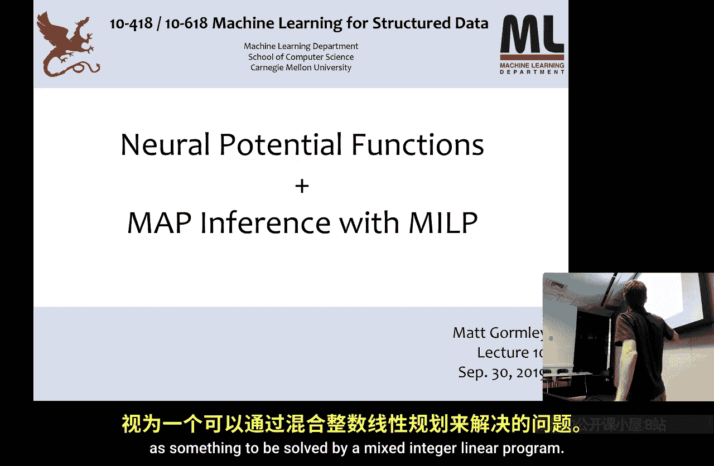
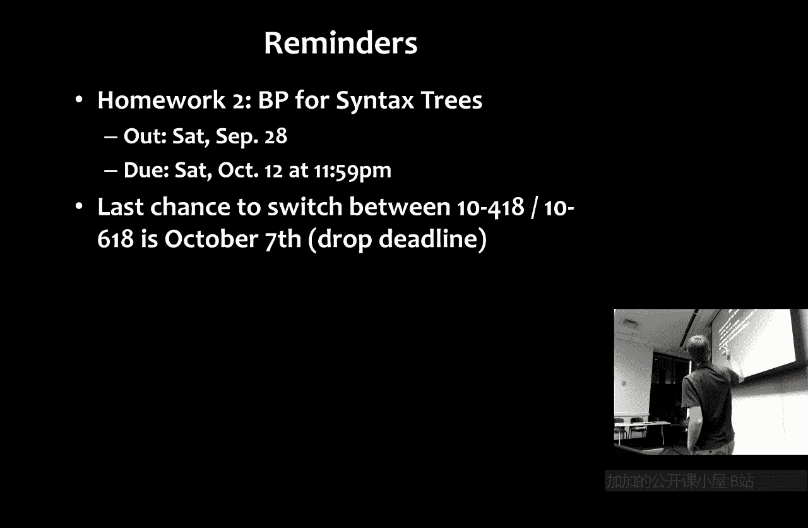
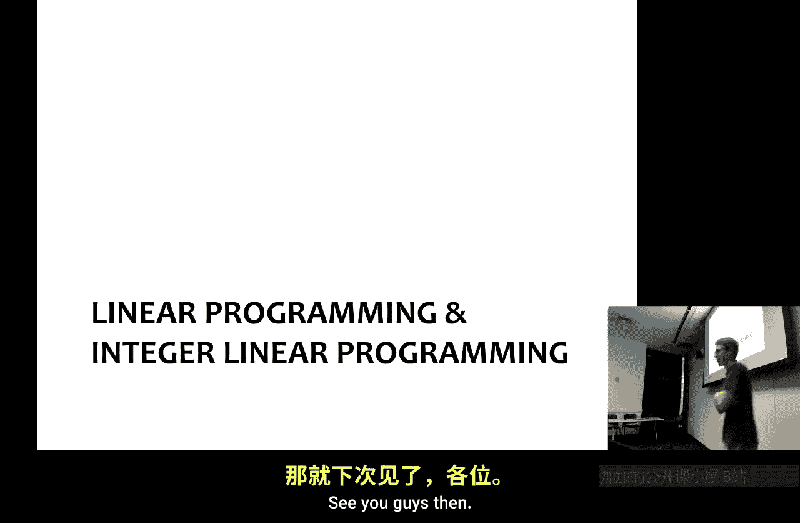

# 卡耐基梅隆大学【中英⚡结构化机器学习｜10-418 2019 Machine Learning for Structured Data】 p11 p10 10-418 ⧸ 10-618 Fall 2019 -BV1eJRsYBEaK_p11-

除果同咧就呢个。Continuing where we left off， talking about neuro potential functions and how to。

What be happen。And。We'll also。Begin to move into a discussion of。How we can do mapping。

By casting the full problem as a mixed in ager here。So we'll actually talk a little bit about。

What is youling？The algorithms that exist to solve it。What is injury here。

It all them with branch and bound。And then we， once we've done that。

 we'll kind of double back and look at how we can actually。Treat this map。

It's problem is something to be solved。

A mixed inline per。So and。One reminder here that the last chance to switch between 1014 and 20618。

Coming up， so I think the drop deadline is October 7th。s。

old that you can make that switch with an appropriate sort of drop form and late add form。

A coupleupled together。

So what we want to think about is this notion of sort of。

Using back propagation in the context of belief propagation。

And so I want to think about how we can actually come up with the appropriate gradients。

For derivatives。With respect to actual factors。So。These are the answers that we're going to come up with。

 but what I want to see is how the conditional independence assumptions that we make actually allow us to come up with those。

So。What we have is。A problem where， oh， actually， I guess it's worth just making a quick note。

About where we left off last time。 So last time we had said that。We could。Think about。

A computation graph that ties together our use of belief propagation。嗯。

And log likelihood into one sort of unified picture of a loss function。And so。In fact， here。

I guess it's probably useful to。Have a copy of this。So。What we can conceptualize this as。His。诶。

A setting where。Where'。Basically treating。The entirety of。

Sort of the middle and right part of this picture。As。Itse， some black box loss。就。Victorialally。だ咧。

Everything in this。In this box。We could think of as。Defining for us。嗯。Oh， actually。

 so here's actually also agree。I didn't start with Q&A， but but I'll start right now with Q&A。

 so one thing that came up in office hours is I had written the loss function。L of datata given x。

But we actually kind of notice that's not quite right。

 really we can't compute the loss without having both x and Y。So if you look at the actual leaf node。

In this computation。They're the theta parameters feeding into the LSTS。Then the x parameter。

 the x feature is representing our example。And then the Y vector representing our ground truth also needs to be。

まてもマクく。And so maybe I should be a little more careful。Say that the box。We're talking about you。

That is our loss function。Really everything。Except for our reason。And。Our computation。啊。

这个还是我 attention。And so。Everything inside this box is what we're thinking of as this loss of。

This cost， that is a function of。啊这じな做。And so the question is。

If we want to run belief leaf propropagation。What do we actually need？For this lost book。我。

na actually， did I say we want to run belief propagation or back， did I save belief propagation。

 that's why you're all。What is he talking about， see this is the problem with names that sound too familiar like too similar to each other。

 so if we want to run the back propagation algorithm。

What do we need to run the back propagation algorithm？If we're going to use this as our loss。

What specific。博使。With respect。Yeah， so it feels like， gosh。

 we mean like all of these little derivatives along the way。How do I to make things simple for it？So。

 backdrop here。We'll just use。The derivative。嗯。Of a gradient。

 let's rate it as a derivative vector derivative。So it's going to be the derivative of the loss L。

Just a function of data。因文。喂。And。It's going to be with respect to。C。😊。

Which is you could just say a gradient with respect to Z。Out of that box。

So if we can come up with this。Where's Z is。I mean， it's not just one number。

 Z here is a collection of numbers。Representing all the numbers that we need to define those potentials。

And if we can get those numbers。Sorry， if we can get those derivatives with respect to Z。

 then we don't really have to worry about the internals。Of exactly what belief propagation is due。So。

What we can do instead is just write down。The log likelihood of the ground truth。Okay。

 so here we're going to be thinking about。Actual derivative。Of。Poential function。And。

We can actually do this sort of one of two ways。嗯。The way that I want to。

Start with here is actually to take。Not the derivative directly of the。Of the potential function。

 but rather。To work。With like one element down on the stack。 So if this is some element called。呃，Z。

Here。Which is the output。呃The X。Then we could say that。Before we apply。That X。

There's a sense in which that the Z variable is sort of written in the wrong place here。

 so this is a proper computation graph。We're saying that， you， the function is。

So the thing that is the output of x we'll call z。And then we could call the output of the LSTM。Zpro。

So Z is x of Z prime。And what I want to actually work with today is the derivative of the loss。

With respect to Zra。And notice here， we have that。Z is actually equal to the potential functions。

It's a full definition of them。 And Z prime here is equal to the long。Of the potential functions。呃。

是 the prevention function。Will be two colours like this。Poreential at everywhere， right。

So like this good thing like。That won't have any those would it。Yeah， so that's actually。

 that's right。Let's actually draw a picture of just what what these potentials are because I think that'll help clarify so let's suppose。

We have a sentence， like time， flies fast。And so we're going to have some black box that is an LSTM。

And just for simplicity。We can draw that。As。Some。With courage。Function on that。On that sentence。And。

Maybe just if we wanted it to be like a more interesting biosM。

 it could go both ways and then we could have as output vectors。嗯。These values。

Which we're going to call。Z credit。So now what we want to do is we want to have a factor graph。

And the factor graph。It's going to have。你个台湾。为 too。AndY three。诶。Attenched to it。Thanks。

But let's make these factors sort of larger than life here。

And let's say that each of in this example， each of the Y values。诶。Our binary grand。

So for this example。We're going to say that。The fact， the unitinary fact。漫我系。Is itself。

Two little cells。And on Y2 and on Y3。So to get from Z prime。To what we're calling C。

 which are the actual values and the potential functions， we're going to apply。

To the values of the output of the LSTM。So。At this point。Maybe we should。Sayve that。

 we might also want transition factors。And if we did that。This transition factors would be。

For binary variables， there will be these little four by four grids， right？其他对噶。Pairs of。でおす。

And so maybe what we have here is that。诶。There's other， there's some other sort of。

Complicated function of the LSTM。That gives us back。These little matrices。

And how do we get that matrix， Well， maybe we just concatenate together these two and pass them through a linear layer。

To get something at the right shape。And so then the same thing can happen here。

To get back on potential。So here we have this picture。诶嗯。啊。Z prime and C。

Where we can think of these as roughly。The log of the potential function or the potential function itself。

But we're sort of being flexible， shall we say， with our notation by saying that this being primeed is some combination of all of these put together。

So it's some rich mathematical object。Okay， so any questions about our computational graphs set？

So the outputs of this graph。Oh， I see so。By that do you mean。嗯。Where do we get the。

So let's so I haven't I haven't like combined this picture with that one is that what you're asking so so what the picture below here is showing。

This example for binary range variables is just showing how we could have some LSTM layer。That is。

Giving us。value use that。We can use for the factors。Okay， so once we have this notion of。

The LSTM output， giving us values for factors， now we can go back up to our first picture。

So in our first picture， the values of those factors are。ARight here。

And so when we run belief propagation。We have values for all possible assignments to why。

Because the factors express the full probability distribution over all possible assignments to why。

And so what we get out of belief replicationation。Our marginal probabilities。

Tell us the probability of each y variable taking on its different possible values。So finally then。

We can use those marginal probabilities or this partition function。

In combination with why the ground truth。To actually compute the likelihood of the data。Yeah。

 is here can you explain。In the belief。The research that said is equal to the potential。

 but from there that is going into a potential function。 and then the output bad goes in terms。 Yeah。

 so that's I guess confusing so。Again， let me correct。

Correct this slightly so I guess what we're saying here is really our picture。

Z is the potential functions。And then here things。What we have is just built。

So the potential functions really kind of live。Outside of our lot。And。

So before I was kind of thinking in terms of my identity just so that I could tap it up and through to。

I't to be able to talk about Z and all sort of potential functions， but this makes more sense。

So now the potential functions actually live。Outside here。These are the potential functions。

And they are the input to our loss。It a big questions。just finished。It up from。T over。No。

 so the probability distribution over the Y is given the x is represented by these marginal probabilities that are the output。

OfThe reef proagation。So， the Cs allow us to。They fully specify that probability distribution meaning。

What we're about to do is write down for a specific case。

 we're going to write down the derivative of a potential function here。

 and so what we'll need to do is so for an MRF，We would have。The log。Of the probability of。Why。

And this log probability of y is fully specified if we know what those potential functions are。

 right， So this log probability of y for an MRF is just going to be。诶发 song。Over all the factors。

 alpha。Where for each factor， we're going to multiply it together。s alpha法诶 y。就是。The addition that。

We actually need this to be。系到哇嘅。Poential function。And then we're going to have minus the log。呃。

呃职业的啊。So we wanted to define this for a CRF。It would book。Just about the same。

 but it would be log of p of y， given x。Is equal to。Some of the factors alpha。

Of the log of sign up the。Y alpha and all of x。The quantity minus。f。Z x。

So if you know what the potential functions are， then you can write down what the probability is。

 but you might not actually be able to compute what that probability is because computing the partition function is。

Shap P hard。Okay， so in our picture， at the moment that we have computed。Z。

 these potential functions。We have everything that we need to compute the partition function and the joint probabilities。

 but we haven't actually computed those until we run the leaf propagation。Okay。

 so here is just the long probability written out。And now what we're going to do is we're going to compute the derivative of this log probability with respect to Z prime。

 which is the log potential functions。So we'll say we want the derivative of log。Of P of Y here。

 now I'm actually going to work with the MRF case just because the CRF case is identical。

 it just includes a bunch of conditioning on。So it'll just kind of clean up our notes a little bit if we write it this way。

So the derivative is going to be。With respect to。The log。Of。Si alpha。

And here's where we need to be very careful。So remember that what we're actually doing here is computing the derivative with respect to some Y alpha。

Which refers to a specific entry in that factor table。So if we go back up to our picture here。

What we're actually doing。Is say taking the partial derivative？With respect to say。

Just one of these little factor table entries like that red one。

And so when we write out this derivative。We're looking at。On the numerator。呃。

A why that refers to the ground truth。Okay。So that log P of Y， with respect to。

 whatever we actually observe。And then by contrast， in the denominator。We have this derivative。

Respect to white crime， which is just sort of。Indexing。Into the factory table。

And we're going to take derivatives with respect to every single entry in ZP。Okay。

 so so what do we do here， Well， the first thing we're going to do is we're going to write。

 We want the partial derivative with respect to log of。si alpha of y alpha prime。Of。

Our MRF likelihood， so this is going to be a sum over alphas。Oh。

 let's actually be a little more careful here。We're going to want a sum over。Say factors beta。

Because we've already let alpha refer to one of the specific factors that we're taking a derivative with respect to。

So here this summation is going to be over factors beta。And for each one， we're going to have logs。

晒机啦。诶。我嚟噶。Where here， this why。Why data is referring to the ground truth from our new。Okay。

 so then we also need the minus。Lg Z term。As well。系。So what's the derivative of our first term here？

So we're going to have the derivative of。With respect to lot ps alpha， y prime alpha of。

This summation。 And what would that be。いけてじる。Yeah， so it's only going to kick in if alpha is equal to beta。

That's right， and there's another condition that needs to hold。Have idea idea。Well。

 it's not that the ground truth is one， it's that the ground truth。

 Y beta means to equal y prime alpha。For alpha equal to vtata。

So we could write this as a little indicator function。Just saying。

That it's going to the derivative is going to be value1。If and only if。The ground truth。Why alpha。

Is equal to。The thing that we're taking the derivative with respect to， which is white prime alpha。

So conceptually， this is simple。 This is just a sum of a bunch of terms， right， And in fact。

 if you look back up at our picture。Great， if we're taking。Say to compute the log likelihood。

 what we did was we multiplied together the values from the different factor tables and they were this blue value and this blue value and。

This blue value。This one。So in this case。This correspond， these blue values correspond to。

Some assignment to why 1， Y 2， Y 3， and to get the。The actual log probability。

 what we're doing is just。嗯。Adding up those log， those log factor values。

 That's the numerator of the log probability。Okay so in this case。

 if we're taking the derivative with respect to that red value。

It's just going to be zero because it didn't even show up。In the numerator of the log probability。

 if instead we took the derivative with respect to say， this lower corner。It was blue。

 then it's going to for the numerator， have value one。As long as we're kick。That particular cell。

Okay。All right， so now question。关。Because alpha is just telling us which table we're looking at。

And why alpha a prime is telling us which cell？We're taking the derivative。So。

Another way that we could have done this， we could have done this。Major it's calculus。In that case。

 we would have been taking derivatives with respect to log psi alpha， the whole factor。

So that at this point， then we're talking about a matrix derivative or a tensor derivative， I guess。

And so I didn't want to talk about matrix calculus。

 I just want to talk about partial derivatives with respect to real valued numbers。

And so to index into the tensor Psi alpha， I need to say which entry in that table we're talking about。

 and that's what y prime out。myfi。Aal you。That's。Sorry， oh， I see what you said， sorry。

 I know what you said is not true， so psi alpha of y prime alpha。Is a value in a table。 So sorry。

 the the circled yellow。Partt is a value and a table。The green highlighted part here， Y prime alpha。

Is indexing into that table。I mean， they're an assignment to the actual values of the variables involved in affect health。

So it only updates。Well， remember that we're going to take- so to get a gradient。

 we need to take the partial derivative。Okay， so think about what the gradient。So remember what we。

Set out to do here with take。The gradient， with respect to。opWith respect to Z prime。就。

Z praying is all of these。So I need the partial derivative with respect to that entry。

 that entry and that one and that one and that one and that one and that one and that。Right。

 I need every single。Partial derivative。And so right now we're just writing out how to compute the partial derivative for one of those cells。

 but you're going to actually compute them all。And that would give you back this yellow highlighted。

Tensor derivative， it's not even a yeah， a tensor derivative is an okay way to phrase it with respect to Z prime。

 which is all of those numbers。So the eventual gradient that we're computing here。

Is going to have the same。Z correct。So we're just computing one of those cells。Okay。So。

So if the index of the ground truth。Or the assignment to the values and the ground truth is equal to the assignment of values corresponding to the factor entry that we're currently asking about the derivative of。

Then we get one， otherwise we get zero。Okay， so now what do we need， we need the derivative。

With respect to this log， Psi alpha。Of Y alpha prime。啊。The log。嗯。Partition function。

So to take the derivative with respect to the log of the partition function。嗯。Where're。

We're going to run through a couple steps here， so the derivative of the log of Z。

With respect to the log of Psi alpha。Actually， let's do something。Even simpler here。

 so let's write out one more step。Which is， so we have this indicator function and then y alpha equal y prime alpha。

Minus and before we even figure out what the derivative of this partition function is。

 we can just apply the chain rule here。Because Z is also a function of。The potential functions。

Or is he prep？So here we can actually say。Just apply the chain directly， and we would get。诶甚。

New terms here， what do we get back。By applying the chain role。

So you could think of this as like derivative。With respect to some facts。

And then this is like the log of。佢安键话。对。The。Yeah， exactly。So it's just one over z。

Times the derivative with respect to that log of ps alpha， y prime alpha。Of。Which is the function of。

Potentially this and a bunch of other people。Okay， so now let's just compute the derivative of Z with respect to that log。

Of the Psi alpha y prime alpha。Okay， so to get this。We just first substitute N Z here。

And we're going to have。The derivative。佢晒 off whiteか。Hello。A summation over。All the possible values。

对。The vector Y could take on。So， let's call that。Why double graph。

So for all of the possible assignments to all the Y variables。We're summing over those。 for each one。

 we're going。Multiply together。All of the factors。not搞费。We use again， that index beta。

And for each one， we'll have some si datata。哦。Why double cr。

So now we just need to take the derivative for the sum。And。

The first thing that we're going to do is we'll find that。We can kind of。Throw out。A bunch of。

The values of why crime that we don't care about so namely。The only terms in the summation。

Whereai this。Potential is going to be used。Are those for which。Why prime prime alpha。Is equal to。O。

 sorry。 Let's say that。 This is。Why crime crime such that。

Y prime prime alpha is equal to y prime alpha。So。Taking the sum over this restricted set。

It's fine because for all of the other ones， we can't have possibly used this log potential function。

It didn't show up in that product。So now we have。The derivative。Corresponding to。So， two groupings。

OfThe actual terms in that product over the Ven。So namely， we have。

A product over betas not equal to how。For Pi data。我想发理咧。嗯。This whole product term is going to be。

Consant with respect to。The actual。Value of alpha that were or the value of the potential function that we're concerned。

And the value that we really care about。Is only going to show up。嗯。Our second term here。

Which is telling it consists solely of。The actual。s alpha法。咩。

We can actually make one more observation here， which is because of the restriction in our summation here。

We actually know that this y prime prime alpha is equal to。Why crime up？肯定肯。Right， so。

How are we going to get the derivative of the log of this thing？When we're taking。

 this is like derivative with respect to log of x of x。So how can we get that to work？All right。

 let's make a side note here。 So suppose you have。Dirivative with respect to log of X。Next。When。

We can just say that this is equal to。The derivative with respect to logx of。X of log of X。

Because x of log of x is just going to be x。Not getting thinking today。Hm。

So here's our little side note。So the derivative with effect a log of x of x is just the derivative of。

あ。With respect log of x of x of log of x。What's that？Well， that's just。你经过到嘅。Yeah。It's just that。Of。

所以。Ex good v X。Right， times the derivative。Logouts with respect to log at， which is just one。So。

AndAnd we just get back。But this is just。O。So。What that means is that this derivative。

I can just fold this。Allows us to fold this term。Right back in to our summation。

So this whole derivative term。Is just Psi alpha。Of why。Prime prime， alpha。

Or P psi alpha of y prime alpha since they're equal。Allright， so。Finally。

 then we can just rewrite this whole derivative。As a sum。Overall， why prime primes such that。

Y prime prime alpha is equal to y prime alpha。Taking the product over all possible factors， beta of。

晒俾啦。Of why crime parent。So what we have here then。Is that。嗯。

The derivative that we were originally after。Is。It's just sort of one step away from。

What we just wrote up here。So specifically， let's zoom that a little bit。Yeah。

So what we want here is the final。Substitution of what we just came up with back into the original。

Curative with respect to the log of probability and what we get is。

An indicator function of why alpha。Equals y kind of。マイナス。Something beautiful。

Let's see what emerges in the second term but we substitute back in。This one。

So here what we're doing。Is we're summing over all the possible。Variables。

 except for those that participate in the factor alpha。Yeah， this is just the marginal。Well。

 so this is not the marginal， but。Over here we have a one over Z term， so if you take this。

And divide it by Z。Then we get back exactly the marginal probability of why。Yhy prime alpha？

Which isn insane。And so what we're left with here。Is。So what we're left with。

Is an indicator function on whether the current cell entry that we're looking at showed up in the numerator of the log likelihood。

For this training example。Minus the marginal probability。Of the current self。

So think about what this is actually trying to do。If。The current cell shows up in the log likelihood。

Then this gradient。Is going to try to push the。Law potential larger。

 which would essentially be pushing it closer to one。If the value didn't show up。你。

This indicator function is zero and it's going to try to push it in the negative direction。

Which is effectively trying to reduce the marginal probability。

For that particular assignment to the variables。So。嗯。

I guess the last detail here is just that you can do kind of all of the same math。

Except with respect to not the log of the potential， but the potential itself。

And what you get back is essentially the same thing。

 except that you need to define out the actual value of the potential。

Because we're no longer taking its lock。就各这个呀。So maybe I down the loss for ground truths。

At the beginning of the televisionvation is some over beta per dog or si beta by right。

 Why are we taking productive with that or。对。是那个这个。So do you mean right here？

At the beginning of the day。When you're writing some。Oh so maybe it's worth writing out。

 so remember what the actual definition of the probability is right because is the this here is the log probability。

But the， so this is the log of。Be a wife。But if we wanted to write out， say。Here of why。Then。

What we would have is that。Probability of Y is a product over， say， factors， be。

Where we take the product of。呃 each be。坏俾啦。So， essentially。What we're seeing here is just。

What you get when you take the log， it's that P of Y。And I happened to switch the。

I happened to switch from alpha to beta just so that we could index all of the factors。

Pro go over all of the factors。这个。Not conflict with the alpha that we're using to say which factor we're currently taking the derivative。

In the second。Where did that bar disappear。So in the second part。

 we had a derivative with respect to this part。Oh， so why did， why did this， Oh。

 so notice that this was a product over all data。Except for an alpha。Yeah。

 so I pulled out one of the terms。That was corresponding to health。So that's this term。

And so the derivative with respect to all of these。Well， they were just a constant multiplying time。

 the thing that we were taking the derivatives with respect to。

So these just pulled out as a constant。And then， here。We took the derivative with respect to alpha。

 which we found this whole derivative to be。Si alpha of Y prime prime alpha。 Well。

 that was just the missing term from this product。So I just folded it right back in and now the product is over all data。

So this is actually the beautiful， this step right here。This is sort of like why all of this work。

This is the magical step。And the fact that this works is what allows us to get back。

That marginal probability。In our final answer。And so what's fascinating about this is that something emerges。

 which is incredibly powerful。So， to run that propagation。With a say log likelihood module。

All we need are two things。We need to know how to do the forward computation。

So the forward computation is just going to be the actual computation of log of P of1。

Right which we said is the log of。You have， this product over。beta属晒 be啊。排飞咧。Divided by Z。

So this numerator term is trivial to compute。But the denominator term is what we would say compute。

With belief propagation。But at the end， what do you get？You just get a single number， right？

This is just a real valued number that you return from the forward computation。Okay。

 so what does the backward computation look like？What I mean here is the。The backward。

Part of the backdrop。Right。You need to compute。The derivative of log。P of y。

With respect to the derivative of the log。Ofsi alpha y prime alpha。Well thanks。So we need to compute。

The derivative that we just spent all this time on。For all values of。Alpha。

And then respectively for all values of。Why cry out？But doing so。Is going to just。

Be some indicator function。OfThe true value of。诶Y alpha。

And whether or not it equals y prime alphata minus that marginal probability of y prime alpha。

And where do we get marginal probabilities？Again， we can compute marginal probabilities。对都干。So。So。

 actually。I use chalkboards when teaching other classes。I opted not to for this one because。

Of the online section but。It's manning to have technology fail on you。Okay。

 so so all I wrote here was。I rero the derivative。And just I highlighting the fact that this。

 you can also compute with belief propagation。So imagine a module in Pytorch。

 how would you implement such a module？Well。The first thing you would do is you would take as input。

All of your。呃。Potential values。The actual values for the dental functions are what you feed into this module。

Once you have those。You're also going to need。The ground truth。

And when you have the potential function values and the ground truth。

You can run the belief propagation algorithm on the corresponding factor graph。

That will give you the partition function Z， as well as all of these marginals。At that moment， oh。

 of course， I should throw it in the caveat here， you never actually want to compute Z in itself。

 you usually want to compute log of Z， and so you'll notice in our homework assignment that we actually ask you to implement the leaf propagation not using multiplication in addition but using log add。

And addition。Which is just a convenient way of reerizing the actual computation so that you're not multiplying together a bunch of probabilities such that they undergo。

So once you can compute the partition function or the log partition function。嗯。呃。

You can store that and at the same time you will have just computed all of the marginals as well。

 so you should store those as well。You'll get back the output of the loss function。

 which is the log probability， and now you need to pass the a jointins or the derivatives with respect to the inputs to this module back to where they came from。

To do that， all you need to do is compute that partial derivative with respect to each of those log factor values。

And hand that gradient back to the thing that computed them。And so。

So the result is a fully functioning module that's just like any other loss function。

That takes some inputs in， and it knows how to compute the output of the loss and also the gradient with respect to the input。

Okay， so this is an incredibly powerful idea。Because here we said， okay。

 we're going to contribute things with belief propagation。

But we're going to spend a bunch of time this semester thinking about all sorts of different approximate inference algorithms。

And so。If you wanted to。You could just write a general purpose module here。

That takes some black box inference algorithm that knows how to give you either the partition function or an approximation to the partition function and the marginals or an approximation to the marginals。

And as long as you have that black box inference algorithm， you can。Within this pietor function。그래。

ok。So now let's actually see how you might piece this all together。And some examples。

 So let's start with a classic one， which is this combination of a neural network。

And a hidden Markov model。And so we had， you know， we had talked about sort of Markov random fields。

 And then we had also mentioned that there's this thing called a hidden Markov model。

 which is just like。呃。This Markov random field over a linear chain of variables， except that。

It has this restriction because it's a base net that the。

Conditional probability tables some to one across the rows。And so。

So this is just another Bayesian network and maybe the interesting property about it is that reuses the same conditional probability table for emission at every time step and for transition at every time。

So what we can do and what Yashua Benggio did back in 1992。Is。We can。Think about。

A discrete HMM state， and here we're going to be thinking about phome outputs。诶。

Continuous HMM admissions。So here， note that the Y's are actually the emissionmissions in this particular model and the s's are the hidden states。

So usually we talk about wise as the hidden states。

 but it's a little bit different just for this example。

So the joint probability according to the HMM is given by。This product of。

All of the corresponding conditional probability table entries。

And the interesting part is we're going to assume。That the。Probability of a particular Y。

 given its hidden state， is given by some Gaussian ambition。Okay。

 so this is just should be a multidimensional Gaussian distribution。Over some vector Yt。And。

The notion of hybrid here。Comes from sort of this idea that you could say that the actual emissions themselves come from。

The output of a neural network。And you could do this for every time step。

So that each of these vectors， y1， the vector y 2， the vector y 3， and so on comes from a vector of。

These。These wises and the input to that neural network。

Was the original audio signal that we're going to try to convert to a sequence of say characters or phonemes like you did in homework one。

So there's a whole lot of things that just。Like I can imagine this paper coming out in 1992 and everybody just like。

Thinking to themselves like， what on earth， Because there's like this huge clash of visual notation。

 So the graphical model that we're talking about here is a Bayesian network。

 And so the arrows that we have in that graphical model are pointing from the top down。😊。

To the emissions。 But so that's the actual generative process for any Bayesian network is to start at the root and gradually generate down to the leaves。

 By contrast， the neural network starts at the bottom and generates up。Okay。

 so the weird part about this is that。In this case。

 the observations of the HMM are not actually observed。Okay。

The X's are the actual speech audio features as input。So。啊。So essentially。

 what we have to do here is step back and now think of what we just did。Which was to say。

Everything that we're doing with these factor graphs we could think of as just a fancy loss function。

And so we could say that there is some neural network。That gives us emissions。

And then those emissions are input to some loss function。

That is based on not a Markov random field probability distribution。

 but a bay net probability distribution。So it works out all to be the same though。

 from the perspective of inference。So if you want to compute the log probability for an HMM。

What do you do， you multiply together all of the table entries， Likewise。

 if you want to compute the partition function for NHMM， well。

 you could run belief propagation and you would get back that the partition function is just one。

You can also run believe propagation and if you do so。

 it'll be called the forward backward algorithm here just because this particular model is a linear chain model。

And so。What we can do then is run belief propagation to get marginal probabilities。

 which here are denoted by gamma。For every。Hidden state variable。And the log likelihood， then。

 is given by。Well， basically， in this case， if you know the forward backward algorithm it's given by alpha and T。

 though we also could have just written that this is given by sort of the output of belief propagation。

 right， the sort of standard numerator。Divided by the Z that you compute in belief propagation。so。呃。

You can essentially say that the decision function that you're using in this hybrid neuralNe H&M combination is essentially just some really complex differentiable function。

And we can differentiate it easily because we just saw how to take the partial derivatives with respect to factors。

Okay， and then our loss function is just。The law of likelihood。So， oh， okay， I guess。

I have some slides here that are kind of summarizing what we just talked through which is just that how do we compute the actual problem the actual gradient here。

 well you could think of this as dividing into two dividing your function y of x into two parts right。

 one is the part G that computes the graphical model y likelihood and the other is the part H that computes the actual output of the neural net。

and the chain role allows you to combine these together。Okay。

 so then you just need to figure out how do you actually compute these partial derivatives Well。

 if we want to compute the neural net partial derivative。

 then we're just going to use some convenient automatic differentiation library like hightorch and if you want to compute the partial derivative for the graphical model。

 well we just did it on paper and you could go and implement it。So， oh， and。

Just in case you've forgotten。This is a simple neural network like the one that BenGio is using。

 and it also has some forward computation and some corresponding backward computation that allows you to back propagate gradients through it。

Okay， so in the end， what do we get， Well， the the neural network is going to sort of build up from the bottom。

 right It's going to take some xs its inputs， and that will give us our first hidden layer of z's。

 and then it'll take the z's and we'll use those to compute our Y's。And then given the Ys。

 we'll run the belief propagation algorithm， and the output will be the marginals。

And also one of these alphas is going to be the actual partition function Z。And at the end。

 we'll just or sorry， it's not the partition budget B， it's the。

Total probability of the actual sequence that we observe as。Okay。

 so we can call that our objective function。And now we can just proceed with the backward computation。

Okay， so here we need to compute the。Partial derivative with respect to all of the emission parameters of the graphical model。

And with all of the with respect to。All of the。Outputs of our neural network， the actual Ys。

And then we can backpro further。All the way down into the parameters of。The actual neural network。

And at that point， we actually have the gradients that we need。

And we can update the parameters of the neural network appropriately。Okay， so。

So this is an age old experiment where he was doing frontian recognition。

 with Sp independent recognition of ploive sounds。And so these were just。But对对。And actually。

 I don't does anyone know what Dx is？IDon't speak IPA so these are these are all the HMM hidden states and。

And then so those were the actual S values and then the metric was just accuracy okay so he was looking at three models a Mari only a neuralNe plus an HM。

 whether you're training the two completely independently and then putting the two together。

 jointly training them。Okay， and what you see is that the neuralda does。Honestly， pretty badly。

 but if you combine it with the hidden Markov model。

 it actually then does pretty well and why is that well。

 it's because we know that there are really strong correlations between successive phos。

And then finally， if you put the neural net together with the AM。Then， and train them jointly。

Back propagating through the whole thing， you get a big improvement still。所要 o呀话村咧你只两望都。えつ？

Sly like why would you forforrating that one by？そべとて。

Why would why are we using the available first case。

 can't you just put an HM that takes x as the input and then predict the next date？Oh yeah。 so。

 so he is kind of missing a baseline here， right， which would be something like。Like just an H M M。

 right， And there should have been some other bar here。That we don't have。So， yeah。

 So that's absolutely the right thing to do。 The catch is that。いう。嗯。

You would probably do really poorly。And the reason is that。

You would somehow essentially need to align input frames to output frames。

And I actually forget now exactly how you was going about that。

 whether this VenGo paper was actually assuming that you knew the number of outputs a priority。

 so you might have this might have been sort of a cheating experiment compared to what you guys were doing in homework one or you could。

Your output be arbitrary length， you might have actually been restricting the output to be the true known length。

Of the not 100% sure， otherwise， if you don't do that， you have to worry about actually a alignment。

And really at that point， this isn't just an H ofM it's actually。Finance state transducer。So anyway。

 yes， so he should absolutely have had another baseline， I'm not actually sure how long that would。

Okay， so that was with sort of a standard feed forward neural network。

 but you can also imagine setting up almost exactly the same thing， but using an RNN and an HMM。And。

Essentially。So there's this paper by graves that use sort of a deep bi directionional honestTM and then。

Each hidden unit is。You know an LSTM cell and it was deep right it was actually more than just two layers here。

哦 if feel都け。Why has incoming edges from the dock。Which means。The two bikes are。

Knowing why they're in their dependent。没是。So why has。

Are you saying the Y and the R N and the Y and the。In the HM they're actually disconnected here。

 but in the previous diagram。See。This one。So why  one， way do。It has incoming edges from the HM and。

Yeah， and so the reason that I reddrew this is a factor graph。Is because conceptually。

 I think it's actually。Better if you think of this as so。

It's actually easier to think of this as not an HMM， but a CRF。

Because if you think about it as a CRF。Then what this is giving us is just some conditional probability。

 which is the probability over these states， S， given some y。

So the actual probability distribution that we care about is that conditional distribution of which states。

Given what we typically call the observations of this linear chain。And if you know what the x's are。

Then these observations are a deterministic function of those x's。So essentially， we do actually。

 if you know what the parameters of the neural network are， you know exactly what those y's are。

And then。The actual graphical model is just giving you a conditional distribution over S given1。

Okay so as it happens。And HMM actually gives you a joint distribution over S and Y。And so。

 that's why。In the actual definition of the HMM。We needed to say that。The。嗯。

The emission distribution was Gaussy。Because at the end of the day。

 we actually are getting a technically， we're getting a joint distribution over Y and S。But the。

But the Y is essentially just a deterministic function of our true input x。So right now。

Maybe I can drop a slide in about this next time， the current state of the art for pretty much any sequence labeling task that you could care about tends to be where the number of outputs are sort of a fixed sequence tends to be a CRF LSTM。

Which is sort of analogous to what we're about to talk about here， which is an RNNHMM。And。

And that would be the case where we're explicitly modeling some conditional district。Of the states。

 given the。The wise。And so。あ。So anyway， in this case。

 the model inference and learning can be sort of analogous to this neural net HMM hydrate that we just looked at where the objective function is like likelihood。

 the model is this combination of HM with Gaussian emissions。

 inferences forward backward and learning is schiasticastic gradient。Desent with back。No。And so。

So again， this sort of combination of models is able to do better。So here we could also think about。

Say a convolution our and combining it。Conditional random field。And。So to do that。嗯。

We would say that， in a standard CRF， each of the factor cells is a parameter。

Or a transition or an emission？So in the hybrid model。

 these values are actually computed by a neural net with its own parent。

that's the picture of the LSTM CRF that we drew originally in our notes。

We're going to run some convolutional neural network that is going to fill in these table entries。

And then。Will run。Some inference algorithm to actually get。

APartition function and marginal probabilities。So。For computer vision。

 the CNN would be in two dimensions， for natural language， the CNN would be one dimension。So here。

The the sort of earliest example of this was this 2011 paper that Coliv and Weston where what they were saying they were doing was a neural net plus this sentence level likelihood sentence level likelihood was just their way of saying a linear chain conditional random field。

So they basically， this picture is now flipped， their neural network worked from the top all the way down to the bottom。

 and then the output was used as a factor。In a distribution over the hidden states。

And it also gave the values for the urary factors as well。Oh sorry， no， this is a separate model。

 so the neuralent with word level likelihood was where there were no transition factors。

 they only had urary factors， so this is sort of an uninteresting model。And what they found。Was that。

For all of these different tasks。There is some improvement。When you incorporate。

The actual transition factors into the model。And that's the S SLR program WL。Okay。

So if we look back at you know， the current state of the art for all of these tasks。

 they're all using embeddings like Bt， which are these sort of in。Contextualized word embeddings。

 and then those are fed into not a CMNCF， but an LSTM CRF。

And that's essentially the state of the art right now for all of these towns。So as well。

 you can do interesting things like prose estimation。

 where say your model might be a DCN plus some MRF。And again。

 if you do joint training of these things， you end up getting better performance。On all of these。

So I'll skip that。And see。Let's skip that summary。Let' me say one more detail here。

 which is so minimum base risk decoding is sort of the key。

For how we actually then get back our predictions from the model。

And the minimum base risk decoder is going to return the variable。

Assignment with the minimum expected loss。And so what we care about for your homework assignment is saying that we want to minimize the hamming loss。

And so across this syntax labeling problem， and so the minimum base risk decoder is just going to return for every variable。

 its prediction for that variable is just going to be the white hat。

IThat maximizes the marginal probability for that。And so next time。

 what we'll do is we'll look at a different minimum base risk decoder。Which。

Is returning a vector Y hat that maximizes the total joint probability of all of the variables at once。

So this is once you actually know what the marginal probabilities is this is just sort of returning variable level。

axes？And this problem solving this AGmax over all possible assignments to the variables Y is NP hard。

 and we'll think about next time how we can use linear programming inte linear programming to do it。

喂。

She겠。