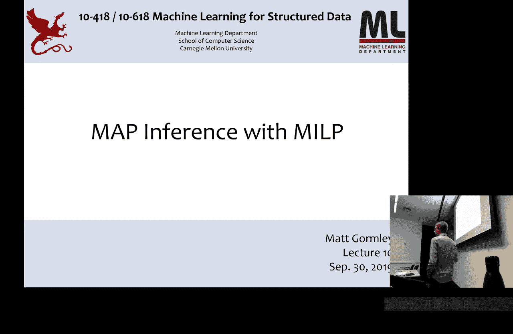
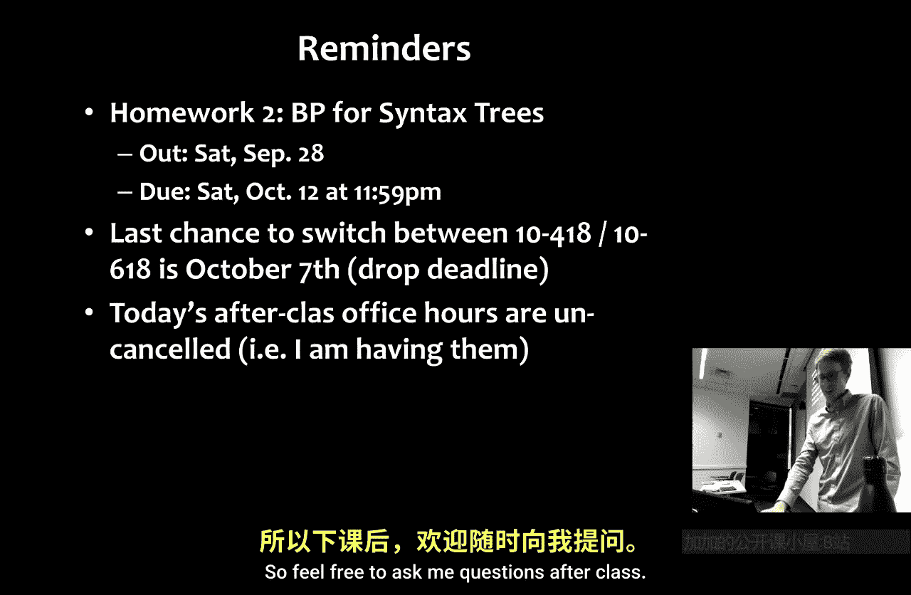
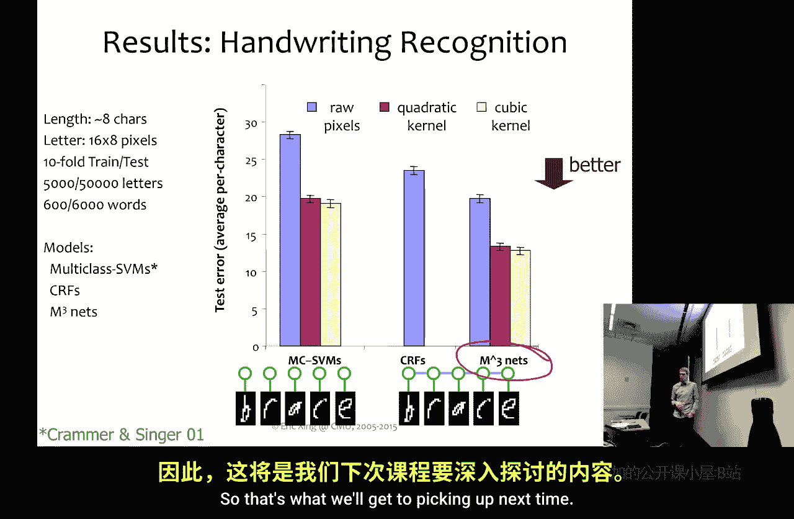

# 卡耐基梅隆大学【中英⚡结构化机器学习｜10-418 2019 Machine Learning for Structured Data】 p12 p11 10-418 ⧸ 10-618 Fall 2019 -BV1eJRsYBEaK_p12-

そがけつ。Today we're going to be talking。プれはね。This is a fun topic， because。

Sor of pushes in a different direction， just algorithmically and sort of how we have been thinking so far。

 where up until now， we had been kind of concerned with，Finding this。Continuous mar。Or sorry。

 continuous marginals of variables。And for that。trying to find。Those crbible assignment to。

This is really a compatorial optimization crop。And so。That me resort to here。

Algorithms that sort of come out of this rich field of combinatorial laughter。

Okay， so homework two is due on Saturday， October 12th。And then。I'm sorry you had a date note or。

Well， October7 of this today， so this is the last chance to switch。

So it might be too late because you need so many signatures on a late ad form。我接整现得但到嚟看。

Canceled my office hours after class today， they're now back on， they're uncanceled。

So feel free to ask me questions after class。

嗯。So we were using， in some sense， as motivation for this section。

 this notion of minimum base risk decoding。And so I want to bring this back up again。

We said that a minimum maze risk decoder。Is one that。

Returns a variable assignment with minimum expected loss under the model's distribution。Okay。

 so here you remember this notion of an expectation under the models distribution we talked about it last time in the context of computing the gradient of a conditional random field for。

For a log linear parameterization a bit。And so here we're seeing that same sort of expectation under the model's distribution over。

The output variable is Y， given the input X。And the difference is that now we're taking an expectation of。

就挖吧。So this to me is one of the most。Interesting equations that shows up in machine learning。

Because what we're saying here is that neither my hat nor why is bound by the left hand side of the equation。

So the left hand side of the equation is just。The decision function that you want， right。

 It's some H of X。That should return a lie， a prediction work。Namely a white hat。

And so what we're saying is that the Y hat that you should return should be the one that minimizes this expectation。

我。If you knew。What the true why was。Then you would just return theard men of L of Wahat and the true one。

But you don't know what the true why is， right， This is at test time where we're trying to make a。

And so what we need to do is return。The white hat。That minimizes instead。呃，哦。

A quantity that uses the current model parameters。As your best estimate of what the true why is。Okay。

 so essentially what you're doing here is you're saying， you know。 if we were sure what why was。

 we would just drop this whole expectation because we're not。

 we're going to sum over all possible true why。And for each one of them。We're going to say well。

My model thinks。This particular true why？Is。呃。7 probability likely。That's a lot of weight。And so。

We're going to take。The loss of what hat。With respect to that， why very seriously。

Whereas there's going to be some other why。That has really low probability， say。00001。我要。

The model is pretty confident that that's not the true one？

And so we're going to say the loss between whatever you're predicting and that why is lesson important。

It gets downgraded。So。So a minimum base risk decoder。It's just。A decision function， H theta x。

That you get when you instantiate this equation for a particular loss。And。

So what's interesting about this is that。The loss function itself。嗯。Depending on how you define it。

You may or may not be easy to come up with an algorithm。That efficiently。It's each theta effect。

So why is that Well think about what you're writing down here， this is anardman over Y hats。

Looking at all possible Y hats， and this is a summation over all possible why hat。Leash， I mean。

 the you know， computing marginals。Requires just the summation over and doing map inference just requires min or max over。

That set of wise。Now we're putting the two together into one。It' saying we're going to do both。

So this feels like the sort of thing that。If we're not careful。

 might have some double intractability to it。But it really depends on the actual loss。 why。 Okay。

 so if the loss decomposes perfectly over the。The variables。

 then the minimum base risk decoder also decomposes over the variable。因为。

If you do something like handling lock。嗯。The actual law simplifies to just being an arc max over individual。

Individual white hacker。The one that we're going to be interested in today is the  zero1 loss function。

 So if this loss function says。You're going to have。

Loss equal to1 minus an indicator function of whether the two are equal。Okay。

 so substituting that back into our equation for a minimum base risk decoder。We see that。

We still have our A men and our sum。But。There's。Going to be many terms in the summation。

Where one minus that indicator function is zero。Only one of the terms in that sumation will have one minus the indicator function。

Oh， sorry。Other way around， so should be careful。So there's exactly one of these。

For which the indicator function will be one。And。Sorry， so this is an indicator that they're equal。

 maybe I would usually write it like this。So。For the term where y is equal to y hat。This term is0。

 and then all the other ones are value one。So what that means is。If we're trying to。Minimize。The sum。

Then。What we're really doing is。So now we can actually expand this out。

 so imagine taking this probability and multiplying it by one and by。negativeative of the indicate。

So just distribute that probability between those two。And so what you'll get is。

One term that's just summation over the probability of y。And then minus another term。

 which is summation over all wise probability of y given x times this indicator。

So this term is just constant。With respect to why hat？So we can just discard it entirely。

 And this term。Negative sum over P of y given an x times the indicator。

Is only non zero for the value Y hat？Which means。This whole thing is going to be just equal to P of Y packet。

Okay， this is should I just write this out， I should write this out， this is such a mess。

Let's just write this out。 And this is such a。Such a lovely little decomposition。

 and it just takes us two seconds。So what we have here is。这个ね。Equal to art and。Over why hat？

A summation over。Oh why of PY given X， that's according to our model。Times our loss function。

 which is one minus。This indicator function of。hy had过另外。So all I did here was I said， well。

Let's take everything in brackets here and divide it into two submissions。

So we'll say we're still have our R end over Y hat。 But now we're going to have a sum over y。

B of Y given an X。 That's one of them。Minus a sum over y of P of y given x。

Times that indicator function。Why that equals y。And。The observation here is this is constant。

With respect to why hat't。At this。Is equal to。Probability of what hat。

Because all of the other terms in that summation are here。And so what we get back then。

Is that this is simply。Arment over why hat。P f I hat。O肥。

So it would be our ban of let's do this carefully here， so it's of the negative probability。

And then we flip it to an our。And drop。And there is our minimum wage risk decoder for the zero low loss。

Okay， so if this is the case for  zero1 loss function， we can also find that if you know。嗯。So， if。

L of white hat。Why。Decomposeers。In the same way。As P of Y given X。There's this question， which is。

 can we efficiently？き。呃。H day at the max。你こ to thatMBR的个。So the answer here is yes。

And I think we'll have to say that this is such a lovely little problem to work through that we' leave it for you to do on your homework。

 you just want to just make a note of that。This this sort of decomposition kind of。

Follows naturally with the way that。P of y given x is specified。

 and if p of y given x decomposes according to some factor graph。

And the loss function also decomposes according to the same factor graph。

Then you can get back something efficient。So long as you have an efficient way of working with PY index。

それビ。So。So just that so if。So we spent all this time talking about factorizing P of Y given x。

 according to a factor grant， where it's a product of a bunch of terms， one for each factor。

So in the same way， if you can write L& Y hack Y。Such that it factorizes into a bunch of terms。

 one for each factor， then we would say that they decompose。So we'll make that precise in for。

So this is the kind of key problem that we want to actually， oh yeah， another I'm。

I dont why all of people are。you watching I go away say your love。Negative P of white hat given。哦。

是 so嗯。The question is for what values of why？Is the indicator function。Y hat equals y equal to one。

Oh suppose those would be one last。So there's only one term in that entire summation。That is。

And then the other ones are called。That's what you can。So。Okay。

 so where are cases where you might actually have a loss function？That。That is like this 0，1 box。

 like where， where where are cases where you might not want something like handing lock。

 You might want something that。Gives you back a single assignment to the variables。

That has highest probability。Take of any places like this。In the。

So if you're doing anyway classification， do you mean。

 but here we're assuming that we have multiple variables。So。Are you saying you would decompose。

The N classification into say n indicator variable。Yeah， so if you have。嗯。

So maybe let me generalize that a little bit to say， if you have， say， n variables Y。

Where certain joint assignments to them just don't make any sense。

Then this might be a case where you really do want a single。Jointly likely assignment。

Right so putting this another way， imagine if you had。嗯。A coloring problem。Great。And。

And you had to color。All of these。Variables。Such that node two variables。Again。Sorry。

No two adjacent variables in the actual factor graph had the same color。

So if you had such a coloring problem， then you could imagine。That we might want。

So if we were to do something like hamming loss。What could go wrong？不用。If we just did hamming loss。

Maybe we're in a setting where。The most likely。So let me give a valid coloring。

This will show up in a second。So this is a valid coloring of。Of this graph， because no。

Of adjacent variables in this graph are color the same way。So if we had a situation like that。

And you used a hamming loss。It's possible that you could get back an assignment to the variables that was something like blue。

 blue， blue， blue， and blue。Maybe each variable independent of the other variables。

 is most likely to be blue。But when you consider them all together。

 what you want is an assignment to all of them that gives you back something。

Okay so in general there's lots of problems of this variety。

 I think a great one is actually if you're trying to populate a Wikipedia info box with information say about a person。

 you want to populate the fields in that Wikipedia info box in a way that is。

Sort of logically consistent。So you don't want to describe aspects of the person that would make sense if they were a world famous soccer player。

But they don't make sense if you're separately describing them as。Financial take good。

And so this notion of sort of having many output variables that interact sometimes means that you do want to。

Return an assignment to variables that is sort of internally consistent。Okay， so how can we do this？

We need to take a little bit of a divergence into talking about linear programming and integer linear programming。

 and then once we have these under guard belt we'll kind of double back and think about how we could use these techniques to actually solve this problem。

So let's start by thinking of a linear program。And a linear program。Is。

It's going to be one of the following form。Where let's actually we'll start with just a simple example。

And it's going to just be a two dimensional example。

And so we're going to say that our goal is to maximize some linear objective function。

Over variables x， Okay， so the objective function we'll work with here is going to be x1 plus。2 x 2。

And we're going to have some constraints。So we'll write。Such that。

And then our constraints look like x1 is greater than or equal to1。

And x2 is greater than or equal to3。And。X2。Minus3 x1。Is greater than or equal to negative five。And。

X2 minus12 x1。Is less than or equal to 50。So what we're looking at are sort of。

Two parts of the actual program。This is a linear program。And it consists of an objective。

And some constraints。诶。We can actually depict。啊。This objective and constraints。In2D here。

Where we say， okay， the variables over which we're optimizing are x1 and x2。And。嗯。Range over values。

 say 1，2。Three on the x1 axis。And one， two， three， and four。On the next two axis。

And so now what we need to do is actually draw out。呃。

AllThe intersection of all of the feasible half spaces given by these linear constraints。

So each of those linear constraints is defining for us some hyperplant。Okay。

 so here let's do the easy ones， so x1 is greater than or equal to one。

So that's just going to be a half plane。I sorry， I paper plane goes like this。And we have X2。 Oh。

 and then we're going to be on。The right side of that。Since we're greater than。

And then we're going to have。啊，X。2？I。Let's see Do want crazy in here。

I probably want less than are equal。 Oh no， no， no， that's just a typo here so。

We're going to do x2 is also greater than equal to1。So now that looks like。Another。

Ororizontal hyperplane like this。Acroros。Okay now we have this x2 minus3 x1 greater than or equal to5。

And that one。Is actually going to be。so。It's going to have an interceptive negative five。

 but it's also going to pass through this 0。21。With a slope。呃。Positive story。

So it will also pass through this 0。34。And then the last constraint。Is going to be one that has a。

Intercept of 2。5。But I think it'll pass through one three here。And also，3，4。So what we're left with。

Based on these constraints is a region。Or if we take the intersection of all of these little linear constraints。

We get back。This blue region。Y， because we need to be on the greater than or equal to side of x1 equals 1。

And on the greater than equal side of x2 equals1。And on the greater than equal side of this。

Dagonal line， and on the left are equal to cellular。啊对解。So。This inner part is what we call the。

Feasible region。And we can also depict the objective function。 And we do that by thinking about。呃。

The objective as the dot product of， say， a vector 12。With a vector。And thinking about it this way。

 we can say， well。That would be like。An objective function where the direction of steepest disscent。

Is pointing up at this。Direction following the vector 12。Ex scale that。So， here the。だ。2。

 example here。And so you can imagine if we were to draw a contour plot。

For the linear objective function， it's kind of an uninteresting objective function。

 right if you're used to， you know solving quadratic objective functions or non convex objective functions。

 you know， those usually have some interesting topology。

 the contour plot for this one is just going to be a bunch of contour lines that are。诶。

That are orthogonal to。This objective function here where the further you go。Upward。

In that direction， the higher the value of the objective function。So。

We should probably make a few small definitions here。So。We say that。The problem。Itself。Is。Oh。

 so actually let's let's define the actual feasible region， So the feasible region。

It is a polyhedronron。And。Possibly unboundly。Meaning that。

It could actually have sort of an open side to it。It's the only two constraints we have where x1 greater than or equal1 and x2 greater than equal。

Then what's the solution to this problem？X1x2 equals infinity。We're just going to run off。

So in this case， we have a bounded， feasible region。And。We would say that the problem。Is infeasible。

If。The feasible region。其实。So if the feasible region is empty。

This just means that there's no solution。To the sexual problem。

So in the case of the problem that we laid out here。The。

The point that maximizes that objective function， subject to these constraints。

Is going to be at the very。Edge up here。3， four。The actual。はい可愛い。It to。Gos 3，4。So。

If you're working with linear programs， though， it's sort of useful to understand。

How we sort of traditionally write them down。And。啊So the。

Standard way is called a linear program Standard form。And writing a linear program in standard form。

He's just going to amount or rating。The problem as。maxax。C transpose X。Suchし that。

AX is less than or equal to B。Each variable X is greater than a equal to0。So。What we have here is。

A max problem or a max objective function。So that's ingredient one。Ingredient2 is。

That are inequalities。Are in this less than or equal to4。And then， lastly。That we have non negative。

す。So just so we're clear here， when we write it out this way， what we're assuming is that。诶 c。アクス？第一。

A vectors。诶诶。It here。Yeah。呃。And then further， we assume that X。A variables。Cビ and a。而客。So。

So this is how we typically write them down and the sort of important bit about this。Is just that。

We can actually convert any linear program。Two standard fourth。So。只认为。Every LP can be written。現選で。

So just so you can actually。See that嗯。So let's， let's run through a couple。Examples here。

 so if your original LP was written with a min instead of a max。Well， you could get to a me。Just by。

Nigating the objective。 so that means， you know， if you have。Men C transpoposedse X。

That can just become max negative seatranspo。And then。

This applies similarly if you wanted to go from。四。A greater than。Or equals。

Constraint to a less than our equals constraint。So。You can do this by。Miggating the constraint。

So here， if you had， say A1， x1。Plus。A2 x2。Is greater than or equal to some B。

That's exactly equivalent to a constraint that is。Negative A1 X1。Minus a to x2。

Is less that are able to。できる。And。Okay， so what if you have an equality industry？

you convert an inality constraint to standard form。So let me give you an example。Aワ。

1 plus a2 x 2 equals。I don't， I don't think you can do it with a constant。Any other ideas。研究さ。Oh。

 you morning。Z zero。So where do the xerox go？Oh， but remember that AX needs to be less than or equal。

Not equal， I want to get rid of the equality。You can do。M there you to be plus one in great。Yeah。

 or even simpler， we can just do。So just。The greater than equals 2 and the less than or equals2 version of this。

 So a 1 x1 plus a2 x2 less than or equal to B。 and then also add a1 x 1 plus a2 x2 greater than or equal to。

If both of these are true。Then it's got to be equal。

And we already know that I convert a greater than equal to a less。诶 so。Let's see。

 so there's there's more of these。 so like for example， if you have a variable。With an upper bound。

So this would be like if you have a variable， say。X I， that is less than or equal to some u。

You can actually。Do a tricky conversion， which is you add a new variable。

And we could say that the new variable。Is just going to be some。WI。Which you define to be equal to。呃。

四。U minus X。With。W I。Os， and with the usual non negativity constraint。Z is less equal to WI。

So if everywhere that you have Xi， you replace it with WI。Or U minus WI in your actual program。

And then you just let WIV usual non negative constraint。Then you get back。

A variable and you get this constraint for free。You don't actually have to add an extra constraint to account for。

This upper bound。So maybe that's just getting fancy。

 you can also do things with if you have like a variable。With an interval。So， this would be。嗯。

I'll skip this one。I'll say leave that as an exercise。And then。Oh， the last one is kind of cute。

 So if you have a free variable。So this would be。A variable that's just got no constraints on it。

Then in that case， you can have。A new。Or two new variables。X prime。An next primeing prime。呃。

Such that。X is going to be equal to that x prime minus。That problem。And then we just have that。

0 is less than or equal to。X prime and zero is less than or equal to x double prime。And so， just by。

So replacing all of your x's with these two variables in your program。Now it's just as if you had。

A free variable that could be either positive or negative。so诶。

So the point is that you can always take any linear program and convert it back to that form and the reason that we do that。

Typically is actually so that you can。Then efficiently carry out sort of the standard algorithms for these things。

あ。The most commonly used algorithm。Is the simplex algorithm。And。

I think actually just sort of in the interest of time， we're going to just do this in pictures。And。

So， the sort of。呃。Pictures version of this。 So we're going to do an example here。

And I'm going to attempt this in threeD。Probably end badly see how far we get。

 So we're going to say we have three variables that we're optimizing over。Okay， and those are。X 1。

X 2， and。3。And。So remember that any linear program is defining a polyhedron and so here what we're doing is。

We might have a polyhedron that。Looks something like this。And it's in three dimensions。

 So now we're going to kind of imagine。This part of the colleague Adrian， kind of coming out。

Away from the slide。So you can kind of imagine some polyhedron in three dimensional space。

 and this part is sort of sticking out of wave fromance。And then we have an objective function。Well。

 that's just a gradient or sorry， it's just a vector pointing in the direction of increase。

So maybe it's pointing in this direction。And。呃。Tey idea behind the simplex algorithm。Is。That。

The optimum。Is。嗯。Always。诶。Of the pond。Of the polyed。And so。呃。The simplex algorithm just walks around。

The corners。G都 be。So you could think of this as sort of consisting of。An iterative process for。

Some initial困。And while that sounds like an easy prospect。

 even just picking an initial quarter is actually a little bit tricky。

imagineag just with our tiny two dimensional example up here。If I said， okay。

 here's some constraints now give me a backup a point inside that region。Without drawing the picture。

Writing an algorithm to give you back。Any point in that region might actually be a little bit tricky。

Okay， so just to say that step one here is not trivial。But once you've picked an initial corner。Then。

啊。The next step is。To inspect。All the adjacent corners。

So you could imagine if maybe the initial corner that we picked。Is this one bottom a corner。嗯。

We're going to actually inspect。3。Adjacent quarterss， definitely。And of those adjacent corners。呃。对。呃。

Bs。佢这情况。Where here best just means。One with the highest objectives。And if there's no improvement。

等你傻啊。So you could imagine then the way that this might proceed is you start off as。

This red point in the bottom corner， and then you inspect the adjacent corners and you pick this one。

So。Once you pick that one。Then again， you're going to have to inspect the corner that you had already looked at。

 plus a bunch of new ones， this one， this one。And this one。Looking at all of those。

Maybe in this case， the best one is this outer corner here。So you move to it。And then again。

 you inspect the adjacent corners， you certainly don't go backwards。

Maybe you move forwards to this one。And then finally， land。At the up of the quarter。ですあ。

Isum that the optimum is always in a corner。Oh yes， sorry。 This is a true statement。

 So it's always the case that the optimum is at a corner again， let's just do this in pictures。

 So in pictures， the reason that。The optimum is always at a corner you can actually sort of see based on the actual。

were plots。Of。Of the objective function that you're optimizing versus the constraint。

And so what happens is so if we were to the way to actually sort of explain this formally is to talk through the method of LaGrange multipliers。

And if we did that， we would be able to make a really precise statement， which is that the。

The gradient of。The objective function。Is actually going to be。Tangent to the gradient of。

The constraint function。おいて。If we combine them all into one。

So think of one function that describes outer that feasible region。And so。The point at which。

We get this tangency is always going to be at some point where so the constraint region we could think of as let's actually draw a new picture here？

So。してでさせてください。Eethod of a range of multiplifieriers。

 let's say this is not sort of proper material for the course at the moment we'll actually probably。

这个是他在。But I just don't want to sidetrack as too long。 So if you think of the。

The feasible region as consisting of a L of conour line。

And the real feasible region is just one of these control。And then your objective function。

There's a bunch of。Contour lines as well。There's going to be some。Point where。

The contour lines of the objective function。Are tangent to the contrary line。Of the feasible region。

And that's always going to happen。やこう。So you could kind of think of it like。For anyone。

If you just start sliding it towards a polyhedron， it's going to hit a corner。

Except in one specific case， and what is that case？When would you not if you were imagining sliding。

 so you have the contour lines of the objective function？

Over there is the highest possible value of the contour line， and this is slightly less。

 slightly nice， slightly last， slightly less oh。It lines up exactly with。

One of the edges of the feasible region， then that whole edge is going to be。

Any point on the edge is going to be maximum， but that means that so long as you land on one of these two corners。

 you found a maximum。So it still works。Give me some downで then。呃。Yeah。

 so this is where things get interesting and so you actually have to be able to detect when there does not exist。

A corner， right， so if you're if you're a feasible region。Is truly open。And this just goes on。

Forever， you need to be able to detect。At this corner， one of the sides is completely open。

The case which your aunt will just。先分いや。So， so this can happen。

And so often it's useful to know that this can happen because if you're defining a linear program that you're pretty sure should have。

A valid solution。And what you get back is that the problem is unbounded。

 then maybe you've actually sort of specified your problem。Okay。嗯。Okay。

 so so we'll at some point come back to sort of this discussion of method of the branch multipliers。

 so the other algorithm that I just want to highlight here is that of the interior points method。

Now there's many different interior points。Algorithms。And。

The name essentially gives away exactly what it is。These algorithms are doing。

So if you have some feasible region。And。Some direction of。Greatest increase。ive function。

 then you start。That' some initial point inside the region and you move around。Inside that region。对あ。

So here the key idea。Is always。嗯。冇。Within the feasible region。So。嗯。

So this is a whole family of algorithms and sort of the key aspect of interior points methods is that they are。

Onlyly time over。And。诶，面个哋。CanFor any given input， they will complete。In time。

 polynomial and the size of the input。And the key thing to note about the simplex algorithm。

Is just that。This is not。A polyton。Algorithm。But， it's。Common in practice。So essentially。

It's so efficient to actually implement the simplex algorithm。

That people tend to use it more frequently than interior points。Essentially like getting a。

Getting an interior points method。That on paper is polynomial times。

And is practically fast when you implement it， it is actually a little bit。So。好あ。Oh。

 why doesn't it get stuck？嗯。So。呃。I mean， I guess。I think a proper answer to that question。

Would be for us to prove that。That the feasible region of a linear program is convex。And that。对。

That going in any direction in a convex region。Has a unique or it's not actually strongly convex。

 so it's it's convex， So there's。There's not a unique maximum。就。

Like basically the key property that we would just need to show is that。

The feasible region of any linear vers comebacks。我才れ。So if you can prove that， then。

Then you're basically。the objectject function like the hybrid。所以被类。かたする。嚟。So。诶。哦，的。Yeah。

 but the more important detail is that the actual feasible region is convex。

 so the objective function is just a linear function。So in that sense， yeah， it's convex。

And also and also concafe， the question is， is our const set giving us back a region that is alsok？

That's the more important question。And the less obvious one。So。No。

What I want to do is move to a discussion of problems that are non contact。

And we're going to get there with just a tiny tweak。To our definition of the linear program。

 and it'll give us what we call。Integer。What your preference。Or pile。

So an integer linear your program。Is going to be one that。嗯。So， this isn't just an example。 This is。

sort of跟 ILP。Standard point。And so an ILP in standard form is going to look just like a linear program where we have。

Max over the variables X。A linear function of x， so C transpose that。Such that。

AX is less than're able to be。And also zero is greater than。Z is less than or equal to Xine for all。

And then， we have this additional。straight。对。Each variable X。Is in。The7个分主。So。

What we have here are really two programs。So the important one is。

The entire thing is what we call the integer linear curve。

But if you were to take everything except for this last constraint。

Then what we're left with is called the LP。Relaxation。呃。其他嘅。It's just equals。消费。That into。でち。So。呃。

Problems of this form。Are particularly interesting。And。If we just draw a simple picture of one。

 you can immediately see why。They are likely to cause us some trouble。Thanks。So here。

But suppose again， we have variables x1 and x2。嗯。I'm just gonna to detect。The possible。

So this is just a grid of all possible。Integers that you could get through x1x2。

 and you could imagine this grid kind of expands off in either direction。

So imagine if the feasible region defined by the LP relaxation。Look like this。So suppose。

We had something。Cut through like that。Here。So this blue region。Heres the。OP relaxation。

This is what we would get if we didn't have the integer constrain。

And the set of feasible points for x1x2 in the ILP。哦。Of the black part。Inside the blue box。哪有啲。

Visible points。black points。In the blue box。So。Crucially， what we have here is that if our objective。

Was a vector say pointing in this direction？Then what is the optimum of the LP relaxation？Yeah。

 that top corner right up here。 So this。Yes。OfThe LP。What is the optimum of thus。

Full integer of linear。1，2，3。1，2，3，4。如么事啊。IOP。I think it's probably。去问。So， this is。Of integer point。

And。It's inside the feasible region。So fair second， let essay say  two，1，2， three。Yeah。

 so the  point23。Is inside the feasible region， and it's as far in the direction of the objective function as we could go。

I think maybe it's a toss up between two，3 and。1，2。So。The key idea here is that。呃。

Just by imposing this integer constraint， suddenly the whole shape of the problem looks rather different。

Okay， so let's define one more type of problem here。Which is a mixed integer。Mineni your program。

And a mixed integer linear program。Is going to be one。嗯。

So the mixed integer linear program is going to be just like the integer linear program。

 except that now。We're only going to have the。The integer constraint on a subset of the variable。

上 will say嘅。We have the same constraints as before。But that。我美。Some of。The actual Xs。In some set。

Is a subset of， say。The integer is one。And variabless here。So。Only some。

So inspecting our picture above here。呃。我 would the。What would， how would the problem change。

If suddenly I said， okay， only。2 aim to be integer。

What is the set of feasible points for the mixed integer linear program that results？

Have our same square for。What was the。Yeah， it would just be horizontal lines。

Cutting through this box。For each integer value。这个是比。X2 was it。这以。one was not。

That's the wrong thing to say， but X1 was in the real system。So。Okay， so now we have this picture of。

Of all of these sort of different ways of specifying problems。

And we need to kind of be specific about how we could actually solve。A mixed inte layer program。

I want to give some quick background on non convex global optimization。

 so imagine that our goal is to optimize over this blue surface。So this is not necessarily a linear。

Problem anymore。 It's just some complex。Noncon v problems。

And we have different projections of that objective function onto the different planes representing the different axes。

And you can imagine one way to solve it is by。Standard local amendment。

 so you start at some initial point and you maximize locally by just climbing up to the top of the nearest hill。

This is a good， good idea， but you might not get the best of the hills， right？

So we say that a relaxation of your objective function provides some upper bound on that surface。

So here we're looking at a linear relaxation。Of that non convex。Objective function。

And we say that branching is basically partitioning the search space into subspaces。

That will enable tighter relaxations。Okay， so here's what I mean。

 if we branch on the value of x1 being either less than or equal to zero or greater than or equal to zero。

Then。We could now get back two relaxations， one for the right half and one for the left half。

And the resulting relaxations could actually be tighter in around the regions that they represent。

So if you put those two relaxations together， these represent a tighter upper bound。

Then if you just have this one。Right。So。As you're seeing this。

The connection that you should be making back to what we're about to do is。

The ILP is like the blue surface that we're trying to optimize over， it's non con。

And the LP is going to give us。え？Relaxation。Of that original objective。

That's going to be some linear objective。Okay， so now if you continue branching。

So now suppose you branch on x2 or greater less than or greater than or equal to zero。

 you could further subdivide and get tighter relaxation still。And if you look at the maximum。

Of all of the relaxed solutions。For each of those partitions。

That's going to tell you a global upper bound on the entire original function。Okay。

 and there's this other trick， which is that sometimes you can project a relaxed solution onto the feasible region。

So suppose here， it was really easy to solve each of these relaxations because they were。

 say linear programs。Okay， so that could give you back four different blue points。

But maybe none of those blue points。Is actually sitting on the blue surface。

So if you had an algorithm that could project it down onto the blue surface。

 then you could get back a feasible point。Similarly。

 if the blue surface represented some integer linear program。

 maybe you could project a fractional solution， a fractional blue point to an integer。Red point。嗯。

So we say that the incumbent is。The best。Solution that you've found so far。

So an incumbent is a feasible solution that you found。

And we can say further thatumb the incumbent is epsilon optimal。

If the relative difference between that global upper bound， which is the max of the blue points。

And the incumbent score is less than epsilon。Okay， so why is that。Well。In general。

 when we're working with。嗯。A branch and bound algorithm。What we're really doing。Is over time。

We're actually thinking about。Sort of the value of the objective function。And time。So。

So what we were just talking about was that you have this global upper bound on the objective function。

And so。You know， the original very loose relaxation is going to give you some。Value of the objective。

But then once you branch。You might actually get。Some slightly improved global upper bound if you have。

 say two of those relaxation。But then you partition it down into， say。

 four regions and you get another tighter。Upper bound。 And so as you go along， gradually。

Partractitioning。Into smaller and smaller regions， you're going to end up with。Improved。诶 go嗰个。

Upper balance。At the same time， while the algorithm is running。You're gradually finding。

Better and better incumbents。So the incumbent is going to be sort of the best thing that you've seen for a while。

 but then they'll jump up。Because you find a new， better incumbent with higher score。

So then you keep that incent for a while， but then you find another good one。

And then that one is really good。 and it sticks with you for quite a long time until you find yet another better one。

And eventually。If the incumbent score。对。Which is the。Best you've seen。So far。

If it ends up equal to the global upper bound。Then。What that means is。

You've actually solved this non convex problem。So how does that actually work out？This red line。

 this incumbent score line。Is。Is actually also functioning as。A lower bound。On your objective。So。呃。

When they need。When the upper bound and the lower bound meet， that means that you found a solution。

And it can't possibly be better than the current value of the green。And。

It's a lower bound because you actually have a real solution。

So you know that you can at least get a solution， but is this good？So。Oh。

 Ed scribbled some notes here。是。Just slow today。So。So there's a sort of， oh yeah， question。

I didn't understand how in government is giving the lower government， isn't it the actual solution？

It's an actual solution， or it's the best of the solutions you've found so far。

And so a lower bound says。Back to that。A lower bound is saying。

knowFor the either mixed or integer linear program。What's of value of sea transpose？

That is lower than the opt。That's what a lower bound would tell you。你 say。You know。

 maybe the true optimum。 So let's say you don't know it。 but the true optimum is 7。

 C transpose X is going to be 7。And right now， you have something。

With an incumbent score where its objective function value is5。So at that moment。

 you know that there is a solution out there。That has objective function value， at least。So。

 the optimum。Must be five or。At the same time， if you were able to use that upper bounding。To。呃。

To get this green line and they met。And now you know that that say and find a value of seven now。

 an incumbent value of seven。And if you've up and bounded it to 7， then you know that。Well。

 the optimum must be seven or greater。But you've just upper bounded it so the optimum must also be less than or equal。

Which means that you can。三次主音です。是方式的吧。Chris and the red there， Christmas。That's right。So。Okay。

 so basically， the branch and bound algorithm is this method for recursively subdividing the search space。

And the subspace order can sort of be determined heurically。

So there's lots of different ways that you could actually decide how to。Recursively accepted by it。

And then you could actually print subspaces that can't possibly yield better solutions。

 so if the subspace upper bound。Is worse than the current incumbent。

Then you can actually prun in that entire subspace。

Okay so if this upper bound says the best that you can possibly do in this region is a score of fuck。

But you already have an incumbent that says。My objective score is seven。Well。

 then you don't even need to look in this。Whole subspace。 You can just prune the entire thing away。

Because you know that you can't possibly do better in that subspace than this red Bull。Okay。

 so there's sort of all of these different ingredients to it。诶。What is the relaxation。

 how do you do this projection， what are the different search heur？And。So for。

Intery linear programming， we're going to solve the relaxation using the simplex algorithm。And。

And then。To project a relaxed solution onto the feasible region。

 one possible solution is actually to do randomized rounding of your variables so you can actually take。

Variables that have fractional values and randomly round them to integers and see if you get back feasible regions and this is actually a very common solution。

So。So where we're going from here。Is we'll look at sort of a small example of branch and bound。

And then。We'll move to defining how we can actually set up。

The map entrance problem as an integer linear perk。And we'll do all of that， probably in the。

We'll basically just write this down。And we'll say look。

 an integer linear program and once we've done that。We're basically done with this entire section。

So this is sort of the wild part about next tos really linear programming Iming is there exists these black box solvers that are incredibly powerful and incredibly expensive。

 so you all probably have licenses to them through CMU。And呃。And basically。

 as long as we can write down the map inference problem。As。

An integer linear program or a mixed integer linear program you can just。

Send that off to one of these black box solvers， and it will surprisingly efficiently， in most cases。

 give you back。A most probable assignment。From there。

 what we'll sort of lead into on Wednesday is a discussion of how you could then use。

Just map inference within learning。To actually solve their problems， like image segmentation or。

Depenency far saying。Or OCR。 And all of these will be， will'll be looking at。嗯。These different。

Ways of actually training。Particularly structured SM or。M3N， where the actual。Sor of only。

Inference algorithm that you need is one for map inference， and you won't actually need to say。

 compute marginals。Follow the gradient of the likelihood。We'll actually do say。

 max margin learning where we can do it without actually say computing something like margin。

So that's what we'll get to picking up flex。

Okay， see you guys done。