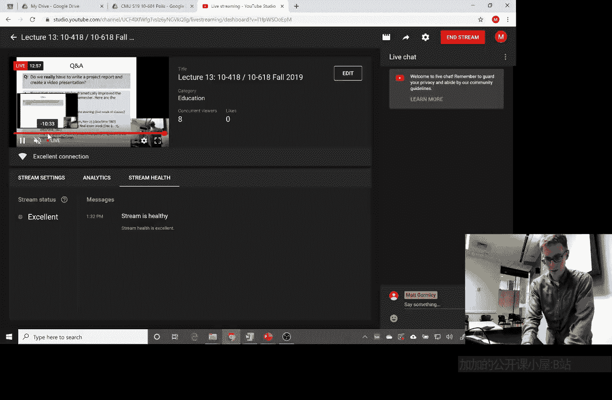
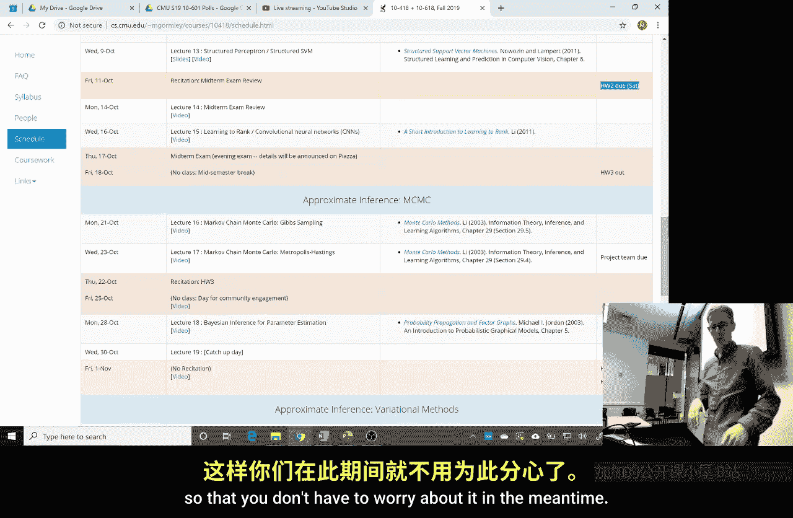
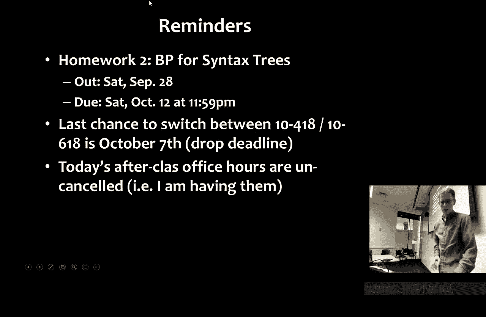

# 卡耐基梅隆大学【中英⚡结构化机器学习｜10-418 2019 Machine Learning for Structured Data】 p13 p12 10-418 ⧸ 10-618 Fall 2019 -BV1eJRsYBEaK_p13-

Okay， so welcome back to 10418618 So today we're going to pick up where we left off talking about。

Map inference with mixed integer linear programming。

 and this time we'll actually get to see how the sort of IOP framework that we had set up last。

Can actually be used to solve the problem。And then from there。

 once we have actually established how you can do mapping thing。

We'll see how you can use map inferences a subroutines within learning。

 and our first example of that is going to be structured。Which is what we'll discuss today。啊，不是我那个。

Simpst。Actual learning algorithms。We'll look at in this entire course。

They're beautifully simple in the way that perrums。Okay， so。Question。

Let me throw one at you rather than the other way around。What is the。

Study on supporting and improving teaching at the university level that I just mentioned onMP Joze Post。

 so rather than me into it， why don't I let Francesca do just that？

Ill answer this question for you guys。 Hi everyone， my name is Frances。

 I'm a fifth year PhD student in the Human Computer Interion Institute， I work with Dr。

 Amy Yoga and my team and I are very interested to run a study in your classroom。

 which is why I'm here today to get your permission to run the study。

 We have been very excited like this for the past four years and have the extensive of experience in this domain in the education domain So before I tell you more about the study I need to ask if there is anybody who's younger than 18 do we have any minors in the class。

Awesome， so the study will take no time for me except for the time that I'm talking right now because the focus of the study is actually your professor and not to the students the research study details are I suppose there's going to be a study team member present in some class session。

 the study team member will sit somewhere in a corner taking notes they won't interfere with class the classroom you're currently is an instrumental classroom which means that we have a sensor over there in a sensor over there we don't start those sensors unless we get permission from everybody in the class to do that we will process once we get your permission we want to turn those sensors on and we do audio and data with your collection and we process these data to get features such as how many students raise their hand What's your professor standing on the left side of the classroom or their right of the classroom and we actually use machine learning for that the open post library if you're familiar with that。

If we get permission from everybody in the class， the data collection is going to start automatically on schedule at the beginning of the class。

 the information we collect is going to be confidential。

 we will not attempt to check or personally identify any of you so I won't know who you are in any way to or form the data will report in papers and presentations is going to be high levelve data the data will be stored in a very secure survey CM you for a meaning of three years class study completion annot services might be used to transcribe video recordings of classroom session transcriptions and annotations will be crowdsourced the sponsor of the research National science Foundation may have access to the research records so just to reiterate or're not evaluating anybody with this data。

 the data is not going to be used to evaluate you or your learning or your performance in this class in any way as mentioned the focus of the study is your professor and not to the students whether you participate or not this will not affect your grade in this class in any way either positively or negative。

Part disip is voluntary。In addition to that， if you agree now to the study and then later decide you don't want to do it anymore。

 you can email me， my email is a kappo very likely and once we get notified from you that you don't want to continue the study we can stop at any point immediately。

So any questions before I get your permission， anything that I can answer very quickly？

About our study。Awesome so maybe I have a question on the other hand so what would what would the data that you're collecting actually look like like what would you actually be storing on a server So we actually do store the video and audio data but the data that we work with is this kind of data if you have walked in mu all Simon hall the Opopo library is displayed in one of the screens over there we get joints and segments of each of your bodies including your professor and we actually mainly focus on the movement the gesturing position in the classroom。

Tings like that， we don't if we get data from the students。

 we do things like how many students raise their hands and not who raise their hands like 50 and all of like 30 something students raise their hand。

 that kind of information is what we work with。Questions any other questions， Any back to the board。

어어 어떻게。You should ask your professor for that for me。 they would be trapping you eating it Actually。

 our algorithms are not that advanced， so we wouldn't be able to unfortunately So if you agree with us running the study and recording the sensory data as I described。

 please raise your hand I'm sure you to make you do this。

 but the Instituteute review board requires us to ask you to。😊。

If you do not want us to run the study， do not raise your hand。Oh， if you agree to the study。

 please raise your hand。Let's go with， like， a positive。

I see some people have not raised their hands okay。

 so then we're not running the study in this classroom， thank you so much for your time。

 I hope you have a wonderful semester thank you much。Great。Next question。

This is a more important one。Do we really have to write a project report and create a video presentation。

 it just seems like so much work。No， actually， we thought about this。You know， the syllabus is。

Included sort of all of the traditional components of a project， but the more we thought about it。

 the more we realized there's actually， I think a much more streamlined way for you all to communicate to us what you are doing at two points in the semester。

 which is really what we want to happen。Okay， so the new milestones for the project in this course are going to consist。

A midway poster and a final poster。Replace the midway report and the final report you'll still submit a sort of standard text proposal before either of those。

 but the idea is that。The midway poster session will happen on Monday， November 25th。And date sorry。

 the time not being announced here is just because we have to actually have confirmation of a room before we can announce it。

 and then the final poster session will happen during final exam week。Again， like。

Pending confirmation on our space。And the idea of this is that usually the process is sort of you're submitting a midway report。

 and then we read the report and write you some feedback。

So our thought is that having something interactive where we can actually have a dialogue with you is actually going to be a better way for us to give you feedback and that's why we're going to do this midway poster session。

 it will most likely not involve you printing a poster midway rather will probably do something kind of where you're just projecting your whole poster on a screen。

 this is sort of maybe like to be fine。Again to have a space finalized。And。

And then for the final poster session， we would actually use sort of the traditional poster。

Over the usual way。So this has an important consequence。

 which is in order to hold a final poster session during final exam week， we can't。

Still have a final exam during final exam。 This is both because it would be just like condensing the schedule a lot for you guys。

 but also just for sort of the usual university policies。

 So what this does is just the the final exam would be will be in the last week of classes on Thursday。

 December 5th in the evening。And so for 10 to 4 18 students， that's sort of your last obligation。

Final exam。啊，那就。You won't have a final exam during。

So obviously this sort of dramatically changes the flow of the course， the final exam。

 we won't be able to there's going to be like some topic in that last week of classes that just won't be covered on the final exam。

 but we think this is going to dramatically improve your experience with。Of course。

Sort of allows you to get more sort of direct feedback from us and also save you from the sort of。

Lorious process of technical writing， which is not really kind of our goal for the outcome of this project。

 where what we want is for you to be communicating your sort of experiments and your results。

 your models and your setup and we're less concerned with your ability to clearly write a report。

 which is often and so there's just an additional note here， which is that I think。

From an assessment perspective， it's very difficult to assess。The quality of a report。

 because it's often very like the assessment of the。

Report quality is often colored by the quality of the writing。

You have a lot of technical writing experience， then you can make a really lousy project sound really good。

And likewise， if you don't have that experience， it's actually very difficult to always kind of。整体。

You know constraints。So we think this will work a lot better and then most likely， so again。

 I have to sort of still say at this moment that。Poloer recession is during this timeframe。

 but most likely we're looking at December 11th。The poster session。

So I think our original final exam wasn't scheduled till December 13。

 but don't don't actually so we won't Oh sorry， so we won't go past December 13。

 whatever whatever our official。An exam schedule set。So when booking flights。

 we'll try to nail down this date。Maybe even this week if we can so that you guys are able to。Take开。

Any questions about this？のてを。struggling。was since。ミディ。Oh yeah。 so let's talk after class。 Well。

 we basically like so for example， this is like really close to。洗てくら。Oference， which Im。

If any of you are going to you can go check out my paper there but I'm not going to be there so you know I think that we have like someone who is planning on attending set conference and we'll figure out how to make it work so I think it sort of depends on like the exact dates。

That the travel looks， so。Any other questions。

Oh， there's one other important detail。

The schedule is also updated because of all these changes then we were also able to adjust the timing for homework three so that it's a lot more sensible so right now homework two is due on Saturday and then you just have this break leading up to the midterm exam next week and then homework three won't be released until after the midterm exam so that you don't have to worry about it in the meantime。

Okay。

嗯。Great， so。So last time we talked about linear programming， integer linear programming。

And we left off with this discussion of Bra andbound。

 and so that's where we're going to pick up today。So we had been thinking about Bridge bound。

 specifically in this setting where。We had been thinking through。

The sort of behavior of branch and bound in terms of the global upper bound and the global lower bound that it maintains。

During its runs。So。What I want us to think about now is this picture of。

What Bran and Bo is actually doing？As it sort of proceeds through these individual steps。So。

The idea here is that as before， we're trying to solve some。ILP， and so that's going to be some max。

Over。Sed transpo。fullll screen。Such that。AX。Very冇啲。And。啊。So this is the linear part。And then we have。

Each of our XR。For all I is greater than or equal to zero。反正。Lastly。对。X I is itte。So。

Inside of the setup， we're going to think about a specific example here。

 like one of the ones that we had been thinking about before， where we assume that。

We've kind of discretized。The space of points。And what we're searching for is。比说か这个。

Within the set points。And so the actual LP relaxation。Is going to look something like this。

We could say then then。Objective function。See transpose X。

Correponds to a vector pointeding in this direction。And so crucially， what we observe is that。呃。

The the LP啊。Is at the top corner。That's the rectangle， whereas the true off。呃 theILP。ああ、こい。

And so the idea of the branch andbound algorithm。Is that it proceeds by constructing a ran and mount tree the step。

What it needs to do is actually pick one of the two variables， x1 or x2。

And it needs to cringe on that variable。So what we would find is that。Yeah。It runs。

 so this is going to be the first node in the Branon Bo tree。

And at that first node in the branch of Bo tree。It's going to run。O。

It's going to run the simplex algorithm。To get back。AV of the current linear programming relaxing。

And so when it does that。What it will find is that。The global U bound。

For this problem is going to be the。Reorresponding to。The actual solution。For this top red point。

So we could call this。Some extra Tuesday。That's one crime。And we could say that the。就是。

Global or the global upper bound。It equal個。C transpo。P 1 pre。That2。So。Once we have that upper bound。

 we also have a solution。To the LP。But as we can see from our picture， x1 prime。Is not。

In the set of integers。And so what we might do is we might say， well， for that reason。

We're going to branch。On the variable x1。And。We're going to look at two possibilities。So。

 if we said that。Same X1。Is equal to。Say，2。8。Then branching on that variable。

Corresponds to dividing into two subprobles。 One would be x1 less than or equal to 2。

And one would be x1 greater than or equal to。So when we branch on this variable。

We're effectively creating two new subproblem。So our original subproblem。呃。

Just the set of constraints， Ax less than or equal to P。But when we branch。We're creating a new。

Linear programming。That now has。The feasible region corresponding to this green。O。

That keeps everything， so here we have other components here。So in this green L。

We capture everything that is x1 less than or equal to two。反正。Say this rainbow。手皮。

We capture everything that is。O sorry。So可 right。So。The rainbow LP is going to be。

Going cutting right through the value。X one equal equal。对这个。Okay， so now。On the left side。

We're just going to explore the green L。And if we solved it。We would get back。

A new solution to the LP。This time， giving us back x2 prime prime。And。That's one。

So here for the green LP。Our。Upper bound。Is going to be given by sea transfer。X1 prime prime。

And so this time， what we observe is that x1 prime prime。

It looks like is actually going to be integer。Because it got pushed all the way up against that region。

Thatside。And so if we were to branch， it would be on the variable x2。

Where x2 landed somewhere between the values3 and4。And so we would range down one side with。T to。

Less than or equal to three。And on the other side， the next two great of。4。

So this would give us two new node。I have two new LP。What would happen。On the。

The x2 greater than or equal to4 there。So we would solve a new linear program。

 it would have these two new constraints。X1 less than or equal to 2 and x2 greater than or equal to4。

And what would the solution of that LP be？No solution。It would actually return。Infeasible。Because。

For this one。呃。The when X。When x1 is less than or equal to2， there does not exist。

Point with x2 greater than equal to 4 that is in the feasible region。ok， so诶。

So this is what Branon Mount does。 it gradually subdivdes the space， as we saw last time。

And for each of those partitions， it gradually finding。

Solutions to the actual LP relaxation of the original program。But as you divide more and more。

 you're gradually tightening those relaxations because the actual relaxations are getting closer and closer in。

So eventually， if you subdivide on every variable all the way down。

 you would get back a bunch of LPs that are restricted to individual points。

So once you have either an inger solution at one of the LP relaxations or one of those individual points。

 then you can。Know that for that particular sub， the global and the global upper bound， sorry。

 the local upper bound and the local lower bound。Okay， so。呃。That got corrupted。Okay， well。Okay。

 so we're going to skip the。The actual description here， maybe it's something I'll double back to。

And so this is just a again， sort of a picture of a branch and boundary tree where now you can imagine we have some root node and we divide into three subpro by branching on some variable。

オケ。Is this for convex and non convex services or just content？Oh good question。

 so whatever we're working with an integer linear program。Remember that the only。Valid solutions。

To the original integer linear program。Ourre。These individual。どいう points。So。诶 we。

So technically speaking， this is a non convex problem。But it's sort of a strange non convex problem。

 it's not， so we're used to talking usually when we talk about non convex。Say if we have a function。

If we have X here。And we have some function of x that is non convex。We might say F of x。Is。

Non convex function。Okay now let me draw a different non convex function of x。

So this is f prime of x。So F prime of x is also a non convex function。Oh wait actually， sorry。

one more blank disagree。就。Crime of X is a non convex function of xs， but it's also not。

It's not smooth。It's just。It's only defined for certain values of x。

And so it's definitely not a complexvex。And so in general。

 we have this for all of the integer linear programs that we're going to work with。

They're going to be。At least non continuous， non smooth。Problems。啊。

The the sort of caveat that I should throw in here is that you could actually define。嗯。

A good define a problem。 That is a。A mixed integer linear program。Where it is convex in。

The non integer variables。But it's non complex what you're looking at。

Because of these discontinuities。So in general， the branch and bound algorithm。So I mean。

 I guess so this was a very long winded answer。But the branch andbound。Algorithm。呃。

Is for non convex functions。So does let me like the。We find our。Like the entire。So， when we got。

就 when we got the。When we solve that green LP。We got this up or down， C trans goes x1 pre。

And that value says that。An upper bun bound on how well you could do inside this green region if you were to impose the integer constraints。

Must be whatever the stock gar。And it makes sense too。

 if you think about higher values of the objective function going in the direction of that arrow。

 then the true。The true optimum within that green region is this top。あた。So in that case。

 the bound is actually tightened。Right， so the upper bound at the root note of our branch and mountain tree was all the way up at。

Whatever that。That redt note is。And for the side where x1 was less than or equal to 2。

 we actually got tighter。On that left side。 and if you look at the。The right side。

 which we kind of skipped here， but the rainbow side。Here's the。

 here's the optimum on the rainbow side。 And it also。诶 went down。

And so the upper bound actually went down because it was going to be the max of the green point and the rainbow。

Okay， so。So the whole idea here is that。We have this lovely situation。

 which is that when you subdivide into these problems。

You're suddenly able to prune away some problem。And so here。

 the yellow nodes are the solved stuff problems。And the red node。Ped some problems。

And the green node is a feasible solution， meaning that we actually found an integer。

Solution to the original ILP。And。So， when we have。Approv some problem。

 that must have meant that we found some point along the way。Which。

Had a better score than the upper bound for that sub。So going back to our example。

We could actually see this happening where。Suppose we had before going down and stump dividing on the green algae。

Suppose that we had instead first gone down the rainbow side。So on the rainbow side。

 it might have been that we would get lucky and we would find。啲。

So as soon as we subdivide on the rainbow side， we're going to subdivide。

 say x1 less than or equal to3 or greater than or equal to four。As soon as we add that constraint。

Then suddenly， we're going to find it's actually sketch the sound。このペース？就。Over here。そうです。诶。

Someubdividedness。Rinbow up。And we had done so on X1。Then what we might have done was say， okay。

 on this side， we're going to say。This one is less than or equal。And on this side。

 we'll say x1 is greater than or equal to before。So now we need a couple。Points showing here。

The case where X1 is。Greatter than or equal to4。But what happens when we actually subdivide this rainbow up？

哦。诶。The LP on the left。Let's call it。The agendaenta note here。Becomes simply aligned。Ranging from。

Bring it through here。And then， on the right side。We're left with。Agr to highlight。

 which is going to be。This freedom。So once x1 is less than or equal to three。Suppose we at this node。

Got back， yet another fractional solution。Because x2 is still fractional。So at that moment。

 we might try to convert it to an integer solution by， say， randomly rounding。The resulting value。

So if we got back a solution of that node。一位。potentiallyally be。The true opposite。

And once we have that true optimum。It's actually slightly higher。And the upper bound are the sign。

So once you have a solution。That has that objective score that's higher than。The objective。

For this entire sub。All of the nodes in the subre we can just create away。就。

The important note here is that。The question is sort of which comes first？

So if you had chosen to do a lot of exploration and subdividing in this green LP subre。

You might have done a lot of work calling simplex over and over and branching on different variables。

But if you had instead gone down this branch and found a feasible solution quickly。

Then you might have been able to prune out that entire branch early on。

So then the remaining question is how do people actually do all of this。

 and the answer is lots of heuristics。For choosing。诶。Things like which variable。To branch on。

Which node to explore next。第三。So。嗯。So here's just sort of another picture of。

We of a simplified version of what we just talked about。That's so。Okay。

 any questions just while over're here？So said if we did the rainbow side first。嗯我。

Need to do the green L B。こ類ダ。Just to realize。I that is hired。I mean， we got。 We beautiful。

 let me know。There is no。すご大好き。That is higher than that。

So let me let me actually attach some numbers here because I think that actually makes it a little easier。

 so suppose we have a feasible solution on the magenta side。呃。Such that。C transpose x is equal to。

8ight。So that's going to be some beautiful solution that shows up here with c transpose x equal to a。

Now， suppose that the upper bound that we came up with。或在隔两屁。Was C transpose x equals 6。

So what is this upper bound telling？This ever bound is saying the best that you can possibly do。

Subject to the constraint that x1 is less than or equal to 2。Is an objective score of six。

So any solution you find in this sub will not have a score higher than six。Okay。A feasible solution。

Tells us that。We already know that we can do at least as good as8。

So once we have this feasible solution。With value8， we can say， well，8 is higher than6。

And so we don't need to look。Anything in that create subre？So that's the real power of。

The bound part of branch and bound that we can， because we have these bounds that each node。

And if we have found good solutions along the way， we might be able to completely get rid of the entire regions of the circums。

When you say that we have heuristics to choose which。不ch。ICouldt be initial。Yeah， yeah。

 so the way that we would typically do this is we would run the simplex algorithm and then you might so a good heuristic。

 for example， is pick the most fractional variable。The one that is farthest from integer。

 So if you get some variable that has value， you know。Not 2。8 but 2。5。

 that's as fractional as you can get。So that would be a good one。And so then like in this case。

 we picked the one that happened to enclose the true optimal。

 but that might not necessarily be the case。Right like less than or equal to two or greater than or equal to three actually encapsulates the true output。

But， like。Are we given the too optim to start with or are we just trying to approximate？No。

 so we're trying to find the true optimal。And really what we're going to do at the end。

Is trying to also say not just like。That we've approximated the true optim。

 but if we run this thing to completion at the very end。

 we'll be able to say this is definitely the true optimum。

 and we've proven it by pruning away all other parts of the tree。

And shown that they're all going to be worse。But I felt that the true optimum are decimal values and we're only working with integers so is this the true optimal integer solution Yeah。

 true optimum cater solution Yep， so we're always trying to find an integer solution。

Any other question， Yeah， so how do you decide which？Ex to。In the personal view。If you拜。哦唔。

On the that side you divide on。诶So， again， we go。Hereuristics。The one that I mentioned。

 the most fractional variable is often。A good。A good choice here。就。え？プれ？

Depends on so you can also look at。Not just most fractional。

 but you can look at within the simplex solution。啊。Which of the variables was？Leice close。

A collection。So in your Sfx solution， you can actually know。Whether or not。

One of the like how many of the constraints were actually tight meaning we have these less than or equal to constraints。

 so we call them tight if they're equal to。So you look at variables that are。Not typing。

 many of the constraints don't apply。And so maybe that's another good variable。

So the way that people come up with these heuristics is to look at。Lots of different options。

 And see。Which ones are actually like fat？That's usually the tradeout。Basically。

 there are companies like Cplex and Grobi that spend。You know。

Thousands of hours of engineer time trying to figure out what the best heuristics are。

 And then they sell their mixed managerte linear programming solve to people who need them like。

For example。Airline companies that need to schedule a bunch of planes。Okay。

 so we're not an airline company。We want to use this for map difference。So remember。

 we kind of had this third inference problem。And。嗯。We said that the first two were sharply hard。

This one is a covenator problem and so it is actually we can' be hard in the general case。And。

And so the goal here is that we're going to want to predict。The highest likelihood structure。

Some why。Given our observations， X and say parameters， W。And。啊。

So the key idea here is that we're going to reformulate this problem as an individualte linearium program。

诶。Then。Essentially for most problems， this is going to be sort of a new way of writing down the problem。

And then we're going to remove。The integer constraints and solve， say， a linear program。

 and that would give us a relaxation of it。So here's the lovely other side you。

 so if you did remove the integer constraints。And you found that there was a unique map assignment to the LP relaxation of the。

ILt the above that it's actually guaranteed to have an integer solution。

 which is exactly the absolute。And if that doesn't work out。啊。And our otherwise here is run。

Branchbound。Okay， so。So what we're going to do is we're going to think about how we could do this for the case of a Markov random field。

That is。goinging to have binary variables and pair wise potentials。So， here。So， our first example of。

Map inference for ILP。Is going to be。A binary。Very wise her。So for this setting。We're going to。

Assume that。What we want to do。Work with a model where all of our variables。四喂。Or。Finallyary。

 so there's 0，1 variables。有咩 say都系。整天又做。And then X。It's just some arbitrary input vector。

We're conditioning。Oh， actually， sorry。 we're going to。Do the CRs， so we'll just。

Ignore the fact that。And you can always hold it back in if you want to see the CR。So here。

We're going to say that the probability of our vector Y。Is given by one over Z。呃。

So this is going to be some function of our parameters data。And。We're going to have。A product。From。

T equals one of the capital T。And for each variable。We're going to have one potential function。

So that's some society。关。And then we're also going because this is parawise。

We're going to say we have a product。D ball。S T pairs。In some edge set， defined by our graph。

So that we have a potential ST。OfY S， Yt。So this is going to correspond to some。Undirected。

Graphical money。It looks something like this。Yeah。The key thing to note here is that even if we did have。

Therere parts of the actual undirected graphical model。Where。They actually。

 where we actually included a maxal clique。That had more than。Just。Two variables。

Like this makes completeY3Y3Y four。We would still only have。

Potential functions for each of the edges， Y2Y3， Y2Y4， and what。Right， so so this is our。呃。

This is our Carewiseise MRF。And。Now what we want to do is。嗯。Is say that。呃。We can instead。Work with。

A slightly different form of。Because we know that all of these。Potential functions。啊。

Are non negative。So let's actually。Here。那虽然。来。si S。林。Is defined as。哎。Of some score them。I。

So our score function will just be some phi ST。Of Y S，Y T。And then similarly， we'll have。呃。

Potentials on the variables。YT that are defined as。Some 5 tea。

So you can think of this like what you're doing。For homework too， where the Ps or， say。

 the output of some。LSPMs， something or other。We're concerned with。

Exponentiating them to get back something not negative。 And so in this case。

Why it's just going to be。Or rather we can now write the log of。If they out of Y as a sum。Over。诶知。

For all tea or P tea。呃外企。Plus， a sum over each of the edges， which are the ST pairs。And exit。Of。St。

I SY T。minus。Some logs。So。Let's suppose， finally。What we want to do here。Is。Say that。

We're trying to set this up。As。Aual ILP。So， here。A goal。Is to find some white hat。

That is the art max。We're all possible wise。For the log probability of why。So。

We want to set this up as an ILP。Then we're going to need some objective functions。

So the objective function is going to be a linear objective function where remember。

 we're maximizing number values of y。So。What should our。Ojected function。You want it to be linear。電は？

呢个叫诶。A little bit of a hint here。So， suppose。Then we can actually index into。These put on buy。

So how are we going to do that， we'll say that。fie。TK。Is defined as。快啲。Similarly， by。S T KL。

Is defined as。By S。So。So these are now real value numbers， right， this is a scalar， this is a scalar。

Can we somehow use those to set up？An objective function that is linear and wide。Okay。

 let's let's push on a little bit here。 see if you guys can film。Socis。

What we have is a sum from T equals1。Cap， right。诶。For each of those。I'm going to take。

So remember we're maximizing over y。And we're going to say。For each one of these。We're going to have。

The value。Of YT。And we're going to multiply that。系。但系资层冇话。Which is one of the entries in that factor。

Okay。So if yt is equal to one。And what do we get back？快啲放条嚟。Yeah， V T of white tea。Okay。

 but what if Yt is zero？What do we get back？0。茄子な。So how can we get back something more informative then？

Zero when Yt is0。Yeah， one minus yt。 Okay， so let's do plus one minus yt here times。5 T O， let's see。

 What's this going。So it's going to be1 minus Yt times1。关。1 minus yd in the subscript。Okay。Okay， so。

 so far so good。So， this here。です。Our first term， and then we can do the exact same thing。

For the second subject。So we're going to sum over all edges， ST。And not hedge that。

And now things are going to get a little more more annoying。

 so we're going to say so I'm actually going to rewrite this。Or well， we can no。

 we can still do it the same。 So we're going to have Y S。位置。fi。SG。And now。

 I think just just so that our brains don't explode here with with subscripts。

 I'm actually going to change our notation， just this pad here。So that will say5 T of。嗰两部嘅系。

Actually因问嗯。I'm not sure so I think that this idea of vectors is helpful。

 but I'm not sure that it's actually really going to like help you conceptually。

 so let me let me just go back here and just say just use the original function of the。

Just call this on。The value of。Very well known，Okay， so we'll just plow along here。So here。

 we're gonna say。Subscript YS。And then， plus。One minus yness。位置。Times5 S。1 minus Y S。出体。こし。1 minus。

Yt times YS。スパイが。即。Y S1 minus Yt。Yeah。Was。1 minus。Yes。1 minus y T。F S。1 minus Y S，1 minus。

So this sort of ridiculous。Way of writing things out。Shows for us a really important detail。

Which is that。We can take this entire thing and write it out in terms of little binary variables。

And this way of writing it out。Is entirely linear。对。So what are the constraints？

What constraints do we have on the variable？😔，Yeah， just that。我知。As in。0， one。不知道。

So that constraint that they're01 valued is sufficient。To ensure that the max of this。

This is the max。Llihood assignment to the variables。Capital T， the number of。有。So this is just the。

Okay， so。Here's the next question。呃。What if YT comes from to say？我能嘅听。Can we still do this？

It's still going to work。I have question about sure。This does not respond to the linear program。哦。

Yeah， so a good question would be， how do we get this to look like the standard form that we had before？

Okay， so。The objective is fine。 So the objective。嗯。Is already。呃。Some linear function。Of why。Check。

Now， what we need is。Constraints， thank you。Constraints of the form A X less than or equal to B。

 Okay， so to get those， we could just say Y T。Is less than or equal to one。For all tea。

We could write that down in matrix vector form。As the identity matrix。Times。

The vector y is less than or equal to the。The vector of all once。So this is equivalent to。

Identity matrix。Times vector y。Less than or equal to。all once。And lastly。We already。

Usually have the constraint that each Yt is greater than or equal to zero。

And then the last constraint is just that Y T。Comes from the set of images。

So this is exactly equivalent。To our original constraints set。呃。But now it's in standard form。Yeah。

CanExplain more about why this is a linear function of bike because。To me。

 it seems quite dramatic like when you head on。YS time YT。So。Oh yeah， so we did write it wrong。

 so it is quadratic。So。Let'sSee， where did I go awry here？So we want to encode the constraint。Okay。

 so。It is a wonderfully important detail。So， questions。How to encode。呃。四。Y T。う。Y S。Or。Like T and 0，1。

AndY S。In0，1。As a linear。Fction。So。Here we can turn to some lovely tricks。That only work。啊， if。

YT and YS are binding。So， namely。We need the。So。Make sure this works。left。嗯。Some new variable， Y TS。

Be defined as the product。YTYS。And now。We need linear constraints on WTS。Such that。

It only has value one when these both had value one。So how can we pull that up。Okay。

 so the first one is WTS needs to be。0，1 value。The next one。The is one。Y D I。Yeah。

 but how can we get that as a linear constraint， because I mean， that's what we really want。

But saying it in words is one thing， writing it down is letting a cons as。なだそい。Yeah。

 it feels like you need an am。How can we get。If you just add two constraints。

 like WTS is greater than or equal to Yt。And。WTS。Is greater than or equal to Y。Okay。

 so this would ensure that。诶。The WTS。Is。Is greater than her is is。Is only one。

When both of these are one。How could we ensure that WTS is zero？When。嗯。Either of these is zero。

This is an for。So it's a little trickier。So addition is kind of like。In many cases。

 in these sorts of programs， addition often functions a lot like。You might get。是啊， because that你会 do。

Yes， if we say。WTS。I？Less than or equal to。The song。OfYt plus Ys。Does that work。No， not quite。So。呃。

If they're both zero， then it works， but what if only one of them is zero？

Then it's just WTS less than equal to one。So how can we fix that？Yeah， I just divide by two。完了。Okay。

 so now we can go back to our original program。And。

And substitute in these little YTS variables everywhere that we had。诶。The quadratic variables。So。So。

Solution here。It's just going to be。Substitute。A WTS variable。For each。White PY。And this gives。

linear objectives。Okay。GreatThat would have been egregious if you hadn't asked that question。

 we would have been all wondering。objective， thanks for asking。Okay， so。Okay。

 so now we didn't actually go back and answer my earlier question。Which was。啊。So what if Y T。Is。

In one decay。Can we still do this。Let's take a quick look。Okay， so。啊。

So I want to look at a particular example here。Optical character， right。

Where we're going to say our output is a sequence of characters and our input is going to be some back。

Individual images or characters。So why is just characters a to？For each time step。And here。

 what we're going to say is that。Not have my slides， Okay。

 so this slide is just describing the actual structure of the CRF。O are and again。

 it looks like I'm getting some weird。Issues with my slides today。 So basically here。

 what we're looking at is just these are just our potential functions at the top。

And we're defining the potential functions here in the usual log linear。

So you can think of this just like。A linearar chain CRF。So。If our output Y is a sequence， A， B， A， B。

 B。That we could use。One variable for each time step。

As an indicator variable for the corresponding class。So here what we have is。Z1。

 so M here is the the actual value。 so Z1 of M。呃。Is going so this is M。So if。Yeah。

So if M is equal to a。嗯。We get this vector with a1 and the a position of zeros elsewhere。

And if M is equal to B， we get a1 in the B position and zero is elsewhere。Okay。And then if M is A。

 and then B， and then B， we get this sequence effect vector。

So then we can also have indicator variables for each pair of variables。

So this would be an indicator for。M equals A and N equals B。Right where we have。

The value one in that position of zero everywhere else。and then sew on down the line。

 And now we can look at each pair。 So this was A B。 This was B， A。 So it has a one here。

 This is A B again， and this is B， B。So now what we can do。Is we can rewrite。

The actual optimization problem in terms of these indicator areas。So， what we have is that。

We're going to have sort of two types of potentials。

 We're going to have node potentials and edge potentials， just like we did in the。

The binary pairwise case， but now we're no longer binary。

So now we can say for every variable J and for every possible value that that variable could take on。

We're going to multiply some binary indicator variable times our potential function。

And then we'll do the same thing for each pair of variables， J K， and for each。

A pair of values that they could take on M N。And we multiply that by。The edge。Score。And then lastly。

 we have constraints that。The indicator variables are going to be greater than or equal to 0 for these two。

So we have this additional constraint here that sort of corresponds to what we were doing with。

These little。These little W indicator variables。Which is we have a normalization constraint。

That says。The sum of all of these little indicators for a particular J needs to be equal to one。

And then similarly， we have to have agreement between each of the indicator variables for a variable and the indicator variables for。

A pair of variables。Okay， so this is saying the sum over n。For ZJK is equal to the value ammpler。

So basically， we could look at that as。This， the sum of this column。Needs to equal one。

And the sum of or sorry， this row needs to equal 1， the sum of the second row needs to equal 0。

 sum of this other row needs to equal0 and so on。And then you have the same constraint for the columns as well。

And then lastly， you have these indicators。And because we have both the normalization constraint and the greater that are equal to constraint。

That's going to make sure that their integer values in the range zero one。Okay。

 so if you kind of conceptualize this as we have。Our objective。

Which you could write as some F transpose W。Which is the actual feature matrix times the weights that's going to give us our scores。

So this is kind of like our score vector C。So we have the score vector C transpose Z。

 which are all of the indicator variables。And then we have constraints A Z is equal to B。

Or unless they're equal。Okay， so。So finally， then we can treat this map in front' problem。

As if it were。A binary integer linear program。Okay， so looking ahead。

We're going to use map inference as a subroutine。Within two learning algorithms。

 structured perceptron and structured SVM。And。So the the way that we had been doing learning up until now was you know maximum conditional likelihood estimation right where we want to choose the parameters。

Maximize the log likelihood of the data。Okay， but then classification was。

Potentially going to either look at marginals or it could now do map inference where you could choose the highest scoring。

Configuration。But if we're only doing classification。With some dot product of weights and features。

 then this sort of begs the question， you know， do we really need to learn the entire distribution？

We don't actually use the log of the partition function。At classification times。

So what we find is that。So if you train。With a CRF。It does a lot better than if you train with。C。

SVM on the raw pixel。Independent SVM that just looks at one character。That said。

 you can incorporate kernels into the SVM。Qudratic or。Cubbit kernel。

 and then you can actually beat the CRF。Well， it turns out you could also do。

This which is a structured SVM。And it's also called a。M3 N。

And the structured SVM can actually also support kernels。And so we can have the advantage of kernels。

Inside the structure S。But you'll also notice that even if you're not doing kernels。

The structured SVM does outperform the CRF。So 45% error reduction over linear CRs。So here。

 this is yet another comparison where the structured SVM does better。

This is on hypertext classification where you're looking at。

Connections between web pages and then on name density， where hire is better here。

 you can see CRFs are beaten by linear structured SVM。And then。

It's even better if you use sort of a quadratic。Structured SVM。So next time。

 in order to eat into structured SVM， we'll talk about structured perceptron。

 which is sort of the natural stepping stone toward the structured。

So see you guys there。