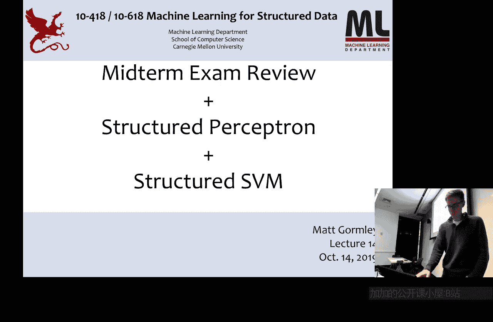
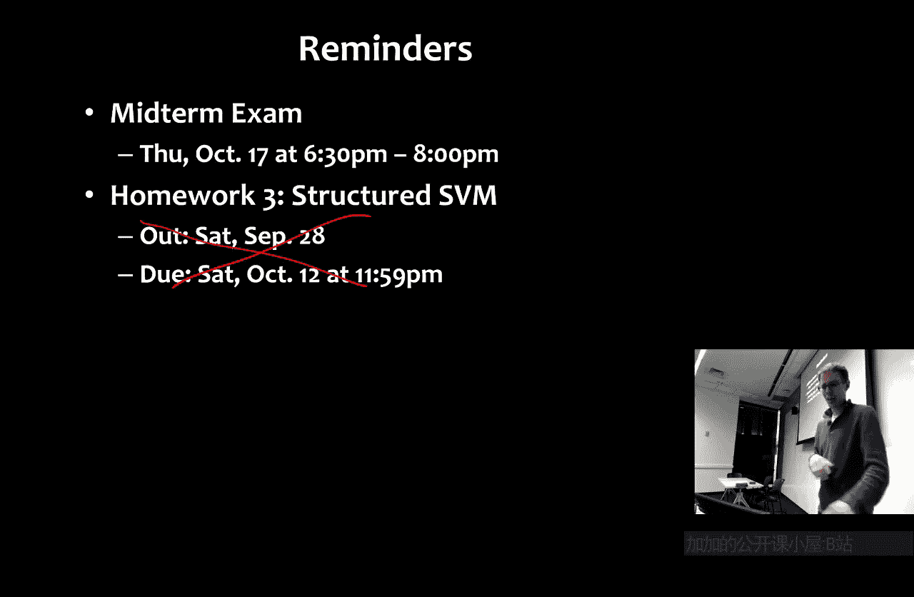
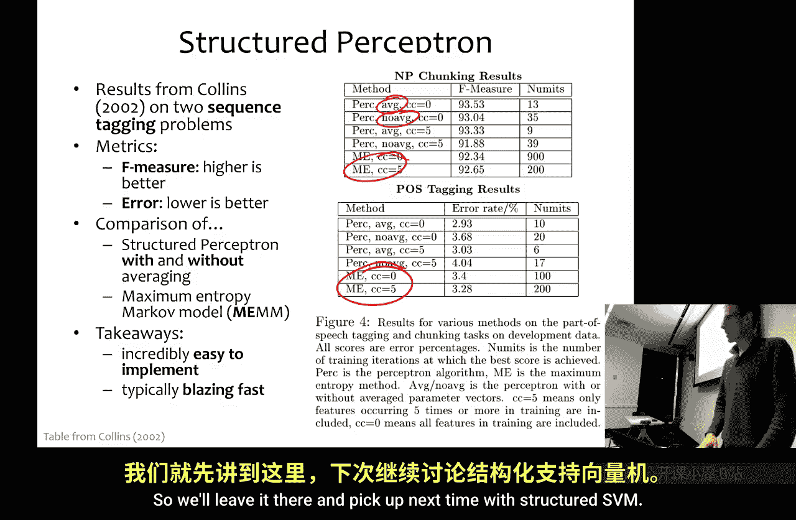

# 卡耐基梅隆大学【中英⚡结构化机器学习｜10-418 2019 Machine Learning for Structured Data】 p14 p13 10-418 ⧸ 10-618 Fall 2019 -BV1eJRsYBEaK_p14-

Very。我。Since18。Today we're going to be talking about。Certainly， the midterm exam。

 we'll do that first。And then we'll begin our discussion of structure perception and structured SVM。

 which are going to be our examples of how。Actually use。As a subred learning。And。

We'll see exactly how far we get， I think we may very well get through books。

スとい。So the exam is on Thursday at 6 30 pm， so I'll see you all there。And homework free。

 as we had mentioned before， isn't going to， oh， that's how。This is completely out of date anyway。

 the point is homework three is going to be released after the midterm exam。So， we'll。

We'll send that out。Probably over the weekend。Okay， so a couple of just logistics。

The time of date I already mentioned， the room is Hamburg call 8301。

 Does anybody know where Hambared call is？Genuine question。Yeah。know what the super computeruter is。

 so from gauge you can get out from that。That goes out to its forms。

The building that's across that way。あオケーオケー。So CIC is the building us on the left and you go follow the loop。

 if you go straight across right the following loop， run on the buildingness。

As thes act that's depends all。Goodです。Thanks for letting us know。And so there will be a sign。

So if you just arrive a couple minutes early， that'll help us sort things out。

Though we'll make sure you get your full 90 minutes if it takes us a few minutes just to find everybody's seat and we'll announce any more if there are any other logistical details。

 we'll use Piazza to announce them。I think this is mostly it。

So I already mentioned that the material covered is lecture 1 through 13。

So this is everything up to and including map inference。And then。

the types of questions should look kind of familiar。

They're mostly of the variety that appeared on the homework， so you have some multiple choice。

 of true false。Sort of very short derivation。Question。Short answers and take place。

English interpreting figures， also drawing figures。Be opening algorithms on paper。

And you won't need an electronic device。そいう。Shouldn't bring a calculator， you don't need it。

But you are allowed to bring one eight and a half by 11 sheet of notes front and back。So。

I always remind people here that there's no research supporting the notion that。

Having such a sheet of notes will actually improve your performance on the exam。

 but it will actually make you less stressed。While you're there， I tend to think that。

This process of actually creating the thing is actually incredibly valuable。

 so just this notion of you going through and trying to distill down all of the things that you have learned。

On to。Into a small space is actually a really valuable exercise。嗯。

So kind of all of the usual exam advice applies， don't leave anything blank。

 solve get easy problems first。If you make an assumption， just write it down。

If don't if you look at a question and don't know the answer。当究的一け。I think the main one of these is。

If you make an assumption， write it down。As you've seen。

 there's lots of cases already where we've written。

problemsblems where we didn't clearly enough state our own assumptions。

And so we're trying to be more and more precise about this。

 but if you notice a question where something seems like underspecified to you， that's fine。

 just raise your hand ask a question， we might clarify it in the moment or you can just sort of write down。

An assumption that seemed appropriate。ok， so。We've already talked about a lot of things。诶。怎么了？So。

Sort of the content that' will appear on the exam。 so you know we've talked about search based structured predictions is where we started and we used reductions to binary classification as。

Sort of our jumping off point to。Get around to this notion of。

It's generally reducing one problem to another。And。From there we。How we could take。

A problem that recastest。A structured prediction problem and recast it as a search problem。

And then how learning could be reduced to training a classifier on that search problem。And then。

 you know， we essentially from there looked at。Very， very fancy classifiers to things like RNLMs。

C bottle。The the entire representation of the state in your search space so far might be reused from time sta to time。

So。This whole notion of decomposing a structure prediction problem into a sequence of steps。

 was only sort of one way of decomposing a problem。

 and so the next way we looked at it decomposing a problem was graphical models。

And so we contrasted a couple different representations， we looked at directed graphical models。

 undered graphical models， and factor graph。And those are just visual。

There's essentially visual location for representing a set of conditional dependencies that hold between a collection of rain。

So then we talked about Bayesian networks， markup random fields， and conditional random fields。

 which。呃。Have a rough correspondence to some of these visual notations。But fundamentally， the。

The models of this list， phase and XMF， CRFs， are just models and you can have one even if you don't have。

The visual notation representing it。And。We also saw that some of the visual notations like factor graphs are capable of representing all of these kinds of bumps。

So。From there， we actually said， all right， well。This is great。

 but we actually want to learn the parameters of these kinds of things and so here we thought。啊。Well。

 just to kind of keep learnings。Sort of in its simplest possible form。

 we restricted our attention to fully supervised。Great where we observe all of the variables present。

不宝。And so， this gave rise to our discussion of fully observed Bayesian network learning。

 fully observed MRF and CRF learning。Which were gradient based。

 whereas the Bay net learning we saw was kind of count based。And。Further。

 we saw that in order to even talk about learning。You need to have some notion of how your network is actually parameter。

What is the mapping from parameters to actual scoring？And I think of note。

 we've been looking at this particular case where we have neural potential functions。

And what this allows us to do is kind of get the best of both worlds。

Deep learning and graphical money。And so。呃。The last thing that we looked at was exact inference and here。

We thought about these three inference problems， computing marginal probabilities。

 computing the partition function and computing the most probable assignment。

And we looked at variable elimination of belief propagation in the some product case for solving the first two of those inference problems。

And then we saw that the max product BPP algorithm end。

Map inference by a mixed inger linear program could handle the third inference problem。So。

At this point， okay so next we're going to look at some sample questions， so we'll get there。

 but at this moment I think it's actually good for us to pause and to look forward a little bit to what it is that's coming after this。

 sort of what are the parts of the story that we really haven't yet told。因为。Fundamentally。

 the main part of the story that missing care is。So I guess maybe maybe I'll highlight a couple points so one is that we've really only looked we've only sort of scratched the surface on search based structured prediction。

 there's a lot more algorithms that we could talk about in that space。

But I think that we've kind of hit on sort of the most fundamental of them。So。

In the graphical model space。This restriction to， oh， and so I guess I should say a couple。

Of search based structure prediction。 So specifically we， we also in that setting。

 we're sort of assuming that。For example， the oracle policy that we have。Access to。

Wasn't actually optimal。But there are other imitation learning settings where you might not have。

An oracle that is exactly the or that is known to be the best you can possibly do。

So think about an example like ad placement。So this is like a。投定。Billion。

Multti billionllion dollar industry。And the way that people often place at。Is some combination of。

So machine learning rules and handwritten rules， because the handwritten rules actually determine。

Part of the decision process， which is where do you actually want to put these things on the page？

So if you have a rule based handwritten。Notion of how to place ads on a page。

That gives you some notion of a probably non optimal oracle。

 maybe we shouldn't even call it an oracle， or you could just call it a teacher at that point。

And so you could imagine a slightly different learning setting where you're trying to learn from some teacher。

 but you actually want to do better than a teacher is doing。

So this is an example where we could go beyond sort of what we've seeing in search based。

So in graphical level learning， you know， we've restricted to this fully observed case。

 but I think that a lot of the power of graphical levels comes about when you're in a low resource setting。

 so you're doing either unsupervised learning or semisupervised learning or you have。

So those two usually。Cture sort of the simplest possible cases of partial supervision。

 But there are once we。sortrt of describe the setting in which we observe some variables and don't observe others now there's lots of different ways that we can talk about partial supervision that don't necessarily fit into the paradigm。

And70 supervised learning。With some examples label and so on。

So that's an incredibly important thing to start thinking about is how those learning settings will evolve。

啊，但们。In the context of inference， we've seen that， okay， there exist algorithms。

Like variable elimination， sort of a mixed integer linear programming solution to map inference prints that can solve these problems for arbitrary graphical models。

But。We didn't say that they were going to be fast。And so in practice。

 most of the time when you're using an interesting graphicmal model， we're not using exact inference。

 we're going to have to resort to methods for approximate inference。And。

So those methods will include sampling methods， they'll include things like things kind of like relaxations of integerline programming like dual decomposition。

 they'll include。Broader classic methods called variational methods。

 of which only propagation happens to be an example。

 but will delve a lot more into what variational inference actually looks like。嗯。呃。As well。

 there's sort of this collection of deep generative models。That has become really popular。Recently。

 that have their roots in。Variational inference。 so we'll also look at this case of variational auto encoders coming from from the perspective of。

How inference is actually carried out。These sort。So that's a lot of both what we've done and also where we're going。

Okay， let's look at some sample questions。Okay， so啊。

Sopri is you're training a seat to seat model for supervised POS tag。

And let's say that the inputs to your encoder are E1， E2， E3， and so on。

And then your inputs to your decoder， maybe we should be drawing a little picture as we go here。

So here's your encoder。Here's shes good odor her， this is how I would be。Solving this problem。

That were given to me。So here's E1。E 2， E 3。And then decoder has inputs D1， D2， D3。And outputs，0，1。

O2，03， and so on。And so here we're just asking， you know， describe in words what the inputs。

To the end。Assuming you're training with teacher forcing。And here。

 the task that we're working on is stay a supervised POS bank。フるスピ。Great。

 so what were the inputs to the encoder？Yeah， they might be embeddings of the actual words that we're feeding in they might be a one hot vector representation of the words or just generally some feature representation of the word but one for so the you know ET is going to correspond to the Teth word in the sentence Okay so then what are the。

In English， what about input。Of the decoder。So here I assume you're using teacher force。对。四六个啦。Yeah。

 so let's be a little bit careful here。So why don't we actually answer this one first。

 so you're right that they're going to be the ground truth POS tags。

But let's get specific about what the outputs of the decoder would be。So what are the outputs？Say。

 what is OT？Yeah， it's a probability distribution over。The POS tags for the Teth word。All right。

 great。 So， so here。What is say， DT。So we said that ET is some representation of Teth word。And O T。

Is a distribution。呃。Over tags。For。If word。And Dt。Would be what。

Is it a representation of the Teth Tnic？Yeah， so it would need to be some representation。

Of the T minus first。Tag。Right， so。We would be in some start symbol。For D1 through it's a D1。

Is some start symbol。And then Dt is going to be sort say D2 here would be the representation of the。

The first ground truth tag， and I should， I guess we would need to be careful here to say ground truth。

Okay， so。Great， so here's three more questions。They're the same questions。

 except that now we're assuming that we're using scheduled sampling instead of teacher forcing。

And if you want， if your answer is the same as for Dger forcing， you can just say write the same。

So what would we have for the first one， which is describing what the inputs to the encoder would be？

Same， right， okay and then。Question five， describe what are the inputs of the decocode？Yeah。

give disclosure。Yeah。So， we could say that。Dt。Would just be。Representation。Of。Be。T minus first。

Predicted tag。As opposed to the ground truth tag。Okay， and what would the outputs of the decoder be？

The same。Okay， so。So here's another。Problem， and。So be okay， so some I think。fun。

When copy pasting snippets of。诶。Of Pdfs into。My PowerPoint are getting lost in a calculation to windows。

Okay， so this is why like I'm not going to see these things until I actually project。知吧。て。

So so the things that are missing are just assume that the factors are named Psi a。Si， A B， Psi， A，B。

C and Pi C。And。So we have this factor graph。There's three binary random variables， ABC。

So using the given factor names， we want to write the partition function Z that ensures that the joint probability distribution P of ABC sums to1。

So how would we write this partition function？Yeah。

Just speak of some over all the values of A B and C。So a。啊Time I a time。Right。

 so we'd havesi of asi of。AB sorry of AB c。And Sc of C。And crucially。

 we have to sum over all of these。 And since they're all binary valued。

These are just summing over the sets 01。So here using the given vector names。

 write the joint probability mass function defined by the factor graph shown in figure4， okay。

 so I think you guys all know how to do do that one and here maybe Ali even said you could include the term Z directly in your answer。

 right？嗯。Okay， so now suppose that you have a joint probability distribution that factors as below。

 So here this is a new。Distribution with factors。呃。Like the ones sh。Okay。And。呃。And here。

What we have is。That。TheProb is proportional to the product of these factors。

And so now we're asking you to actually draw the factor graph corresponding to this factorized joint distribution。

So。What would the factor graphic？Actually， why don't you take 30 seconds and jot down what the factor of graph would look like and then describe it to？

あしか。我呃不是I there only do you only choose the。じ、あのさ。呃，都是。

When we're whats some probability when we're doing data schedule have。A previously predict。

So part of the reason that we called it scheduled sampling is because you need some schedule。

Of how to。Over time。Change the mixture of。The oracle policy。The models policy。

So this question is a great one where like we didn't state our assumptions。So we didn't actually say。

You know what。What is that mixture here so if we had just said。Predicted tag。

 I'm actually making the assumption， I guess that the mixture is 100% model。

So hopefully on a question like this， we would have specified。

What the actual mixture distribution is So wrong to say like the of the team predicted tax。

Yep that would be great that would be a much better answer than what I wrote here so if we had said yeah。

 predicted tag。With probability。You know， beta T。And ground truth。

I like this answer better with probability1 minus。Bta tea or something like that。That would be great。

Okay。Okay， so here， did anybody。While we were talking there actually already come up with this thing。

Okay， does anybody have an answer here。你啱号。Why don't you describe， okay。

 so are there going to be some circles so what are？す。Okay， so a uninary factor alpha of x， great。

 are there an edge factor between x and P？诶。Great， I just call it a factor between X，1 and Z， okay。

A coming between Z and W。I。Great。Okay， so basically， we're just。走。Okay。

Does everybody agree with that？Yeah， so what we're looking at then is just some factor representation of the actual factors themselves。

Okay， so。嗯。So here this is a lovely little question。

 so suppose you have yet another factor graph where we actually have the factors shown Now draw a table containing all of the values of a scoring function。

😊，SF QR， which is a product of those two factors。So you could imagine filling in a table that multiplies these two factors together。

So here， then we ask， okay， what is the value of the actual partition function Z for the joint distribution？

Okay， so。Imagine you've just created this table。S QR。

 how would you compute the partition function from it。Yeah， just so the table looked like you know。

 like this little factor table up here， so you have the different values of QR and then you have S of QR。

So if you build out such a table like this。Then you could just take the sum of all the scores here。

And that would equal B。So that would give you the partition function。Okay， so then。Here。

 this is just asking what's the joint probability of a particular assignment to the variables。

 how would you compute that？Oh yeah， do like。Yes， so if you already computed this table。

Just take the entry in that table， corresponding to。Let's see what was it asking for？Q equals green。

 R equals crayon。And。呃。Just pick that score out and then divide it by Z。And there's your probability。

Okay， so then this is asking what's the marginal probability P ofq equals green and here you could just add up the probabilities of。

哦，我这个。The probabilities for which。For whichQ is you。Summing over the different values of R。

So now suppose you run the variable illumination algorithm to eliminate variable Q resulting in a new factor graph with just one factor MR。

Okay， so you could then draw a table。Containing the values of this factor。

So what would that new factor table？Actually， it look like。How many entries would it have？Yeah。

 just two for pencil and crayons。And how would you get the entries in it？It's going to be some。

Table like this。Pencil。Crayon。And what would the value here be？Yeah。扩一方。Exactly。

 so if we already computed those scores， we'd just take the score of。Red pencil。Plus， the score of。

Green pencil。Plus， the score of blue pencil。Great。And there's another marginal probability question。

Okay， so now suppose you're running the variable elimination algorithm on this this factor graph。

And the first variable you eliminate is B。So draw the factor graph that results after you have eliminated B。

 so what would that look like？Let's give someone else a chance， actually here。Someone knew。Yeah。Yes。

The be circle。はいとてる。To。Yeah， so we're going keep these uninary factors， right。

And we're just going to have some new factor。That touches both。And this is maybe what we would call。

M said B for。The factor that we got after eliminating。Okay。

 so now suppose you're running the belief Proagation algorithm。

 how many messages are required to send a message from the factor F ABC。To the variable C。Yeah， too。

 We need this message。And this message， in order to send。That message from factor to variable。啊。Okay。

 so。Another question would be。Is there a Bayesian network question？はくだ。That its like。

 you need all of people。Like messages， so you need just send a message from。所为两。

to assume that you doesnt。Yeah， so this isn't a good question。Well。

 I read this in like a couple minutes before class this has never been used in where， but yeah。

 this would be a bad question there's a lot of reasons that it's bad one would be that we probably wouldn't ask you to run the propagation on a loop graph。

😊，about who people believe propagation yet and then two would be yeah。

's there's kind of this ambiguity， which is like。Yeah。

 are we talking about just the two incoming messages or yeah， is there some notion？So anyway。

 in this particular case， if we made the graph。Acyclic。Then。

Then there might be sort of two unambiguous answers here， one being the two coming in。

 and one being all the messages from some subgraph。Yeah， great question。Okay， so。

I think this is a good question。Is there a Bayesian network that would convert to the factor graph shown above？

就是的。the question is basically， does there exist some Bayesian network such that when converted to a factor graph？

We yield this。So if yes， draw an example of such a behavior network， if not， explain why not。So。

 let's。Let's do a quick show of hands。 How many of you would say。Yes。There is such a Bayian network。

 And how many of you would say， no， there's not。Okay， so how many for yes？How many for no。

How many are still working on it？How many I've not actually because still people that didn't raise their hand。

You should have a good prior here， which is， you know。

 it's probably going to require you to draw a the network just because feels like a better question that way。

U，Okay， so the answer is yes， I think I think I found one。

 did anybody else think that they found one？That works here，あ、そう。Okay。每一次。我是个车。Like this。Yeah， so。

If you remembered how。The factors of it， so I think in some sense it's actually a little bit easier to go from the Baysian network to the factor graph than to go from the factor graph to the Baysian network。

So the key thing to remember is that in a Bayesian network。

The things that we are multiplying together are one term for each variable where that term is the probability of that variable conditioned on its parent。

 So that would be P of a times。P of B given A times P of C given。Be。

And if we were then to convert these to factors， they would look like F of A。

Or if we were to just rename them as factors， they would be like F of。A and B。And F of A and B and C。

不在这回家。And these are the factors corresponding。Okay， any other。Questions， yes。因没有问。那我就开始。So。嗯。

So you'll notice， so let me let me。Delay my answer a little bit because the real answer is I don't know。

But one thing that I'll observe here is that I did not include so the previous example here。Had a。

Had a unitinary factor on sea。So I had to remove it here。Because。In order to make this work。嗯。

I needed。啊，on the。The root。To。or sorry。So in a bay net， there can be multiple roots。

So a root is just unknown know that doesn't have any parents。And so in basementement。

 all of the rhnos。you know。And there wasn't a way for me to。Get back。A phasenet that had both A and。

Go。This particular set of public。So。So the reason is basically like there was only one possible child B for both of those roots。

 and yet there were two factors for it。So those two so in this case， I mean。

 one way that we could say that there does not exist at A for this particular graph。

Is that there's just too many factors， we know that there should be as many factors as there are variables。

One for each variable conditioning limits。So if the factor graph。

More factors than there are variables。It can possibly be that。This would be sort the correct factor。

So whether we can do that more generally。I just haven't thought it through either。So good anxious。

FM to that。To that factor graph because I thought you could convert any。Bnet。我人去了吧，是吧？

You can so you can have more。Potentials跟。So we can always。

More factors in a factor graph than there are。But。I guess we described sort of one specific way。诶。Oh。

 so yes， so let me be careful about my statement from before so possibly。

What we could do here is we could say that。嗯。Let me see if I can do some gymnastics to make this work。

 So with this new factor graph。We could say there's a bay net that looks like this。Okay。

 where we define。P of a。Or sorry， F of a。Is equal to P of a。诶。F of C is equal to P of C。

 And so here's the odd part， right， So I can， I can go the other direction。

 And I could say something like。P of B， given A and C。

 we could actually define as the product of F A B。Times F of ABC。

So long as this was a properly normalized distribution。

But it feels weird to go in the other direction。So。Yeah。

 so so in the particular way we set things up in this class， there was a specific way of going from。

A bay that to a factor graph， one factor per variable。And so while I， I could potentially， so。

 so basically like。A different question would be， does there exist a Baynet？

That includes the same conditional independence assumption。As this factor graph。And in that case。

 I would say the answer is yes。This one。I'm not sure know this。本。Thement in Jordan。对。

He was creative with new nodes。For any factor。HeWas able to make。安定す？你。哦。But I on to。

For any undirected？No， no， no， so did he go from undirected graphical model to Bsnet or did he go from factor graph to Bnet？

So I would guess that he went from undirected to directed。

And so I guess what I'm trying to get at here is just that this particular question is constrained by the fact that we said。

You know， is there a baysnet that would convert to this vector graph if you were just doing sort of the standard conversion of Bsnet to factor graph？

And so that is a different question then。Can you encode the same set of conditional independence assumptions between two。

Two factors， that。是没电吗？Determinine conditional independences from。Oh， good question。

Should you be able to。Yes， like so I think like right now we have。

I think we have like two such questions。can think up on the exam。It's free after free， surprise。😊。

And I think they're like very simple。 So what I don't want you all to do is like。

Spend the entire week。Youre trying to deeply understand。How to。You know，P performed。

Like every possible notion of de separationparation in any factor graphic or given。

 that's more of like a homework style question you can get like the if you can remember the very basic of de separationparation to perform them on a tiny graph。

That's sort of what we do。呃我也没什么详写。Thank you。Of Beijing。Like apply those rules。

 or we should we be able to from this。Oh， I huge me so I think。呃。

We I guess we didn't spend a whole lot of time talking about conditional independence assumptions on factor graphs mostly。

So we did， we talked about them not in terms of de separationparation， but in terms of。

Say Mark out blankets。And then sort of the general separation property of undirected models。Yeah。

 so usually basically like the main thing that I think is。

Just moderately tricky is sort of deseation on basement。

And then the other properties like Markov blankets and separation of undirected infected。

Visual inspection。Other questions。咁即间先我。Yes， you would。

That's why so that's why I asked the question this way right so this way it's like we're avoiding。

The need to enumerate every possible。诶。Conditional independent assumption for each gra。So I again。

 like。あ。ItIt's a great homework problem where you actually have to kind of think through every possible one。

 but we probably wouldn't。Ask you to do some lot of information like that。

Though I guess I shouldn't rule that out yet。Anything is fair game。

That seems like the type of question，Would steer away。Does it means every factor。选咩。Bpir。So， I mean。

 we just established that。啊。Essentially， when adding this additional factor。

 we said there there's no Bayesian network that。If you just sort of follow the standard way of converting a Baysnet to a factor graph would yield this one。

That room more in general。You have two pair。And it's like， hey is like。Eancy is also like。所以。现。

I think least shouldn't go there。I remember if that have a。Yeah， although if we got rid of FAB。

 then we're fine。So in that case， there's still。我那会我也。That' hear baby。The use of AC。

A see still connected。呃。But C having a margin probability means that it should be a。

 it would have to be。But it could still participate in other factors so long as it's just not connected。

Yes， that's right。 Oh， yes， So that would be another rule。Great。

Okay so this is why I did not promise to get through both structured perceptron and SVM today because I wasn't quite sure how long we would end up spending on this。

 but this was time well spent and so what I want to do now is move into our first look at structured perceptron。

And。Yeah， we'll get through it so just a reminder that what we did last time was we said， okay。

 if you have this， you know， MRf you could or in this case， CRf， you could rewrite it。And。诶。

It is really really your program。Where we now have these indicator variables that are telling us whether or not。

A variable is taking a specific value。We did an even more compact representation sort of in our notes where we had one variable just saying。

 is this variable equal to one or not？We're just taking on the value of the variable equal zero。And。

So。So this allowed us to then write down this map inference problem as an integerlinear program and so now what we want to do is think about how can we use that map inference program inside the structured perceptron learning algorithm。

So to do that， we're going to start by just。Sort of doing a quick refresher。On。Linear models。

So here our setting。Is that we're going to assume that we have training examples。Which are。X。

 Y pairs。Where。We're going to say that X。Is some vector， say of length M？And why。

Is some integer from1 up to K。And。So， our model。For just sort of a standard linear model is going to have parameters。

Which we'll call theta。Oh， actually， sorry， let me make a small change here。

And just changed in my note， I just wasn't looking ahead。 So X is actually going to be。

A vector of length P here。And the parameter vector is in the up。就。In addition to parameters。

We're going to assume that we have some feature function。

And that feature function is going to be some F of。X and Y。That returns a vector of lengthham。

So to make a prediction。We just returned some white hat。This is our decision function， H theta of x。

 which is the arg max。Over all possible wives in the set。one of the key。嗯。Data transpose。F。あてわ。So。

 okay， so let's let's just think about a couple examples of。These feature functions。

Because it's useful to see just how general this setting is。One such example。Would be。

So should be example one。We're going to say that。Here。F of the vector X and Y。Is defined as follows。

We're going to make a big matrix。And。That matrix is going to have。Bun of rose。

Most of which are just filled with zerorus。But then， in the middle。

There's going to be a row somewhere that contains the vector X。1， x 2。Up to Xp。

And so this matrix will say is a。K by P matrix。And。It's defined。So that only the。Whyeth row。

Its not here。So。So you can imagine having these row numbers。And it'll be like row 1，2。Why。なて。게임 많이 뭐。

Okay。Wise。The current class that we're constructing this feature vector。Now。

 I promised a vector here， so。What we're going to do is wrap this entire matrix in a function called vectorize。

Which is just going to take this matrix and stretch it out。Into。How long。Vectctor looking thing。

Like that。就。This vector is just going to stretch this out。And that would mean that。呃，嗰当有。

It's just equal to k times P。So the number。Gs we have。

Is equal to the number of classes times the length of that factor。So。呃。This is cute。But， honestly。

Didn't really accomplish anything interesting。All it did was。

We just took kind of the usual way of representing linear air model。

So its like we could have just had theta B sum matrix。Everything we could have said。

 we're going to take。Theta sub y， the y is row of theta， and won't take in stock product。Okay。

 so let's look at another example。So this will be example number two。Where now。

We're going to suppose。That。The labels one up to K。Exist。In some hierarchy。And also。

We're going to continue assuming x is a length P vector， but now we're going to say that it's。

Bary vector of length。So。What would a hierarchy look like， well。

 maybe it's something like we have some root node。And then we have。At the first level。

 something like mammal。Reptile。人phiian。And then under mammal， we have both cat。And dog。And。

We could say。Under reptile。We have a turtle。And snake。And under amphibian， we have frog and sound。

So here's some hierarchy。And。So how did this map to one decay well each of these leaf nodes has some label right so we could say you know this is label one。

 two， three， four， five。6， so here， K is equal to 6。And then we could define our feature function。

 so this is now our F of I。And why。To be something like。A collection of binary values。

Where the first one might be。An indicatord。Saying whether or not。X1 is equal to 1 since x1 is binary。

And。Why。Is a。In the subre。没有。And then we could have another indicator that something like x1 equals 1。

And y equals catt， so that's actually a little more specialized。

We could do the same thing for x1 equals 1。And y equals dog。

And we could kind of keep working our way down。 And， you know。

 we would have lots of other indicator features， like maybe we have X P equals one。

And why comes from the amphibians。Suburary。And many more features after that。So here。

 what we're doing is we're basically saying。We could actually take。

Some structured information that we have about why。And encoded。In our features。

Such that now we actually have more interesting parameters than we did before， right？So。For example。

The original linear model setup that I did before， it would have a parameter for each of these cases。

 right？The X1 feature was one。W was equal to dog， there would be some feature that would be added into the do product in example number one for that case。

But the new one， the interesting one that we added here。

Which is sort of like a back off feature that's basically allowing us to capture some interesting notion of。

The fact that。YouWe're a little bit unsure we're not。Exactly sure， you。

 but we don't even care whether Y is cat or dog， there's some really useful information encoded just for the case that Y is a mammal that's sort of shared for both cats and dogs。

And so you can imagine if you were regularizing a linear model like this。

 it would be useful to have these sort of backup features because you might be able to get more out of the actual classifier。

Okay。so嗯。What we're talking about here isn't going to be restricted to linear models。In fact。

 what we're doing here can be applied to sort of much more complicated models。

 but it's useful to kind of have these in mind as a starting point。Oh。

 there's another example of a linear model just like this that already came up in this class。

 so any of you remember it？Homework one。So you guys have actually seen multi class perceptron before。

It showed up。Sort of by accident on homework 1。Where set we had set up a particular problem one way as a binary classification problem。

 and then we switched over with a feature function to be a function of x and Y and broke our ability to use standard old binary for subtract。

Okay， so here's the key idea。Of multiclass perceptron。If。The prediction。Is incorrect？嗯。

So that would mean that why hat？Does not equal。The true why。Then。The idea of。

This is that we're going to increase。The score。嗯。What。And decrease。The score。呃我 hat。Okay。

 so what does the algorithm actually look like？So。We're going to say that we have some initial parameters。

我咁 theta。That we set to zero。And。W， we have not converged。We're going to say。For each X， Y。In data D。

We're going to compute。Why hat't。To be the argument。Over the possible values of one。

 which are going to be。K from the set one。Up to saying capital pay here。Let's just use J。Cl。

5 Jane at the class。And then we're going to compute theta transpose F。X。Class J。Yeah好 yeah。

We think of us。And if。Why hat does not equal the true why。Then。We're going to。

Make an update to the parameters。And our update should be such that。We increase the score of。Why。

And we decrease the score。Of why系。And then at the end。When youve converged。You can return theta。So。

是内四多好时。嗯。And。So now we want to ask the question， how does this all fit in with structured prediction？

So， for one。The algorithm that we just set up。Is actually。Both the multic perceptron algorithms。

And also the structured perceptron algorithm。So here this algorithm is the same。As multi class。

Perceptronomy。Each。あ。Possible。Output structure。 each possible why。From the set， y of x。As a class。就。

I mean， I put class and quotes here because basically what we're saying is you could imagine。

Ennumerating every possible structure that exists。And you could imagine then encoding。

Each of those structures as a class。So let's think about what the training examples actually look like。

 and then let's think about what that encoding might look。So training examples are again， X Y pairs。

Where。是。The vector X。Is again， R P。And the vector Y。Is say Rt。And。As before。

We have some feature function。Which takes。And X。And a why。And。Returns。あし。阿け好啊。A vector。呃不会。So。

Essentially。What we're doing。Is we're saying。If you like this notion of a vector em bedding。

We're saying come up with。Some function that you designed yourself call it F。That takes an X。AndW。

And gives you back a vector representation of that X Y。And then。We're going to。Make predictions。As。

Why hat。Equals arg max。Oh， and let me be sorry， a little more pedantic， so。Instead of saying that。

Why is an artia。Let's just say that why comes from。十四。hyhy。A tax。And if we want to。

We could call this vector X。So。Cliographic。And this is fine。

 we're just sort of using it to do as you're looking out。Let me do that the other way， right。

So let's go ahead and say the X。Its from the set callliographic X。But in practice。

 this is probably just some。Feature vector reling。But the exact specification of what x is。

Doesn't even really matter。What we care about is that the feature function returns effectively。

And so we could say that we kind of think of this as。Some representation。Of the pair。X， Y。

So to make a prediction， we return。The white hat， which is the。Our Max white have。From the set， Y x。

That gives us the highest score data。This is white。

So this is just a linear model where we've encoded things as a feature vector。The gal market。

X could be。Why， sorry。Good be。Tres are。请拿我。Prection has to。Yeah， so this is。Yeah，所以诶。You the said。そこ。

Trees。Or。Se。Of Wikipedia info box completions。We the set。Semantic segmentations of an image。So。

In general， what you给。wayay to kind of think about this setting is just one where we're kind of using a conditional random view。

So it would be totally natural。Sort of any collection of random variables that you might use in a conditional random field here。

Okay， so the last detail is the actual algorithm。For structured perceptron。Is。Exactly the same。

Has that for。The multi class case。The only difference is in this line。Where we're computing why hat。

We should just rewrite it as。Why hat？Gets the a max。

Overall Y hats and this is the prediction step that we just wrote。And y of x。Of theta transpose。

Of X and Y。So this is the structured for。And all these other lines。Are exactly the same。

Except for this one。So what we're doing in the structured perceptron algorithm is essentially increasing。

The score of the true y and decreasing the score。Of the predicted one。So the remaining question is。

How on earth do we。Compute。呃。list的。Well。If you think about it。This is basically just。这一个。Nerator。

Of a log linear CRF。And。So， if。F of x and y。Decomposes。Recording。Or sorry。

 let me write it another wave。This dot product decomposes according。To some factor graph。Then。

Solve this。Essentially， map benefits problem。With an M I LP。So the last detail here。So basically。

 so if you define your。Yourre F based on a factor graph。Great， and you've already ensured that。

That it decomposes in this way。And so one way that you could actually ensure that。Just as an example。

Would be you could define。Theta transpose F of x and Y。

Could be defined as a sum over all possible factors or cliques C。And for each one， you're adding up。

Theta C。Transpose F C。Of X and。Some sub vector YC。Where these are。The variables。In say。

 clique or factor seat。So this is one way of ensuring that。

That you get the decomposition that would work out efficiently。Okay。

So the last detail is that just as the standard perceptron algorithm has a mistake bound。

We also get a mistake bound for structured perceptron。And。The， the resulting theorem。

Is fairly similar。 So it says for any training sequence。

 So if you have imagine examples coming along one at a time。Which is separable with margin Delta。

Then the perceptron algorithm， the number of total mistakes that it makes is going to be bounded by R squared over delta squared。

And here， are。Is just a constant that looks at not the So in the standard perceptron algorithm， R is。

the largest L2 norm of any vector。In your data。And here， R is just。The largest of any difference。

Between a pair of feature vectors。So what's interesting is if you think about this difference。

 this is what we're bounding by R。Right。And if you jump back to the algorithm。That difference。

It is exactly。This F of x minus y minus f of x and y hatt， what we're taking here。So the fact that。

So in the standard perceptron algorithm， we would be adding in or subtracting the feature vector here。

Whereas now we're taking this difference。Is exactly why we end up with R being the same way there。

Is it the norms of that？Yeah， sorry， these bars are。This is an L2 norm。有。So。The last detail。

 since I already kept you late， I'll take you one more minute。

 so the results from this sort of landmark paper in 2002 were for these two tagging problems。

And basically， the finding was just that you could do the structured perceptionceptron on these tasks and outperform a sort of now antiquated maximum entropy Markov model。

 but the reason that I put this slide up is that there was this trick。

Which was to actually average the parameters that you see during training and this averaging trick is actually really important to sort of successful use of this。

The structured perceptron model and it ties back just to the standard average percept。O。

So we'll leave it there and pick up next time with structured SVM， see you。

