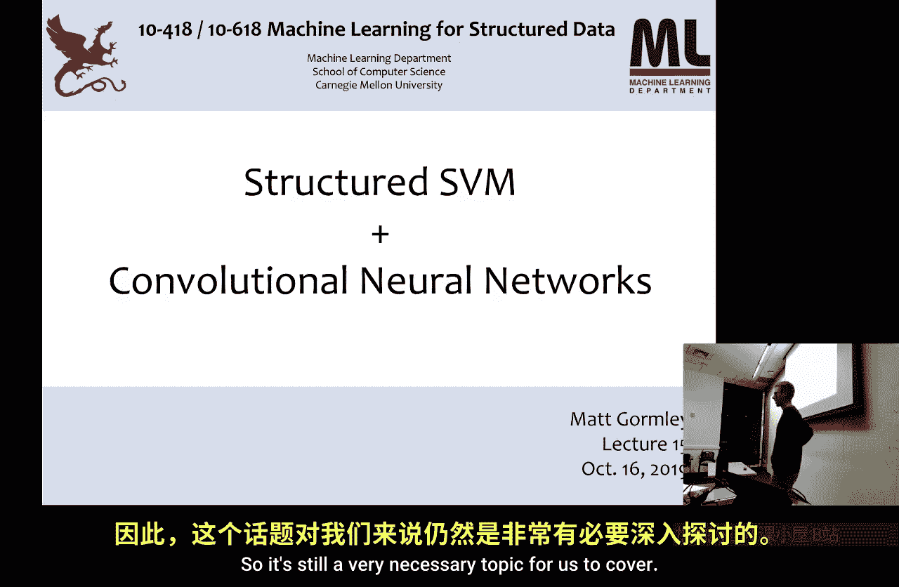
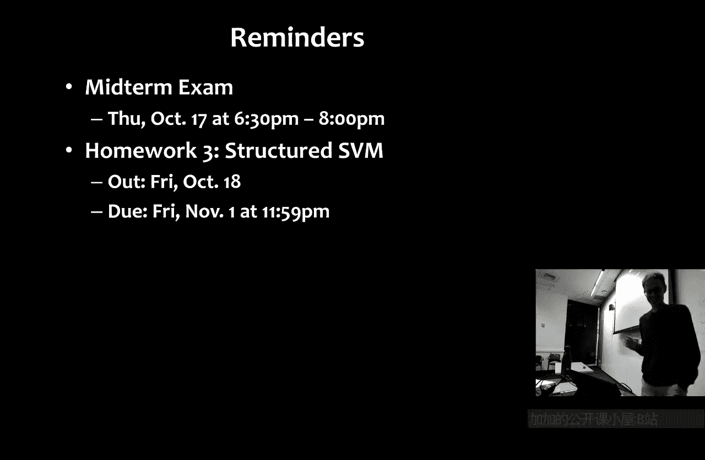
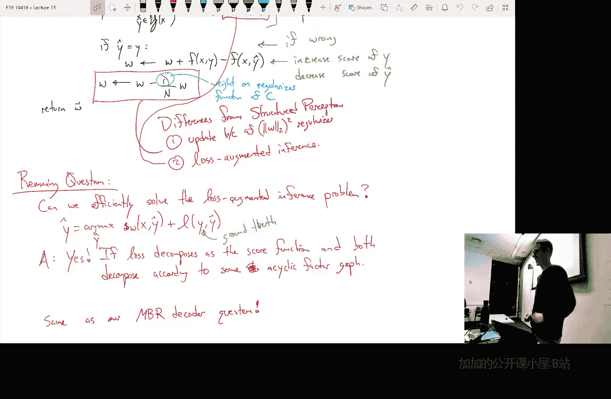

# 卡耐基梅隆大学【中英⚡结构化机器学习｜10-418 2019 Machine Learning for Structured Data】 p15 p14 10-418 ⧸ 10-618 Fall 2019 -BV1eJRsYBEaK_p15-

不。Let's get started here。Today， we're going to be talking。About structured support vector machines。

And。From there。公会讲。先はかでしょう。Andか。I guess in some sense。

 I guess I think of CNNs as essentially now like。就是呃。Required background。In order to。

Have any sort of discussion about computer vision today？

And so although many of you have actually seen CNNs before， many of you haven't so it' still。

た。So。😊，The midterm exam is on Thursday。Please be there a few minutes early just to find your seat。

And these are now。So of our new plan for the dates of homework three。

 which is to release it after the midterm。I think we have yet to actually release whatever the day that I say we will is。

 so you could probably add a couple days to that to get the actual thing。

Okay， so let's talk about structured SDMs。So the idea of a structured SVM。Is。

Basically that we want to。Sort of extend the notion of a standard SVMA。

In the same way that we sort of extended the notion of。A perceptron to the structured case。Here。呃。

What I actually want to start with is just a。Sort of an initial discussion。Of。

Sort of a standard binary SVM。Just so that we can kind of。Swap that back in。

 but also establish just some shared notation around this。

 So we can kind of think of this as our warm up。Thinking about SVFs。And。

I guess the first thing that we want to do here is just set up the standard quadratic program。

That one would solve。For or QP。To get back。诶。A support vector machine。

That maximizes the margin on the data set that you're given。

So what this would look like is we're going to minimize。Over our。Wt， vector W。Our。Slack variables。い。

And the idea。We have two terms in the objective。One is the L2 dorm。OfW quantity squared。

And then the other。我。A so。Over slackck variables where we have one slackck variable。

For training example。And。This constant C is just a paperparmeter。That allows us to trade off between。

Maximizing the margin on the one hand。Minimizing the slide。The other。So。

We have some constraints here that we want to enforce。So。Namely， we want to say that。

Each example is going to be correctly classified by some margin。

 but we're going to inject these slack variables so that if it's not correctly classified。

 you can still find a feasible solution here。So。Here。Correctly classified。

Just means that the predicted。Score。Is the。Same sign as the true。诶威 for啲 example。So。So here， maybes。

Good just a。Make an actual statement about the form of our data。So， we could say that。而这个。Con。

And training examples。Are these X IY high pairs？嗯。For each one。X is just our feature vector。

InInal space。And why。Is。Either plus1 under minus。So with that statement in mind now。

We can look down at the constraint that we're about to write and say， well， if Y I is plus one。

And W transpose Xi plus B is positive。Then that whole quantity will be positive。If yi is minus1。変？

Prediction W transpose x y plus B。Is negative， but that whole quantity will be negative or sorry。

 that whole quantity will again be positive。And the only time it'll be negative is if they。D in some。

So what we want to do here is constrain this so that。

This quantity is greater than or equal to 1 minus our slacklack variable EI。

And we're going to have one of these constraints for each of our training intake。

And then the last detail is just that。Each of the EI variables。

Is going to be greater than or equal to zero。So this is the standard setup。诶。For。The SVM。

And we could say that the actual model that we're working with here is just going to be a linear model。

Predict。hy。Just sell。WB of X。The art man。why and。Plus1 minus-1。Were sorry together。So just a sign。

W transpose Xi plus。So。Once we've set things up this way。Now we can actually handle data。That is。

Not linearly separable。So if we have a bunch of plus points。Over here。

At a bunch of minus points over here。We'll be able to find。A decision boundary。그な覚で。Maximal margin。

But we can also accommodate the gate where we might have some plus。

On the other side of the decision boundary。What's the minus weight。Over here。And in that case。

The slacklack variables。Are going to， essentially。Correct for the fact that。

WI or YI terms W transpose x plus B for those examples。Is actually going to be some negative number。

And so。When we get that or it's going to be say less than one。And for that case。

Will actually allow this EI variable to grow。To some value， greater than0。

And this allows us some flexibility。To handle these this not linears。No nonlinearly separable data。

Okay， so the other thing to remember about SVM。Is that？

We can actually reformulate it in terms of a hinge loss。So a hi loss。Is a one function。那我可。

A true wine， and a predicted white hat。因。We define hinge loss to just be。A max of0。And one minus。

Why things why。So。呃。This is a useful notion for us。Because。Now we can actually come up with。诶。

New optimization problem。That is unconstrained。So。呃。The key observation here。Is that？We can。

Rearrange。This constraint， that's try to make sure that every。

Training example is correctly classified。So the EI is served by itself。

 so that would look like EI is greater than or equal to。1 minus。喂诶。helello。W transpo。X I plus B。

And this。Is。Something that we could just serve。Think of as。At least having the same sign as why hat。

so。So what we have here is that we're trying to minimize the sum of these slackla variables。

And we know that all of the slide variables。Are going to be either greater than zero or greater than this one。

So we have that。いや。Yeah， I agree that equal to zero。So putting these two together。

We get that E I must be greater than or equal to。The max of those two。The banks of zero。And。

One minus。喂系。Times W transport X I。Plus three。So。We can rewrite the problem。As a minimization。

Over just W。Where now we have the term as before。That is。Minimizing the L2 norm of W。 And as we know。

 you know， minimizing this L2 norm of W is equivalent to maximizing margin。But now we have。

This additional term。Which is C times。A sum from my equals1 to n。But this time。

 we actually take the hinge loss。呃。Each of these。Slak variable。就。

This is going to be the max of zero and1 minus。Yi times the prediction W transpose Xi plus B。Good。So。

What we're trying to do。Is get back。A model that has。Large margin。And。That has。Few slash small。Ps。So。

There'sBefore we jump to the structured version of this。There's an interesting connection to be made。

Once we've actually formulated the problem。This way。So， let's look at。Two loss function。So here。

What we what we're looking at is。呃。The SVM problem。Oh， and actually， I guess we're。嗯。Yeah。

 this is fine。So what we're looking at are。Essentially， the same sort of setup as before。

 except now you could think of this FiI。Function。F I of Y I。

Is equal to some feature function applied to。Xi。And why I。

So this just kind of keeps things a little more up。

With this notation so we don't have to write out all of the x's。So what we can look at is。That诶。

On the top， we have the SVM problem where。What we're doing is。啊。Saying that we want。

The difference of。The score for。Oh you know what， though maybe I should come back to this。

 We haven't talked about loss augmentation yet。诶。Okay。

 so I'll make the observation now and then we'll come back to it again after we talk about loss augment。

But basically， what we're trying to do is say the score for the true thing。啊。

We want it to be much more than the max of the score。For any other why？

And what we're looking at in the bottom is what you get if you were trying to do。

 say L2 regularized logistic regression。Where again， we have this WL2 norm term。

 that's the L2 regular answer。But then on the right。

 we're looking at the log likelihood of a log linear bottle。And so here， again。

 in the numerator for the lot linear model， you have the score of the correct。Fification。

And then you have the log of the denominator of， say， multinomial logistic regression。

Which is just summing over all of the possible output classes Y。

 and for each one taking x of W transpose。怖い。就。These look really similar。Except that one of them。Has。

A max。Over all possible why。And one of them has。This log sum X。Over。All possible。So in both cases。

 we're trying to push the score of the correct thing up above either the next highest scoring thing or above。

啊ever。That appears。O。So。So how do we get to the structured group？嗯。对呀。In addition to。哎住哪？In fact。

 it was negative sign。Oh。Yeah， so here they don't have a C。はい so。嗯。

So they don't have any way of flipping the sign。This，So I guess maybe。

I don't actually know what convention is。Maybe。Your reading actually uses plus。I used plus。嗯。

So to me， the。Plus， is more natural。 Oh， I think maybe it's because of the max。With 0。呃。Yeah。

 so we should come back to the slide after we do the structured SVM version。嗯。And。

Let's look at it again then。 So what I wrote here， though， I definitely trust。

Because what we did here was we said， we're trying to minimize the L2 norm and we're trying to also minimize the sum of these slack variables。

 You want those slack variables to be small。And as well， here。

We also want to minimize this hinge loss。But I think what's happening in library。I they're saying。

 well， okay。There's going we're going to end up in a situation where we have this negative in front of。

The actual thing。The actual scores。 And so I think they're just using that negative sign， but none。

Hyperpar to trigger。O。So。Okay， so the next thing that we want to do is look at just。

A slight variation of the SVM model that we already saw for structured perceptra。So the new model。

That we're going to consider here。For structured NN。Is。We're going to assume。A linear bottle。

And here that would look like。呃。Why hat？Oh， and。We're also going to。呃。Go ahead and。Describe our data。

So our data is going to be。As before。This collection of X。我。Theres。But now。XI comes from some。

Set calligraphic。Under why I comes from subset。呃。Ctographic。えなたくさん。

So the actual set of structures that's valid is constrained by the X。So。

So if this was part of speech check。The sequence of tags says your output has to be the same length as the sequence。

It this yours。And so we're assuming a linear model here， this just means that as before。

We would predict why hat as an argmax over。哦。Say all possible wise。For a given X。

 and let's go ahead and。四。That why hat？Is。The output of some function H of x。So， here。

We have R maxs over all possible Ys， where for each one we look at。W transport。Some feature function。

过。So this is the same setup that we had last time where we can now have features of the XY。

So you could think about what we're doing as essentially building up to multiclass SVM， right。

 the same way that we were thinking about building up to multi。是这事。

But here I'm kind of skipping that intermediate step and let's just jump straight to thinking about this as there being exponentially many sort of possible outputs in the setYx。

As a function of the size of x。咁日。So here。What we'll do as well。Is。This W transpose F of x and y。

We're going to call this。Score。S sub W of。X and y。This will just be。The score。A particular x pair。

So what's interesting about writing it this way？第个。For now， we're just assuming linear models。

So that it's really apparent。Where the parameters are， what the features are， what's going on。

But everything that we're going to do here is just going to lead up to the definition of a particular type of training objective。

And。If your scores were coming from somewhere else， it's like a deep neural network。诶。

Or some sort of。Interesting st version of an SV。Then we can also make this work in that。

but let's stick for now with the linear version。And。So here。

We're going to want to set up another quadratic program。And this time。

The quadrata program is going to look pretty similar， but there's going to be some important changes。

If our model or data。Okay， so we're going to minimize。Again， over W and our Slack variables E。

And the first term is the Lt norm of W。Square。And the second term is。Our hyperparameter C。

Times a sum。From i equals  one to the number of training examples。And another song。

But this sum is a little more interesting， It's going to be over。哦 the possible。1 is。

That you couldn have。Or the highest。这。It this is why in。Calligraph。Celegraph y of Xi。

So inside that sum， we're going to have。We're just going to be adding up our slack variables。

 which are the EI。开个过嚟。Values。So what's changed is now we have one slacklack variable。

For every training example。And every。Possible， why。You could get for that corresponding XI。Okay。

 so suddenly this is a lot of。Slack variables。我调 them them咩。嗯。And。

The constraints that we use for a structured SVM。The key idea is that we want。To have。嗯。

The score of the。Score of。The true。Why。H于B。Larger。诶。The score。Of。The predicted。喂系。

So this is sort of the basis of what we're going to be doing here。And。

So now we can come in and say that we want。The score。S W of。X， I， Y， I。To be。

Or the difference of that score。With the score。Of every other possible。啊我看。Okay。

 so let's just pick one of them。So if we take the difference between the true thing。

And one of the possible things we could predict。We want that to be greater than or equal to1 minus。

E i。And so actually， just to be consistent here in this first description。

 I'm actually going to go back and。A little hack to those wives。And then， as before。We want that。

The EIY hats。Are greater than or equal to zero。Now， here's the key that。That first constraint。

In the second constraint。We're going to want both of these。To be for all I。And。For all。Why have。

In the三。hy。Calligraph Y of X。So let's think about what it is that we're actually saying。

So what we're seeing here。Is that？If we were to。Sort of line up all of the possible。

 So let's say that we have a word。Or at let's you part of speech。So， we have。W is bad。没有。

This is our Excel。えラごいな。Something like。系。And。So what the structured SBM is actually doing。

Is it saying， okay， well， let's look at。The scores of all possible， different tags。And what we want。

So here's why I， but here's。Another possible white。Which would be， we could call it why hat。

Subscript 1。佢家一佢啲。呢边。And why had two。佢别一为。3。诶啲嘢。So for each of these different possible。

Labelings of the sentence。What we want is for。The score。That's a。X I and。

Whichever of these we're thinking about。We want the score of the Yi to be much larger than the other ones。

So ideally， we have something like this has score。7。And then these ones have scores。For。

And so if we look then at the difference。Between this pair。The difference is。

Plus two in favor of whye。And the difference in in this pair。検在？Plus 3。The difference this activity。

Plus。啊。So the problem that we're trying to solve here。It是 the。Choose parameters， W。

 such that we push。喂系阿le得讲个时间。And so we're essentially just enumerating every possible。

Sequence of part of speech tag。And constraining each one to be worse than the truth。So。

Here's where you should start feeling uncomfortable。Because， oh yeah， go ahead。

So our v year is basically three dads， right？For that there cannot be any be in there。Yeah。

 I mean I guess really maybe this list actually keeps going， so if this list were sorted by score。

 then hopefully we would have。Like let's imagine it is。诶。So， let's just say。sorted by score。

So in that case， yeah， we might actually have。An additional Y have four。我会有。Why have。

But these are all。Lower scores。 Maybe the last one is like a score of negative。Yhy4 and score。

So there might be many other possible tag。And we just need to make sure that the true one is scored high。

So when you said that why hat is。why。That exc I just click on on the length。Oh yeah。 in this example。

 it would just be on the length of the taxi。So。There's lots of other things that we could have here right。

 so if we were doing some sort of。Object detection plans。You know。

 maybe we need to have the output variables。Bounding boxes in images。

 and so the bounding boxes need to be within the ring。Of the actual pixels of the image。So。Just do。

Another example here。So。Rebounding boxes。This would be like。

We'll be taking a look at these later so if you have some。Image of a tree。

And we're trying to come up with。Valid bounding boxes， this first one。好 that be one。So B1。

 So x is the actual command。And then be one is in。W。Okay， but here， if I mean another bounding box。

this。Call that B2。 B2 is not。It's just an invalid ending。So depending on the actual problem。

 we'll have a different definition of y X。そ here the white。个て。Oh， whoops。Yeah。

 so we need to be more careful here， right？So this needs to be the set。So well。

 I guess there's sort of two ways that we could do this。So one is we could just say that。嗯。

Just leaves the set as is。And then you're just going to have some slackck variable。

Which is for the actual training example itself。And that slack variable is always going to be。

Equal to one。Like so there's going to be one slack variable that just has to be equal to one for every single training。

So I kind of prefer that way， the alternative is we could go back here and we could say this is the set y of X I。

And then to just remove。Why I from it。So it's everything except for that。

诶 which should also be put down。That's going to be white eye when it appears。So。

So this looks like a nice idea。嗯。So here now。I guess I have a question， which is。How many。

Constraints do we actually have？In that actual QP that we just wrote down。I mean。

 we just wrote down a whole lot of constraints and the question is。How many of them are there？😔。

Where equivalently how many slack variables are there？So how does we write down？大。

A number that captures that。这诶你分咧做。Yeah， so for a part of speech tagging example。

It's going to be n times something。So。Let's actually give two answers here。

 so let's give a general answer first。So the general answer is。It's going to be n times。Basically。

 however many things are in that summation over those white hats in。right。

 so we could write that as this is just n。The max。Over all by。OfThe size。Why next。So。Basically。

 pick the largest size of。诶啊但系。And then we can just say that。系啊。Total number of constraints。

At least big of this。우런 애 때 기억。If we wanted to do。Say an example here。For。P O S tagging。

On only sentences。Of say。Length 23， which is the average length of， say an English sentence。In say。

 Wall Street Journal text。Then we would have。Something that is。关个 be。The number of examples times。

Well， here we're going to have。The total number of tags。There's often。And let's say 45。

So that would be n times 45 to the 23。We have1 thousand examples， it's 100 times 45 to the 23。O。

So this is useless then， right？We can't possibly。Actually。

 give that quadratic program to a quadratic programming solver。So how do we fix this thing。All， well。

 how about before we fix it， let's actually make it slightly more complicated。

So I want to add an additional sort of key idea here。Is。

So we said that we want the score of the true YI。To be larger than。The score of the prediction。W I。啊。

Buy some margin。And in this original version， we just use one。

Which is going to get us that standard margin。 But now I want the margin。诶。To this scale。By our loss。

So what we can do is we can take the exact same quadratic program。Thatle before。诶。Replace。This one。

With the loss。Wfi。嗯过系。So this is actually a。Fascinating change that we've just made here。

Because what we're saying is。Now， we actually want。Mararin。To be larger。

For cases where the loss between。The actual prediction。And the true。Why I is high。So for example。

 if we had。Back to our example here。要第。If we looked at， say the loss。我系。The predicted value。

Then for the first example， the loss is just zero right because it's exactly the same。

 And let's assume this is。Assume thats something like a hammerming loss。

So this is just looking at the number of tags that。Well， now， so the first loss is going to be zero。

 but the loss of Yi with Y hat1。It's actually going to be a loss of one， because it made。One mistake。

The first。现在全。And then it made one mistake for why hatt2。

And then it actually made two mistakes on why not three。So what we're getting at here is that。

However， much。The wallace says。That's how much we're going to want the margin to be。

So this is interesting。Because it actually solves the earlier problem that we had。Which was。

 we were actually including YI in the set of Y house。

And so now we find that the slack change anything about the fact that we still have way too many constraints。

Okay， so let's see if we can solve that。So this will be rely on。The idea that。We can sort of fold。

maximization problem。跟住。Our constraint。So what would this look like Well what we're going to do is we're going to say we want the score。

Of X， I。And why I。To be greater than or equal to。The score of every other。Possible， why。

So let's just write that down directly as our constraint， so what would that look like。

 it would be a max。Over。All white hats from the set。Y X I。And。For each one of those。We want。

The score， S， of W。Of X I。Why can't？To be。Less than or equal to the truth score。Okay， so。Let's see。

 Can we stop here？Like is this a good replacement for what we had it？But do we need something else。C。

So。What we've just done here。As we've said。We're now， oh， well， so we're now only going to have。

One of these constraints， for example。So， we still have。I mean。

 it's effectively taking those size of Y I many constraints。Packing them all down work。

But we left out some pieces here， so namely we had a loss and a slight variable。

 so we don't want to lose those。So here we're going to say， okay， take。The max。The score。

 but also that score， we should add to it the loss。Part white。So this to be why I。With what。So now。

This is almost equivalent to what we had before。Here。This whole thing。Basically。

 the score plus the loss。Right。Of each of the other examples。

 and we want the score of the true thing to be higher than that。For every single other possible。

And then。We're going to be nice and add a slack variable。trackinging off。Just a single E。So。Here。

Please。Constraints。And slackla variables。Replace。た end？But things。エックス？size way at exercise。

Constraints and likely。不。So， this is our new。Constraints that end just so that we're totally clear on。

嗯。On what's going on， we could even just rewrite。The whole thing。

Just so it's kind of all sitting in one place。So the whole thing would say we're going to max over。

有要提定我向。But you don't have3 squared。This time we still have slack variables。

 but there's only10 of them。And our extreme set is this。And。诶 also。E，I greater than or equal to0。

This is gonna to be。For all I。我去。Okay， so。The question is， why on earth？Would we do that？

Why would we fall。This maximization problem issue our constraints。Like kind of like you said， right。

 like we。Okay， technically， we're down to end constraints。But it still feels like， you， effectively。

 it's the same thing as before。Yeah， so maybe what we could do now。

Is play the same trick that we did with the standard SS。

Could we come up with an unconstrained version of this。So let's see what that would look like。

So what if we took？The standard Q P。And now we did。An unconstrained version。

Just like what we did with SVM。Where here the unconstrained version。Is going to say。

 let's max or sorry， let's oh sorry I was max， I wrote max， this should be mid。Here。

This is minimizing。So now what we can do is we can say that we're going to take a min over all W。Of。

One and half。L2 norm of w squared。Plus， C times。I equals 1 up to n。Of。Another hinge loss。

Where the hi loss looks almost like what we had before。

But now think about what the constraints on EI are， right， EI is greater than or equal to 0。

It's also greater than equal to。Difference。Of this max term minus that score term。

So we can do the same thing here where now we just have。A max。Overall， y for Yxi。Of。S of W。X I Y hat。

Plus， the loss。Of Y I with Y hat。And then we subtract off the score S of W of Xi like Yi。

So this thing。Inside that sum。By analogy to the hinge loss that we were looking at before。

This called。Structured。It works。And so。Using this structured hinge loss。Is really important。Because。

呃。It's going to allow us to。To solve this optimization problem。With standard gradient methods。

So here's where things turn from。Okay， so if we want the grade hunt。Of this。Then。

What we should observe is that so let's call the structured hinge locks。嗯。诶， so。For structured。

And you can see that the structured hinge loss is really just a function of。And our wfi。Or sorry。

 or why why I。So。What we want to compute then is。And it's sort of parameterized by W。

So to compute the gradient。Here。We want the gradient of。L structured hinge loss。Of。那个。Say a single。

Xi， Y high pair。And。What we'll find is。That there's two terms。That result。

So does anybody remember how to take。Does anybody know how to take sub derivatives？This is probably。

Something that you haven't really talked about yet。Okay， so。So， let's look at。

So let me write down what the gradient is。And then we'll look at why it's that。So whatever you have。

Or let's， let's just do a quick example。诶。Seub gradients。mic。So。If we wanted to have a function。

 that was max。Of 0。X。And we plotted that function。Then max of zero and x。It's just going to be。我系系。

For values of x that are less than 0。 and then it'll be linear。For values is x greater than zero。

So here。This is non smooth。Because it has this。And。The actual function。

 but if you've worked with L1 regularization before。

 then you know that we can actually optimize in the presence of these sort of non smooth functions。

So this is non smooth， but it is sub。Different。And what that means is that。You know。

 if we picked a point here and we wanted to know what its gradient was， well。

 it's just the slope of this little vector that's tangent to the blind。

And if I picked a point over here。Its gradient is the slope of affect。And the origin。

There are actually many vectors。That range between the vector immediately behind it and the vector immediately in front of it。

And that set is called the set of sub gradientients。And。

So what the key thing that we take away from this， though。Is。For。反て？Sub gradient the sense。

You can just。One of the gradients。In the submarient。And it will convert。

So all we need is one of the gradients of this subdientable function。Okay， so what are those， Well。

 it's either going to be zero。Like the left side of that max of 0 and x plot。

 And that's for the case of。呃。Structured hinge loss。For this example。Is itself less than zero。

And because we have to pick a value。We could even just say。Or sorry。

 I guess it's never going to be less than zero， it'll either be zero。Or if the inner part was。

 if the right hand side was。Less than zero and the whole thing will be。

So we can just say if the structure hint loss is0， then the gradient is0。

 and otherwise the gradient is just the gradient of the right hand side。

 which is just going to be the only two terms that actually involve。

W is the difference of those two scores。And so opening that up。

 we get that the gradient is just going to be。The feature vector for。X， I， Y， I minus。

The feature vector for。X I。And。Why hat。O。Anybody see any problem with？What I just wrote down。

was still want to example and normally。ity with the brown truth。嗯。I signed why。

 I should would be why and why。Yeah， so that's what we're getting。 So remember here。

 let's go back up。That。We said that the model is a linear model。So。Here we have。The score itself。

 that SW of x and Y is just W transpose the future vector。So going down。啊。So if we take。

So what we're doing is we're taking the gradient of just this inner part， right？And。

This is the difference of two scores。Right。I was like wasn like one。And like I'm just like why。他本身的个。

没关系。Oh， no， because we're。We're doing something a little bit different here right so crucially so that's this is sort of what I'm getting trying to get you to notice is like。

 oh， well， let's make sure this is oh， there's a minor typo in here that's。Super important。

 So this year is。外。So under that max is a white hand。So the point is that why have？

Is bound by that map。Okay， but over here， I didn't say what why hat was。

So this is where this looks like a mistake and indeed it is because we haven't defined what why hat is。

Okay， so we can define what Y hat is， so this is why it feels like， yeah。

 this should be a law so Y I and Y hat。But no， that's not what we're saying。

 we actually do mean it to be a function of Xi and Y high。The key statement here is that。We have。呃。

Where。Why hat？Is。呃。A particular one。And which why hat should it be？Exactly。

 we have another max in here。So only one Y hat actually participated。In the computation of this loss。

 the other ones had score that were too low。 So this is the Y hat。That is equal to the argm。Over。

All white hats in。Y of X I。Where now we have。The one that had high score S of X。Why hat。Plus。

Hopefully， low。嗯。Loss， white eye。咳。Excuse me。Okay， so we picked out the Y hat。

That was basically the second best or the one that was highest scoring among the。Okay。

 so the last detail here。Is。We can put this all together。Into an actual algorithm。

 so I mean we have an objective function， we have a gradient。

Let's look at how you would actually implement this thing。So the algorithm is going to say。嗯。

Start by initializing your weight vector。Should you say the vector of all zeros？And then。呃。

Following what we had done with。呃With。Perceptron， we're going to have an outer loop that says。

 while we have not converged。And then we're going to have an inner loop that says for each X Y pair。

In our data set D。For each one。We're going to solve。That Arg max problem that we just set up。

So why hat becomes？The Argm。Overall。嗯。Why hat in。Why of。X I。Where here， we get the。

The one that has highest score， S of W。Xi。Y I。Plus。Wass。Oops've got to be careful here。

 we don't actually have eyes。Right， I actually just rewrote it so that we're just getting。

These XY pairs， so it actually kind of cleans things up a little bit for us。Okay。

 so now why is the ground？What I had is our prediction。And what we then do is we say， okay， if。

The value of Y hat that we're predicting here does not equal y。Then we're going to update W。To be。

The current value of W。Plus， the feature vector of。呃。Ground truth minus the feature vector of。

The highest prediction that we made。And。There's one more detail here， which is that。呃。At the end。

Regardless of whether or not we。We updated the parameters。Based on why hat。

We're always going to update the parameters。To be。嗯。呃。Decreasing。Because of the。The actual W。

He too lost term。In our objective。And then at the end。We can return W。Okay， so some commentary here。

So this score。Because we chose it to be a linear model is just W transpose of。呃。F of。X。

And why hat so I had misdirect that。As why， but that's why can。So， this is just the。

The sort of highest scoring。Prediction。And then we say。If we're wrong。Then。Increase。The score。

Of why and decrease。The score。Of why half。And then， lastly。We have that。There's this additional。し。

So as we're looking at this， you should start to notice that。

These are this whole thing is almost identical。To the structured perceptron algorithm。

But there's a few minor differences。So differences from structured perceptron。The first is。呃。

This update。Because of the。Regularizer term。And the second。Is that we've included in our prediction。

This losss。 And we actually call this problem。Loss， augmented。Infr。Okay。So。

If we didn't have the loss there。And you had set up。Your feature function。

 just as you did for structured perceptron so that it was based on a factor graph。Then。

You can solve that maximization problem with a mixed in linear your program just as before。

So the key remaining question。Is。Can we。Efficiently。Sove。This loss augmented。Infer。

Where the laws augmented inference problem is just。You，Preing why hat as the hard max。Overall。

 we have。The score。SFWX。Where。This is the ground truth。Okay， so。The answer is yes。You certainly can。

And。And this is actually the problem。That I had said that we would put in a homework because it's such a good one to think about。

Which is。啊。呃。Essentially the same as an earlier question that we had asked。

Which was our minimum base risk to coder question。Where we could ask？If the laws function。Decomposes。

Let's score。And both。Both呃。The compose。According。So basic factor。O。

So the sort of remaining piece of the puzzle here is just。You know， how can we ensure。

That you already know how to do Mac。And basically， we're kind of looking at a map inference probably here。

But we've got this extra loss term。And the question is。

 can we basically fold that loss term into the map inference problem？

Such that the whole problem just looks like another map entrance problem and we can solve it as as we usually。

 with belief propagation or with an ex signature layer。So on your homeworkmark。

 we'll actually ask you to kind of show that if the law speech imposes correctly。

Then you can reformulate it as just another factor graph。With a map struggle。So we'll stop there。

And us's take questions outside。Oh， sorry， Lambda is a great question。

 Let's not stop there Lambda is the。Sorry， this is by analogy and so like the weight on the regularizer。

I should have done this in terms of。This is a function。Of sea。So I should have written it as like。

I think it would be like one。Why hat not equal to why？李容。How would you able consider if。

Why hat doesn't it。Yeah， that's correct。So if we make a mistake。

 it's kind of like a perception on update。Oh okay， thank you all right。

 now we're truly fixing all the errors。Right， great， thanks guys。

You can stop me in the middle when I'm making a search fair。

