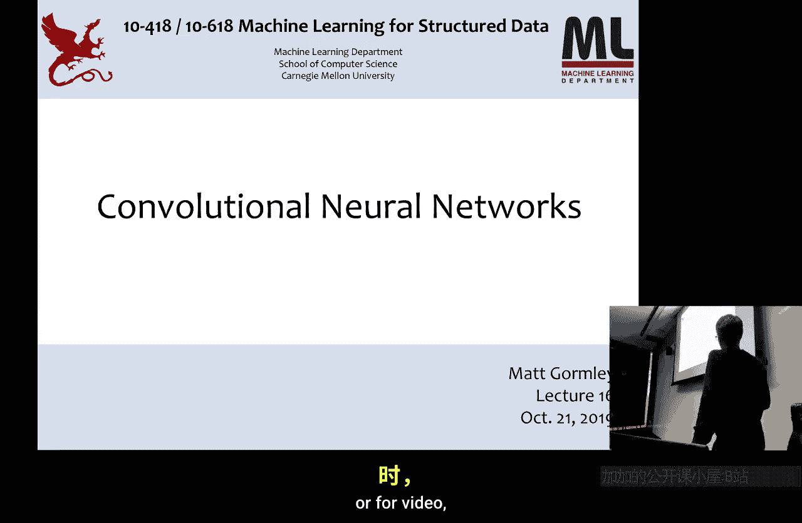
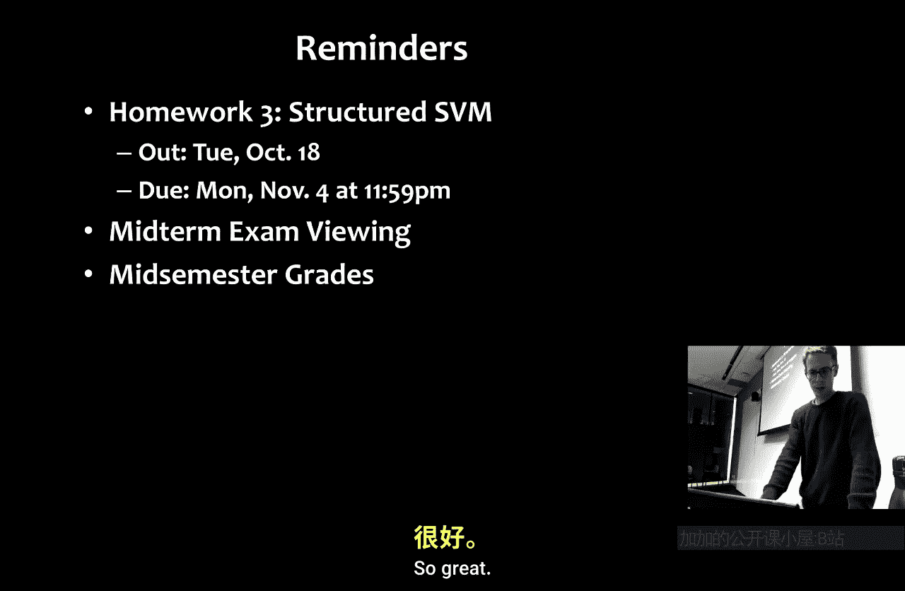
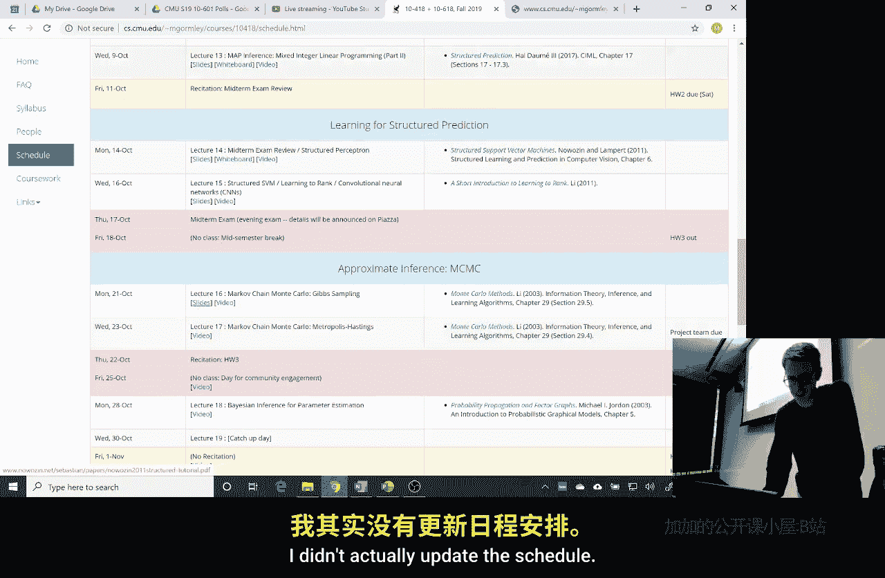
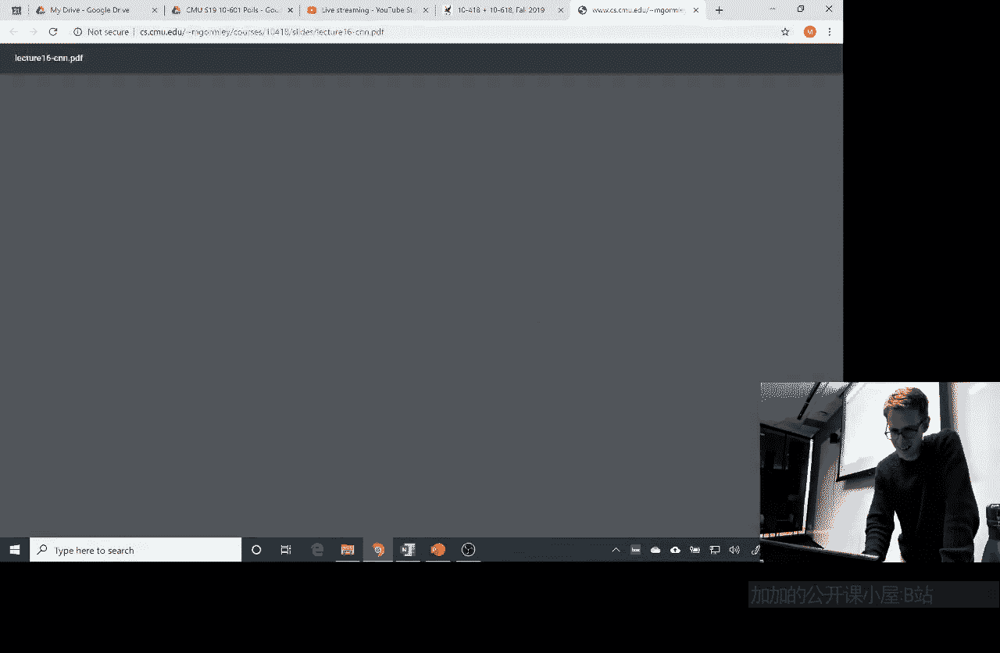
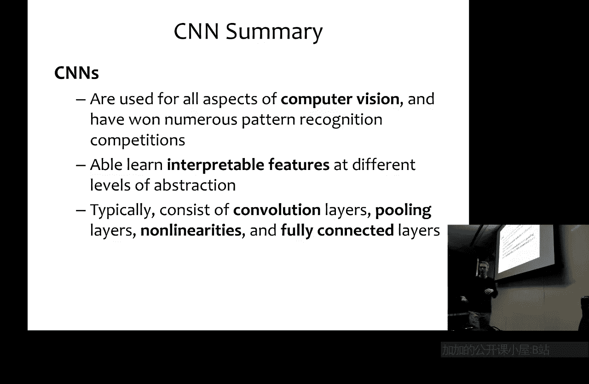

# 卡耐基梅隆大学【中英⚡结构化机器学习｜10-418 2019 Machine Learning for Structured Data】 p16 p15 10-418 ⧸ 10-618 Fall 2019 -BV1eJRsYBEaK_p16-

诶，我拜拜。Today。😊，不认定。あバかどしが。We'll actually also do a little bit of wrap up。structured SVM topic。嗯。诶。

Part of the reason for this is for homework three。We're actually going to have you implementing semantic segment patient。

Which is a problem。At the pixel level， you're actually trying to。Figure out。In an image。

 what category a particular pixel belong on， whether it's grass or sky？A dog or a cat。A tree and。

And so to do that， we'll have you build a。Structured SVM learning algorithm。

But we'll have it backed by features that are coming from。なでしょうから。変態？

So this is kind of a useful tool specifically when we move to this problem space of doing structured prediction for images or for video。

Okay， so。SoSo that's going to be homeworkmark three and we think that we'll have it out tomorrow。And。

And then I think that we're going to aim to kind of keep the deadline around around Monday。

 it might be like again like kind of plus or minus a day we're actually kind of working on you know。

 adjusting this assignment just so that we're going to try to make。

The CNN part of it really clear what we want you to do。

Even to the extent of sort of giving you some code for that and then。

And then allow you to kind of focus on。The actual structured SPVM part。And。Two other details。

 so for the midterm exams。We won't be releasing a PDF copy of your exam。This is。

Partly because unfortunately， I've experienced lots of cases where my exams。変ダ？

The internet on websites where you can purchase them and their solutions。

 so just by keeping them on paper this seems to not happen。and。So anyway。

 it's really obnoxious for us， it's really obnoxious for you guys， but we're going to do it anyway。

 and so the earliest possible exam viewing we would have would be some time today if we can get our act together in the next hour or so。

 otherwise we'll have them throughout this week。As well mid semester grades are due at like 4 p。

m today and so I believe I've actually already released the letter grade portion of them but no explanation whatsoever for where that letter grade came from so I'll be releasing the actual explanation of。

Different numbers。That were compiled together to get your mid semester grade and so partly this is also just a chance for you to be double checking my work so i'll send you out a summary describing you know each of the different components and you know。

So I generally just ask that you kind of take a look and make sure that we didn't make any mistakes。

Great。Okay。So to talk a little bit more aboutMs， I wanted to wrap up just with。

A discussion of some actual results so here we're going to be working with some some results from when structured SM was kind of first coming out and so these are all linear models where we have some weight vector W and some features of the。

The given input X and whatever variables you're trying to predict。And。And so。

What we're doing here is classification just by maximizing that score of W transpose F。

 and then learning is going to be via structured SVM。

So here an important detail is that the original name for a structured SBM was Max Marin Markov Network。

Wwhich is abbreviated as M3M， but in this class I think it's analogy to structured perceptron and is so strong that I think it's actually easier to just kind of think of it in the name that we've been using。

And but this name shows up in the literature。And as well on these slides。So here。

We can look at like a couple different models stage for handwritingiding recognition this is a slide that I had pulled out before。

 but now I actually want to focus a little bit differently on the actual entry3 end results so here。

The first baseline model is just taking each character。他。

And independently predicting what letter it is。And over here。

 this is a linear chain CRF over those characters。Where。Yes。Using a similar linear model for the。

The actual factors that touch the。The image。So there's some features extracted from that little image。

 but then it adds in these little edges between subsequent variables so that you can have the model learning something about how which characters are likely to follow other characters。

Like an R is very likely to follow a B， for example， but it's very unlikely to follow a Z in English。

So。呃。The third bar here shown is the same model as for the CRF。

But trained not by maximizing likelihood， but by minimizing the structured hinge loss that we learned how to do last time。

RestructureB。And so what's interesting here is that just by making that change to the objective function。

We actually see this pretty dramatic improvement。And Teer。On this task。So the only change。

the model is exactly the same between the CRF bar and that M3N bar。

The only thing that changed isn't a CRF bar。Objective function was likelihood of the data。

 and with the FN bar， it was structured inchline。Okay。

 so there's this other detail that I'm not going to just talk about just probably because it's。嗯ん。

Not as in wide use today， but just as you can。You know， do kernels with SVMs。

 you can also do kernels with structured SVM。Though I tend to think that the way that we're going to be using them with neural nets is probably。

A more modern and useful way of going about it。So this task is interesting because。

It actually relies on。Approximate inference， which we haven't yet discussed。And。あ。

And so what the actual path who's trying to do is classify each page。As either faculty page。

 a course page， a student page， a project page or other。 and so this。

Collection of web pages was collected from four CS department websites， probably CMU， Stanford。

 Berkeley， MIT， something like that and。And so there are 1300 individual pages and 3500 links between those pages。

The train test split is actually by university， so three of them were for training and the fourth was for testing。

And so now you can imagine a graphical model。Where。Each page has a variable。

And there are edges between。Pairs of variables for which one page links to another page。

So this would result in。Some。Complicated looking。G。诶。And it would probably have cycles in it。And。

So there's。Lots of different ways that you could do inference。For this sort of problem。

 in this particular case， they used what's called bluey belief propagation。

 which is exactly the same as the belief propagation algorithm that you learned。

Except that it won't actually converge， or there's no guarantee that it would converge to true marginals。

Or a true math assignment for this graph。But you send messages just as you normally would。And。

So here again， we see that you can still train with structured SVM。

Though now you're no longer getting。Necessarily the true。Map assignment assignment。

 there may be some approximation to it。Okay， so name identity recognition is just a tagging task I'm not going to go into details here。

 it's sort of similar to what you were doing on homework one where you were trying to label actual natural language。

Where here the actual goal is to identify persons， organizations。

Locations or a fourth category miscellaneous and so you would try to identify that you know the UN is an organization and Richard Butler is a person and Baghdad is a location and。

Here again， using sort of what's so interesting about this is just that。

 you know using the same model。The structured SVM。Is outperforming the CRM。嗯。啊。What。😮，ほら。Okay。

 so I think。That's fascinating。So these slides look entirely normal on a Mac。

So my guess is that we're having some sort of like。嗯。And yet another Windows issue。

 I still haven't actually resolved the the font issues。 and I'm guessing this is sort of related。嗯。

So let's hope that I successfully posted slides for today。 I didn't actually update the schedule。

うん。🤢。

ああ。Okay， we'll do this in handwriting。

I guess so。 But come on， that would be so obnoxious， Okay well。Great。We only need。

 we don't need all of these slides， but I really actually do want you to see。嗯。Two of them。All right。

 this is the slide that I care about， the other ones don't even really。Okay。So。

Let's start with this horizontal slide and I think like you know mental rotation is probably just generally like good for your brains。

 you know， so we'll just leave this one as it is。And。So here， what you can see is that。嗯。The Markov。

The tax margin Markov network is getting 93% accuracy whereas it's sort of beating out some baseline。

😊，So what I care about is that what we're going to be doing here is trying to label different pixels。

So this is just。sortrt of a segmentation task in three dimensions where the label is either the ground。

 a building， a tree or a shrub， and these are all horizontalr now sideways buildings。

Just to give the classifier an extra challenge。And the data is actually collected by this robot can move around in a real three dimensional environment and collect these 3D point clouds。

 and then we're trying to actually label these 3D point clouds as being different types of objects。

 right？Okay， so。How might one do this？One way that you could do this is by building what's called an Associative Markov network。

And you could think of an Associative Markov network as really just。

Another name for a pairwise Markov random field。Okay。

The reason that it gets a special name is because we're going to train it as if it were a structured SVM。

So essentially， Associative Markov Network， you can just think of as structured。SVM。Plus。

Pairwise MRF。And there's one more detail， which is that。

The actual pairwise MRF has a lattice structure。So those three ingredients。

 we're going to give the name Associative Markov Network。And， this particular。

A three dimensional variant of this model， I think is a little bit obscure。

 I haven't actually seen a lot of work done in this space。

I think though it's a little bit outside my area， the much more common model that we see all over the place is the two dimensional word。

Wwhich would apply when you're trying to do say segmentation on an image。

 so that's the variant that you'll look at， but here what we have is you know this sort of three dimensional lattice of points and adjacent points have an edge between them and that edge has some potential function attached。

So this gives us。Both point potential functions。And edge potential functions。

And the way that they happened to define this model was with a log linear formulation。

 so they actually had features。Of these different points。And so。

By training this pairwise MRF with structured SEM， they're able to train a model that then makes a single prediction for a most probable assignment to that model。

So the thing that you should be thinking about contrasting this way。

Is the solution that we came up with in homework2。So in homework too。

 we said we're going to do some maximum likelihood， like learning objective。

And then for every variable， we're going to independently return。

The most probable assignment to that variable， according to that variable's marginal probability。

So what that means is that when you return the point value for one variable。

It's not actually looking at what value you return。It's neighbor variable。Here。

 because we're going to return a single most probable assignment， right。

 we're going to return some Y hat。That is the arg max over Y hats of P of Y hat given x。

We're going to return some assignment to these variables that is。Intly cohesive。

So the slides that I'm showing here were basically just sort of a visual depiction of that internal cohesiveness。

So。So I'll I'll debug the slides。 And I think actually。

 the the slides that I was trying to post on the website are。Should correctly include this。Okay。So。

Before we jump to CNNs， I want to make sort of two important notes。About structured this feelings。

So the first of these is。啊。We can actually。诶。Think through。What it would look like。

To do structured SVM with neural potential functions。So here。The idea would be that。We're going to。

Let the scoring function， S of W of X and Y。Be defined。Bye。A hybrid。

Of a neural net plus conditional random field。And so an example of this。Would be。

If we define the scoring function。To be fact by some factor graph。So this would be a product。

Over a bunch of potential functions， sine alpha。Where each one takes y alpha and x。And， crucially。

You'll notice this blank space here。Or I have written nothing。So whenever we write。You know。

 this product over the potential box， I guess maybe it's blank space。I should have says。

It really up it。So there is no term there。That corresponds to those parts。Or the inverse Partition。

So here we're not actually going to be thinking about what the partition function is。嗯。We will。

 however， say that。These potentials。Are defined。By some neural。So here this is some。あ network。

对 takes in。啊，都。Y and alpha and x and returns a table of values that it represents our factor。Okay。

 and this could be。呃。For example， I call STM。Or a CNN or some other neural network that you like。So。

Pctorially， we could think of this as。Two steps where we take our vector x。And we feed it into。啊CMM。

And that's CNN outputs。Some representation。次。And then separately， what we have going on is。So。かも로。

Which consists of variables of y1。Wite to。By3。Like four。

And there's some factors connecting these together。

And we could say that to actually compute those factors， we're going to take the output of。The CNN。

And use it to。Compute these factors。So。Now， recall that。For structured SVM。

The unconstrained objective。That we had come up with last time。Look something like this， so we said。

We're going to have some。L of W that we're trying to minimize。

Which is a sum from I equals one to N of a bunch of little terms L I。

Now I'm going to write this a little bit differently than what we saw before。Where。

We might need a whole line just for。LI of W here。 So where L I of W。Is defined as。Say one over2 n。

Times the L2 norm of W squared。Okay， so what did I just do well before we had this L2 norm of W。

side of the summation over our training examples， I just multiplied it by one over n so that I could push it inside that sum。

And then we had plus。Some constant C times。A max of zero。

And now our sort of more interesting structured hingelo term。Which was a max over all Y hats。

In the set。Y， X， I。So here's where the pie is。This is going to be our IF training example。Of S W。Xi。

Why hat？Plus， the loss of I with why hat。And then we close this。These brackets for the maximization。

And subtract off。The score for XI and YI。O。So what do we have here？嗯。

The first bit is we have this this weight turn， this is like an L2 regularizer。

 and if you were actually to go implement this。You would find that you can actually。

Not include this in your objective function， but just use what's usually called weight decay。

In your optimizer。So if you have an optimizer like atom or something like that。

Sychastic gradient descent， you can turn on weight decay。

 what that will do is just update your parameters at every time step so that they're gradually decreasing。

As they should， if they were L regularized。没有。So this was the update to W that came from that L regularizer term that we had in our structured。

Et stochastic。Someub gradient structured SVM however the last time。Okay。So。Now。呃。

The next thing to notice is that。This where we have a maximization over white half。

This is essentially fixed。For a given。嗯。Data and odd。

If you know what theta is and you know what I is。Then you or sorry， not beta W。

Our parameters here are W。So if you know what our parameters W are。

 you can figure out which Y hat maximizes this by running loss augmented mapping。Or loss。

 Ive meanted it。And then this max。Well， this one is subdiiable。And。What that means for us。

Is that it's sort of supported。By our back implementation。So you can include。This max。

In your actual loss function definition。We know how to get a sub gradientient of it。This one。

We don't really。Back propagate through you， but rather it's fixed for a given W and I。 and so we can。

We can work with it directly。And then。The last detail is。嗯。That essentially what we're doing here is。

We're saying。That。This whole part。Is。Defining a loss。Using the score。诶。The current。Through winner。

Of loss augmented inference。And。The score of the ground truth。

So this is the score of the ground truth。AndThis thing is the score of the。

Sor of winner of loss I metative。Okay。So。We've talked a lot about loss augmented inference。

 I wanted to。Actually have us look at。An actual example of loss argument。So this。

 we're going to say is。TheNew section。So our example here。Is going to。

Be derived for a silly looking graphical model consisting of three variables。

Where the first two are connected by a factor Psi 12。And the third variable。

 Y3 is actually disconnected， it just has its own potential function， side three。

And so you could suppose you know that。For each of these YT values。They can take on different values。

 including red， blue。Purple。And。呃。The first thing that we're going to assume。

Is that our probability factorizes according to this graphical model， so that would mean。

The log probability of y 1， y 2。And Y3。Is given by。The log。Of Psi 12 of y1 y2。Plus。

 the log of site 3 of Y 3。Minus the log of the partition function Z。Okay。

 so that's our first assumption。 and then our second assumption。Is that。Our loss function。

Which is some。L of。The vector y star， which is all three y1 y2Y3 variables。

And the vector that we're predicting。And so thiss why star is the。

And we're going to assume that it consists of two terms， L of1，2。

And that's going to look at why one star。And why two star？As well as why one hat。Y2 hat。

And a second term L of。3。Which looks at Y3 star。And why3。对， so just是那个。this。Looks a little cleaner。

We could say that。You know， the log probability that we're working with here。Is。Equivalently。

The lot嘅。Some vector， P Fy。We didn't actually have。Okay， so。

What's interesting here is that now we can define L of 12 and L of3， so L of 12。Which takes in。

Why 1 star。Why two star。Why one hat？Why too hat。Is defined。As a loss of 100。If。Y1 equals y2。

 which equals purple。And that is not what。Why hat one？And why have to equal？So basically。

 the color purple here is extremely important。If these are both purple。

And you're not goodking these do correct， you get a really high loss， otherwise we just back off。

To say hamming loss on each of the variables。Which would be an indicator function of。Why1 star。

 not equaling。Why2 star。Plus， another indicator of。O， sorry， why one not， that's not great。

Y1 star not equaling y1。Plus， y2 star， not equaling Y2。And we get that otherwise。Okay。

 and then the last detail would be we'll define L3 here。To just be呃。Again， panel loss。

 which is the indicator function of Y3 star not equaling。我反罪。嗯。So loss augmented inference。

Tells us to do the following。In the first step， we're going to define。A new factor graph。

And that new factor graph。Is going to be。Have some log probability that we'll say is log P prime。X1。

Oops sorry， why？So it's the log probability of。Some vector Y。ch isY1，Y2Y3。And that's given by。

The log。哦。Site crime 1，2。OfY 1 and12。Plus， log the same form as well。Site crime。3。Why 3。

M is the log of Z。So that's the same form as our original probability distribution except that I added primes to everything。

And the key difference then。Is that now we have。Pi 12 prime。OfY1，Y2。Defined as the sum。Of。Pi 1，2。

Or sorry， yeah， Psi12 with L12。And here。We're assuming that you already know。What， why star is。So。

 given。The vector Y star。Define exact prime of one two by combining。This loss with respect。

And then similarly， S three prime。Is just the original Psi3 plus that loss L3。

So once we've actually defined this new factor graph。你 know we get to the分配。

We can just run map inference。On our new factor guys。So what is this doing and saying， well。

 we want the value of y。That is theard max over possible whys。OfThe log probability。Of why。

Under the distribution。Not P， but this new P prep。And so。Running map inference in this way。

Is significant。And we have that。呃。Because of our carefully defined。Distribution。Pace star。Why here？

Is going to be equal to。The art max over y of。The log of P of y。Plus。The loss of why star with why。

And this。Is the solution。To the loss augmented inference。So。

Essentially what we're accomplishing by combining these。Is。We're saying that。呃。You know。

 if we have a distribution。And it factorizes according to some factor graphs。

 and then we have some loss function， and it factorizes according to the same factor graph。

We can just。Those two scoring functions together。And what we get back。I。呃。An actual。

New factor graph where if we run map inferences on it。

 we'll be solving the problem that we set oh solve。Okay， there's actually a bug。

And what I wrote great at here， doesnt really see what I did wrong？

Didn't even notice it as I was doing it。你 train人咩么。就啦佢。我死了。逻辑 prime constant。

Does it change depending on age。Good question， so here I was just writing this out as if it were an MRRS。

So we could do exactly the same thing where we just condition everything on an x。

And the whole example would still hold。This would have required a lot of x's。就就单就可。

Just assume that Z prime here is defined as the normalizing constant。Yeah， should maybe some those。

Oh， thats。 Oh， yes， actually。Okay， so there's two errors。 Thank you。

 So the one that I was trying to fix here was so we want to maximize the score and minimize a loss。

 So the first first thing to fix here is this could be subtracted。The other detail of it。

Is just that what we're defining here is actually the log。Of these potential functions， right。

 So we're sort of saying that the log of the potential functions。Is。啊。

Is being added to the actual loss。Because it's really a log probability that is the sum of these individual log potentials。

And the loss is a collection that is a sum of these little loss terms。

So we want to work with the law of potentials rather than the potentials there。Okay。

So let's talk about。看 wish。好。So in order to do this。Oh。

 so this is another topic like LSTMs where I think。诶阿哥。

A good portion of you may have actually seen CNNs before but this is。Sort of so again， so necessary。

 like we need this to be。This is really central material to the course。

 so we do actually kind of want to carefully go through this。O。

So the background here is really computer vision sort of before deep learning took over and so there you know is this classic picture of how deep learning took over。

 which comes from the INe contest and it was a data set with 1。

2 million labeled images in  a thousand classes arranged in a hierarchy and the goal was given a new image you've tried to label it with the correct class。

 so this is a picture of the actual hierarchy where I've selected images of birds。

These are images of the German iris。These are images of courtyards。

And the classic approaches to doing this were feature engineering。

 where people would build those functions that we've just been seeing， know， W transpose。

And that F function would be some really interesting and complicated function like canny egg Edge detection。

 which is taking the original image and giving us back a sort of filtered version of it that puts these really high values on pixels。

 like values of one pixels where that look like edges and then really low values on things that don't look like edges values of zero。

Another example would be the Harris Carterter defection algorithm， which given a picture like this。

 can highlight the corners with these little green dots。

 or up here it's highlighted in the corners with red dots。

And then there's other sort of more interesting and complex functions like sift features and hog features。

And all of these got replaced when in 2012。In this contest， the。

The winner by a substantial stretch was a convolutional neural network。

That had taken as input the image and then passed through the image through a bunch of， well。

 five convolutional layers with back pooling layers and interjected in between some of them。

Followed by some dense layers， followed by a soft box。And the output was this。

Output of the thousand way soft bags。Which is a dense vector representing a probability distribution over the thousand different classes that we were trying to classify into。

Okay。So。We won't get to it today， but I'll eventually sort of。Give us some discussion of Resonnet。

Which。Was sort of a much later iteration of this。So basically this picture what this picture is showing is kind of fascinating so the architecture that we were just looking at came from Alex Kzyevsky and corresponded to the LSVRC 2012 contest。

That's showing its performance rate here， so got it had eight layers deep and it got 16。

4 error the year before the solutions had not used deep neural networks so they didn't you couldn't really count them in terms of you layers of depth and the error was much higher。

So this was a huge improvement in 2012， then in 2013 someone came along and improved performance。

Though didn't really add that many layers， then somebody else。

 you know doubled the number of layers and got another significant improvement。

 and then somebody else came along and added more layers and the arrow went down again and then these guys from MSRA came along and added a ton of layers and got a huge performance improvement yet again。

So what we'll do is we'll actually kind of build up to what it was that went into this resnet that actually successfully got them this incredibly low error on this task。

It's continued to get better over past this point but I think this was sort of one of the most significant jumps as well this paper was cited like 30。

000 times or something like that already because it introduced an idea that was just。

Reusable all over the place， so this idea of residual connections has just shown up time and again。

 both in the field of computer vision and other fields as well that are using these sorts of deep nets。

So first what we need to understand is that of convolution。

And the whole idea of convolution is that you're。So let me just take a step back here。

When I say convolution here。I do not mean a convolutional neural network。I mean。

 convolution is just going to be some function。That takes in。Some parameters。

And an image and returns another image。Or maybe a set of images。

So the idea here is that if you have an input image， that's say three by three。You can take。

A collection of a convolution， which is these parameters， four of them，2 by two。

 and you're going to get out an image。Where y11。Is the dot product of。

This convolution with the upper left corner。And y 1。

2 is the dot product of this convolution with the upper right corner。And so on down the line。

 Y 21 is the bottom left corner and Y 22， the bottom right corner。And so here by dot product。

 what I really mean is an inner product of two matrices， right where you take。

You could imagine just taking that matrix and stretching it out into a vector and then taking the dot product of those two vectors。

So let's actually look at an example of this so suppose that our input image is black and white。

 and so its pixel values are given by zero's importance。

And then the convolution is also a collection of parameters that are01 valued。

And so we could actually。Look， then， at the。AConvolution。

Just in terms of the actual sort of pictorial representation， right。

 all of the information of these zeros and ones is encoded by which of these squares are shaded as blue。

 those are the zeros and the rest are one。So you could think of this convolution as basically being a level of transparency right the blue squares are opaque you can't see through them and the ones are transparent。

 and so if we take that convolution and slide it along here at each step along the way at each different position。

 we're getting back an actual value for the convolved image。So。For example here。

If we wanted to compute the value in the upper left corner。

We could lay our convolution down over our image and then taking its product is really just because these are just zeros and ones adding up the numbers that we can actually see。

 right？Okay， so that's going to give us three。And then this is going to be one times 0 plus one times 1 plus one times1。

 which is2。And then again， one times0 times long possible。so on down the line。

 so we keep taking these inner products， we get three，1，2， zero。And so on to get the rest of them。

 the convolved image。Okay。So。啊。You could do a lot of different convolutions， so for example here。

I've chosen parameters that give us the identity convolution。

 so this is just going to make an exact copy of the image where there's this annoying detail that we're actually going to lose the outer edge of pixels。

Because we're。Our convolution operation is actually not going to be able to tell us what。

You know the convolution is unless we have a full collection of pixels to take the inner product with。

We could also use parameters like this one where we have 0。

2 in the middle and then 01 around the outer edges。

 which will give us back a blurred version of the original image。

And so that's actually what we're seeing here。And then you can actually you know go online and find some little cute demos of different convolutions。

 so this convolution is a vertical edge filter。Right so it has two in the middle and negative ones on the on each side。

 And it gives us back an image that's trying to like， kind of pick out the edges of。

These little vertical rice grains， right？You can do a different convolution。

 which tries to sharpen the image。You could do a horizontal edge filter and now you can see what we're getting back are sort of the pixels for most of the。

诶。Horizontal rice greens。嗯。And。You can then do sort of other interesting combinations。

 this is not a this is sort of a diagonal edge detector。This is another diagonal one。

And so the whole idea is that， you know， just these different。

Fvolution functions give us back interesting representations of the image。

So suppose you were trying to define a linear model。For image classification。

One thing that you could do is you could just。Take all these different filters like this diagonal edge filter。

 this sharpened image， this horizontal edge filter， this vertical edge filter。

 and you could use each of those as a feature representation of the original image。

 and then you could build a linear model that just takes a dot product of those features。

With some weight parameters。Okay， so this is what people used to do in the early 2000s in computer vision。

 and they spent a lot of time trying to figure out how you could use。

These sorts of functions took good effect。Okay， so there's other tricks that you can play with competition。

 like one is actually down safelyly。So here what I have been doing so far is I've been using convolution with a stride of one。

 that means that I move the convolution over one pixel at a time。

 but I could have used convolution with a stride of two。

 which is where I'm going to shift the convolution two pixels at a time。

So doing so is essentially now down sampling the image。 And so as we go across here。

We've just convolved the image， but now we get back from our original six by six image。

 a three by three image。But you can see that it's actually preserved a lot of the information that was in the original one。

Okay， so convolutional neural networks follow our usual recipe for neural networks。

 where we're going to have some training data， we'll choose a decision function， a loss function。

 and then train with stochastic gradient descent， but here the actual decision function is going to be provided in part by this convolution operator。

And some of the parameters are actually going to be the convolution itself。

So this is a classic convolutional architecture from 1998， which was。

Named Lynnette after Young McCon。And the typical layers include things， at least sorry。

 let me be careful here， the typical layers in 1998 included things like convolution， max pooling。

 fully connected layers， value layers and softm。啊。The typical layers。In 2019 include。

Basically all of these， except for max pooling。It's kind of gone out of favor。

 and we found that you can basically do everything that you want to do with convolution。Okay。So啊。

What the Lnette architecture was doing was following this key idea， which was。

We treat the actual convolution matrix as a bunch of parameters to be learned。And。嗯。

And then we can have sort of some interesting layers in ourpersed that allow us to do down sampling so we already saw one example。

 this is another example of down sampling by say averaging。And。And I。嗯。

So this is sort of the same example as we saw before。

And Max pooling was this idea that sort of replaced that。Which was that。呃。

Instead of taking the average of all the values under the convolution。

 you could just take the max of all the values under the。

So this doesn't correspond to any particular assignment。To values in a convolution matrix。

 So it sort of it requires its own name。 So this really is a different function than a convolution function。

 but structurally， it kind of behaves in the same way where we slide this maxing。

Layer over top to get back a max pooled image。So how could we train one of these？嗯。

With the convolutional neural network as a decision function。

 we then want to compute the actual gradient of one of these things。And so to do that。

 we rely on back propagation and so assuming you know how to implement back propagation。

 the s category gradient descent training for the CNN is actually sort of the standard thing that we would expect to see。

 so here we could say that our input is going to be some image X。

And then we're going to have parameters of different layers。

 namely these alpha parameters from this convolutional layer， this is the convolution。

 the beta parameters from this convolutional layer。

 and then some W parameters from this linear layer。

And so our goal is to learn those three sets of parameters。And so the architecture here is sort of。

Written out bottom to top， where we say first you apply a convolution layer to x using parameters alpha that gives you C1。

Then we apply a max pooling layer to Z1 to get Z2。 Then we apply another convolutional layer with parameters beta to get Z 3。

 Then we pass that through a rectified linear unit， which we'll define in a second。

And then a linear layer， a softm， and finally a loss function to get back some the score。

So our parameters。You could think of as just。Some object theta。

 which is maybe the sort of vectorized version of all of this alpha beta w right。

 so you can imagine taking those parameterss and stretching them out into a long vector。

 concatenating them together to get us back a long vector theta。And then we could initialize theta。

 and we could then just do stochastic gradient of descent training where we sample one of our training examples。

 I。And then we compute the whole forward process， which is going to first predict for us our distribution over outputlets。

 let's call that y。And then we'll have some loss function like cross entropy。That looks at。

The predicted distribution and say， the one hot representation of that distribution。

 which is the ground truth， why star。And then we run back propagation to compute the gradient。

Of this objective function。And then we just update our parameters with SGD。Okay。So。

The remaining question is just how do we actually do back crop？For you guys。

 we're not going to ask you to implement this game。Instead。

 we'll just ask you to chain together a bunch of modules where somebody already figured out how to implement both the forward computation and the backward computation for each of those modules。

So here's some of those modules。嗯。So this is a re layer， so the input is a vector x of length K。

 and the output is a vector y of length K。And what we're doing is element wise applying this。

Function sigma to X。So where sigma of a is the max of zero in a。

So we've actually seen this function before and structured SVM and we saw that it was subdiiable。

We can actually compute a sub derivativeiv for it， which is just。One。

 if X is greater than zero than zero otherwise。So you could use this partial derivative。

Inside an adjoint computation to get back。The partial derivative of the final output。

DJ with respect to Exxon。And you would do that by。Assuming that。The module receives DJDYI。

And then you can compute by the chain rule， the DJ DY Dx。Okay。So then for a soft max layer， again。

 we would have vectors of the same size as input and output。

 and we just exponentiate the inputs and divide by the sum of the Xs。And then for backwards。

 the partial derivative that we care about is for each YI with respect to XJ。

And it works out for this lovely clean little form in terms of the Y's， and again。

 applying the chain rule where we actually correctly need to sum over the different values of y high。

 we can get back the partial derivatives。Okay， so there's this other little detail。

 which is you might need a fully connected layer with。A tensor as input。And。So， you can actually。

Imagine if your input is a three dimensional tensor X。

You could stretch that out into a long vector and then just apply a standard linear there。

that would get you back。Something that you can work with。Okay。

 so the convolutional layer is sort of the。The last interesting one here， but honestly。

When you look at it spelled out for this small example。

 you begin to see that the convolutional layer is not terribly interesting。

All it is is some linear function of the input。And some parameters， or technically。

 it's a bilinear function of the inputs and the parameters。And。啊。You know。

 we can come up with different versions of it。So in the first case， we say， okay。

 we have one input channel。And one output channel here channel refers to what sort of computer vision people would talk about the fact that。

 you know， an image is represented not by just a single。Matrix of pixels。

 but rather a matrix of pixels for all the red values。

 for all the blue values and all the green values if you have an RGB representation of your M。And so。

Those would be three different input channels， but you could also just have。

 say multiple convolutions that are actually running in parallel， but have different parameters。

And so if you have convolution number one， convolution number two。

 then you're going to get output number one and output number two。And if we take those outputs。

There's two matrices and squish them together and we get back a three dimensional tensor。

So the actual computation for the convolutional layer。Is。Honestly， like entirely uninteresting。

 right like you can figure out exactly what these sumations actually mean， but at the end of the day。

 all we're doing is sort of some for loops over positions on the image。

 computing dot products of our convolutional parameters with the image itself。Okay。

 so if we write that out， we get something like。These obnoxious looking summmatations。

And then to compute the parameters。We get these obnoxious looking。Smats。For。The actual parameters。

And the interesting bit is that if in the more general case， you have an input which has say。Red。

Green and blue。Input channels。Then suddenly your convolutions need to be able to look at all of those channels at once。

And so in three dimensions。Convolution， the actual convolution looks at an entire block。Of。Pixels。

Through all of the channels at once， going front all the way to the back。

And then it slides that three dimensional block along just as we did for the two dimensional image。

And so that's actually where we're getting this third summation。

Is the summation over Q and R here for the actual positions in the image and the summation over C is for the chain。

Okay， so a max pooling layer is just a max and so just as with the re layer。

 we can work with sub derivativeivatives here， we can work with sub derivativeivatives of a max pooling layer as well。

 and so we get a forward and a backward。Okay， so now we can double back to this Lette architecture。

 which。啊。Combinines all of these different layer types into something interesting right so first it does six separate convolutions on the 32 by 32。

Image to get back。S separate 28 by 28 images。Then it does max pooling。

 which here is just called sub samplingampling。To get back images of half the size。

But still retaining the six channels。Then it does convolution again on all of these channels。

 so it does 16 convolutions to get back 16 slightly smaller images。

 it does max pooling again here to get 16 five by five images。

And then it does a fully connected layer a couple times until its final layer output。Okay， so。Here。

 the。The Alex met that won this 2012 contracts competition was。Actually breaking up。

The computation for the image threw into these two separate computations graphs。

 factss that ran all the way up， and then it combineds them together at the end。U and。

So what I want to do with the last couple minutes is talk about a third architecture。

 which is resant。And the key building block。Of Resnet that I want to highlight here is that of residual connections。

Okay， so so these slides are。Stolen。From。Cimings actual talk， and this was actually at。

So this was actually his presentation on this topic and I kind of it's maybe more slides so I encourage you to go back and actually pick up these slides I just kind of want to highlight a couple of the really interesting aspects of his talk in the minutes that we have here。

嗯。So the first is that， okay， here's a depiction of Alex Smith。

In terms of the layers that it was putting together， right。

 so it had convolution and pooling and they were kind of and then some fully connected layers at the end and。

Pretty large dimensions， you know， pretty deep eight layers。

And the models that followed it just kept getting deeper and deeper。 So here this is VGG。

 It had 19 layers。 So now much deeper， but similar looking components。 GoogleNe then had 22 layers。

This was。But the same year。In 2014。And resonant。Made all of these look kind of tiny with 152 layers。

Okay， so this memberss animation here is actually from his slides because he had animated this like zoomed sliding down through the 152 layers right and in some sense。

 exactly what's in here is not of great concern to us except for the residual connections and the residual connections are these little curvy arrows that you see kind of jumping along through multiple layers and we'll look at what those are in just a second。

😊，So the first point of resnet that they were making was that。If you just take really， really deep。

Plain convolutional nets， they actually have higher error。

As you go deeper so here lower is better and so with a 20 layer net you're getting this yellow line。

 32 layer net， you're getting this blue， 44， this green and 56。

 this red so the 56 layer net is actually doing a lot worse than the 20 layer net。OkayAnd sorry。

 here what I'm showing you is the actual test or validation performance。

The dashed lines that are shown at the bottom are the train performance。

 and that's actually also pretty bad。So it's not even like the training performance of the Deep net is doing better。

So this was for CFR 10， which is a data set where you're trying to classify 10 different classes。

 this was for ImageNet 1000， where you have 1000 different output classes and the same trend holds there。

Okay。So。The plane neural network is essentially saying we have some input X。

 and we have some output H of x， and there's going to be some weight layer and some re layer and some weight layer and then some re layer。

So it's some pair of stacked。Layers in this fashion。And。呃。The idea of the residual map。

Is to add an extra connection。Into the network。And it's a really， really simple connection。

So it's saying that， okay， we're going to take this X and we're going to do some complex linear value layer to go through and get us back。

F F of Xx。At the same time。We're， we're going to define the output of this thing to be the sum of that complex function of x with。

The original value of x。So this is incredibly significant。Because。

If you are back propagating through this function。The error。

Its just going to back propagate directly through。That identity connection。

Whatever error you were back propagating to Hh of Xx？Is also going to backproagate directly to X。

By contrast， if you didn't have that identity， your error is going to have to flow through FF of Xx。

And it might get shrunken or clipped or manipulated in some way such that you lose a lot of information about how you should be updating。

Your parameter values。Okay， so this is sort of a residual mapping with respect to identity。

And there are sort of more modern variants of this where you maybe take some weighted linear combination of these。

But here， just this simple way of doing this identity works incredibly well。

And they had this additional very interesting insight。

 which is so the usual way of kind of combining convolutional layers was to do say， you know。

 all three by three convolutions， okay， so all of your convolutions are these little three by three matrices。

And they said， well， let's try one other little tweak here。

 which is this sort of bottleneck trick where they first have a convolution， which is one by one。

So that's a funny convolution because it's essentially just doing some like direct linear combination of the pixels。

 there's no real convolution happening there。And then it does a three by three convolution。

 followed by another one by one。And when they say similar complexity here。

 what they mean is the time that it takes to do all of these major multis for this side is about the same as this。

Okay， so their basic design is。Almost all three by three convolutions。

 which was really kind of an idea that came from this VGG model from 2014。

And then they just made it incredibly deep with these residual connections and this bottleneck trick。

And so what they're going to do is they're going to compare this plane net to this residual。And。

What they find is that on the left here。We have the plane neural network trained on Cpar 10。

 And on the right， we have the Resnet trained on Cf 10。 Okay， so this is image classification。

 We have 10 different classes for the image。And again， for the plane net。

 deeper layers give us higher error， which is band， but for the ResNe。

 as you add more and more layers， the error is going down and this holds again， both for train。

 sorry and test performance。Okay， so here they're showing。

 you know a 20 layers deep network and down here， 100 layers deep network that's doing better。Okay。

So this was then their result on IageNet， which has 1000 classes， which is， you。

 they did 152 layers and got this really low error compared to prior。Results。

But then they went on and applied it to a bunch of other things。

 so they did object detection where here object detection is where you're trying to say。

 put a bounding box around， say that refrigerator， that oven， that bottle， that knife， that bowl。

 that cup。person that you can see his shoes in the very。Background there。

Hard to even capture in this light。嗯。And so they were able to。

 with Resnet substantially outperform the coa detection results， which is this particular benchmark。

嗯。Okay， so here's more object detection。And then they were also able to do instant segmentation。

 which is where they're trying to not just。Find individuals， so if they're actually trying to。

 not just box。The instances， but also find the individual pixels corresponding to those instances。

 So so here what we're looking at is， you know the yellow pixels inside here are a person and these green pixels are also person pixels。

 but they're a different person。So this differs from the semantic segmentation task that you're going to do where we would have just said all of these should be yellow pixels for person。

Okay， so they're actually able to kind of separate out the instances of you know。

 different persons and skis and backpacks in this image。就话。There's a bunch of visualizations。

 so anyway， the key kind of takeaways here are you know CNNs have revolutionized。

The way that we do computer vision， residual tensions are critically important。

 and will probably give you something kind of like a reson。A we building that infrastructure top？

homework so it should be a lot of fun。