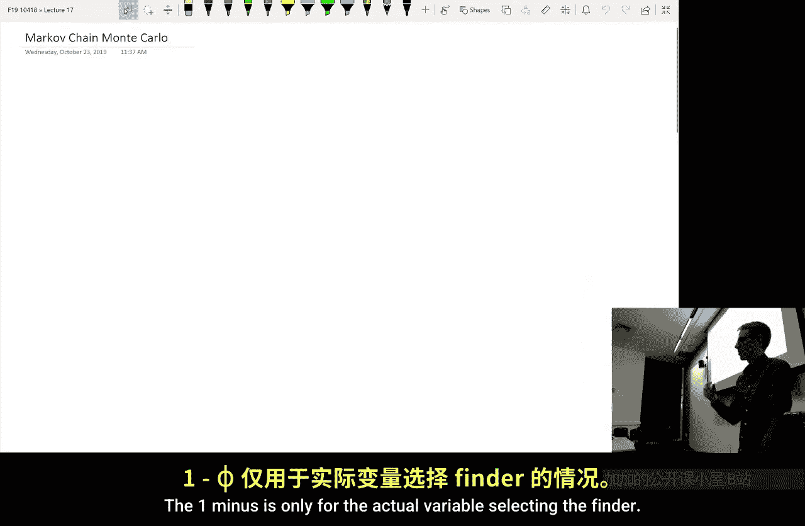
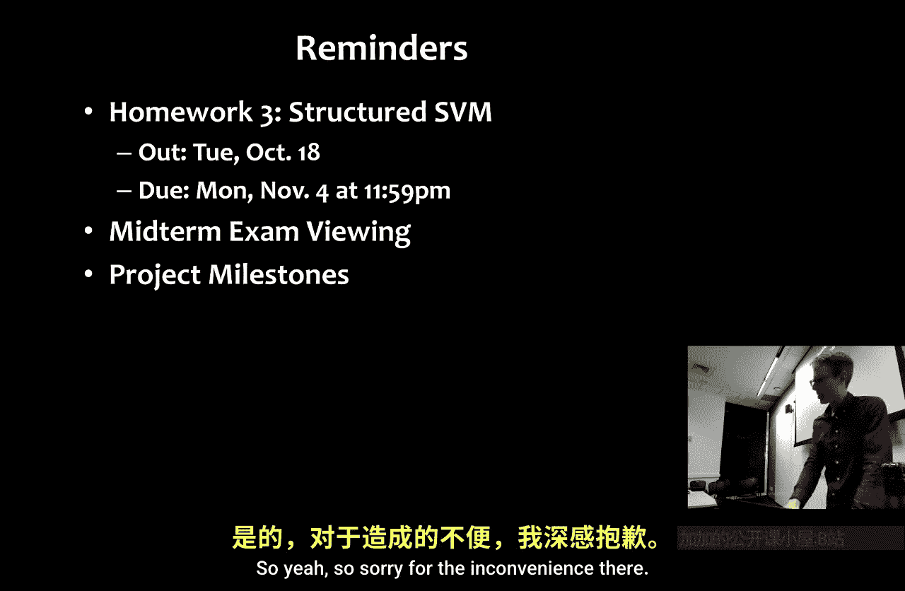
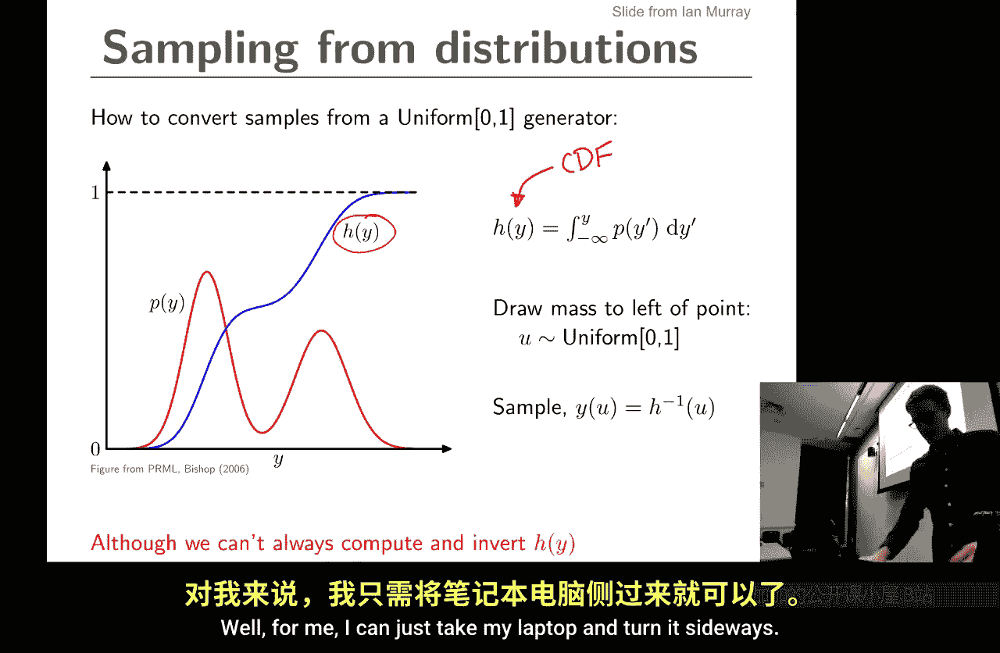
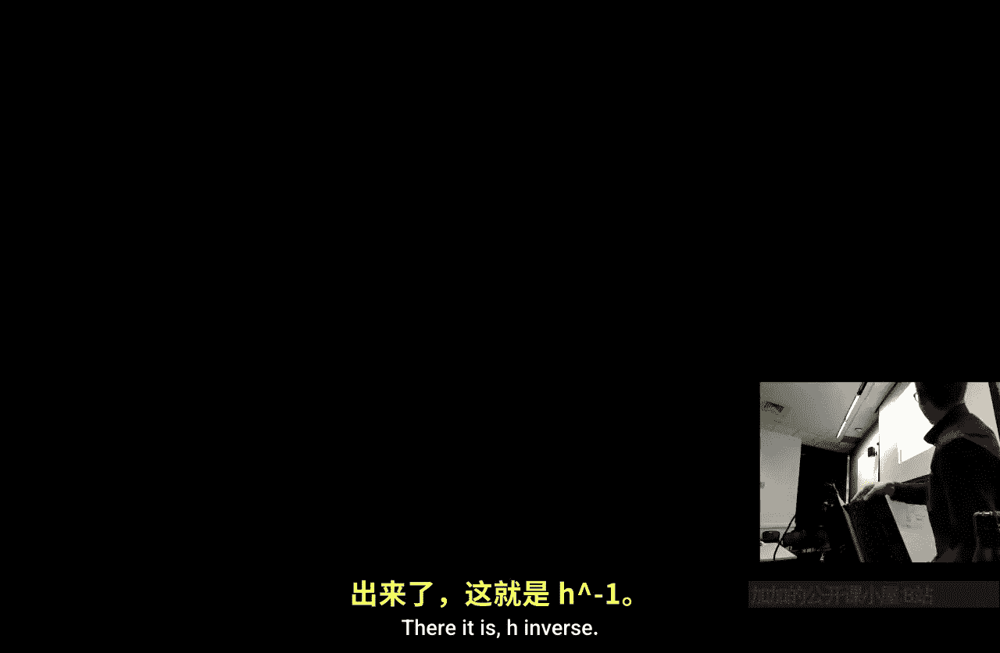
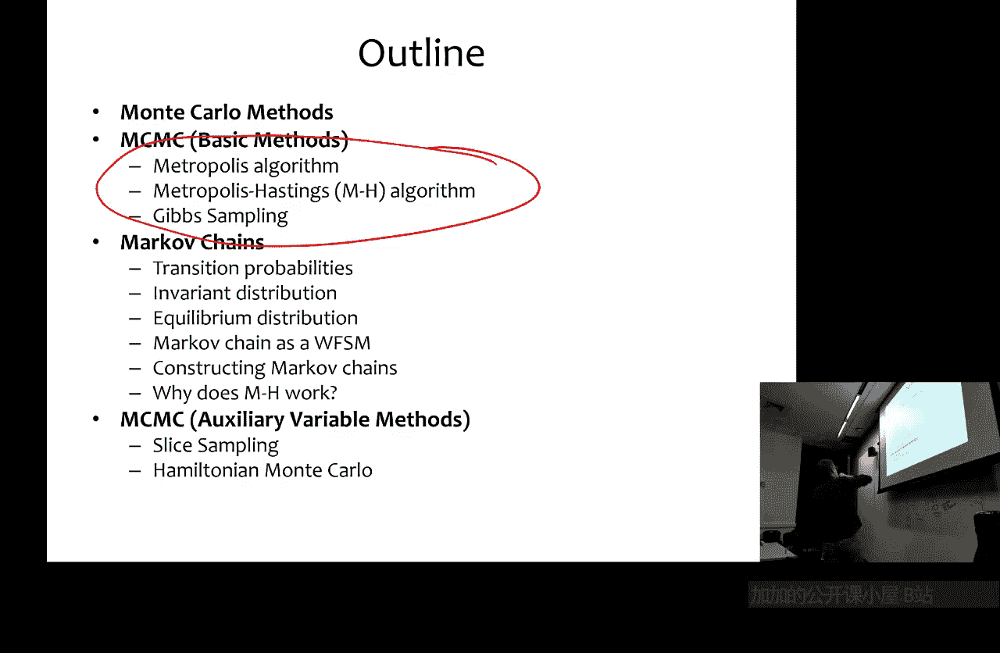

# 卡耐基梅隆大学【中英⚡结构化机器学习｜10-418 2019 Machine Learning for Structured Data】 p17 p16 10-418 ⧸ 10-618 Fall 2019 -BV1eJRsYBEaK_p17-

All right， welcome back to 104。啊， today。呃，我觉得呢就。Particular particularly fun。New area for this course。

 which is approximate inference。And we're going to be looking at。啊 today。

A bunch of different examples of algorithms that allow us to sample from distributions。And。

Some of them will fall under the title bun Cargo methods， so we'll talk about those first。

And then some of them will follow their name Markout Cha Money part。second。

And then once we've done that， we'll actually go back。

And we'll talk a bit about what a Markov chain is。And。What sorts of theoretical properties？カチンさ。

And why it is that we can actually get Markov Jane Money Car。So we'll kind of start by looking at。

 how do we use them and then we'll come back to why they work。

And then the last detail is not in this lecture。Our future discussion of MCFC methods will actually look at how these are used。

Specifically in the context of sampling for graphical models。

Where sort of other inference methods might be attractive。Okay， so。A good question to start with。啊。

Isnt this ILB for Matt inference from Le 13 correct？ButThe answer is no。

The index in care is incorrect and it should be， so let's actually just jump back to this。

 so where's this lecture 13。So what we said was。That。Here we go， lecture 13。I had written down。

That the。What we were looking at was these little subscripts。

Where the five variables were subscripted by YT。And then the other one there is scripted by one minus y。

So the funny part about that。就。So， if Y T。Was。Was one。诶。What we have is。So Yp is one。

 so we get phi of t comma1。嗯。😊，And then the second term is just going to be zero down。So if Yt is0。

 the first term is going to be。Zero it out。And we'll have one minus yt equal to1。And then。

We'll have ps of T of。1 minus Yp。Which is。The same value that we were using on the left here。Right。

 so the point is that。In this。This left term in this right term， the way that we wrote it down。

 they ended up being the same phi term。So to fix that。All we need to do is just say。For example。

 I mean， there's a couple different ways we could have just written it as。Subscript YT。

 and I think it's actually clear to say there was a nice suggestion on Piazza， which was， well。

 we could have just written this as P T1。快始。0。RightBecause what we're doing is we're saying we either want to。

Add in。F1 or 520。And then， over here。嗯。We're saying。We have this。

This summation over similar looking terms。え？So rather than having YS and YT。

We could have just subscripted with the actual values of。YS and YT that we care about。

Or we could have just dropped the one minus So I think again， here we could just。Rerites。呃就 Y s one。

Y G one。Here。And then this one。Ys is0， Yt is1。And then about to。one zero。呃よ。

So the point is just that。When we're writing these things down for。At inference。

 what we're doing is we're trying to use these variables to just pick out the appropriate score that we want to add。

Great。So。Well we're。Causing here， any other。Question。Does it need to be about math influence。不定 much。

ItS if we request I file TYt。Yeah， so that would be啥。Yeah。

 I look kind of like this way because it makes it very explicit that like we have these two different values of fine。

And depending on the value of the parameter we're either going to use。

 we're going to pick one before the other。But yeah， it would also be fine。I've just written5 to1。

So both of those are correct， the incorrect thing was the version that I had with。With the one minus。

 So we， we just don't need the one minus there。 The one minus is only for the actual like。

Variable selecting the fight。

Okay。Okay， so homework three deadline is coming up here。

We still have a couple midterm exam viewing times， so if you haven't stopped in on one。

I encourage you to actually do so it's also just a good time to， you know。

 it's kind of a little crowd of people in the room and so you can you chat with each other and you know Austin。

Aktra Carartheka， whoever is there， just about questions that you might have had about problems。

 sketch out solutions on the whiteboard， and so it's just a good time to actually pot through。So。Oh。

 El， also on project milestones， I think we actually had on the calendar that like team formation。

 oh yeah， question。Oh， sorry， no。Oh， wait。Oh sorry， see。

 I have too many did I mention that I'm teaching another course。

 I have too many deadlines that I'm juggling in my head anyway， so homework3 is not out。

Not yet November。That's so the deadline is not coming up so we're homework three is the one that we're like actively working to make a little bit simpler for you so what we did is we kind of carefully looked at the hours spent on the first two homework assignment。

And then I have a bunch of other data from， say 601 where I have 500 people taking it that I have like really clear pictures of sort of estimates of how long people spend on things like lectures and recitations and studying for midterms and final exams and so I actually have this picture in my mind of exactly how many hours are remaining according to this notion of a 12 unit course for homework and right now so the number of hours that we are aiming for is something like 90 hours total spent on homework on average across the course and I think right now for there's a lot of variance on time spent on homework and so on the first two homeworks we've already maybe eaten up about half of our budget of like 45 hours。

For the nonexistent average student of this course。

And so we're kind of trying to think about you know。

 how can we make your time just a little more streamlined for the remaining three homeworks。

 so that's partly why it's actually taking us a little bit longer to get this one out。

 but we hope that what will actually be releasing in the end will actually sort of require a little bit less。

So that's the goal and so I'll also be sending out sometime soon here just kind of like a survey。

 just trying to collect additional feedback， I mean obviously you guys are talking to us and so that's kind of why we also know that you've been spending a lot of time on the homeworks and so having that feedback is always really helpful and you can continue to give that verbally but I'll also send out just a survey that I'll have you fill out to give additional feedback on the course。

Okay， so the last detail is project milestones for 618 so we had a deadline for like TV formation this week。

 what we're trying to do is schedule like an office hours where the purpose of that office hours will be for。

For anybody who say doesn't have a team formed yet or who does have a team formed yet to come and just chat with whoever is at the office hours。

About their interests and what sorts of problems they might be excited about。So。

In order to kind of help us， maybe even facilitate helping you all find teammates if you haven't done that and the precursor of that to that that we're going to release is sort of a description of you know data set ideas and problem ideas to work on for the project and so don't worry yet about like the actual。

 I think I haven't updated the website yet， but we'll have a new deadline for project team formation once we've actually kind of got that office hours signedd up。

Okay。Any other questions？いや、先さいの size。Oh， okay， so I just put a link on Piazza that points you to our GiHub pages version of the webage。

 the CS。For some reason， like something is broken and I'm probably going to have to contact SES Hope so all of the slides links for 1516 and 17 should all be working for some reason they're still not。

On the actual CS mirror。So。Yeah， so sorry for the inconvenience there。

阔给。So。We've built up now this picture of ways of modeling data with graphical models。

Ways of writing down objective functions。Maximum likelihood or。Max margin， in case of structured SVM。

We've thought about how。To actually learn parameters for our models。

And we've also already identified ways of carrying out exact inference for all of these three cases that we identified as sort of the core problems that we care about。

呃。The problem with those exact inference methods is that some of them are inefficient when applied to。

The sorts of models that we care about。And。So。In general。

 I want us to kind of go into this next section， thinking about a few problems that you might want to solve for a factor drive。

So。The notion here is that we should suppose that we already have the parameters of our factor。

We're actually going to go back later on and think about Bayesian inference where we're not even going to assume that the parameters are available。

 we'll actually think about how the parameters could become involved in this sampling process that we're going to be talking about today but for now let's suppose you already have the parameters so one question is know how do we compute the probability of a specific assignment to the variance。

Okay， well， this is easy if。You have the partition function。But if you don't， well。

 that could actually be a little bit tricky。Okay， so another question would be。

 how do you draw a sample？From the joint distribution。Defined by your factor graph， okay， well。

 even if you do have the partition function， we'll see examples where， this could still be tricky。嗯。

Another question would be， how do we compute marginal probabilities？啊。So you know。

 we have algorithms for this， and I want to sort of call to mind this example that we had seen before。

 which was， you know， if you could sample from the joint distribution。

 right if I could draw a sample from P of x。And I could do that over and over and over again。

 Then we had this idea going into variable elimination that we could estimate the marginals。

By looking at the samples that we had just drawn and taking basically the empirical marginal from those samples。

And doing so would allow us one way to estimate that。So。嗯。That's great， but then you know this。

leaves us with another question， how could we draw samples from a conditional distribution？

Or how could we compute conditional， marginal properties？And so。For all three of these。

 Ki that one way that we could solve these is by using samples。And。嗯。

And so we're actually going to think about ways that we could actually go about getting those samples。

So the first of these is going to be Monte Carlo method。

And so we want to think about sort of the two problems that money Carlo methods are actually trying to solve。

How many of you have seen Monte Carlo methods？그래 오케이 삼각。We'll move through this part overviI。So。

For Mon， Carlo， that is the first problem。So。A goal here。Is to solve two problems。

And the first problems。Is。That we want to。Actually， generate。Samples。

And you can think of this as a set。诶。You know， X's。I got a vector， say。X1。Vectctor x2。

All the way up to a vector。Capital S， we have S samples。啊。From。A distribution。诶我靠。De。Okay。

 so problem two。Is that we want to。Estate。Expectations。Of functions。Under the distribution P of x。So。

Problem two here， what we mean by that is that。Yeah。As an example， you could think of。We make过。

To take some。Expectation。Under P of X。诶般我以为。So function FX。So。What does this look like well for？

A continuous valued distribution。That would be integral over the possible values of X。

And for each one， we're going to compute F of X and evaluate。あピエロです。Or if this is a。

If this is a discrete distribution， it's going to be a sum over the possible values of x。F of x。

 P of x。And so the whole idea of a money kla method is that one way of。

Approximating this expectation。Would be to say， well， if you already solved problem one。

And we knew how to draw samples。From。Distribution P effects。

Then what we could do is we can estimate this expectation。By诶 say kick a son。From S little S equals1。

To capitalize。Capitalized samples， and for each one， we could evaluate。Fle。Say x sub little S。

So let's assume this x is a。Bector。And then for each one， we can evaluate。系呀。Pia of access。

And if we take that sum。And multiply the whole thing by one over capital。

Then this would give us an estimate of。That expectation。So。嗯。

So I guess there's a couple questions that we want to ask。So， one is。This question。

You knowSo so basically， if we can solve problem one。啊真。that implies that we have a solution。

The problem去。Okay， so our focus today is going to be on problem war。

A least exactly because we don't have is to the effects so that summation inside that would that be。

そゃて。三呢个多。So which sorry， this summ， like many they expectation。等大这抓那个大。不要一。

UmSince we don't have access to the effects， we just like we are sampling according to the effect。

 but we don't have a tractable。花吗有。So would we still like your there or are we just summing eggs according to of X and then summing and taking？

No， so I guess the point here is。For problem two， I'm assuming that you can at least evaluate。あ。

Evaluate data。If you're going to use that。Particular approximation。And。Here， what we're saying is。

G know， this assumes。E value。Evaluating T of x doesn't necessarily mean that you can。Sample for a。

But be could if we dont take didn by one we just take。呃。Because that means that we have value。だり。

Yeah， yeah， so let's think about why does this car。So that's actually our next question。

Sa drawing samples。あ、ピだます。So one。I guess there's a couple answers here。Answer one。

Would be so actually let me let's let's look at some actual examples here so well let's say answer one first because I think this is actually the one that you're kind of driving at which is answer one is。

We。Light not know。The partition function。Okay， so if we don't know the partition function。

 then we can't evaluate it。So that would make it particular。So answer two。Would be。

The curcursive Di Avenue。Meaning。We might have a probability distribution in high dimensions。

That could make it part， so let's take an actual look at an example。And oh， I encourage you to。

 so actually， how many of you have actually relied on the。

So called requiredqui readings for this course。Okay， that's it。I really need to add。

We should have like homework questions that like。Ask， you know。

 what figure appears on page 34 of the reading or something like that just pushes them to anyway so we should think about that so you're reading for。

😊，For this section where we have this reading from Mackaai， it's one of my favorite。

Favorite textbooks。啊P。And this particular chapter 29 on the stuff that we're talking about today is sort of one of my favorite textbook chapters ever。

 so if you haven't been doing any reading and you only read one thing from this entire course。

 I think it be chapter 29 of account。It's free online， like all the other readings。Okay。

 so I'm stealing his example， which is suppose that。You want to。Estimate。The plankton。Concentration。

In a lake。So what does this mean， Well， it means that you have a boat。And you have a。

Give a plum right。Or you can send down。And evaluate啊 the。The depths of the lake， and。

You have the ability to take samples。Of plankted concentration in a small area。

So let's draw a picture of what this might look like。So you could imagine that we might have a lake。

That looks like that。Nothinging water。And we have a boat。It are don。And oh。

 I guess we should draw the rest of the lake， so the lake， it kind of looks like this。You know。

 pretty uninteresting lake， oh， except for this part。Which is really interesting。嗯。ok， so诶。

So this is a particularly。啊。Challenging problem。啊， because。

If we just sort of imagine uniformly taking little samples with our plum line。

To evaluate the the depth of the lake。different， let's actually make this even more extreme。

So if we drop our plum line at different points。And we evaluate the depth of the lake。

Somewhat uniformly across。We might actually miss this huge deep valley。

Where a massive amount of water and possibly a lot of plankton is living。So similarly。

 we could actually now let's sort of flip this picture on its head and think about。Drawing samples。

From a one dimensional distribution。So in that case。You could imagine。

That the distribution looks something like this。And。One possible oops。

 one possible way that we could。啊。Draw samples。That say our first algorithm。

Which is going to be uniform example。So here， this distribution that we're looking at。We have one。

Aariable x。 and then this curve is。さ定は。Some distribution。诶DX。And。Uniform sampling would say。

That we're going to。嗯。So here have a goal。Of。Let's say estimating the partition function。And。

The key idea here。呃，这个配。Colection of values。So we're going to have samples of the actual value x。

Say from the uniform distribution， let's assume further that。In our example， the distribution is。当的。

Its range is only for values。Xs zero to1。We're going to pick samples of X。

From a uniform distribution from zero to one。And then。啊。So once we do that， then we can。

Estimate the partition function。As。Oh， sorry to to be a little clear about our not here。

 So we're going to say that。So if we're going to estimate the partition function。

 then we should assume。An assumption。That P of X。Is defined as。一illだ theら。Partition functions。And。

We can evaluate。嗯。Pte Tilda of X。So。So， here。We could then estimate Z。Bye。Sa。啊。

We're just going to take a bunch of those little samples X。

And we're going to say that Z is approximately equal to a sum over， say that's samples of x。

beginning of our distribution。Where for each one。We just。Soing up。あピそだから。And so。So here。嗯。

What we want to do then is。啊。Essentially， draw。Enough samples that our estimate is actually good。

So one thing that you could imagine doing is that you know， essentially this kind of corresponds to。

你食你。Measuring。The lengths of these lines。Beautily space out。So， okay， so this doesn't sound too bad。

You know， one dimensional distribution。So the question would be then。What actually makes this hard？

Here。To see that we want to think about。呃。Relative example， which would be sort of the same setup。

 but where。We're now going to assume。四。え？呃，1000的时。Distribution。And so what does this look like it？

That we have some probability over x1。Ex2 all the way up to。X1000。And you know。

 just to kind of make things similar。嗯。Let's assume。Further， that each X T here。

Is from one of Tony Green lines that we have here？One， two， three， four， five， six， seven， eight。

 nine。4。So。It's， you know， some。Number between one and 14。

And so so now we actually have a discrete distribution， not a continuous one。

 and so here we're just going to say that。嗯。We'll do the same thing that we did over here。

Except that we're going to you know。Basically， have。A plot like this。In every dimension。Okay， so。

So what if we just made one such plot？For each dimension。

Would that sort of solve our partition function problem？Yeah， what could go wrong？

DoAssuming that the direction is independent okay。Yeah， so， so maybe。You know， what we have here is。

So suppose you。You just have now a plot of x1 and x2 okay this is just two of the thousand dimensions but you know suppose I was able to actually give you the probability density。

 I'm going to make it look continuous but it's actually discrete I'm just going to show sort of a continuous version of it and so we're going to have this be like a contour plot of the actual distribution Okay。

 so suppose it looks something like this。Where。All of the。Ourability mass。

Is essentially concentrated over here。Okay， so if we did our uniform sampling。

 what that would be like doing is， you know， you have a lake where the deep part is out there and it's basically like you have your little boat。

Kind of run along this edge。And collect a bunch of samples and then run along this edge。

And collect a bunch of samples。 And you send the plumb line down at each of these points。You know。

 maybe 14 times。But it gives you。A kind of useless picture。Of。Of the actual distribution right。

 so what this it saying is basically that you know1 thousand。Times 14 samples。Is not enough。Okay。

 so how many samples would be enough？4定。Yeah，14 to the power1000， okay。We need。

Something like 14 to the thousand0。政府。And。And then， what we would have is。Yeah。

Z is actually a pretty good estimate。S equals one of the s。P till the the next one。不 that。So。呃。

So this is enormously problematic。And。So what we want to think about is how can we sort of deal with this problem？

And。呃。And I guess so okay， so now we should sorry now we need to come back oh so this is just the partition function problem。

 so now we need to come back to your question which is so if we can evaluate P of X，跟。Like， you know。

 what's the big deal we could just draw samples from it， right？

So if I give you a function for P of x。Over this thousand dimensional。Examp。

Can we just draw a bunch of samples？たし。Not really， but what could go wrong？What do you need to know？

ら三と。So if you want to draw these samples， you kind of need to know。Where's the deep part of the lake。

 right？You need to know where the deep part of the distribution is。

Or the tall part of the distribution as it may be。And。So in order to figure that out。

 we would need to evaluate the function。In all of these different places to figure out where the high probability regions work。

So。嗯。呃。Last example。Would be that of。A Gaussian。And。ItTurns out this is sort of easy to sample from。

Like it's a solved problem。Okay， but this is not true of most distributions。So。Okay。

 so what do we do？嗯。Oh， okay， so。So before I answer what do we do。

 let's just make a quick statement about some properties of money Carlo。

 so this is just the estimator that we had been talking about where if we could draw a bunch of samples and we could a estimate。

Expectations。Using those samples， this is just a statement that the estimator is actually unbiased。

So for an estimator to be unbiased， what that means is that。The expectation。Of。This。

Which is our approximation。Of the true expectation。Under the distribution over samples that we get。

So this is our。This is our sample distribution。Like distribution over those sets of samples。So。

 that's going to be。One of s of some s equals one to as of the expectation of F of x。

Which is exactly equal to the expectation that we wanted。So。

So this is a good estimator in that sense。And there's another nice property。

 which is that the variance of this F hat under this distribution over those sample sets。呃。

It shrinks。Proportal to one over the number of samples。之。

What this means is that the standard deviation。Shs according to one over the square root。

Of the number of samples。So the more samples you have。

 the less variance there is in your actual estimate。Okay， so yeah， in the previous。

 so what I was saying earlier is that F hat is equal to work upon a sum of X y。

 but on the whiteboard I'd say computer use the product of Fx and Vx， that's what my。哦。Oh， okay。

 sorry。Yes， I did。Okay， sorry， sorry， sorry。Sorry， yes， we haven't。Sorry。

 I'm sort of skipping ahead and。Okay， sorry， we don't want to assume that we can evaluate it。

So we'll come back to this notion of。Trying to full enter our estimates here once we talk about importance。

I got ahead of myself， so the standard on the cognitive thing is not to include those thingsx。

So now all we're doing is。Assuming that the x's that we get back are going to be representative of the distribution over x's so for example。

So let me correct what I was saying before， so say we have a distribution。

Over two possible values of x。And this has probability 25%， and this has probability 75%。

Ex peopleing。W0， values1。What will happen in our sample。

 if we have enough samples is that 25% of them will be or roughly 25% of those samples will have value zero and roughly  75% will have value one and so when we evaluate。

对。Average of F of x over those samples。We。Are going to be converging to something that is correctly approximating that expectation？

Okay， thank you。So。Okay。So now let's think about how we could actually make sort of it。

Dumb approximation of pi。派。We could say is。嗯。It's possible to calculate pi。啊。Based on。

There's the geometric definition of pine。And。And so namely。What we have is that。A pie is the。ThatSo。

Crucily we have this four， so you can imagine that there's sort of two different ways that we could have we could have drawn this picture so we could have said well。

 pi is。呃What you get。If you take the。The area of a unit circle。And so here what we're saying is。

 well， let's just take a quarter of that unit circle。They rooted at the origin。So this is a。

The origin here。 And this is 1，1。And we could then say that one way to compute pi。

Is with a double integral over x and Y。Where。We're going to evaluate an indicator function that says。

It is the value of x and y inside that circle。And then we'll take the probability of x and Y to be the uniform distribution。

Over this entire square region。So what this is doing is basically saying we're just integrating over the area of the circle。

Right， because this probability distribution is defined such that。

Such that it's giving us back probability one for anything inside the square。

 but the actual function are f of x and y here。This is F of x and Y。

Is only evaluating to one if it's inside the circle。So you can kind of think of this as。

We're just ignoring any of the samples that fall outside the rip region。Okay， so。So in fact。

 Ian Murray， who made this slide， did exactly this。And。So he started out with just。12 samples。And。

randomly sampled those and then computed this quantity for pine， you got three and a third。

I did not do that Let bumped it up to， was about a million samples。全。Don't know examples。And。

It's a lot of samples and even at 10 million samples， he' still only got 3。1418。So。

That seems like a lot of computation power because in fact。He could have used a function。That嗯。

Gives pie。To much higher precision much more quickly。And so there's this quote。Alan Ckle。

 which was that Monte Carlo is an extremely bad method。

It should be used only when all other alternative methods are worse。

So this is good to kind of keep in mind as we think about this。

 but in many cases for the kinds of models that you could build when you start connecting up variables with interesting interactions。

 it turns out that many of the alternative methods are indeed worse。

 either because they're computationally intractable or because the answers that they give back are not particularly good。

O。So。诶。So suppose what we want to do is sample from some distribution。

Then essentially what this is amounting to is you could think of you know。

What we're trying to do as draw。Points。Uauniformly from the area underneath this curve。So， in fact。

 if you go back to。This picture。Essentially。If you just threw away all of the。

The points that were outside of this red region， what we're really doing is sampling points that sort of fall in。

Red region， and so if you want to sample from a probability distribution。

 you could imagine that the area underneath that curve is some red region。

And we're just trying to draw points uniformly。From that area。

So if you could sample uniformly from that area， like here's a point。And once you sample it。

 now you have an x value， this could be x5， and you also have a Y value。

Some wfi corresponding to the actual probability。But if you're trying to just draw samples from P of x。

 then you can immediately discard that y5 value because all we really care about is the actual sample itself。

So this is another picture of kind of why drawing samples could be tricky because if you don't know where the high probability region for the area under this curve is。

 it's not easy to do。Okay， so here's one possible solution。You have a distribution P of Y。

And you're able to evaluate。The cumulative distribution function。

Which is just the function that integrates from negative infinity up to the current value of y。

Or the distribution P of y。Then，What we could do is。啊。They could say。If this works， then。あ。We can。

Let's see。Sorry， which of these is our axis。 Okay， so this is H of y。

 and so so what you can imagine is we actually have。In this picture， kind of。To different。诶。

Two different。Pictures of a function age。But also of a function， H inverse。Okay。

 so how do we get H inverse？

For me， I can just take my laptop and turn it sideways Oh did that work。

 Oh it actually worked for a second Oh there it is， that's a genderverse。Okay。

 let's get it here again。There it is H inverse， Okay， so to get H inverse。

 all you need to do is take this image and rotate it。

So that what we're looking at as the vertical axis becomes the horizontal axis。

And then the picture gives you H inverse。Okay， and so what we can then do is draw。A sample。

From a uniform distribution。Okay， so U is going to be sampled from a uniform。Over。01。

 which corresponds to some value in this region。Okay。And so then what we do。Is we sample。The value。

Of each inverse of U。Okay， so you draw some u value like。Say here。You won， and then you compute。

The height of。H inverse。Of you1。And this quantity down here would be H inverse。Of you what。

And you take that to be your first sample。Then you draw another one so this will be。You， too。

And H inverse tells us。That the value for this is each inverse of you2。

And you can do this over and over。And each time that you do it。

 you're actually sampling from the original distribution。で话。

And the reason that this works is that essentially by。

By converting us to cumulative distribution function， we're saying that。The probability。呃。诶。

Of landing on a particular why point。Let's actually do this with。Little error bars。

 So that's we're going to convert to。Right here。对， so。あるいは？え場。试啊。So， we could say that。

If you already know。That the distribution looks。Something like this。Then so sorry。

 this is our cumulative distribution。 So this is。你着 why。Then。

A inverse Y is going to be something like。so。If we sample。啊。One of these。High values。

 it's going to end up。Essentially， like the top portion。Of this bar。And so， we'll get。

The corresponding。H inverse。Whereas if we hit one of these middle two。

It's going to roughly correspond to。Les landing in this region。And so。O。You know value of it here。

And lastly。at this region。And so what we've done is we've essentially figured out these are proportional how these are proportionally related based on the cumulative distribution function。

 except that we're doing in a continuous phase when we actually live。

Invert the cumative distribution function。Okay。So here is our first sort of general purpose algorithm。

 and this is called rejection sampling。Here again， we're going to be assuming that we can compute some pilde of x that is proportional to P of x。

And。And yet。We're going to assume that we。We don't know how to evaluate P of x。

So what we're going to do is we're going to say we have some other distribution， let's call it。诶。

K timesqilda of x。And that's the green curve。And let's assume that the green curve is something like a Gaussian distribution where you already know how to sample from it。

Okay， and you also have something that is Piilda。Which is。

Maybe be scaled incorrectly because you don't actually know the partition function。

 but it's at least proportional to the true P of。And so what we do is we draw some x value from Q of x。

so that would be like we draw。Some。Value， say。X1 here。And then we sample a height。Uniformly。

In the region between。The value zero and the height。K Q of X。For that point that we just sample。

So this is this height here is。Kq of x1。So after we sample that height。

If the height that we just sampled is greater than Ptilda of x， then we reject that sample。Okay。

 so what what does this mean， It means that if the sample comes from。

Somewhere in here for the height。And we don't count it。 But if it comes from somewhere in here。

We keep it。Okay， so why would we do。Well。What we're trying to accomplish is to take samples in proportion to the height of this curve。

And so we're essentially。嗯。Saying that。Well， we don't know how to draw exactly from。This curve。

 but we're going to make sure that all of the samples that we do draw。reKt。

With probability with an appropriate proportion of probability。

So specifically what we can see is that。The actual。Rate of rejection。

Is related to the height of Q and the height of Peilla。So what that means is。Okay。

 so it's really likely that you'll get a point like this。X2， because according to Kq of x。

 x2 is really likely。But next year is actually pretty unlikely for Pilda others。And so， okay。

 maybe you get samples like that look like x2 pretty frequently。

The probability that you'll keep those samples。Is actually pretty small。

If this is height3 and this is height7。And according to rejection sampling。

 even if you get 10 samples x2 from KQ of x。Only three out of 10 of them are likely to be keptped。

I'mCon like what Q KQ whatever Q is。The sample and then I understand that Pfx is like the probability that X shows up。

Yeah， sorry， I maybe breezed past that so so an example of Q。

So it would be like a Gaussian distribution。And what we call this is the proposal distribution。And。

So the point is that it's easy。To sample from。So if you know like if so if you don't know。

 if you're using your proposal distribution， like to try to get samples within your like actual distribution and that required that you know the actual distribution。

 but you might not necessarily。嗯。So。Are you saying how do we。

How do we know that P u of x is taller than P til bit of x？I guess like I just。

 I thought like we don't know what P Tilde is or we're trying to draw samples that like match P tilde I given。

Oh， sorry， sorry， setup up here was unclear so we can。Compute Pilda。We cannot compute。P of x。Okay。

 so the point is we don't know the partition function。Where we don't need to know。方式。Okay。

 so now think about a factor graph。嗯。It's really easy to evaluate the numerator of the probability according to a factor graph。

You just multiply together all the numbers from the factor graph， right？

Evaluating the partition function is hard because we need to actually sum overall possible assignments to the variables。

 maybe efficiently， maybe not so efficiently， to computes。

So here it's kind of like we're assuming that we know how to compute something like the numerator of a vectorgraph even though we haven't figured out with the partition function。

T cake so that it's taller than。Great question， How do you choose K such that it's taller than Peila？

Any guesses what the answer is。It depends。So you need to know something about it。

The the function key till that in order to ensure。A valid k Q toilga。

And so the last point here is that in gray， we have this picture of KQO I saying KO times Q teles right and the point here is that you know for different values okay。

You may be more or less optimistic。In the sense that what you want is ideally。

 Qilde would be right in close to。Sorry， yeah， Captota would be really close into to Pta as close in as possible。

Okay， so there's some optimal value of k。That would sort of squeeze whatever cuilde is down as much as possible。

So in practice to actually figure this out， you generally need to know something about the core of P tilda and if you don't know something about the form of P tilde。

 then，Then you're probably out of luck。And you can't。 You can't do this。

Just because it is hard December。Comppe to whether it is。但是。就。大丈夫。This complicated factor graph。

And maybe cute， so say you have a factor graph over a thousand variables。

Q tilde could just be10 dimensional Gaussians。Where we need to know something about the factor graph。

In order to ensure that the0 dimensional Gaussian actually covers。变到啊这。四咁可以成。做这个。这个す。So。Oh。

 so what we're getting back in the end is samples not from P Teldeda because it's not even a probability distribution。

 we're getting back samples from P。就。What we're actually returning here are samples from P of x。

 not Ptilda of x。Even though we couldn't actually evaluate P of x。So we couldn't evaluate PX。

 we couldn't sample from it， but as long as we could sample from something proportional to it。

 we were able to sample from it。P of X。We can do this because we can't sample from P tilde。

 but if given some Yx， we can compute P tilde X and that's how we can know whether or not to throw out。

That's right。And the determination of whether we're throwing it out or not depends on Qilde。

Are you assuming that the support of QOex is greater than the sport of？の face。Yeah。

 we're assuming yeah， so that's up here， so we have to assume that。Sorry， this。This。

 this statement here。Is true for allx。Can we progressively keep on decreasing case as that it starts to fit feet our。

Because as the gather more information market about， you know what's the problem？Yeah。

 so in practice， what you're usually doing here is you know something about like。

Sa say like the individual factors themselves。So for example。

 if the factors can just be any arbitrary values that are。Not。Negative。

Then this would be problematic because that would mean you could have arbitrarily large values of PTL de x。

So if instead。Sort of all of the different factors were， say， themselves Gaussians。

Then but we're multiplying together a bunch of Gaussians in a way that might not be a valid probability distribution so basically say you knew that all of the factors ranged between zero and1。

Okay， well， now we know that when you multiply together a bunch of things that are between zero and1。

 they're upper bounded by one。So in this case。As long as you have a distribution that has。

Q Tilde or K Q Tilde such that it's always you know greater than or equal to one than we're okay。

 like a uniform district。So。诶。It might feel like， you know。

What we're really doing in rejection sampling。I you can think of it like。We're playing darts。

We have some dirt。And。You know， we have our darkboard here。And。The dark layer is good。

But they're not bad right and so the dark layer is able to throw the dart underneath the green curve。

They line up and。Hey， success， they got under the green curve。

 but that shot is actually above the blue curve because， you know， man。

 it's actually really hard to hit under the blue curve。

 So the dark player is essentially able to hit somewhere under the green curve。

 And we're just going to throw out anything that lands。😊，Ubove the green。

So that process is actually equivalent to what we described here。

What we describe here is how to actually operationalize that dark throwing process。In an algorithmic。

Okay， so。If you want to compute。嗯。P T their X and Q T de X。

Then you're going to be throwing away a lot of dark fros。You're going to be sorry， that sounds。

 you're going to be discarding a lot of the actual dark throws。所。One idea is important sampling。

 which is where we can actually rewrite the integral as an expectation under。The distribution Q。Okay。

So here， what we can say is that， okay， here's our original expectation。

Expectation under P of F of x。And。We can just play this sort of silly trick。

 which is that we can multiply this whole thing by one。multiply by one。

 where one is equal to q of x over q of x。It feels a little bit silly。

 but perfectly validate doing things， so that gives us this new integral。

Where we've got these two Q of x terms。Now there's a catch here。

 which is that Q of x has to be greater than or equal to zero everywhere that p of x is greater than or equal to zero。

So if it weren't， right， then you could have some value of x that has nonzero probability。

 but Q of x is actually zeroing it out where you get some sort of like n in the integral。Okay。

 so what this suggests。Is a slightly different algorithm。

We say what we're going to do is we're going to say that。Here， we're just trying to。

Work with this Q distribution that again， is kind of easy to work with。

So we're going to suppose that like before we've known how to draw samples from Q of x。

 but also evaluate Q of x。And。What we're going to get back is a new approximation。Which is。呃。

Just like the。Approxiation we used before， except that now we actually have this。Importance weight。

That ensures that。Even though we're sampling from cuabac。We're reweighting samples。

So that the contribution of F ofX for any particular samplet go doesn't sort of push us off the rails。

Okay， so let's go back to this picture from the rejection sampling。So suppose x2 comes up a along。

So here we're saying that the height of Q of x。Is a total of 10， right， This is height 10。

And this is height 3。So。If we draw a sample。X2。The important sampler is only going to give it weight。

3 over 10。So in this approximation。The importance weight。Of。Is going to be some fraction。

Where that fraction is。呃。Is telling us a ratio of how likely it was under P to how likely it was under Q。

And so we're correcting for the fact。We're going to be getting。Some samples a little too frequently。

This is B is。Because we can appreciate。Yeah， so this should be。This should all be。

This should all be Pete。用的。呃。So if we don't know the partition function then。Yeah。

 so if this is Pete Tilber。And this is Q Tilda。And so what we're working with then。Are going to be。嗯。

Let me actually double check that and then get back to you。So if they're。Basically。

 if they're futil then and futil then， they might not be calibrated right。

 so this importance weight might not actually work out so possibly we might need P&Q in this case。

So I'll have to think about what we do if I think we might need some additional term here if we want to work with Piilda。

So I'll double back to that next time。Oh okay， look at that。

The previous slide assumed that we could evaluate P of x。As P Tda of X over。The partition function。

And。So here we're now gonna correct for it。So。What we just did is we pulled the partition functions out to the front。

就要ZQ andZP。But this equation is exactly， it's just a rewriting of what we had before。And。If we call。

嗯。This importance weight r tilde of S， so this whole thing is R tilde of S。Then what we can do is。

Estimate。诶。This， instead， by taking。A sum over。呃。So we have our importance weight。

 but then we're dividing it by the total sum of all the importance weight。Okay。

 so what this is going to do is actually ensure that we。

The scaling problem that we had before that I was worried about is corrected for。

 and so these so this is where I've gone wrong。This is not an important weight。嗯。This。

Is what we call an importance weight。And so。嗯。So this estimator is going to be consistent of bias。

 meaning that if we took the expectation of this estimator， it will actually be the true expectation。

Okay， so what we got through here are。呃。Sort of these different Monte Carlo methods。

We're actually sampling from distributions。And there's some。Pitfalls to this。Which is the。

Both of these methods actually scale really badly with。Dimmenality。就。Here。系咯。In rejection sampling。

 if you just have a。A Gaussian distribution centered at the origin。

Rejection sampling is going to require the variance。呃。

The fraction of the puzzles that are accepted is equal to sigma to the negative D where D is the dimensionality of your Gaussian。

And then。The variance of the importance weight is also。

It going to be an ugly function of the dimensionality。So next time， what we'll do。我们给。This suite of。

ああ、ちれ。They're not terribly basic， they're incredibly powerful methods of Markov chain money Carlo。

That are going to allow us to essentially be making random walks。

Around the space of the distribution。And one of the metropolis Haings algorithm is going to have a sort of rejection sampling like feel to it。

And then give sampling is going to be a variant that doesn't need to actually do any rejection。

So next time we'll pick up with those。