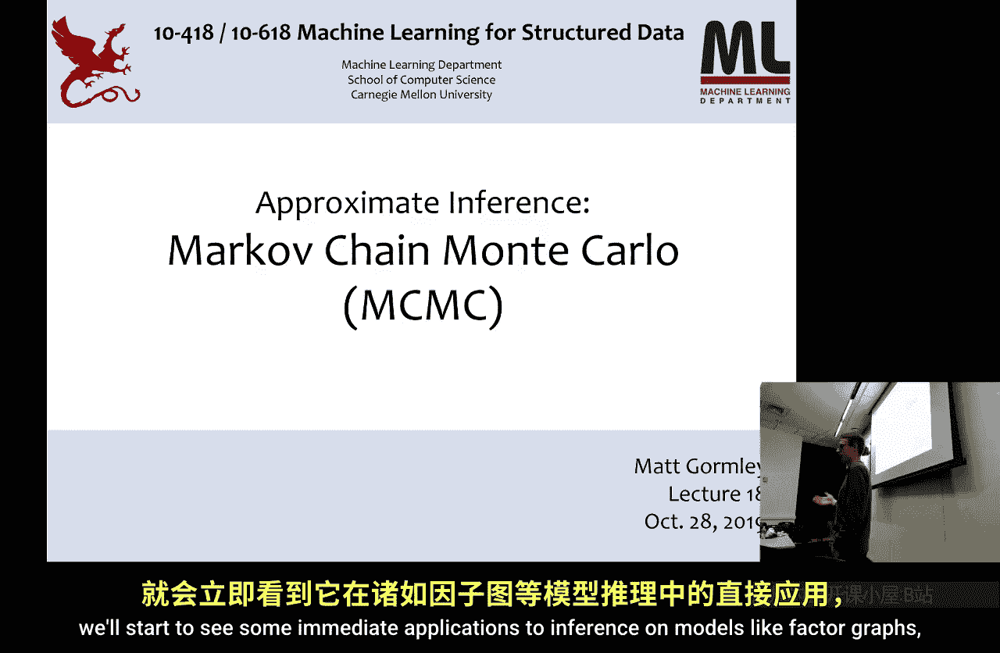
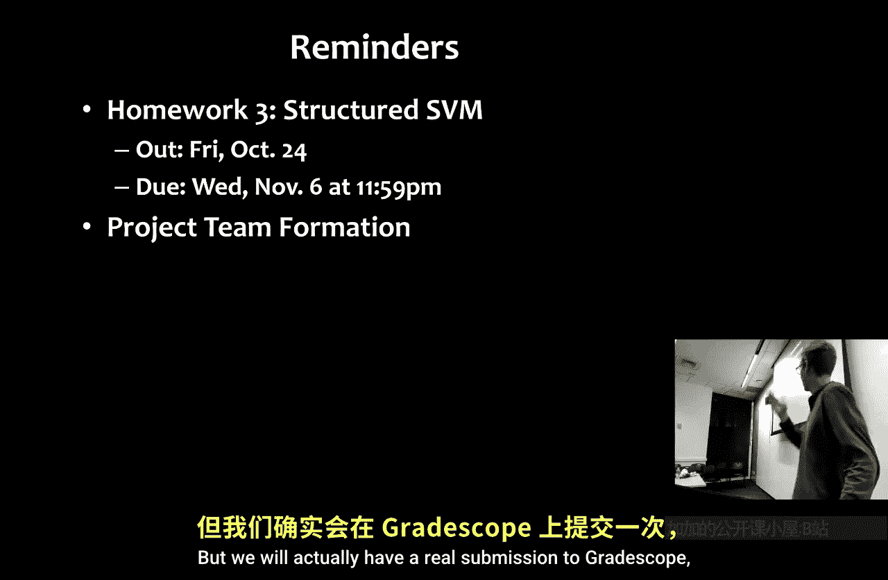
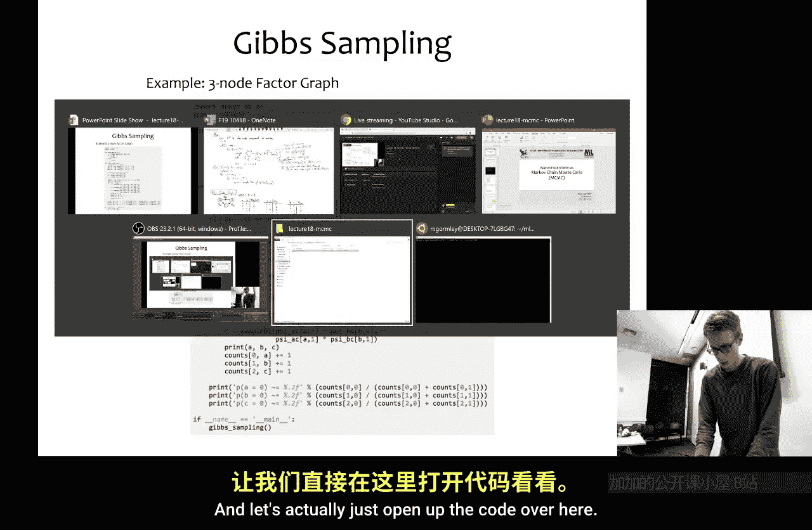
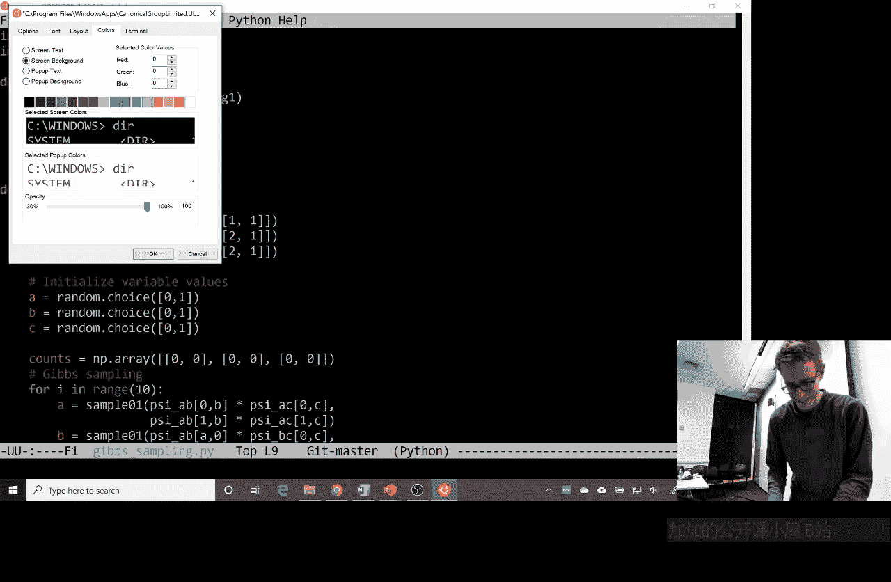
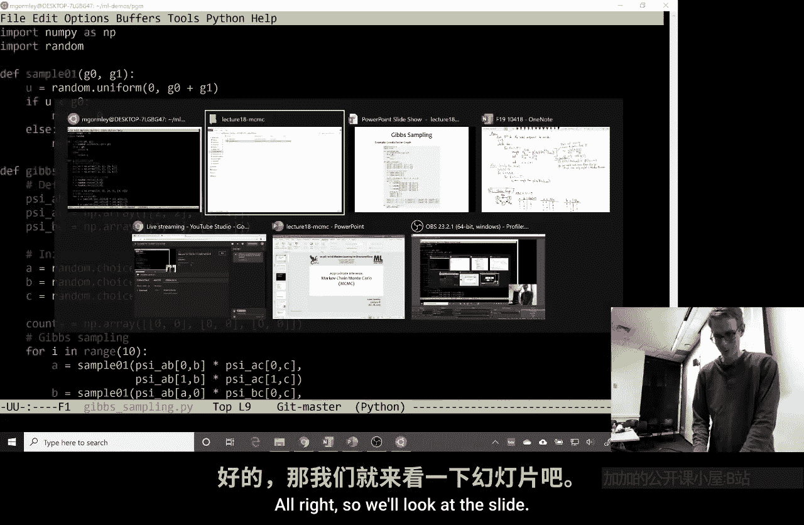
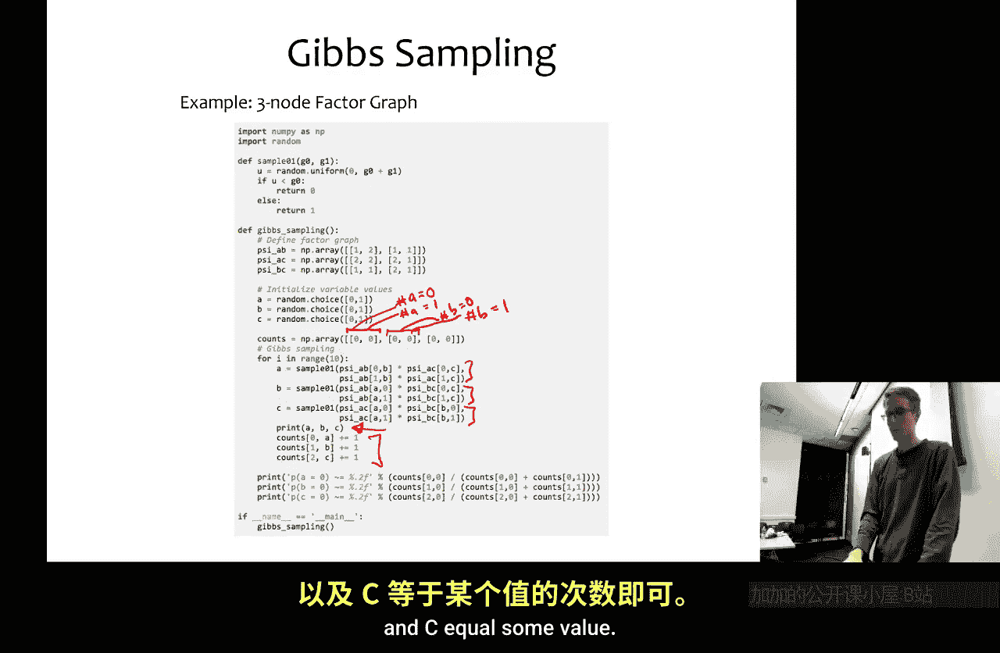
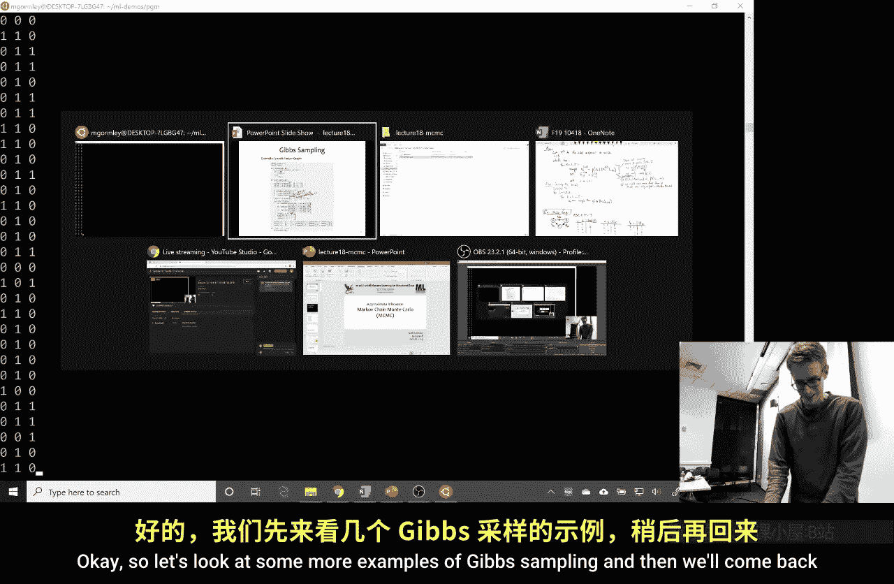
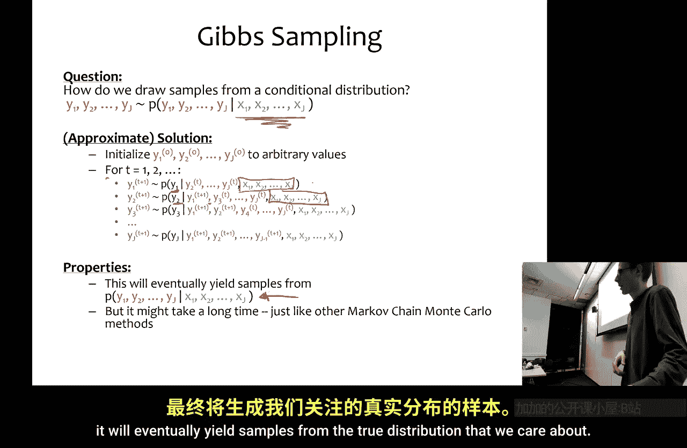
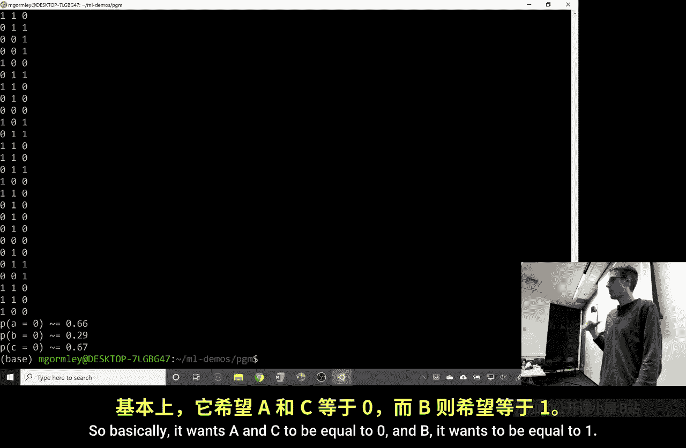
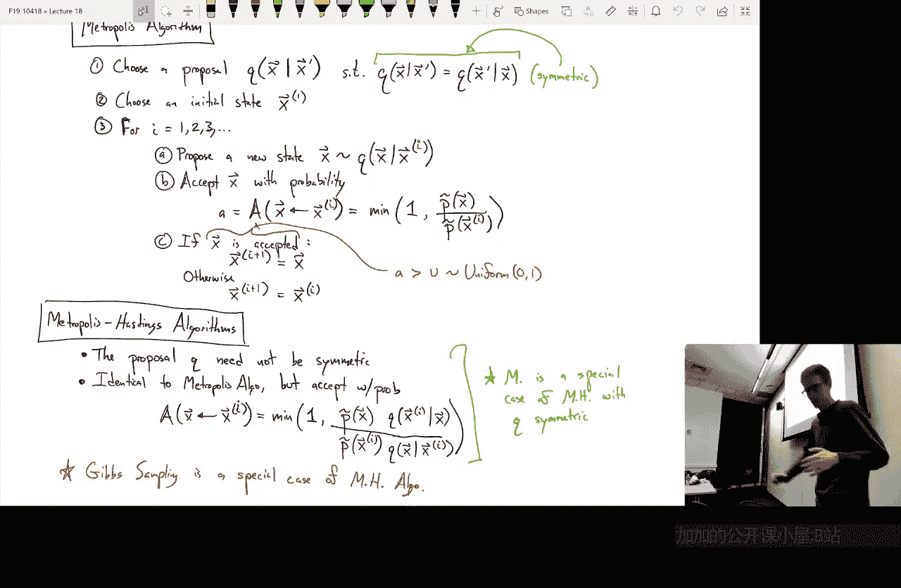

# 卡耐基梅隆大学【中英⚡结构化机器学习｜10-418 2019 Machine Learning for Structured Data】 p18 p17 10-418 ⧸ 10-618 Fall 2019 -BV1eJRsYBEaK_p18-

Very going back to。For 18618。这啲要嘅哋。Moving beyond Monte Carlo methods to Mark out chain Monte Carlo。

And the idea is that we're still going to be trying to draw。Samples from distributions。

 but we're going to be relying on some slightly different。To actually pull that off。So。As well。

 as soon as we get into G sampling， we'll start to see sort of some immediate applications。

To inference on。Models like factor graph。

Where we might want to use these。So。Homework  three is out。

 so if someone had asked a good question of you know。

 why don't we have a full two weeks on this assignment and the reason for that was so you know we。

We basically are trying to keep homework three， four， and five。

A little bit shorter than homeworkmarks one and two。If that doesn't happen on Homemark three。

 you should come and complain loudly to me so that we really know。

 though I mean we're actually really using。The hour spent that you report at the end of each homework。

I'm trying to track。How much time you guys are spending， so definitely continue filling that out。And。

And then as well， we do have a recitation that I didn't put up here， but we have a recitation today。

6，30 PMm in。Rashid auditorium GHC 4401， that's the big lecture hall。されてと。啊，现 then。

Project team formation， so this is an important milestone。In some sense。

It kind of goes hand in hand with the actual。Appal that isn't due for another maybe two weeks so the actual milestone for project team formation will be that we want everyone to correctly submit basically just their names in a PDF to gradecope using the team functionality of gradecope so there's。

There's just like enough trickiness here that we want to make sure that everyone's and ID is appropriate。

To a team in this way， and so we'll send out instructions for just how to go about this。

We had also sort of internally scheduled these sort of special office hours to just like chat about project ideas and also help people form project teams if they didn't have them。

 we had those scheduled for last week but we't quite ready to actually put them on。

 so we're just going to be rescheduling them to this week and as soon as we have a room and a date。

time for this。さきやさ。So so anyway， I think there's。A couple outstanding questions on Piazza when is this actually do。

 it'll be due sometimestime soon， but it's also， you know。

 if you find that you need to change teams like as the project proposal actually lands that's not out of the question。

 but we will actually have like a real submission to GradeScope just so that everybody knows how to use it。

Okay， so last time we talked about Monte Carlo methods and this time we're going to be talking about MCMC。

The algorithms at top， the metropolis algorithm， the metropolis aings algorithm gives sampling。

We'll spend a little bit of time talking about Markov chain and I have some extra material to talk about these last two algorithms。

 so we may or may not cover them just sort of depending on。

There's a lot of things to say beyond just these basic algorithms。Okay。

 so we're going to start with sort of a look at。The algorithms themselves。

 and then we'll actually come back to。Why it is that they actually work。

So last time we left off thinking about these different inference problems for a factor graph。

 which are， you know， computing different。Sort of quantities of interest。Given a fully trained model。

And we said that for the last three。Computing marginal probabilities。

 drawing samples from a conditional distribution。Computing conditional marginal probabilities that we could use samples to actually compute these。

So what I want to do is think about。Sampling directly from a joint distribution。

And so here what we're looking at is。Just a little example。

 akin to one that we looked at when we were first introducing Bayesian networks of。

Of an actual graphical model， as well as the conditional probability tables for that graphical model on the right。

And I didn't write them out as tables per se， I wrote them out mathematically by saying that the random variable T follows a granoully distribution。

 parameterized by some parameter town。And tu has the value12。Okay。

 so you could think of that bely distribution as an evenly weighted coin flip。So H is。

Also parameterized by a Bernnoli with parameter eta equal to1 third and then a is a Bnoulli parameterized by alpha ht and here you should observe that the parameter for a is dependent on the value of H and T so here we depending on if H is equal to0。

 say and t is equal to0， then the parameter alpha takes value0。

So that would be like a coin where whenever you flip it， it just always comes up heads。Or sorry。

 I guess maybe if alpha is zero， that means it always comes up with tails。And then， the last。

Variable here is。Just。A uniform distribution。Over the numbers is one to six plus the value of a times another uniform distribution。

So if we want to draw samples from the full joint distribution。Of a Bayesian network。

All we need to do。Is proceed through this generative story。

Line by line and that will give us a sample Okay， so what does that mean Well， for sampling T。

 it would be like you pick up a coin and you flip it and it comes up heads and so we write down that T is equal to one。

And then you pick up another coin， but this time it's got weight one third。

 so this is a different coin and you flip that one and it comes up tails。SoThat's zero。Now， for a。

啊We know what agent are。H is zero， t is1， and so alpha needs to be the value1 half。Okay， well。

 we actually already have a vernoully distribution parameterized one by one half。

 we just use it to sample T， right？So that's just an even coin flip。 Okay。

 so we flip that coin and a comes up， let's say。As。Heads。

So now when we need a uniform distribution over the numbers one to six。

 that would be like rolling a die。So it comes up three， and then we need to roll another die。

So we have another uniform distribution times a。So it's going to be three plus a times whatever the second roll of the die sums up。

 okay， so we roll the second die， it comes up two。So3 plus a times2 is5。

So that's how we draw a sample from a joint distribution， this is very easy。嗯。

And we could just continue drawing samples exactly in this way。 You just start back at the beginning。

 flip a coin， sample T。 you get 0， flip another coin， sample H， you get one。Flip another coin for a。

 you get zero， flip another coin。Or sorry， roll some die。

 say you get two and you could just proceed through this process collecting examples。

And gathering data in this way。So。What we saw last time was that you could use all of these samples that estimate different quantities。

 but some of those quantities you might get sort of poor estimates of。So for example。

If I wanted to estimate a marginal probability， say I wanted to estimate the like。

The probability distribution over。啊。T。And H， given that a is equal to zero。Well， in this case。

I actually only have one sample for which a was equal to zero。That was this work。So， here。Oh， sorry。

 and let's say。Maybe we condition on two things。Like a equal to zero and C equal to2。Well。

 that did actually come up once， but I only have one sample from which to estimate it。

There are other combinations of A and C， for which I have no symptoms。

And so in order to even see those conditional。Margiinnal distributions。

 we would need a lot of samples of those specific cases that we care about。So suppose， for example。

 you were trying to use sampling to estimate the marginals of an HM。

So you have a sentence like time flies like an a arrow and you're trying to estimate the marginal probabilities of the tags。

So what I'm saying is you could draw samples in this way from the full H。

 you would draw a sample of tags and words。But if you wanted to estimate the marginal probabilities。

Conditioned on a specific sentence， you're going to have to keep on drawing。

 sample after sample after sample and discarding all the ones for which the sentence is not time flies like an error。

Because they don't apply to actually estimating a conditional like this。ok。So Markovane money Carlo。

 the goal here is to draw approximate correlated samples from a target distribution P ofX。

OkayNow the fact that the samples are correlated， I guess I read that in the poll。

It's not necessarily that we actually want the samples to be correlated。

But any Markov chain money cargo method is going to have that。嘢。

And so what it actually does is it performs this biased random walk around the distribution。

And if we run it long enough， the samples that come out of it will eventually be from the true distribution so long as we set up the Markov chain correctly。

Okay， so it's useful to kind of see some picture of。啊。You know how these things actually work。And。

So what we're going to do first is a visualization of Gibbs sampling。

And so you can see if you watch carefully here， that what we're watching is basically a random walk。

 so it jumps to some new point at the end of the green arrow and then it resets from that point and takes a new jump somewhere else。

And so we're always taking these steps around the distribution。

 And if we let this thing run long enough。Oh， so sorry。

 an important detail here is that the underlying distribution the is shown by the contour plot and then also the heat map。

 so high probability regions are darker。And you can see that as it's drawing sample。

 we're also collecting a histogram over the different values for say， the variable x1。Variable x2。

And as we run this sampling process。Those histograms are starting to match the true marginal history。

We' just shown as this。1。And so if we turn up the speed。So here we have an autoplay delay of 250。

 So now let's get this down to。No delay。You can see that as we collect more and more samples。

 these marginal distributions are starting to look more and more like the actual true marginal distribution。

So how is it that they actually create this little。Histogram， well。

 you can imagine just taking all of those points and projecting them directly down onto this axis and just counting how many land in this particular bin and how many land in that particular bin and so on。

Great。So。So， next。I want to actually look at how does this algorithm work。So， let's。

Let's see how it works。So。Give sampling。嗯。Alobly a little algorithm。The idea is。That we。

Draw off samples。One variable at a time。嗯。From what are called full conditionals。

Which we'll define the moment。And。Those full conditionals are just。嗯。Oh， and we always accept。

The next sample， okay so。So you'll remember that last time we talked about a my Cargo method called rejection cycle。

where we would take a sample and we would either accept or reject it。

 so here we're going to set things up so that we always accept the samples that we're given。Okay， so。

So， full conditionals。Are just conditional distributions。For a distribution。Say P of x1。Ex2。

Up to X T。嗯。We have full conditionals。That are。呃。P of X I。Given。

All of the other variables except for Xi， so that would be x1。To。Up to X， i minus1。

Exi plus one all the way up to。き？And I mean， maybe a more proper way to actually write this。

With the P of。Xi given the set of variables， Xj。Such that J is not equal high。So。呃。

So here's the algorithm。We're going to say。L。X superscript 1。Be the initial state。Or rather。

 let me rephrase that the initial assignment to the variant。So。Here。

 this is a vector x1 giving us a value of every single one of our random variables for the distribution。

And then we're going to say。嗯。Well， true。We're going to repeat the following。So。

For each of the random variables， so we could say for。I equals。啊。one？Or let's say， for a little。

Little T equals one update。Capital G。So this is for each of the random variables。We're going to。西博。

One of the random variables。Oh， actually， sorry， let me be a little bit。呃。So we're going to。

 I'm going to use T。So I'm going to use I to index。これ。Make sure I get this right。

So we're going to use Subscript。我有钱。To index the variables。So that I can use。就是。The value， I。

Whatever I'm referring to certain time steps。Okay， so carry is reinded。Okay。

 so now what we're going to do is we're going to say。Sample the variable。X T。

 and this will be superscript。I plus one。From。That full conditional for that random variable。

This is going to be the probability distribution over X T， given all of the other variables。

 except for X。So， that would be。X， S。Were all S not equal。

We're just resampling the value of one of the variables。And we're using。The values of。The诶。

The variables that。Time step up。So we're going to have some counter。Back here。Let's keeping track of。

Our time steps。 and we could initialize I to be。not zero one。So this is。たしと。Okay。

And then we're going to set。呃。The诶。The actual value。呃。嗯。Of I to now be。I equals。Oh， sir。

 let me be very careful。嗯。So we just resampled one of the variables。

But all of the other ones have stayed exactly the same。

So just so that we're kind of indexing properly with time sets here。We're going to say。

Set all of the other variables。Besides tea。At time， i plus one。To be equal to。

All of the variables besides T。At time。啊。人咩。We can set I equal equal to high plus。

So here all I'm doing is just making sure that that indexing。In terms of。

Timetamp updates every time we resample one of the variables。So this is the whole algorithm。

 now let's actually look at at applying this sort of general algorithm to a specific extent。

So our example here will be。factorogram。嗯。We'll say that the factor graph is pretty simple。

 it just consists of three random variables。诶。B。And see。And the factors， there's one factor。

Between each pair of random variables here。And they're labeled as Psi A B。就系公司。就系咩时。

And for simplicity， we're going to say that each of these random variables， A， B and C。

 are labeled as either plus or minus。And we need some factors here。

 so let's just spell out what the actual entries in these factor tables are。So， here we have。晒系啲。

And so there's four different values， so there's plus plus。Minus， minus plus， minus minus。

And we're going to have values of。1，2，1，1。So that's our first factor table。反呢。For the factor， AC C。

Here， again， we have four entries。And this is going to be all twos except for the last one。

 so it's going to be two， two， two， one。And then the last factor table is for A B or sorry， B。

So here。We're gonna。The values be。1，1，2，1。So there's our factor tables。

And the first thing that we want to think about is where we're actually going to get the full conditionals from。

So。The key thing that I want us to think about for this example is sort of how we can actually work。

With things that are proportional。To the probability。And。The sort of key observation。

That you need to keep in mind here is that。If all we're trying to do is sample from a distribution。

We only need something proportional to it。So， to simple。From a discrete distribution rather。Right。

 so some distribution say P of。Why。啊。We only need。方式。Proportal。That would be like some。

Something such that。至。functionction之。Such that。We have that the probability of y is proportional to。

诶G话。So。呃。So we have an example to think about here。

 imagine that you what we want to sample from is a distribution over three colors。Like red。

Green blue。And。呃。You know that。Red， the probability of coming up red is proportional。I really agree。

one。Probability of blue is proportional to three。So in that case。

All we need to do is either take those things that are proportional to the distribution and we could just renormalize it or we could do something。

Even simpler， which is。Draw some value from a uniform distribution。Between 0 and。1 plus1 plus 3。

 which is5。So draw some value between zero and five。And then。In step two， ask the question。

 which bin？Does you land in？Right， so you can think of this like。Here we have these little bins。

And they're spaced out according to these different values， right。

 so here's the bin between zero and1。And then this bin is from one to two。

 and then this bin is from two all the way up to five。And so if we sample between zero and five。

That's like taking some value。Randomly， maybe like the value 1。8。And 1。

8 lands in the bin corresponding to regions so we could return region。Okay， so with that in mind。

 let's go back to our factor graph here， because we can say。

 you know one of the full conditional that we want to work with is something like P of A given B and C。

So this is one of the full conditionals。We can start by rewriting this。嗯。P of ABC。Divided by P of。BC。

可以す。It's just probability。嗯。So。What this means。Is that we have our first sort of version of something that's proportional to our original quantity。

 right， so we could say。This。Holds with equality。But this thing is proportional to。B of ABC。

So why can we do this？For this distribution。We need to make sure that。呃。

The actual distribution over the As。Is sort of preserved。

So we can't leave out any terms that would affect。What are the values for A？But PFBC。Its constant。

With respect to A。就。If we leave it out， we still have something that preserves all of the information about the relative probabilities of A。

Okay， so let's play this game again。嗯。And this time。Let's say， well。This P of ABC here。系。

We know that。HeA。Is equal to according to you know。Let's say you we have our factor graph here。

 so let's assume it's a Markov random field。So it's going to be equal to1 over c times。晒诶 a b。就系诶。其施。

And side of B。Yeah。details like B given A C or like C given A B make。一一个直。So they come。你讲得佢。Yeah do。

我。Yes， exactly。 so yeah， so what what is going to be sort of different。Between。And。

The actual different。是 condition。你个知啊。So let's ask this question。How many table entries。

Are there for this distribution？That joint probability distribution。

LetLet me actually write it on the other side。A number of table interview here。

And a number of table entries here。So how many cable entries do we have for a P of ABC？

And for P of A and a B。去。So only two of those eight joint probabilities actually come into play when determining this conditional distribution for a specific value of V BC。

So now this question is a little bit misleading。Because。We can also say that， well。

Maybe this is actually a table of eight entries。But only two of them sum up。

To one for each value of B and C。So。Okay， so here's the interesting trick that we can now play。

So here's our definition of PM ABC， which is how we actually define the thing。And。

Now we can play another trick。With proportionality here and say that this is further proportional to。

Well， only terms that actually involve。え？So Z is constant with respect to A。We don't think this term。

诶。B and C are concept。So we don't mean that term， so all we need are psi of A B。たさいあ。A事。Okay。

 so if you want to compute。A full conditional。For P of A， given B C， you only need to multiply。

Two numbers together。Okay， so let's spell out all the full conditionals here so we can see the bigger picture。

So full conditionals。Are going to be so there's three of them。There's P of A given B C。よ。

He have B given A。And P of C。Given A B。So the first one is proportional to。si of a b and side of a c。

The second one is proportional to p of。A啲。晒啊 b c。And a third one is proportional tos of。你试晒嗰啲。Where。

 okay， I'm kind of getting lazy here， we should have subscripts under all theseses， A B， L AB。

You guys know what I'm talking about？嗯。So。So there's a couple things that we should say here。

 one is we're going to take each of these。And we're going to call it some function。Of a。

 like a function G of a。And then this， we can call some function。G of B。And this is some function。

G of C。And you could think of these as just defining。A little distribution over。

The possible values are。Plus， minus。And B， then maybe they look different， right so maybe here。Plus。

 is pretty unlikely， and minus is pretty likely。 And C where maybe it's the other way around。

Plus minus。But the other thing to notice is that。These functions。Might actually change。

At each iteration。我也在。Why would the function G of A change？What the power distribution。Well。认是。

It's going to stay the same。But here G of A is like a function over plus and minus。

So the actual like relative ratio of plus and minus might change from it ratio to。

What causes that change？ゼさん。说的。Well， we're sampling something that changes， but what changes？

Is it we're excluding the。TheI probability at every it。嗯。は選挙が。It's truee。呃。

Where I refers to one of the variables。That's not quite how I would put it， but I mean， in essence。

 yes， can anyone sort of rephrase that in a different way？cameExactly。

 it'll change depending on what the values of BNC are。So G of A。

You have one value for G of a equal plus G of a equal minus， but it all depends on the。

Values of B and C。系就。These values。Here， highlighted in blue。Are essentially。They're sort of fixed。

While sampling。So。Let's actually spell out sort of the whole。The whole algorithm here。

 just for this small example。So the algorithm is going to start。Just being the gift sampling of by。

Initializing。诶第。Be rain。Do some values and。Not zero1， but plus minus。And then from there。

 we're going to say。For。I equals one， two，3， and so on。

We're going to resample each of the values of the variable。四诶。Is sampled from the distribution。E啊诶嘅。

历史。B is sample from。第一个呢。C is sample from POC。So now you can see how the values are showing up。

In these little quantities， right， we're going to be recomputing that conditional distribution。

Or using potentially a different conditional distribution each。So。

I thought it would be useful to see just how。How simple。嗯。This is。Oh， actually， sorry。

 before we get too far。嗯。We should make an important note。嗯。Just don't want to forget this。

I're going all the way back up to。Broader algorithmic definition here。え？The important note。

Is that when we're sampling from these full conditionals。It does not。Asum。

Access to the partition function。For example， if。If P of X。Is defined as。必修嘅咩。就解第事。对。

We don't need the full distribution P of x。We only need。Pil的。So。

So this is nice that we don't actually have to have the partition function and we can still do this sampling and so the reason I want to kind of call it out in the general case is now when we look back at our small example here。

That's exactly what we're seeing， which is that when we define the old additionalitions。

 we did it without access to the partition function。Okay， so now let's actually look at。

An example of a， oh yeah， question。公 activity original grade。Incre by。哦。

This I implemented it after the end。Oh， yes so。I shouldn't have even written。So。

I was like being too tricky for my own good。In this particular definition。

Let's let me just let me just define another。Exactly identical， but slightly different way。That。

Pro不对。呃。We'll make this clear。 So this is exactly the same。啊佢哋咁。As of left， again。

 I'm just going to write it different。诶 so。Iized。On here。And then we're gonna to say。诶。Well， true。Or。

 rather， that's。いは？What I had the love。Which is a four loop。H4 one，2， three。And so on。

We're going to say。F tea。个好纸。Oh sorry， so the key changes that our'm about to make here is I'm not going to superscript these with timet。

So I'm going to just write this out。As if we just have a single vector of variables。So in that case。

 what we can do now is we can say for each variable。Just resample。The variable Xt。To be。

A sample from。P ofXT。Given。The set excess。That's not。就。What I've done here is I've just said。

At each time step。You're updating one of the very。Just res sample one of the values。

And then you just move on to the next。The next variable。Re samplele。But you update it。

 you can imagine X here is just like a vector。Of values。

 you're just updating one entry in that vector at a time。

So the full condition is to the same for monitoringet of diet。Or are they also updated every？诶。这。

These full conditionals。呃。嗯。Except that。Like if you want to do。

 you could pre compute all possible full conditions。え。

All of those values were something proportional to all possible full conditionss。But in practice。

 you。You probably don't need to。Because you might never observe。All of the things。

 the possible configuration is the variables you're conditioning on。Right， but once we sample。Right。

 then the number of times we observe the regular X changes， right。

 So the full conditionals should change in accordance。No， so。呃。

Proability distribution is not changing。The only thing that we're doing is we're using。

Particular probability from that model。So the value of X T。And this right hand side can change。

But the actual distribution itself is remaining constant。

So it's just which full conditional are we looking at？Okay， so so let me actually jump。

 let me preview something I was going to show this sort of afterwards， but I think this is like。

Exactly the rate moment to。To see this。嗯。就。Gal models。

 the full conditional only needs to condition on the Markov blanket。So when we're working with。

Give samplers if you want。The probability of some variable like x6 conditioned on all of the other ones。

The graphical model tells us。That that is equal to。

The probability of x6 condition only mark out blanket。

That's one of the first independence properties that we came up with for these。

And the same thing goes for an undirected or indirected graphical model or factor。

And the point is just which of the variables？Are actually in the Markup link。Okay。

 so this is critically important because if you think about。

 how many actual entries in the full conditionals， if you spelled them all out without conditioning of just the Markov blanket。

 we had10 say we had 100 binary random variables。Okay。

 well then if you spelled out all of the possible full conditional values。

 that's a table of two to the 1 hundredth values。But we're only going to compute the ones that we need on the fly with the。

With the actual markup blankets。So， so this is sort of the key。The key thing here is just the。嗯。

Like those probability distributions are fixed。But how we're using them is changing from iteration to。

Okay。So now let's actually implement Gibbs， oh， yeah， question。So the particular X we have here is。

The same as the these satellite we had an importance to。えすでせんだね。诶。Pete， oh， yeah。

 what What notation did I use for。I don't know。 it was either key in importance in the election。

 but it' the same thing。 but over there， we did defined kind in concept of conditionals。

 we just had some key star。That's right， so the difference is that a full conditional is the probability of one variable conditional all of the others。

Right， so overard， Ma only computer bags makes sense and bias competition less intensive。

 it makes sense， but over there， what was speed star done？And how will be evaluate these eggs？

And how is that less intensive than evaporating？Oh， because so here。

 so I guess what I'm saying is that。If you can sample from。呃，Ptilda。嗯。

Then like if you had sort of full conditionals of Pilda， that would be sufficient。呃，这。

To get you back samples from P。Re and。But then like this is even more relaxed because here we're going to have some graphical model from which we smell。

Okay， so in itss most general form， the point is just that。You can， you can compute。Sorry。

 so I guess we need to maybe spell this out。So to prove that you only need beilda is just a short exercise right so if you want to draw samples。

From P of x。Then verse sorry from the conditional P of x。Like P of X T given。Excess。

S's not equal to T。对。That's proportional to。呃。P till the。Of。X1。Up to X T。That's the key point。

So this full conditional。Is proportional to the joint。In this unnormalized detailedt。And then。

 further。So this is like。嗯。Two great ideas。So I one， and ideal two is we might need。Even less。

Then Pete Tilda。If we can rely on a Markov blanket。Just a markup bracket。

So the way that we spelled out the sampling here was technically nothing to do with。

A graphical model， right， we said you just have to have some way of sampling from these full conditions。

And in the most general sense。If you know how to evaluate something proportional to the joint。

And that is enough information that you can sample from this。But better yet。

 if you know that you can just sort of relax that to just a Markco blanket。

 then you're in really great。Okay。So can we is that？So what I was asking us over here。

 I can see how people that leakcomp poses into product or potentials of the macroplanet。

 which makes sense， but over there in important rejection something we didn't really discuss the form of be with the eggs。

 we just presume that that exists some with the eggs， but how do we get that。嗯。

That's not your bill item Oh， oh， sorry， okay。Just multiply all the factors together。

 multiply all the potential functions。Without dividing by。Okay， so we still't need access to other。

Yeah。That's one example。Other distributions where。Like say， yeah， but I mean。

 that's basically it just multiplying all the potential functions together and not dividing by the。

Which is generally like the hard thing to compute。But so I remember reading into one of the readings that the have that there are two reasons why reading he calculate these tota x。

 one verse that is strictlyact the part function and the other verse because this P of x is in the matrix had。

so we calculate the star effects of the data effects， which is in a lower dimensional space。

 but if we just fund by all the fetch function， then the dimension directly remains the same for to the distribution。

Thank you。So but I mean， multiplying all the potential functions together is still linear in the number of variables。

So even if it's high dimensional。The actual act of multiplying the potential functions together is always。

An easy computation。So if I'm still not answering your question，' let's chat offline。So。

What I want to show is how we could actually run gi sampling on this factor graph。

So here we have some code to do that and let's actually just open up the code。

Over here。So。This is the code and the first function up here to note。Is。我先。呃。This is called Windows。

I don't ever use it except here。啊。😊，That's why it's not。Cos。Really， there's not like a。Now， okay。

 that's not going to be easy， I don't think。

Okay， all right， so we'll look at the slide。

And。嗯。So here at the top， we have this function。That's just sampling from an unnormalized distribution right so G0 is proportional。

 the probability of coming up。Heads and G1 is the probability is proportional to the probability of coming up tails。

 so we're just drawing a random number from a uniform distribution from zero to the sum of those two numbers。

 and then we're saying if zero if u is less than G0。Okay， so Gib sampling。We need a factor graph。

 so we can define the factor graph with Psi AB， Psi AC， Psi BCc。

 and those are just little lumpier rates where I've indexed them so that the first index is going to be。

 say for Psi AB， the first index is going to be the value of a and the second index is going to be the value of。

And for Psi Bc， the first index is the value of B and the second index is the value of C。

 and these are the same factor graph that we just wrote down。

And so we need to randomly initialize the variable values， Okay。

 so random that choice just takes a list of options。

Like plus minus and it selects either plus or minus random。So here I encoded plus and minus is0 and1。

And now I have this counts variable that we're going to use to count out the number of times that we see each variable assigned to a particular v。

Okay， so that's all this is going to do。 So we initialize those counts to zero。

 And so here you could think of this as like this is。So， this is。

Going to give us the number of times。That a is equal to 0。

 and this is the number of times that a is equal to 1。And then here。

 this is the number of times that b is equal to zero。

And this is the number of times that b is equal to1。Okay， so now。Let's actually do。And so on for。

 So now let's actually do our sampling。So I is just iterating over time steps right how many times am I actually going to sample all these so we've already assigned values to A B and C。

And now we're going to say reamp the value of a。So to do that， I need two numbers。

One is a quantity that's proportional to the probability of a equaling zero。

 and the other is a quantity that's proportional to the probability of a equaling1。

Those numbers are really simple to get， right。The two factors that participate， so Pi A V。

For0 and whatever the current value of B is times psi a C of0 and whatever the current value of C is。

And then the same thing for Psia B with a equals1 and psi of C with a equals one。

So all we're doing here is resampling A。And then reampling B， and then resampling C。

 And then we just print out whatever the values of A B and C are after we resampled them ball。

And then。Here。啊。Couning up。The values of。A， B and C。So now there's sort of an interesting。

Question here， which is。How many samples are we actually getting out of this route？

So the way that I set it up， we're getting out。天せ。At the end of it of reling A and B and C。

I get one sample。ょが。By increment， you know。The value of A and value of E and value of C for that particular sample。

 and I print out that sample。Okay， but I could have taken these four liness printing out the same whole。

A的 health。And injected them in between resampling of A and B and resampling B and C。

 such that we would effectively get back 30 samples。One after each call to sample 01。

So this was just a design decision。And。系。It doesn't really make a big difference here。

And then at the very end， I'm just going to print out。Our estimate of the marginal probability of A。

 B and C， and we do that just by looking at those counts of counting up。

 how many times did a equal some value B equal some value in C equal some value？

Okay。So now。Let's go ahead and run this。Good。So it ran， it drew 10 samples。

For1 that we kept track of。And an estimated P of a equal zero is 80%。B equals zero is 30%。

 and C equals zero is 40%。Where I'm assuming you can figure out the P of A of one was 20%。

One minus P of a equals here。So that's nice。You know。1en samples isn't very much。

So why don't we sort of turn up the number of samples here？So rather than 10。

 let's say we're going to do 100 singles。So we run this again。ItTurns out all of our samples。

 and now it's getting 0。67， 。3 and 0。63。That still feels like a little small。

 Why don't we multiply that by 100。 Now， we're taking 10000 samples。

And we'll sit here for a little bit， printing is the thing that's taking the majority of the time here。

If we weren't printing this out， it probably would have done long ago。这 are。

Somehow this printing didn't take very long。So maybe the Mac terminal is like doing better buffering or something。

Okay， maybe we'll kill this and comment out the print loop。

I guess we could also just come back and check on it in a little bit。

Okay， so let let's look at some more examples if you have sampling and then we'll come back and see what our estimates have beenmark。

呃。So this is just sort of a picture of the original little。

Web browser demo of Gib sampling that I showed you， right。

 What was going on there was that we had some。Initial values for x 1 and X 2， right。

 So heres some X T。 This is a vector， right， and it has some value。啊。Oops， sorry。

T here is indexing the timestamp。 So this is like x1 T。The value here would be。X 2 T。

And if we took some full conditional as just a distribution over x1 condition on x2。

Now you can sort of see why we wouldn't want to store all of the possible full conditionals because here x2 is now a real number。

And so the actual distribution over x1 is really like a slice of this two dimensional distribution。

And so when you compute that full conditional， you really want to do it for the current value of x2。

 so compute it， use it and then probably discard it。Okay。

 so we get this distribution and then we randomly sample。From this distribution。

And let's assume that you already know how to do that by either some efficient method or some money cargo method。

 but somehow it's pretty easy because it's just a one dimensional sample and you get some new sample that's Xt plus1。

Okay， so now you move there， this is your current sample。And now you get a new distribution over x2。

And you sample a new value of x2 that gives you a new sample xt plus2。And you move there。

And now you get another full conditional to sample another point and you just gradually move around this space。

So。We can use Gib sampling to draw samples from a conditional distribution， like a say。

 conditional random field。If we sort of say， okay， well， we have a bunch of variables。

 these x's that we want to condition on。And what we're trying to do is just take samples of the Y's conditioned on the axis so we can initialize。

The values of the Y to some arbitrary values， and then for time steps t equals one， two and so on。

 we're going to draw these samples from the full conditionals Okay， so here the way that I next。

Time steps was。To say that。A sample is like a full collection of all the variables。

So we see that the full conditional for y1 is just conditioning on all of the x's。

And all of the Y is， except for y1。And then the full conditional for y2 is。

 again condition on all the x's。And everything except for Y2。Okay， and so on now a lot。

And so if we run this long enough。It will eventually yield samples。

From the true distribution of the carat。

Okay， let's see if this thing stopped， Oh， I did。And you can see that。

What it seems to be converging to is that the probability of8 equaling zero is about two3。

The probability of b goinging zero is about third， and the probability of b goinging zero。

two so basically it wants A and C to be equal to zero and B， it wants to be equal to one。

 so let's actually look back at our factor graph。

And we can see。That the actual way that I encoded those plus minuses。

 I think was plus zero and minus is one。So here， the factor for AB is saying， you know。

 I really like。To be a zero。And the factor for B is saying， I really like C to B。0。

And then the AC factor。It's basically saying I don't really care。Oh wait sorry。

 did I read that wrong？Yeah， so it。So it just really doesn't want them both to be minus minus。

And I guess for B。Both of the first and the last fact。

Those twos are cases where b is equal to minus which is。

So you can kind of see like just even by looking at this particularly tiny example。

 you can kind of guess what those marginals would have been。

And the sampler did actually get it right。Okay， so in general。

 when we're working with these factor graphs， we don't just have three variables。We actually have。

A bunch of variables。 and we only condition on the ones that are actually in the Markov blanket。

 and we only need to multiply together the factors that involve。Don't mark up them。Okay。

So now we're going to talk about a slightly different algorithm。

Called the Metropolis Hastings algorithmri。And。To get there。

We're going to first talk about the metropolis algorithm。Okay。So， the metropolis algorithm。

We're going to say。That like importance and rejection sampling。

 we're going to have a proposal distribution， but the form of the proposal distribution is going to be quite different。

 So we're going to choose。え。그 풀어줘。And that proposal distribution is going to。Be a distribution over。

The vector X。Conditioned on。A vector x prime。And。We're going to choose that proposal。Such that。Q of。

X given x prime。Is equal to Q of。X prime given an X。What this means is just that。

The actual proposal distribution is what we would call symmetric。So the proposal distribution。

 what it's going to be used for is we're going to condition on the current sample。

To give us a proposal for a new sample。So that's why it's the full vector X。Okay， so like before。

We're going to choose。An initial state。And this is going to be some vector x1。And now。We'll say。

For time steps， I。Equals one。To。3 and so on。We're going to。嗯。ければ。number。I actually refer to them。

 so step one， step two。Seep three， then we'll have step3 A。In step 3 A。We're going to propose。

A new state。And that new state is going to be some。Vectctor X sampled from。Q of X given。

The X at time T。Now， that X doesn't automatically become our next sample。😡，Instead。Step B here。

We're going to accept。That newly proposed state X。With probability。Of a。Where。

This little a it's a value between zero and1。So there's going to be a coin flip。And。

We're going to say that。This acceptance probability， we'll talk about it as。Some capital A。Of。

Getting。This new sample， X from。Xティ。So we're just kind of giving it this fancy capitaly name so that we can actually refer to it in the next algorithm。

And we're going to define this to be。The minimum。Of two quantities， one。And。啊。P Tilda of X。

Divided by。Pteilda of。Xt。Yeah。So， here we have。会睇过。Thanks for catching。Yeah， so we're iterating。

And then we'll say。That step C。So， if。That vector x is accepted。Then， we said。The value of。呃。

Exit time。I plus one。To be equal to your x。Otherwise。We set X。That time， I plus one。

Equal to the current x。At tone I。So this is really sort of a definition of what it means to accept a sample is that we're going to carry it on。

 we'll actually like move to that as our sort of new state。Okay。So啊。

When we say that if X is accepted。What we're really saying is。

We want to know whether that quantity A。Is greater than some U when sampled from。

A uniform distribution。In the range zero to one。So if you sample a value between 0 and1 and a is greater than u。

 then we accept。So it's like flipping a weighted coin with weight A。Okay。So。嗯。

So this is the metropolis algorithm。And now。Given this metropolis algorithm。

 we're going to define one more algorithm。Which is the metropolis Hastings algorithm。And here。

We're just going to take the metropolis algorithm as is， and we're going to make a small tweak to it。

So the proposal。Q。Does't need to be symmetric。So。For the metropolis， Hastings algorithm。

So this algorithm is identical。To。The metropolis algorithm。Except。There's one change。

 which is that we accept。With probability。呃。But's slightly different。

So here the acceptance probability is。A of x。From。Exit time I。And。We define this to be the men。

Of one。And here we're now going to do something that kind of looks like important sample。

So what we're going to do is we're going to say。呃。We're going take P tilde of X。And divide by。

P Tilda of X I。But then we're going to scale this thing。By our proposal distribution。

So in the numerator， we'll have。Q of。X I， given X。And then the denominator will have Q of。X。

Give an x。So basically what we're doing here is we're saying。That。The metropolis algorithm。

Is just a special case。Metropolis Hastings algorithm。With。Q being symmetric。So in fact。

 if you kind of jump back up here and think about。Replacing。

That acceptance probability with our definition down here。And Q is symmetric。

Then we have that this quantity is equal to that quantity。So this is just like multiplying by one。So。

What we're doing in metropolis Hastings is a little bit different。啊。From。啊。From Gib sampling。

 because we actually have to have this proposal distribution。And we propose some new state。

 and then we only accept it with some probability。 The interesting bit is that。It turns out。

That gives sampling。Theres a special case。Of the metropolis Hastings algorithm。So。

How is this possible that Gibb Sandley could be a special case of metropolis Hastings because it feels like metropolis Hastings。

 you make a proposal and then you're going to flip a coin to accept or not accept？Okay， well。

 here sampling， we'll see next time that you can set things up so that the proposal distribution。

For Gib sampling is just sampling from a full condition。

And the acceptance probability for that specific proposal distribution。Is。Always going to be one。

We're always going to accept。The proposal from the full conditional。

So we'll be able to see that the Gib sampling algorithm is a special case of metropolis Hastings。

 and then in addition， we'll see that there are properties of the metropolis Hastings algorithm that ensure。

 regardless of what the proposal distribution is that if we run it long enough。

 we should eventually get samples from the distribution level。Okay。

 so that will kind of conclude our。Our look at these Markco Jane Money Carlo。

So we'll see you guys on。

