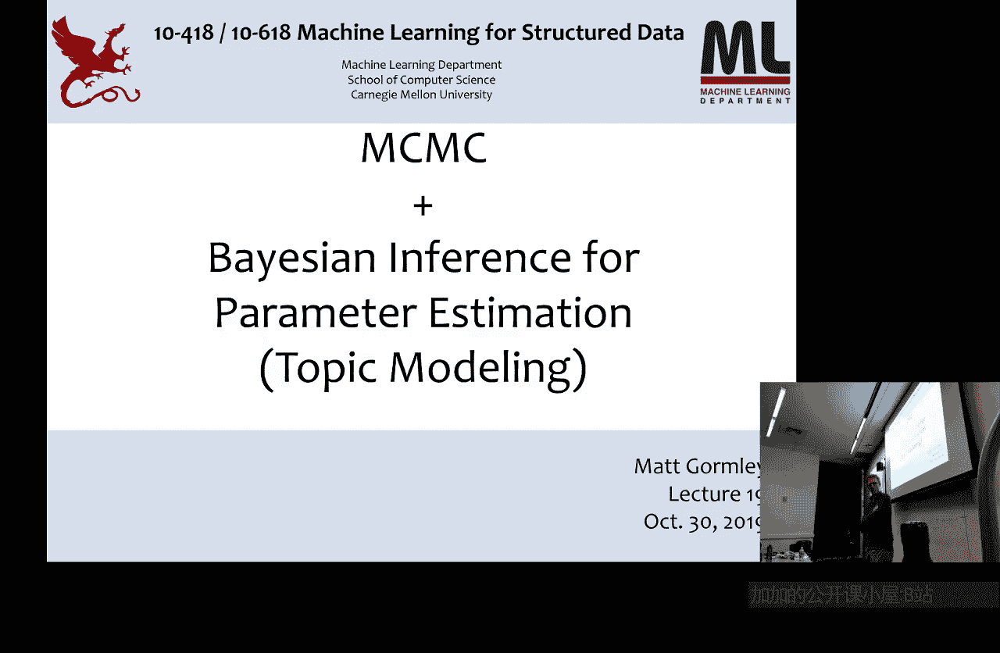
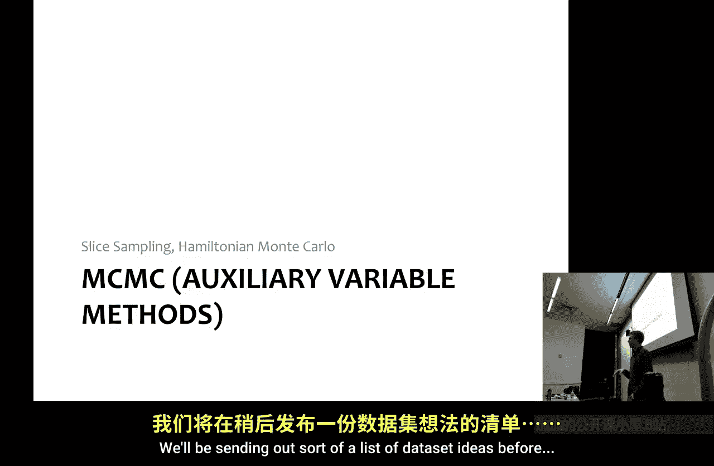

# 卡耐基梅隆大学【中英⚡结构化机器学习｜10-418 2019 Machine Learning for Structured Data】 p19 p18 10-418 ⧸ 10-618 Fall 2019 -BV1eJRsYBEaK_p19-

R。Let's get started。So， today。We're going to be talking a little bit more about MCFCC and then what we'll do is transition to a discussion of ba an inference。

And。嗯。We're gonna to。Sort of dive into the topic of Bayesian inference through a very specific application。

 which is that。Clic modeling is sort of like a。It's sort of a funny sub area of machine learning and somewhere in between like a set of applications and a set of methods。

So we'll be。Talking about that is an example of。How I you they。

One announcement here is just that。On Friday， we don't have a recipe。Instead， we're going to have。

Preduject team of office hours。Is this one 5222， did I get that right？

Maybe no one knows what so we're going to be in this room。On Friday。

130 the 145 to 250 and the whole point is that。We'll just be around to kind of have some informal discussion。

With classmates， of course staff are。Such。And so I plan to。

 I have a draft of kind of some project directions that I'll probably pose today or tomorrow so that you can kind of look through that before Friday。

Yeah， so that's the newest thing on the agenda here。

Great。So last time we left off talking about。The Metropolis Hastings algorithm。

And I'm just going to jump back to the actual notes that we were looking at last time。

Just so we can see where we had left off。And。So here。We were thinking about。抓le下。And。

The whole idea of the metropolis algorithm was that we could。Tsday。Proposal distribution。And。

Use that proposal distribution。To。Give us sort of a next possible sample that we might work with。And。

From there。Just copy this over。Okay。So啊。Using a proposal to distribution in this way allows us to。

Take samples of new。Potential states that we could。Treat as samples。And like a rejection sampler。

 we compute some acceptance probability。Which in this case， was the men of one。

The probability of the new sample or the ratio of the probabilities of the new sample to the current state。

And。呃。And then we accept with that probability。So what this means is that。Yes， the。

So it's important to look carefully at what this acceptance probability is actually saying。So。

 namely。If。So if the news。State X。Is。More probable。Then our current XI。This is telling us。

That we should always accept it。嗯。That's essentially what this algorithm is saying。

But if it's not more probable。Well then。We actually need to look at the ratio of the probabilities。

And we're only going to accept it with。With some fractional product。

And so the metropolis Hastings algorithm。We said， was， just like。The metropolis algorithm。

 except that。Change the actual comm of the acceptance probability to take into a account。

The relative ratio of。The current to new。And so by including this factor。We're now recognizing that。

You know， some samples might be sort of coming up too frequently。So是 that。By looking at the actual投。

O。So。In thinking about this algorithm， it's useful to kind of understand the actual behavior of this thing。

From。The perspective of a random walk。So here。If we have some generic proposal distribution for metropolis Hastings。

 like say， a Gaussian distribution。With mean zero and some。Some variance sigma squared。你。

We could basically think about this as working for pretty much any sort of continuous valued。啊。

Variable packs。And。The thing that we can then reason about。Is。

How the actual sampler would sort of move about in the space as a function of the proposal distribution。

Right， so。So the two cases that are interesting are。One where epsilon， the variance here is large。

So in that case。Essentially， the actual sort of。Region from which most of the samples。

Is going to be drawn is a really large region。And so if you have some probability distribution。

 say in this picture， P of x， where it's given by。Some contour plot， like the one shown。

And we can say that， you know， the majority of the probability mass。Concentrated。

Inside sort of this red area。Well。So， if we had a。啊。A really large。Epsilon， then essentially。

 that's kind of like thinking about a Q distribution that gives us。

A really large region to draw sampless from。Now， of course this is all probabilistic， right。

 a Gaussian is actually giving some probability mass to every value of x。

But you could think that most of them are going to be within say two standard deviations。

Of your current sample。And so， oh， and I should be careful here。 So we could say not that the。嗯，就。

Here。The Gaussian distribution， the way that I wrote it， it's actually always centered at zero。

So this means that it's not actually like changing with the value。

 So really what we should do here is say， okay， let's add。Xt here。

Or we could have had a Gaussian center at XT。So that wherever your current sample is。

 you're actually looking in sort of a neighborhood around。

And the point is that if the neighborhood is large。

 you might step way outside the high probability region。A lot of rejections。

And so this is very unproductive for the metropolis Hasting sampling。

 whereas if epsilon is very small。Then you might not reject very often。

 but you're not going to make much progress either。

Because maybe all of the steps that you're taking are going to be really tiny steps。So。

So for rejection sampling， the accepted samples are actually independent。

 and the reason for that is that the proposal distribution doesn't depend on the current statement So going back to。

My example here。Before I added the plus XT， that would be kind of like a rejection standpoint。

 this is just some generic proposal distribution that doesn't condition on the current state。

It's just a distribution over access。But once we condition on Xt in an informative way。

 now we get this random walkbe。So this is kind of the key contrast between our rejection s and metropolis Hastings is that metropolis Hastings has the sequence of steps at the random walk that are actually correlated。

And so the bigger question then that。A user of a Markov chainmon Carlo method。啊。

Is going to ask how long do I have to wait until I get effectively independent samples？

And unfortunately， that's not an easy question to answer。And。And it's going to depend heavily on。

How your proposal distribution relates to the actual true distribution。

For the reasons about epsilon that we just described。Okay， so。So if we have a Gaussian。

Proposal distribution。Then what we could say is that。

Independent states in the metropolis Hesings walk are separated roughly by。

Sigma X over Sigma bin squared steps。Okay， and the reason for that is that if you think of。嗯。

So what we're here， sorry， sigma max is going to be sort of the the。嗯。

The large variance direction of P of x and Sigma min is going to be the small variance direction。

Of P of x right and some this is an two dimension。And。

And but right on walk in order to get independent。States essentially， needs to。

Be moving almost entirely across。the actual high probability region。

So now we can actually think about Gib sampling in terms of it being a metropolis Hatings algorithm。

 so this is useful for a couple reasons， one it allows us to recognize that Gib sampling is going to have that same random walk behavior as metropolis Hatings it's just going to be slightly different than the Gib sampler is going to take these sort of axis aligned steps。

When it's making its random walk， because it's only updating the value of one variable at a time。

So let's actually sort of think through how we could write Gib sampling as metropolis Hastings。So。

Okay， so the idea here is that。啊。We can actually。Write down the acceptance probability。

Or an acceptance probability。For。Metropolis Hastings。As。We did before。

So this is just going to be copying down our definition of this acceptance right probably。

This is咩 one。And exactly what we have up here， so。Some tilde， P of X。最解拜。ピア x。あるき弟。

Times the ratio of。Q x givenq x i。就间变晒叫为晒。给你机位。So。What we want to think about is what do these quantities actually look like？

For the Gibson。Well， let's start substituting some quantities。So first， let's say。Well。

 this ratio of pizza the accentson。Betail the X I。That ratio is equal to。啊。P of x and， P of X I。

So not necessarily its like。I'm not claiming that we can necessarily compute the exact ratio of Pilde and Ptildexi。

 but just that it's something that we can write down and we can reason about the fact that。

These two quantities are identical。And then。The ratio of the hughes。

We can also write down what the proposal distribution for a Gi sampler is。Okay， so。嗯。

So this part is where things get interesting。 So does anyone want to sort of take a guess at what。

The proposal distribution for a Gi sampler is。So I think I said， I think I said before。

I kind of gave you a hint that。Gbb sampling is just metropolis Hastings， but it always accepts。

So what would the proposal distribution of the Gibbb Sr be？What is Q here？Q the x given。Because what。

So remember in metropolis Hastings。The idea is that。

You propose some new state X from Q of X given X I。And。What I want is to get。

So imp probabilitybability that we would use for。四十嘅时。所以你为你是没给过。Because they were really。So here。

 it's not that the proposal distribution itself needs to be equal to one what's going to end up being one is the ratio。

一你。So the question is just， how do we define this？自分的。That do we be a俾。

'sSo let's be careful about our indexing here， so X I。Is the full- so these are vectors。

So I'm just saying data。你俾这个地方。To be unitinated the denominator。Oh。

 you're saying just make sure that。Well， yeah， so we， we definitely want these two to be equal。

That's going to make sure that things are work out。But the question is， how could we define Q？

So that it sort of mirrors what we are doing in a gift same way。We he kill。Q of X I plus1。

 So the point is that we need to define what Q is。So here what we're actually trying to do is say。

Q is just a function that we come up with， so one example of a Q is like a Gaussian distribution。就。

Couldn't set it equal to a Gaussian distribution， or it could be equal to。No， a deish leg。

It could be equal to some other distributions that you might like。这为一个的水间方。So there so。

This is an interesting option。 So if it's uniform。呃。So remember here that。

We need to be really careful， because。We need this entire quality。To be equal to one。

 not just this ratio。So。So really， what I'm asking you to do is think about operationally。

 what is Gib sampling actually doing？Like， what does a， what does a sample from。

Gibb sampling look like right， Like， how do we get from one state in a Gibb sampler to the next state。

Let's maybe go back。This is what we wrote now as our algorithms forgive sampling。

So how are we sampling the next state？搞完这是不看就行。Yeah， no。Not just the full conditional。

 but basically one of the variables comes from the full conditional。

 and then all the other variable values are just kept exactly the same。So here。

 this first algorithm definition， yeah， it looked when we wrote it down right。

 like we did this kind of complicated indexing it kind of looks more complicated than it needed to be。

 so then we rewrote it like this， right？But now that we're looking at the first algorithmic definition。

 we can see really clearly what's going on with those X's and those Xi plus ones right the Xi plus one is exactly the same as X except for we changed one variable with a whole conditional Okay。

 so now let's jump ahead and try to write that down for Q of Xi so we could do something and here I'll just do some use of notation to say that what we're going to get back is。

This sort of combination of things， which is。Xt is going to be random sampled from。

The full conditional。So this is X T given。私はい。For all of the。The variables that are not T。And个。啊。

X do T is just going to be set deterministically equal to。The vector X。So。

So this is our proposal distribution。And the probability of transitioning to that new sample。

All we need to do is take into account the the deterministic part happens with probability one。

 so all we need to take into account is this top part， which is the actual full condition。Right。

 so the probability of a given proposal is going to be the ratio of。嗯。어 do I啊。

It always looks like I mixed up， even though like this was right above。

 I actually mixed up the indices of our eyes， right？So you'll notice， but in my key ratio here。

 I actually have this upside down。So let's fix that。So what we meant to do here was this is X。

Theumerator。在下一个到那。Okay。So now when we write out the proposal ratio， so Q。

 let's do the denominator first， so Q of x given X， that's just going to be our full conditional。

P of。啊，XT。Given。X I do t。And then the numerator is going to be。

Going in the other direction for the full conditional， right。

 which is essentially sampling the value back to the。To whatever XIT was。其 that会 be。X， T I。

 probability of X T I given。诶。Sorry。Without the eye， not tea。So all of the variables except for it。

So now we have this ratio。And。嗯。What we can do is rewrite this thing。But expand out。啊。The term of。呃。

P of X and P of X2。So namely， we can expand this out to be。Written in terms of。The variable X。Okay。

 so specifically think about， so what I'm about to do here。

Is we're going to basically say if you have some distribution over P of x and y。

 that's just equal to。B of x times。比 why。So let's do that for this vector value distribution。Okay。

 so what we get back is something like P of。X T。Given。X， not T。

that actually looks just like a full conditional times P of。X not two。你翻电仔。The the same thing。

 but now with eyes， P of X D I given。X， not T I。Times speed of。那天啊。And then this part。

 we can just copyright down。This is what just。Use as it is。 So this is just the。

The ratio of the full condition， so P of XEI given X。啊师。Divided by P。嘅。X Iな。

So all I did was I just sort of treated this as a distribution over XT and then everything else。

To break it up。Okay。So does anybody see what our next step？Yeah。How do we simplify this？

What's the relationship between。やっぱ quality。经议。And。X not t。Superscript。They're exactly the same。

Right。Because when you propose a new quantity， you're keeping those parts exactly the same。

 you only change one variable X T。So if these are exactly the same。Well， then。In that case。

We can just take。呃。This whole thing。And we can say。Well， these two quantities。They are equal to。

So this whole thing。你接各个关。喂。😊，It's just。up。X not t and divided by the probability of x not T。

And then， here。The thing that we need to be careful of is this XT and this XTI。

 those might actually be different， right？Namely， so we could write that down。 So X T。

Does not necessarily equal。呃，XTI。So。To cancel out the remaining terms here。

 we need to take this and this。Those two cancel and this and this。And those two kids。

So what we're left with。Is。This whole thing。Is the min of one and one。

So let's circle these just so we're about clear here。就。This blue box。Does this blue box go to one。

And this red box。And this real。So。This whole thing。We can see now that the acceptance probability。

No matter what the value。テ。付き合い。I's always going to be one。And so gib sampling。

Is just the metropolis Hasting algorithm， where a proposal is defined like that。

And where because of our proposal distribution being up this particular form， we always accept。

To be sure。indexでing。あい。Is。喂。One stage another。 And D is basically how we index our very。

That's right。Theき。YeahSo you could so let's let's think of this。

 I think I'll actually have this on a slide this little picture of like。嗯。You know。

 we have some X here。Right， and how do we get there， Well， we get there by starting at some。Vctor Xi。

Which is some other state。And the process of getting from one to the other is by following that cu distribution。

The conditions on。The X to get a sample。So there's many possible x's that we could have landed at。

 but we sampled one from that here， which was the specific X。So。

What we're saying when we talk about this。Q of x given an X for the gi sampler specifically。

 So I guess the maybe the the better thing to think about is。嗯。You know， when we were talking about。

Now let's jump back here。So when we were talking about metropolis he。

Let's actually sort of visualize how does this actually work， right， so you're at some XT， right？

That's this point。So this here is Xt。And then you resample some new X， okay。

 let's say you sample this value。Of。X。Now， there's some probability that you'll accept it。

 some probability that you'll reject it。 Let's suppose here that you actually do accept it。

 So it becomes X T plus1。Bummer， so Mike。I think， okay。

I switched I switched my notes to and I didn't actually update the slides。Okay， so。

Here T is equal to I sorry， like here I've swapped。Sorry about that。

The point is that the superscript is indexing。So that ignore the actual fact like letter itself。

So what we get then is that， you know， you're going to， from this point， propose some new point。

Maybe this one。And maybe it gets rejected。So then Xt plus 2。Is just the same as X T plus1。

Because we stay at the same place。Okay。And now you sample another one here， okay， well。

 that has really high probability， and so it gets accepted as xt plus 3。

And so this process continues and you might walk down to one side of the。

Across and the you set outside the high probability region for a little while and then。So。

For Gib sampling。If you think about。What we're actually doing with this proposal distribution。嗯。

Essentially。We're saying。We have two variables。即。one。And x 2。And again。

 we can kind of think of you know， having some。Probability density like this。

But now whenever we're doing the random walk， it's always going to be access aligned moves。

 you can't move diagonally so a proposal is going to send you along access to some view point。

And呢落佢而家嚟。発拶さめ。And then again， it only went across the axis。Yourpoint。

And this is just going to continue。But you're always moving in an access aligned aligned way。这就买的。

So that like it a sequence remain the same for every step。Like first we move next month。

 then we move next to everybody will opposite and then traffic。Yeah。

 so there's lots of variants of gicycl， so one of them is。

Rather than iterating through the variables。Randomly pick a variable。

And this so the way that we can see that this works is by looking at the properties of Markup chains that we're about to talk about。

 and we can just show that if you randomly pick the variable。

 you still satisfy this property of detailed balance。

 which is what we need to show that it's a valid markup。With the property。

But the value that so one of the variables will be in the conditional right。

So and that means say when we go into the next step。 so then we we probably would have to shle。Yeah。

 so you， but you could imagine a setting。Sometimes you take two steps along the same axis。

And that would be a valid gift simple。So we are restricting the functional power of Q distribution to anything that we know that we can draw samples from instantly。

 So are we saying that because Q is low dimensional。Regardless of whatever function方 drugs。YesYeah。

 right， so in a gives sample yeah， like the or basically so in the metropolis Hatings。

 though let's be careful right because for metropolis Hastings。

 Q is a distribution over the entire vector。So metropolis Hastings is a specialization where we're only resling one variable at。

So。嗯。O， so then。I actually wasn't going to talk about this。

 but let's do a quick foray into block case sampling。So the way that block Gib sampling works。

Is we say。嗯。For。I equals one，2，3。那能。For。And now， here。We're going to say， for the。In a set of。

So for a block and a set of blocks。We're going to resample。The vector X， B。From the full conditional。

Xビ？Given vector act not。So this is exactly， this is sort of a generalization。A regular gift sampler。

 except that now what we're saying is。咩。B is not， not an element。Sorry。

 not an element in the index set one through n， but rather B is a subset。

Of the index that sorry1 to T。So。You say this is a subset of the variable。And。This is。

All were variables。In the subset。All of the variables。In the。So basically。

 this is now just like the gi sampling that we saw before。

 but we're saying that you could take an entire group of variables at a time。

 and so long as you can compute the full conditional efficiently，Then resampling here is easy。

So one example of a set of blocks that you could use is the factors in your factor graph。系い so。

Because of the structure of a factor graph。So， we could set。B equal to。The set。嗯。Actorors。F。

And here then what we're doing is we're resampling all of the variables that touch a particular factor。

But all at once。And so this might actually have some advantages。In terms of。

What we call mixing country， which I'll talk about。

Which is basically how quickly we get to the true distribution。O。Okay。

So next we want to think about Markov genes and explain why it is that these algorithms are actually giving us samples from the distribution that we care about。

So that's the big question of this section is why is it that these algorithms are actually working？

Like don't just take my word for it。That they work， let's actually show that they work。Okay。

 so what's a Markov chain so a Markov chain。Is。Sort of the building block for these algorithms。And。

We say that Markco chain。Is a random process。And。What that means is that。It gives。A series。Oh。

 random variable。So a random variable can give you a set of samples from that random variable。

 but they'll be independent。A random process gives you a sequence of random variables that might be correlated in someoma。

Okay， so two examples of this。Of a markup chain。Would be a first order Markov chain。

And a first order Markov chain。Would be one where we say。The probability， oh， let's。

 let's be specific。 So a series of random variables， which we'll recall。X superscript1。Superscript2。

And so on up to， you know， some X superscript， hi。Some superscript I plus one。

So here we want to say that you know， our first order Markov process is going to say we have the probability of X I。

Given all of the variables up to I。 So that would be X I -1。All the way down to。X1。

That is defined to be equal to。The probability of just Xi given X minus1。So this。

First order Markov assumption that we're making here is the same first order Markov assumption that often shows up in things like a Markov decision process for reinforcement lighting or a hidden Markov loan so we can likewise make a second order Markov chain。

And a second order Markov chain would just say that。The probability of the same thing here。

Is equal to。P of Xi， given the previous two states。So that would be X minus1。And X minus2。きま？So啊。

Whenever we talk about Markout chains。It's useful to also have this notion of。Transition probably。

So the transition probabilities。啊。We're。We're talking about for a Markov chain are just the set of probabilities that we work with。

嗯。position from one state to another。So for a first order， Markov chain。嗯。We could write down。That。嗯。

We have transition probabilities that we'll call R sub T。呃。Sorry。Well call them R sub I。呃。呃。X。

I plus one。So it's the distribution over the next variable from whatever your currently。

And we're going to define that R to be the probability according to whatever our Markov chain is。

 so if it's a first order Markov chain， it's just the probability of Xi plus1。Given。Exa。Okay。

So why did I bother coming up with some new name for R here？Os。Be careful about my own indexing。

 So here， these， these eyes need to be。Let's say in the superscript， so this is X。Ie plus one。有ex晒。

So once we have this notion of。This are transition probabilities。

 We can say that there's such a thing as a homogeneous。Markov change。Which is。Simply one。Where。呃。

R sub I。Is always defined to be equal to some fixed R。So what this is saying is basically。

We're using。なずでしこ。嗯。We could， basically。Think of the Markov chain as having the same。嗯。

Transition probabilities at every time step。The transition probabilities。A the same for all I。So。

 so here。嗯。Where're。We're going to。Now， think about。嗯。What it is。That allows us to ensure。That。嗯。

We set up a Markov chain such that it gives us back samples from the true distribution。

So the key question here is。How to define。A markup chain。Such that。It yields。Samples。From。

A desired distribution。And let's call that desired distribution， some P star。

So this is our key question。And。So we're going to think about sort of two properties that we need here。

The first。Required property。Is。That。啊。We have sort of。That P star。Is the。Invariant distribution。

啊同埋感值。So the question is just， what is an invariant？呃。Invariant distribution。嗯。We can basically， say。

嗯。嗯。嗯。Pace star of X。Is the。Right。四 it。Invariant。With respect to。The Markov chain。We're really。

Not just any markout chain， but。Say the transition matrix。That we're going to just call R here。

And you could think of this as， you know。This R is sort of fully defining。28。

So we're going to say that E star is invariant with respect to。

A Markov chain defined by a transition matrix R。If。The following holds。If we have that p star of x。嗯。

Is equal to。A sum over all possible X prime。推见。The probability， according to R of transitioning to x。

Fro X prime。Times the probability P star。Of X credit。Or。呃In case。In case X is continuous。

 we also need to be able to write this as P star of X。It was。The integral。This是话。So。

So these two statements are the same just that one would be for discrete。

 one would be for continuous。So。嗯。Yes。So if this is true。Then。We have that。

PaceSt is the invariant distribution of the Markco。And so。诶。Sort of the key thing。Is that。

We can consider。The actual marginal。Of our Markov chain。So think about x。I plus one。Okay。

 so what do we write down， We have that P of。X， I plus1。According to our Markup chain。

 this is a marginal probability where I just sewmed over all the values of X， X minus1。

 X minus2 all the way down to X1。Okay， but。嗯。So this is a sum over all。You know， x 1， x 2， up 2。

Or sorry， X superscript 1， x superscript 2。Up to x superscript I。

Where we put the joint probability of all of these。That's what a marginal probability is。

So here we're just summing over all of this。所哋做。冇。That marginal probability summing over all of these is actually equal to a sum over just。

X， I。嗯。P of。Xi plus1。Give an X。Times P of X。And this is true， just sort of by induction。あ。

This sumation。 all wesing is that。This quantity is equal to。If you already have。

The marginal probability of just Xi。To get the marginal probability of the next state。

 you doesn't need to sum over all the possible next states。Oops， sorry。

 this summation should be over X plus1。Oh no， no， sorry。 No， that's correct。 Overall X I。

 So some overall possible previous states。For this。Silities。All right， so。嗯。Okay。

 so this is required of property number one。So the second property。Is。嗯。

That the distribution we want is the equilibrium distribution for this thing。So。Here we say。that。嗯。

Its the for the。Distribution。咁冇感情。Okay， so。嗯。So here's how we can define an equilibrium distribution。

 So suppose that we're given。Some arbitrary。Initial state。X work。ItDoes't matter where you start。

And now。Suppose further。That啊。P star of X。Is invariance。To our transition matrix R。

So suppose that the first required property holds。Okay， if that's the case。Then， PC star。Of X。

Is the equilibrium of distribution？If we have the following， that the limit。As I goes to infinity。

Of P star of X。Is。Oh sorry， peace，' sorry。Not P star X， but just。

If the limit as I goes into infinity of that marginal d of Xi。Is equal to。He started。

So what this is saying is that。Let'sTake a big step back here。Oh， and sorry， before we do that。

 let me make one more annoyingly。Annoying definition， which is just that if this is the case。

 then the Markup chain is said to be ergootic。Okay， so what did we just accomplish。

We said that you can reason about the marginal distribution of some future state from your Markov gene。

Imagine that you have a Gib sampler and you start out you know all the way back。At some state。呃。X1。

And then who knows how you do it， you take a bunch of steps。Through different states。And。You know。

 you move all over the place and you end up at some state。Exon。We could ask the question， what？嗯。

One of these days I'm just going to like stop supporting the online section and make them long The problem is none of you have dropped we really counted on like。

The ability to fit everybody in this room， but there's still somehow 60 people in this class。

 despite the attendance， we should probably we should probably。

 did we ever invite online section people to fill in empty seats？Okay， we should do that。

 Can you do that now， Yeah so。So basically， imagine that you start at some state X1 and then you take a bunch of steps and you land at state Xi。

That's one possible Xi， but there's lots of other Xs that you could have landed at。

 and you could reason about the distribution over future states X that you could land。Right。😊。

And so what we're saying here is that the first property is that we need it to be the case that。The。

Whatever the P star distribution is， it's going to be invariant to transitions in our according to our Markov chain。

So if you have。If youre already you already have a distribution over the state's XI that is identical to be stuck。

Okay，And now we say， let's just take a sample from P star of Xi。

 but now take one more step from your Markov chain。

The first property is saying that that will be the exact same distribution as P star。Okay。

 so a sample from P star plus one step of your Markov chain is a sample from P star。Okay。

 the second part here。ItDoesn't even say that it's like giving me an error， that's the worst part。

Let's see if I can get something showing up here。It's not true。 It hasn't sinked just now。嗯。Right。

Okay， so the second statement， the equilibrium distribution statement is saying that。フンス。嗯。

As I increases as we take more and more steps。In this Markov chain。The marginal distribution。

 P of X I is approaching P star of x。The distribution that we actually。Okay。Okay， so。Yeah。😊。

Since that when we talk about MCC， we。Intro transition。But is that。嗯。So。

Is that the only reason that we're talking about transition capabilities， Oh， no， sorry， Su。

So the transition probabilities were always there。 I just wanted a different notion of a transition matrix。

So that I could talk about。So， so basically， we have a lot of like letters going on here， right。

 So the whole reason that we introduced this notion of a transition matrix R was so that。

I would be able to actually like talk about。嗯。ああ。The， the actual transition。

Probability distribution as like something very distinct from say P star。

Basically we just started accumulating too many things with the letter P。

 so that was the only reason that I introduced the transition probabilities as a par just so that it's really clear where。

The actual marov gene is showing up in these equations。有。是，所 the property能不能。It only true。First a。

じゃせ問。Oh sorry so yeah， so here we are， sorry， I didn't make that clear。So we， we are assuming。

That we're working with。A first order。Homogeneous mark。这。My exception。Just that we need to。

We need to change the statements a little bit， right。

 because I the way that we actually wrote the statements for required property one。Was in terms of。

transition major。So we would have had to write it in terms of something that conditioned on multiple states。

 and then we would have had to marginalize over multiple states。So we can do it here。

 we're just doing it for the first order homogeneous case。

Which is going to be true of the so that those assumptions are going to hold for。嗯。

For Gib samplers and for metropolis Hastings algorithms。Okay， so the last detail here is that。嗯。

So we don't actually have to。嗯。So of directly prove these properties。Instead。We can work with。

Sufficient conditions for them。And。So， these sufficient conditions。Are going to be that。

See if we can make something happen。是。We should just end class early due to technical difficulties and call it a day。

嗯。So。Okay， so we'll just jump over here and we'll just pretend that all of the things that I wrote didn't actually ever make it。

So the key limit thing that just is not showing up for some reason is the limit。

Of this marginal distribution is equal to。啊。P star of X。Okay， so。

So what are the sufficient conditions here， so the sufficient conditions。

For these required properties。Are twofold one。嗯。So we say that。R呃。Satifies detailed balance。嗯。

If the following holds， which is that。R of x prime。From X。Times P star of x。

Is equal to the reverse direction， which is R of。X from x prime。P star of x prime。So。

That's the property of detail balance， and。Detailed balance actually implies that。Pace star。

Is invariant。With respect to Ark。So if you can show。That for whatever piece star is。

Taking a step and then just take two states， x and x print。

And if you can show that taking a step from x to x prime。

 according to your Markov chain has the seen probability as taking a step from x prime to x where you're factoring in the relative probability those two of the PR distribution landing in those states。

 then that actually guarantees this invariant property that we set out。Okay。

 so the second sufficient condition。Is that。啊。If。Pace star。Of x is。Invariant。With respect to R。And。呃。

The following property holds， then we're going to get back an equilibrium distribution just as we want it。

 So we， if we have that V is equal to the min。Over。X and x prime。Such that。嗯。

I'll come back to this such that in just a second。 So taking the min over x and X prime of。

The transition probability of moving to x prime from x divided by。The true probability of x。

So if this whole thing is greater than zero。Then P star is going to be the equilibrium distribution。

Okay， but we need to be careful here because when we're looking at all x and X prime。

 we need to make sure that we're only about we're only thinking about。嗯。Cases。Such that。

P star of x is greater than zero。Right， so we don't want。Did not nonlinear here to be zero。So。

So what is this minimum actually telling us， It's telling us。Looking at all possible pairs of states。

Think about。what is the smallest ratio？Of a transition probability from x to x prime divided by the probability of。

And we're saying so long as that ratio。Whatever the smallest such ratio there is is greater than zero。

Then。We have that P star is the equilibrium distribution。4 R。Okay。

So these are the two properties that we end up caring about for metropolis Hastings and so now we can actually tie this all back to the algorithm。

So the transition probabilities。Or the transition matrix。F metropolis Hastings。

We could actually write that out。Like what does the transition matrix？Of pairs of states， you know。

 X from。State X， I。好。What does that actually look like。So what's the probability of transitioning to。

Some state X from some state X I。In metropolis Hastings。So there's going to be a ratio in there。

 but would a。そす。Yeah， so this should just be Q of。X。Give an X， right？Okay， did we leave anything out。

So you take a proposal from Q of X I or  Q of x given an Xi， do you always keep state X？

Do you always transition there？Yeah， we need to multiply in the acceptance probability。 right。

 You're only going to transition to X from X I。If you sample it。

 with this probability and you accept with probability men。Of one and that obnoxious ratio。

 P of x over P of X I。Times， Q of。X I given X divided by a Q of X given X I。Okay。

 so this whole thing is a definition of the transition matrix for metropolis Haings。Okay。

 so from here。What we would want to do is。To actually prove。That metropolis Hastings。

Satisfies detailed balance。Okay， so if we prove that metropolis Hastings。With this transition matrix。

Satisfies detailed balance。Then， we've effectively proved that。嗯。Oh， sorry。

 and I guess we'd also need to prove part two here， which is that。

This ratio is always going to be greater than zero。And to prove that， you actually need to inspect。

The proposal distribution， right？OkaySo there you just need to make sure that the proposal distribution doesn't have any like zero probabilities for states right so long as your proposal distribution always gives nonzero probability to some state。

 then part two here is easier proof。All水。这。Proving that this transition matrix satisfies that equation would guarantee for us that P star is invariant with respect to R and that P star is the equilibrium distribution with respect to R。

So we'll have you guys。啊。Do that on homework four。And essentially that then ties together everything here because it shows us that。

The metropolis Haastings algorithm。Its a Markov chain。

And we're just taking samples from that Markov chain。And as long as we take enough samples from it。

Eventually， those samples。Because。P star is an equilibrium distribution。 Eventually those samples。

From the Markov chain， we'll actually look just like samples from the true distribution that we care about。

If you look at them in terms of their marginal curriculum。

So this is sort of the power of this sort of collection of methods and of course。

 because Gibb sampling is a special case of metropolis Hastings。

 once you've proved this for metropolis Hatings you've also proved that Gibbs sampling gives you a Markcocane that is a valid way of drawing samples from the distribution that we care about。

Okay。So。In words， detailed balance just means that for each pair of states。

 x and x prime arriving at x。And then， next。Versus arriving in X prime and Nx are equal probable。

And so if you can just prove that， then you've successfully shown that metropolis Hatings works。Okay。

So there are some practical issues。啊。One of them is。

 is it better to move along one dimension or many？For metropolis heings。

 it turns out it's actually sometimes better to sample one dimension at a time。

Okay so even though the proposal distribution， we said could look at many dimensions at a time。

 you could have a multidimensional Gaussian that moves you in some random direction。

 you often end up getting a lot of rejected samples in that case and so often you can get a proposal distribution that's a little bit better if you know something about the one dimensional distribution。

Okay， so。So basically， you know， given a sequence of one dimensional proposals。

 you could compare sort of the array of movement for one at a time versus like encapcatenating them all together。

So for Gibbb sampling。In fact， maybe sometimes it's better to sample a whole block at a time rather than just one so maybe for both of these。

 in fact， you know the answer is somewhere in between right don't sample all of the variables at once。

 don't sample just one， sample some small set of variables that you contractively work with。

So when is tract to sample a block of variables， well。

 one of those cases is where you're sampling from a block that corresponds to the factors of the factor graph。

Okay。So this is the big question， how do we actually assess convergence of the Markov chain。

 we just you know this theory work to show that it will confirm。But practically。

 if you implement one of these things。How do we actually know that it's converged and well honestly it's kind of difficult but one of the answers is to actually compare statistics of multiple independent chains Okay's what I mean Imagine that you have。

Two chains。And they start out at different states。And you're just watching the log likelihood of the actual samples。

 according to your model。Or maybe something proportional for。And so， you know。

 you draw samples from both of these and you start to notice that the likelihoods sort of like move up to some high probability region and then they kind of like shuffle around in that high probability region。

 but kind of stay there for a while。 That's often a good indication of convergence。

 if instead what you're seeing our likelihoods that look like these Well。

 then maybe you haven't yet actually converged right because here it looks like there's a lot of volatility。

 there's a huge amount of movement into them and you know。

 you're still kind of in an early phase of exploring the space。So another question is， you know。

 is one long Markov chain better than many short ones？So well。

 a couple things to note one it's typical to actually discard your initial samples。

 this is called a burn period。And it's partly because the chain itself may not have mixed or sort of reached its converging distribution。

And。So again， just like the whole block gives sampling thing you know often a balance is best right so if you have some amount of computation and you can either run one really long chain or a bunch of short chains in parallel you know maybe your best option is actually somewhere in the middle。

And the nice part is you know， you're getting sort of more independent samples right each chain is in theory。

 sort of independent to the other chains。And compared to this setting。You know， a few samples。

 maybe6。嗯。Practically， if you're actually implementing this。

 you might have some parallel hardware that allows you to more efficiently say parallelize this stuff。

And lastly， if you have multiple chains， then。We have some mechanism for we're going to just kind of leave this as sort of some extra ideas and we'll be sending out sort of a list of data set ideas before that something to st。

Great。