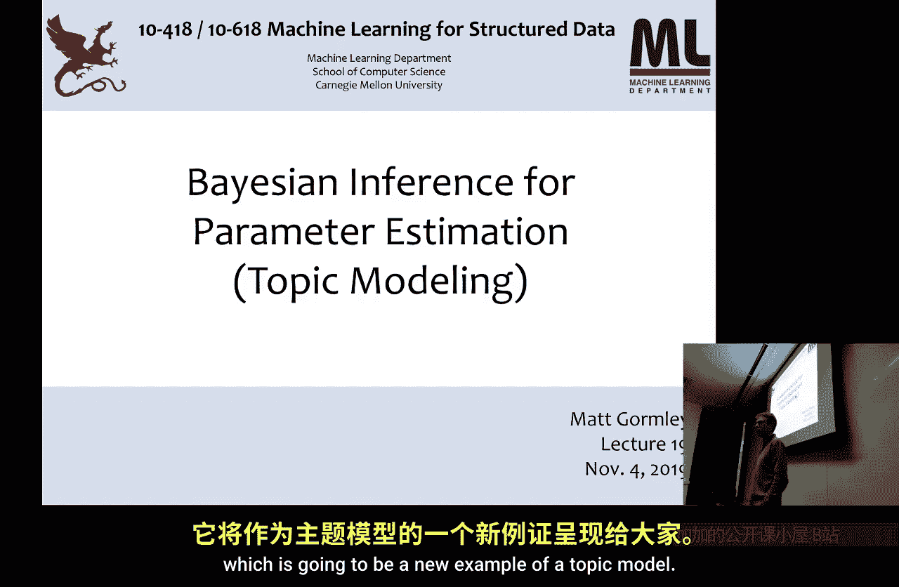
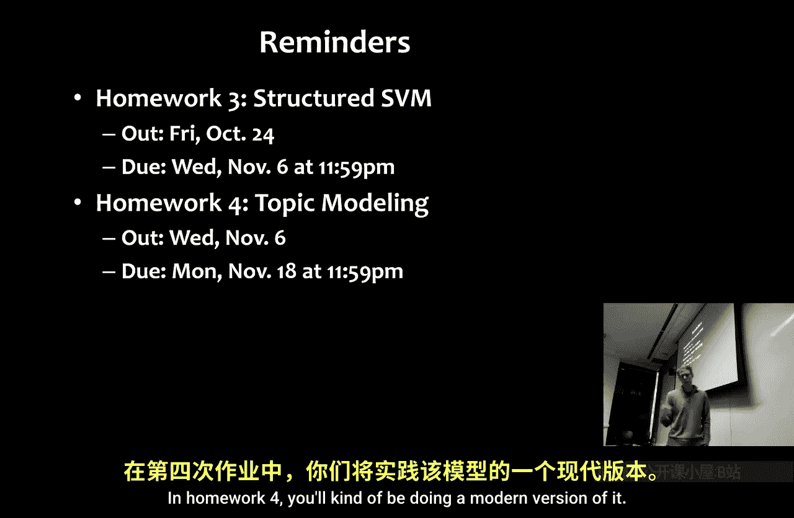
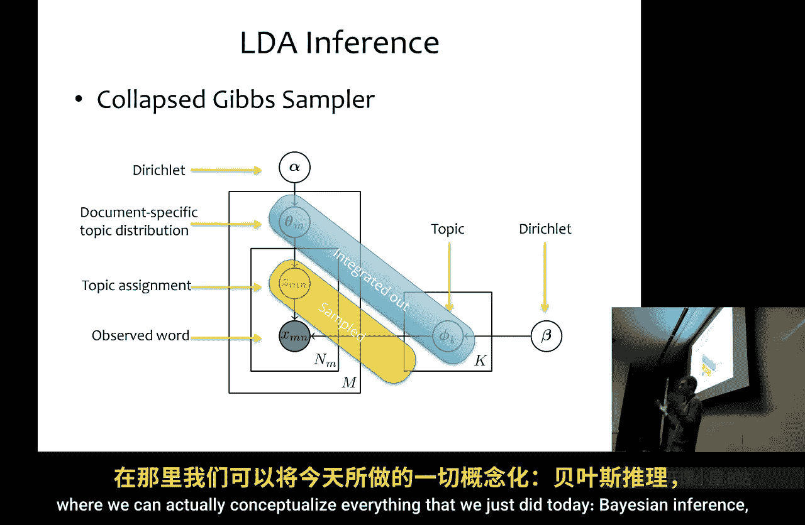

# 卡耐基梅隆大学【中英⚡结构化机器学习｜10-418 2019 Machine Learning for Structured Data】 p20 p19 10-418 ⧸ 10-618 Fall 2019 -BV1eJRsYBEaK_p20-

Okay， so welcome to 104 18， 618。Today， we're going to think about。

A very different way of talking about parameters。Presumably what you're used to。In着。

That new way of thinking is going to be that。A Bayesian approach to forever。And in order to do that。

 we're going to look at two small case studies， one is the naive Bayase model that hopefully most of you have seen before。

And the other is latent Dely allocation， which is going to be a new example of a topic model。

And。So homework three， you guys will be wrapping up on Wednesday。

 and then in homework four you'll actually be implementing。Topic model。

 but a rather modern variant of it so today we'll be talking about kind of a classic variant of Earth B be sort of classic latent deish lay allocation model in homework4 you'll kind of be doing a modern version of it。

Okay， so what is topic modeling？The motivation is that you could imagine being given a massive corpus。

And。And you're asked to carry out the following tasks。Okay。

 so organize all of the documents into thematic categories。Maybe describe the evolution。

Of those categories over time。And enable that domain expert to actually go in and analyze and understand what's in the content。

And then find relationships between the categories and understand how authorship influences the content。

And all you're given are doing。Maybe historical documents。

 and maybe they're in some language that you don't even speak。

And so what you're trying to do is build a system that you can hand off to some expert who's going to be able to interpret the output of your system in some meaningful way that will give them insight into what is sitting inside that massive collection of documents。

Okay。So。We say that topic modeling is a method of。mostly or usually unsupervised discovery of latent or hidden structure in a corpus and that it's applied primarily to textcorra。

 probably because that's easiest， but the techniques are actually more general and so they've been applied to other things like computer vision problems and computational biology problems and so really topic modeling is providing a toolbox for modeling。

AndIt's prompted sort of the exploration of a variety of new inference methods。

As methods for accommodating really large scale data sets。Okay， so when we talk about。Topics。

What we mean in are you know sort of ways of describing these thematic categories that appear and so this is actually topics drawn from one of the models of the variety that we'll talk about today。

 but when run on a corpus of machine learning papers from a conference called Nriitz。

 oh sorry this is the maybe ICM。The international Conference on machinechine learning。

 and so you can see kind of what's happening here is。The first topic here。

What I'm doing is I'm displaying。The words that are high probability under this topic。

And so you can see that things like。You know，Convex optimization， semi definite programming。

S tax margin for this。Kind of an optimization topic。Down here。

Is a whole collection of words or phrases that are all kind of related to a decision tree。嗯。

And so like something like random forest is sort of an ensemble method for it。

 And then the last section here。Is a topic on approximate inference。

So there's a bunch of things that you probably don't yet recognize。

Like variational Bayesian or variational inference， those are what we'll talk about next。

But there's familiar things like Markco chains and Gib sampling。MCMC。

So you could also imagine using the information that you extract from the corpus to build sort of a map of the actual relations between documents and so this is actually a map of。

National Institute of Health grants。Like successful grant proposals。

You can kind of see that the ways that they actually fit together in this map are tied to the actual content of the documents。

 so these labels were actually kind of applied retroactive。And you can then kind of see how。

You know you get these sort of clusters。You could also apply this to。Even data and。

I actually learn to sort of spatially segment。The data。And and so broadly， you know， these。

 these methods are going to apply in。In settings where you have some data that you want to infer latent structure about。

Okay。So to get to lateton Deishlay allocation， we're going to step through some sort of precursor models。

And then get to the actual main model。Okay， so this section。

 I'm really going to lead up to a discussion of basing an inference for naive Bay。

 but I'm going to be doing it in slightly different terminology than maybe what you're used to。Okay。

 so first I want to talk about the beta benoulli model and so to do that we need to know what the beta distribution is so this is。

The probability density function for the beta distribution。And。It tells us that。You know。

The density of a particular point estimate phi。Conditioned on。Parameterters。Alpha and beta。

Is given by one over the beta function of alpha beta。Times， so this is just some constant。

Times x raised to the power alpha minus1 times 1 minus x raised to the power beta minus1。

And for different values， so to be clear here， phi can range。Over value zero over。

And so we can actually plot the aestheticity function for different values of alpha data。Okay。

 so if both alpha and beta are 0。5。Then you get a completely uninteresting uniform distribution。

 okay so that's this one。Or oh maybe that's sorry， that's this one。Alpha and beta equal to 1。0。

Okay so in that case， you get an exponent of zero for both of these。

 you're just raising the value to the power of zero， so completely uninteresting。You could also have。

A distribution， like this 0。51。And that would give you this sort of U shaped density。

If you have values of say， 10 and 0。5， it's going to have a slightly skewed distribution that puts a lot of probability mass on something like 0。

7。So lots of different possible distributions all from this family。Okay， so the beta Bulli model。

Is described by the following generative process。So a generative story is just a way of articulating the full content of a Bayesian network。

So this is more specific than a Bayesian network with beads because it's actually telling us what the distributions are。

So you could think of this as providing a distribution over coin flips and the way that we're going to get it is we're going to first draw the weight of a single coin so take this beta distribution。

And draw。Parameter five。Let's suppose we picked alpha equal to 10 being equal to 5。

 Then we would be sampling from this tall。Tall distribution here。So it's this blue one。

And with high probability。Phi is going to come up in that like 0。6 to 0。8 range Okay。

 so we sample phi and maybe we get back that phi is equal to 0。0。

Now we're going to generate a corpus of length n。So we have Ncoin flips， and for each one。

We're going to use a Bernoulli distribution right so how do we take a sample？

Re distribution with parameter5， Well， we just flip a coin with weight 。8。And with weight，  point。8。

 it comes up heads。And we like you to comes up there。

 so we flip it a bunch of times and that gives us。10 different samples from this beta Bnoulli model。

O。So here's the Deishle distribution， and it's actually the same as the beta distribution when you're in two dimensions。

So here。Is it just the same slide except I changed the words be to spiritually？

But it generalizes to the multidimensional case， and that's what we care about。So。

The beta distribution。Or。Which is a special case of the Deishly。

Is useful if you want the parameters of a Bnoulli distribution， right。

 because it's giving you back a number between zero and1。The deish lay is useful if you want。

 say the parameters of a multinomial distribution。Meaning that you're going to now have a vector phi of parameters that sum to one So here we have that the vector phi。

The vector phi。呃。Is in。Are K。And。Each p。Jy。😊，Is in the range。Zro to one。And。

Further we have this property that the sum。From say little k up to capital K of  phi k。

Is equal to one。So this dely distribution is just one over that beta function。

Times the product of PhiK raised the power alphacade in its work。Okay。

And what we get back is this vector that could function like， say， the weights on a k sided die。

It's telling us。诶。You know， an actual probability distribution over the sides。Okay。

 so the deishly multinomial model says let's sample a。A parameter。Phi from。

Dishly over parameterized by beta。Okay， and that's going to give us back some。Vectctor of you know。

 Phi1。Phi 2 all the way up to phi k。And then we're going to sample words from this model。

By saying for each word sample from a multinomial distribution with parameters phi。Okay。

 does anyone remember why I wrote multitonnomial1 font right here？So X N。Is in。Sorry。

 the is from the set。1，2。Up to K here。What are the parameters of a multinomial usually。

So whatever it is。So one of them is this fivehi distribution that tells you the probability of getting。

Each of the sides of a case side of die， what's the other parameter？So the P is the actual weight。

The individual classes。So what does one telling us。Is。发生呗。Now， quite。

 it's something even simpler than that， so the multinomial distribution。In general。

 is giving us a distribution over counts。Of many roles of a caseside to die。Okay。

 so if I had written multinomial n phi， that would mean we want a distribution over the number of times that each class comes up if I roll a dime。

Other。So here we're saying。Independently， you should sample one dice roll at a time。

So a multitonnomial with just one is of that variety。Okay， so。嗯。

So we can think about the deishle multinoial distribution。

As providing us with just a distribution over a single corpus of say words where you have a vocabulary of size k Okay。

 so here it looks like I have a very uninteresting vocabulary maybe there's。

Four or five different words in my vocabulary， and so that's why it looks like it does。So。

What we can think about now is a different。Geneerative story for the Deersle multinoial mixture model。

So this is different because now we're going to say。For each document。And of， say。

A set of M documents， we're going to draw a topic for that document。

OkayYou could think of this as like a label of what that document is about， sports， movies， history。

 politics， what have you？And then for each word in the document。

We're going to sample the word from another multinomial distribution。

 but this time where the phi distribution is actually selected based on whatever topic we just chose。

Okay， so let's think about now where the parameters are coming。So the distribution over topics。

Is just coming from。A deishly distribution over the vector too。

So theta are the parameters for the distribution of topics。

 whereas here we're going to say that this phi distribution。Is。啊。

We're going to sample one fine distribution for each of the topics。Okay， so phi。

 this is actually a vector， right？We're sampling the entire vector phi k。

One for each of the different topics。m sure， there should be the parameters should be a fine and beta。

Just几过。So it takes one vector。So whenever we， let's go back to this real quick。

 so the beta distribution has。Salar parameters alpha and beta。

The deishle distribution in its general form， has a vector alpha， so this is a vector of alpha 1。

 Al 2， all the way up to alpha K。And the restriction on the alphas is the each alpha J。Is。

Greater than 0。Okay， so you could think of the alphas as essentially giving us。

Sort of weights for the different。Classes。And so。Here we can actually visualize the deishle for the。

For three different values of alpha in just。This two dimensional space。

 So what we're looking at here is。The probability。Of the vector Phi。For Phi1 and phi2。

 but also for phi3 because phi3。Is just equal to one minus。Phi 1 minus phi 2。Right。

 because we just said that。The parameters phi sum up to one。 So if you know what phi1 and phi2 are。

 then you know what phi3 is So that's why we're only seeing。

this triangle here of different values of fun because values over here would add up to greater than one。

 so we can't have those。Okay， so you depending on what you choose for alpha。

If you put all of the alphas as say value is greater than one， say they were all equal to。Say five。

 you get a plot that looks something like this， that's kind of concentrating the probability mass in the center。

Whereas if they were all small values between0 and1。

 you could get kind of this bowl shape that's trying to push。Probability mass to the quarterss。Okay。

So。So this is sort of our first generative process。

 and you think of this as so you could think of this in two ways。

One is where the corpus that you're going to work with is just these words right so you have document one document two。

 document three。And you generate some collection of words for each document。And in this case。

 I actually allow the number of words per document to vary M sub M right it's specific to the document。

 so that's why this one could add four words and this one only has three words。Now。

 we're going to be working in a setting where you learn from just data that looks like this。

 we're not going to actually observe the topic Z， but you could right， you could say， okay。

 there's also a value Z1 here corresponding to the first topic。And this is， say， equal to sports。

This document doesn't look like it's about sports， but it's possible and then Z2 here。

Is about politics。M Z3。Is also about sports。So。In our setting。

 we're going to be looking at settings where these are latent topics。

I also want to think about the case where they're observed。Okay。

 so the reason I want to think about the case where they're observed is what I just drew up there on the slide was actually an example of naive basease。

So namely。What I just said was that。诶。We have。嗯。Documents， and they have。Labels。

And then we have features for documents。Contents of the document。

And I gave a particular instantiation of naive Bayes here， where we're saying。

 know Zm is the actual label for the document and then the X。

to them is a vector of words for the document。So let's think about。N be for a second。

So the first point that we want to make。Is。So this would Bfully be titled。嗯。Baesian。Nive base。Okay。

 so the whole point of naming it that is that the standard。Nive days presentation。Does not use。

Basian inference。Okay。So what is Bayesian inference？Bsy an inference。Is going to say。

That suppose you are given data。好啲。Your goal。Is to learn。The posterior。Distribution。Over。

The parametersers。对。Giveity。So what do I mean by that， I mean。The goal is actually to learn。

Be a theta， given D。And to figure out what that is。

This is very different than what you're used to doing。So what are you used to doing？

The standard setup。Is let's actually be clear about sort of what our model is。 So our model here。

Is this dely multinomial so we're saying we have。嗯。Parameterters。呃，这个。That are sampled from。

Make sure I get this right so we want。K。I just want to stick with the right notation。

Theta alpha phi beta Okay， so we're going to say we have theta， which is sampled from。

A dearly at their website。And then。We have five sub k。That's another vector， which is sampled from。

A deish laser by beta。We're okay。And then， we're saying that。诶We have。え？A particular C。

You can take at this is like个。Is sampled from。A multinomial or。

prefer you could say a categorical distribution。Were randomized by Beta。

The categorical distribution is just a multinomial with n equal to1。然那。The vector Xi。

Is sampled from a categorical。With parameters， phi sub Zs。And this is for all。So。Okay。

 so how do we usually do data， well maximum likelihood estimation。So。啊是么你。为一些。

The way that we should learn parameters。Is by maximizing likelihood。 So we should find。Theta。

And five。Little hats on them that are。The parameters which maximize。

The joint likelihood of the entire data set。 So that would be the probability of the data given theta。

And5。Right。And if I ask you to。You would be able to write out that。Distribution over the data。

 given the。The assumptions of the 90 phase model。And oh， sorry。じゃとな。Ne to fix here so。あ。所以。

We have to have this inner for loop。Or features or else we don't only have one features。

So here we can say four。Feature。即系。We'll sample that M feature from the categorical。

And we do this for every training。Right， so the whole point here is just that。

That Xi is a single feature。Or a single word in our document。Right。So。Okay。

 so one way that we can learn is by maximizing。The the data and picking the parameters that maximize that likelihood。

How what would we actually get back if we maximize the likelihood of the data？

Like how would we solve this maximization problem or just a standard？呃。第一ペです。Yeah。

 we would just be counting。哦回相对。And you'll notice that。We have。Successfully。

You're going to call it that ignored。Pris。Over the parameters。So we actually have。

These prior distributions。Over the parameters， they say that they came from a deishly distribution。

But we completely ignored them here， we've just described the likelihood of the data D given phi a theta。

Right so here， let's say that D is a collection of。ZI， XI payers， right， your training data。

I equals one of that。Okay， so so this is sort of silly， so can we do something better Well yeah。

 we could do better， we could not ignore。The prior over the parameters。

 So that would be map estimation。And if we're doing map estimation。Then， we pick。

St hand and fire hand。To be the abacks over possible theta of bias。

Where we maximize now the posterior。Over。你个。5 given。So this posterior distribution。By Bay's rule。

Is equal to。Actually， can someone apply base roll to this？Is this here for me？Yeah。より。Okay。对个呢。Good。

And there's going to be one more turn here。So this top thing that we just wrote here。

This is the joint of POD。Data fine。So how do we get it to be this？

conditionditional or conditioning on deep。Right。Okay。So。呃。So with this in mind。We can now say that。嗯。

This P of D is not a function of the parameters。And so we can rewrite this as。Arc Max。

Data Phi of P of D given。所的。Theta phi times P of theta。Okay， so this is a little bit better。嗯。

And in fact， we still solved by counting。And now it actually takes our priors into account， right。

 so I think the map estimates of the parameters here。Should be something like。呃。Theta hat sub。Okay。

So the k of value of theta is going to be alpha minus1。Plus。Some over。All of our training examples。

 So I equals one up to n。 We're going to have these indicators that are just saying is Z I equal to。

But that's not with a quality partition function if we were doing it this way。

 so we could just say that。The actual parameter is proportional to this。

 so the way that you would compute it is compute all of these values and then just normalize the vector theta。

And then similarly， map inference for Phi would give you that phi sub。其 comma。

Let's say we index words word types by W。Is going to be proportional to。Beta minus-1。Plus。

 now we need to sum over all of the training examples I equals1 to n。Some over all of the。

Feature vectors， so this is M equals1。And take the indicator。诶。Whether or not。The actual value of。X。

 I am。Is equal to W。And the indicator of whether。CI is equal to。Okay。

So here we're just counting up all of the cases where。

The word is the W with word and the topic is the K。of labelable。O。So so far。

 really all we're doing is sort of review， right？So where does Bayesian inference come in here？

Baesian inference。Oh， let me make one more statement here。Which is。So。If we wanted to do inference。

With these point estimates。Of the parameters。What we mean is， suppose you want。A distribution。

 so suppose you're given。A new。X。Then you can actually estimate。The probability of。诶四。

Z equaling some particular K， given that x。And the parameters， theta hat and Phi hat。Oh， sorry。

 so to be clear here， point estimates to this。Point estimatesence refers to the parameters。

 so point estimatesments of the parameters would be like the actual vector。The actual matrix spike。

That's做。So if you were to do this right， this would just be given by the naive base model right what's the naive base model it's just the thing that we didn't even bother writing now probability of。

Z or sorry， probability of Z equaling K。Given data。Times a product from。M equals 1 up to capital M。

OfThe probability of。T嗯。这个。是。So。Here， this distribution is just going to be the usual distribution。

Given by an IU based model right， this is the part where this is sort of the actual。第二月30。I大对。So now。

Suppose instead。You wanted to do。Baian posteriors。😀。Orbaessian parameter estimation。

So what we do here is we say。对。What we're after is a distribution over。

The actual parameters themselves。So what we want is the probability。Of theta。Given。

All of our training data B。W which really just amounts to all of the Z's。So。

We don't actually need it to depend on。嗯。On all of the the X。

 It's actually only going to depend on the。And then the other one that we want is the probability distribution over5。

O， so。Think about what it is that I'm actually asking for here。What I'm asking for。Is a distribution。

Over real valued vectors， theta and。Real value vectors5 k。And the question is。

 what is the form of that distribution？Okay， so。Here's where things get interesting。

So it turns out that the deishle distribution is conjugate to the multitonnomial distribution。Okay。

 what does this mean。It means that the posterior， okay。

 so now I'm going to change the notation on the slide is going to change just to be sort of for the general case here。

So here we're going to have one phi， and then we're going to sample a bunch of independent x's。

From that fight。And so what we want is the posterior P of phi given x。Okay， so by B's rule。

 we have P of x even phi times p of phi divided by P of x。So now let's define account vector N。

Such that。The entry Mt denotes the number of times word T appeared。In your sample。

So here's here's the punch line， the posterior。P of Phi given x is also a deish slave distribution。

The parameters of that deish lane are。The hyperparameter， beta。Plus， that count vector N。Okay。So。嗯。

So then the question would be， why does this happen？Like why is it the posterior of this thing？

Is a de light distribution。 Okay， so let's actually go backwards。

 Let's first look at what the conequ。 Oh yeah， question。Like your first sampling words from。

D distribution， right。 I'm sampling a single vector once。From a Dele distribution。

But then your words X are kind of dependent。Exact， exactly。

 so you're sampling from a given distribution， then you' try and predict that distribution， right？

Yes， so why is that surprise that it is， It is a direction of this。So if instead。

I had sampled parameters5。From a deishle distribution。

 and then I had somehow used those as the mean of a Gaussian。

And sampled a bunch of x's from a Gaussian。The posterior。Over。5。Would not be a dely distribution。

 In fact， I have no idea what it would be。 I don't think it would be any like distribution that we haven't named for。

嗯。Could you jot down that we should probably have on the homework？Question that asks to show。

That something is now。It great， great。Okay， so what have you keep thinking about that on the homework。

So here， the point is that I picked this pair of distributions because they have this property most of the times when you multiply。

 I mean， like what I'm getting at is that。Here， we multiplied together this multinomial distribution with this deishle distribution。

 And for some reason， it worked out that the posterior ended up also being deish。Okay。

 so let's actually look at this particular pair of distributions and see why it is that that works out because it doesn't usually okay。

 so what we need here is say。Sort of be a little。Deariously。もみの管理です。Okay。

 so what we want to say here is。We're after the posterior。嗯。fi。Given。Our data D。Book and。

Let's actually match the slide here， so I think on the slide it had beta。

So we're going to use that beta as our hypo parameters。So we want a distribution over phi given。啊电在那。

Okay， so what that looks like is we're going to have。A bunch of。🤧E here。

 So the first term is going to be， so this is。This probability。Let's say。Proportal to。

So I'm going to drop the probability of the data term because it doesn't depend on Phi。

So it's proportional to the probability of the data。Given the vector phi， Oh and sorry。

 So here the data we just said was。This vector of x' is， so we'll use that rotation。

Times this prior distribution over。And so this is equal to。A product from I equals one to n。

The probability of each individual except something。嘅本法。Times the prior of the Deish。So。

What do these look like？嗯。The first of them， or let's。Yeah， let's do。Let's do this prior first。

 So the prior here。Is going to be proportional to。A product from。K equals 1 to capital K。

Where for each one， we take 5 k and raise it to the power beta minus1 or beta k to minus1。

So what I'm leaving out is there's this extra one over the beta functioning term。

But it's a constant with respect to fine。So we don't actually。Very sorry， with respect to hyper。

So that's our prior term， and now let's get our likelihood term， so our likelihood term。

Is going to be a product from i equals 1 to n。And a product from。People point to cap okay。

Where是 each。Each one we're going to have。快十期。Raised to the power。And this is the fun part。

 this is just going to be a little in。As to whether exon。Some people they。

So what we're essentially doing is we're saying。Multiply together all of the Pcades。

Raising only one of them to the power one， that's the one。

For which X is equal to K and all of the other ones raised to power zero。So what does this give us？

Well， what we can do now。Is we can actually simplify this whole expression。

Because it's actually equal to a product from k equal one to capital K。Where we multipied together。

 a bunch of five cater。And raise them to the power。Beta K -1。Plus。

A summation from i equals1 to n of these little indicators。Counting up how many times。

Xi is equal to K。So all we did was。Observe the fact that if you multiply these together。

 you get the summation in the product， and then I just combine the two。I sorry， this summation。

And then I combined the two exps by addition。So this whole thing。Means that。P of Phi， given。

X and beta。Follows a deish lay。With parameters。Vectctor。呃贝ta。Minus1， oh， not minus1。

 the minus1 is inherent。It's beta。Plus。Some count vector。Where the。不 see。What did we say。

With T of entry。Or rather the。K of entry in n is the number of times。That some Xi was equal to K。O不。

O。So the fact that this worked out。Is like practically a miracle。Okay， it's not entirely。

 well there's a good many pairs of distributions that have what we call conjugate priors。

So we actually say that。The Deish lay。Is the conjugate prior？너 어떤。Okay。

 so now let's go back to Bayesian parameter estimation here。So we said Bayesian parameter estimation。

Is going to tell us that。This distribution， P of theta given D。Is actually given by。A。Dishle。

Where it's parameters。So it's a deish leg distribution we could write this like a deish leg over。这人。

given跟。Hyperparmeters。Alpha prime。And this is a garishle。快 k。Given hyperparameters。四。Beta prime K。

So we just need to define the hyperparameters properly。So the hyperparameter here。

Are going to be that。Alpha prime。Is just。Account vector。For。Let's see。嗯。The original alpha。Vctor。

Plus。嗯。So make sure you get good notation here。So actually， let me do it a slightly different way。

So rather than defining the whole vector， let's define one element。So alpha prime K is alpha K。

 which is the original hyper parameter plus。The indicators。So this is going to be an indicator for。

How many times do。诶 cI。现在。Beta KW， right。なる。It's going to be。The original beta KW。Plus。

A sum from equals one to N。Another sum from K equals1 to K。OfThe number of times that。

Xi was equal to do。たます。The number of times that。CI。Was example to。Okayッケ。Okay。We're almost there。

We need to do one last thing。Which is that。嗯。Before with map estimation， we said， okay。

 you get back a single set of parameter values and then you do inference。With those point estimates。

 just by multiplying some numbers together。Okay， so what if you just got back？

Two probability distributions over the parameters。Then what you need to do is。Baesian inference。

For prediction。So what would that look like， it would look like you're trying to basically estimate。

The probability of some。Z， so here let's。Again。As before we're given。Some new X。And distributions。

Be ata D。And P of。fi k given啲。And so now， what do we want to estimate。

 We want to estimate the probability of Z given。X。And。The hyperparameters。

Which are just the alpha prime。And the beta price。And if we do that。We findd well。We would find that。

This distribution， P of C given an X。Is obtained。By marginalizing over。All the possible values。

Of theta to five。For the joint distribution。P头 c 。x。都是这个。This integral looks really bad。

We just set up an integral here where we're integrating over this vector theta， this matrix5hi。

 and we're now。Trying to sum over all the possible values of those real value vectors。

 just so we can get a distribution over the topicss。Okay。So。How want earth。Could we estimate P of Z。

Given x and alpha prime and beta prime。Any thoughts。What tools do you have in your arsenal？

To estimate a distribution。It just looks like some mess of an integral。十三？因我得。so诶。社保。I mean these。

咁 sorry。Favorite。Mark up Jane Mon girl。O。So。This is what it means to be a phase。

Dive Bes has nothing to do with being ba。The name naive B is just because we make this naive independence assumption in our app after we applied Bbook。

The fact that the word the name baes shows up in naive baes is just sort of confusing here we're actually now being ba in the sense that we are expressing our uncertainty。

About the distribution over the model parameters。Okay， and what's， what's left here is a totally。

 okay， I mean， a fundamentally different way about thinking。呃。

Or a fundamentally different way of thinking about parameter estimation， right？At any given moment。

 you don't just have a single value for your parameters。 you actually have a full distribution over。

Okay。So I guess I should add that。You know， maybe。If sampling didn't work or if it didn't work very well。

 it's possible that sometimes。诶。Can be sold。Analytically。Meaning， you know。

 we can just do some more math。And maybe we could actually work out exactly what that posterior could be。

I actually didn't do the math。And as far as I know。

 like nobody actually uses Bayesian inference for a naive Bayase。

 like the whole reason that you use naive Bayes is because like it's incredibly easy to implement。

 you just do some counting， like it's just not made for like your average person who knows how to do this math。

啊，就。Anyway， I'm not sure if this。你度会佢啲。It feels like it should because we have all this conjuguous e。

So we could probably solve it analytically， that would actually be a great homework problem。

Do you want to write that down too Okay， so what we have here is this new framework that we can work with and now we can talk about late and Deish application。

And so。In the past， when teaching LDA， I've made the mistake of。

Not stopping to do this obnoxiously technical。Discussion of naive days right hopefully this is the most obnoxious presentation of naive days that you have ever seen right mostly like we just like do some simple counting right。

Here we're actually like making things essentially more complicated for ourselves by thinking in this Bayesian setting。

 okay， so I'm not actually advocating for you to ever actually use Bayesie well。

 maybe this might actually work better than regular naive Bay。

 but I'm not really advocating for it Instead， I think it's an incredibly important pedagogical step。

Towards understanding what's going on in latent deish la tissue， and here's why。Because。Nive bes。

Is a mixture model this。I still haven't solved this stupid font problem。And。So。On the top。

 we're looking at a mixture model， which is where you pick a particular topic for a document， right。

 like you say this document is going to be all red words， and then you sample a bunch of red words。

And then you say， okay， now let's take a new topic and let's sample a blue word and then a yellow topic and let's sample yellow words from that。

And。An ad mixture model does something different。 It says， okay， let's。嗯。Actually。

 have each document。Be a mixture of。Multiple topics。So our first document is going to be， you know。

 one third red， one third yellow， one third blue， and then our second document is going to be mostly red with a small probability of being yellow or blue and so on down the line。

And so。We're now going to think about a different generative process that could give rise to the same collection of documents。

 but through different latent structure。Here's what it looks like。

 it's almost the same as that deishle multinomial mixture model that we had。

Except that we sort of pushed two things inside this document further into the for loops。So。

What we're saying is for each topic， we're going to sample a distribution over words。That's 5hi k。

Okay， and so what that you could conceptually think of that as is think of those topics from the ICNL database work right。

 one of the topics might be a distribution of are things that seem to be about decision trees。

 another topic might be things that are about convex optimization。

So those are our different topic distributions over words。And then for each document。

 we're going to sample a distribution over the topic。And then for each word。

 we're going to sample a topic assignment and also a word。

And the interesting bit is you sample that topic assignment。

 but then the distribution over words that you choose is dependent on whatever the topic assignment for that word is。

So here's what's weird about this。We're not saying that a document is about a single topic。

We're saying that if you want to describe a document。

 you actually need a distribution over topics for that document。So here's how this could work。

 So the generative story is going to begin with only a bearishly prior over the actual topics and each。

Topic is defined as a multinomial distribution over the vocabulary。 Okay。

 so here's our deishle prior。And now I sample one multinomial distribution。Okay。

 so you could think of each bar here as corresponding to one of the words in your vocabulary。

 and so the higher the bar and the higher the probability of that work in this particular topic。Okay。

 now you sample another multinomial distribution， a different one。

And a different one and a different one。 sew on down the line until we have。

 say six different topics， each one expressed as a multinoial distribution of our words。

 And we could number them as by  one up to 5，6。Okay， so now we could also visualize the topic。

As a list of its high probability words right so53 here。

 we've visualized its high probability words in their team season hockey player， England's Ice。

 Canadian Puck， Montreal， Stanley Cup。And。And maybe the。You know。

 the model picks up spellings or misspellings of words， and if you wanted to。

 after you knew post hoc， what those high probability words were。

 you could pedagogically assign a label to identify the topic。Okay。

 but that's something you would have to manually do after the fact。So I labeled it as hockey。

And I could do the same thing for each of these other distributions， right。

 one about Canadian government， one about hockey， one about US government， one about baseball。

 one about Japan。Okay。Okay， so now let's actually generate some documents。To do that。

 we first sample from our deishle parameterized by alpha， a distribution over word。

So this is a multinomial distribution oh sorry a distribution over the actual topics。

 so this distribution only considers six different bars， right， one for each possible topic。

 so in this particular document it seems like it's mostly going to be about Canadian government and US government。

So we start sampling words。And one at a time， we sample words。

 So the 540 boundary dispute is still unresolved in Canadian the US。 Okay， so now we sample， okay。

 now I want to sample the next word。 So think about that generative story。First。

 I sample a topic assignment for the word。So I have a six sided dye with weights according to theta 1。

 and I roll it and it comes up green。So that means that the next word is going to come from the US government distribution over words。

So we sample a word， oh， it comes up Coast Guard。And then we keep going all the way through the do。

And I guess in this case， I only highlighted you some of the words with their topic。

 but really each word in this list。Should actually be highlighted with some corresponding topic。Okay。

 so now you end sample your second document， well， first you have to sample theta two。

 which is the distribution over topics。And then for each word， sample a topic assignment。

 and then sample a word from that topic。Okay， so we just keep going down the line and so the second document looks to be mostly about hockey。

 the third one seems mostly about baseball。是。And so you can think about this as sort of。Decomposing。

Into a distribution over words。That's what an actual topic is。And then a distribution over topics。

That's how we're representing a document。O。Here's the interesting bit。Inference and watering。

Are only going to start with the data。We're only going to observe these words。

We don't know what the thetas are， we don't know what those phis are。

We may or may not know what alpha and beta are。In the general case， we don't even know what they are。

 we're going to learn them as well。Though often just for convenience。

 you just treat them as observed。Hyperparameters because it's a little bit easier。Okay， so。

In order to summarize what's going on here， we need one more。诶。New concept。

Which is that of a plate diagram。So a plate diagram。

It's just kind of a convenient way of writing down a graphical model。So话。For the beishly multinomial。

The plate diagram。Is going to have。A bunch of different variables， it's going to have variables。

Super scared。Where， let's say。X IM。咁诶。Z is specific to the document。And。Then we have。

Some distribution。所以呢。A more。Oh sorry， this is the De label multi a meal。Nextture？Roughly9 days。

And the way that we draw， oh， and then we need。parameter data。Some parameter vectors。ァケ and。

So how can we connect all of these up in some meaningful way？非常。

Drawn from a deishly parameterized by beta。And we just have one there。

But then each of the Zs is sampled from。A multinoial parameterized by theta。But there's a lot of Zs。

So what we can do is draw a little box with this。さ的てか。And we can put down in the corner。

A number of times。Then we want to repeat this box。So let's say we're going to repeat it1 times。

One for each。Dokey。Now there's many words in a document。The Xi。

 oh let's get a little more competitivetic here， so Phi k， these are the distributions over topics。

Okay， and。Here， there's going to be。Such distributions。

So we can put that PK in a box so that it gives us back。Capital K vector。And then。

The words are sampled from CI， but are also a function of the parameters 5K。

And we need another box here。That repeats this M times if there's， say， M words in every document。

So this is akin to what the regular Baysnet would look like。

 but essentially what we're saying here is there's a bunch of repeats of variables with lots of different indy names。

And rather than actually writing out something like。You know， beta and then beta。

 and then document one is going to have Z1。And document2 is going to have a C2。And then sorry right。

 So this is a document。 And then document one has three words， x1。Next to。3。

And those are a function of the parameters phi1。And fight to。Which are。Function of alpha。

So you can see what's going wrong here， this is just becoming such a mess。

That to write that thing out。For all of the words， would just sort of become ridiculously。

And so this plate diagram is just kind of a convenience method for collapsing all this stuff in。

So that we don't have to。Make it look like such a mess。

So the plate diagram for LDA is almost the same， except that now we've moved the Z inside this inner box。

 so there's one topic per word。And so here what we have are deishly parameters。

The corners often beta， we have topics， we have document specific distributions over topics。

 we have topic assignments， and we have observed works。Okay。So a couple questions。

 is this a believable story for the generation of a corpus of documents？No， of course not。 No。

 Now you're not even close， right， Like this is a completely absurd story for where these documents actually came from。

 right， If I told you that all of， you know， the history books ever written about ancient Greece were generated。

From this model。Okay， you would just sort of shake your head at me。 Of course。

 it's completely unreasonable， but。It turns out that it might work well anyway。😔。

So why might it work well Well so this slide is so beautifully worded。

 I just copied it straight from David Blythe， David Blyigh was one of the original authors on the LD paper in 2003。

And so here is， you could imagine him explaining to you why this absurdly simple model of documents。

Might actually work out， Okay， so here's this thinking。So LDA is trading off between two goals。

 one for each document。It's going to allocate its words to as few topics as possible。Two。

 for each topic。It's going to assign high probability to as few words as possible。Okay。

 so these two goals are they're at odds， they're intention with each other。

 meaning that putting a document in a single topic。Makes number two difficult。

If you say that a document is drawn entirely from one topic。

That it's difficult to have each topic assigned high probability to as few words as possible。

By contrast， putting very few words in each topic， meaning。

Very few words with high probability makes number one difficult。

Because in order to cover a document's words， it actually has to assign many topics to it。Okay。

 so trading off these goals finds groups。Tightly co occurring word。

And it's this process of finding these tightly co occurringring words that gives rise to these sort of beautifully interpretable topics。

Okay， so how does this relate to my other favorite model for capturing low dimensional representations of a corpus。

 good question， so it does actually build on latent semantic analysis if you're familiar with it。

 it is actually what's called a mixed membership model which is sort of a well studied topic and it also does have connections back to PCA and matrix factorization。

😊，Um and。Back in 2000， it was actually independently invented。

 and so LD was invented and popularized by this 2003 paper。

 but it was independentlyly invented in 2000。For genetics， it's just that nobody cites that paper。

Okay， so。Where do we go from here what we're going to do is think about Bayesian inference for parameter estimation of the latent deishly allocation model。

 so I'll give you a preview。If and only if we knew what all the topic assignments were， okay。

 this is completely absurd， you don't ever actually know what word each or what topic each word is assigned to。

 but suppose you observe both the X's and the zs。In that case。

Fully observed maximum likelihood estimation is super easy， right， This is just count and divide。

We know how to do this， this is just a Bayesian network， we happen to draw it as a plate diagram。

 but you guys could solved this in five minutes okay。😔，If you wanted to， you could add the priors in。

Right and you would still be able to solve this in okay， maybe 10 minutes because again。

 it's just going to be sort of kelt and divide to come up with point estimates of the parameters right so when I say optimize here。

 what I really mean is，Choose the value of theta and phi that maximizes the probability of whatever you've observed。

Okay， and what we're going to do is think about a setting where we take these three learning paradigms that we just looked at for naive days。

 but we're going to apply it to this unsupervised learning setting where instead of observing topics and words。

 we're only going to observe the words。And we're going to have to figure out everything else。

And so we'll see that you could do lots of different things。

 You could do standard expectation maximization， you could do map expectation maximization。

 You could do Monte Carlo Y， which is just like。Expect maximization。

 but where you replace exact inferences over the topics with sampling， like say， a Gib sampler。

Once you're sampling， you might say to yourself， well。

 why don't we just do the full Bayesian thing and do exact inference directly over the parameters that we care about？

Okay， we'll see that that's not going to work out and instead we'll say， well， okay。

 maybe we could then sample all the parameters and the topic assignments that actually would work out。

And then we'll get a little fancier。And will actually integrate out。

The parameters and willll just sample the topic assignments。

So essentially what we're moving towards is a setting where we can actually conceptualize everything that we just did today at Bayesian entrance。

But for this slightly more complex model。So that's where we pick up that。

