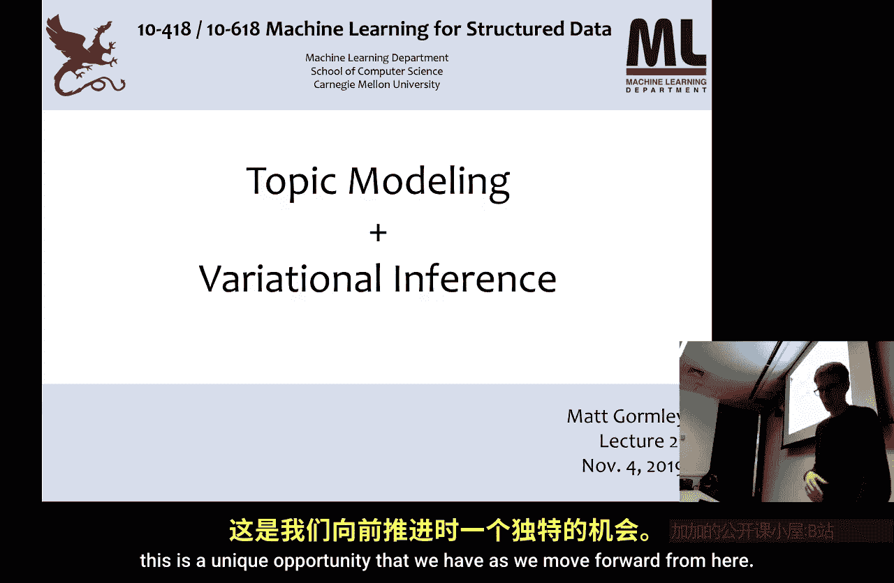
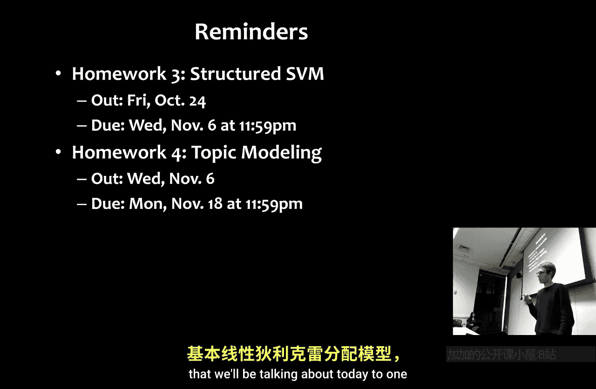
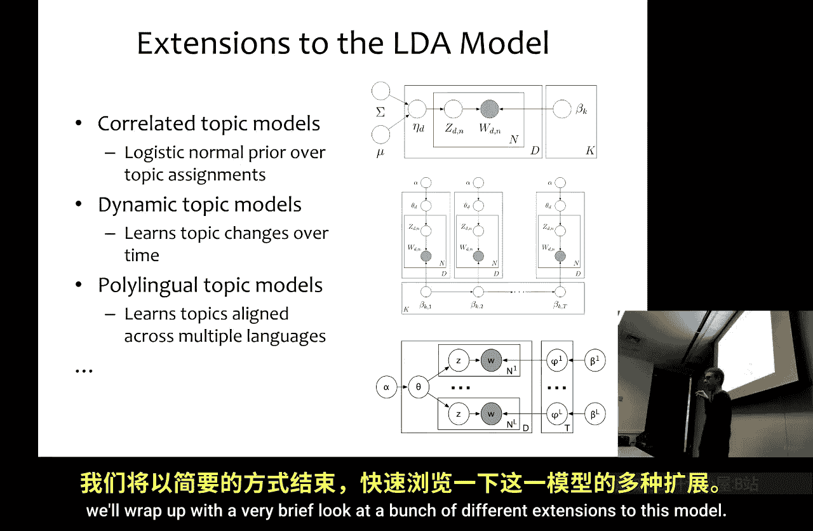

# 卡耐基梅隆大学【中英⚡结构化机器学习｜10-418 2019 Machine Learning for Structured Data】 p21 p20 10-418 ⧸ 10-618 Fall 2019 -BV1eJRsYBEaK_p21-

So today。We're going to be thinking about what we' left topic。反正。

We'll move on to sort of our first discussion of variational inference variational inference。这个对。

Primarily because。It offers us a very different way of going about approximate inference。

And once we think about approximate inference in that way。

 it sort of movements up a lot of opportunities for us。And in particular。

It will open up opportunities for us in the context of。

Deep generative models or these models that have been。Increasingly common in deep learning。

And I think one the so one of the interesting aspects of this course is。

Sor prior to the start of the semester， I'd had a conversation with Russ Sal Kav， who's teaching 10。

4，17 617。Which is。The course that's running in parallel to this one focused on deep learning。And。

We had this conversation about， you， is it appropriate to actually include deep generative models in this course 418。

 618 because they're also going to talk about them in4 17， 617 and we didn't want too much overlap。

And as we got to talking about this， we realized that by including them here。

 we actually provide ourselves with a really unique opportunity。

 which is that we are going to get into that discussion after we've spent some thorough time deeply understanding variational inference。

By contrast， your typical deep learning course doesn't have time and or doesn't make time to go into this topic and so the typical presentation。

Of。De generative models that rely on variational methods sort of sweep a bunch of the details under the rug。

 which still offers a really sort of interesting high level picture of what's going on。

 but will also be able to get。More of the low level picture。OfWhy those methods are actually working。

And what the mechanics are that are doing。And so I think in general。

 this is kind of a unique opportunity that we have as we kind of move forward from here。

Okay so one。啊こ。Be wrapping up the structured SPM homeworkmark on November 6 which just today。

 and then we'll be releasing homeworkmark4 where you'll be applying。

Markco chain money Carlo methods in the context of a topic modeling problem and there will be sort of。

Pushing beyond the basic LDA model that we'll be talking about today to one that actually incorporates some Gaussian distribution。

Kind of a fun way。Okay， so before we wrap up LD， I wanted to do a quick recap of the model itself。

 and then we'll we'll pick back up with。嗯。With the actual discussion of inference。

 so we had said that late Deishly allocationnotation starts with this notion of a deishly distribution over topics。

 and these are distributions over words。And they're shared across the entire。And。

 you know we could visualize the topic with its top probability words and we could you know sort of。

Post hoc apply a label to those topics if we wanted to kind of interpret them。

So the generative story for LD then says that the way that we generate a document is by sampling a distribution over these topics and then for each word we sample a topic assignment so that's like a color for the word and then we。

Sample the actual word from the corresponding distribution in this case， he sampled topic four。

 which was green， and then we sampled the word coast。Okay， maybe a pair of where it's here。

 Coast Guard in front the distribution fight folder。

So we can proceed through and generate entire documents in this way。

 and the crucial decomposition that we have here is this distribution over words and this distribution over topics。

And。We saw last time that。啊。These two modeling goals are kind of at odds with each other and it's that tension between them that actually gives rise to something interesting and that allows us to find groups that sort of tightly cocho occurringing words in interesting ways。

Okay， so now we want to have this discussion of Bayesian inference for parameter estimation。

And so to do that， we want to begin by thinking about。

What it would be like to learn this model if we were just。Treating it as a fully observed。

Baesian network learninging problem。Okay， so this is the problem that we solved many lectures ago。

 where we said that this just boils down to sort of count and divide。

IAll of these Z's without the priors are really just going to come from some multinomial distributions parameterized by theta。

And so for each document， we would just count up the number of times that each topic occurred。

And for each document， that would give us a little vector of topic counts。

 And then we just normalize that vector of topic counts。 Okay。

 And so that would allow us then to say that。Basically， we get this。Decomposition。

 which is that the vector theta M。Is just the。C的M。That maximizes。The probability。Or rather。

The log probability。Of all of the。Word and topic assignments。For the particular document。

And so here we would just have。诶。Bg probability of Z。And， and。Given all of the x's。The vector。

 theta M。Okay， and then we would do something analogous for。The actual topic vectors。

Where we would say。We're just choosing。The vector， P K。

That maximizes the total probability of all of。嗯。The actual word topic pairs。啊。

Where the particular C MN is assigned to some topic K that we care about。 So we would have a sum。

From。嗯。Little M equals1 up to capital M。A sum over all the words for that document。

 I guess here we have N M。Words in a document。 And then we would say that we have some。

Log probability。Of。Oh， sorry， I guess here。We want the joint probability of Z M N and X M N。

And here we would again have。The joint probability of ZMN。An XMN。Conditioned on。Data啱。反 k。

And crucially here， we would only care about the terms in that summation for the cases where the particular Z was actually equal to。

So， let's。We're out of space here。They still here。So there would be this indicator that says。

 is ZMN equal to k？Okay。If it is， we'll include。That term， if not。Okay。So。If we wanted to adapt that。

 oh yeah， here the whole。Crucial to this slide。At this moment， I'm saying what if it were observed？

In all the remaining slides in this section， it's not going to be observed and in practice it's not going to be observed。

And in fact。It would be extremely strange if it were。But we want to make sure that。From。

A graphical models perspective， from a learning perspective。

 the actual problem that we would solve if it were observed was really easy。

So that's the key takeaway。Not that this is in any way real。So similarly。

 then if we just added some prior to the parameters。

 this would just change that maximization a little bit。

And this alpha and the beta would make their way into the sort of count divide process the same way that priors make their way into a naive base。

For map estimation。Okay。So now let's move to the realistic scenario。 Okay。

 the realistic scenario is that you only observe X。 You don't know what Z is。

So maximum likelihood estimation is finding the theta that maximizes the probability of X given data。

Map estimation is maximizing P of theta given x， which is proportional to P of x giventa theta time P of theta。

And the Bayesian approach is to estimateate this posterior P of theta given x。Okay。

 so crucially here。For all of these cases。We have that。呃， this。

Maximization problem is not exactly easy， right， Because what's really going on here is that we're summing over all of the unobserved latent variables Z。

For the joint distribution， P of X and Z given theta。And so。诶。In general。

 that marginalization might be sort of the source of one of the key challenges。

Of this learning problem， because now we essentially have to solve two problems at once， right。

 we need to maximize over the parameters。But we also need to marginalize over the late variables。So。

And this also shows up in the estimate of the posterior， right。

 This posterior distribution is really a marginalization over。The latent variables， Z。

So even estimating the posterior requires solving this inference problem。Okay。So。嗯。

From your backgrounds early， I think about half of you have seen expectation maximization in an introl course。

 so' right now I'm not going to sort of belabor this point about EM but I do want to kind of connect it back to EM and we might actually talk about EM later in the course since we talk about variational EM so。

If you know the EM algorithm， then one way of solving this unsupervised learning problem。

Would be to do basically an alt solve an alternating optimization problem。

Moving back and forth between the parameters and the latent variables see。And so here， standard EM。

Would。Go back and forth between choosing。啊。In the M step。The values。Of theta。And5。Which maximize。

Over。P of。The expected value。Of these parameters。They don't p。And Z given x。And in an E step。

Estimating the。Sorry， estimating the actual distribution。Over the latent variable。

So this back and forth between。Maximum likelihood。And estimating latent variables is called the EM algorithm。

 and conceptually， you can actually think of this in a really simple way。If， oh， sorry。

We're going to take this and we can。We're going to generalize it to be EM with priors right。

 and it would just be like before but now we have Jewishish Lake priors over the parameters。

And conceptually， it's actually really easy to think about how this algorithm works。

If you just think about Monte Carloo。So money Carlo E is an algorithm。

 whereby we are essentially doing something almost like the EM algorithm。

 except that we're alternating between optimization and sampling。So suppose， for example。

 you just take one sample of the latent variables。Okay。

 so how would we take a sample of the latent variables from this model？

If we already knew what the parameters were and what the X was。去3。Yeah， so the E step here。Would say。

For example， take。One sample。Of Z from。P of Z， given。The parameters。And x。And then， in the M step。

And let's call that sample Z hat。Okay。In the M step。Choose theta。And phi。Which maximize。

The problem the posterior of。Which the posterior of theta phi given？X and Z hat。Okay。

So to accomplish the E step here。What do we need to do？We need to run something like。Give sampling。

 grant。Okay， and that would allow you to take one sample of the Z variant。

And how do we accomplish this M step。Choosing these parameters that maximize that posterior。Okay的。

So it's not really a sampling problem because we want the actual maximum， right want。

The values of those parameters that。Maximize the。No， it's even simpler than that。

We actually just did it。不真。几个晚。Yeah， it's just the map inference problem， right？

If we know what X and Z are。We're back here。喂。😊，Okay。

 so what is the one case where X and Z might be observed。 so to speak， Well。

 it's the M step of Monte Carlo again， right， You just sample a value of disease。And okay。

 they're not the real disease， they're just a sample of disease。

But you can treat them as observed and then optimize over the pm。And the optimization problem。

 it would look just like this， which is just count and divide， plus we said。

 you know account for the Deishly priors。Okay。So here， this is the same。As fully observed。

Map estimation。Okay， so。This is only Carlow E and so you know， standard EM。

You could so I wrote this out in terms of one sample， Z hat。Right。ok 都。What we're really doing here。

Is we're saying this。Is a Monte Carlo。Approxiation。To。The desired distribution。

Which would be what we just wrote down in the previous slide。Which is。The posterior of theta and phi。

Given just acts。Which sums over all possible these for this thing。So it would be a sum。Overall。

 possible z P of theta。And Phi， given x。And see。Times the probability of。あZ。Sorry。

We'll just write this as。I'm going to write this in a slightly different way here。Probability of x。

Given data。So this is proportional to。Probability of x given theta P phi and z。

Probability of Z given just beta。Okay。So it's a particularly bad Monte Carlo approximation。

Because we're only using one sample。Okay， a better approximation would be to approximate this by taking many samples Z。

And averaging over this。Okay。Okay， so what about the Bayesian integral？So the Bayesian approach here。

Let's say we just want。Not a particular point estimate。嗯。Theta and Phi。

 which is what these EM algorithms are giving us。 they're giving us back a particular value of theta and phi。

 just one。Baesian inference says。Let's estimate。The whole distribution。Which is going to be a P of。

Theta and phi。Given X。And to figure out， you， what does that distribution actually look like？So。

This is a nice idea。嗯。But。I' know， we're gonna to skip that。In general， this problem is intractable。

So。嗯。This is just a quick note about that inability。So。There was this paper by。啊，They addressed this。

 so exactly computing this posterior is intractable。

And one way that we can actually think about this。Is that in order to do inference here。

 we would need to use something like the junction tree algorithm。juunction tree algorithm。

 it's kind of closely related to the variable elimination algorithm that we talked about。

 but it does things a little bit different so first。It moralizes the graph。

 which is going to convert the directed to an undirected graphical model。Second。

 it triangulates which。meansで。Wherever there's a force cycle。Which just means that you have some。

Set of four。Variables like so， it triangulates。Bye。Adding a new ash。大家要。And then。

It makes a new structure called a junction tree where each cl in the original graph becomes a variable。

And the time complexity is actually exponential in the size of those cliques。So for LDA。

 the cliques are going to be really large。At least sort of order number of topics。

 and so that means that the actual time complexity is ordered due to the number of topics。

 So if you have 100 topics。Then we're talking the time complexity order 2 to the 100。Okay。

 so it turns out that further exact map inference in LBA is also NP hard for a large seller。Okay。

 so the point is。That。We can't just go straight in。And do exact inference easily。Okay。

So what else can we do？Well， one answer is we could just define an explicit gibb sampling thing。Okay。

 so what would an explicit Gib sampling look like？An explicit Gib sampler for LDA。

We'll sketch out real quick here。So an explicit Gib sampler。Or LDA。It looks something like this。啊。

We would have。呃。Basically， to iterate through all of the different。Variables that we're concerned。So。

Based on this little。Click diagram。A four loop over the different five parameters。

 we're going to have a four loop over the different da parameters。

And then we're going to have a for loop over disease。So。What this would look like is。Something like4。

嗯。佢。And。我。Up to capital K， a number of topics。We could。For这。啊，Se？翻企。From the full conditional。呢样快期。

基本。啊，的。Markov blanket of 5K。Okay， so。Let's actually just。Just so we have a hand。知要了。

The plate diagram you in here。自的。Thanks。将佢嘅。Block over here。P。Should I have some priority。So here。

 if we want to resample the fine case。What's the actual Markov blanket for the full conditional。

 so what do we actually condition on here？So。Let's see。 we need。Children and co。

So what are the parents？Just bear。小军。阿信。So let's say all the x's。

Because any of them could potentially be using 5K。And。All of disease。Since again。

Any of them could potentially be involved。And it's。

It's going to boil down to all of the that are currently assigned to topic cake。So。So we only need。

To games。Sor of currently。Assigned。topic其。So there's a segment detail here， which is that。Formerly。

 I mean。PK does depend on all of the x's and all of the Z。

 it's just that because we know the actual structure of LDA， we know that only the ones that。

Actually have the topic equal to that K。Rely。So then we'd also have a loop。For little M。

In the different。Documents one of the capital end。And we'd say for each， say， vector。呢嚟讲。

We could res it from the full conditional。That takes parents， alpha。childrenren。自。And。In this case。

 the。呃。都看。Our。All of the statuss。That are parents of。The children of data。So this plate diagram。嗯。

It's not always completely obvious。What the。The co parentsent are here。 So let's actually jump to。

reWhere we introduced。This plate diagram notation。So last time we said。

Here's the example of a plate diagram。For。Oh， we didn't actually draw the。Explicit example。

 so I guess we need to redraw。Right， so。So if we had two。Two separate documents here。嗯。

What's going on， really， is that。Out like gives rise to。对我。这个去。And all of the C。For theta one。

All under just the1。And all is disease for data too。Follow just follow just under data2。

So there are no co parentsents of the vector theta M。So in that case。

 we can just close the full conditional。And then finally， we have this inner loop。

 which says for each。Of the word。So end in。one up to。We're going to resample。次系系。

From the full conditional。Which is probability of CN。Given its parents， which is just。

The vector theta m。It's。Which is。哦的。For a document。And it's co parents。

 which are all of the topic parametersers。这样。Or sorry， fuck。And then， lastly。

The actual words are observed， so we're not actually resampling them。

So this is the whole explicit G sampling。And。The only remaining question is。

 what is the actual form of those full conditions？So if we were to write those out。

 we would hope that the form of those full conditionals is sort of amenable to fast competition。

positive research called why。佢你肺你 이直。So i鬼或者先知我。是关0。哦，啊。Yes， they are。 And why。So。

You're absolutely right。So we should write this as all。By。For not k。But I guess what'll happen is。嗯。

The actual values。So what's going to happen is those fine not cave terms。

Are only going to actually accept。All of the x's and zs。That are assigned to。哦。他俾 other。

When we're actually working with this full conditional。

 all of those terms will actually just drop out。And we want him to。啊，这还是个定的。

So that's a great insight， thanks for catching。Okay， so。

So I'm not actually going to go into the details of these full conditionals because I want to now sort of just establish at a high level what this algorithm looks like。

 and now I want to talk about a slightly different version of a sampler called a collapsed Gi sampler。

So essentially， sorry， what I want to make clear here is that I trust that you all could actually go in and figure out sort of the remaining probability slash algebra required to articulate what those full conditionals are。

Okay， so we're going to look at some full conditionals。

 but I want to do it for a slightly trickier setting。In this setting。

 we're only going to actually sample the Z。And？Because of Deerishle multinomial conjugacy。

Which we saw last time。We're actually going to integrate over all possible values of theta and Phi。

So this is going to be what's called a collapsed Gib sampler。

Because we're essentially collapsing the values of theta phi。

Makes them sort of not show up explicitly in our Gibb sampler。

So the whole point is that here explicit refers to the。Parameterters。Our。Explicitly。Sable。

And in the collapsed case。We have that。The parameters。Not。Lilissitly sample。Integrated out。

Or marginalized out？Okay。So what does this collapsed Gib sampleware actually look like？In some sense。

 the actual algorithm。It's sort of just a simpler version of what we just ripped down。Which is that。

We're just going to loop over documents words and then resample topics only。

Let's just briefly write that down for a contrast here。So the collapse gets sampling。

Is going to work。Almost identical and that itll have。Just resampmbling of disease。

 but we're going to just drop the reling of the Ps and data， so we'll say for each M。

So for each document。And then for each word in each document。We're going to resample。CM n。

A slightly different distribution， which is ZMN。You only。The access。Hos and。Also， now。啊喺度。打分。诶对啊。So。

 before。We had。We didn't have to include the hyperparameters in our full conditional in the explicit sampler because the parents were showing up for ZN and the co parentsents。

But when we integrate over those， it's like we're marginalizing them completely out。 So this。

Probability distribution。What it is is a marginal probability where we integrate over。

All possible values are data five。For a joint distribution of。主系诶。这个。five given。咁买客过。Ex嗯。好， sorry。

carefulful。就。In our in our new。B整。We should probably actually draw on the thing so that。

Don't leave this confused。So the mistake that I made here was。Copying down the X town。When in fact。

 we're going to look at all of the x's。So。Here。This。This。Joint distribution here。呃 is going to。客服。

Because we're going to have。呃。Probability of Z and Phi theta。Time is the probability of。这个。系就差多哋快。O给。

So。And then this is integrating number。75。So effectively， what we're doing here is。嗯。

Working with a slightly different model。And the different model。We can express as a Bayesian network。

我也是。have paper Grmeters， health。And we still have this notion of。有庭。But。你好。

Alalfa is sort of directly into thing。Theise and the exs。The X's are directly being influenced。

By the hyperparmeter span。So the whole trick here is going to come from the fact that。

We're able to attractively work with this model。So why is that possible？Okay。哦呃。Okay。

 so actually sorry， before we get to why is that possible？Let's。Let's say why is this desirable？Okay。

我。嗯。If we have a bunch of samples of just Z。Then it turns out that we can get back a lot of the things that we might have wanted。

So namely， we could estimate， say， the mean of theze。Or we could estimate the mode of the disease。

Or we could estimate a posterior distribution over disease。Or crucially。

We could get an estimate of the。Topic parameters。 and the document distribution。

The document specific distribution over time。And how would we do that Well。

 we would look at some counter。Which we'll define in a minute。That are just counts of the actual z。

Okay， so。So this is where we're going。O。And here's the punchline。Which is that the actual definition。

Of the full conditionals for this collapsed Gb sampler， works out to be incredibly simple。😊，O谢谢。

It all fits on one slide。That's always a good first sign， and essentially it's just count and divide。

Okay， so let's first define our count variables。So NKT here。Is the number of times that。他的企。

Appears with。Word type。Tea。So for example。We might not know it yet。

 but maybe topic K is going to end up being something about hockey。And so。The， the word。T。

Might be the word penguins。And so。And sub hockey。Com up penguins。Is just the number of times。That。嗯。

Some。ZMN。Equaled hockey。And。X， M， N。Equaled penguins。Okay， so what about N M K。

 So this is just the number of times the topic K appears in document。

M so here this might be ends of hockey。Coma 37。And this would just be the number of times。That。Z。

Sub 37， comma N。Equals hockey。So the number of times that。Some word in that 37 document is either。

あて theは。Okay， in practice， of course， we don't have labels like hockey。Topics are just integers。

 There's some topic that's， you know， topic seven。And maybe it'll eventually look like a hockey topic。

 a distribution of the hockey words， but we don't have that up front。Okay。

 so what is the form of the full conditional， Well。

 the full conditional is saying that the probability of。Some particular。Z， I。

Where here we're going to assume。This sort of notation。Trick。

 which is that I is equal to some M N pair。Okay。So why didn't we just write Z sub MN。

 Well there's already so much going on with sort of all of the different。呃。

dIndices here that we want to just be able to talk about these count variables with and without the contribution of a particular Emma and。

So。N sub K T。Minus I。Just equals the count。Without。Zmn。And n sub M， K minus I。Is just the count。

Without。ZMn。So it would be like if you were keeping track of these things globally， right。

 you can imagine like a little table representing MKT and MK。就 how do you get诶。N Kt minus I。

Efficient。So if I give you NKT。How do you get MKT minus I？Okay， maybe if that's not obvious。

 let's do it as a quick example here。就。Efficient。嗯。Computation。Of k variables。

So the first idea is globally store。Count variables。NK T。And， and。JM。Or did I say N MK MK， sorry。

As tables。So as an example here。Let's just look at and。记节。So it would be a table。

And the table might have。Rs for different case， so maybe we have three topics。And it might have。

Columns which correspond to。The actual words。And we could say that the words。A maybe things。Yeah。

Hard work。And zebra。我就在具为。就。These are this is the actual NKT table。

And the counts might be something like seven four two。1，6，6。O。So given。对。Oh， and further。

 let's go ahead and say that。That these words。I mean， sure there。

There are things like Artbark and zebra。But they should also be indexed by numbers。Or something。

 So let's just say。Our words are。Represented by these letters。So， given the。And so。To。人。Is equal to。

sorry。So given that the actual C value for one of our documents。Is。one one。そら道。The first document。

is先こ to。Im sorry not。差べ。主。AndX 1，1。Is equal to word。What is。And so。其次。いですか。

So we just want a new table here。That leaves out for。I equals 1，1。你说的。So I guess the question is。

Yeah， like what would be zero？后呢月到。So we're just leaving out one of the words。

So this is the global count right for all words and all documents。可。Four times。

The topic two is associated with the word。Six times the topic two is associated with zebra。

Seven times the topic one isn't associated with。And so if we're leaving out。Just the particular。

I equals11。Then what's the remaining count？So what's observed here， given that。So咩。

I'm tryinging to say is that this is observed。The actual account table globally。

 for the whole corpus。And I'm just telling you one of the word。Tubic。Ex。

And now I'm asking you to leave that pair out。Okay， so。

Is the first table entry affected by leaving that out？Or is it still set？

If we leave out the occurrence of。Topic number two。

Is the number of times the topic number one appears with Artmark going to change？No。

 it should be exactly the same， so this should be set。Okay， same thing goes for topic one。

Assigned to zebra， there's still going to be some other word somewhere in the corpus that's still assigned to that is word zebra assigned to topic one。

Okay， so here we have four cases where our are。It was assigned to topic two。

 and now I'm leaving one of them out。So what's the new account南。3。

And then all the other cells say the same。这个 point is。If you have the full NKT table。

Computing the NKT minus I table is just a matter of subtracting away one of the numbers。

Derementing it by war。Okay， so now let's look back at the full conditional。

So the full conditional is using that subtracted away version of the table and all it's saying is。

Take the number of times。That。呃。Topic。Oh， and so let's be a little more specific here。

So I is equal to MN。And T is equal to XMn。Okay， so。In the numerator of our full conditional。

Take the number of times。That。Whatever the actual word that we're concerned with。Yes。

Was assigned to topic K。And add to it beta t， which is just coming from the deish length prior。

And then divide by summing over all of the。Councts for all of the different。

And then in the second term， we're just saying count up the number of times that。

This particular topic appears in the current document。I are vily prior count。

Half a k and then divide to get something normalized。Okay。So why does this work？嗯。

So this full conditional is actually。呃。Maybe be a little more interesting。Then， then those count。

Variables let on。 So what's actually going on here is we're saying this conditional probability is the probability of all of the x's and all of the z's divided by all of the x's and all but one of the z's。

how this is just a definition of conditional probability。

 we're just conditioning on everything except for the one ZI that we care about。Okay。

 so because the denominator doesn't depend。On。Z I。We can just drop it。And say， well。

 this thing is proportional to P of x and z。The joint distribution of the words and the topics。Okay。

 so according to LD。呃。We have some base， and it has。Some independence assumptions。

And so that joint distribution of x's and C's decomposes into P of x given z and beta and P of Z given alpha。

 we can see that by jumping back to。This red Bayian network。

And just decomposing the probability in that way。Okay。

But now we need to remember where that red picture came from。

 the red picture came from the original model that had the phi and the theta parameterage。So here。

We're actually going to bring back the phi and theta parameters， those integrals that。

We had integrated out。 They're actually still there just because we integrated them out doesn't mean they're they're sort of gone。

 It's just the。They don't show up if you are marginalizing。So bringing them back into the fold。呃。

We now get this expanded version of the joint likelihood。

And you'll notice that I was able to essentially。嗯。

Take the integrals and separate them out because the integration here is associative。

 so phi doesn't appear anywhere in these latter two terms and theta doesn't appear anywhere in these former or two terms。

And so we can associate the integrals in that way。And the interesting step。Is。That we can jump。

From these integrals。Do these beta functions。And then jump from the beta functions。To the cats。

So the question is。How do we actually make this leap？Okay， so。This now comes back to。

Dishly multinomial conjugacy， which we saw last time for the Naive Bays example。Okay。

 so what we said last time was that。啊。If we have a deishly multinomial model。

Like something like this where we say draw a distribution over words， like a topic distribution。

 and then draw a bunch of words from that topic distribution that the posterior over5。

Actually as the form of a deish leg。Based on beta and some count variant。Okay。So。

If we take just one of those two terms that we were looking at okay。Let's jump back here。So。

 let's look just at。This term。It's P of z given theta， P of theta given alpha integrating over theta。

Where P of theta given alpha that is a irish lay and P of C given theta is a multinomial。Okay。

This is just another example of that， I guess I have a change of parameter names here。But it's。

 again， just a multinomial。And dearishly。So what do we get， Well， substituting in the multinomial。

 we get this product of a bunch of multinomial parameters times the Pf。Of the Deishlay。We're here。

B is just this beta function。等等。呃。What we can do is the beta function only depends on alpha。

 so we can move it outside of the integral。Okay。And we can take these two exponents。

And combine them together。그。So， once we've done this。Now we can say。冇ultly。By one， right？

This is just the number one。Represented in a funny way。

So I didn't all I did was just multiply by one。And then I can move one of the numerator of that one outside the integral。

Okay， so we take this。And move it outside。And that gives us the next one。

The beautiful part here is that this。Is a deish way distribution。Specifically。

 it's a deish lay of account vector n。And some hyperparameter， alpha。In fact。

 this is exactly the posterior of the parameters。When we integrate over those parameters。

For some posterior， this whole term。Just goes to one。And we're left。This ratio of beta functions。

Okay。So。啊。It's just a little more algebra to go from data function to account variable。

 so we'll skip that step。But basically， we're just doing that twice， right？There's a deer label。

at the label multinomial distribution there， both of them have corresponding counts over topics and over documents。

We do that trick of integration to get back to the ratio of the betas。

 and then we can simplify that ratio of beta functions to be just these counts。

So the whole collapse skip sampler is。Really working with this sort of simplified Bayesian network where those are integrated out。

 and so the remaining question is just how do you actually implement this thing？And essentially。

 what you do is you work through。呃。Everything initially you。Sample。

Some assignments to the topics that are just completely random。So these are completely。Random。

Initialization。Of topic assignments。Okay， and then of course。

 whatever ZMN works out to be is going to be some value K。

 And so you should just increment all of your global document topic counts， document topic。

Sos got an topicic term count。So this NK is just going to sum over all the possible T's and this NM is going to sum over all of the possible case。

Okay。So now here's the actual Gib sampling algorithm。So you're going to pick a particular word。

One of your ZmN variables。And you're going to decrement。The corresponding count variables。

 N M K and N K T。 And then we've added these additional convenience variables。

 N N M and N K that are just the full count for all for all of the words in document in it and all of the words assigned to topic K。

Okay， and then all we need to do is sample the topic K using those counts。And then， re increment。

The corresponding counts。Using the new K tilda that we just sampled。じ見てくれ。Oh， so why， yeah。

 great question。 So let's go back to the。Full conditional here。So the full conditional。

Is the probability of ZI taking on some new value K。And it conditioned on all of the current values。

 Z for Z， except for that particular。Word that we're currently looking at。就。If we look at。

These full conditionals。Right。In order to get。The actual probability rate。

We need to leave out whatever the current assignment of ZI is。

So if you think about this from just sort of a general Gibbb sampling perspective。You know。

 what we say would be something like。You know， in a general gibbb sampling， setting。Right。

 the full conditional。Of some， you know， P of A given。即系 b c。D NE。Is going to be something like。

Here's A， and it might have parent B。And child。C。人机。And co E。So that probability。Depen。呃，BB andE。

Right， but generally what we're concerned with is you know。

 the probability of a taking on some specific value。

 like so we would say we want B of a equals K given B， C， D。这个意见。And to compute that。

 we need to know what the specific current， let's rather than K， let's say little a。

But we can't just work in abstract。 We need to talk about some specific。

Probability of a equals a specific little A， given that B equals a specific little B and C equals a specific little C。

 and D equals a specific D and E equals a specific。And so the point is。

That in order to actually draw this sample。What we need to do is compute。

The probability of ZI equaling each of the possible different topics。

We need to compute that full distribution over topics for all of the different values。

That ZI could take off。And then we sample from that distribution。

So that's why we're leaving out the former。Assignment K。And then once we have the new K tilda。

 adding it back。So there's this last detail of。How do we actually recover？呃， the。

The actual parameters。And。So， here。This is kind of interesting。

So we can recover parameter expectations。And。We do so by observing that。

The probability of a particular theta M。given。All of the。X and z values。And alpha。Is equal to。

ButDishly。Over vector theta M conditioned on parameters。And plus。And similarly。

 the posterior over P K， that vector。Again， conditioned on all of the x's and C's and beta。

There's a dearish way。Over。Sorry，5 k。Given the count vector。MK。Plus bigger。

And so what we typically do then。Is。We say that。The expected value。Of the vector， it's theta M。

Under that Hiishla distribution。Is obtained just by looking up the expected value of a deish leg。

So if we went to Wikipedia right now and we looked up， what is the expectation？

Of a deer slave distribution。It would just be。So。The following。So。For a dearish lay。With parameters。

 alpha。Or rather， let's say for Deishle。Over vector theta given。Prameter alpha。We have that。

The expected value。Of theta。Is。嗯。Just the。Sorry， let me be careful here。

So if we take this expectation and then we select the K of entry。That's going to be alpha K。

Divided by a sum from Aprils one。double the other。Oject。And so what we can do up here is just。

Take the expected value of these parameters。Which is just going to rely on these count areas so it'll just be。

That the。Make sure this is。Specific to。One parameter。So we could say if what we want back。

Is some specific theta。MK。Then we're going to define it to be OR。Expected value。Chath entry。

Of this expectation。And that's just going to be。The count。あ。NMK。O。Deidded by summing from J of one。

即系。Over Jay question。AndSimilarly， then。啊，拜。呃。kT。We would just define as。The expected value。

Oh has a five actor。Looking at the Tth entry in。And that's just going to be MKt plus beta divided by。

A sum over。Say all the different classicalible word types。NKS。Yeah。哦放变。And this is still like k。た？嗯。

Oh， sorry， yes。So here i'm being kind of ambiguous about it so there's two ways that we could do this one is。

We could say that I'm cheating and I'm using sort of nump pipe broadcasting。

So when I write alpha here， it's actually a scalar。

 but you're going to add it to each of the entries in the vector。

The other thing is we could just say that。Here。We have vector alpha。

And vector alpha is defined so that。It's。诶。You know， k if entry is just equal to alpha。And similarly。

 for。Vctor beta。Yeah。Okay， so。So the key takeaway here is that。This bit。Is Bayesian inference。

And then， this。Is actually。Obtaining。A point estimate。Of the parameters。So in the end。

 maybe we actually do get back a specific value of the parameters so that we can inspect it。

But ultimately， we've actually succeeded in doing Bayesian inference。

 We actually can perfectly express what。The distribution over the parameters is for a particular training center。

O。嗯。So next time we'll wrap up with a very brief look at a bunch of different extensions to this model。

 and we'll move on to talking about variational evidence。

