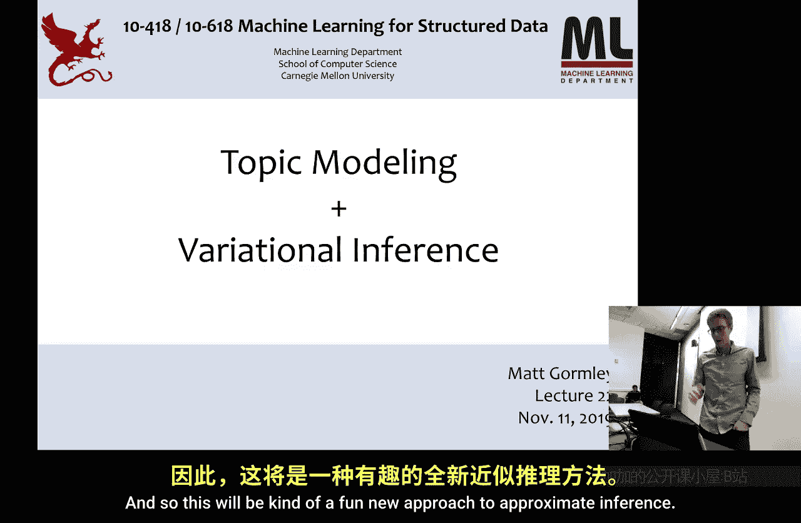
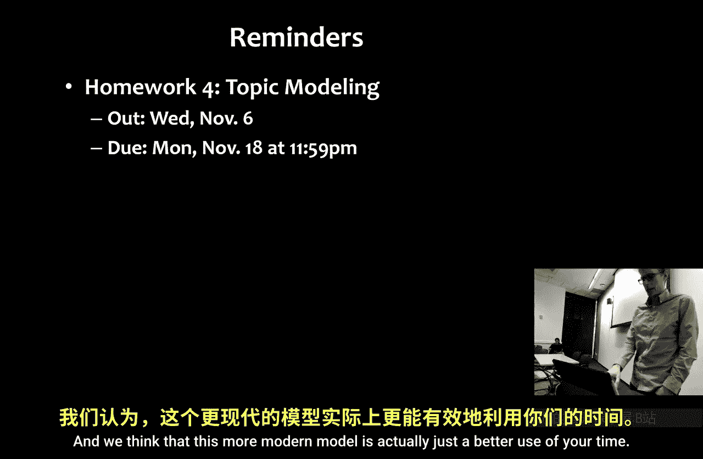
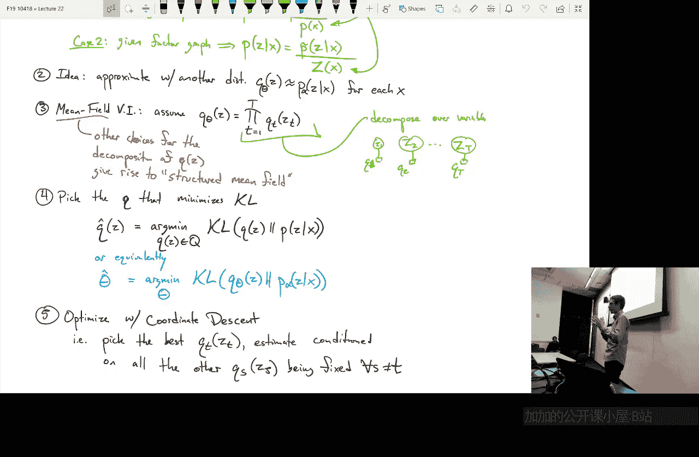

# 卡耐基梅隆大学【中英⚡结构化机器学习｜10-418 2019 Machine Learning for Structured Data】 p22 p21 10-418 ⧸ 10-618 Fall 2019 -BV1eJRsYBEaK_p22-

1618 today we're going to be talking just a little bit more about topic modeling。Grap up。相 of the。

Sort of models that kind of go beyond。Just the standard L。And that we looked at last time。

 and then we're going to move into variational。And的。So。Yeah， a kind of a fun new approach to。

Apply。Okay， so homework4 was out last week and is due on this upcoming Monday， so a week from today。

And。I think our hope was， again the。Homework for we kind of defined in such a way that。It should be。

A challenging assignment， but not excessively challenging。Yeah， but I think as well。

 maybe the key point that I want to make here is just that what we really set out to do with this homework is to kind of expose you to modern technical。

So one of the things that we had sort of considered doing here was。

Just asking you to implement sort of a vanilla。LB， and we think that this sort of。

AMore modern model is actually sort of a better use of your time。

Okay， so let's talk about some extensions of LD so there's this wide variety of。

Models once you kind of have this framework in place。

 this notion of being able to write down a Bayesian network that describes a generative story for where these documents and these topics came from。

And you can start to sort of build up a repertoire of similar looking models that try to capture。

So one of those is called correlated topic models。And they're correlated in that there's actually a different prior placed over the actual。

Topic assignments， such that。嗯。You can actually get。ちて。More interesting。

Then just sort of the standard multitonnomial distribution。Over topic。

So a dynamic topic model is really fun， we'll look at this， I think in a little more detail。

 because it can actually learn topic change over。So there's actually a notion of。

Sort of groups of documents right so here's group one， here's group two， here's group three。

 and each group might be a set of documents from a different decade and maybe you have you know 10 decades worth。

Data and so you can actually see how the topics are changing over time。

And then polylingual topic models。Are useful say if you have something like Wikipedia。

Where for each document， you have maybe not exact translations。Of the document。

 but you have sort of comparable versions。Of a Wikipedia page， right if you go to the。

The English and Spanish Wikipedia pages for a particular topic， they're not going to be identical。

 they're written by you know completely different。Groups of authors。

 but they tend to correlate in terms of the actual contents and so you can start to build up representations。

Topics that are actually in a shared vocabulary across multiple different languages。

 say T different languages。Okay， so。So the correlated topic model。Is kind of about rejecting。

The the Deishly crier。And you know， the dily is a great distribution。

 It gives you a distribution on the simplex， which is the space of vectors that sumg to one right or probability vectors。

 right， So vectors that sum to one whose entries are。ああ、なんだけで。And。Basically。

 it kind of assumes that the components are are are mostly independent。But if you think about。

In a real data， an article talking about fossil fuels。

It's more likely to also be about geology than about genetics。

So there's some notion that when you have a distribution over topicss that is describing a particular document。

Certain topics are more likely to correlate than others。And so。呃。

So the logistic normal is also a distribution on the simplex。

 but it can actually model dependence between components right so if you look at these distributions from the Deishle。

You know， they tend to be。You can kind of move the center of probability mass around。

 but it's somewhat symmetric as a prior By contrast。

 the logistic normal is actually able to give you these kind of skewed priors。

And so then you can actually use this as a prior over those document level distributions over topics。

And so essentially all we're doing is replacing this one little bit of LVA。

 which used to be a deishlay prior with a logistic normal prior。Okay， so。

This does provide a better fit to text data， but。The whole reason that we were using the deishly prior in the first place was because of deishly multinomial conjugacy。

And so once you switched to this logistic normal prior。

 now you have to do something a little fancier in terms of inference to actually work with this model。

Okay， but why would you care to do this， Because at the end you could actually visualize your topics and how they are actually correlated with each other。

 So this particular picture is connecting up。The top words for each of the topics。

To the other topics that were sort of most highly correlated according to the prior。AndSo。

So I don't know if we can find fossil fuels on here。

 but this is the one that seems to be about genetics， genetic population， populations difference。

You can see that the topics that it's connected to。

This one here also kind of appear to be about similar things。

 So this is about like sequences of genome and the DNA sequence。And。

You know there are entirely other separate subsections of topics like this one over here that's kind of completely disconnected。

 right， United States women， University， students and education， science， scientists， et cetera。

 these are all kind of in their own little cluster of topics。

And so this is a different way than of visualizing the actual contents of some really large product。

So I should add here that。The examples that I'm showing are going to tend to be these examples。

poBut people have applied these sorts of models all over the place to computational biology problems and computational neuroscience problems。

 computer vision problems， where the notion of words and topics changes depending on the actual application。

 but we still can kind of refer to them as topic models。Okay， so the dynamic topic model。

The high level idea is， you divide the documents up by year as I had mentioned。

 and then this is the interesting part， you add a dependence of each year on the previous form。

So this beta。This is the parameters of some Darly distribution Oh sorry。The beta here。

Are the actual parameters of the topics themselves？

And so what we're doing by connecting beta K1 to beta K2 is actually saying that the topics in one year are actually。

Going to be similar to the topics in the previous year。And so what that allows you to do then is。

I look at how a topic changes over time。And so you can see here in 1880。

So this was the documents from 1880 that。That gave rise to this topic。Had words like。

Electric machine， power， engine， steam， two machines， iron battery wire。And then as time goes on。

 this topic。Appears to kind of change。And so gradually we can see like by the 1950s。

That same topic is now talking about two about the rads glass air chamber instrument。

 small laboratory pressure rubber。And then， finally， by 2000。We have devices， device materials。

 current， gate high light， silicon material technology。

 it starts to sound like so this technology topic kind of was drifting from。

Sort of a very different use of engineering。In the early 19 hundreds to。

Something like maybe computer chip development。As well。

 you can also look at the prevalence of topics over time。And。

And you can also look at the prevalence of。Of sort of word frequency。Overturn。

And so here we're looking at。呃。Basically， two separate topics。So these titles here。诶。

We should be careful to observe that those titles for topics are kind of retroactively applied。

So there was some collection of words， some distribution over words that the authors of this paper thought kind of looked like a theoretical physics topic。

And then there was another one that kind of looked like a neurosign。So in neuroscience。

 you know in the early。1900s。You know， nerve was kind of the the most one of the most prevalent words for that topic。

 and then gradually neuron took over and for theoretical physics。

People were concerned with forces back in the 1880s。난。Lasers in kind of the late 1900s。

And there was kind of this。Interesting trend towards discussion of relativity in the middle。

So what's fascinating about this is that you know。Just by looking at this plot， you know。

 we kind of like all see these words。diisttributions over words and we can all just kind of like nod along because what they're capturing is something that's kind of admittedly cherrypiced but very intuitive about what's going on in these documents and so the hope is that something that might not have been intuitive to you about what's going on in the documents might jump out by being able to examine them in this way。

Okay， so polylingual topic models， you can similarly kind of learn that you know there might be some topic like this one。

And。The same topic is reused across 12 different languages。Learn on Wikipedia。And so， you know。

 all of these tend to be。Hopefully about。Space travel。K。

So this is another topic that tends to be about Spain or Spain。About one about poetry。So。

So the point then is just that that we can。Kind of begin to also look at。嗯。

Proport of tokens assigned to a specific topic。And。And ask the question。

 you know which topics are sort of more or less prominent in the corpus right so this particular topic。

World ski kilometers and one appears mostly in。Language is spoken in Nordic countries。

And Ottoman Empire Khan and Byzantine is。Appearing mostly in countries with languages or sorry。

 mostly of in languages。Sppoken in countries nearist。And then there's other topics like this one。

About。TV and movies that's nearly uniform across countries。

So a lot of times you also have actual labels or sort of some observed metadata about。

About what you'd like to model。 And so supervised LDA。

Provides an opportunity for you to include in the generative story， both where your words came from。

 but also where that metadata came from as some observed variable。

And then the model that you're looking at now says， well。You know。

 we've spent a lot of time recently thinking about ways of representing our data。

 be it words or images。Or。Data about cancer cells in low dimensional vector representations。

One sort of key idea is to generate instead of words as sort of these discrete entities to generate you know。

 a vector representation of each word。 and so this is exactly like LDA except that now instead of。

Generating words from a multinomial distribution， the role of a die。

 we're generating an entire vector。Some multidimensional Gauss。And what's fun about this。

 though we opted not to ask for you to actually make this visualization on the homework。

 is that you could plot these actual word representations in some low dimensional space。

 say by running PCA on the actual word vectors。We did remove this question right， Yes， yeah， okay。

 so so yeah， this just seemed like。It would be really cool。

 but maybe not like the best use of your time。Oops。So。

WellWhat's being done in this figure is each of the words was high some100 dimensional vector。

 like what you're working with。And then they ran PCA on both the word vectors。

 but also the topic vectors。Dr everything down to just two dimensions so that they could plot them。

And then what they did was they plotted the first two principal components for the word embes of only the top words in some topics so they didn't show every single word but just sort of the most prominent ones。

And then， they also。呃。Have the actual word color coded according to the actual topic。In。

For where the word appeared in like the top 10 list for that topic。

And so what we can see is just that you kind of get these clusters。

Of word vectors appearing in topics。In sort of a reasonable， correlated way。ok。So。

Topic modeling broadly is allowing us to do this。It's really。

Powerful analysis in an unsupervised way of large data sets。Fundamentally。

 LDA is sort of providing us with this。Really framework for describing a way of generating data that can be extended in all of these interesting ways。

And approximate in。Is really what enables all of this to work？Because at the end of the day。

Everything that we just did here。Both learning。As well as coming away with the actual topics themselves was passed as an inference problem。

And so it was that sort of boiling no of learning to inference。

And combiningbin marginalization over lant variables and also estimation of parameters simultaneously。

That allowed us to think about。Baisy and inference and Mar。ok so。A good question to ask yourself is。

 this all sounds great， but if we don't actually know the number of topics ahead of time。And。

So there are actually good solutions here， and one of them is Bayesian non parametrics。

And the idea is that we can actually replace something like a deerslay prior over a finite number of cave topics。

With what's called a Deish Lake process， which would give us a distribution over infinitely many topics。

And the sort of interesting part about Bayesian non parametrics is that we can work conceptually with an infinite number of topics。

 and yet we can boil the computation down to something that fits in finite space so that we can actually work with it on a computer。

呃And。So there's sort of a wide variety of。Other modeling constructs that come out of this space。Yeah。

Is it。Oh great question。 So oh， so this is probably a good moment to mention。

 So this topic right now it's not。On the schedule， but it might spontaneously appear on the schedule because of some scheduling constraints that I have where I might spontaneously disappear for a lecture and so I've actually got a prerecorded lecture on this that I'm not releasing unless。

unless we need it， but it's something that I actually could I could release later if you guys are interested in the topic just as kind of an introduction to the space。

 but basically the short version is that，There are a lot of models that we call non parametric。

Because they so a parametric model has a finite number of models and the number of parameters is defined independently of the actual data itself。

So a non parametric model， it's not that it actually does not have parameters。

 It does have parameters， like there's actual topic parameters。 It's just the the number of。

Parameterters that we end up working with is。Is actually a function of the data itself。

So these models， I think it would have been better for everyone if they had been called sort of。

infinite dimensional or something like that， but yeah。

 there are certain kinds of models that we can work with that truly have no parameters。

 but these particular times actually do。O。So yeah， so this is sort of an advanced topic that we won't go into today。

嗯。So broadly， approximate inference is sort of opening up all of these different ways of doing things for us。

 right， so we started out with these exact inference methods that were sort of specifically catered to solve。

What we were calling the inference problems at the time， they were map inference。

 computing marginals and estimating the partition function。

 and we've broadened that with Bayesian inference to say， well。

 really learning parameters can also be an inference problem。

And the approximate inference method that we've now spent a lot of time on Markov gene Money Carm is one solution to that problem。

 but we're going to move to talking about other solutions like variational inference where。

We can recast this entire problem in a different light like in a light that is not based on sampling。

Okay， so。I want to begin with just a high level look。At what variational inference is doing？And。

And how it differs from Markov chainin moneyney Car methods。

So the problem setup that we're going to be working with。Is a really general one。

 and I want to make sure that it's abundantly clear just how general this problem setup is。

So here's one example of the problem， okay， for inputs x and output C。

 we want to estimate the posterior or P of z given x because that posterior is interactive。So。

So this is like the problem that you were solving on Home2。

 right you have some conditional distribution over， say output variables。あてや。

Some factor graph and you want to estimate the say marginal probabilities or some distribution over those those variables Now in homework two。

 we purposefully chose。This factor graph that was tree structured， everything about it。

Was chosen so that。While you were working with it。You could do regular belief propagation and compute the distribution exactly。

Okay， the whole time that we were doing that homework assignment， though。

All I was doing was thinking， gosh， this is such a terrible model。🤢。

I knew that we had to do that model because it was a tree and it made everything kind of clean and nice for the homeworkmark pedagogically it was the right thing to do。

 but deep down I just felt like I'm crippling all of you by making you work with this model because I know that part of speech tags which are the leaves of the model that you were working with。

 they actually have sort of this temporal left to right dependence and so ever so desperately I wanted to add extra factors in here。

That connected them up in a chain。But I couldn't do that in homework too because we had to have exact inference and make everything simple。

O。So。If we had that factor graph， which would have made much more sense。

For the data that you are working with。Suddenly。诶。This posterior distribution P of Zga and X would have been intractable。

Okay， that's problem number one Pro number two here is suppose X is all of your training data。 Okay。

 in the first problem， we're assuming x is something like one sentence and Z are the variables for that sentence In problem number two。

 I'm saying let X be your entire training data set。 Think like LDA。Okay， and。

And Z is now the parameters of the model。Maybe parameters here we could actually use loosely to say maybe it's not just parameters。

 maybe it's parameters and latent variables， Z。This is exactly what we had going on in LDA。

 you have observed words X for an entire corpus， and then you're trying to jointly infer a distribution。

 a Bayesian distribution over the topics Z， and also the the actual parameters for the model。

 things like theta and phi。And so what we wanted to do was Bayes an inference to estimate the posterior Z given。

And again， that was intractable because of the actual model。Okay。

 so variational inference is going to tackle this problem in a totally different way than what we were doing with FMC。

And it's dramatically more powerful for a lot of reasons。

 though it also comes with some disadvantages。 So let's look at what it does。

The idea is to approximate。This posterior with some simpler distribution。Okay。

 so this is the thing that we're trying to estimate， and this is the simpler distribution。

And so in general， while we're thinking through variational inference here。

 I think it's actually better for you to carry problem one as sort of the running example in your mind throughout all of this。

 and that's actually the one that I'm going to emphasize today。

 but I want you to kind of have problem two in the back of your mind so that you realize just how sort of general and powerful this method。

O。So。Typically this simpler distribution， Q of Z。Is going to have more independence assumptions。

Then P of Z Gs。And that's going to be fine because Q of Z is actually going to be tuned for a specific X。

So going back to our homework two example。Maybe what we could do is。

 if this is the factor graph for P of z given x。Well， we could say that。Q of Z。

For that specific X is just going to be the simpler model。That you already knew。How to oops。

That you already knew how to do exact inference on。Right， the tree structured model。

So if this were the case。Well， Q of Z has made more independence assumptions。

 we left out that linear chain connecting the leaf nodes。

But it has a structure that makes everything about it easier to work with。

And so the key idea then is to pick a single distribution Q of Z from some family that best approximates P of Z genetics。

Okay， so we need some terminology here， Q of C， we're going to call the variational approximation。

And capital Q is going to be the variational family， and we would say that。Q of Z。

It's going to be some distribution。In the variational Fa。So further。

 what we're going to do is we're going to work in a setting where or the typical setting that one would work in。

我的 assumed that。Usually Q of z is parameterized by some vector theta。

That we call variational parameters。Likewise， that P of z given an x is usually parameterized by some fixed parameters alpha。

We can just kind of refer to them as the parameters like we usually do。OkaySo here。

 the reason that I like us to focus on problem one。Is that。

Now we can kind of think of an example of P alpha of Zga and x。Would be。

The actual learn factor graph。For some model。And all you're trying to do is now test。啊。

Estimate some distribution for that loan。就。We'll come back to the problem of how could you use variational inference？

to learn alpha， but for now we can just assume that alpha is fixed。

 that we have this distribution P of z given an x， and we're just trying to do inferences with it。

Okay， so it turns out that variational inferences is really this sort of broad。Family of algorithms。

The term variational inference actually comes from the term variational methods。

 which just refer to sort of methods of function approximation by optimization。

And so the key property of variational inference algorithms are。

ThatThey solve the inference problem by boiling it down to some optimization problem。

And then using standard optimization techniques。To actually do the optimization。

So the one that we're going to focus on here is called the mean field approximation。

 but loopy belief propagation， tree related belief propagation， expectation propagation。

 they're all other algorithms that are solving inference by optimizing some objective function。

 it's just that they're going to these other three are actually optimizing。

A different objective function than the one we're going to focus on today。Okay。So。提交。

The function that takes us from x to。你也穿一。Prooximate probability said。That function is very simple。

 just like a linear。Projection office。I some like。Then probability of central ne should be easy to。

So。If。You're saying if。So what are you saying is actually easy to approach？Intractly， yes。

But for some function， it's very simple right right and in that case。

 you don't need variational inference So what I'm saying here is that you know the problem is。

That that posterior is intractable， if it's not intractable， then。Don't use variation。Yeah。So。

 so for example， on homework2， we just set it up so that the posterior distribution over the。

The tree was tractable to work with， and so you just ran belief propagation， it was easy。嗯。Okay， so。

呃。So now the question becomes。You know， is， is it trivial to come up with some cue that。

Kind of best approximates P。It's kind of important to notice that。

We're not defining a new distribution。You know， this simple。Q of Z， given X。But rather。

 we're defining a。Q of Z for each P of Z given mix。So。

Q of Z actually doesn't have access to whatever x is。So whatever it is that you're conditioning on。

The only reason that Q of Z。Is going to look like P of Z given X。

Is because we're going to define some objective function that tries to make them look like ychuck。

Okay， so let's think about like a Markco chain money Carlo equivalent of this， right？

So suppose you're trying to do this with MCM， well， you could draw a bunch of samples from， say。

 the posterior P of Z given it。Call those Z1， Z2 up to Zn。And then let's say for that particular x。

You train some new model， Q theta of Z。On those samples。So when you train that Q theta of Z。

 it doesn't know anything about x， but the samples Z1， z2， Zn were sampled from K Z given x。

 and so they should be representative of the distribution over Z's for that particular x。

And so the hope is that that sample kind of adequately represents the posterior for the given eggs。

Okay， so。Qu is how is variational inference different from this Markup chain money Cargo thing。

 Well for one， variational inference does not require same。Two。

 it's going to be usually a lot faster and it's also going to be deterministic。And。

Then the question is， well， why， so the reason is that we choose some objective function。

Qu forward is that it's going to be this thing called kL divergence before。

That defines which Kthena best approximates。呃，PL。And the fact that it's going to be fast。

And deter deterministic is going to be because we'll exploit the。但是。休てが。So that。

All of this works out to be efficient。So。What's really interesting here is that that I think this MCMC contrast provides us with。

 is that in variational inference， you have this new design decision in front of you。Essentially。

 what variational inference says is， okay， first come up with your model， P alpha。

But choose the model that you really wanted。Don't dumb the model down just so that you can do exact inference on it。

 write down the model that you really wanted to work with， the one that you believed in。

Once you've done that， then dumb the model down into something that you can actually work with and call it Q。

And then learn a cu that looks kind of like people。Okay， so what are some examples of this We'll say。

You had a Markov random field like this one， this is sort of like what you were working with on homework three for computer vision where。

You have this。This pair wise Markov random field， and you have an edge between each pair of adjacent pixels。

So， we could。Get back an approximation of that Markup random field simply by removing all of the edge factors。

So what we would be left with are only node factors or node potentials。And so the queue。

 so if this was， so let's call this。P of z given x， and this over here， Q of z。And then let's just。

Change these x's to Z here。So what we're saying is this appxid distribution is just going to pretend as if it completely factorizes according to the variance。

O。This is called a mean field approximation， it's what we're actually going to focus on and what's astounding about this is that。

We can actually get away with this and it works really well。So why on earth would it work you？そでだきき。

在。It's for each X。For each input and time， depending like the different Q。

Is itically a single distribution， which is。Yeah， so for each x， we're going to learn。

 say different parameters data。So we can always think of like theta is specific to one of our。本で。

Yeah， so so the way that you could think about this is suppose。So suppose you were trying to。

Basically do the test time version。Here two so you already have a training model。

And now alone comes a test example。 That's a new sentence。 And you want to。

Produce this like tree of tag for it。So you're going to run variational inference so that you get back a theta for that new test example。

And。啊，还单风门。You will then use that too big see。A way of approximating marginal probabilities for all of the output。

你咩过。是啊。And so in some sense， this MCM solution is it。

I mean it's a strawman solution right what I'm saying here is the MCMC solution would take that one test example。

 run MCMC on it， train some Q theta of Z on those samples and then completely throw that Q theta of Z and move on to the next test example and start over。

And we choose the z， which is just not next。Yeah， so you might choose this Z that maximizes the probability if you have marginal probabilities for each of your variables。

 you could do minimum days risk decoding and if it's hand loss。

 that's just going to be know the most probable assignment to each variable according to its marginal。

So once you have the actual distribution over the seas。

 there's lots of different things that you could do to actually choose a single C。Okay， so。

 maybe this is actually a good moment to pause and think about。Problem two here。 Okay。

 so now suppose x is the entirety of your training data。Well。

If x is the entirety of your training data， then。Q theta of Z is going to be。

 say the distribution over all of the topics for the entire corpus and all of the parameters for say a topic model。

So that's a totally different， maybe unsupervised。Way of doing things where you're doing baing。

Okay so so this is just one example of a way of decomposing things。

 but there's other ways that you could decompose right so for example you could take little clusters of variables right so maybe you take not maybe you don't break it up into individual。

Single variables like this。 but rather， you say， okay， each collection of four random variables。

 Well， we can do exact inference for variables。 We can just run variable elimination or something。

And it wouldn't be too inefficient， and so maybe our Q distribution actually assumes that each collection of four variables is。

Or maybe you know， if you're feeling more ambitious， each collection of 16 mars。

So we talked briefly about a factorial HMM or a factorial CRF。

In the context of sort of energy estimation or current estimation。

 so this is one where you have a bunch of sort of backbones for an HMM and this is an example where you could just decompose it into a bunch of independent backbone so this is one backbone it's not connected in any way to this backbone which is not connected to this backbone and so on。

So if you wanted to do this for LDA， there's actually different options available to you。

 so one would be you could make that mean field assumption and just remove all the arrows from this graph。

And then you could approximate。The topics and the parameters with Q。

But you'll remember for the Gib sampling that we talked about in class， we actually integrated out。啊。

非常 fine。Because of duly multinomial con。And we worked with sort of this reduced LDA where alpha went directly to Z and beta went directly to X。

So you could actually also work with that model and collapse those parameters out and then just use variational inference to to approximate the Z。

 for example。And that would give you collapsed。Variational inference。Okay。

 so what I want to talk about today is mean field variational inference。

 and we're going to start with just some background。

So what we need first is just a quick look at kale divergence and I imagine a lot of you have actually seen kale divergence before but。

We actually want to make sure that。You kind of also understand the behavior of this。Metric。

 even if you have sort of seen it written down before。Okay， so the definition。Of Kale divergence。

Is given two distributions。Q and P。It's defined to be。The expectation。Under say。Q of x。Of。The log。

Of Q of x divided by P of x。Okay。So this is the definition。For。呃。To。Distributions。Q of x。And E of x。

For all X。In some sort of shared space。So the two distributions have to be distributions over the same output state。

So the properties of pale divergence that we care about。Are that。 one。The KL of Q and P。

Can be thought of as measuring the proximity。Of。These two distributions。P and Q。

So you can think of it like a distance metric。But for probability distributions。Okay。

Another important property is that it's not actually symmetric。And。So KL of。Kale of Q。P。

Does not equal。诶 k l。Of P。Q。The third is that it's minimized。When。Whatever。Q of x is equals P of x。

For all acts。So if the two distributions are equal， that's。The minimum of the KL divergence。Okay， so。

What we're going to do with variational inference is try to find a cu of Z that。

Best approximate P of Z given X。According to KL divergence。So what we care about is sort of。

Let's say，3。Cases of interest。For minimization。O啊。So we're going to break these three cases up by thinking about。

Say the value of Q of x， the value of p of x， and the actual outcomes。So。The first case。

Is that where Q of x is high？And P of x is high。So你都。Q of x is high and p of x is high。Then。

Is the kale divergence higher or low？For that。For that particular answer， yeah， question Oh sure。ま。

で平あれ。いう。Yes。Well， in the so they're minimized when the two distributions are exactly equal。

 but there's this caveat around。诶。Whether or not P of x and  Q of x can be zero。

Sos actually let's return to that exact question， but after we get these through these three cases。

 so think about zero cases as we're talking。Okay， so if both Q of x is high and P of x is high。对。

Is that going to make？Kale divergence higher or lower。Look。Because what happens is。Q of x is large。

Then that means that whatever the term is is going to contribute more to that expectation。

And if they're both high。Then the log of the ratio。Is going to be。The log of see。

Something close to one。And so in that case。The log of something close to one is kind of like zero。

So the outcome here is going to be sort of low。K有。Which in our case is good because this is like a distance metric。

Okay， so case number2。We're going to think about， let me actually write out all three cases just so that you sort of see where we're going here。

Would be where Q of x is high， p of x is low， and then the third case is going to be where Q of x is low。

So。Well， why don't we break it into four cases， just so when you look back at this。

 it's not confusing so this would be。就啊。So when Q of x is high and p of x is low。

How is that going to affect？KL dirgence。你使佢我专面咩反应。what is in that point。Yeah， yeah a。

They just sort of point。Yes， so let's actually。Explit。So basically what I mean by that is。

Like keeping everything else constant。So all else constantly。Consider。Particular。Say X。It's effect。

関経？Thanks， for。So we'll say like there's some specific X prime。I up here。

We're thinking about how does it。The KL diversion， keeping everything else the same。Okay。

 so for that particular x prime， ifq of x prime is high and p of x prime is low。嗯。

Is this going to relatively sort of push up the k divrgence？Push down the k of the。The same。はい。Yeah。

 so it's going to be high k all this time。Which， again， for our purposes。

 if we're trying to minimize is bad。And why does this happen Well if Q of x is high， then again。

 it think a big contribution to that。That integral or some， that is the expectation。啊。The ratio。

 Q of X Px。Is going to be some positive number， if we take its long，' going to。

Possitive numbers still。Okay， so the last case is actually for both of these。

 because if Q of x prime is low， we don't actually care what p of x prime。

Because it basically just doesn't。Have much effect on KL at all。We could just say who cares？

Because in this case。It's essentially going to have like no effect。So， okay， so now we come to。嗯。Oh。

 sorry， so now oh yeah， questions ahead。あそはでせ。What3 that minimize when  Q x equals3x。

 And then we say that for all x。啊，搜的个。I mean， because we have sampling according to QX。

 and so there will be some points that will have a high QX。

But there is some point I have a long Q export might have had a high V export。P。

 that is not equal to Q it， but we're not giving any importance that。

So in calculating care divergence， when we minimize the care divergence。

 we will not be giving one schools one。So for those points， QX and BX won't be included。诶。

For the points where。Q of x was basically for the points where Q of x is built。

It may not be that the care origins。Basically， we have minimized the objective。

 but it need not be that for those points， QX could be equal to BX because from that point。

 QX is low and it had a valuable contribution in our care algorithms。Yeah， so that's true。

 But I guess， I guess my statement in property3 there is that。Like in， a minimum of。

Kale divergence is achieved when there。So。Yeah， but what I' saying。

Our condition like geo X is equal to yourex， according to the care。

Because there will always be some points which will be less important according。

Over which when we try to optimize， we won't really care about this。Oh。

 I guess what I'm saying though， is suppose here。For example， like。P is actual。Colum vector of like。

07。2。point one。And the question is， you know， so this is your distribution P。Like that is P of x。呃。

The question is， what values？嗯。The vector Q here for defining a Q of S distribution would give back minimum k dirg。

And so。The。So what I'm claim is。So for example， one Q would be like 0。1， 0。1，0。1。So that's like。

 well， actually， that doesn't make sense because we have to sum to one， right？

So these were if this was the uniform distribution。Like one third， one third， one third。

 well then we've kind of made them as low as possible。Right， but call that Q1。

 but my claim is that Q2， which is not uniform， so it means that some values of Q actually are high。

Is actually going to have lower kL divergence。And so I think that the key thing here to remember is that Q is not unconstrained。

It's not just a vector， like we can't have some vector Q that is 0。1，0。1，0。1。呃。

Like because in that case。We haven't defined a proper probability history。And so。

 so what what's kind of。Yeah， so this， I think is kind of one of the key properties of kale divergence that makes it a little bit different from。

Something， some other metric that we're used to reasoning left with like like Euclidean distance over two vectors。

Is that we have this constraint on the actual。Distribution vectors。

So I was wondering why we consider a particular X because I thought it was the expectation of the distribution。

 so shouldn't it be like the mean？Of the distributions that you use rather than like like to the average across like all access that you use rather than this particular。

Yeah， so do you mean well so hold on let's so if we were to write out this expectation。

 right if X was discrete。Then it would be a sum over all the x's of。Q of x log。Q of x over P of x。呃。

If x is discrete。And it would equal an integral over x of Q of x。Q of x over。P of x。BX。

If x is continuous。So。So I think what you're getting at。呃。

Like why are we considering a particular X if it's supposed to be the expectation？Oh。

 now here you mean。 Oh， I guess just because。Maybe it's harder to- so it's easy to think about。

One particular term in that summation， it's harder for me anyway than sexualized。

apps to ha divergence。Like I guess in some sense， I don't even know how to like break down。

The actual behavior of distributions。Cases， we're not boiling it down to like thinking about a particular。

En treated that actual summ。So that's that's why I was kind of。But your rate that in general。

 what's going on is we have these whole distributions。And so the kind of key thing to think about。

Is that。嗯。So let's now think about an actual example here。So this is actually maybe example one。

This is example two。So suppose what you have is。嗯。Some distribution。That looks like this。

That is good。And it's two dimensional Gaussians。M equal to 0，0。And covariance that gets us back。

That sort of skewed。Distribution。And then we define。Q of x。To be。The product。Of two Gaussians。

 So it's going to be。And one， which gives us。A distribution over。Sort of X1， given mu。

And sigma squared。Times。And 2。Is this region over x2 given mu sickness grade。And let's say。

 these are。You know， specific to the distribution。 Okay， so this is actually a。Meanfield。Approxims。

And the question is。What is the Q of x？That has lowest kale divisionrgs to P of x。For this case。

And it turns out。But it's going to be a distribution that looks like this that puts most of its probability mass symmetrically around the origins。

Okay， so why on earth。Would that be。The Q of x。That we get back here。 So Q of X has to be like。

A symmetrical。那这啊也就。嗯。So it doesn't have to be a symmetrical distribution。

 it could have stretched itself out horizontally or vertically。But if it did that。Then， you know， so。

If it looked something like。This。我问。We have these regions out here。And over here。For the green case。

Where Q of x is high。But P of x is low。And that is going to push the kale the virgins up。

And so the distribution that it selects is actually going to be like this red one。Okay。So。

So where do we go from here？Yeah。This case， so the objective is to minimize。よしし。

Why do you just choose Q B。Why didn't it just choose a diagonal one Oh because I defined Q of x here to be the product of two one dimensional Gase。

And so if you take the product of two one dimensional Gaussians。You can get like。

You can't get anything diagonal。If you want something that stretch it skews diagonally。

 you need a two dimensional Gasian。Like P ofx to do that。So。Yeah。

 so maybe I won't go into a deep explanation of that or anything， but yeah。

 so you can either stretch it horizontally or vertically， but you can't stretch it di。

So that the the second program。けの九。Thankきそそ。Find whether the two distributions are similar or not which one to choose。

哦。呃，Yeah。Great， so let's make one more point here I wasn't actually planning on making this point。

 but today。We talk about。Mean field variational inference。呃。Which minimizes。KL of Q of Z。

P of Z given an x。呃。And never， like not like next lecture， I just don't plan on talking about it。

 We could talk about expectation propagations。😊，Which instead minimizes。KL of。P of Z， given x。Q。

S like that if I minimize one the one also。てコンピュニーで。Not necessary。And the last detail is that。呃。

Both are non convex optimization preference。ok。So。呃。WhatOh so yeah， I didn't answer your question。

 did I？So I think this example number two kind of roughly gives us a sense of the the zero pace。

 So imagine if okay， what if now we didn't have。We didn't have Gaussians。Uniform distributions over。

Andipsoids。Okay， so now we're going to uniformly spread all the probability mass over that。

Diaagonal ellipsoid， and that's P of x。And then for Q of x。

 we can get any ellipsoid so long as it's not diagonal。So you can have a circle。

 you could stretch it vertically， you can stretch it horizontally， you just can't stretch it di。

And the question is。Which Q of x would you choose？And here the answer is going to be。One that。

Sort of sits right over top of the black ellipsoid。And that's because。あ？

What goes forwardly wrong is if p of x is zero。Then。You're going to be taking the log of Q of x。

 which might be some harmless 0。001 divided by zero。Which maybe if it's not exactly zero。

 but it's just close to zero， it's going to rock it off to it。

So that's the thing that we need to be aware of is that there's this sort of odd behavior。

Which is that。Q of x is going to be。of placing more probability mass in places that avoid this behavior。

So。So what is meanfield variational inference？So today， we're going to just。

Outline kind of at a high level what it looks like and the next time we'll come back and actually。

Dive deriveive it。So at a high level， the goal here。Is to estimate。P of Z given up。

And we could think about sort of two cases of interest。So case one is。

We're given the joint distribution。Of P of x and Z。Which means that。嗯。P of Z， given x。

Is actually equal to。P of x and Z。Divided by P of X。So that's case one。Case 2。Would we're given， say。

 a factor graph。Which would mean that the conditional distribution， P of Z given X。Is something like。

Pil的。Of Z given x。Divided by a partition function， Z of x。

Where Pilda z given x is just say the product of all the potential function。Okay， so the point is。

Either way。We have this term in the denominator。That we're going to assume。To be intractable。就。

The sort of key point is that you， P t them of z given x and the joint， P of x and z。

 both of them need some normalization if you want to work with the posterior or P of Z given x。

So the idea here is。That we want to。Approximate。呃。With。Another distribution。Q of Z。

Which is gonna hopefully be something near P of Z given x。For。For Ex。And。Let's further incorporate。

Arameters like we did before so that we have Q of theta。And P， P of alpha。P office。And。呃。

So mean field variational inference。Is going to assume。That。Q theta of Z。

Decomposes according to variables。 So that would look like a product。Com T equals 1 to capital T。Of。

Q， T， Z， T。Where we have。See capital T variables here。So you could think of this as。嗯。Decompose。

Over variables。And if we're thinking about this as a factor graph。

This looks like Z1 with a little factor。That's the。QT factor。And then or that's the sorry， Q1 factor。

And then Z2 has a factor， that's Q2。And then all the way up to C capital T。

And that has a factor Q capital。Now it's important to note here that。

We could actually choose a different decompositions， and。Other choices。呃。For。The decomposition of Q。

呃。Give rise to。What's called structured meanfield。Unstructured means field。Operationally。

 it kind of works out to be the same， but maybe the computation works out to be a little bit more challenging。

Okay， so。We're going to pick。The Q。That minimizes KL。

And so we can write that sort of one of two ways。 One is that we could write。

 we want some Q hat of Z。Which is the a min。Over。Distributions， Q of Z and some family Q。

Where we pick the one that minimizes K L of Q Z。And P of Z given an X。

The other way that we could write it。Is in terms of the parameters。

And then we could say we're going to choose some theta hat。

Which is an amin over parameter vectors theta。That minimizes the KL。Of Q theta of Z。And。

P alpha of Z given x。And。I actually prefer that we think about it this way。

Because then what we're saying is the structure of the graphical model for Q is fixed and all we're doing is trying to figure out what the parameters of the graphical model are that will give us back。

Minimum kL divergence。Okay， so the last question is， how do we actually do the optimization？

And what we're going to focus on is。Optimizing with。What's called coordinate descent。

And coordinate descent is just a standard algorithm where you pick one dimension at a time to optimize over。

And so in our settings。What we're going to do is basically pick。The best。呃。Factor。呃。Q T。Oops。是。

So we're going to pick the best。Q of。T Z T。嗯。And we're going to estimate it。Condition。嗯哦。The other。呃。

Q T。Zt。Oh， sorry。Q， S， Z S。Being fixed。For all。F's not equal to T。So。

The point is that there's lots of optimization algorithms out there。chastic gradient descent。

 gradient descent。Block coordinate disscent， coordinate disscent。

We're going to choose coordinate tocent。Which is going to essentially update the marginal distribution of each variable one at a time。

Why are we going to do this？There are other options out there， but this one。

That's to give us back a really clean looking algorithm。As well。

 it's going to give us something that we can draw analogies to Gb sampling with and Gib sampling。

 right， we came up with this full conditional distribution and then we sampled a value of one variable at a time。

Here， that's not what we're doing saying。We have these little Q distributions。

 which are kind of like distributions over each variable。And。Maybe unnormalized。在。

We're essentially saying that we're going to take each one of those and we're going to estimate the entire distribution for that variable condition on all of the other estimates。

Those。Q Q T distribution。And then we'll pick the next variable and we'll update its distribution。

 the next variable and so on and we'll iterate through until we enter。

So we'll look at the details about how important the structure of Q is。And。How we can still。

Minimize this efficiently， even if P has a structure that would be really hard to work。Okay。

 so that's where we'll get up on one thing。

So see you guys。