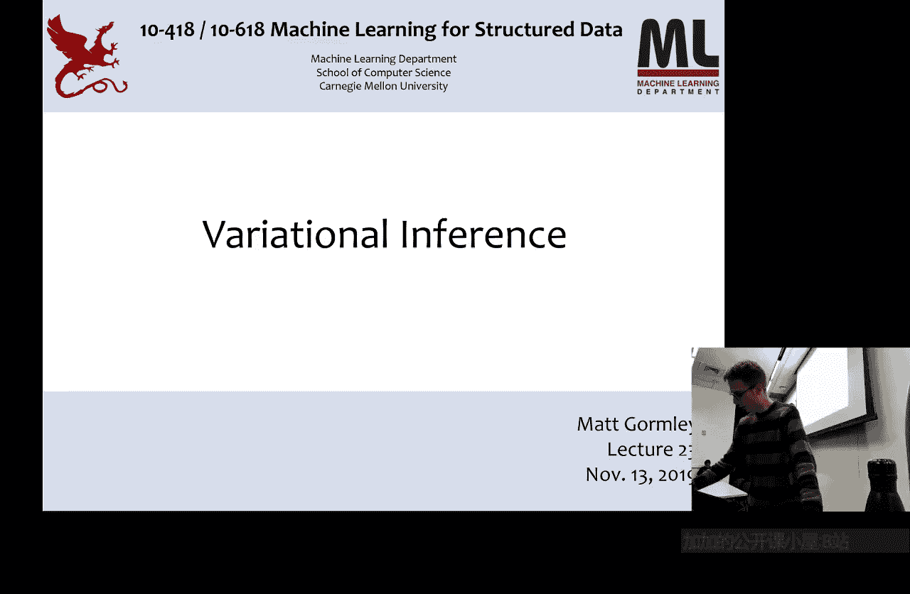
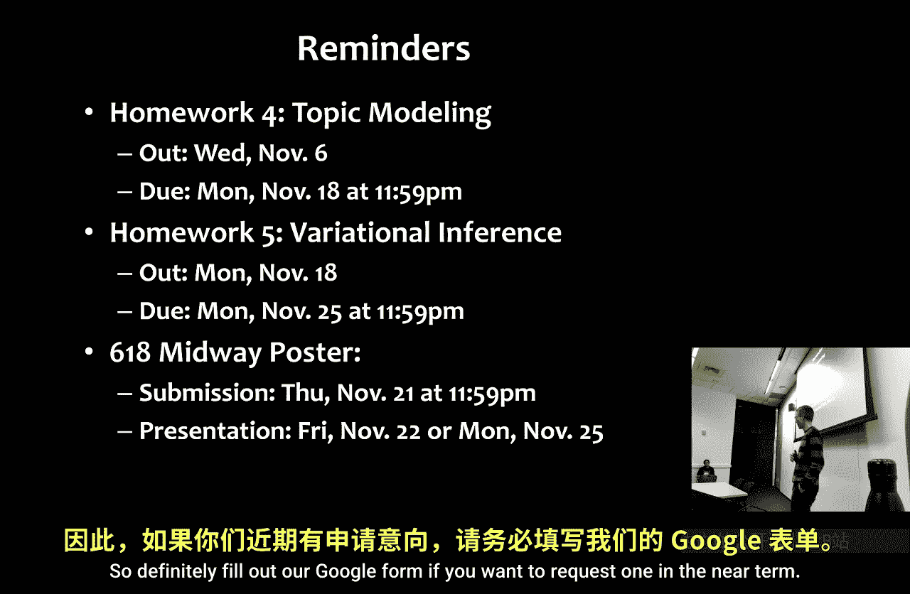
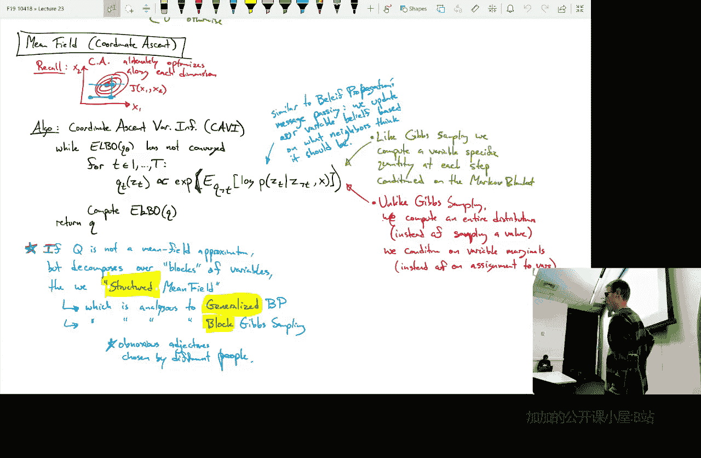

# 卡耐基梅隆大学【中英⚡结构化机器学习｜10-418 2019 Machine Learning for Structured Data】 p23 p22 10-418 ⧸ 10-618 Fall 2019 -BV1eJRsYBEaK_p23-

Okay， let's get started。Today， we're going to be talking about。对于所有证。And。結거。

But today is really to try to move through the rest of this picture of。

Sort of pure variational inference where what we're trying to do is just。For a distribution。

Or some plagueant variant。Right， true。What we'll do later sometime after this。

Is we'll kind of come back to this。Bad idea variational inferences think about how it can be applied to learning in a Bayesian setting。

 we sort of already did this with Markco Jane Money Carlo。We're using。An actual inference method。

Not to sort of find the single point estimate cement of our parametersers， but。

You actual distribution。And then we'll also think about。Very印象あ。Sort of a method。

Sort of degenerative model。That relies on。Variational inference。And specifically， in that context。

We'll be thinking about。嗯。We'll be thinking about how。We can。Use variational inference。

Within the context of an EM like algorithm， an expectation maximization algorithm。诶。

And so variational autoenrs will actually sit。As sort of an example of that。

So that's kind of where we're going here。And。嗯。So what we want to do is。

Pick up where we left off last time in thinking about how。

To。Sort of build out。This algorithm in some more detail。So I guess I also just wanted to mention。

ual reminders and one that I don't have up up here is I just sent out this note on piazza about getting。

Credits for the 1 618 projects。だ。Basically， we can give you these kind of like coupons and $50 increments。

So if you're interested in using GPU dos。Or sort of cloud CPUs for your project。

 that's an easy way to do it。 There's also Google co La。

 which is useful full if particularly like at this point of the project where you're just trying to get things up and running and you can actually just。

啊。Access to one GPU at a time。If that's at all helpful。

So kind of few different ways that you can look into that so check out the Piazza post。

 the main reason I raised that is just that just sort of arbitrarily。

 I said that the deadline for submitting the first wave of coupon requests is this Friday。

 so definitely fill out our Google form if you want to request。

In the future term。Okay， so we said that variational inference is。

Fundamentally about estimating the posterior some P of C given X。

 and we thought about different problem settings in which this comes up。

And we said that our solution was going to be to approximate that posterior with some simpler distribution Q of Z。

And。The Q of Z distribution should come from some variational family capital Q。

 and what we're doing is parameterizing Q by some theta and P by some alpha。At this moment。

 we're concerned with purely the setting where we want to learn the parameters theta that give us back a good approximation to some fixed P alpha。

 so we're assuming that you've already learned the parameters alpha。At this moment， okay。

 we'll come back and we'll see how we can use variational methods to also estimate alpha。

 but for now we're assuming they're fixed。And what we want to focus on today is really this mean field。

Approxiation algorithm。And so last time we saw these these examples of how you could actually take。

Say a Markov random field， like this one and decompose it using a mean field approximation where we say that basically there's no。

Connecting edges。In our graphical model。And so the next thing that we actually need to do is identify。

IA little bit more about。The actual objective function that we're going to be working。So。

The objective that we want to use here。Is that of。Kale divergence。And。

So we're assuming that we've decomposed Q as the product of a bunch of。

Sort of little cute distributions that I guess。One thing I'm just noticing here。Is。

In my definition of the field assumption at the very top here， I kind of lost track of theta。

 so we could say。Maybe put theta。Inside the parentheses。

 So it's also parameters to the Q T distribution。I guess we could have subscripted it alongside the little T but we were just kind of writing out of space there。

So。啊。So we're going to try to pick the cu that minimizeizes scale of divergence。And then， optimize。

Something they might coordinate to say。So。嗯。So the next thing that we want to think about here。Is。

The meanfield。Objective functions。And。The first thing that we should note here。

Is that really so the question that we're asking is， you know， how to optimize。This KL divergence。

Objective。And essentially， we're saying that， you know， our original optimization problem。Was。对。

We want to find。啊三。Parameter alpha。Or some distribution Q。嗯。백 minimize。The啊 KL。Q alpha。老师。And。Sorry。

 other way around。So we want to find some theta。That minimizes Q theta of Z。P alpha法。Of Z X。ok so诶。

Problem is。诶。This K altered。We can't actually compute。So。Specifically， we said that。

So let's see why here。So we defined the KL divergence。Just sort of generally for two distributions。

 so here let's just write it out for this Q of z and this P of Z given x。So its form is going to be。

The expected。Log of a ratio， where the expectation is taken under Q of Z。诶 the啦。Q of Z over。

PFC dividends。嗯。And。So at this moment。We now want to。呃。Divide up this expectation into two terms。

So that we have the expectation。呃。话q c。Minus the expectation。Again， under Q Z of the log。啊 p m c 嘅。

So why can we do that， well。This is just a log of a ratio。

The log of the ratio is just a log of defibriator， minus' the log of the denominator。

And so by linearity of expectation。We can just take the expectation of the new numerator expectation of Lo the company。

Ja，So so far， just simple manipulation。And then we can observe that。You know， P of C given an X。

Is really P of x and Z divided by P of x。 So that means that。Really what we have here。Or more terms。

Where。We can take this。Second term。B it up into a log。PX ofZ。Minus a log。P of X。So。

So that would look like。Qせ。Of the log of P of X。What is the expectation under Q of Z of log of P of x？

Can anyone simplify that for me？It's just log of deal。It's just log P of x， right？

If you have some random variable。And you're taking。

An expectation under some distribution over that random the variable。Of a constant。

Then the expectation is just the value of the constant。So this might be like 27。Or sorry。

 it's a large probability， negative 27。And so this expectation is just whatever that value is。

 negative 27。So what we're left with is。The difference of these two expectations。Minus log t x。Okay。

 and。Much earlier on here。We actually。Assumed。This was intractable。

That was how we kind of walked into this whole thing。

So we said from the getgo that this term was something that we couldn't compute by assumption， Okay。

 so if we can't compute that term then we can't compute the KL divergence。

So what are we going to do well？Let's think of啊。Some alternate objective function。呃。

That we could actually。Fororthwith it。So。If we say now that， you know。

 what it is we're trying to do is。Here， actually， maybe y'all。Maybe I'll actually switch to。嗯。

We're going to be really sort of focused on。The behaviors of the distributions here。

 So essentially what I want you to be comfortable with。Is sort of what we were doing before。

Which was to say that。You know， we can talk about this optimization problem in one of two ways we can talk about it as。

optimizationptim problem number parameters The， or we could talk about it as an optimization problem over。

The variational family， these are just two ways of talking about the same problem。Either way。

 we're getting back。So。Ce distribution。it's just a question of whether we talk about it as optimization over parameters or optimization over the distribution。

So。So I think we'll stick with。With the way that I set it up here， which is。

Optimization over parameters。 and I think it's just sort of a more natural way to actually talk about this stuff。

That said， as we're jotting out notes here， we're purposely going to leavea out the parameters for most of the time just because we don't want our hands to like cramp up while we're writing on this。

 So okay， so what we want to do next is we want to say that。Finding this data。Which is the artman。

Over。K lキ西タ。Be alpha。Well。That is。呢个叫。TheAr over。These three terms that we described now。Expectation。

这个。a log。揭备啦。我で。The expectation， again， under。诶嗰话。あキアシエケレックス。バイで。Oh， actually。

 I should be careful here。So。This second term。I actually missed sort of made a mistake on the sign here。

 so the first term。The expectation of log P of Z given an x was subtracted。

 So when we divided out the numerator in。Get out， this's really should have been a plus。slide。Okay。

 so this P of X is， is a function of。Alpha as well， it's just that we're marginalizing over。O。So。

This is minimization over data。And we can't compute log P alpha effects。So what should we？好有你叫。

Yeah actions。So。All right， so we can't solve this optimization problem， so what should we do？

my question yeah， so when you say that。はぱい。Iing that you know the function how be。我。而啊所以依家。成实得呢。Oh。

 we chose。This is the distribution that you came up with， right？

If you were doing Markov Jade Monte Carlo， this is the distribution， right。

 this is the thing that came from。I don't know， say the graphical model that you're working。

So P alpha is， you know， a the actual。嗯。YouComplic distribution care about。 So maybe。Here。

We have something on。P alpha Z given x。Is something like。其实会合时果。2。3。All of these things。

to some Texas。We observed。Next to。Like， so。一月四。Cl。So these expertss are shaded in。I observed。

And then what we're saying is that separately。We might have some。呃。Q theta of Z。

That just has the same。Support， so it also has variables C1， Z2。Z3。

But maybe they're under a mean field assumption。So they look like this。

With little factors touching each one。That's that's the setting of the brain。

 And then we're assuming that， you know。knowAll the factors involved in P alpha。So。So。Okay。

 so the question。Is you want to minimize。Over theta。This kale divergent。

But we can't compute log P of x， so what should we do？其啲。あださ。Yeah， great idea。

Lob P alpha of x isn't a function of theta if we're just minimizing over theta。Let's just ignore。

L P alpha of x， right， so we could even say。We're just going to take an argument。Over theta。

Of just the first two terms。This one。Dropping。华逼。F。Now， this is such a good idea。

That we're going to give this idea a name， but we're not going to give the first two terms a name。

 I'm actually going to negate them and then give them a name。 So if I negate them。

Then that means that we're going to be now doing an our math。Here， not an argument。

So we switched from。Inter Max。And we're going to do。三。Objective function called the elbow。哦。

Which is a function of Q theta。So the elbow， let's just define it。诶去实呢。Wass going to be。Definine。As。

The ne gateated version of those two。Which is just。The expectation。Under Q theta。Let's see。我ばれ。数知。

Minus the expectation under the same Q theta as z。啊，好啦嘅。If you want to do。This now you。Alright。

 so now。诶。I guess the remaining question is， well， we got rid of this one term that we knew we could compute。

 but what about those other terms？Are we even going to be able to compute them。

 are we going to be able to actually do learning with them？So it turns out we will。

And we'll be able to precisely because。We've chosenq theta of x to have a really simple form。Okay。

 and we'll see how that plays in here in just a moment。So。I guess。Another thing to note here is that。

For。呃。For a factor， so。Forever factor。We would have written things out a little bit differently。

Right for a factor graph。We would have written this。Oops。

We would have said this was equal to an artman。是对啊。诶。The speed of Q theta。我企飞咧。W点 the。Term。我哋嘅。

Of the log of Pida。How excellence。Or they see get next。And then we would have had not log of D of X。

But the log of the partition function， C of X。So if we are in a situation where we can't compute this partition function。

We would drop that。即 get啲有佢。So this is just the same thing。For a factor。Or rather。

 I guess I shouldn't think for a factor guy I should really think for。Conditional rate。ok， so。

Now we have this objective function。And before we actually put it to use。

I want to just sort of make a few notes about this new objective function。嗯。So。

This is just sort of some side notes about the elbow。嗯。So。

The thing that we want to highlight here is。You know。

 the reason that we're using the elbow here is because it's going to get rid of that that intractable term。

 but there's also this。Well， I mean， I'll call it a theorem。

 but feels a little bit funny even calling it a theorem because。呃。

It's an incredibly simple statement。So for any。Distribution Q。The log。

Of p of x is greater than or equal to the elbow of that Q。So what that means is that。呃。

In other words。Elbow。Of Q。Is a lower bound。On log P of x。Right， so。We could actually prove this。

 and let's prove it two different ways。So， the first way。Is going to reuse Yenssen's inequality and。

Yensen's inequality。Is is just a statement about how we can。Work with。Functions of expectations。So。

So Ymsen's inequality here。It might have been something that you actually saw in your probability class。

 so it just says that。A function of an expectation。Of a random variable。Is greater than or equal to。

The expectations。Of。That function of the rate。嗯。We could probably spend like an entire probability。

太短吃。alAbout that inequality I don't really want to do that here Instead I just want to see how we can use that inequality in our setting to show that this is a need a lower bound so there's really just sort of one step here so we're going to start with the fact that the log。

Of P of x is。Just the log of a marginal probability， so it's a marginal over z。

Of the log of P of x and Z。Where we integrate over possible values of Z。And。Then we could say。That。

Word。呃。We're able to just take this and multiply by one。Where here one is defined as Q over z。

Divided by Q over z。So this was really just multiplying by one。And then。We can actually now。

Look at this as an expectation。Namly。We can call this an expectation under Q of C。

So what we're going to do is we're going to take this viewerator。Q of the。

 and move it up to the front。So really， this， we could say is just an expectation under Q of Z of。

P of x and Z。Divided by Q of C。诶，就。So this is just definition of。Expectations。

So and we got that by sort of moving this Q of Z out to the front。And then。At this point。啊。

Our next step should hopefully be straightforward。 Does anyone see what it is。就是不要这个。Yeah。

 just applying Nen's inequality。It's just a log function。So what we get is that。

This must be greater than or equal to。The expectation under Q of Z。Of the log of that ratio。

So that's back。Youson inequality。And okay， lastly， by just strict equality。

 we have that that's equal to， and now I'm just going to divide up those terms as we've been doing the log of P of x and z minus the expectation。

Of the log of QZ。O。Great。😊，So that。It's just the elbow。Of Q。就咧。Proves what we were setting out to do。

 which is that the log of P of x is greater than or equal to Ldo ofq。Okay。

So it turns out that what we just did here。Was a whole bunch of work for nothing。

Here's proof number two。So proof number two。You just need to know a little something。

About KL divergence。So step one。We have that the log of P of X。Is equal to the KL。Of Q P。Plus。

 the elbow。Of Q。Okay， so does anyone want to give me just why， why is this the case， Why is it the。

The sum of KLPQ。Plus， elbow of Q is log P of x。If you just write the equations together。Yeah。

 the two terms are just going to cancel out。 The whole point is that we negated elbow we negated the first two terms of the K and that was the elbow。

 So we're just by adding the two， we're just getting those to cancel out Okay。

 so this is just sort of。By our very definitions。嗯。Of the elbow。Okay， so。So how can we show？

Very directly。喂。The summer。Well， but given this statement。That elbow is a lower bent。

For a log of P ofQ。Give you a hint， it requires a property of the kale divergence。そけ。Yeah， so KL。

Of QP。Is greater than or equal to zero， actually is it？But equal do is it greater than。啊。I guess。

It could be equal to zero because we could have all of the Q terms that are zero probability v where p is non zero vice versa。

Okay， so it's greater than or equal to0， which means that。

Log p of x is greater than or equal to alpha of q。Okay， so， so really。啊。

Everything that we just did in proof1。This is just sort of the standard。呃为。Approving。KL。

Is greater than a equal to zero or similar to。So if you wanted to prove this fact。

You would use Y inequality， and we just did it directly on log P of effects。Okay。

 so why are we belaboring this point， Like what is the takeaway message here， So the takeaway。

Is that。In variational inference。We are finding。The queue。That gives us。The tightest bound。On。

The marginal data likelihood。So in a sense。I'm sorry about that。

We just find the cu that gives us the typeest bound on marginal data likelihood。

 And so what that means is that essentially。诶。We're trying to make。啊， the。

The actual observed data X as likely as possible under this Q distribution。

 you could think of it that as effectively what we're doing。So。嗯。

This statement is actually going to become more important。Once we come back。

And try to learn both the parameters。Theta of Q and also the parameters alpha of P。

Because what we're going to do when we come back to this later and we want to learn the parameters alpha of P is we're going to look back at this elbow。

Definition here。And we're going to say， well， really。

 elbow is a function both of the parameters theta and also the parameters alpha。

So let's tune jointly the parameters of theta and alpha。To maximize the elbow。

Maximizing the elbow is essentially trying to。Maximize the marginal data like。

So we'll come back and we'll do that later so if that's not obvious to。Okay， so。

So now we've sort of laid out。This whole。嗯。Elbow thing。 And， oh， I guess maybe the。

 the most important detail I left out here is just that。So why do we call this thing elbow？

Elbow stands for。Evidence。Lower。Bound。So evidence lower bound where we take the B andO from bound。

And now we've actually seen， you know， it's a lower bound on the evidence where the evidence is x。

The actual observed data。All right。So。From here。We want to say。Let's actually solve。

The problem that we set out to solve。The first way that I want to sort of allude to solving solving it。

 and we're not actually going to go through this fully。

Is to use gradient descent and the reason we're not going to fully go through this version is we're going to sort of leave this。

this we're going to leave being filleded with gradient descent as sort of an exercise in formmark five。

 and so what we'll do is we'll sketch this out， but we'll leave sort of the last step of deriving some gradients。

Open ended。 and then what we'll do is we'll come back and we'll actually look at。Those gradients。

 but from a slightly different perspective。And we'll do coordinate accept。Okay。

 so I want to start here because you know we all know gradientian descent really well this is this is sort of where it feels like we should start if we're just trying to optimize this objective function okay so。

You know， suppose。呃。We want to find。This theta hat。That is at least approximately。The A max。

Over theta of elbow。Of Q theta。Okay。So that's the setup， gradient descent。Does local。Oh sorry。

 I guess we need not gradient decentcent， but gradient。Uent here。So gradient uscent。

Does local maximization？嗯。But the elbow。Is generally non convex。

So whatever solution we come up with here， we're not going to actually try to deal with that non convexity。

 we're just going to use do the usual thing and rely on local maximization。Ours。Just for simplicity。

Okay。So。So then the whole point is。Let's apply。Gradian ascent。To。Yeah。Okay。

 so what would that look like， Well， the algorithm is just going to be。Pretty simple。

We're going to say， in step 1。Initialize。Your parameters is data。

And then except step two of the algorithm willll say。While we have not converged。

We're waiting for some。Converive criteria to be met。We're just going to update the parameterss data。

With the usual gradient ascent。Update， which is going to be theta， not minus。

 but plus here because we're doing acent。Some learning great gamma。

Times the gradient with respect to theta。呃就个。休死。This is still very great。So。

Now all we need to do is come up with the gradient。The elbow。So。Roughly。

 that's going to look like we have the gradient of。家佢。あ聞いてら。Is just the gradient of two terms。你会。

The expectation under Q of Z。Orcus data。Of the log of P alpha of C given X。So that's the first term。

Minus the gradient of the second term， which is just。The entropy of Q here。So expectation。The mark。

き制。Okay， so figuring out exactly what those gradients are。啊。まのか。Or5。And。The detail here is just that。

啊。But， this is easy。Precisely because。嗯。A simple queue function。So。So this is our。

This is sort of one version of mean field， right？Where。We were just。

Reun gradientd and descent as long as you can compute those。Those gradients。So， at the end of this。

所以点。Great。You'll have run gradient descent。You'll have come up with some data out。

And the whole idea is use。Do had heard。Q非ta。姓你。As。An approximation。Or whatever。

Distribution here approximate。 So namely observe that。あ九さ九。Hat of Z， We chose it to decompose。

Over the variables。And so。What that means for us。Is that？So。We can actually。你 should。

So this is our approximation to P alphapha。啊司嘅啊知。So。

So there's sort of like two things that are really important to observe here。嗯。就最 cases这系这。

Suppose the one thing you wanted to consider。Was。Comput of variable margins。🤧。So。

If you think about running the belief propagation algorithm。

The two things that you walk away with are variable beliefs and factor beliefs。Right。

 so here so why was it that we wanted variable in factor group beliefs， Well。

 you could use variable and factor beliefs to compute an objective function like the log likelihood for your model。

So one thing we might want are variable marginals， such as P alpha of Zt。 which is exactly， I mean。

Defined as a sum over。Sort of。Variables in the vector Z not T。嗯。The joint。ZT and Z。有钱。对不对？Oops。

 I guess we could。Incorporate our X here。Into the variable marginal as well since。

So it's really right here， we have this variable marginal condition on it。

And what we're saying is that。If we have this Q function， then this is trivially approximated by。

Q T Zt。基本地啦。Let me read this actually a slightly different way。嗯。Because。

Really what we're saying here。Is that。What you get back。For。This。This Q T Z T。

This is approximately equal to。The variable marginal that you care about。So。Yeah。

 so the point is the。The way that you would approximate this。It usingな。O， so。What if you wanted to？

Something like factor marginals。Let'll put that in quotes here。我。Then， in that case。

You want to approximate that with。Say QT of。四需要 hand诶。Some variables like ZT and ZS。

So this is just going to be an example of a factor margin。So this should be。

This is just an example for two variables。So， if you wanted to have。

We could say that that is approximately equal to。P alpha of。Z TzS。Given。So the question is。

 how do we actually compute？呃。This marginal。Like。How do we actually get Q T of。Z T and Z S。

Given data hack。What is that equal to？Is it easy to compute， Is it hard to compute？All right。

 don why don't we step through it， So what is the definition？嗯。This margin。帮到好俾。系个。

To make this even clearer。Oh， sorry， I guess I shouldn't have used。A T in the sub here。

 This would be like。实Q啊。These two variables， it's not just tea， it of both。

So maybe just so that we can actually see what's going on here。What if I said we want Q of Z1 and Z2？

Marginalizing over all of the other variables。So how do I even define this marginal problem？

It's like the sun。いやです。Yeah， so like we have a sum over all the values of C3。

And some overall values of Z4 all the way out to。诶C capital t。And what would we be adding up。

 we'd be adding up the joint， which is just。Q of Z1。你 two。All the way up to ZT。ok， so。How be defined。

That joint distribution， where we define the joint distribution to decompose。As the product。

Of from t equals 1 up to capital T。Of Q。嗯。呃ZT。We're written another way， I mean， this product。

Is really like。九？我。That's Q O Z2 all the way up to。九ジ？So that means that we can rearrange terms。

By pushing these down through these summations。So this should actually feel kind of like what we were doing in variable elimination。

 right， we have Q of Z1。Times Q of Z2。Times of summation over Z3。Q of Z3。Smation over Z4。Q of Z4。

All the way up to a summationian over Z T。Q c t。嗯。So what is this term。Once。What is。This是。1。

This entire thing。可能。And just work your way back。Since each one of these little summing is going to be one。

 then this one was one and then the one before it， also one and also one and also one all the way back。

 and so that means that。This。Marginal just boils down to Q of z1 times Q of z2。So more generally。

We have that。These factor marginal。Are just going to be Q out CT。Thats Q of Z S。And this whole thing。

So maybe I should say。These aren't really factor marginals because we don't even have any factors。

In the Q factor graph， these are say。To variable margin。And then we can just kind of keep going。

 right？re嘅个关。If you want them are just。Q自知。yes。ZR。Is equal to the Q of ZT times Q of Z S。

H isQ o theR。And so on。For more it。Sorry。Okay， so this is why we worked with a distribution like Q。

Because once you boil down to a mean field approximation。

 all of the things that are usually really tricky。Become really easy and cute。2。So。呃。

So now I want to look at one more variant。Of。Of actually doing mean field here。可以的。

The assumption that we make a meanme field similar to the assumption that we make in9 days。

It's independent。Yeah， I guess the， the point here is that everything。Is conditionally independent。

 given the parameters theta。就。All of those。I could even say， sort of。这个。You know。Conditional。

Independence。Properties。Of meanfield。I mean， they all boil down to。A little dayszeman。

That looks like。The one。Z 2。ZT。So once you actually observe theta。

They're all independent of each other。So the way that I've been writing it down is instead as a factor graph like Z1。

Z2。人时之。Each with these little factors but。It amounts to the same statement where here I'm just not actually visualizing data。

As a random variable and visualizing it as。Fixed parameters of the model。

So we would be like to say that as the complexity of Q approaches is that of daily the low bound。Yes。

 yeah so诶。And， in fact。Just to take a little bit of。So yeah， stretching break from all of this math。

 why don't we actually think about kind of an interesting case and then we'll come back to coordinate this sense。

So what if we were to talk about mapping？As。meaningfulfield or。Variational inference。啊So。

Suppose we wanted to。The math entrance。As a variational inference problem。So we want a family。九。

Such that。呃。Q。诶C。Which is the artman。All possible Qes and capital Q of KL。调屁。Gives back。いや。

Distribution。Which is appointment。Where。Q how。え。嗯。Z hat equal to the art max。You be个 next。抓不这问题我。

Anything else。With probability here。Then the question is。In this this case。What is Q。呃。

So if Q is equal to P。Then when we saw that KL。We just get back P。

But here we're trying to actually do something kind of wacky we're saying。

I actually want to solve the mapping。The map entrance problem， remember what it does。

 I mean I wrote it in here。You know， the map inference problem。Is saying。

So the map inference problem。Just says。We want to find Z half。Which is the art max。Overall。

 possible z's of P of Z。Give an X。It's just finding the most probable assignment to the variables under P。

Okay， so what essentially I'm dragging towards here is what if we defined Q？

So it was just the family of distributions。Where each distribution。Was a point mass on a different Z。

すた。So we could。Yeah， so basically。What we're saying is each member。Of Q。They some Q and Q。

Is a point mass。For some。Z in the space of all possible Z's。So， that means that。

We're doing a little bit of gymnastics here， right we'。Hue is always going to be。Like。

 you can think of it like。呃。This is sort of a wacky notation here， but Q of Z prime。Of。Z。Is equal to。

1。If z prime equals z and0 otherwise。So in this way。

 what we're saying is we would have this funny little collection of distributions。

Where each one just gives probability to one particular assignment。

So if you have a distribution that gives probability to only one assignment。

The one that minimizes kL divergence。Is going to be the one with highest likelihood under P of Z of an x。

And so。诶。In that case。That would be the Q hat that we came up with here。O。

So finally now let's return to this mean field problem。

And let's look at one more way of doing things。And this time we're going to look at coordinate。Acept。

So coordinate ascent。Is just。So if you recall。The coordinate descent algorithm。

It just alternately optimizes。Along each dimension。So if we had some function。

That we were trying to optimize， and it was a function of x1。And x2， and the function was some。

Something like this。J of x1， x 2。We would pick some initial point。

And then starting at that initial point， we would step along the x1 axis。To the highest value of x1。

And then we would step along the x2 axis tos say the highest value of x2。And then along the x1 axis。

And so all we're doing is just sort of going back and forth between next one and next two So the K means algorithm is block coordinate descent。

On cluster centers and cluster assignments， right， we do this alternating back and forth between updating cluster centers and updating cluster assignments。

The expectation maximization algorithm is also a block coordinate。block variables。

So here we're actually going to do cocent， meaning one variable at a time。So。To the algorithm here。诶。

Is。Called coordinate asscent。Variational inference。Usually abbreviated。Cabby。And in Cavi。

 we're going to say。You know， while the elbow。Of Q theta。Has not converged。

We're going to iterate through。Each of our variables， so let's say for T。In one。Up to capital T。

We're going to set。QT。Of Z T。To be equal to。Or rather proportional to。呃，The following quantity。

So it's going to be。And we'll come up with how we actually get this in just a moment。

It's going to be the X。Of an expectation。Where the expectation here is taken。With respect to。

All of the variables， except for T。So let's call that distribution Q of not T。

And the expectation is going to be of。A conditional。

 a log conditional probability that looks just like the log full conditional that we worked with in G sample。

 namely the probability of Z T， given Z not T。Anex。And then。呃。We can compute。The elbow。

Of our current queue。And then at the end， return Q。So。

The way to sort of conceptualize what's going on here is that。It givess sampling。

So light Gi sampling。We。Compute sort of a variable specific quantity。诶。At each step。Conditioned。嗯。

Really the Markov blanket。对。So unlike give sampling。嗯。We compute。An entire distribution。That's。

 instead of。Sampling of value。And。We condition on。Variable marginal。Those Q distributions。

Instead of on。An assignment to those variables。嗯。So you could think of this as， you know。

 we're going through each。Time recomputing the distribution for that variable。And then， we're。啊。

We're using the expected log conditional to recompute that， which is sort of like。

 you know what we expect or what all of the other variables expect that distribution to be。

So another analogy that we can draw here。Is。So。This is similar。To believe propagations。

Message passing。How is it similar？We update。Our variable belief。Based on。

What neighboring variables think it should be。So。The neighboring variables have some belief about what the distribution over this QZT should be。

And we're updating that belief based on。Their understanding of what that distribution should look like。

And we cycle through variables one at a time to do that。Okay。So。嗯。あ。えいて。All the very good。未调晒。

A joint。With all these three conditions。The similarity that we want。So in mean field， we didn't have。

 are you saying if we didn't make the mean field assumption that there was one factor per variable？

So yes， and actually。Let's。In favor of so the thing that we're going to do next is derive this update。

Which is going to be like very closely related to。The actual gradient descent version， right， I mean。

 at this point， you can imagine how we're going to derive that update。 We're just going to compute。

The derivative。Of the elbow with respect to this distribution。

And then we'll set that equal to zero and solve for。

So that we're maximizing that value condition and all the other ones。

So instead of jumping into that just yet， let's actually leave off with one more connection here。嗯。

Co。So if。So if Q。Is not。A mean field approximation。But decomposes。Over。四。Blocks。Of variables。呃。

Then we have what's called structured being field。And。We would say that this is。Okay。

 we'll just end the lecture really quickly so which is oh no， there I have power which is。Annalogous。

たら。To what's called generalized belief propagation。Which is also analogous。To。Block， give sample。

Okay， so what's ridiculous here？Is。We have structured meanfield。

 generalized Bp and block Gib sampling。呃。And these are just sort of obnoxious adjectives。嗯。

Chsn by different people。嗯。So essentially。The fact that these names differ。

 like it would be great if they were just all， you know， block mean field， block， belief propagation。

 block， give sampling。For whatever reason， these things kind of developed independently。

We ended up with these names that don't make this connection obvious at all。

 but really that's what's going on is that they're very closely connected。😔，Okay。

 so next time we'll kind of get a feel for what this looks like on a tiny factor graph and then we'll actually derive that update and from there we'll step into either some other variational methods or variational EM。

 I might actually bump up variational EM。Just so that we can talk about it right after。

Okay， can I see you then？