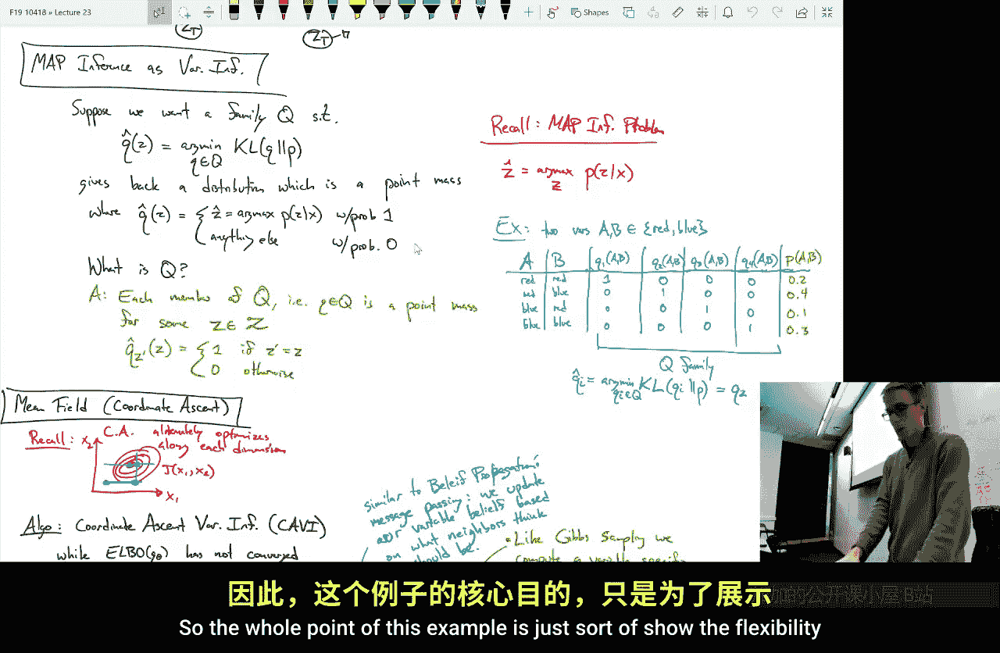
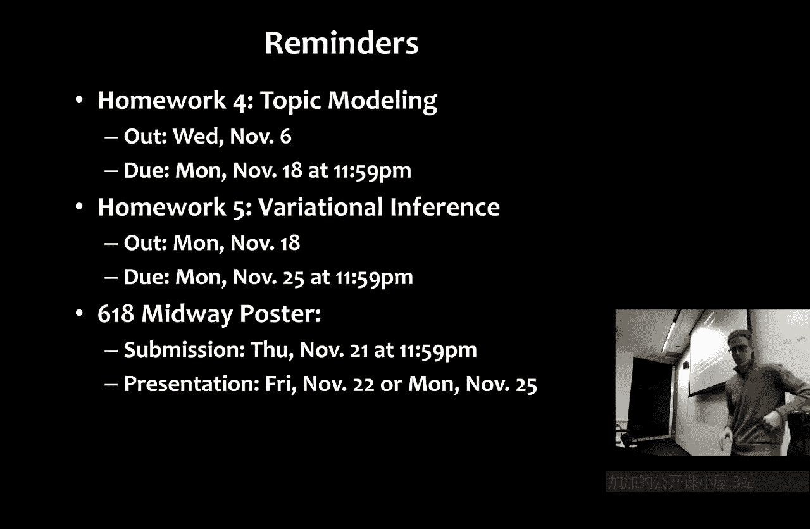
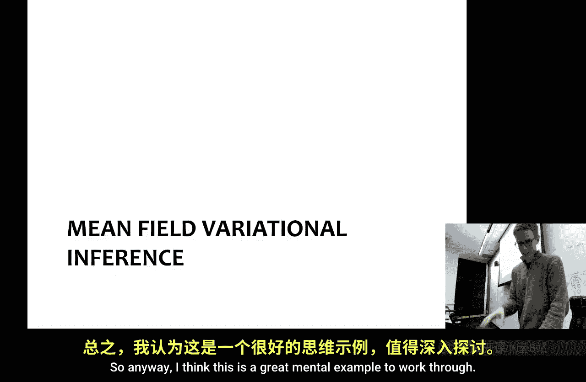
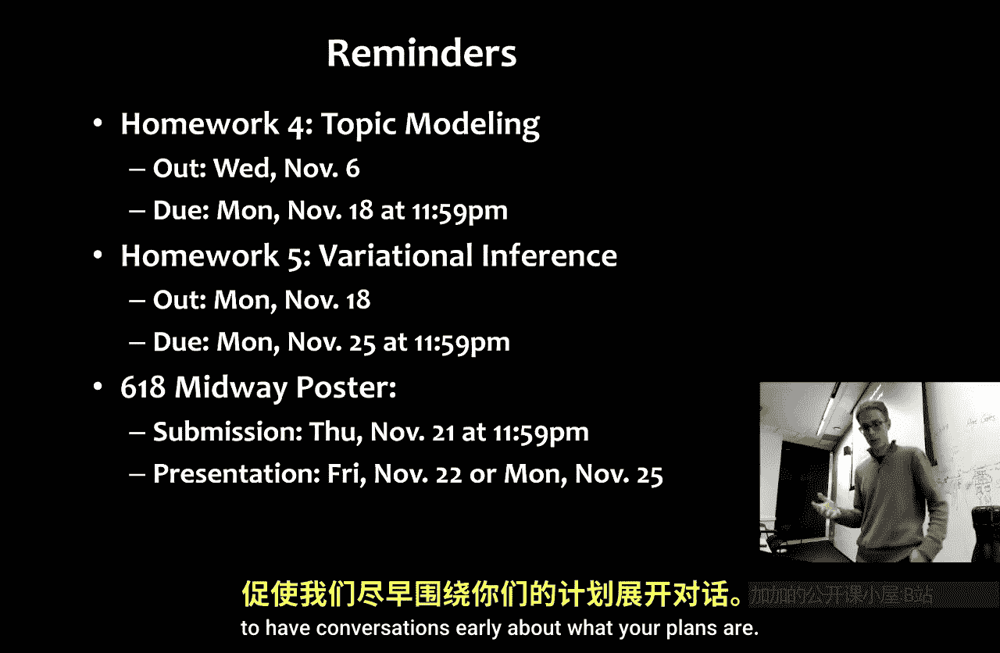

# 卡耐基梅隆大学【中英⚡结构化机器学习｜10-418 2019 Machine Learning for Structured Data】 p24 p23 10-418 ⧸ 10-618 Fall 2019 -BV1eJRsYBEaK_p24-

So， I didn't think this one is the in。

可能这是不在外面人管。系 look like what also。The is okay， this is。

 and so that's why the on other side Okay suspect be。Oh one thankful。第个问题。两这分。れて。这来不是在。你的个。いつな。Yeah。

常。Yes是。啊，这边的。だ。我 it。Andにも。Should the be down。上面你系边车帮我。So for this one。そそで。Just成。For every single。

And then。Welcome back to  F4 618。Today， we're going to be talking。About a really fun topic。

 which is that of learning from personal observation。And we'll do that in a context。Of variation。

Before we get there， we actually have a little bit more with。I mean feel have variational answer。やか。

あてもけ。This new topic。So啊。One good question that came up。次源のワさ。我对 talking about。

With the reduction of map inference to variation。And so afterwards in office hours。

I'm started sketching out a little example。嗯， what it was。Let's actually pull up the notes from that。

From that discussion。Where。See。So what we were thinking about in the context of variational。

Inferance gear was how we could take。Map inference。Kind of cast it as。Variational inference。

This example on the right hand side is new， we didn't talk about it last time。What I did is I said。

 okay， well。You know， recallca the message。Right，It's just about finding。

So Z hack that maximizes P of Z given X。So let's suppose we have this little example where we have two random variables。

 A and B， and they can each take values red into loop。So。这是。

Four distributions that I want you to think about。Those are Q1， Q2， Q3 and Q4。

These are funny distributions。Because okay， so a distribution over A and B has to give four probabilities。

 right， one for each of the possible configurations of A and B。

But these four distributions are funny because。I made it so that。对呀。That's all。

That would be problematic。OneNot has sort of stopped functioning on us here。

See if we can get it back up again。Okay。I think we'll manage。

 even though it's not fully functional here。Okay， so。

What we're thinking about is basically this setting where we have these four different distributions over A and B。

And each one is a point mass distribution， meaning that it puts all of its probability mass on one of the configuration。

One of those A configurations， and then it gives zero probability to all of the other configurations。

So I listed out the four different possible。Q functions of this variety。

And I didn't list out any other possible distributions。

Because I want to call those four distributions our Q thing， our variational thing。Okay。

 so suppose that the true distribution over A and B is the green column。Where we have 0。2， 0。4， 。1， 。

3。As our probability distribution。If we solve this kL divergence problem。

 which is what variational inference solves。Then what we're saying is find me the Q distribution in our family of cues。

That minimizes the k divergence between Q and P。So the question is。

 which of these four minimizes KL divergence？Well， we could actually just measure it， right？

It's just in this case you can exactly compute the KL dirgence so you could compute KL for each one of these and what we would find is that the KL dirgence is minimized with Q2。

Yhy Q2？明在在吗？Yeah， exactly。 And the the kale dirgence。It's just going to look like。

The value of Q times a log。P over to。So all these cases where Q is zero。

 those just don't even contribute to the sum。And only the term where we haveq equal to one。

 actually do we contribute to the study。And so naturally we want P to be at its heights。

For that term。Okay， so here we reduce。Map inference to variational inference。Okay。

 so this is illustrative， I'm not suggesting that you actually go out and implement map inference in this way。

 but rather than it's important to understand that what you're doing when you've solve this map inference could be interpreted as a form of variational inference。

So the whole point of this example is just sort of show the flexibility of the framework that we've built。

Okay， so any other questions just to work？Pausing here。Yeah so you。Family can include on。哦。

so variation additional inferences and quote a limitation on。感觉就。平时啊。So yeah。

 that's the sort of key property of the variational approximation is what does that Q family actually look like？

And that's going to define everything about it。问题张。Lar that。Yeah， exactly。

 so that's what we're really going to be doing。The rest of today's discussion in the Mefield is thinking about how do we actually learn the parameters of Q rather than sort of picking out a specific cue from the list？

So anyway， I think this is a great sort of mental example to work through。

So the usual reminders。変が。I guess for 618 students， just a note。

We're going to be releasing your project proposal feedback。I think today this afternoon。And then。

The submission for the midway poster is on。Thursday and here it's sort of of important for you to keep in mind the whole point of this midway poster session is just for us to kind of give you actual feedback。

An even more sort of interactive form than sort of what we'll be doing。

Just sort of writing you a few notes。In response to your。R。Yeah。

 so we hope this is sort of just sort of fueling interesting discussion。

 I've never actually seen another class do this before， so it's a little bit of an experiment。

 but I think it'll be kind of a useful forcing mechanism for us to have conversations early about what your plans are。

So to wrap up mean， we spent a lot of time talking about variational inference and what I want to wrap up with is so we actually already did this algorithm summary。

 but we skipped over this discussion of the actual derivation of the coordinate asscent variational inference。

algorithmgoth。And so today I actually want to look at why it is。네。

Coordinate ascent variational inference。Works as it does and。So let's pick up there。So。

The whole idea of。Coordinate scent variational inference。Is that。

And maybe we'll actually go ahead and just kind of grab the algorithm summary from last time so that。

嗯。We can go ahead and recollect what it is we were talking about here。うくくて。不用用。I guess we will。

So this is what we were saying about coordinated。Aent variational inference。

We said that the algorithm is going to proceed。嗯。It iterating fruit each variable。

So we said we have T variables。And while that elbow is not converged。An update to that Q T or ZT。

Which is to set it。They're proportional to you。Exbook。

An expectation of a log of the probability of ZT given all the other variables。就。The inner term。

 that log of probability should look really familiar。

 that's just the full conditional from Gib sampling。And what's different about this is that。

 you know， we have this expectation under the Q distribution where we've essentially made an expectation。

Given by all of the variables， except for。And so when we say that we want this cu to be proportional to something。

 we're saying， okay， well， you're actually。You're going to have to normalize this。

And so we'll look at a discrete case where you can just enumerate out all of the。

These quantities and then just sum them all up。Okay， so why is it that we end up？With that。

That update rule for coordinate and variational inference。So。Essentially， what this boils down to。Is。

It's essentially a function of two important properties。

 one is the chain rule of probability and the other is the mean field approximation that we made in Q。

And so。So the first thing that we're going to do here is。So just recall。We call the chain rule。

Of probability。呃。And apply it to the joint。To what we call P alpha。嗯。

So what this looks like is we have this joint distribution。Which is a P of。That vector Z。And。呃。

What we're going to do is we're going to actually。So rather than talking about via some abstract vector or over some unknown number of variables。

 we're actually going to subscript Z to show。The variables that are involved in the spectrum。

So Z subscript1 colon T means Z1， Z2， Z3， all the way up to Z capital T。

So the joint distribution is then， say， z1 colon T and x1 colon。Let's say M。

 or we have M input variables。And so if we want to apply the chain rule of probability here。

 what we're going to do is we're going to say， well。First。We have this。Joint probability over。

All of the x's。And so actually， let me just sort of the chain roll here。Just in case。

It's been a little while。So P of A， B and C。Is equal to。Be of。诶。Times， P of。Say B， given A。

Times B of。C， given DNA。And we could write that out in any order。For those three。

So here we're going to do the same thing。And so the first sort of actually group of variables that we're going to put together are all the x's。

And then all of the other terms we're going to collect into this product。

Which is little T up to capital T of the probability of Zt。Given。Z from1 up to t -1。

And all the excesss。So essentially we've just。Said that Z T depends on all of the Zs。

Up to and including T。And notice that this is not for a specific kind of factor graph， I mean。

 this could be any sort of arbitrarily interesting factor graph that we might have。Over。

A collection of variables here。And they might have cycles in the factor graph。And there might be。

Lots of interesting dependencies between。The x's and the z's。

So we're not saying anything specific about the actual form。

Of the factor graphs that we're working with。So。The next thing that we want to do is to actually decompose the。

The entropy of the variational distribution。呃。So here。What we have is that。V of Q theta。

And so the Q distribution that we're working with， we're going to say。

That the elbow consists of two terms， one is。Expectation under Q of log P of x and z。

 and the other is expectation under Q of log Q， so that's the one that we want to work with。

So the expectation under Q theta。Oh， and I guess above， I actually dropped。

I dropped the parameters of alpha。Just because。We'll kind of bring them back in as we need them。

So here， we could say P alpha all through here。Just so that we don't lose track。

The fact that this is preized by。Okay， so this is。The entropy， which is going to be Q theta。Of。Z。

One up to teeth。And。So this。嗯。Entropy。Because of。The。The actual form of。

The mean field approximation itself。嗯。So well， so let's first say。

 so this expectation is going to be a sum。Over。Z1。C，2。Of to Z capital T。Great。And then the term。

 let me actually make this。And sort of two steps here。

So the first step here we should write is just you know writing the expectation as a sum。

 so summing over all z's1 up to T， we have Q theta。Of Z1 to T。Lolog。Q theta of z1 to T。

So we can rewrite that sum by breaking out。Into sums over each of the individual variables。

And then we can replace。The Q theta is with the mean field approximation， so that would be a product。

From T equals 1 up to capital T。嗯。Q T。Z T。And that's with parameters data。

So that's our first term here。And then we have this log of the mean field approximation。

And that we can actually push the log through this product。It's really just a log of that。

But we can push it through that product to get back a sum。So， we'd have a log of。guty。Zt。嚟噶。And。

So then in the last detail。Is we can actually do some tricky rearranging here。

But it's not that tricky。It shouldn't shouldn't feel that tricky。

Because you've done lots of similar things。With variation with variable elimination。

And this notion of kind of being able to shift these。These different。Sations and products around。

Like comm is sort of one of the key properties of。OfGetting things to work in this。

And the punchline is that after we've done so。We get back。A sum。Over。Just T equals1 up to capital T。

Of a bunch of many expectations。Which。Are just summations over that particular variable。

Or we have Q Z T。Theta times。Log， Q， T， Z。And we could rewrite this。As an expectation under。

T different distributions， right， Each one is now under the distribution Q T。Of log。Cty。

So essentially what you can think of this as accomplishing is this is now。The entropy。呃。

For one variable。Or really it's the marginal entropy。And。So here。

We can now take sort these two pieces together。And decompose。The actual elbow。

So what does that look like Well， we're going to， oh， and I guess I should be careful here。嗯。

So I have these。Smatians。Over Z。And。呃。So all of these。And we should note that。

These would actually be integrals。If the。诶。Are continuous。But the the actual。

Sure algebra works out to be the same。Okay， so now what we want to do here is say。That。

Our objective function， the elbow。Can also be composed。Okay。And。

The key property to how we're going to go about that。可以。春那决备。あ嘅。哦，诶。What of this to me seen？So， we。

I think this is the secondary elbow， so let's write down the elbow just so that。

We actually remember what the elbow is。So elbow。Of Q theta。Is an expectation under Q theta of。

It should be first the log。Of X and Z。Minus。Expectation of。Lgq theta of z。So。还个车。

This minus and pulled it out and then broke that in terms of the second term。啊，回到。就。

We should actually。If we're talking about， let's just put quotes。Around entropy here。아反 then。So。

 you know， we really want to talk。Great， great catch。So。Without the minus。So okay。

 so now we want to decompose the elbow and the trick is that we're only going to think about the elbow。

As a function of。future。Okay， so why are we going to do this？So the key let's just jot that down。

 so the key idea here。Is。Treat。The elbow。As。A function。Of Q T。CT datata。Really。

 this is the whole distribution。 So it's not for like a specific ZT。It's for all possible。

So treated is a function of this little variable specific distribution。嗯。Keeping the others fixed。

So why would we want to even do that？Any thoughts？Why would we even want to treat the elbow as a function of justice。

One of the Q T terms。Where are we actually going？Yeah。It been moving by going。即系。

developing a coordinate a。And really， it's not actually coordinatecent。

 It's actually block coordinatecent。Because what we're doing is we're taking。

Block of values here for this mini distribution。And we're going to update this distribution。

 leaving all of the other ones fixed。And so if you were to choose the value of this。

That maximizes the elbow， keeping the others' thicks。

Then the way that you could do that is just how you always kind of find a。啊买什么 which is。

Take the derivative set to zero and solve。So that's where we're going fixture of the entire elbow album。

Yes， so here alpha is always fixed and so I mean what we're going to do later today depending on how far we get through this。

 this stuff is。Completely rethink that and say， okay， now we're going to also update alphapha。

 but we're not there yet。So right now， alpha is fixed。嗯。Because we're doing。Block。그 월 that。아。Okay。

 so。嗯。So now let's write。呃。Elbow。And we can write it as elbow of。呃QT。Or rather of， say。Q T。呃。

 given对的。And so we're going to write that。By。嗯。By kind of combining the two pieces that we just put together here。

Which is to say， we're going to have a。呃。And maybe at this point， we should actually switch to。

Maybe we should actually switch to integral here。Just so that it's really clear where we're actually。

 I think summ Asians are fine。 I'll just kind of call out explicitly where where we need to switch to integrals。

 So this is a sum over。Variable ZT。Of。Q， T， Z， T。Prameterized by theta。Times。An expectation。

 and this is the interesting part。We want this。To be an expectation under just the distribution。呃。

Of everything， except for。呃。Oh， actually， let me go back a step here。So。

So we'll get to that in just a minute。 So first， we want to write it in terms of。啊。

The decomposition of the chain rule of probability。So what we have then is。An expectation。呃。Where。

We know。Take the expectation。Under Q theta。Of the log。诶。P of Z， T。Given。Or sorry， not ZT， but。Yeah。

 it's right。Z of everything except for TD。なて。And X。Minus。An expectation。Under Q T。诶。The log。Of Qty。Z。

Oops， and this is also under QT。Plus， a constant。ok。So。So what I'm claiming here is that。This elbow。

Of Q theta is actually equal to what I just wrote。Right。

 so this normal elbow is equal to this plus a constant if。

We're thinking of this as a function of just QT。Because what we're essentially doing is we're saying。

 well。We have this expectation。Over the joint of Z and x。And there's all these terms， there's P of x。

 there's P of each of。The individual。嗯。Terms in that product。And we get this by saying。

By essentially， applying。The chain roll。With。Z T last。In the order。So whatever ZT is。

 apply the chain rule to our joint， making sure that it's the last in that product。

 the last turn in that。And then， here。We have an expectation over all of the different ZTs。Orm sorry。

 a sum over expectations for all of the defensive Ts。

 but let's just push all of the ones that don't involve QT into this constant。

And all of the terms from。The chain rule。That don't appear aren't directly a function of CT into this content as well。

So that's all of them， except for the last one。Which we kept。So。So maybe we should。呃。Just to be。

Really。Onoxiously clear here。So where are constant。Is equal to。An expectation。Under Q theta。

Or an expectation sort of under。Everything， except for tea。So we could write that as like Q not T。Of。

呃。P of x1 to T， and the product from T equals 1 up to capital t -1。Or rather。

 let me write it the other way。都是。So here。So this is a product from。哦。四。T prime， not equal to T。

Of PM。Z， T prime， given。Z1 up to T prime。Inex。So we've discarded all of those terms。This product。

Except the last one。So。And。And then we've also discarded all of the terms。In the sum。

Over t primes not equal to T。Or we have expectations under Q T prime of。Lolog。Q deep Brian。Z T brand。

So what we're doing here is basically saying we only care about。

Some of the some of the terms that are actually showing up， right？Only care about the terms involved。

 that actually。呃Touch。And all of these other ones， we're just pushing into that topic。Okay。

So now what that means is。We can write。的。诶。Write this thing。So we're going to。呃。Sort of rewritten。

Without the expectations。This would be a sum over Zt。Of Q T， Z T。

And here I'm going to leave all of the parameters out of P of Zt given。Z not T and x。

So this is one expectation， and then the other expectation is a sum over Zt。Of Q T， ZT。Of log。QZt。

So now with' really like。gott rid of most of the terms in this thing。

And so all we have is a sum of the different values it could take on。

It's really just this expectation under。QZT of。The full conditional for CTt。

Minus the entropy of that distribution。哎。So then the last step here。Is。That we're going。

Take the derivative。嗯。With respect to。Q TZ T。Oh yep， we did this along Karen。Thanks。

So let's call this。嗯。Say L sub T。These two terms。But I guess actually we can even keep the constant around。

Because when we take the derivative， this constant is going to go away。Okay。

 so elbow written in terms of T is going to be LT。So what does that look like。

 it's going to be the derivative of LT with respect to QT ZT。Is just going to be。An expectation。

Under。嗯。Make sure I have this right。うん。Oh， no， I actually messed this up。 so let me make sure I。

Figure out where next this up。So。Yeah。So it's actually wrong。How easily we can get rid of this term。

So， in fact。The first expectation。Appear。So we have these two expectations。the elbow。

And the first one is not an expectation under QC， it's actually an expectation。Under。呃。The， the full。

Qe distribution。Because otherwise。We don't have。Any notion of where？These。

ZT terms actually came from。So that expectation， it's not under QT。

And I think I actually wrote this and then I looked at it and I corrected myself。

 So I wrote it correctly the first time it was actually an expectation under Q theta。

Because we need the distribution over both ZT and ZOT。

It's not like Gib sampling where we have a specific assignment to the other variables。

 we actually need a distribution over the other variables。Okay， so my mistake then was。In this。

In this re of the whole thing。So now we're going to make some space and actually get this log back in here as it should have been from the beginning。

And as well。嗯。So here's the log where it should have been。

And we also need what we're really doing here is just factoring out。one of。

The terms and the expectation。So this is still an expectation under。Q Nati of this log。

So this is sort of like key mistake。That this whole thing is an expectation under Q。Do。

So that's really neat。Right and the way that I did that is that an expectation under Q theta is just a product of Q1。

 Q2， Q3， Q4， so it's trivial to pull one of those terms out of the expectation。And then get us some。

Okay， so now when we take the the derivative， what we get back is。呃。

Essentially something really simple， right now if you look at this。These two sums。Orre just。

So in the first case。It's just sort of a linear function of QTZT。So if I take the derivative。

With respect to QTZT。Then， all we have。Is。The expectation under。Q not tea。Of that log。

Of the probability of Z key。Given。Z not T and x。Minus just。One of the terms in that other sum。

Which is going to be log。Of。Q T Z。Allright。So。呃。So the key observation here is that I'm。

And takingak this derivative with respect to a specific value ZT。So here。嗯。

I remember this was actually， if you remember when we were doing these factors derivatives。

We were first looking at how do you learn a CRF？This was actually sort one of our major sticking points was we were talking about taking partial derivatives with respect to factors。

And what we were doing was taking partial derivatives with respect to one entry in a factor。

Here we're doing the same thing。QT is a distribution over the variable of Zt。So it's like a vector。

And we're teaching the derivative with respect to one entry in that vector。So if this is。Say， Q T。

It could take on maybe four different values like red。Blue。Green。来了。Okay。

And there's going to be different values for those， right，0。40。20 point。To。30。1。2， say。Oh no one。

And we're taking the derivative with respect to say， the green cells。So in the first sum。

Only one of those is a function of the green cell。And the other terms in the sum are constant with respect to that。

In the second term， likewise， only one of them is a function of。

So that's why those summations drop away。O。So。Now。The next step is。Set to zero。And solve。O， so。Here。

 let's set this thing to 0。ok。And now。So for QTZT。And what do we get back， we get back。That。Q， T， Z。

 T。Should be proportional to。Ex of。An expectation。Under。Q， except for tea。Of the log。

Of the probability of Z T， given all of the other variables， Z not T and x。And。And that is。So this。

Oh， sorry。There's sort of two there's an important detail here。嗯。So the important detail。Is that。

If you're actually solving this。You need LaGe multipliers。To ensure that。Q T。Sums to one。

So how many of you have figured out the maximum likelihood estimate for a multinomial distribution before in some probability class along the way？

要紧呢。诶新个月系边较多表。So if you're asked in a probability homework to get a maximum likelihood estimate for a multinoial distribution。

You can't just maximize the likelihood of the data with any parameters。

 the parameters have to sum to one， so that's a constraint on the parameters。

And so when you're setting equal to zero and solving， you actually have to fold that constraint。

It's the objective violate a multiplierers， and then you solve it。

Or then you take the derivative with respect to that。And soft。So。So this is the punchline in that。呃。

Or our punchline here is that this。Is the value？Of。Q， T Z T。That maximizes the elbow。So。呃。

So now going back to the coordinatecent variational inference， what are we doing at each time step。

 all we're doing is we're saying keep all of the cu'es fixed and then update QT to be the one that maximizes the elbow。

That's this update。And then move on to the next variable and so on。

Can you go over what's fixed and what's like variable。

 because I thought that you have very fixing just like the QT and then the Q nT is a distribution because we don't know that variable？

Those the other very。Yeah， so let's sort of reiterate the CA algorithm here。So that we can see it。

So it's wild elbow。き。Has not converged。We're going to say。嗯。Iterate through T equals1。To capital T。

 So for each variable。We're going to。P。The distributions。Q1。Here2。Up to Q T -1。

 and then Q T plus1 up to Q T。Fixed。So those are distributions， right。

And it's unlike Gib sampling because we actually have these tiny little distributions over the variable。

And what we're saying is then update。Q T。To be proportional to。This rule。Okay， so。

Let's actually instantiate this for a particular case Oh yeah question。それで我 it个同。

Should me be like exactly go to the picture just following looking for。設定。If it is the Q。

Exactly where its going。Oh， you mean if we just solve for。So for about。Yes， yeah。

 so if we don't have the71 constraint and you just solve that for log QT。

 then you get QT equal to this。We do have a sum to one constraint that says。

The total sum of all of these things needs to add up to one。い大す。

And so you could imagine that expentiating some expectation like this。

Might actually give you back a bunch of things that do not sell。

Like maybe one of them is seven and one of them is four。しない？

So the probabilities for QT are proportional to seven，4 and nine。

But you actually need to renormalize them。That。So that's what you're seeing there is actually。

The effect of the range policy。It's just。It changes that from equality to proportion。Okay， so。So。

 now。Let's do a sort of example of this， which would be multinomial。Full conditionals。

So this is a common case。Where we have。呃ZT。Is discreteet。For all tea。And。呃。And finite valued。没你。

You know， I can only two sorry。Here's our example。 So Zt is discrete。

 and it comes from a finite number of。Okay， is it like red read through but。So what we have then is。

呃。Suppose that the full conditional。P of Z T， given。Z， N T and X。Is defined to be equal to some。嗯。派。

呃。诶。而上。这。I。呃外没。Be careful here。So， this would be。High of。Ct。So this is sort of funny。

What I'm saying is suppose that the full conditional， you can actually write out as a little table。

Great， like this is some table。And。It just has entries for the different Z values。

Then what we have is that。呃。This like Q star of Zt， that update rule。

Is that this should be proportional to X。Of。An expectation。Over the log。呃。Of this distribution。

안 될 밖에。So。So this， I mean， you can just。Compute with afford。It's just a。It's just a sum over。

The actual。Full conditional。 So once you can actually like write the full conditional as a little table。

 evaluating this is tricky。So if。If the full conditional is not。呃。Just a multinomial。

Then we get into。Exponential family distributions。And。嗯。We'll just say these are not covered。嗯， so。

Exponential family， this includes lots of sort of familiar distributions。So， you know， things like。

Galussians。And exponential distributions。And lots of other ones。

So if you have continuous distributions that involve。Sort of familiar distributions。嗯。要 also嘅。

Simple update rules。Okay， so now。嗯。I think one of是。

The last and maybe most useful things that we can do here。Is。That。

So I want to actually think about a two variable factor graph。So we're going to say we have one。

Red variable。诶。one blue variable。我为 b。And。We'll say they're connected up by a single factor。So。

We could further say。That this true distribution。So this is our P of alpha of A and B。

And our true distribution。Is going to look like a little grid。

Over the possible values that A and B could take on。And let's say。呃。

There's 9 different values that A can take on。And。Something like 1，2。Or。S， seven。

 eight different values that B can take on。So this is a。And this is B。

And that we're going to represent the probability distribution by shading in certain regions that are high probability。

And so maybe the the。The distribution that。That actually holds between these two variables。

Is something like this？Where that's sort of the high probability mass region。

And everything else is kind of low probability mass。Okay， so what we could do then is we could。

 oh and actually， let's maybe put a little bit more probability mass down in this corner。

So that means that we could actually take a marginal probability。

So this would be the marginal P alpha of B。Right down here， this black thing is P alpha of A and B。

 the joint。And we could also look at a marginal probability。诶。The alpha of a。

And what we would find in these distributions。Is that。

Here the marginal probability for B puts most of the probability mass kind of around here。

And then a little bit off in this corner。From these sort of two most dense creature。

And then similarly， if we looked at the marginal probability of A。

It might kind of shade in most of these parts in this part。The sort of middle。就是。把两。So。If we were to。

Run。Something like。A mean field approximation here。Then we might have。

An A and a B that were completely disconnected。So。This mean field approximation is。Q theta。呃贝。

Or rather， let's just read the。So the mean field approximation is。2 theta of A B。Equals Q theta of a。

Q theta of B。And。Essentially what meanfield is doing。Is。It's saying， well。

We're actually able to reconstruct。A joint distribution。That approximates。

The true joint distribution。And the way that we do that。Is by taking。Q theta of B。And Q theta of a。

And multiplying them together to get an outer product。So maybe here。

Most of the probability mass and Q theta of B is here。

And most of the probability mass for Q theta of a is here。And when we multiply them together。

We kind of get some。Probability mass。Because most of its weight。In the corner there。

But maybe it actually misses。These sort of diagonal parts of。The actual distribution。So。Lastly。

 the sort of。Interesting bit about this is that。The ca algorithm here。

Is just going to go back and forth between updating。啊。Q theta of A and then  Q theta out of B。

 Q theta of A Q theta of B。Right， so maybe we start out with。诶四。So we initialize Q theta of a。

 say it to be some little distribution， say it's just two values and it works out to just be。

You know， the uniform distribution， 0。5 0。5。And Q theta of B also uniform。5。5 right so here。So， now。

 assume。The A is just in。1，2。And B is also just from one two， right。

 so now I've just sort of shrunk these grids。So our joint distribution now looks like this。

So can is going to initialize Q theta of a。Thank you非第。And then。It's going to update Q theta of a。

As some function of。This Q theta of B。And then， it's going to update。Q theta of。

 and that'll give us back some new values。It's for Q theta of day。Maybe it's that this is 0。

7 and this is 0。3。So then we update Q theta of B。As some function of。These。

And that gives us back a new。Distribution， which is maybe something like 0。6，0。4。

And we just repeat this back and forth， right now we go back to A。Q theta of a。

Gets updated as some function of。These values。And maybe now it's concentrating。Point9。1。

And then finally， Q theta of B。Updates to some function of these。Which is maybe。0。7，0。3。

And we've just run this until convergence。So。嗯。If you want to think about what。

A Gib sampler is actually doing here。A good sampler in doing something a little bit different。

A Gib sampler。This saying。Suppose what we did was we just kept track of。呃。A fixed point estimate， Z。

And a fixed。Let speak that please。A fixed point estimate。Zb。And then， we had some。Joint estimate。

Of the whole vector。That was。The vector Z， consisting of Z A。嗯。自B。So in this case。

What the Gib sampler is doing。Is it saying， okay， well， at any given moment。We're assigning。

It's like we have a point mass distribution。That puts all the probability mass。

On some specific assignment。To these。To these A and B variables。And that corresponds to。

 I guess this was position four here。Corresponds to some specific。Entry。In the York。That's sir。

So the Gib sampler is sort of taking a step。And updating the value of Zb， maybe it moves to here。

So that would be like moving。The joint。To this new place。So if we resampled the value of ZB。

That's effectively like moving the value of the point。And now， if we then。Reampled。The value of Z。

To this one。That's like resmbling here。To move down to。

And so the gibb sampler is just kind of walking around in the space。

Essentially using these kind of point estimates。And giving us back a sample at every iteration。

Whereas。I mean， field is actually updating these like many distributions。Over。

The actual whole variable itself。So。Okay， so。Okay， so let me leave you with one parting thought here。

 which is。Why do we go to all this trouble？嗯。Let's think back to what we would get if we were doing exact inference on a grid CRF。

 so this is useful if you want to do something like Po estimation。Doel if you want to do。Yeah。

 really any CRM in envision。Like say you wanted to do。Image segmentation。

Semantic segmentation like you guys were doing。So we probably have lots of vetinary terms。

 lots of pairwise terms， and you might have a grid conditional random field like this one。

Maybey backed by CNN。And so。If we want to do image segmentation。

 then let's suppose further that all we're trying to do is。

Just divide into foreground and background。So each of these variables takes one of two values。

 therefore we're on back。And each is a little table with two squared entries。Each of these factors。

Because。It's going to have an opinion about。TheForeground background values of two variables。So now。

Suppose we said a。This mean field variational inference seems like a lot of work。

Let's just do variable elimination， right， That was easy deterministic if it gets us exact。Marginals。

 okay， so you know you eliminate the first variable， it's actually really easy， right。

 e eliminating one variable here。And then you eliminate the second variable。And then， the third。

The fourth。撮です。OhBut now this new factor it actually has two to the fifth entries。

Because it's now connected to。Each of these。Varis。In the grid。And as you continue along。

For an M by M grid。就是。After elimination of that first row， this factor has two to the M entries。

So if your image is 100 pixels by 100 pixels。That factor has two to the 10 entriesason。Okay。

So this is why we don't do variable elimination。On a problem like this。

 why we turn to approximate inference for methods like these？And so。I'll start next time。

 I have a whole lecture here on variational EM that we'll pick up with。

 and I'll start next time by thinking about the case of a ridiculous， fully connected CRF。

Where we don't just have pairwise factors。 We have a factor between， or sorry。

 we don't just have like a grid of pairwise factors between adjacent pixels。

 We actually have a factor between all possible pairs of pixels。

Pick any pair pixels in the image out a factor between them。

So we'll pick up next time thinking about how we can actually。Work with this fully connected CRF。

In a variational inference framework。And。And we'll look at a couple other examples of just sort of the power of this method。

And then finally， we'll get to dealing with sort of partially observing bond。

So I promised you that today。啊我其实就嚟。记的。

Well。Oh I这。