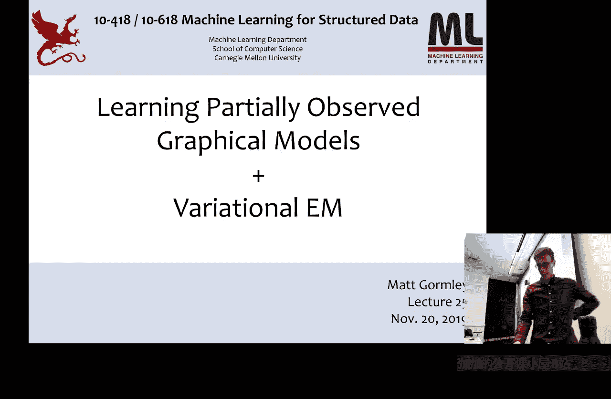
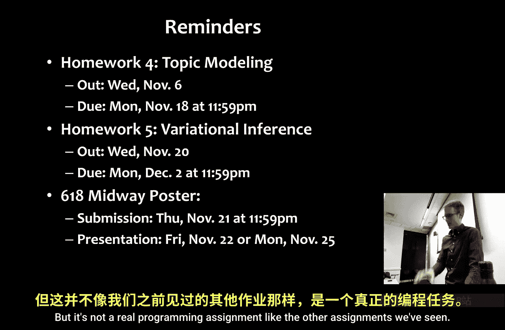

# 卡耐基梅隆大学【中英⚡结构化机器学习｜10-418 2019 Machine Learning for Structured Data】 p25 p24 10-418 ⧸ 10-618 Fall 2019 -BV1eJRsYBEaK_p25-

Okay， so today。Unlike last time， we're actually going to talk about variationM。And along the way。

 we'll generally be thinking about settings in which we just have partial observations。

And so in addition to variational， we'll also be thinking about the hidden state conditional random fields。

Okay， so let's see。Update here， so homework five is finally ready to go。

 I think we'll be releasing it momentarily。呃。Push back so we wanted to give you a week for the assignment。

 but a week from now you're on vacation， so then we just push the deadline all the way back to the Monday when you return。

So that's December 2nd。But the length of the homework has not changed like we。

 this is really a much shorter homework assignment。

 we're not giving you more time because you need more time。

 it really is like a substantially shorter assignment than the previous one。

 so it really is like a one week assignment。There is one thing to note here。

 there's a question that sort of asks you to do some little implementation initially we weren't even going to have you submit your code。

 but we actually went back on that kind of at the last minute here and。

And are going to ask you to submit your code， it'll probably be like what1。

 10 lines of code or something， the whole reason that we're doing that is because the problem was set up asking you to submit。

Outputs of your code and if you accidentally had some tiny bug and your outputs were wrong。

 we wouldn't have a way of giving you partial credit。

 so the whole point is by having you submit these deadlinelines of code。

 we can give partial credit to people aware appropriate。So。So anyway。

 there's this annoying extra step that you will submit your 10 lines of code。

 but it's not a real programming assignment like the other assignments we've seen。

Okay， so。I want to start。By kind of mentioning a few variational inference results and really kind of looking at some models where variational inference has been used and sort of I kind of picked some of the maybe most prominent ones。

 but it's been used all over the place so these are just sort of some interesting examples that tie back to things that we。

So one of those is collapse variational Bayesian， latent deish lay all。连。

So if we had explicit variational inference。We would set it up where we have an approximating Q distribution that gives us some Q over z theta and phi。

All of these separate parameters。And collapse variational inference is analogous to a collapsed gib sampler where now we only have a cu distribution over the。

So remember that in an explicit Gib sampler， you would res sampleble values for the topic assignments。

 the topic parametersers， and the topics themselves。

And in a collapsed Gb sampler you would only resample topic assignments。

 that's the same thing that's going on here， except that we're approximating those different latent variables with our Q distributions。

Okay， so here are some results of two different data sets。The first data set is from dailycot。

com and the second is from。The proceedings of the conferenceferencing ares which is。的。

Sort of one of the largest machine learning conference。At present。And。

So there's two kinds of plot here plots here， let's look at the first one， the first row of plots。

So the first row is showing basically the log probabilities。Of the actual words。Under do the models。

As a function of the number of iterations for three models， so standard， explicit variational base。

Collaped variational bays and collapsed gi。And so what you can see here is that standard variational bays is at the very bottom。

 this is it。And。So standard variational v is underperforming both of the other two。And。

So then there's this comparison of collapse variational based and collapsed gives。

And what we find is actually kind of interesting， which is that so collapse variational bays is the solid line。

And you can see that in both cases， the solid line is。

Initially actually doing better than the gib sampler as a function of the number of iterations。

In terms of the log probability of the data。But then as you get enough durations。

 the gi simpler actually outperforms the collapsed variational dates。

In terms of the log likelihood of the data。Any thoughts on why this might happen？

Why is it that they're the same model that we're working with， the same collapsed？

So why are these two inference methods？And pretty consistently across data sets。

Coming out where variational bays is getting higher likelihood faster， but then gives sample。

Let's look at the second row and then come back to my question。Okay。

 so the second row is showing histograms。And the reason that they're histograms。

 so they're histograms over different。Levels of log probability， right？

So imagine if at the end of this run， you took the best。

Probability from variational bays and Gibbs sampling。And。The啊。Standard variance。Okay。

 so that would give you three values of log probability。

And then we could do it again and get three new values。

 and we would change some random seed so at each time。We were。

Say randomly initializing the parameters of variational bays。

 and we were randomly initializing the sample for Gibbs so that we were getting three different results each time。

So then we could get a whole collection of lot of probabilities for each method and we could get a little histogram so here you can see the standard the explicit variational phase。

Tends to have most of its results down in here。Sort of low probability。

The collapse variational bays is better， but pretty consistently the gibbb sampler is outperformed。

So this is over many random initializations。Of the same method。

 so we're seeing that consistently good sampling is beating variation。So what approximations？

Is the Gibbb sample making？그깐。So。I was actually going to take your silence as the correct answer。

 which is none。There are no approximations in the Gib sampler right it is exact in the limit eventually if you run this thing long enough。

 the theory says this will give you exact samples， what approximations are we making with variational inference？

There's some Q family。And so the results that we're seeing here kind of match up with。

What we might expect out of these two inference funds。That the variation of days is faster。

 but the MCMC method wins out in the end。Okay。What if you have lots and lots of data？

Like so much data that when you want to make a plot about how much data you have。

 you have to put the number of documents。On a log scale。Okay。That's a lot of data so this is。

10 to the 6。5。Document scene， can anyone do that for me， what how many zeros is that？the6。5。about a。

それ。Million documents。Something like that。So。If if we have。A million doctors。嗯， then。

It's worth actually thinking about。嗯。What method？You might want to use。

 and so online variational bays is sort of like the stochastic gradient equivalent of gradient descent。

So we can take gradient descent and we can make it stochastic or online by taking one example at a time and you can do the same thing when you're training models like these and here what we're seeing is that。

You can take。An online method that。呃。That is able to get much more progress much more quickly。

 and in fact， it's able to actually sort of beat out。

The batch version in the end and actually get lower perplexity。So the contrast here。

Between batch variational days and online variational days。Is。Essentially。That。啊。

For for both of these。嗯。We have some outer for loop or some outer loop that's kind of deciding when to stop。

And。诶。And what we're going to look at in a moment is how we can kind of break up learning into an E step and an M step for an EM algorithm。

And there's an E step and an M step for the online version。

And the key difference is that in the online version， we're essentially assuming that。We get。

One document， T at a time and。We're updating based purely on that one document。Whereas。The batch。

Is doing a whole。Collection of computations for the full document collection and then updating the parameters for that document collection。

So this contrast， so you can see by contrast， so here on the right。

 this is a for loop over documents， this is like for each document。And over there。

 we're doing computation just for that one document and then updating parameters answers in M step。

And so。嗯。So this is all for the LDA model， so now I want to think about a different model。

 which is that of a fully connected CRF。So here I want to actually just quickly。

Sketch a picture of what it is that I'm talking about。So a fully connected CRF。Is one。呃。Where。

We take a normal pairwise。CF。这 like个错。That's maybe like a grid model。And then we say。

So this by itself。It's just what we would call。Hewise。CF。诶啊。A fully connected CRF。

It's going to be one。Where we start to add a whole bunch of edges here。

So for this node in the upper left corner。We're going to have a diagonal。

And then we're going to have another edge over here。FromThere。Here。是。Yeah。

We're going to have edges like that for every single node in this graph。

So now we go to the second node。You can exit it diagonally。To every other node。上运就好啊。So。诶。

This fully connected CRF。If we were to write out。sortrt of a factor graph like or a potential function version of the model。

 we would say， okay， we're going to have the probability of some segmentation X。Given some image eye。

So x is the output here and i is the input。And。So just here what we're looking at is like。

This is an example of an X， and this is an example of， O， sorry， other way around。

This is an example of an I， and this is an example of an x。And actually。

 each of these are different examples of x's from different models。

So what we're saying is that the probability is going to be just the usual CRF where we have a partition function。

Z， that is a function of the input， Z I。 And then we have X of some negative energy function。

 where the energy function is just the sum of a bunch of potentials。

 So usually we've been talking about potentials as x of some score here they've already expiated the potentials。

 So now the potentials are what we usually think of as log potentials。 So we can add them。

 And so you have for each variable I， you have one potential function。

And then for each pair of variables。You also have a potential function。 and the key thing is that。

That second summ is for all I less than J。Okay so。嗯。So for inference。

It's actually possible to do Markov Jane Money Carlo。For。A fullyully connected CRF like this。

But it's incredibly slow。And so， instead。There's this paper。2011， I introduce this。

Crazy modeling and said， well， we can actually do variational inference for this。And。

What we can further do is we can say that we're going to filter out some of the variables from that summation over all possible pairs that。

Seem like they don't actually make a difference once you get this thing running。And so。

 so what we're looking at in the top figure here is。Basically。

 the pixel level segmentation of the image into different regions。tree or grass， a dirt and bench。

And so the first thing that we can see here。Is that。Figure 1 B。This is what you get。

 So let's focus on the bench here。 So what you get when you're using just。

Entirely independent classifiers is something really quite bad。There's all this esspcing of this。

This like red color， which I forget what the label is， but。Excuse me。

 it's nothing that we care about。And。So then instead you could do some other fancy model called a robust PN CRF。

 but what we're concerned with are D and E， so those two are the fully connected CRF with MCM C entrances and the fully connected CRF with variational inference。

 which is what they're calling R。And you can see that the performance of these two is actually pretty darn close。

Maybe the variation inference is actually slightly better。

But the key difference here is that the MCMC is taking 36 hours。

And variation additionalal inference is taking 0。2 seconds。So which would you choose？嗯。

And then down below。They also are looking at something interesting here。

 which is just the actual convergence of the k divergence between the true distribution and the Q distribution。

And so they're showing as a function of the number of iterations for different hybrid parameters。

How it's very robust。To the selection of hyperparameter。

And that regardless of which hegmeters they're choosing here。

 it kind of all converges to the same point， though that may be in early phases。

 early numbers of iterations。And。And then on the right， they're also showing。The actual distribution。

 according to the Q function。For。This particular image。

 so the image is just that seagull flying through the air there。And they have。

A cu distribution for the probability of a pixel being bird and then a cu distribution for the probability of a pixel being sc。

So these two distributions are decoupled， right， they're not actually jointly estimating the probability of a pixel being bird or sky。

 they're separately estimating the two。And so then they can visualize。Over iterations。

 what these distributions actually look like。And of course。

 this is sort of an estimate of the posterior distribution over those different classes。

And you can see that over。Even just sort of after one iteration。

The Q sky distribution has really narrowed in on what is sky and it's sort of cut out the bird as not sky。

Okay， and then but in the top， after one iteration， it's still not exactly sure what the bird is。

 it really takes two iterations before Q bird actually kind of comes into focus。

And then by 10 iterations， they're both really crisp。緊ち番で。Yeah。

 so this is sort of an interesting way of。Decomposing。

But they're decomposing into these sort of independent distributions for each of the classes。

Even though the true model is actually。Jointly giving a distribution over all the classes。

So this is sort of a different way of decomposing than anything that we've seen。Okay。

 so it shouldn't be too surprising to you that so that was maybe 2011 paper。

And then a couple years later， at I Claire 2015， someone came along and said。

hu those was fully connected Crs。 They seemed like they were pretty cool， but。😊，I mean。

 it was a little bit hokey because they weren't using CNNs and you know now everybody uses CNNs。

 so maybe we should take their fully connected CRF and combine it with a deep CNN。

And get back something better。And so that's exactly what this paper did， and they got good results。

With this combined model， where essentially these。These potential functions were no longer coming from some sort of。

Fixed small function， but they were coming from the output of a CNN。嗯。Okay。

 so this is actually an example of structured mean field。

 so we were talking mostly about models where you have。

Basically a mean field assumption that each individual variable is independent。

 but here we're going to think about a case where you have dynamic programming algorithms that you can use to work with some subsets of variables so what we're looking at here is a joint problem of。

Alignment between an English and Chinese sentence and。And then。Psing of both the English sentiment。

And the Mandarin。And。So here there's some ellipses here， right。

 they didn't actually show the whole sentence， but something was established or they were established in such places as Kuanzo。

 Zhangzhou， et cetera。And。And then here we have。The Mandarin。And what you can see is that。嗯。

We have these different blocks that are kind of aligned with each other。 So here， such places as。

Should。Sorry， I don't speak， but it should align with。This little noun that I've circled here。

So those two are a translation of each other， but it's interesting because in the English。

 you actually need three words to capture this and they actually span separate constituents in the syntactic representation of the sentence。

OkaySo this is what this here is one of the constituents。

 and then over here this is another constituent。And the word as falls in this。

Right hand side constituent， whereas such places falls in the left hand side constituent。

And so and then we have a place here。Or a place plus， et cetera。 And that maps to。Three words here。

And we're established。Okay。It translates。Down to these two。 But in， actually。

Ls up with this first character。Okay， so you can see what's going on is that in this translation。

 there's a lot of movement。Between these different subphrases。

But if you know something about the sumphrases， it might actually help you figure out how the different words align。

Okay， so the goal of joints parsing and alignment is to simultaneously figure out which words are aligned to each other and also generate these syntactic pars for the two sentences。

 these trees for the sentences。And so the trees are representing the actual grammar for the sentence where we would say。

 okay， this entire thing is a verb phrase。And it consists of these two verbs。

And then back here in such places as is a prepositional phrase。

 and it consists of this larger noun phrase， which is。Containing yet another prepositional phrase。

 right so this is sort of a decomposition of the syntactic structure of the sentence。

And so the whole idea here is that there exists efficient dynamic programming algorithms for doing things like paring。

嗯。So one such algorithm is， say， the CKY algorithm。Or the inside outside algorithm。

 and you could think of that as sort of。The equivalent of belief propagation for running over a collection of trees。

It's just another dynamic programming。And then there's also dynamic programming algorithms like ITG。

 which allow us to efficiently reason about。A collection of an alignment between two sentences。

And so what Burquette？And others did in 2010 as they said， well。

 what if we took those two dynamic programming algorithms and kind of combined them together within variational inference。

 So that would be structured meanfield variational inference where you essentially say， okay。

 here's one big variable， let's call this Z。Sub a for alignment。And here's another big variable。

 Let's call this。Z sub。T for target language。 And here's another big variable for Z sub S。That is。

Representing the source language。So all of these are latent variables。

 but they're big latent variables， right， this Z ranges over the space of all possible alignments。

And Z S ranges over the space of all possible trees， same with Z。

And so if you have visionsion algorithms for。Reasoning about the space of all possible trees that you could decompose you could have your mean field approximation。

Look like Q of Z as decomposing into Q of Z A。Times Q of Z S times Q of Z T。Rather than having。

 say a whole bunch of tiny little variables like one here， one here， one here， one here， one here。

 one here， one here， right， and having the mean field break up over each individual binary variable。

 saying， is this word aligned to another word。And so so what they report here are both parsing results because they want to know how accurate is their parsing and they also report word alignment results because they want to know how accurate that is and what they find is that。

The呃。Depending on which language you're looking at， Chinese or English。

Either a reraker or their joint model actually wins。 but sort of if averaged over the two。

The joint model。In terms of paring results。And then for the word alignment results， if we look at F1。

 which is the harmonic mean of precision and recall。

 the joint model actually does a good bit better than sort of the competing ITG model on the HMM。

If you are么。And you're representing that ASCT in some form。不。And if in Z A。

 you are still approxiating all of the values in that little table。小孩。

Saying that they're in separate way。Yeah， so we。So in fact。

 we do talk about each of those individual little variables， but what's going on is。

 so another way that I can interpret this little diagram that I just said is let Z be the collection of all the variables that make up that little word of。

And so if the English sentence or the source sentence has。

N sub S tokens in it and the target sentence has M sub T tokens。

 then there's going to be n sub S times n sub T variables in that matrix。

And so we could say Z is actually just the set of all of those variables。

So under that interpretation， right？What I wrote here still holds。

 This is still the structured mean field approximation。But now when I write Q of CA。

 I'm really talking about。Q of a whole collection of variables。And。

That approximation Q of the doesn't decompose with a mean field approximation。

Or with a mean field assumption where each variable is independent。

So there's going to be some interesting dependencies between those variables。

Things like that allow us to look at like the fertility of water， so for example， if we go back here。

嗯。So one thing that you'll notice is that most of the time， if you have， you know， one English word。

 it matters to say one。Very个人。And if you have three mentorarin words， that you might just。

3 English words or two and two right There's only one sort of unusual case here。

 which is where we have three English words that act to just one。

And so a fertility constraint that you could impose would be that you know most of the time。

Or maybe a fertility prior， I would say most of the time。

 the number of words that you align with is going to be。You know， about one。For each。

And so that sort of。Imosing that。on these VA variables would require more than a mean field approximation。

 but there's efficient algorithms that we can work with those sorts of constraints。Okay。修啊。So next。

 I want to think about hidden state CRFs and。So the setting that I want to think about these for is actually computer vision where。

We could say that we have some data consisting of images and labels。So image is X and labels Y。

So here's our X， here's our Y。And。We're going to say that we're going to pre process our data into patches。

And。You know， that's going to consist of these little rectangles。

And then we're going to say that there's some latent labeling so and then the patches will represent by variables x right so this X1 represents all of the pixel data for that。

And that x7 represents all the pixel data for that yellow patch。Where it is in the image。

 what the actual values of the pixels are， et cetera。Okay， and Z1。We're going to pause is。

The labeling of that patch right So here this should be labeled as leg。

 and this should be labeled as leg。 Actually， all four of these should。

And then Z 5 over here should be labeled as tail， Z 6 as torso and Z 7 as head。And。

We're going to assume that you could go in and label these patches with sensible labels like that。

Our data only consists of images with labels。 It doesn't have these。Patch level label。

So while I believe that we could get this data， it would be expensive and time consuming。So instead。

 let's define a graphical model with these latent variables in mind。And。

Then we're not going to actually observe any of those Cs that train or test。

So this is a partially observed model in a different way than say。

 the late Deerslay allocation model that we have been looking at。Because in LDA。

 you just observe the actual documents and then all of the other variables and parameters are unobserved。

But here that's not the case， we actually do observe。At training time， the value of y。Being leopard。

So we have some signal coming from that supervised label。So what do we do。

 we then add factors between each x and its corresponding to Z。

Because we believe that whatever the pixels are would tell you a lot about。

What the actual label for the patches， right？But then we say， well。

 we know where positionally these patches are。 So let's actually connect up the individual latent variables here。

based on。They're nearest neighbors。So I just connected them up。Some arbitrary way here。

But making sure that the close by Z's were connected to each other。

And then let's connect all of those factors。To the output label why？Okay， so why would we do that？

Because。Maybe we believe that if you know what the configuration of these latent variables are。

 if you know that there's a head， four legs and a tail and a torso。

 then it's very likely that the true Y label here is leopard and not burnt。Because if it were a bird。

 we wouldn't have four leg labels， we'd have two。And we' probably also have some winged labels。Okay。

 so now think about how you could actually train a model like this。

 you could say my data is just the x's and the Y's， and I have n examples of those。

But I'm going to define a joint model over both Y and Z conditioned on X， so this is a CRF。

But we can marginalize out the Z's if we want to， right， we could say， well。

 there's a marginalized model， which is just the probability of y given x。

Which is the joint model summed over all possible values for Z。

So what we can do here is actually work with that。Marginalized mug。And how do we work with it。

 well we train using gradient descent。But here we maximize， say， the likelihood。Of our data D。

But we do so marginalizing over。The latent variables that we didn't observe was。

And so if you work out the gradient and one' city that we have a feature based model rather than say a CNN backing list。

 just for simplicity， then what we would get back is something that looks very similar to the standard CRF gradient。

 which is the difference of two expectations。Now， if this was a standard CRF。

 we would have the first expectation。Being the。呃。The actual empirical counts that we observed on the data。

 that basically the empirical counts of the feature from the actual data distribution。

And then our other expectation would be the model's expectation about what the features would be marginalizing over all the lake variables。

That's almost what we have here， except instead we're seeing。あ？って。

The marginalized variables show up in both expectations。 Naly， here we have an expectation under。呃。

The distribution over the Z， given the true value of the ys。

And then here we have a distribution over both Y and Z。

Where I've kind of left out the conditioning on X just because otherwise this thing wouldn't。即 on冇 싸。

So if we expand those expectations now， right， you can see that。Basically。

 the first expectation is summing over just Z for the true y。

 and then the second expectation is summing over both y and Z。And so the key trick here。

Is that we can get these marginal probabilities just by running some inference algorithm on the full factor graph。

So the question is， how do we get these marginal trouble？さ。Let's go back to the factor。

Here's what it looks like。So we observe the x's and then we run something like。记成。

variariational inference， and we can get back estimates for those marginal probabilities that we need to train this thing。

But they're going to be， if we do it for this， they're going to be marginals of。P of ZN what？

So how do we get？Marginals of just Z given y。Oh， let's。That's interesting fun。So。

But there's actually something simpler。 We don't even need to。啊。Don't think too hard。Yeah。

 we just fix why。If I take this factor graph， then I just shade in why。With its actual value。

 the actual YN for that training example。Leopard。And then， I run。

Inference on the v factor graph where y is treated as observed。嗯。

We'll just get marginal probabilities for Z given why。So basically to train this thing。

You have to run inference twice once on the full factor graph。And once what I'm calling here。

 the clamped vector graph， which is just where we clamp the values of y to the actual values that we observed in the training data。

And marginalize over the values of seat。The structure of decide to。

It will be different based from the image。Yeah， so I mean， the way that I。

This was sort of a made up example， but the way that I came up with。This particular structure。

 was I was saying that。The actual connections between pairs of the Z variables is given by like their adjacency。

So maybe I believe that so if you imagine the patches。

 now let's imagine that like all of the patches are half the size。That they are in this。

Picture right， so in that case， you know， if we just have some patches， you know。

 this might actually consist of three patches。I running segmentation first。Oh， sorry。 Yeah。

 So patches。 Yeah。 So it's not exactly image segmentation。

 So there's computer vision has long had ways。诶。Taking an image and dividing it into little regions where the pixels in that region are all very similar。

 say in color or brightness or darkness。And so if you do that， you can actually get back。

A form of segmentation of the image into what what we have， I mean。

 patches here is actually a technical term。Used to mean these like collections of pixels。

 sometimes they're also called super pixels。And so these superps are given to us by。

Some pre processingces algorithm。And then rather than labeling individual pixels？よし。

And so usually there's some hyperbra on that deterministic function that gives you back superps that says。

 you know how big do you want your superps to be？And so if you wanted them to be somewhat small。

 then you might believe that。In fact， here。The， the individual patches that are near by each other are more likely to share the same label。

So in the extreme case， you could take the model that I'm describing here and say。

What if your super pixels were all of size one pixel？So then what are you doing。

 you're doing exactly the semantic segmentation problem that you guys solve。

But you're doing it without labeled training data for the actual semantic segmentation。

So now we're saying all you have is image classification data。

 but you're jointly learning a model that can。Semanically second。诶 image pixel pixelが。So。

I've not actually， have ever seen that done？I don't know。

 so you could Google whether anyone's actually tried that。 maybe no one has。

 but you could imagine basically taking the semantic segmentation model that you had and instead of doing structured SVM training with。

Map inference， we could say replace that with variational inference， like a mean field approximation。

And then we could marginalize over the unobserved pixel level annotations and just try to do training based on classification。

Okay。So now I actually want to take。Sort of a small step back in order to take a bigger step forward。

 which is， I want to look at Gaussian mixture models because about half the class maybe has not actually seen expectation maximization before and so it's useful just to kind of briefly think about just kind of a very simple model with EM and then we'll think about variational EM。

So a Gaussian mixture model is one where we assume that we just have a bunch of we have n data points and each data point is in M dimensional space。

And the generative story is you draw some cluster label for each point。

 so this is going to be a clustering model。So you draw a cluster label for each point from some categorical distribution parameterized by Phi。

Okay that gives you a Z， and then you sample the actual point using the mean and variance for that particular cluster z。

That you just chose。 So Z here is like an integer。You know， one up to say， K， if you have K clusters。

And then you would have K means and K variances for each cluster。

And so the joint model is both x and Z， but you could marginalize over the actual cluster labels。

And the idea of Em is that what we want to do is actually maximize not the likelihood of the。

Xs and the Z， but of just the Xs because we don't know what the z's are。

So this is a marginal likelihood optimization problem where we want to sum over all possible k values that Z could take on。

And maximize the joint likelihood。stand。Okay， so more generally。

 a mixture model is one where you have data and you have some generative story where you sample a cluster label from a categorical。

 but then you sample x from some distribution， it doesn't have to be a Gaussian and then the marginal likelihood problem is the same as before。

 we summing over all the training data examples and then each of the cluster possible cluster assignments where we have the prior over that probability of that cluster assignment times the likelihood of the point coming from that cluster。

So， this。Here。You can look at as an expectation under P of Z。Of。The probability of。

And this could be any distribution correct or。So if you're doing supervised learning in this model。

 then the parameters be couple， and in fact， what you have is just the naive Bayes model。Re。

Specifically， the way that we were looking at it， it would be Gaussian night。

RightWhere Z is the label for the example， and then you have M different features。Okay。

And so then you could separately maximize to get theta and phi。

So in the unsupervised learning problem， the parameters are actually coupled。

 you can't actually decompose。 So here this is like the usual supervised Bayesian network training where we maximize over both theta and phi。

 but we get separate maximization problems over oops。That's a type of over。Theta and phi。Okay。

So in the unsupervised learning setting。These parameters。Coupled by the sumation over the Z。So。嗯。

If you just write down this objective function。There's actually lots of ways that you could optimize it。

And。Like stochastic gradient to， for example， but a really common way of optimizing it is the expectation maximization algorithm。

And that's what we're about to talk about here。Just very briefly before we move on to variational。

 yeah。Okay， so the first algorithm that I want to show you is hardy end。

This is sometimes also called vitubiTM。And here's how it works。

 So you initialize your parameters randomly。 And then while you've not converged。

 your e step sets all of your latent variables。To the values that maximize likelihood。

Treating the parameters is fixed。Then。In what we call the MCT。

 you set the parameters to the values that maximize likelihood treating the latent variables as observed。

Okay。So this goes back and forth。Updating all the latent variables and then all the parameters and then all the latent variables and then all the parameters。

And。啊。And so in the E step， you're estimating the unobserved variables and then you're getting maximum likelihood estimate。

たか？Unobserved parameters。Okay。So soft E。Says almost the same thing。

 we're going to initialize the parameters randomly。And then while we haven't converged。

 we're going to go back and forth between an E step and an N step。

So this is also just sort of the standard expectation maximization element。So in the E step。

 you're going to create one training example for each of the possible values of the late variance。

And then you're going to wait。Each of those examples， according to the model's confidence。

That that is the correct label。Treating the parameters is observed。And then in the M step。

 you set the parameters to the values that maximize likelihood。

 but now we'll call these pseudo counts。These weights you could also call pseudo counts。

And we'll set the parameters to the values that maximize likelihood。Okay。

 so it's the soft version of RM because now we're waitinging the likelihood of each latent variable assignment by the model's confidence in that assignment。

Okay， so getting a contrast here for Gaussian mixture models。In hard EM。

You're actually doing an Argm over。The possible assignments to Z and picking the most likely one。

So for each training example， ZI。Or for each of the I training examples。

 you're updating ZI to be the most probable value。The most probable cluster。But in soft E。

You're getting a distribution， which is this distribution C I over all of the possible。Cluster I。

And that's given by this conditional probability。And in the M step。

 it looks kind of the same in each case。It's just that in the hardy M case， you're just counting up。

 Sa the number of cluster assignments。Whereas in the softM case。

 you're looking at real value numbers， real value probabilities。

 and weighting that counts according to those probabilities。是。Okay， so once you do this。

 then you could get some new training example and you could obtain a posterior distribution over the cluster assignments for that new example if you wanted to。

Okay， so what I just showed you。Is actually K means。And sort of。

It's like a fancy cave mean where we allow。The kingdom's clusters to have a variance。

And then this is just sort of the standard EM。For a Gaussian mixture model。Okay， so let's look at。

An actual run of these two algorithms。 So first， let's look at hardy end。

So what we do is we randomly initialize the cluster centers。And then。嗯。

Let's get a PDF version of my slides。Some Windows bug won't display these properly。Okay。Okay。

 so now we can actually see the cluster centers。So there's a blue， a green， and a red cluster center。

Okay。And。What we do is we。Reassign the cluster centers and then update all the points to be assigned to the closest cluster center。

And then we do that again。And again， and again。And eventually， it convertedverges。

So it converges really quickly， right？Starts here， you have a bunch of blue points that are assigned at the blue cluster center because it's the closest one。

 but then the cluster centers move， you reassign the points。So you can see like。

There's like these two green points right on the very edge that change from blue to green as we're going。

 and then there's these three red points here that as the blue cluster moves closer to the center of the blue points change to blue。

Okay， so。E M algorithm for a Gaussian mixture model is doing almost the same thing。 Okay。

 it's going to initialize the cluster center， but it's not going assign assign each point to the most probable cluster。

It's going to say。Each point。There's a posterior distribution over。

Which cluster that point came from？so we can graphically represent that by saying， okay。

 this point down in the bottom corner here is about 50%。Sure that it came from the red cluster。

There's maybe。30% chance that it came from the blue cluster and then 20% chance that it came from the green。

So reweighting based on those probabilities， we update our cluster centers。

And you can see them going。And gradually。As the cluster centers are changing， notice that。

These points down in the bottom corner because the red cluster center is moving down are becoming more。

R。Where the posterior distribution over the cluster centers is becoming more red。

And the points in the upper left corner are becoming more green。So this continues for a while。

Until gradually， the cluster centers sort of settle in。

And what we get is this lovely thing happening， which is that。

Most of the points that arere really close to a cluster center are really sure that they came from that cluster。

But。There are these points on the boundary。That are actually still representing their uncertainty about which cluster they came from。

If you run the thing long enough， the。It does converge。

 and it even converges with some uncertainty about a few of those points that are kind of on the back。

Okay。So。Okay， so k means tends to converge a lot faster than a Gaussian mixture model as we saw。

 and each iteration of can meanss is computationally less。

ten but the Gaussian mixture model is actually giving us a probability distribution over the cluster assignments whereas key meanss is not。

So。Some useful properties of this EM algorithm， keep in mind， that also apply to variational email。

Are that EM is trying to optimize a non convex function。But it's also a local optimization algorithm。

So it's really just picking some initial assignment of those cluster centers and then climbing to the most likely configuration。

Maximizing marginal likelihood。And so the typical solution to this is you do a bunch of random restarts。

Each time you initialize the parameters randomly and then you pick the parameters that give you the highest likelihood so if you do a bunch of random restarts and you find okay。

 these parameters corresponded to the overall highest likelihood。

Those are the ones that you usually go with。So there's lots of interesting variance to this algorithm。

 so generalized EM replaces the M step， which is just likelihood maximization by instead doing a single gradient step。

To improve the likelihood。So it's not necessarily that you're going to。

Pick the most likely estimates of the parameters。But rather。

 you're just going to change the parameters a little bit by taking a step in the direction that maximizes likelihood。

So Monte Carlo Iam says， well。One way of getting those that posterior distribution over which cluster center a point came from is by doing this exact computation。

But another way that you could do it is approximating it by sampling。

So for Gaussian mixture models we would never do this because it's easy to actually do the exact computationm。

 but for a fancier model like say， LDA this might actually make sense。Okay， so。

There are other things like Sprsm that kind of keep。

Some active points and incremental EM that's kind of like the online equivalent of EM。

And there's other variants， as well。Okay。いや。The slide。

 so put the general here into place the m single step but the surface is in complex， right？你来上次。Yep。

 absolutely， or well， no， so you're you're still taking a step in the direction of the gradient。

But it's sort of an accessal。就诶。We'll see in a minute that EM is really like a block coordinate ascent algorithm。

 And so taking a gradient step in in the direction of。呃。That most improves the likelihood。

Is still gonna。Usually push you uphill。Okay， but it's possible you could actually go down。

So if your gradient step was too large， the gradient might be pushing you in this direction。

 but maybe you step so far that you dropped into that valley。Okay， so。

Some good things about EM are there's no learning rate to worry about。

It's very fast for low dimensions。Each generation is guaranteed to approve。

 but likelihood some problems are that it can get stuck in local minimum。大啲。

Could be slower than say gradient based method。It might require an expensive in step。

And if you don't actually care to do maximum likelihood， then。Maybe this also isn't a good choice。

Okay， so let's talk about variation units。So variational M in order to。Think it through。

 we're going to be looking at。嗯。An example here。And。

Our example is going to be that of unsupervised part of speech tagging。Please。And。

So the idea here is that we're given。As our data sentences only。And。Our goal。Is actually to infer。

The POS tags。For these unlabeled sentences。And。The model that we're going to work with here。

Is actually going to be a。Bay and HM。Which will sketch out there。And so。The Bayesian HMM。

Is going to consist。Of sort of one part that's kind of familiar looking， which is like。

The H&N backbone。So we're going to have words like W1。W two。W3， so on。

 and then we're going to have tag variables， which I'll call T1。T2。T3。And the each of them。

Graphal model says that the word was generated。Conditioned on just the tag。

And the tag at time step T was generated conditioned on the tag at time step T minus1。Okay， so。

If we want to make this a Bayesian model， then what we're going to do is we're going to say， well。

 the parameters of this HM are themselves part of the graphical model。

So what that looks like is we're going to say that there's。

Emission and transition parameters and the the emission parameters。F sub B are used to generate。

The words。So conditioned on the tab。You're going to look up the probability。

Each of your words using fun。And then we're also going to have transition parameters。

 which we'll call Phi T， and those are used to generate the tags themselves。Now， the。

The Bayesian would say that。We also have。Hyperpars。Beta一。And贝ta T。

And those are the hyperparameter say of some deishly priors。Over our parameters。

So that is what distinguishes this。This Bay NHMM。From CNN on。Bay in HM。Is that we actually have。

Prior distribution over。よし。Okay， so。What we're going to do is we're going to think about this in terms of the variational inference framework that we have been setting up。

 so namely， we're going to say。These beta parameters。

 those are sort of what we had been talking about as the parameters of our distribution。P alpha of。

X and Z。And then， the Z。Variables here。Are all of the。The thighs and all of the T's， as well。

And then x， well， that's just the actual observations。Right like the words。

So this is our actual true model。But then we also want to have。A mean field approximation。

And so the mean field approximation here。Is going to be some distribution over just the zs， right。

 So that's the， let's say， Q sub theta。Of the。And what this will look like is we're going to have。

The parameters by E。第知。And then， we're going to have。T1。地中？193 here。

And they're all going to be independent。不。If we wanted to be really specific about this。

 we could say， well， actually， what's going on here is there really are separate parameters that we would call say theta。

Stタ。Is what we。With condition on。To get all of these other。Very。

And so theta here is actually observed。And so if you observe theta。

 then all of these other ones are in。That's what the mean field approximation is saying。

 conditioned on theta。The variables are independent。So。So here we're saying， you know。

 these are all the Z variables。So all right， so what do we actually use as our training objective Well the training objective。

That we're going to use is just the marginal likelihood。要玩这个。So we're going to say。

We want to maximize。For each training example。The log probability。Of。X。Given parameters alpha。Okay。

 so how can we do that Well what we can do is we can say。We're given sentences only， oh yeah。

 question。So in our。Versus like。So you we go。Saly。The。Exact and also the arrows between PhiE。啊。

Like the P's and the T's and the。P the fight， the fights。这样。So those are the things that we removed。

And in fact， I mean， maybe it would be even clearer if we had drawn out the factor graph version of this base net。

 because there are actually fes connecting。AndT1， right。Like W1， T1， and F E。

 they all participate in a factor and we've removed that factor。Okay。

 so the trick that I'm going to play here is I'm going to say we're given sentences only。

 but let's say that。They are concatenated。Together。Into one long string。So what do I mean by that。

 I mean that you know here。W1 and W2， that is sentence1。And then W 3 and so on。 that is sentence 2。

And then there's sentence three， sentence four， and so on。So basically。

 what that allows us to do is now we're saying。B of X and alpha is the probability of our entire collection of all the training acceptances。

And maybe we inject like end of sentence symbols or something or periods so that you know that a sentence has come to an end。

Okay， so this log P of x given an alpha is just the log of a sum over all of the Z of。

The probability of X and Z， given alpha。Okay， so let's rewrite that， though。

 in terms of the variables for our actual model。 for our actual model， this is a log。

Where we have three summations， right？As summation over。The vector T。Over the parameters。

Phi E and over the parameters， Phi T。And then the joint probability of X and Z given alpha is the probability of the vector W。

 the vector T。Fiyi。5 T。Given。The hyperparameters。比例二。And beta T。

 So now you can see what's going on here is like this is x。This is Z。This is Alpha。Okay。

 but I wanted to make sure that we're grounded back in sort of the notation that we had set up last time Okay。

 so here's why because now。Let's think about how would we actually optimize this training objective？

Well。What if we used the elbow？Remember， we said that we can't directly work with this quantity。

 It's intractable， but the elbow provides a lower bound for it。

 So the log of the probability of X given alpha。Is a lower bound。Or sorry。

 the log probability of x given alpha is lower bounded。By the elbow。Of Q。Where elbow of Q is just。

An expectation under Q theta。Of。This should be familiar the log probability under alpha of x and z。

Minus。The expectation under Q theta。Of log。Q theta of z。And we can write out that elbow。

For our model as well。Right。It would just be， okay。

 so I'm just going to replace these two distributions with the joint and the mean field approximation。

 so this is expectation under Q theta。Of the log， of P of。W T。Fie， fight。given。Beta E and beta T。

 right。So we have that as the first term， and then the second term， the expectation under Q theta。

Is a log of Q theta。 And what is Q theta really a distribution over， It's over vector T Phi E。

And fighty。Great， that's what Z is。Please3。O。So here's the punchline。就。Our new idea here。No， thanks。

So our new idea is the phone。Let's。Jointly。Find P alpha。And Q theta。To make the。Elbaow。Of Q theta。

As large as possible。But if we make elbow of Q as large as possible。

 then we should be choosing parameters that are at least giving us as tight a lower bound on the thing that we really wanted to optimize as possible。

So what we're doing here is we're essentially making two approximations。

So the first approximation is we're doing approximate learning。Okay， why is that？ Well。

 we're choosing。Alpha。For P。And。The thing is， we really。I wanted to maximize。This log probability。

Of x given alpha。But， instead。We are maximizing。A variational lower bound。That's the elbow。

So that's the first approximation， the second approximation that we're making is that we're doing approximate inference。

Okay。So approximate inference here means we're choosing。The value of theta。For Q。And essentially。

 what we're saying is。呃。After reaching。A local。Maximum。Of the pair。P alpha Q theta。

We're going to query。Q theta。Approximately。About。The latent variable Z。So。These two approximations。

Are essentially what makes up。The variational Yam algorithm。And。

The variational EM algorithm is exactly the same as the standard EM algorithm。

Except that the E step is really just a matter of performing variational inference。

With the current parameters alpha。And then the M step is just choosing the parameters alpha that maximize likelihood。

O。So let's take one more minute to write that out。So variational M。Is saying。

We're just going to apply。Block coordinate ascent。To the elbow。And so the algorithm。Is going to say。

 well， not converged。We go back and forth。Between two steps。哦。Sorry about that。

So we have a variational e step。In which we。Adjust our Q theta。Given our current P alpha。

What do I mean by that。I mean， that。嗯。You just run。Variational inference。To maximize。K l。Of Q theta。

Be alpha法。For theta only。So that's the variational E step。And then the variational M step。

Is that we adjust。P alpha法。Given our current。Q theta。So what does that look like， Well。

 it just means that we。Improve we don't actually need to improve the whole kL divergence or the whole elbow。

Because only one of the two elbow terms actually involves alpha。So all we need to improve。Is。

The expectation of the log of。P alpha of Z and x under Q theta。For Alpha home。And。Okay。

 so the punchline here。Is that。This is variational E step。

We can actually recover the standard EM algorithm。So if P alpha is inside our Q family。Then。

 in that case， we have。The standard EM。And so that's what's fascinating about this， right？

So I think that there's something sort of broken about how we often teach EM。

 which is that we teach EM as if it sort of lives in its own little world and it's this nice。

 convenient algorithm where in fact， I think variational M conceptually is something that you can actually wrap your hands around and understand。

嗯。Because the variational E step， what we're actually doing there is just running variational inference to pick the best Q theta。

 given whatever our current alpha is。And then in the hands step。

 we're just picking the best alpha parameters。啊。For whatever our Q theta is at the moment。

And so the fact that we can make this efficient。Comes from the fact that we can choose an appropriately structured Q family that makes both the ETP and the MstepP efficient。

And sometimes if you get lucky， like in a Gaussian mixture model。呃。

The troop P alphafa actually is in your Q family， and then you can do the E stepP exactly。

And you don't need to rely on the。Okay。So next time。

 what I'll do to wrap this thought up is just present you with a table that ties together map decoding marginal inference。

 variational bays。Regular EM， variational EM and looks at how we can get kind of all of these just by doing different things around summation and maximization。

 so we'll pick up that， thanks for staying a little late。

