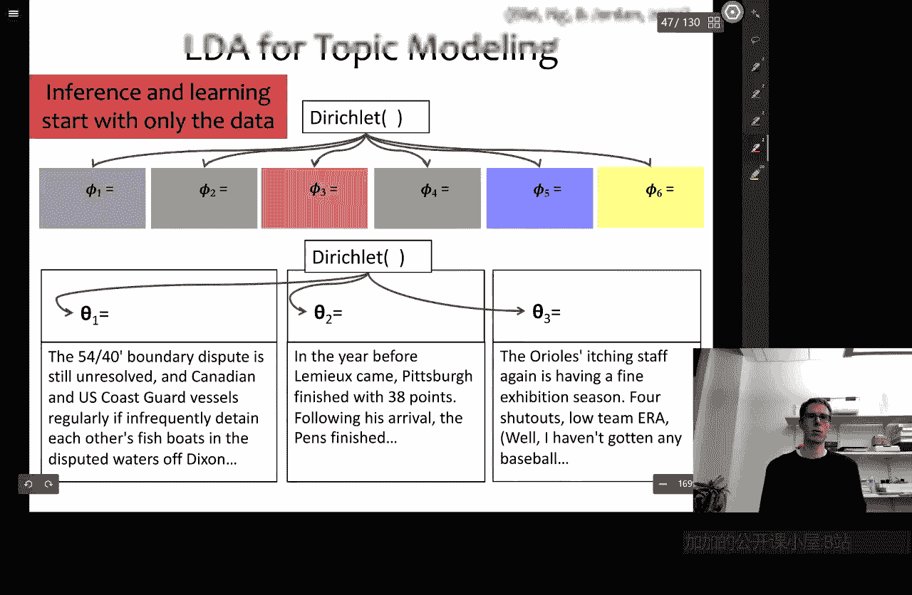
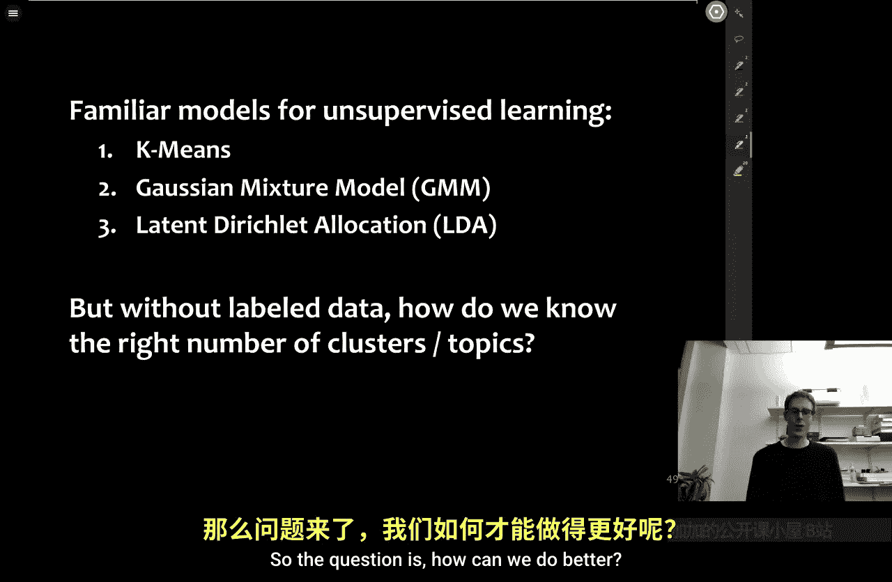
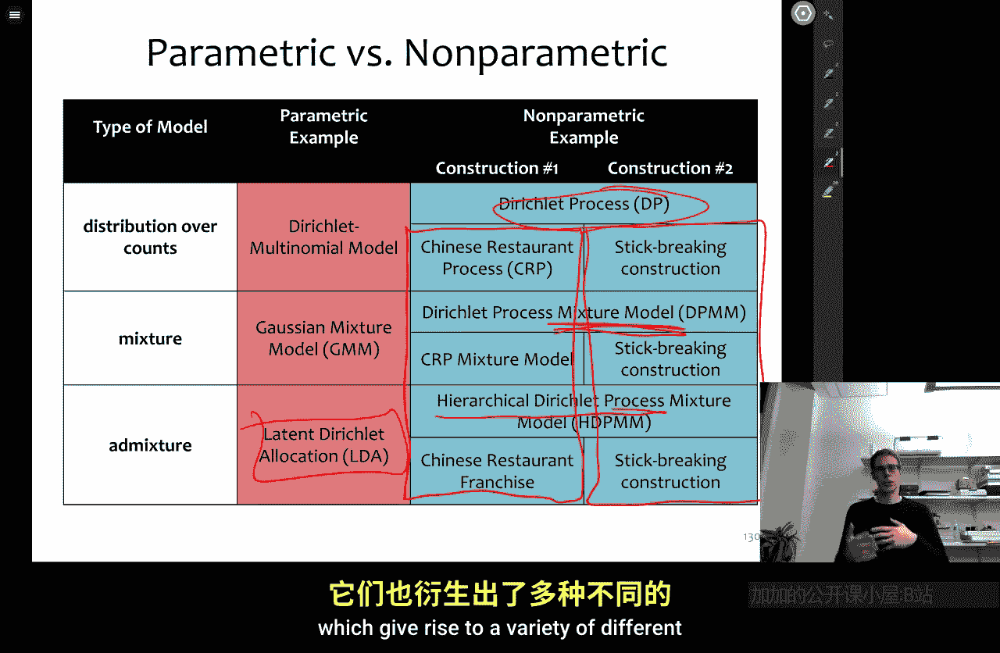

# 卡耐基梅隆大学【中英⚡结构化机器学习｜10-418 2019 Machine Learning for Structured Data】 p26 p25 NPBayes 10-418 ⧸ 10-618 Fall 2019 -BV1eJRsYBEaK_p26-

Welcome to 10418618s Today we're going to be talking about Bayesian nonparmetrics。

 and we're going to look specifically at the Deishle process and some of the models like the Deishle process mixture model and the hierarchical deishlet process mixture model that actually result from it。

So to get started。I actually want us to think about some parametric models。

And I want us to think about specifically these models that have been used to great effect in unsupervised learning settings here。

 suppose you have a data set that。Is an unsupervised data set。

 meaning it has no labels right so here you can see there's three points and maybe they actually did truly come from three different clusters。

 but we don't actually know that all we have are these unlabeled data points。

So if we were to run the K means algorithm， then we would have three centers， a red center。

 a blue center and a green center， perhaps the randomly initialized and we reassign the centers to the average of the points assigned to the centers and then we update the centers so that's one iteration of K means and we repeat this until convergence and here K means converges quite quickly and we get something that we like。

So Gaussian mixture models are a similar model where we could take the same unlabeled data set and we could initialize our cluster centers。

 and now we could actually depict each point by the probability or the posterior probability of that point being assigned to each of the cluster centers。

 So they start out sort of evenly assigned to all of the cluster centers and gradually as we run K means。

One iteration after the next， we can see that。The cluster centers are sort of gradually each moving towards their own region。

呃。Of points， and we find that in the end， the cluster centers kind of center around the desired places that we would want。

嗯。So this is great， it's kind of cool to see these sorts of unsupervised learning algorithms in action and another example would be latent Deishly allocation。

 This is the model that we've talked about now where we generate some finite number of topics。

 say here we have K individual topics and we have some generative story that tells us how we proceed through generating data using that fixed finite set of topics。

😊，And this is another unsupervised model that we can use to infer both the distributions over the topics。

 the assignments of words to topics， and the topic distributions themselves。

 and learn something about an underlying latent structure that exists in a large corpus。

So。呃。These are familiar models for unsupervised learning。But we're left with a question。

If we only have。Unlabeled data。How do we know the right number of clusters and topics。

Thinking back to the Gaussian mixture model example we just went through。

I assumed that the Gaussian mixture model was initialized with K equals three clusters。

 and so its performance actually worked out pretty well。Later in this lecture。

 we're actually going to see what happens if you initialize the Gaussian mixture model with K equals6 clusters on the same data set and we'll find that its performance really degrades。

 So the question is， how can we do better。😊。

So what we're going to do is actually talk through。

A different sort of building block for a model called the Deishlay process。 And to get there。

 I want to first start by thinking about this contrast of parametric and non parametric models。

So parametric models。而。Models that have a finite number of parameters。And。

We should think of this as the number of parameters is independent of the data set。

For our Gaussian mixture model example， if we chose K equals 3。

 then there would be three cluster means and three covariance matrices。

 and those would be the parameters， and if you applied it to data set A or data set B。

 it would still have the same number of parameters。

Non parametric models somewhat confusingly do have parameters。

 and we could say that they have infinite dimensional parameters。

 So maybe we could call these models infinite dimensional models。

We could also understand them as having a random number of parameters。

 but the key property is that the number of parameters that they have can actually grow with the data set。

 meaning that the parameters themselves or the number of parameters is not independent of the data。

Okay， so semiparmetric models have a parametric component and a nonparmetric component they kind of reside in between so there are lots of familiar parametric models。

 things like logistic regression and aOva and Fisher discriminant analysis and these are sort of classic examples of frequentist parametric models。

 though there's also Bayesian parametric models we've looked at a bunch of Bayesian models already like different Bayesian networks。

 we looked at， for example， Bayesian naive Bayes。For non parametric models。

 these include things like nearest neighbor methods or kernel methods。

 sometimes decision trees fall in this category。And we could we could say that some examples of Bayesian nonparmetric models are Gaussian processes。

 deish leg processes， pitmanure processes， and these are really kind of building blocks that you can use to build up a whole variety of different。

Bayian non parametric models。So， semi parametric。Models are ones that kind of live in between and combine aspects of both of these sides kind of into a single model。

So if we were thinking about specific applications， you for function approximation。

 we might want to use polynomial regression for a parametric model。

 a nonparmetric equivalent would be a Gaussian process for classification。

 we all know logistic regression， and there's also a Gaussian process classifier that is sort of its infinite dimensional counterpart。

For clustering you know mixture models like a Gaussian mixture model are useful。

 but they require you to specify the number of clusters。

 we're going to look at the Deersly processed mixture model which can have an infinite set of clusters if you had time series data hidden Markov models are commonly used and say unsupervised settings and there's an infinite hidden Markov model that actually permits。

An infinite number of hidden states that we'll look at later。 and for feature discovery。

 things like know factor analysis or probabilistic PC PCA there's。

Infinite latent factor model based on the Indian b process that are sort of their non parametric versions。

Okay， so another way that we could contrast parametric and non parametric is by saying， well。

 a model is just a collection of probability distributions where the parameters theta of the model come from some set capital theta。

 and for a parametric model，All the set of parameters， capital theta is finite dimensional。

 it comes from real value， it's a subset of the real valued vectors of dimension K， for example。

Non parametric models， the parameters could be from some possibly infinite dimensional space F。

And so this is a different way of actually characterizing the two models。Now。

 why would we want non parametric models？One of the motivations and one that we'll kind of emphasize today is actually that of model selection。

If you're doing clustering， you might want to know how many clusters do I have in a mixture model for topic modeling。

 you might want to know how many topics there are in LDA， grammar induction， how many nonterminals。

 visual scene analysis， how many objects or parts or features。嗯。And so further， we might say that。呃。

The there's a lot of parametric approaches that you could actually use if you wanted to。

Say do model selection。 And at the same time， non parametric approaches are going to provide sort of a different way。

 right， Cross validation is a very mechanical way of。Doing model selection。

 non parametric approaches are actually going to kind of build the model selection into the model itself。

 such that we are able to say get an average of an infinite set of models。嗯。

So another motivation for these models is that of density estimation。

Here you could think about a case where you're given data and you want to estimate a probability density function that best explains it。

So you might have a non parametric prior that you could actually。

Provide a distribution over an infinite set of distributions， right。

But then once you get your data points， like say， some points here on the real line and some points here on the real line。

 the actual posterior distribution could still be a distribution over an infinite set of distributions。

 but its shape might actually reflect the knowledge that you not have about the data。Okay， so。

Beforefo we go any further， it's useful to have a。This notion of exchangeability in mind。

 and so we're going to talk about exchangeability and also Definnetes theorem。嗯。Before we get there。

 though， we need to say a word about mixed distributions。

So really there's three different kinds of distributions and the first two you' are very familiar with discrete and continuous distributions。

 mixed distributions come up less often， but they're going to be really important to us today。Okay。

 so suppose we have。Some arbitrary random variable X drawn from some distribution， P theta of x。

And X ranges over a set S。 Okay， so that's the setup。So now let's think of three different cases。

 the first case is that of a discrete distribution where S is some countable set。

 so what does S look like， maybe it's the numbers 1，2，3，4，5，6，7 and 8。

 and for each of those numbers we have some probability proportional to the height of that red bar。

Okay。For a continuous distribution。S。Is no longer countable。 Its size is infinite。

 And as a result of that， the typically the probability in a continuous distribution。

 the actual definition of it is that for all x in that set。

 the probability of the random variable taking any particular value is 0。Okay。

 so where do these distributions come from， Well， you know， a lot of them。

 things like the Gaussian distribution， the beta distribution， the Laplace distribution。

A mixed distribution puts the two together where we say that S can be partitioned into two disjoint sets。

D and C。 Okay， so that A should have been a D。 And we say that D corresponding to discrete is a countable set。

 and the probability of the random variable X coming from D is non0。Strictly a nonze， right。

 this is inequality a strict inequality here。And。By contrast， the probability of。

X being any value in the set C is0。So here we have this mixed distribution where we're putting together both a discrete and a continuous distribution。

Now it's useful then to have。Just a。Picture in mind of。How we can actually work with。

Notation for mixed distributions。So let's actually make one of these rather concrete。呃， so。

A mixed distribution you could imagine as。You know， we might have three points。 Let's say x1。

X 2 and x 3。And maybe they're equi probable。Make each one has some probability。

 and then we have a continuous distribution。Over some infinite dimensional space。

 maybe this is a beta distribution。So， it ranges from。Zro to1。And。

We could call this beta distribution。嗯。Oh， beta distribution， it has parameters， alpha and beta。

 and we could call this thing H。 that's our continuous distribution。

So if we want to have some notation for drawing a sample X prime from this。Mixed distribution。

 P of mixed。Then we could say that that mixed distribution。Is characterized by assigning， say。

 one fourth probability。To each of。the。Individual。呃。Discrete points。

 And so we'll represent that with a point mass distribution， Delta sub x I。And， in addition。

There's maybe one fourth probability。That the point will come from the beta distribution H。So。

What we're really doing here is we're saying that x prime。Is going to。

 according to this mixed distribution， be equal to x1 with probability1 fourth。

X2 with probability1 fourth。X3 with probability14。And as well with probability one fourth。

 it will be some x prime prime， which is a sample from that beta distribution。That we're calling H。

And that also occurs with probability， one fourth。That it will be one of those samples。Now， okay。

 so the notation here。That I want to highlight is particularly this little delta。

 So this delta is what we would call a point mass。Distribution。And。This point deck mass distribution。

 where all the probability mass。Is placed。On whatever is in the subscript。

Or the value in the subscript。Okay， so in other words， we could define， say， Delta sub x。1。

As being equal to。X 1。With probability1。And。Any other。X prime。Not equal to x1。With probability 0。

Okay。Or rather， a sample from that delta。So let's be a little careful here。Right。

 so we're saying if you have some。嗯。Some X。That is sampled from that delta。

 then x is equal to x1 with probability 1。Okay。Okay。

 so these are ways that we can actually articulate notally mixed distributions as combinations of discrete and continuous ones。

Okay， so what's exchangeability exchangeability， there's two definitions we could work with。

 one is that it' a a joint probability distribution is exchangeable if it's invariant to permutation。

 definition number two would be the infinite sequence of random variables， x1 x2。

 x3 up to as long as it needs to be is exchangeable if for any finite permutation of the indices 1 through n。

 the probability of x1 up to xn is equal to the probability of the permuted sequence of the random variables。

Okay， so crucially， it's important to realize that。IId。

 independent and identically distributed and exchangeable， are not the same thing。

So when we say that random variables are IID， we mean that one， they were generated independently。

 That might not be the case here with exchangeable distributions， right。

 so independent means that each random variable cannot condition on the random variables that came before it as well。

 each random variable has to be distributed in the same way。

Exchangeable does not require that in an exchangeable distribution。

 maybe each random of variable does condition on all the ones that came before it。

 and maybe the distribution over the next random of variable isn't the same as the one before it。

The only thing that an exchangeable distribution says is that if our data was reordered。

It wouldn't matter because it would still have the same probability under the model。

 regardless of which order it came from。Okay， so Defannetti's theorem says if x1 next to this infinite sequence of random variables is infinitely exchangeable。

 then the joint probability has a representation as a mixture。Okay。

And the way that we can conceptualize this is actually by thinking about Diinnetti theorem as。

Essentially， stating that。For any sub sequenceequence of n random variables。

Those n random variables can be represented。By this graphical model， right， which is equivalently。

 so that's the plate notation version。 Here's the expanded version。

 And what this graphical model says is that each of these individual random variables is conditionally independent。

Of the others， given theta。Okay， so。Essentially， Diennetti's theorem tells us that the marginal probability of any sequence of random variables。

 x1 up to xn。Is。equalqual to。This decomposed joint probability。

Where we marginalize over all possible values of the random variable theta。

Where theta are some parameters。Okay， so essentially if。呃。

If we work with these sorts of distributions， then they are going to exhibit this property。Okay。

 so where are we going？We're going to think about three different types of models。

 One is a distribution over counts。 One is a mixture model， and one is an ad mixture model。

 So the parametric examples here should be familiar。

 a dearersly multinomial model is a distribution over counts。

 an example of a parametric mixture that we'll think about is a Gaussian mixture model。

 and then an example of the parametric ad mixture would be LDA。

So what we're going to start with is to think about the deish leg process。

And how it could give us a distribution of accounts。

And we'll think about that through the lens of a particular construction of the deishlet process called the Chinese restaurant process。

 Now， it turns out we'll actually think about three different constructions of this deishlet process。

 The Chinese restaurant process， the stick breaking construction and the Paula urn model and。

All of these different constructions。Will give rise to the same deish lay process that we're going to define in just a moment。

But the constructions themselves allow us to think about inferences in different ways。

So let's jump in there。Okay， so here is our definition of a deishlate process。

 This isn't yet a construction of it。 It's just a definition of what it must be so。

It's going to be a process。Which has two parameters。 One is a base distribution， H。

And the other is a strength parameter， alpha。So the base distribution you could think of as being something like you know。

 a Gaussian distribution or a beta distribution。嗯。It could even be something like a Bernoulli distribution。

But the first two are distributions over。Infinitely large sets。

 and we're going to be more interested in those because the deish lay process is going to give us back sort of a version of H that's actually a discrete distribution。

So the Bernoulli is already a discrete distribution。

 So it's a little funny to turn a discrete into a discrete， but。We could work with that as well。

And so。The strength parameter is going to tell us how much we want sort of new events to come up。

Okay， so we say that G is a sample from a deishle process。

If it exhibits the following properties now。We should stop here and observe that G。

A sample from the deer slate process is a distribution。So G itself is a distribution。

 so if you take a sample from a deerlate process， you get back a distribution。

And that distribution has the following properties。 If we now to think about the property。

 we need to think about the space of the underlying base distribution H。

 So what is this family theta， Well， if it was a Gaussian it's going to be， you know。

 all real numbers， if it was a beta distribution， it was something like the range from 0 to 1。

 for example。And。So here we could think about， say a uniform distribution over two values， say。嗯。

You know， theta 2。And theta 1， where theta 1 ranges from 0。To4。And theta 2 ranges from， say，1 to 3。

So this is a continuous valued space， it's infinite dimensional。

 but we could come up with a partitioning of it like the one shown in the picture that divides it into。

 say six regions or more generally into regions A1。

 a2 up to a k such that their union gives back the full space and the interesting property of a sample from a deishlate process。

 is that if we take the probabilities of those subregions。The probability of A1， A2 up to AK。

That sequence of probabilities， we could call things like pi 1 and pi 2 all the way up to pi K。

So those pies。Actually， follow a deish lay distribution。With the shown hyperparameters no。This is。

Fascinating， so the the。Derishlay here is not a deishlay process。

 This is the familiar Deishlay distribution， right。

 the conjugate to the multinomial that we're familiar with and its hyperpara are that strength parameter times the probability assigned to that subreg by the base distribution。

Okay。So。This is a mathematical characterization of what a dearishly process is。In English。

 we could say that the dearerly process is essentially。

A distributionribut over probability measures such that the marginals on finite partitions of that space theta are deishly distributed。

So the question is， this is a。Statement of what a dareishly process is， the question is。

 how do we get an actual process that works this way？

And the first one that we're going to think about is the Chinese restaurant process construction of it。

Imagine。A Chinese restaurant with an infinite number of tables。

 And each customer enters the restaurant and then sits down at a table。 And the question is。

 which table do they sit down at。So okay， the first customer always sits down at the first unoccupied table。

And then each subsequent customer that comes in is going to choose a table， according to the。

Probability distribution that if the person will sit down at the Chath occupied table。

With probability proportional to the number of people already sitting at that table。

And though the probability of them sitting at a new table is going to be proportional to alpha。Okay。

 so。Right now we're looking at one，2， three，4， five， six， seven， eight people。

 and so we could think about the distribution。呃。For the ninth person who's going to come in。Okay。

 so the probability that the ninth person sits down at the first table is2 over8 plus alpha。

The probability of sitting at the second table is one over a plus alpha， third table。

3 over a plus alpha， the fourth table2 over a plus alpha。And the fifth table is going or so sorry。

 those are the four occupied tables。 And then the probability of sitting at the next unoccupied table is alpha over 8 plus alpha。

Okay， so what's interesting here is that。We said that there's actually an infinite sequence of tables。

And so we can think about this process as being a mixed distribution。

 because essentially the distribution over the existing occupied tables is like a discrete distribution。

And what we've done is we've said， well， there's actually infinitely many tables that are unoccupied。

 but we don't actually really care whether the person sits at the first unoccupied table or the 10th one to us。

 they all look the same。 They're all unoccupied。And so。Essentially。

What we've done is aggregate the probability of sitting at any unoccupied table。

And we've said that that probability is proportional to alpha。Okay。

 so why do we have a denominator of8 plus alpha Well if you look here。

 that's just the total number of people，8 plus alpha。

 which is our strength parameter or the probability of or something proportional to us sitting at a new table。

And what we've accomplished by combining these is that we've gotten back。

 essentially mixed distribution。Okay， so what are the properties of this thing Well。

 the CRP is defining a distribution over clusterings。

And you could think of this as partitions of the indices from one to n。

 where we have n equaling the number of。Customs。Who walk into the restaurant。

And so a customer is essentially corresponding to an index and a table to a cluster。

And so we're clustering those indices。By which table they land at。Okay。So。In that sense。

 we could have numbered these people and said， O， the first person had index1。

 and they SAT down at the first table。 The second person also SAT down at the first table。

 And then the third person decided to start a new table。Then the fourth person came along。

 and he decided to start a new table， and the fifth person SAT with him。

 But then the sixth person actually started another new table。

 And then the seventh person came back and SAT at the third table。 And finally。

 the eighth person landed at the fourth table。And so you can see here that the people might actually arrange themselves in different ways。

 depending on where they sit。So we write Z1， Z2 up to ZN。

 that sequence is sampled from a Chinese restaurant process with strength parameter alpha in order to denote a sequence of cluster indices like the ones that we just wrote down being drawn from a Chinese restaurant process。

Okay， so this Chinese restaurant process is actually an exchangeable process。

 meaning that as we'll see later， we can actually reorder customers and the actual probability won't change。

So there's two more interesting properties here， the first is that the actual expected number of clusters given end customers or observations。

Is。Order Alpha log n。So it's logarithmic in the number of clusters。

And what's actually happening is a rich get richer effect on clusters， meaning that。

Popular tables tend to get more crowded。 Why does this happen， Well。

 if the probability of sitting at an occupied table is proportional to the number of people already sitting at that table。

 then the popular table that has a lot of people is more likely to get more people than the unpopular table。

So how can we control this， Well， the behavior of the Chinese restaurant process actually depends on this hyperparameter Al。

 So as alpha goes to 0， the probability of picking in a new unoccupied table goes to 0。

 which means that the number of clusters goes to1。 Everybody sits at the same place。

But as alpha increases， then the probability of picking a new table goes up。

 and so the number of clusters， or at least the expected number of clusters goes to n。

 the total number of customers。Okay， so we can actually come up with a different construction of the steerish la process that is based on what's called the stick breaking construction。

And the stick breaking construction is going to provide us。With a different perspective。Then。

 the Chinese restaurant process。Okay， so consider the following generative story。

In this generative story。We're going to sort of explain where。Some。Some data actually came from。

 so what does the data look like？We're going to say。4K。In one，2， up to infinity。

Where K here is going to be sort of a cluster index。For each cluster。

 we're going to say that we draw。Some value beta K from a beta distribution。With parameters。

1 and alpha。Okay， this alpha is the strength parameter。

Of our dearishly process that we're going to construct here。Now。

 remember that a beta distribution has a range of0 to 1， so these are。

 you can think of these beta ks as being probabilities。

But what we're going to do is actually deterministically construct。The probability of。

 of a particular cluster。As。A function of all of the betas up until now。Namely。

 it's going to be beta K times the product。From L equals 1 up to K -1。Of。1 minus beta L。All right。

So how can we actually think of these pi parameters？

This is where the stick breaking analogy comes in。So you can think about。A stick of length，1。Okay。

 this is just the real line from zero to 1。And the first thing that we do is we sample some beta K。

 beta 1， namely， and beta 1。According to our generative story here is actually equal is going to be the value of pi1 pi 1 is just equal to beta 1。

Okay。And that's some proportion of this zero to one range。Okay。

 so now k equals 2 and we compute another beta K。And。The thing to observe here is that。

We're going to end up with some。Pi 2。Where pi 2 is going to be equal to。

Whatever beta 2 was times 1 minus beta1。And this is where the stick breaking part comes in。

Because you can think of the remainder of the stick after we've broken off the pi 1 part。

As having length，1 minus beta 1。And so pi2， its length。

 is going to be whatever proportion of1 minus beta 1 we wanted to hold out for cluster number two。

Okay， so we keep going through this process。 We break off now pi 2。

 and there's some remaining length。Which is。Of length。1 minus beta 1 times 1 minus beta 2。And so。

 when we construct pi 3。It's going to have less to work with。Okay， and then we can get some pi 4。

And then， maybe some slightly。Larger pi 5。And then pi 6 and pi 7 and pi 8。

 and so on down the line until we've broken off infinitely many pieces of this little zero to one range。

Okay。So next in our generative story， what we do is。Within this for loop。We sample some theta star k。

From a distribution， H。Okay， what is this distribution H？

This distribution H is actually going to turn out to be the base distribution。

Of our dearerslate process。And finally， what we do is outside the fore loop。

We define some new distribution， G。To be the product of a bunch of point mass distributions。nameamly。

For K equals1 up to positive infinity。We take each point mass to be。Centered at。

The corresponding theta K star。And the probability of landing on that point mass is given by。Pie k。

 the corresponding length of the stick。Okay， so essentially。

 what we're doing here is we're assigning to each little。Stick region。Each little piece。

 a set of parameters。 Theta 1 star for the pi 1 part， Theta 2 star for the pi 2 part， Theta 3 star。

 theta 4 star， and so on off into infinity。Right。And what we're left with at the end is this distribution G。

And this distribution G。Is itself？A sample。From a deishly process。With strength parameter。Alpha。

And base distribution， H。And we write that as G is sampled from Deishle process alphapha。ok。Okay。

 so as an example， we can actually think about。Sort of how we could take。

A continuous distribution and use this stick breaking construction to get us back a disc distribution。

ok。So suppose。That H。Is。诶。呃。3 dimensional Deishle。Actually， let's make it simpler so。Is a。

Two dimensional。uniformform distribution。呃。Over。The two dimensional simplex。That's just a triangle。嗯。

So you could say then， that。Each of our theta K star draws。Comes from H。

And the two dimensional simplex is just the triangle。From 0 to 1。On each of these。And so our vectors。

Have。You know。Values theta 1 and theta 2。 And when we draw a sample。From  it。

That's effectively giving us back some point on this simplex。 Maybe the first point is this one。

 And we call it theta 1 star。 And then the second point is up here and it's theta 2 star。

 And then the third point is some theta 3 star。O以。😊，So。There's sort of two things to observe here。1。

 that H， the base distribution。Gives。呃。Probability。0。To every。A vector theta。These are vectors。

 right， each of these。Can think of as a vector。That is sampled from H。喂。😊。

And that's because H is continuous。The second observation is that according to the stick breaking construction。

We have that。The distribution， G。Sampled from a deishly process， alpha and H。Consists。Of。

Discreet states。With non zero probability。So， effectively。

There's going to be some infinite collection。Of these vectors， theta 1， theta 2。

 theta 3 all the way up to theta infinity。 And G gives probability pi 1， not not a0 probability。

 but a non0 probability pi 1 to theta 1 and non0 probability pi 2 to theta 2 and so on down the line。

So that G。呃。Actually has different behavior than the original underlying distribution H。O。

So we'll think about one more way of actually characterizing what's going on here。

For both the Chinese restaurant process construction of the deishly process and the stick breaking construction of the deishly process。

 if we marginalize out G。We get the following predictive distribution。

 and it's called the Blackwell McQuen Earn scheme or the Paullia En scheme。Okay。

 so let's actually look at。呃。That Blackwell McQuen earn scheme in just a little bit more detail here。

So。We would say that the。So this is now our third characterization or construction of the deishlet process。

And so we'll call it the。Per。嗯。Scheme。And it's attributed to Blackwell and McQueen 1973。

So we say that G is drawn from some dierlet process with strength parameter alpha and base distribution H。

 and let's let so。That's going to be one， one thing。 And then。

The other is that we're going to say that Phi 1， phi 2， the sequence。Is a bunch of samples from G。

 So what this means is that Phi 1， Phi 2 and so on。Are going to be conditionally independent。Given G。

And also， exchangeable。Okay。So this is sort of the finding of Blackwell and McQueen。And specifically。

 what they say is that。呃 the。Poerior distribution。Over the next。Phi I is given by the following。Okay。

 so we write this as， you know， Phi I， given Phi 1。Phi 2 all the way up to phi I -1。

As well as the strength parametermeter alpha and our base distribution H。So this。AS Phi I。Comes from。

This interesting mixed distribution。So we're going to take from L up to I minus1。

And with each L is going to correspond to one of the customers that we've already seen。

And we're going to have a point mass。Just like in our mixed distribution from before。

 placed on the parameters corresponding to that customer。

And the probability of taking that particular customer's parameters is going to be one over。

I -1 plus alpha， which you could think of as sort of our normalization constant。

So there's the discrete part of the distribution。 and here's the continuous part。So。

 we have alpha over。I-1 plus alpha probability of instead drawing a new sample from our base distribution。

Okay。Which is continuous。And。These point masses。End up being discreet。So， the result is。

A mixed distribution。O。So。Now what we want to do is actually connect this polya urn construction back to the Chinese restaurant process。

 so let's see how we can do that。What we need is first to introduce some new variables so we can introduce。

Variables theta。Theta 1。Theta 2， all the way up to。Theta K here。

And this is a capital K where this is the total number of clusters that we've observed so far。

 or put another way， you could think of this as these are the K。Distinct values。

Taken by our sequence。5hi1。Phi 2， etc cea。And so。We can then not infinitely so， but up to phi I -1。

Okay。And then further， let's let。N sub K equal the number。Of。Actual samples。

 phi J that were equal to that particular theta K。For J less than or equal to I。

Or less than or equal to I-1。Okay。So with these new variables and this count variable N K。

 we can now just combine terms in the original polylia earn description here。

 So we can say that this。The distribution over Phi I。Still conditions on all the same things。

 Phi I -1 down to Phi 1， alpha and H。And it's going to， again。

 consists of this kind of combination of a mixed distribution and a continuous distribution。 And。

 in fact， the continuous part is exactly the same。So， it's just alpha。I-1 plus alpha。Times H here。

And the new part is。The discrete part， where we now say we're going to sum from K equals 1 up to capital K。

And we're going to now have the point masses not beyond the phi's。

 but rather on the finite number of theta little case。

And the probability of landing on one of those is going to be N K over I 1 plus alpha。Okay。

 so why is it that we can do that？ Well， essentially。

 all we're saying is that we're just combining like terms in the summation。

 So there were some number of point mass distributions that were putting their probability mass on the same phi。

And we call that sum theta K。And。We've essentially just added up all of those like terms and combined them together into this new smaller summation over just K terms。

ok。So we could think of this。By as being analogous to what we were doing with the Chinese restaurant process。

 So namely， we have some table that got parameters Theta 1。

 and there were some customers that came along like Phi 1， Phi 2 and so on。

 And then some new customer came in。 and SAT at table， a table with parameters， Theta 2。

 And maybe that was。Some phi3。Now， P，4 SAT back at table 1 again because it was a popular one， but。呃。

Phi 5 was a little more creative and found an unoccupied table。

 And then Phi 6 SAT at another occupied table。 and so on down the line。

 we could collect a whole new sequence of。Samples from this process。Okay。

So the only difference in the Chinese restaurant process is that here we've been describing distributions over parameters or over samples from the base distribution。

The Chinese restaurant process was describing distributions instead over indices of those parameters。

 So namely， everything that we've done here is the same as the。Chinese restaurant process。Except。诶。

We're describing。呃。And。And this base distribution H is not what this is not what we were doing with the Chinese restaurant process。

For the Chinese restaurant process。We were drawing。Indices。Like K of。The theta K parameters。Okay。

So here's where we can turn the corner， we could say that that sequence。If Z 1。

Up to Zen is sampled from a Chinese restaurant process。With strength， parameter， alpha。Then。

We can make the following statement about it， namely that the distribution over Z I conditioned on Z 1。

Up through Z I， -1。And given strength parameter alpha。Is going to follow again。

 a mixed distribution where we have a sum from K equals 1 to K。

Where each of our point masses is going to have。Probability proportional to Nk。

And the point masses are now on the actual integer values， so it's a point mass on the integer K。

And then， we have。Probability proportional to alpha。That instead will land on a new integer。

 namely the integer K plus 1。So one interesting thing to observe here is that in the polylia urn model。

We were conditioning on both alpha and our base distribution H。By contrast。

 the Chinese restaurant process doesn't know anything about a base distribution H。

 It only has the strength parameter alpha。 And we're seeing that they're behaving in the same way。

 It's just that one is working with indices and one is working with actual draws from H。Okay。

And so we can actually think of the Chinese restaurant process and the Diishlet process as being cases where we marginalize out。

The distribution G， what does this mean？If we say that G is a distribution sampled。

From D P of alpha and H。And then。We have a sequence of parameters。Or like Phi1。Tigh too， et ceter。

Sampled from G。Then the Chinese restaurant process and the polyette or the Blackwell McQueen iron scheme as well。

 are essentially。Models where we've marginalized over all possible Gs。Okay。

And in the case of the Chinese restaurant process， we've also abstracted out the base distribution H。

Okay， so what are some properties of the deishle process， well。

 its base distribution is actually the mean of the deishle process。So formally， we would say。

 so remember that we had some space theta。And we could have some subspace， a。In that space， and。呃。

The expected value。Of G， which is a sample from the Deishlay process。

 and that it will give to that subspace A is actually equal to the probability assigned to that subspace by the base distribution。

The strength parameter you can actually think of as kind of like an inverse variance。Now。

 samples from a deishlate process are actually discrete distributions。

And this is sort of the fascinating property about this Deishlay process。

 and it's sort of given to us by the stick breaking construction。

 So if we were working with a base distribution H， that was something like a deerlay process。

 which has which is continuous and give zero probability to each of those theta star ks。

Sample from the dely process G， you can think of as。

A discrete distribution where it happens to have infinitely many things that it gives probability to。

 that's the infinitely many little pieces of stick that we're breaking off。

But each one of those little pieces of stick actually does have。

Some non0 probability associated with it。Okay。The last interesting detail is that the posterior distribution。

Of。The deishly process， given a sequence of samples from G。

Is itself a deishlate process where the strength parameter of that deishly process is alpha plus the number of samples。

And the base distribution is。The district of the same form as what we have just been looking at with the Pollia urn construction。

So we're seeing something like conjugacy here with this sexual deishlate process and its own posterior。

Okay， so thus far， all we've done is outline this particular dearishly process。

 but we haven't actually yet。Produced in and of itself， a model that would let us solve a problem。

 And so now we turn to the Deish La process mixture model， which。

 just like the Gaussian mixture model， is going to be able to solve the unsupervised clustering problem。

 But it's going to do it in a much more elegant way where the process of deciding how many clusters we should have。

 is actually going to be folded into the model。😊，Okay。

 so the first way that we can actually construct the deersle process mixture model is by thinking of it in terms of sort of a Chinese restaurant process mixture model。

Okay， so here's how that works。You could say that we are going to draw。

N cluster indices from a Chinese restaurant process。 So that's Z1， Z2 up to Z N。

 And that's essentially for each data point， an assignment to a cluster。And then after that。

 this is a generative story。 After all， we assign to each cluster parameters from the base distributions。

 and those are the theta Ks， one for each of the K clusters that we observe in the sequence Z。😊，Okay。

 so now each cluster has a collection of points corresponding to it， and it has parameters。

And we draw。The N observations。By conditioning on the corresponding cluster parameters。

 theta star Z I for each of those points。Okay， so it's helpful if we can actually think about this in terms of a Chinese restaurant process analogy。

 which is that just as before， each customer is going to walk into this restaurant that contains an infinite sequence of tables。

 but now customer I after selecting some table， either one of the occupied tables or some unoccupied tables。

 is going to order a dish Xi。From some table specific distribution over dishes。

And so one way that you could kind of conceptualize that is， for example。Maybe。H here。

Could equal a deishlay distribution。And that would imply that each theta theta K star is a vector such that it sums to one。

Okay。And so what we could do is we could say here this P distribution is like a multinomial distribution。

Parameterized by。The parameters for that specific table that the customer is sitting at。

 So if there was a collection of 100 dishes， then the actual distribution over dishes might be unique at each table。

But in the end， the dishes that were actually selected are coming from the same set because the multinomial is of finite support。

So here you can see that， you know， at table 1， three individuals ordered the red dish。

 and there was another person at the table 4 that also。Ordered that red dish。

 But you can also see that it seems as though the distribution over dishes。

Which is mostly red here in some blue is different at tables one and three。

And that's characterized by the fact that the parameters theta 1 star are different from the parameters theta 3 star。

O。So now the question is， how could we define。A way of actually doing inference with this particular model。

Okay， so it turns out that defining a Gibbb sampler for this is easy thanks to exchangeability。

So for each observation we have， we can just remove the customer and the dish that they selected from the restaurant and then resample them as if they were the last person to walk in。

 So why can we do that？ Well， we can do that because the order of the observations doesn't matter according to our exchangeable model。

And so we can actually then work with a Gib sampler that is resampling these different assignments。

 one for each point at each iteration。And if conjugacy was in our favor。

 then we might even be able to do a collapse give sampler where we're sampling those assignments directly from these conditionals。

 P of Z I， given Z I and X。Okay， so let's look actually at three different ways， though。

 of working with the Gibbb sampler two uncoapsed and one collapsed so in the first algorithm。

We would say that the Markov chain state。Are the actual per customer parameters， right。

 I guess in our former case， were you know these were phis。

 and we're going to distinguish between per customer parameters and per table parameters by adding a star to the per table parameters。

Okay， so per customer parameters would be theta 1 up to theta n，1 for each customer。

 and we could say that the Gibb sampler is just going to iterate through each of the customers one up to n。

And then it's just going to reample the customer specific parameters theta I from the full conditional P of theta I。

 given all the thetas of all the other customers and X。Okay。

So the exact form of the full conditional here is just going to depend on your definition of， say。

 the base distribution， H and the observation distribution P。And if you chose them。

 say to be deersle and multinoial as we had just done here。

 it would actually be really easy to come up with all of these full conditionals because of conjugacy。

Okay。So in algorithm 2， we instead define the Markov chain state to be per customer cluster indices。

 So those are Z1。Up to Zn。And per cluster parameters， theta1 star up to theta K star。

And then the Gib sampler here， the exact order in which you do this isn't terribly important。

 but the basic operation would be you iterate through each of the end customers。

And you resample their cluster assignments。So this would be resampling the Z I's。

 but notice that we're actually conditioning on the current table parameters theta star。Okay。

 so after you've done this， you might actually have some new clusters。

 and so you need to update the total number of occupied tables to be k， maybe it grew。

 maybe it shrunk。And now for each of k equals 1 up to capital K。

 draw the table specific parameters from the full conditional that conditions on each of the observations that are assigned to that table。

Okay。So here it's good to pause and ask a question， which is， how can algorithm2。

Permit an infinite set of clusters。If we're so obviously working in a finite space， right。

 let's look back at this。 We just said that the gibbb sampler here is going to iterate through K clusters。

 the K that we've observed so far。While the answer is easy。

 We're only representing a finite number of clusters at any given time。

 namely those to which the data points have been assigned。

But we can always bring back the parameters for the next unoccupied table if we need them， right。

So notice how this algorithm is working。It says that we're going to reassign all of the customers to new tables。

 And maybe that means that we get a whole collection of three new tables from our infinite set of unoccupied tables。

 Well， only then do we actually need to know what the theta K star parameters were for those new tables。

 And so we reample those at that moment。Okay， algorithm 3 says that the Markov chain state should be per customer cluster indices and only those。

And then in that case， we could do what we said on the previous。

A case which is resample the cluster indices one at a time for each customer， but now。

 unlike algorithm2， where we conditioned on the actual cluster specific parameters here。

 we do not condition on the actual parameters， but hopefully due to conjugacy are able to marginalize them out。

O。So it's useful， I think， to actually see this dearerly processed mixture model as a stick breaking construction because it actually allows us to conceptualize what's going on。

And how it relates back to a familiar model， namely a Gaussian mixture model。So。

What we want to do here is say we're going to。Define。

A deishly process mixture model with a stick breaking in construction。And essentially。

 we're just going to。Have a generative story that says for k in1 up to infinity。

 so notice that we're now back to generative stories， these are not gibbs samplers anymore。

 this is describing where the data came from。We say beta k is sampled from a beta with parameters 1 and alpha。

Which is our strength parameter， and then pi k is equal to beta k times the product of l equals 1 up to k minus1 of beta L。

And then。Theta K star， the cluster specific parameters are sampled from our base distribution H。Okay。

 and now we get to the slightly different part。 So in the previous stick breaking construction of the deishly process。

 we just said that G is defined in terms of those。 But now we're actually saying， okay。

 for the n observations that we have。Each one， we're going to sample the cluster assignment or table assignment from something like a multinomial distribution。

I put that in quotes， parameterized by the vector pi。Okay， so。Why did I put that in quotes？

It's not really a multinomial distribution。Because。The vector pie。Is infinite dimensional。

Or infinite length。OkayBut the whole reasoning here is that according to our stick breaking construction。

 you can just think of it like the same way that we would draw a probability or the same way that we would make a draw from a multinomial distribution。

 we can make a draw from this infinitely broken stick we just need to work our way through the little breaks and see which one we landed。

Okay。So here， then after we've sampled the cluster index X I， this is the key part。

 is now sampled from a probability distribution over。

X's where we condition on the cluster specific parameters。Which they'ta star。 It's the one。

For our particular table， Z I。可以。Okay， so。The first thing that we could do here is we could then say。

 well， this is nice。 But what would it look like if we。Got a little bit more specific。

 like we talked about， say， a Gaussian Deishlet process mixture model。Well， in this case。

 the first line is going to be the same。 The second line is the same， and the third line is the same。

 But now we're going to say that theta K star here。Is sampled from， say， a Gaussian。

With mean zero and identity covariance。And you can think of this as essentially a prior。

Over the cluster means。Right。And because their cluster means here。

 maybe it even kind of makes sense to。Refine these theta case stars as mu case stars。 right。

 These are the vector means of the Gaussian。Okay， now the next two lines are the same for I equals 1 to n。

 We sample from a multinomial， and now we sample that X I。

Not just from some arbitrary distribution P， but from a Gaussian。

 because this is like a Gaussian mixture model with mean。Muse Z star。

The cluster mean and identity covariance， just for simplicity。Okay， so the last connection。

 so this is now a specific instantiation of the Deersle process mixture model。

 and it's slightly different than the Chinese restaurant process case where I had a Deersle and multinomial。

So the reason I do this is so that now we can think about a Gaussian mixture model。

In a Gaussian mixture model。The vector pi is not infinite in length， instead。

It's sampled from something like a regular deish lay distribution， not a process。

With parameters alpha。And then we say for each of the clusters， and this is a finite number。

Capital K of clusters。We sample the cluster mean， that's UK star。

And this is from a Gaussian with mean0 and identity covariance， for example。

And then for each of the observations。Or for each of our data points。We。

sample the cluster assignment from a multinomial distribution。Over the finite vector Phi。

 there's no quotes here。 This is an actual multinomial， and we sample the。

Observation from a Gaussian。Cented at the cluster mean， Muque star。Oh， not just not Mu K star。

 but muw。K here is equal to Z I， right， It's the cluster for this particular point。And again。

 we're just using identity covariance for simplicity。Okay。

 so now we have this beautiful analogy between the Deishly process version in the stick breaking construction and the Gaussian mixture model。

 namely， the Deishly processed version。😊，Is。Almost like the Gaussian mixture model， except that。

We have an infinite set of possible clusters that we could work with。Okay。And。By contrast。

 the Gaussian mixture model has a finite number of clusters。Okay。So again。

 we kind of have this same blackwell McQuenarn scheme that gives rise to these mixture models as well。

 And we can also drive our understanding of this forward by thinking about the actual graphical models associated with these。

 So depending on how you construct the dearersly processed mixture model。

 whether it be a polyoear construction， where we have customer specific parameters。

 Theta I drawn from some explicit distribution G。Or where we have。

Customer specific cluster assignments， Z， I with。Table specific parameters or cluster specific parameters。

We get back different Bayesian networks， describing the same Deerly processed mixture model。

 So both of these are actually equivalent。呃。And they just are describing the model in different ways。

So this is actually a picture of a Deersly process mixture model in action where you can see that you it starts out。

 this is the posterior distribution over the points。

 it starts out by kind of assigning high probability all over the place。

 but gradually it's able to kind of narrow in on the most important parts。Of， of the actual model。

As time goes on。So there's lots of different ways that we can actually do inference for these models。

 including variational inference collapsed Gib samplers and non-colled Gib sampling and depending on which inference method you choose the actual time。

 I mean wall clock time in seconds for running inference might actually be different。

 so this is actually just an example that's motivating the use of variational inference which in this particular case can be really efficient。

Especially in high dimensions。Okay so the Deishle process has all of these different representations。

 there's a Chinese restaurant process， the stick breaking construction。

 the Pollia urn scheme or Blackwell McQuen urn scheme。

 we didn't even talk about the limit of finite mixtures。

 though though that kind of might be somewhat apparent from our connection of the deishlet processed mixture model to the Gaussian mixture model。

 and essentially these representations give rise to a variety of inference techniques。

 whether they be Gib samplers based on the Chinese restaurant process or Gib samplers based on stick breaking or variational inference。

 which is typically based on stick breaking。Okay， so finally。

 we can now look at an actual example contrasting the behavior of Gaussian mixture models and Deishly process mixture models。

 So the first， so we're going to have the same data set as before where we have these three clusters。

 but it's an unsupervised data set。 so we don't know what any of the labels are。Okay so here。

 I've also done something different， which is that the Gaussian mixture model now has K equals six clusters。

And in this case， we can then visualize each point as the probability of it being assigned to one of those six clusters。

So as we run this。The cluster centers， you know， at iteration， say，0 are all at the center。

 at iteration 5， they start to move apart。 Here's iteration 10。15。

Now you can already start to see that， you know， there's certain clusters like this yellow cluster that are kind of spanning really large regions。

 Even this green cluster is kind of spread out pretty far and same with this Mangeno one。

And as the iterations progress， we do get something good here。

 which is that there's sort of a blue cluster in this region that seems to be dominating the upper left corner。

 But at 25 iterations， 30 iterations， you can still see that we have these overlapping clusters。

 right， There's a magenta cluster and a green cluster here that are actually competing for the same points。

 And the model isnt isn't able to figure out what to do because we've essentially。

 we didn't know going in how many clusters there were。

 And we incorrectly guessed that there were6 And as a result。

 the model does a rather poor job of actually capturing the trends in the data。Okay。

 so now let's look at a deishly process mixture model， which supports an infinite set of clusters。

 Now， there's this detail that in order to visualize this thing。

 I'm actually only visualizing up to K equals6 clusters。 So I was able to。😊。

Essentially visualize a finite number of clusters。Okay， so at the start。We have， you know。

 a collection of clusters and as the iterations go on， we see that。

As with the Gaussian mixture model， they're kind of gradually spreading out。And you can already see。

By iteration 10 here that we're seeing some of the same problems that we were seeing with the Gaussian mixture model where there's these overlapping clusters。

But what happens is。We start to observe that the Deishly processed mixture model。

Starts to push this blue cluster up in the the top left corner and the yellow up into the top right。

And the remaining clusters that we' not using。Essentially kind of get absorbed back into the middle。

Where they're just going dormant and unused。And gradually， they。Effectively wink out of existence。

Because what we're left with is this beautiful clustering into a blue， a green。

 and a yellow and some unused collection， an infinite collection of clusters back at the origin that we don't care about。

And so this is a beautiful example of where the Deishlate process mixture model。

 we came in with no idea how many clusters there were。

 and it was able to automatically identify for us what appears to be what was the actual correct number of clusters？

Even though it had infinite capacity。So the hierarchical deishlate process is an extension beyond this。

 and you can think of it as essentially being。Built by taking two deishlet processes one after the other。

 So you have a deishle process over some base distribution H。

 that gives you a discrete distribution G0 that is used then as the base distribution of another deishlay process。

Okay。And so， and then finally， we draw samples from that second Deersly process。

So the way to think of this is that。G0。So sorry， this is going to be essentially analogous to latent deishle allocation。

 so in LD we have M independent samples from a deishle distribution where each of those samples corresponds to one document。

And the deerslay distribution is a distribution over topics。

 and the weights are different for every single document， but the topics are fixed to be the same。

And so what we do is we replace the deerslay distribution with deersly processes such that each atom of a deersly process will pick a topic independently of the other topics。

 but the base measure is shared。 And so we actually have。呃。Oh， sorry。

 So if because we have this doubly shared。Darishly process。

 we actually get back a discrete distribution over the same set of topics。

 So looking at this pictorially， we can say， well， G0 is giving us a distribution。

Over the kinds of topic distributions that we would see for each document。

 and then for each document， we get a separate distribution over topics。

 but they're drawn from the original discrete distribution G0。

 and so we get back something that's essentially sharing the same collection of topics。

So the beauty or the power of this model is that。If we don't know what the right number of topics is and we want to run LDA。

 what we need to do is run LDA for 10 topics，20 topics that gives us a point here， here。

30 topics gives us a point here，40 topics， a point here。 and so on all the way up to 120 topics。

And then we could retroactively look at something like perplexity and say， well。

 the best perplexities seem to be in this range from 50 to 80 topics。

So maybe we should pick one of those。Okay， by contrast that。H T P M M。Just runs once。

We don't tell it a priori how many topics to use。We say you can have infinitely many topics。

 and it picks out a single model。 There's only one model， a horizontal red line here。

And its perplexity is matching the best that LDA can do， maybe even slightly better than LD。

 And if we look at。The posterior distribution over the number of topics in that HDP mixture。

It actually seems to find that the sort of most probable。

Or the center of that distribution is right around 64 or 65 topics。

And you can see that 64 or 65 topics is right by the center of sort of that well that LDA found。

And so essentially， the hierarchical deishly mixture model is able to look at the data and figure out automatically what appears to be sort of the right number of topics for that particular data set。

So there's other variations on this idea of using a hierarchical theishly process。

 one of them is that infinite HMM and it's just like a regular HMM except that。Each of these。

Hidden variables。Can take on any of an accountably infinite set of hidden state values。

And so you if you're building an unsupervised HMM， usually you need to know how many hidden states you should have。

 for example， if you are doing unsupervised part of speech tagging， upfront。

 you might not know how many part of parts of speech there are in some obscure language that say maybe some ancient language that you're studying。

And so what you would need to do is compare。A bunch of different sort of numbers of hidden states。

 like we are doing numbers of topics。 and then maybe try to pick the best one based on perplexity。

 By contrast， what this blue horizontal line is showing is if you run the infinite HMM。

 it automatically dynamically picks from among the infinite hidden states a finite set of states to use and it tends to do really well。

There's another analogous model， which is the infinite PCfG。

 which allows an infinite set of non terminals。Okay， so what did we see here。

 We saw that essentially。The Deishly process is this building block that we can use inside of a mixture model。

 and we can also combine it hierarchically to get back a topic model like LD A that。

Allows an infinite number of topics。 Now， in all three of these cases。

 there are Chinese restaurant process like constructions。

 and there are stick breaking like constructions。 And depending on which construction you use。

 they might actually give rise to different inference algorithms。

 maybe different gib samplers or different variational inference algorithms。

 And so the actual construction of the generative story for where your data is coming from is often extremely influential in how you actually employ these models。

So the main takeaway here is just that， you know， this dearishly process has。

Sort of this variety of representations and a variety of different inference techniques and can be extended to build out a variety of different models as a building block。

But this is actually just one of sort of a variety of different non parametric Bayesian building blocks。

 And so if you're interested in this， you can also look into things like the pitmanure process the or Gaussian processes。

 which give rise to a variety of different。

