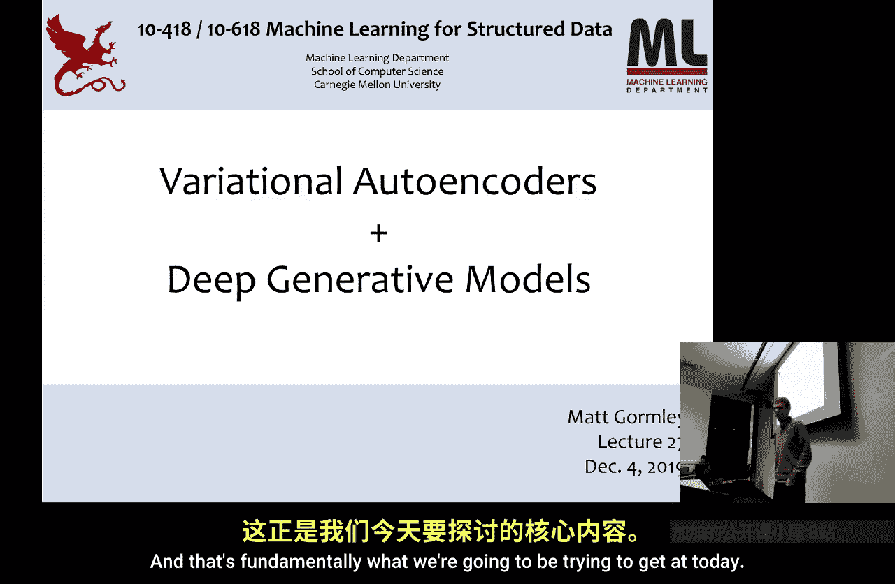
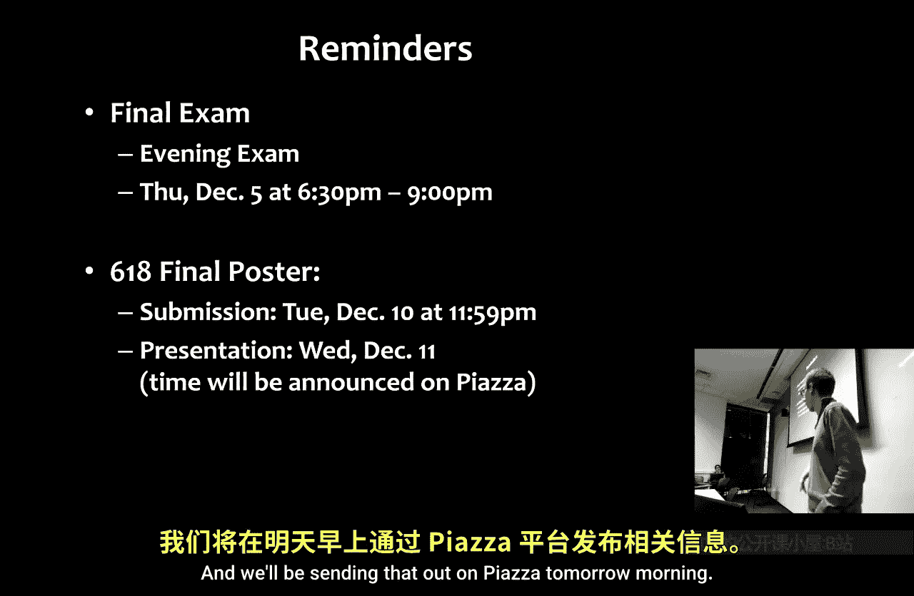
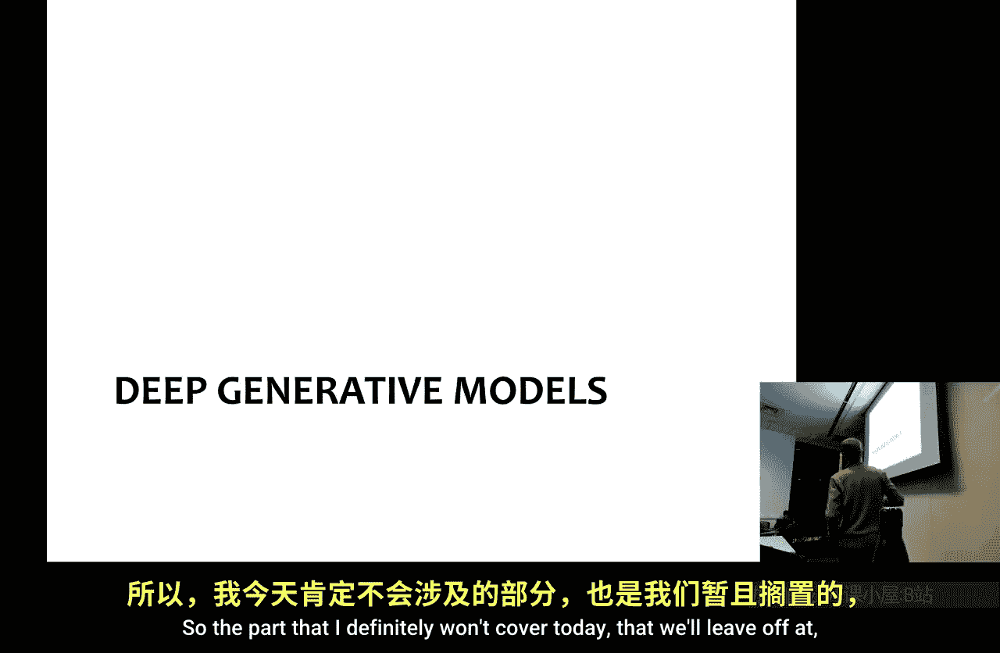
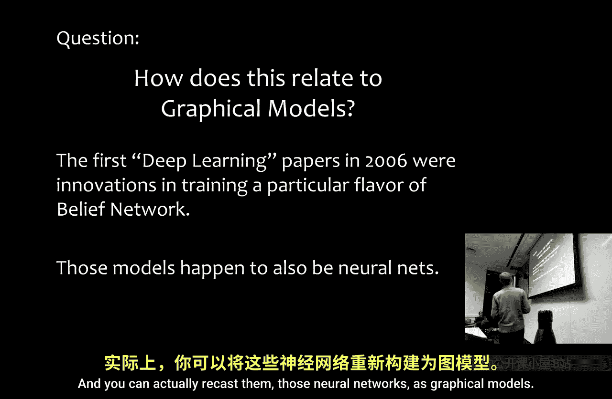
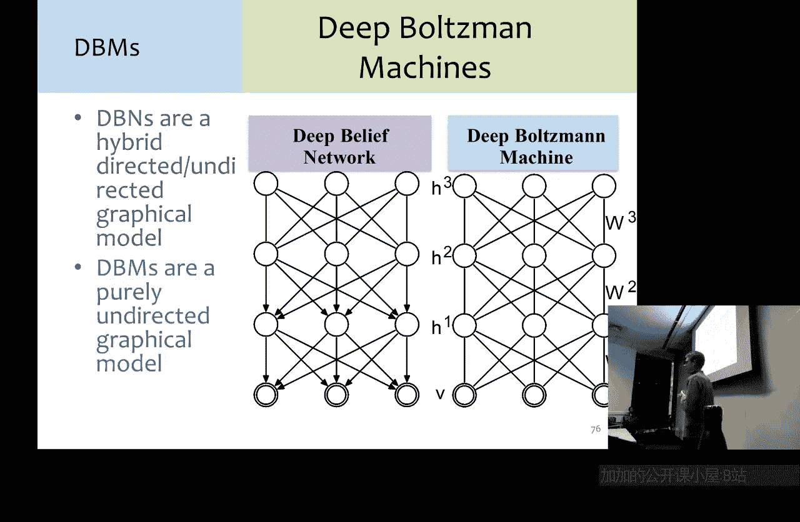

# 卡耐基梅隆大学【中英⚡结构化机器学习｜10-418 2019 Machine Learning for Structured Data】 p27 p26 10-418 ⧸ 10-618 Fall 2019 -BV1eJRsYBEaK_p27-

So today。We wrap up。嗯。You guys finally made it here。嗯。I think。Yeah。

 there's something kind of fun about this ending with this particular lecture because what we can do now is actually tie together a whole bunch of different things that we've seen throughout this course。

And。Particular。I want to talk about variational autoencors。And I sort of expect。

I have a bunch of material on degenerative models that。We probably won't have time to get to。

But maybe we'll kind of ski through at end。But in general。

 I think there's sort of great opportunity here to kind of see a lot of what's going on as deep learning from。

え？And in for perspective， from a probabilistic modeling perspective。

 and that's fundamentally what we're going to be trying to get at today。

Okay， so reminders。Final exam。Thursday。And。The final poster session for 1016。

 the submission deadline。10th Tuesday， and the presentations will be on December 11th。

And don have to finalize the exact time for the poster session。We'll be sending that out on Piazza。

Like tomorrow morning。

嗯。So in my sleep deprived state， I put together the final exam logistic slides here。

 so hopefully they're correct。So the actual exam itself is two and a half hours long。

 so it's longer than our midterm exam once， and then we have Doherty Hall A302。

 which is down in the basement， if you said there before。I think。Iかtion。

Kthecon Austin already mentioned on Monday that the material we're covering is only lectures 1 through 26。

 like today's lecture， anything that we talked about today is not covered on the final exam。

The format of the questions will look kind of similar to the midterm exam， and as usual， you know。

 please bring a sheet of notes。I don't think we need that。

 so did you guys mention the sort of distribution of our content as well？Okay。

 so this is important to note， so 30% of the material is coming from before the midterm exam。

 but most of the material is coming from。After the midterm exam。And so， you know。

 so if we took the list of。Topics from before the midterm exam。

 you can imagine that sort of the way that we're writing our exams we're taking all of these problems and we're kind of packing them all into one section of sort of a lot of short answer。

 multiple choice style questions just kind of the like lighter weight questions。

 but at the same time， the reason that I always want to emphasize that we are covering sort of pre midterm material is just that it's almost impossible for us to write questions about postminterm material without referring back to the things that we've already done So fundamentally when when you get the exam。

 you'll see that there's there's kind of a bunch of a bunch of different sections and those sections roughly correspond to the kind of big lecture topics that we saw。

big homework topicss that we saw in the second half of the course。

So whereas in the first half of the course we were kind of mostly thinking about。

Ways of writing down models and representing conditional independence assumptions and then how to do sort of the simplest possible learning right settings where we have full observations and where we can。

Exactly。In the second half of the course， we suddenly like opened everything up and said， well。

 that's not always realistic。tice we usually can't do exact inference in the model that we actually want to write down the model that we'll look at today。

 variational auto encoders is no exception and learning is in general going to kind of rely on more advanced techniques than just maximum likelihood estimation and might involve things like variational EM where we need to。

Actually learn with partial supervision， or it might be things like structured Perceptron or SVM。

 where we're actually sort of learning in the presence of map inference rather than marginal inference。

And then we kind of looked at these three sort of big areas for approximate inference。

One was that of map in Princeton， and I think I actually kind of somewhat purposefully。

Deemphasized map inference as sort of a topic for approximate inference。

We were mostly concerned with treating it as a mixed in or linear program where we could solve it exactly。

 but you also on your homework we're thinking about this as an approximate in。

Where you were taking an LP relaxation of the ILP。And solving that LT relaxation to get a back in a precedent solution to the infant's problem。

And then we also thought about specifically two MCMC methods give sampling to intrapolious Hatings。

And associated Monte carlow methods so that we can look at how acoxs of an inference could be treated as a sampling problem。

And。And then， lastly。We looked at approximate inference。

From this optimization perspective and thought through how we could set up a mean field approximation and then。

Treat the problem of optimizing kale divergence as the actual mode of doing inference。

And then so the online lecture， the one that was sort of my the replacement for the Monday that I was out was on baing non parametrics and there we were thinking about。

How we could take this sort of standard setting where you sort of assume that you know how many sort of or that you know a lot about the actual underlying distribution of the data that you know。

 for example， how many clusters there are for a mixture model and we sort of said， well。

 in fact you could work in a setting where you don't know how many clusters you want a priori and you let the model actually figure out。

That aspect of things for you， the actual underlying structure of the data。So today。

 the thing that's not covered on the phy exam we'll be talking about deep geneerative models。O。So。

I want to wrap up with just a word on variational EM so that we can partly just to refresh your memory on this and also to kind of paint a slightly broader perspective of what it was that we were doing with variational EM。

So。So first， I want to jump back to this unsupervised POS tagging example that we had used in order to look at。

嗯。An actual instance of variation。And so here if you remember。Are setup up。

Was where we have sentences only and。Further assumed that they were concatenated together into one long strain。

And the goal was actually to infer the part of speech tags for these unlabeled sentence。

So those are to the words。Where the W's here， the T's were the tags that we're trying to infert。

And we assumed that we had a Bayesian hidden Markcoov model。

 which is one where we had parameters Phie and Phi T。

And priors over those parameters dearly priors and so we sort of decompose this back into our usual variational。

Notation is alpha being the parameters of the distribution P and z being the parameters of or sorry。

 the actual hidden variables that we're trying to infer。

And that included both the tags and the parameters of the HMM。

And then x being the words that we actually observe， and so our mean field approximation said， well。

 we're going to decomposese those completely so that all the variables are independent。

Conditioned on the variational parameters， theta。So。嗯。What I want to think about then。

Is how can we come up with essentially variants of the framework that we looked at？嗯。Last time。

And so to do that， so this table。呃。There's actually， I think， a link to it。

This high level explanation of variational inference that I put on the webp page and so this table is sort of adapted from this example from Jason Eisner。

 which I think provides this really great picture of a lot of the different problems that we have solved in this course and that we want to solve。

Okay， so before we jump into variational auto encoders， we're just going to establish some。

Terminology in this example。We're going to say that。In this model， we have a couple different。

Types of things that we're working with。 We have the hyperparameter， beta。We have。

The the five parameters， the o and transition 5 parameters。And then we have the tag sequence T。

And what we're going to do here is construct a table thinking about。Different settings。

That we could look at for those three。Aspects of the model。And we can then articulate。

What optimization problem？We're actually。Working with and。The name of the possibly approximate。

Method that we're working with。To solve the problem。So here's what I mean we have this。

This big table here。And。Suppose in the first setting， we are given。The hyperparameter beta。

 and were given。The emission and transition parameters phi。

 and what you want to do is maximize over t。So here in this setting。

 the optimization problem that we're talking about is。T equals an arg max。Over possible T's。

 this is like of a vector T of the posterior P of T given。The parameters Phi and hyperparameter beta。

Okay。So what optimization problem？Are we actually solving， I mean， I wrote down the math。

 but in words， what optimization problem are we solving if we're given be then phi we're just trying to optimize over the T's for a given x。

So you can assume that X is always given here。This is a lovely sort of exam style question about。

We're kind of asking you to fill in the blanks here。What it is that。

How can you actually map this map back to sort of the terminology that we've used throughout the semester？

So is this。Learning， is it marginal inference。Something else。Yeah， it's just map benefits， right。

When don't we make it， we call it mapped inference。Or maybe map decoding。食冰。

OkayAnd if we wanted to actually solve this， we would need an algorithm to do it and so you know what。

An example of an algorithm would be max product。Belief propagation。Okay。我。Greedy search。

That could be an approximate way。And Max product BP。Its also called the Viterbi algorithm。

When we're talking about it for an HM。Okay， so that's the first setting。So here。

 let's think about the second setting。 Suppose now you are given。

The hyperparameters and the parameters。 and you're trying to sum over t。So。

So we could write this as an optimization problem where we're saying we want a distribution P of w given phi and beta。

 which is a sum over T。Of the joint P of W and T given phi and beta。And how would we describe？我。

Optimization problem we solving here。B。Or if you prefer， you could。Suggest a。

I can solve this for you。To do something。 And for different teams。Yeah， we could do sampling。

 let's start writing some of these down， we could do sampling。Actually， let me， let me be a little。

 I'm actually going just so that the table ends up being。

Really highlighting the point that I want to make。I'm going to put。Some ideas over here。So， sampling。

We could do some product P。喂。So what is the actual？Pro that we're solving。Yeah。

 this is just marginal interest。And so I guess the one that I want to highlight here is that we could say that here we're doing。

Possibly， variational。Inference。Okay， so why do I say that variation is in parentheses here？Well。

If we make the mean field approximation shown above。Then you would be doing variational。

As it turns out， though， if you're given beta phi。You can actually do exact difference by say。

 some problem。So we don't have to turn to the approximate method。

 but it's useful to see that if we did use that particular mean field approximation。

 this would be an example of mean field variational inference。Okay。

 so let's keep moving so next suppose we wanted to say。For our third option that we're given。Beta。

 and then we're going to maximize over。The Phi and sum。Over the Ts。So in that case。

 we're looking at an estimation of phi as。The artrc max over thighs of。四。P of W given phi。

whichch is implicitly summing out。The T's here。Times。Say P of。Phi given beta。Good。

So what problem are we solving here？Given the hyperparameters， you're marginalizing out T。

Maximizing of the parameters。Yeah。So EM is a method， so we could say。The method we're using is easy。

And if we used that same variational approximation， it would actually be variational OEM。

And but what is the actual。Sont。Is it maximum likelihood estimations？So if you cover this up。

Then we have that likelihood。But we have this extra term， P of Phi a theta， so what is this？

This would be map estimation。Because we have。A prior over the parameters。O。And again。

 it's only variational in this case if we're making that mean field approximation。Okay， so now。呃。

In the fourth case here， suppose we're given beta。 And then we sum over phi and T。So in this case。

 what you could think of this as doing is we're essentially estimating。呃。P of phi。Given W and alpha。

And。P of T， given W。And alphapha。And this is really just the sort of Bayesian。

Poserior inference problem。We're trying to get a posterior distribution over the parameters or over the tags。

And one way that we could do this， now looking back up at our example。

Is following what we were talking about last time， which is just say that is our joint distribution。

 P alpha of x and Z， and this is our mean field approximation and we're going to estimate we're going to get。

Mean field approximation of the distribution over Z。 and so this。

We don't call variational EM because we're not optimizing over anything。

 This is called variational Bs。Where we're。Truly coming up with。A posterior distribution。

A posterior distribution。Over。The parameters and any latent variables。Okay。

 so the last one is sort of an interesting one and here suppose you wanted to maximize over beta and then sum over both the phi and the T。

 Well now this is sort of like saying we're trying to find the alpha。That is the art max over Als。

Of P of alpha。Given W。 and this is called not the Bayesian posterior inference， but empirical bays。

Because what we're saying now is we aren't actually willing to commit to a particular setting of the hyperframe。

We actually want to learn what the hyperparmeters are。And in this setting， we're actually back to。

Variation O M。This is just another example of it and so。

 but the key thing that you can see here is that what we're doing is essentially setting things up。

So， that。You know， in our example。嗯。We can actually drop。呃。These terms。

These sort of variational terms and parentheses。If we drop。呃。Mean field approximation。

And do exact inference instead。So。You know， we were in a setting。

 I set things up so that we were in a setting where we could actually do exact inferences or exactly。

Once we get down here though， we're still doing variational EM because we're still using a variational approximation to marginalize over some latent variance in this case it was phi nt and case3。

 it was just T and then we're maximizing over some other parameters and so that gets us our E step in our M step for variational EM。

Okay， so now。Armed with sort of all of these different terminologies， we can see that。

 you know sort of given any model， you can start to you know pick out different parameters and say I'm going to maximize over these and I'm going to sum over those and depending on what you choose。

 you'll end up in a different paradigm， maybe variational base， variational ym。

 maybe variational inference and。Depending on whether or not you're making an approximation you need or don't need to use the term variation。

Okay， so let's look at a couple short examples here， so for unsupervised part of speech tagging。

 someone actually went out and tried this Bayesian HMM that we just talked about。

 and so the task is unsupervised POOS tagging， the data is a million words of unlabeled sentences from the Wall Street Journal and they sort of cheap because they have this dictionary that defines the legal part of speech tags for each word。

So诶。So flies would be in the dictionary as either a noun or a verb。

 but it doesn't show up as an adverb， for example。So they have a little bit of information that way。

 and then they compare five different models， an EM model which is just the standard HMM with trained with expectation maxization。

 so there's nothing bayesian about it。And then there's VD。

 which is going to be an uncollapsed variation Bayesian。HM。

 so here they're going to they're not going to sum over。The parameters of the H&M。

 they're actually going to maximize over them。And then they have algorithm one and two here for CVB。

 which is a collapsed variation of Bayesian HM and in these settings。呃。

The collapsing part is just happening on these five parameters where just as we saw。

 sort of you could do collapse inferences for LDA， you can also collapse these out。And then lastly。

 they also compare it to a collapsed in。Okay， and one sort of cool part about this is just that when you actually look at the mean field updates and the。

The collapsed Gib sampler updates， there's actually a lot of parallels between them。

 it's not worth kind of looking at the actual details of this。

 but basically in the mean field case you're updating this distribution over the CTTs and collapsed Gi sample you're sampling from a full conditional over the ZTs。

And what they find is that。Like a couple things that aren't too surprising。

 so on the left here we're looking at the number of iterations versus test perplex and so the uncolaapsed variational days is the blue one it does the worst and then algorithms one and two are the。

Collapse variational bay and the collapse G sampler is in purple。As you can see that the。

The give sampler is actually doing the best among them。And。

The kind of key difference is just in runtime， where the collapse skip sampler is taking dramatically more runtime。

Than any of the alternatives and this algorithm one is actually doing significantly better in terms of speed than the alternatives。

 So why are they。Why do they have all these different speed issues so EM。

 which takes 28 minutes for it is slow because of the log space computations that it needs to do。

 you need to do these computations in log space to avoid underflow。嗯。

The uncollsed EB is slow because it has these diagramma computations。

 this diagramgama function is really expensive to compute。

Alrithm one is actually the fastest and then algorithm two is slow because it has these like dynamic changing parameters and finally collapse gi sampling is。

Incredibly slow， much slower than any of the deterministic algorithms。嗯。So。

You can also take this maian HMM and apply it to other tasks and there's this pair of papers。

 Foti etol and Moana and Chung in 2015 that looked at human chrominism segmentation where they were actually trying to do unsupervised segmentation of the genome and so they start with。

A huge data set of 250 million observations。And the metric that they're evaluating on is actually the sort of false discovery rate of predicting。

あ。These these known elements in the sequence。And so they compare these different models using Bayesian HMMs。

And without going into picking up the details because I don't know the actual biology behind this task well enough to do it anyway。

 there's kind of some important machine learning takeaways。

 one is that the two models actually perform at similar levels for false discovery rate。

But the variational inference model takes one hour。え。The other one。

 the dynamicnamic Bayian network with standardM takes days。Okay。So it's just dramatically slower。嗯。

So for grammar induction。There's this great question which is you know can maximizing unsupervised marginal likelihood produce useful results right so we were just thinking about unsupervised product speech tagging and so here。

Theme of babies， we can actually think about you know how do babies learn， well。

 babies are exposed to massive quantities of their native language。

So say English just by hearing all of these sentences and somehow they're able to then piece together some complex representations of those sentences。

 and so grammar induction is asking the question can a computer similarly learn the syntax of human language just by looking at examples？

And so here we're trying to unrecover this syntactic structure without any supervision。

 and for a given sentence， we've already seen this before where you you can have lots of different interpretations of the sentence depending on what your actual syntactic structure is for that sentence。

And so and for the machine， they actually have to consider you know a bunch of semi reasonable semantic interpretations and also ones that are completely semantically implausible。

So。So here， the actual training data is just the sentences and we're going to try to evaluate accuracy against gold standard parses。

And so the question that we could ask is， does likelihood actually correlate with accuracy on， say。

 a task like this？And what we find is that， in fact， we do get this really strong correlation。

 so if you run the model many times over each the actual objective function that you're optimizing is non convex。

 and so you get back a different qua likely。For each run of the model， so that's each point there。

And for each model， you can evaluate not only log up likelihood on this horizontal axis。

 but also the accuracy against that gold reference set of。Trees。

And so what we're seeing here is that yeah， there is actually kind of the strong correlation between the actual downstream accuracy and love likelihood。

 even though the love likelihood is fully unsupervised。Okay， that said。

If you pick a particular level of。Likelihood， say 19。4。

 there's still a huge range of accuracies ranging from， say， you know， the low 40s to the low 20s。

For that level of likelihood。Okay， so。Not surprisingly。

 people have looked at variational Bayesian models for grammar induction。

 I'm going to just kind of skip past this， but they do similar comparisons of EM and then different Bayesian models with different priors like Delay ps and log normal p priors and so on。

Okay。So before we talk about。Variational autoenrs。I just want to do a quick introduction to standard auto encoders and then we'll move to。

VAs are variation。So the idea of。An auto recover is that。We want to train on deep network。

And maybe we even have supervised data。But we want to say pick a better starting point。For training。

 right because training is going to be some non convex subjective function。

 even if you're doing supervised training。Y。So we want to be able to。

Come up with a way of initializing the parameters well， and so the idea of an autoencor。

Is to do what's called unsupervised pre training where we use unlabeled data and we work bottom up。

 So we're going to train hidden layer one and then fix its parameters。And then train hidden layer2。

 then fix its parameters and all the way up to layer N。

And then you could come back and do supervised fine tuning using labeled data。

And you could essentially refine the features by back propagation so that they are well tuned to the end task。

Okay， so this is going to be idea number free you， I'll introduce idea1 and two later so that we can compare them on a task。

嗯。So okay， so the question for unsupervised pre training is。What should we predict？

If we're unsupervised。What else do we observe？If we're unsupervised， we don't have this output。

 right？It's just not even there。So instead we can try to use the input。To predict itself。

Or a copy of itself。And so if you have a neural network where you have the input fittedted here and the output of the neural network is supposed to be a copy of the input。

 this is what we would call。And so the key idea is that we want to。Well。

 so we set things up with an encoder and an decocor。Where嗯。The oh， sorry， I guess I。

Should call these， these aren't A's， there's Z's here。And so the hidden layer is a bunch of z's。

We're saying that the encoder takes this input and gets us back a Z。

And then the decoder takes the Z and gets us back a copy of the input X。

And what we want to do is tune the parameters of the model so that z gives a small reconstruction error where we say that x prime is a reconstruction of the original input X and our loss function。

I's just say， the L2 norm or something between the original x and x prime。

Where X prime is just what you get when you feed X into the encodecoder and then feed that into the deeper。

Okay， so。Once you've set up your loss function this way， then you can just train using backpro。

Because this is just a differentialiable loss function like any other。So。Why would this work at all？

Any thoughts。LikeW are we actually going to learn something interesting？

We're constraining the number of failure layers to be small。Yeah， usually。 so if we say that。

there's going to be a small number of those Sand the input is actually an image like a know 100 by 100 pixel image。

 so there's a million pixels in your input and that means your final layer。

 the reconstructionion layer is also a million pixels。But the hidden layer， let's say。

 is just taking it all the way down to just two hidden units or something。

So we're going to try to compress all of this information about the image down into two hidden units and then reconstruct it with the decoder。

Okay， so the idea when you apply this to a deep network is that you can work bottom up right so you can basically train。

H layer 1。And then you fix its parameters。And then。

You keep those bottom ones fixed and then you can train hidden layers two and then fix those parameters and train hidden layer three and fix those parameters all the way up。

 and then you can do supervised fine tuning and back all the way back through。So。

This is now honestly kind of an antiquated idea， in some sense it's still a fundamental idea that we've come up with like better tricks for how to make this work really well and in fact。

 if you're training a deep net this isn't necessarily necessary but it still gives this lovely picture that we can see an autoenr in action。

Where it first showed up in 2006。Where we're going to compare three ideas。

 one is supervised flight tuning only， the second is supervised later wise pre traininging。

Where we train the first layer to predict y and then the second layer to predict y as the third layer to predict y。

 and then finally the last layer predict。And then idea3 is going to be this unsupervised autoencoder to initialize supervised fine tuning。

Okay， so what you can see here is if you just have a shallow app。This is on MIS digit classification。

是呗。Now， classic problems。Where we're trying to predict， you know which andwritten digit。

Image is showing。And the idea one， which is just a deep net with no freetraining。

Actually gets worse than shallow。And so the second idea is， okay， well。

 what if you do supervised pre trainings， so this is error or whatever're lower is better？

And the deep nap with supervised pre training， it does better than no pre traininging。

 but it's still worse than the shallow network。And then the idea of unsupervised pre traininging actually succeeds in getting something that's better than the shower。

So this was revolutionary in 2006。And but we've come a long way since then。And in particular。

 one of the methods that's really sort of garnered a lot of attention is that of variational autoencors。

And the whole idea of a variation， oh yeah， is there any reason why we're doing it layer wise instead of just having a one giant？

Oh， you absolutely can， but I'm just showing you how it was done in its first instantiation in 2006。

So if you were doing it today， I would actually recommend doing it all at once rather than the layer wise pre training。

 we kind of figured out afterwards that well we learned a couple things since 2006 one is that。

You can actually get the deep net with no pretraining to beat the shallow net。

 if you just throw it on enough GPUs that you train it for like a much， much longer time。

 and then the deep net actually can succeed even without auto。P trade。

The other thing is that you don't necessarily need to do this layer wise retraining。

 you can use an auto encoded like objective function。just train the whole thing on。

And so the variation of autoenr， that's exactly what we're going to do。

 we're going to train the whole thing on once we're not going to do。关系。Okay。So this is the picture。

 the reason that I highlight this though， is just this gives us this picture of an encoder。

 which takes your input， maps it down to some low dimensional representation。

 and then the decoder which takes that low dimensional representation and maps it back up。Okay。

 so the variational autoender is going to do that， but in a probabilistic setting。And so。

So let's start by actually thinking about the variational autoencor。嗯。And。

We'll begin by thinking about it as。嗯。Sort of the way that。

So a deep learning person might talk about it。Variational。Auto encoders。2VAE。So。

The neural net perspective here。Is。That。We're going to say we have。2 components。 We have an encoder。

And we have a decoder。And。The encoder is going to be a distribution， Q theta。

Or Q parameterized by theta of z given x。ok。And if we were to draw sort of computationally how this encoder works。

 you'd say， okay， at the bottom。We feed in， say， some image X。And then， there's some。Function。

Which willll call。Ecoder， underscore neural network。And this is a function。Parameterized by。

Theta of x。And the output of the encode colorder， this is where things get interesting。Is not。

Directly。The it's not directly Ze。Instead， the output of the encoder。Are some other parameters。

 It's called a mu and sigma。And those parameters are going to get fed into。A Gaussian distribution。

Prameterterized by。So we'll say this is a Gaussian。Over。嗯。Pameterterized by mu and sigma。And oh。

 I see， I see what I。Hesitating on here。 So we want to make clear that this is a Gaussian distribution。

Over output Z， given the parameters mu in sigma。And so the output of a Gaussian。

Is actually a sample Z。你。So what do we have here We have。Say our input。

 which is something like an image。Or other input data。And then， here。This is a。

Deterministic function。Of。Neururalnet parameters。Theta。And our input X。And。And lastly， appear， Z。Is。

Sort of our latent variable。呃我come back。And I guess the other detail is that this is a stochastic。

放生的。Of Mu and Sigla。So the Gaussian is actually where we actually get。呃。

The fact that this is a distribution of diseases， right。

 it's not a deterministic function from x to Z。The deterministic part goes from x to mu and sigma。

 but then from there we actually have a Gaussian distribution parameter ass。Okay。

 so then the decoder。Is going to be。Some p。Perararameterterized by phi。Of。X。别问自。And here。We say。That。

Oh， sorry。This is gonna be。A decoder that is a joint distribution over x and Z。Oh no。

 let me actually do it this way。So we're going to think about。P of x given Z。

 but we need to think about it in the context of a joint distribution。

 so momentarily we're going to be thinking about a joint distribution P of x and Z where we have two terms。

 P of x given Z and P of Z right。So we have like a sort of a likelihood。And prior。Take distribution。

是。And so here we're just concerned with that P of x giveny。Okay。

 so what does this look like if we draw it out computationally， well， this is going to take in a Z。

And it's then going to feed that Z into a decoder。You're on that。Which is parameterized by phi。

And a function of Z。And its output。Is。Another set of parameters。 It's called them mu prime。

And Sigma prime。And。These parameters are gonna be。Fed directly into another multivariate Gaussian。

Where now， this Gaussian。Has parameters mue prime of sigma br。

And it gives us back not a distribution over Z， but a distribution over。Xs。Or reconstructed access。

So here。嗯。We could say， well， again， we down here， we have this latent variable。Z as before and then。

This decoder。Is a deterministic function。Of Phi and Z。And then， the Gaussian is stochastic。And。

This X is our sort of reconstruction。Of。The image or something like it。So。

 so this is sort of the two。嗯。Pieces that we're working with here， an encoder and a decoder。And。

If we were to just say， okay， this is just。Going to be。A standard。Good old fashioned neural network。

Then what we would do is we would just say， okay， let's write down。A loss function。

And that loss function is going to be some。Example specific thing， right。

 so we're going to say that our true loss L。Is equal to a sum from I equals 1 to n of these L。

Functions， so maybe L is a function。Of our parameters， theta and phi。

And LI is just sort of an example specific。An example specific。し。So the question is。

 what should we write down as our example specific loss function？

So we're going to write it down first。And then we're going to think about why it actually makes sense。

From a variational perspective。So the loss function is going to be an expectation under。呃。Q of Z。

 given。Xi。Of a log。Of the probability under phi， so this is or sorry。

 this is Q parameterized by theta。And P parameterized by phi of X I。Given Z。Plus。

 a k divergence between。Q theta of Z given X。And。That prior term that I mentioned before， P of Z。

It's everything。All right。So if you squint at this thing。You should be thinking to yourself。是。

I was expecting something that looked exactly like the elbow。

But this doesn't look exactly like the elbow。And so let's try to figure out why that's the case。

So to do that。We want to take another look at this variation autoenr， but this time。

Sort of from a graphical models perspective。2。So the model。In this case。Is just going to be。呃。

P of X and Z。Which decomposes as P of x given Z times P of Z。And so far。

 this should feel completely uninteresting。So。呃，The P of X given。Pmeterized by theta。

And so if we were to draw。An actual graphical model picture for this we would have。

One ZI for each example。And one Xi， for each example， this is going to be a plate diagram。

And if we had N training examples， there would be n of them。And we also have parameters out here。对。

And the thing we observe are。The actual Xs。All right so。Thus far， all we've done is written。A really。

 really boring looking model from a graphical modelss perspective。

So why is this going to be interesting？我。Our goal。Is going to be to estimate。The posterior， P of Z。

 given x。Which is a function of theta as well。 And we would say that that is equal to P theta of。

X given Z times P of Z divided by。P theta of。X？Right， and here。The key point。Is that。

This is going to be intractable。And the question is， why is this going to be en？

So what is it about what we've done so far？😔，That makes you feel like。

Estimating P theta of x should be intractable because honestly。

 if you just look at it like from a graphical models perspective， it doesn't look like。

Esimating P of x should be all that hard。Through about little hair。He thoughts on why？

Estimation of P of X might be difficult。Isn't the distribution over x just a Gaussian？

According to our definition of the decoder。Just a plain old Gaussian， right？

I don't how to do posterior inference with Gaussians， plain old Gaussians。

 is this a plain old Gaussian？ちょっと下といく。うがまし。Exactly， so it's。Well。

 it's not just high dimensional it's also conditioning on something high dimensional so suppose Z was actually。

Some low dimensional thing， say Z was just a single real number。The way that we generate X。From Z。

Is not just to say。That x is just a simple drop of the Gaussian。We first。

Have to pass through some big， complicated neural network， right？What we're looking at here。😡。

In this decoder neural network。This thing。Might actually be something like a many layers deep。

Like say this is Z1， say， I mean， Z really could just be a single。A single value。

 or maybe it's like two values， Z1 and Z2。 but then maybe。These values。Are fed into some。Complex。

 many layers deep。Neurural network。Which， after a while， outputs。Something like。A mu 1， a mu 2。

And then。Sigma 1，1。Sigma 1，2。All the way down。To say sigma 2，2。So the point is that。This decoder。

It's not just a simple gaussian， it actually has。Some complex。

Neurural network build into the definition of how it is that we sample X。Okay。

 so back to the graphical models perspective。What can we do about this？

If it's going to be intractable。Oh， so the answer to our why question here is because of。Decoder。

Burural network。嗯。咩劲啊。You have X given z。A complex distribution。So。呃。

So what we're going to do then is we're going to say， well。Come up with a variational approximation。

And that variation approximation will just be some Q lambda。Of Z given x。

So these are our variational parameters， lambmbda。And。This is our variational distribution。

And so why are we talking about this lambmbda here well the lambmbda？In our variational setup here。

We come back up here。The lambmbda in our variational setup。Is going to correspond to。Mu and Sigma。

In our encoder。So what you can do is you can think of this as。嗯。From a graphical models perspective。

Mux and sigma are this just deterministic function of x。And the distribution that we care about。

Is actually just sort of this part。 which is really like a cube lambda of。Z given。X。O。So。No。

If we write down just sort of the standard。elbowbow。嗯。So， this will be。Version 1。Three elbows。Or no。

 I guess we'll just do， we'll just do two。To objectify。Okay， so the first。

Would just be if we wrote down。Elbow of Lambda here。Then what we would have。

Is an expectation under Q lambda。Of。The log。And this is a。Of the log of P of x and z。And then。

We'd subtract off。Expectation under Q lambda Z given x。Of the log。Of。Q lamb of Z given x。So。

The first trick that we can play。Is we can say here。That in this first definition。嗯。

We're setting this up where Z is equal to。All the Zs。From one up to n。

And x is equal to all the X eyess。From one up to。对。So that's like the whole collection of all the。

Interographical models。And so we can rewrite this elbow。Now， as。An example specific elbow。

So elbow of eye of lambmbda。And we get the simplification that occurs because of how we've parameterized things。

 so we have the same expectation of Q lambda。Of。Over ZI or sorry， over it。Say Z given X。And actually。

 let me just write this as a sort of。Vectctor vector X， vector Z， vector X， vector Z。

And that's what we're calling。The full collection of them。So down here。

 we're just working with the distribution over a single pair of a single Z and a single exide。

And so here we have an expectation over。The log。of。The probability of。Xi conditioned on Latin Z。

Minus。A pale divergence。Of。Q lambda。Of Z given X I。And。P of Z。

And the fact that we can get this decomposition back。

Is because of the shared dependence on theta across all of the examples。

And the fact that PC then does not。对呀。So， now。This。Is just sort of a。My has some algebra。We recover。

The sort of。Neururalent perspective。Boss function。And so if we go back and think about that neural net perspective loss function。

We could say that， really。What's going on in the neural net。Version of the loss。

Is that we kind of have two terms。So this is a neural net loss at the top there。

 The first term is basically a。Reconstruction law。This law is saying。

Under our approximating distribution Q。How well did we reconstruct the true exile？

And then the kale divergence。It's kind of like a。A regularizer。That says。

Q theta should be close to whatever P of Z was。O。So， now。呃。We can。呃。We're almost back to the。

But none that version， except that this is still a function of lambda。

Lambda is a function of x through some neural network。Namely， if we think about this thing again。

So recall here that our encoder。Is。Essentially， saying lambda is equal to。You know， this。

This mu and sigma。Which is the output of some encoder neural network。Parameterized by theta。

As a function of x。And then， we have that。We get this distribution， Q theta。

Of Z over Z given x and lambda。So this is our ending。Now is a function of。

The actual neural net parameters， theta。And the decoder。Is really。

This joint distribution that we're trying to approximate， which is。P of x and z。

Which is some complicated neural net。呃。And some simple prior， so namely the simple prior。

Might be something like n of zero and I like this is really just。Go to be a standard。Unit Gaussian。

And then this is going to be。A multivariate。Gausian。嗯。Where new prime。And sigma prime we equal to。

So decoder neural network。Pameterterized by5 of Z。た。All right， so finally then。

If we rewrite this example specific elbow。But now， in terms。The neural net parameters， rather than。

The Lambda Pararam。What we get back is。An elbow， so I。Of theta and phi。As this expectation。

 But now under。Q theta。Of Z given X。Of the log probability。Of Xi。Given Z I， given Z。

The thing over which we're taking the expectation。mininus。This。KL。Of not Q lambda， but Q theta。

Of Z given X I。M PC。So， here。This is just sort of rewritten。In terms。Of。C的。And phi。

Instead of lambmbda。And the whole reason that we do that。Is that。Lambda。Is a deterministic。Really。

 I'm neural that。放神。Of the。O。So what the variation of autoencor is accomplishing。

Is it's just setting up for us。There' incredibly complex distribution， right？嗯。

You know on the surface， it feels like， oh yeah， we're just sampling x from a Gaussian。

 we're sampling Z from agaussian， simple。But the incredible complexity comes in because they are these deterministic and good or deco neural。

That give rise to。The actual parameters of those gaps。And so if we want to do posterior inference。

In a model like this one。Then we can't at all rely on sort of the simplicity of the Gaussian。

And instead， we can turn to variational inference。To actually accomplish。

The problem that we set out to solve。And so training here。Is actually simple。It's just standard。

Variationally in。Where we're trying to。Maximize。Elbow。Of theta and Phi。

And so just ast variational in， we just go back and forth。Between optimizing over theta。

And optimizing over five。So the parameters of the encodeder doesn' optimize the parameters of the decoder and back and forth。

Okay。So there's an important detail here。啊 the。Probably was not obvious。

And that is about back property。So here this figure。

 all it's done is it's taken the encoder picture that we drew and the decoder picture and it put them together。

 so here's the encoder picture。That goes from x。To Z。That's the encoder。 And we just drew。

And then here's the decoder picture that goes from Z back to。This F of Z is just X。

Or a reconstruction X Tilda。And the problem with this picture is that。

There are stochastic parts of this picture， namely， we're sampling Z from this multivariate Gaussian。

And we can't back propagate through sample。So what do we do？Instead。

 what we can do is we can say we're just going to sample some epsilon from。The unit Gaussian。

And then we're going to take that sample epsilon and multiply it by the covariance matrix and add the mean。

And that will give us back the same thing as sample directly from that guest。跟你。

Key here is just that。No longer is the actual sampling in the critical path。

If we want to backproagate to the parameters of the entry。Yeah， so in the diagrams。

 it seems like you don't see a from。I think in the。

Notes you actually said the sample from a Gaussian。From the link。到。Yeah， so。

 so what we're doing here is not so what we're trying to set up here is just a。啊。Training objectives。

So in principle， you could sample from this thing。And the way that we were thinking about this。

Is that。You know，If you were to actually get A Z from the end， that is a sample from the Gaussian。

But then in a decoder， we don't typically sample an X。

 It's kind of like like think about what you're doing when you're training any neuralne with a softx。

If you know what the true label， say you're doing image classification。

 you' get to softm over the labels， and what you do is you want to maximize the likelihood of the true label。

So here， rather than actually drawing a simple X。A simple killed that。

We're just going to maximize the likelihood of the true act that we wanted to reconstruct。

So the decoder then willll predict。Ex' still not mut prime or Epsilon。Or signal points。

So the point is that the decoder is just giving us a distribution over P of x state and z。

 and we're going to tune the parameters phi to maximize。

To maximize the likelihood of the observedserv。What about the view center。

The new private and Sigma price。Yeah， so those are the actual parameters that will too。O。

And so what we're doing is so mapping back to what we had been thinking about with variational。

We have the parameters of the approximating distribution， the parameters of Q， that's theta。

And then we have the parameters of the true distribution P， that's fine。

And just as in so if we were just doing variational inference。

 it would be like saying we already know。What the parameters by are。Those are fixed。

And we're just trying to infer。Some approximating distributionq of Z given an x that bests approximate。

So that would be pure variation。But here we're doing variational EM。

 which means we're simultaneously。Learning both the parameter datata and the parameters spine。

When you're taking the ML LE， right， So that means themll just be you。咁你攞呢个先。

TheE the witch because there's two。You taking the most likely。美し。Oh sure， you mean mu prime here。

 prime yes， so mu prime， the most likely thing would be that mu prime is exactly whatever X wants。

 right？you don't have ever use itbook。呃。哦， except that诶。Oh， I see what you're saying。

 sorry Sigma prime here， you're saying oh， you're just talking about the covariance not matter， yes。

 okay， yes。I think you're right。So training because you need sigma to calculate the lot。嗯。Yeah。

 so you can't compute the likelihood without it。 so it does actually affect likelihood of x though。

 so there's a there is a sigma that could make X more or less likely。Depending on the current values。

So we to do oh， so we're not going to do exact。Like closed form optimization here。

We're going to take a gradient step。And so at any given moment。唔唔会。

Like the maximum likelihood estimate of mu， you could say is going to be exactly X for the single training current training exam。

But。For a given sigma， the best you might actually。

We're going to take a step in the direction of the。Okay， so。啊。

So the point of the repahabilitization trick is that。

We can just take that stochasticity out of the computation graph and fact propagate all the way through this thing。

To get back。A distribution that we actually wanted。And。

And so sort of the thing that I don't have time to go through is that we can actually take this a step further and we can look at generative adversarialness。

And VAEs， and we can put the two side by side by actually thinking of GNs which have this very。

 very different look to them right if you think about GNs， if you've seen them before。

 they're kind of this setting where you have a generator and a discriminator and you're trying to have them sort of pitted against each other and you can reformulate GNs also in a variational EM format。

Such that when you putganNs and variational autoenderrs side by side。You realize that in fact。

 both of these are sort of minimizing a KL divergence。

 but the VAE is minimizing a KL QP and the GA is minimizing a KLPQ。And so。

But ideas that you can actually recap。What sort of the neural net community had thought of as these two totally disparate methods as being two sides of the same coin。

 and you can then also think about you know what might live as sort of things in between two or like combinations of those two luage checks。

Okay。So the part that I definitely won't cover today we leave off that is there's lots more to say about deep generative models and so you can take a lot of the。

A lot of the things that were being done sort of in the early parts of deep learning。

 and you can actually recast them those neural networks as graphical models and in fact。

 a lot of the sort of methods that we had thought about。

Take things like。Just jump to this one last slide。So you can take these things like deep belief networks and deep Bolman machines。

You can revisit them with a graphical model's perspective and see that like a deep belieff network is actually this hybrid of a directed and undirected graphical model。

 and a debolzman machine is this purely undirected graphical model。

And there's other variants like restricted multiple machines and the actual methods that we use to actually work with these things。

 actually look back at the sampling methods that we had talked about， things like givebSa。

So so there's lots of these really interesting and rich connections that exist all the way from sort of the graphical models。

这里说这。I think gradually these two are strength to kind of bridge the gap and see a lot of these connections。

So anyway， this is where I think a great place to leave off just to say that you know what we've done here is sort of given you the foundational materials that allow you to。

To kind of continue your learning and go out and better understand what's going on broadly in the field。

 whether it be by sort of continued learning in other courses。

 if you're sticking around CMU or continued reading on your own as you are kind of going off。

You know， sortt of changing the world。In the mystery here。Anyway。

 so I had a great semester with you all， we'll see you on。Thursday evening。For the final exam。

I catchチ that。

