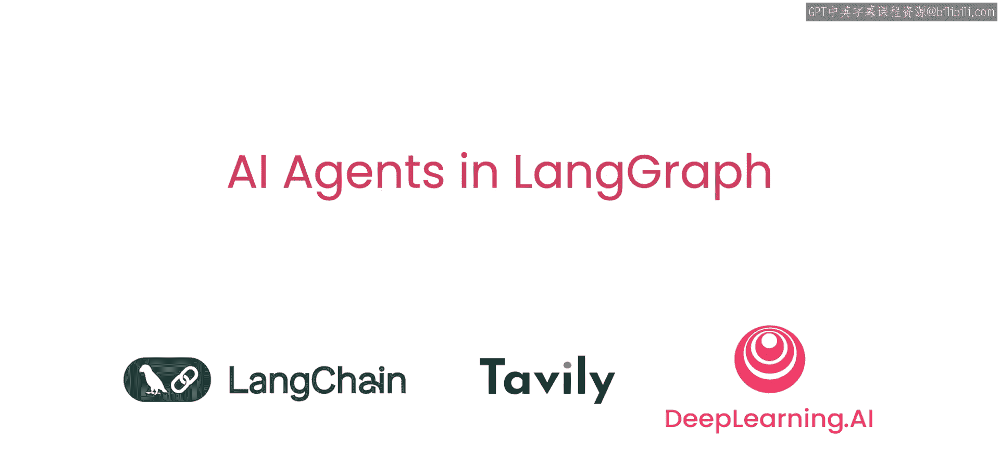
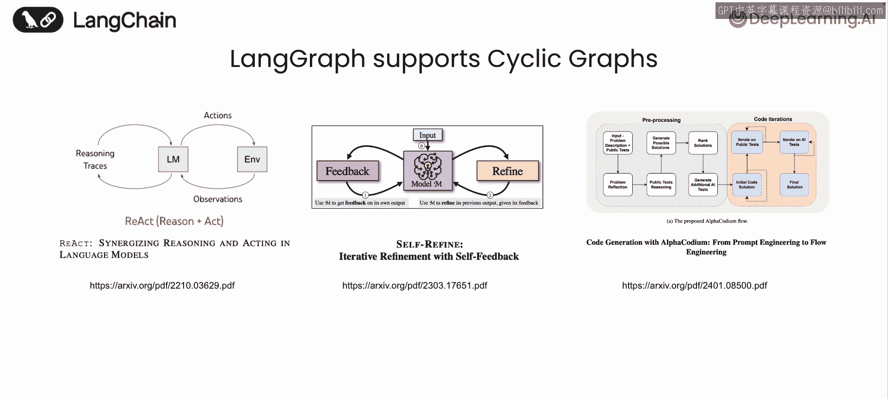
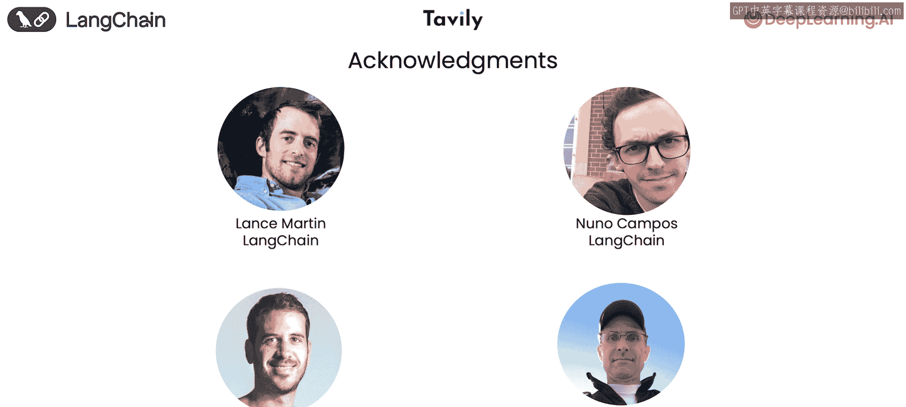

# 吴恩达&langchain《用LangGraph搭建智能体｜AI Agents in LangGraph》【短课英字可关】 - P1：1.introduction.zh - GPT中英字幕课程资源 - BV1bi421v7oD

Welcome to AI agents in Landra built in partnership with Landcha and Tivalli。

 taught by Harrison Chase， cofounder and CEO of Landcha， as well as Dton Wece。

 who is cofounder and CEO of Tvalli。 Harrison， it was not quite a year ago that were working on first calls on OM frameworks。

 And back then we had an agent example， but yeah， it was a little bit of a struggle to get to work since then I've seen many teams successfully built AI agents。

 what was your view on that。 Yeah， that's exactly right， Andrew。

 we've seen many people successfully building a gen applications now。

 And I think there were a couple of key improvements over the last year。

 First function calling LMs have made tool use much more predictable and stable And also specific tools like search have been adapted for a gen use。

 Yes， if you think about it when it query search engine。

 it will return multiple links that you can then follow the finance answers。However。

 what an agent really wants are answered that you can then reference to the link。Also。

 the agent needs predictable format for its results。This is exactly what agent search provides。

 That makes sense。 And by the way， I'm personally a user of Lain and Langssmith and to least some for the excitement of both of you here。

 and let me start by describinging agents and agent workflows。

 Let's say that the few of us are going to write a paper together。

 Maybe I was start with some planning and try to put together an initial outline of the paper Yeah and I can take it from there and do some research。

 maybe run some queries and compile documents related to our topic。😊，Okay， I。

 I guess that leaves me to write the first draft。 They hope it's not a long paper。 Yeah， short paper。

 hopefully。And then after that， I might read over the paper。

 try to make some constructive suggestions and hand it back to Harrison to see if he wants to make some changes or the real terms to see if he wants to do some search and so on。

And this would be an example of an agent or an agent like workflow in which we iterate to produce the work product。

And in contrast to how people often use OMs to write essays today。

 which is to write a prompt and toM write the essay from the first word to the last word in one shot。

 this type of iterative workflow gives a much better work product in fact as a person I don't write that well if you force me to just write from start to finish with no back facing allowed。

So concretely， you can similarly prompt an LM to tell it to write an outline。

 prompt an LM to write a draft or revise it， prompt an LM to do search and so on。

 but to dive a bit deeper， let me share what I think are some of the key design patterns of agent workflows。

First， I think there's planning， which is thinking through the steps to take like the outline and what to do after that。

Then to use knowing what tools are available and how to use them， like our search tool。Reflection。

 which refers to iterative the improving a result， possibly with multiple LOMs critiquing and making useful suggestions to drive that type of editing cycle。

 multi agentent communications， so you can think of each of us as playing a role akin to an LOM with a unique prompt to play a unique role in this process。

And then memory now is tracking the progress and results over the multiple steps。

Now some of these capabilities are related to the LM itself like function calling for two use。

 but many of these capabilities are actually implemented Al DLM by the framework that they operate in Exactly and the L training framework has had many of these elements for some time Mem is available in multiple forms supporting function calling LLMs and tool execution are available and we talked about this in the last deep learning class we did functions。

 tools and agents course。But LangChain has recently updated its support for agent workflows。

 Here are some examples of agents that we now better support。

 So react agents was an early paradigm for building agents and react stands for reasoning and action。

Another example that we recently added support for is the example presented in the self refined paper。

 where it does the iterative refinement that you were talking about。And most recently。

 you can see the Al codedium example， which creates a codeine agent using flow engineering。

 and from all these diagrams， you can see that these agents and their behavior is defined by a cyclical graph。

And so to support directly building agents like this， Laang chainin has extended to support La graph。

In this course， you will start by building an agent from scratch with just an LLM and Python。

 then you'll learn about the components of Lagraph by rebuilding that same agent using the Lagra components directly。

Since search shows are such an important part of many agent applications。

 you will learn the capabilities of agentant search and how to use it。

There are two additional capabilities that are helpful when building agents first is being able to receive human input。

 This allows you to guide an agent at critical points。The second is persistence。

This is the ability to store the current state of information so that you can return to it later。

 This is great for both debugging agents and for productionizing them。

We will build a project using La graph， but you'll have to reach the last lesson to figure out what it is。

 and at the end， I'll describe some of the cool applications and feature directions I see for this technology。

Many people have worked to create this course from Landchain。

 I'd like to thank Lance Martin and Nuunno Campos from Tivli。

 our South Eloic and from Deep learninging AI Jeff Ladwig。 Alright。

 we don't want to keep those agents waiting。 let's go on to the next video to get started。

