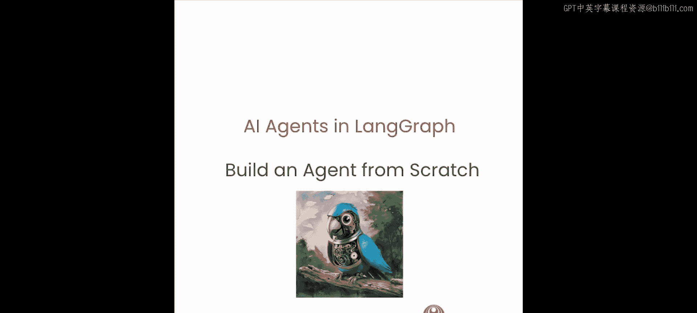
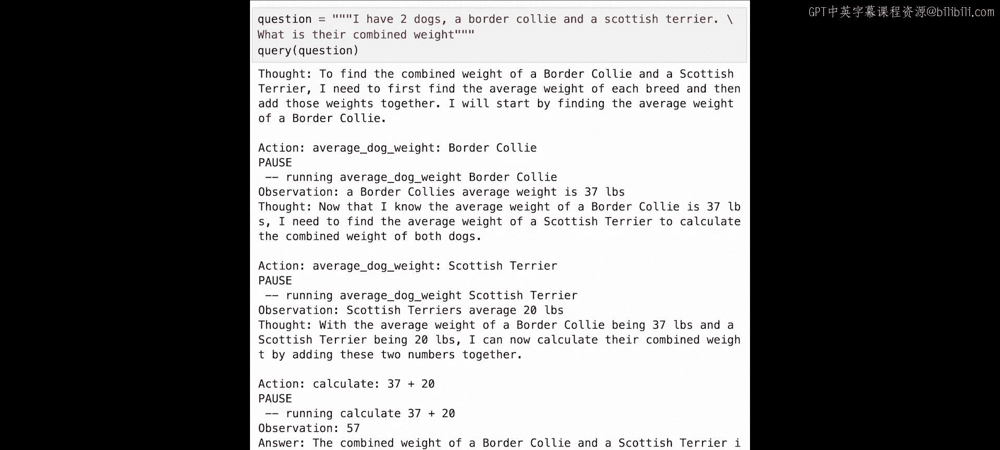

# 吴恩达&langchain《用LangGraph搭建智能体｜AI Agents in LangGraph》【短课英字可关】 - P2：2.Lesson 1 Simple ReAct Agent from Scratch.zh - GPT中英字幕课程资源 - BV1bi421v7oD

In this lesson， we'll build an agent from scratch。 You'll see that while agents can do fairly complex tasks。

 a basic agent is actually not that hard to build。As we're building this agent。

 it will be useful to notice what jobs fall to the LLM and which are managed by the code around the LLM。

 what we call the runtime。

Let's dive in。The agent we're going to build from scratch is based on the react pattern。

 Re stands for reasoning plus acting。 So in this pattern， an L L M first thinks about what to do。

 It then decides an action to take。 That action is then executed in in environment and an observation is returned with that observation The L L M then repeats。

 So it then thinks about what to do again。 decides another action to take and continues intel。

 It decides that it is done。The code that we will be using to start with is based on this blog post from Simon Wilson。

 It's a great introduction to implementing the react pattern in Python。To get started。

 let's import everything we need。We can then initialize the language model for this。

 we will use Open AI。Let's try it out once just to make sure that it's working。

We can see that we pass in hellello world and get back， Hello， how can I assist you today？Great。

 we're set up and running with our language model。 Let's now create the agent。

We'll start by creating a class for the agent。Well want this agent to be parameterized by a system message。

 so will'll allow the user to pass that in。 We'll then save that as an attribute。

We'll also keep track of a list of messages over time。

 This is where we will append everything that happens in that react loop。And to start it off。

 if there is this system message， we're going to append a system message in this list of messages。

Okay， great， so our agent can now be initialized， but what exactly is it going to do？

Let's implement the call method for this agent。What we want this method to do at a high level is to take a message that comes in。

 that is a string and then append that message to the existing array of messages。

We'll then execute a function。 We'll implement that right down below。

 and we'll then take the result of that and add a new message into the array of messages this time coming from the assistant。

So let's implement that execute method。In the execute method。

 this is where we call the open AI client that we initialized above。

 So we'll be using this G 4 model。 We'll be setting temperature equals to 0。

 This will make it very deterministic and we'll pass in this list of messages that will accumulate。

 We'll then have this method return the content or the string of the message that it gets back from the model。

 So this is our agent。Awesome。Now， let's get started with creating the react agent。

 The react agent is going to require a very specific system message。

 So let's go ahead and write that out， and we can take a look at that in detail to see exactly what we're doing。

Let's take a look at this prompt in more detail。 So we're asking it to run through this loop of thought。

 action pause and observation。 I can then output an answer when it's finished with that loop。

 It will use thought to describe its thoughts about the question it's been asked。

 It will then use action to run one of the actions available to it。

 and it will then return pause After that， observation will be used to signal the result of running those actions。

We then tell it what the available actions are。 So we give it access to calculate an average dog weight。

 and we'll implement those down below。 Finally， we then provide an example of this in action。

 This example is really helpful for helping the language model understand in a little bit more specific detail how exactly it should be doing things。

 And we can see here an example trace， incoming question and then a thought and then an action than pause。

And then it gets back in observation， and then we'll tell it to output， answer。

We now need to provide the two tools that we mentioned above。 So we have a calculate function。

 and this just takes in a string， and it will eval that string。

 And then we have this average dog weight function。

 And we're going to mock it with some returns for Scottish terrier border collie， toy poodle。

 and then we'll create this little dictionary that maps the name of the function to the function itself。

 And we'll see how we'll use this down below。 Note that these functions are just a toy example。

 And in your real use case， These are going to be more specific to the problem that you're trying to solve。

Let's now try it out， let's initialize the agent with the prompt that we created above。

Let's then call it once with this initial question， how much does a toy poodle weigh？

We look at the result and we can see that there is a thought action and pause。

 so the thought is I should look up the dog's weight using average dog weight for a toy poodle。

 it then outputs in action and this is all one string， but the second part is outputting this action。

 average dog weight， toy poodle， and then it says pause。

What this means we should do is that we should look up using average jog weight。

 how much a toy poodle weighs。 And so let's do that。We get back this string。

 and this is just what we mocked out above。We can now format that into the next prompt to pass to the language model。

And then we can call the agent with that next prompt。Doing that。

 we see that we get back answer a toy poodle weighs seven pounds。

If we want to see more details about what exactly has been going on。

 we can take a look at the message attribute on the agent。

We can see that we first have this system message and this is the long prompt that we wrote out above We then have our first question how much does a toy poodle weigh。

 we then have this response from the language model which tells us to take this action。

 we then have our user message representing this observation saying how much a toy poodle weighs。

 and then we have the final assistant response， which says our final answer that a toy poodle weighs 7 pounds。

Let's try this again with a different example in order to do that。

 we're going to need to reinitialize the agent in order to clear all the messages that have already accumulated。

We're going to ask it a more complicated question this time。 I have two dogs。

 a board collie and a Scottish terrier。 What is their combined weight。

We can see that first thought is a really good plan。

 It realizes that it first needs to find the average weight of each breed and then add those weights together。

 And so the first action that it takes is calling average dog weight with border collie。

Let's execute that action and create the next prompt。I can now call the agent on this next prompt。

 I can see that it responds that we now need to take a different action。

 We need to call average dog weight with Scottish terrier。 So let's do that。

We do that and create another prompt， which we can again pass to the agent。This time。

 it tells us to use the calculate method。With 37 plus 20。 Okay， great。 Let's run that action。

We run that action， and we get back another prompt。

 which we can pass yet again into the agent doing that。 We get back a final answer。

 The combined weight of a border callingy in a Scottish terrier is 57。

Now that is output the answer string， we know that it's finished。 So this is great。

 We have a tool calling agent， but it's still a little bit manual。 Let's automate it。

 Let's put it in a loop。The first thing I'm going to do is create this rex for looking for the action string。

 This is going to let us parse the L LM's response and determine whether we want to be taking an action or whether it's the final answer。

Let's now create this query function。 This is going to take in a question and run the same process that we just ran manually。

 I'll add this max turns parameter so we can control how long this runs for。

We can then start a counter to keep track of how many iterations we've done。

We can initialize an agent with the default system prompt。We can then define a query function。

 which we'll use to run this loop。 It'll take in a question。

 and we'll also let it take in this max turns parameter。

 which will control how many iterations the agent can run for。We'll start a counter。

 and we'll set this to 0。 We'll create a new agent by initializing the agent class with the default system prompt。

 We'll also create this next prompt variable to keep track of what we should be passing to the agent and set this equal to the original question in order to start。

 Let's now start our loop。So while our counter is less than max turns。

 we'll first increment the counter， and then we'll call the agent and get a result back。

Let's add a print statement just to see what that result is。We'll then use the rex。

That we created above in order to parse the response from the agent。

 and we'll get back a list of actions。Here's where we will decide what to do based on the response。

 So if there are any actions， we're going to add some logic to take those actions and get back a response。

 If there aren't any actions and this happens when the agent outputs answer。

 then we're going to return and end the function there。 So what exactly are we going to do。

 if there are actions to take。First， we're going to get the action and the action input。

 so the action is the function to call and the action input is the input to that function。

So we'll get those two things， and then if we see an action that's not in our list of known actions。

 we're going to raise an exception， this should never happen。

 but we'll do this check and raise this exception just in case。

 and let's print out what exactly we're going to be running here。We'll now get the observation。

And so we'll do this by first， looking up。In the action dictionary， the action that we should take。

 And so this action is a string right here。 We're looking it up in this dictionary。

 and we're going to get back a function。 We're then calling that function on the action input。

 And the result of that is what we're saving as observation。

Let's print out the observation just for some debugging， and then let's also create the next prompt。

 what will send to the language model the next time。

 And this is just a string with observation and formatted with the observation that we got back from the agent。

All right， let's call this on the complex question that we had above and see what happens。

We can see that it first thinks about what to do。Outputs in action， calls it。

 gets back in observation， thinks about what to do again， gets another action。

 thinks about what to do again， gets another action， and then finally it comes up with this answer。

That was a lot easier than running it by hand。That shows how we can create an agent using nothing but the raw LLM API and some Python code。

In the next lesson， we'll take this same agent and show how to implement it using Lang graph。

See ya there。