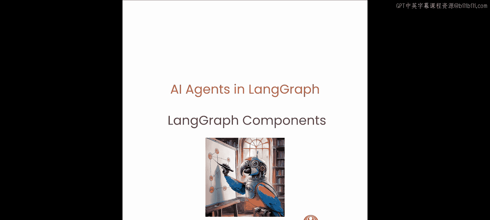
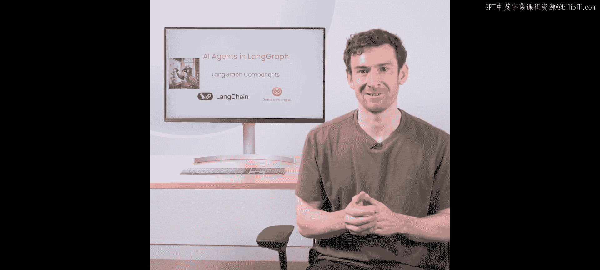
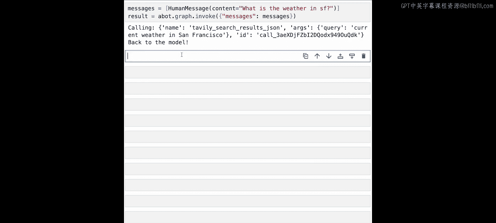
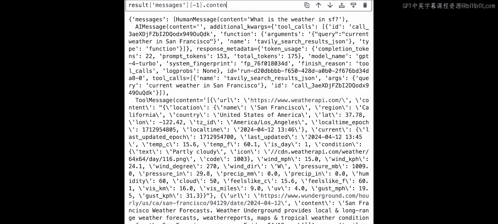
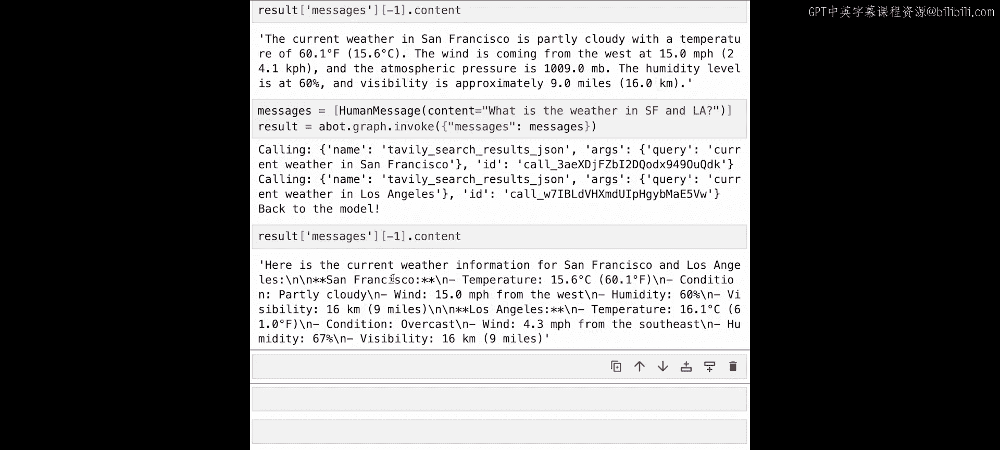
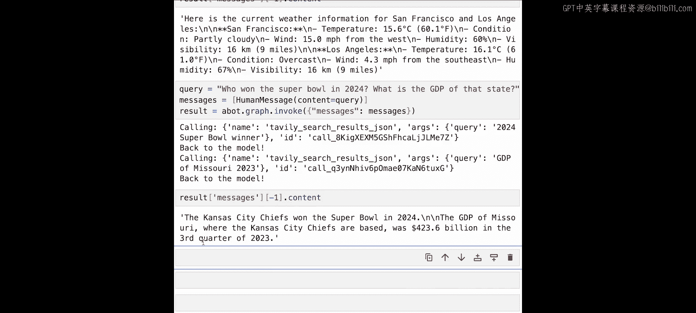

# 吴恩达&langchain《用LangGraph搭建智能体｜AI Agents in LangGraph》【短课英字可关】 - P3：3.Lesson 2  LangGraph Components.zh - GPT中英字幕课程资源 - BV1bi421v7oD

In the last lesson， you built an agent from scratch。Now let's implement the agent using the La graph。

And along the way， introduce some of its components and features。All right， let's get coding。

All right， so let's break down what exactly we did in the last lesson。

We had this user message that came in。 We then had this system prompt。

 and this was this very long one。 We then called an LLM with that。

This outputted something like what's right there， a thought and an action。Based on that。

 we then made a decision， we would either return or we would call it tool。

And we put this all in a big loop， this query function。

And we had these two tools that we would call calculate an average dog weight。

And if we called the tool， we would get back in observation。And then we' loop back in。

To the prompt and would put that observation as a new message。

So let's break this down into lane chain components。 First， let's talk about prompts。

 So prompt templates allow reusable prompts。 And what this basically means is that we can create something like this right here。

 A little stirring with some formatted variables that we can replace。

 And so those formatted variables can come from user content so we can have this prompt template that we format in different ways depending on the user content。

 If you want to see a bunch of examples of these prompt templates。

 You can actually see them in the lane chain hook。 So here is one that's very similar to the agent prompt that we just used。

So you can see here it says answer the following question as best you can。

 you have access to the following tools， and here we don't hard code the tools themselves。

 but we have this little variable and same with tool names down here。

 and then we have the input here and this is the user question and then the agent Sc padd and these are all the actions it takes and the observations。

If you want to see more prompts， you can go to the H here and you can see a bunch of prompts that people in the community have contributed。

The next component in La chain that we have is tools。So here's a tivli tool。

 and this is the search that we will be using from here on out。

 You can see that we import it from the Lngching community package。

 which contains hundreds of other tools。Maybe the biggest part of this application。

 the most code that we wrote was this function that would loop。

 And that's represented by all these arrows here。 And that's one way to think about Lnggraff。

 Langgraff helps you describe and orchestrate that control flow。 Specifically。

 it allows you to create cyclic graphs， which is exactly what we have here。

 It also comes with built in persistence。 And this is really nice for having multiple conversations at the same time or remembering previous iterations and actions。

 This persistence also enables really cool human in the loop features。😊。

If you look at these diagrams here， and these are all diagrams of agents from academic papers。

These are all represented as graphs。 And that realization was what LED us to create link graph。

 an extension of lane chain， specifically aimed at agent and multi agent flows。 Crucily。

 it allows for really controlled flows。 So in these diagrams。

 there's really specific arrow is leading from one box or state to the next。

 We've seen that this controllability is crucial for creating agents that can perform well。

Three of the core concepts of Lagra are nodes， edges， and conditional edges。

Notdes are agents or functions。Edges connect these nodes。

 and then conditional edges are used when you need to make decisions about which node you should go to next。

So let's take a look at an example of the lane graph you can create that is equivalent to the function that we wrote in the lesson before。

 We can have an agent node。 This is the LLM， We can then have a conditional edge。

 which takes the result of that LLM call and decides what to do next。

 One of those edges can be an action edge， which calls a function node。

 and that automatically loops back to the agent node。There's an entry point which is where you start。

 and then there's the end node， which is the other action available to take after the agent。

One of the most important things to understand when working with Langgra is the state that is tracked over time。

 This is often called the agent state。 This is accessible at all parts of the graph at each node。

 in each edge。It is local to the graph， and it can be stored in persistence layer。

 meaning that you can resume with that state at any point in time later on， Looking at two examples。

 we first have a simple state where we just have this list of messages。Taking a closer look。

We can see that this message variable is a sequence of base message。 B message is a lane chain type。

 It's annotated with operator dot addd。 This means that when the state is updated with new messages。

 it doesn't override the existing messages， but rather， it adds them to that state。

Let's take a look at a more complex state。Here we have input， chat history。

 agent outcome and intermediate steps。 They all have their own different type。

 Three of them are not annotated in any way。 This means that when a new update is pushed to that variable。

 it overrides the existing value there。 However， intermediate steps is annotated。

 It's annotated with operator dot add， which means that when a new update is pushed there。

 it adds to it。 This makes sense because intermediate steps is what is tracked as the agent action and agent observation throughout the graph as it executes。

 And so we want to continuously add to that as more and more actions are taken。

Getting really specific about the previous agent that we created and how that would map to a La graph object。

 we can see that we will have one node。 We'll call this call open AI， and this will call the L M。

 We'll then have a conditional edge， which willll check for the existence of an action to take。

 And so we'll call this existence action。 And then we'll have another node。

 which actually executes that action。 We'll call that take action。

 And the state that we'll track is pretty simple。 It's just this list of messages to which we add over time。

 with that high level overview。 Let's dive into the code。😊。

Let's first load in any environment variables that we're going to need to use。

 this is our open AI API key。We're now going to import a bunch of things that we need to create these tools。

 Age state and the la graph itself。 First， let's import state graph and this end node from La graph。

 We'll see how we'll use those later on。 These typing imports and operator are used to construct the agent state。

 We then have all these different message types。 These are lane chain message types that we'll use to represent the human N AI and system messages。

From Lang chain Open AI， we're going to import chat Open AI。

 This is a L chain wrapper around the Open AI API。 This exposes a standard interface for all language models。

 meaning that even though we're going to use chat Open AI for this lesson。

 we can actually switch it out for any of the language model providers that L chain supports without having to change any other lines of code。

 Finally， we're going to import to Vily， the search engine that we're going to start using as the tool in this example。

Let's first take a look at the tool。We'll create the tool by initializing Tvili search results with max results equals2。

 this means that we'll only get back two responses from the search API。

We can see that it's of this type and it's got a specific name to Vily_ search， underscore results。

 underscore JSO This is the name that the language model will use to call this tool。

Let's now create the agent state， this is exactly what was in the presentation。

 it's just an annotated list of messages that we will add to over time。Let's now create our agent。

As discussed， we're going to need three functions。 We're going to need one function to call open AI。

 one function to check whether there is an action present and another function to take that action。

 These will all be different methods on this agent class。 So let's create those first。

 and we can then see how they interact with each other。Let's now create the agent class。

We're going to want this agent to be parameterized by three different things。

 a model to use the tools to call and the system message。 As before。

 let's save the system message as an attribute。We're now going to start creating the graph first。

 let's initialize state graph with the agent state。Right now this graph is pretty bare。

 it doesn't have any nodes or edges attached to it。

 We know that we're going to want to create those three functions before and use them two as nodes and one as edges。

 so let's sketch it out and then we'll implement those functions as methods on the class。So first。

 we know that we're going to want to create a node called the LLM， which will execute the LLM。

 and we can do that by doing graph。Add node。LLM。And then we're going to need to come back here and we're going to need to pass in the function that we want to represent this node。

We'll add another node， the action node will do the same thing here。

Now we're going to add that conditional edge。This goes after the LLlum is called。

 It checks whether there's an action present。 If there is， then it goes to the action node。

 If there isn't， then it goes to the end node and it finishes。 So let's add this again。

 We'll have to add the specific functions later on。

The first argument we pass in is the node where the edge starts。 This is from LLM。

The second argument we pass in is the function that'll determine where to go after that。

 we're going to implement this later on， so we'll leave this blank。

The third and final argument that we're going to pass in is a dictionary representing。

How to map the response of the function to the next node to go to。So if the function returns true。

 then we're going to go to the action node， if it returns false。

 then we're going to go to the end node。We're now going to add a regular edge。

 this is going to go from the action node to the LLM node。So we can do this by calling add edge。

 the first argument is the start of the edge， the second argument is the end of the edge。

We're then going to set an entry point for the graph。 This is at the LLM node。With that done。

 we can compile the graph graph that compile is just what we need to call after we've done all this setups and we'll turn it into a lane chain runable。

A lane chain runable exposes a standard interface for calling and invoking this graph we'll see more about that later on。

 we'll save this as an attribute on the class。We'll also save the tools and the model that we passed in。

For the tools， we'll create a dictionary， mapping the name of the tool to the tool itself。

For the model， we'll actually call bind tools on the model。

 passing in the list of tools that we passed into the agent。

 What this is doing is this is letting the model know that it has these tools available to call。

 All right， So we've created this graph， but we still need to create three things。

 We need to create the function representing the LLM node。

We need to create another function representing the action node。

 and we need to create a third function representing this conditional edge。

We'll add all of these as methods on this agent class。For the LLM node。

 we're just going to create a function called call Open AI， it's going to take in this state。

 this agent state， all the nodes and the edges will take this in。

What we'll do is we'll get the list of messages from the state。

 We'll then add in this system message and we'll then call the model。

 We'll then return this dictionary。With a list of messages， but there's only one message in it。

 It's the message that's returned from the model。 Again， remember， because we had annotated。

The message is attribute on the agent state with the operator。 ad， this isn't overr this。

 it's adding to that state。We can then go back to the graphth add node and change that to pass in this method Let's now do the same for the action node。

The action node will also take in this agent state。

 We'll get the last message from the list of messages。We know that if we've got to this state。

 the language model must have wanted to call some tools。

 That means that there will be this tool calls attribute present on the last message in the agent state。

 Crucily， this can actually be a list of tool calls。 So a lot of the more modern models。

 support parallel tool or parallel function calling。

 What we can now do is we can loop over these tool calls。

 We can find the relevant tool by looking up tool name in in the dictionary of tools that we created。

 We can then call invoke on it， passing in the arguments that we have from this tool call。

 We can then append this as a tool message to this results list。

 And then we're returning this messages。Mapping into this results thing。 Again。

 this is just the new messages that we need to add。

 What's happening under the hood is that Langgraff is adding that to the state in between iterations。

 Let's go back up and let's put this here， in the action node。Finally。

 we need to define our conditional edge。So this is what's going to take in the result after the LLM is called and return a bullolean either true or false。

 representing whether we should take in action or whether we shouldn't。In order to do that。

 we're just going to get the last message from the state。

 which is the most recent call from the language model。

 And we're going to return length of that message dot tool calls greater than 0。 So basically。

 if there's any tool calls， we're going to return true。 If there's none。

 then we're going to return false。 Let's set this as the conditional edge。

And with that we have our agent， so let's start to use it。

We created a nice little system prompt here， we initialized chat Open AI。

 so this is the language model we're going to use， and for our list of tools that we're passing in we're just passing in our one our Tiv search tool。

One of the cool things we can do is we can actually visualize this graph we just created。

So if we get the graph and then called docket graph and then dot draw PNG。

 we actually get an amazing visualization of the graph itself， this is all done automatically。嗯。

So let's now call this agent， So let's first call it with this what is the weather NS SF question in order to do this。

 we're going to create this human message representing a user message。

 we're then going to put it in this list of messages and note that we have to do this because the state that the agent expects to work with has this messages's attribute which is a list of messages so we need to make it conform with that state。

Once we have this input， we can call the agent。 graphph。invoke with this。

And we can get back a result。So we added some print statements in the agent。

 and so we can see that it printed out what it was calling and it was calling to Vily search results JO。

 and it was calling it with current weather in ESAT in San Francisco。

 and then it prints out back to the model， this means we're going back to the model if we look at result。

If we look at result， we can see that it's a list of messages。

 So result is the final state that the agent ended up in。

 If we just want to get the final message in this list of messages。

 we can go into the messages attribute。

Get the last one and look at the content attribute and we can see that the current weather in San Francisco is partly cloudy。

 blah， blah， blah。Let's now try this with a more complicated question。

 so what is the weather in SF and LA？We can see that it first calls to Vily search results Json with the current weather in San Francisco。

 Then before even going back to the model， it calls tovily search results JO again with current weather in Los Angeles。

 This is an example of parallel function or tool calling。 Finally， it goes back to the model。

 And after that， it has all the information it needs。 So it responds。

 And if we look at the final message。We can see that we get back a response from both San Francisco and Los Angeles。

Let's try an even more complicated question， who won the Super Bowl in 2024。

 what is the GDP of that state？We can see first it calls to Vi with the Quarry 2024 Super Bowl winner。

It then goes back to the model。 It then calls to Vily again。

 This time with the query GDP of Missouri 2023， it then goes back to the model。 And finally。

 it's done。And if we look at the final response， we can see that we get the Kansas City Chiefs won the Super Bowl in 2024。

 the GDP of Missouri， where the Kansas City Chief start based， was 400。

 something billion in the third quarter of 2023。So the difference here is that in order to make the second query。

 it actually had to know the result of the first query。So it calls one tool。

Then goes back to the model in order to enable to call the second tool。

 This is a little bit different from parallel function calling。 It's not happening in parallel。

 It's happening sequentially， And the reason it's happening sequentially is it actually needs the result of the first query in order to make the second query at all。

With this， we've seen how we can take that raw LLM and raw Python example with some fake tools and turn it into a real agent that can answer complex questions under of the hood it's using the Tvili Search API。

In the next lesson， we'll learn a lot more about that。

