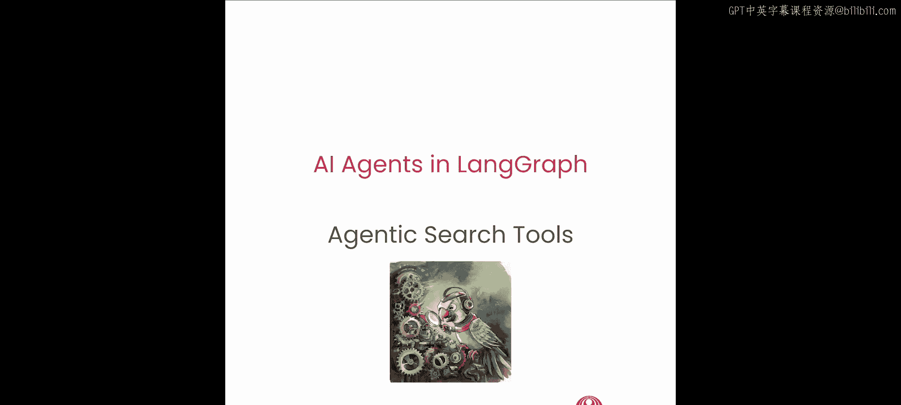
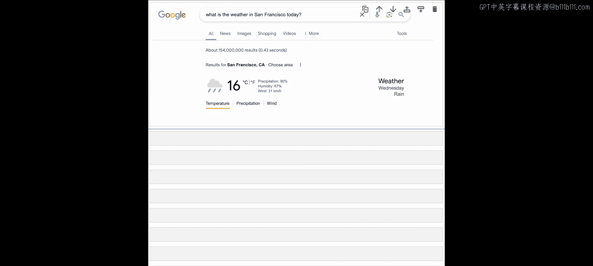

# 吴恩达&langchain《用LangGraph搭建智能体｜AI Agents in LangGraph》【短课英字可关】 - P4：4.Lesson 3 Agentic Search.zh - GPT中英字幕课程资源 - BV1bi421v7oD

A frequently used tool an agenttic search， this lesson is going to dive into how atic search is different from standard search and how to use it。

 Let's try it up。

Right， so before diving into what an agenttic search does。

 let's understand how an agent might use it。In a zero shot learning。

 an agent would receive a prompt and would produce an answer based on hiss static weights of the model。

As powerful as it proven to be， there are many limitations to this process。First。

 the data around us is dynamic。 so he couldn't， for instance。

 ask about dis course from the game last night。Secondly， in many use cases。

 we would want to know the sources of the information provided in the result。

 This can reduce hallucinations and smoothff friction of this human computer interaction。

Looking at the slide， we can see the prompt is received by the agent。

 which then decides to call the search show。 Then the information found is returned to the agent。

 Now， let me show you what happens inside。This is an example of a very basic search tool implementation。

 Let's go over it step by step。 If the agent decides it will send a query to the search tool。

 The first step would work on understanding the question and divide it to sub questions， if needed。

This is an important step because it can handle complex queries。Then for each sub queryry。

 the search tool will have to find the best source， choosing from multiple integrations。 For example。

 if an agent would ask， how is the weather in San Francisco。

 the C tool should use a weather API for best results。

The job doesn't end with finding the correct source。 The search， tool。

 would then have to extract only the relevant information to the subquer。

 A basic implementation of this can be achieved through a process of chunking the source and run a quick vector search to retrieve the top gate chunks。

After retrieving the data from each source， the search tool would then score the results and filter out the less relevant information。

 Okay， so let's test it out。Okay， so first， let's import some libraries and do the initial connection to the search tool。

Here we loaded T V API key from the environment variables。And then we create the Tli client。

Which we imported from the Tvide library。Alright， so after creating the initial connection。

 let's test it out。Here I'm going to run a search， asking about anious new black old GP P。

 And let's see what's the answer。Alright， so as you consider a pretty simple answer。

 but very accurate。Okay， so let's do a simple example to see the difference between a regular search tool and an agentic search tool。

 I'm going to create a simple query about the whether in a certain location。

Feel free to change the location to your location。 I'm going to do it with San Francisco。

So the query is what is the current weather in San Francisco should I traveled there today？Now。

 let's try to attempt it with regular search。Here I'm going to import the D G search。

 I'll try to run a regular search and get the links， the links that might lead me to the answer。Okay。

 so as you can see， we did get the results， but it's not what the agent need。 Now。

 we're going have to get some answers from these results。Let's do that。Okay。

 so now we're going to create a function that' going to scrape the data from the first URL。

 We're going to use beautiful soup to extract the HTML。As you can see， that's a beautiful output。

 And if you want， you can keep scrolling down。But let's try to clear it up。Okay， to clear it out。

 I'm going to use some parsing。 I'm going extract the headers and some content。

 I'm going to strip it down and use join to get the text。As you can see， the output is much。

 much better， but still not concise enough。Okay， after seeing this。

 let's try to run it using the agenttic search tool。

 we're going to do the same query and call tabvi to get us the results。As you can see。

 we get a simple Jason。With a lot of information about the weather in San Francisco。

Let's clear it out so we can see a format adjacent。Okay。

 now we parsed and highlight the JO just so we can see it clearly。As you can see。

 this is not the answer I would want to see as a human。

 but this is the exact answer an agent would want a structure data。Okay。

 I'm going to load the sample from Google search so we can see the difference。

Here I get exactly what I want as a human。A nice image showing me the temperature， the humidity。

 the wind。But not unnecessary data。That's exactly the difference between what a human need and what an agent need。

O， that was an introduction to agent search。 In the next lesson。

 Harrison would discuss persistence and streaming。

