# 吴恩达&langchain《用LangGraph搭建智能体｜AI Agents in LangGraph》【短课英字可关】 - P5：5.Lesson 4 Persistence and Streaming.zh - GPT中英字幕课程资源 - BV1bi421v7oD

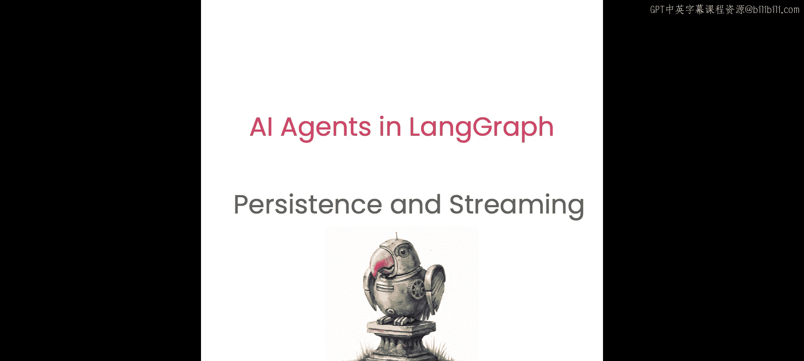

When building agents， they're often working on longer running tasks。For these types of tasks。

 there are two really important concepts， persistence and streaming。

Persistence lets you keep around the state of an agent at a particular point in time This can let you go back to that state and resume in that state in future interactions This is really important for long running applications。

Likewise， with streaming， you can emit a list of signals of what's going on at that exact moment。

 so for long running applications， you know exactly what the agent is doing。

Let's see these concepts in action。

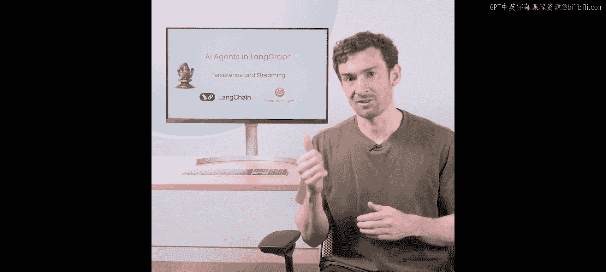

So to get started， let's create our agent as we did before。

Will load in the appropriate environment variables。We'll make the necessary imports。

We'll create our Tivli search tool again。We'll create our agent state。And finally。

 we'll create our agent again。Now we're going to add in persistence。

In order to deal with persistence， we've added the concept of a checkpointer into Lagra。

A checkpointer basically checkpoints the state after and between every node。

To add in persistence for this agent， what we'll do is we'll use a SQL light saver。

 So this is a really simple checkpointer that we've added that uses SQLite。

 a built in database under the hood， and we'll just use the inmeory database。

 So if we refresh this notebook， it'll disappear。 but you can easily connect this to an external database。

 or we also have other checkpointers that use Redis and Postgres and other more persistent databases like that。

😊，Once we initialize this checkpointer， the way that we can use it is we're going to pass it in。

To graph doc compile。 So in order to make this easy， let's add another parameter to agent。

 that is check pointner。And then we're just going to pass checkpointer equals checkpointer。

Right here， and we've modified our agent， this is all we're going to need to do。

We can now create our agent and we're going to pass in checkpointer equals memory and me the object that we initialized above。

When we use our agent now， we're also going to add the concept of streaming。

 And there's two things that we might care about streaming。 First。

 we might care about streaming the individual messages。

 So this would be the AI message that determines what action to take。

 and then the observation message that represents the result of taking that action。

 The second thing we might care about streaming is tokens。 So for each token of the LLM call。

 we might want to stream the output To begin， we're just going to start by streaming only the messages。

 We'll do the tokens later on in the lesson。So we're going to create our human message。

 what is the weather in SF， this is the one we ran before。

We're now going to add this concept of a thread config。

So this will be used to keep track of different threads inside the persistent checkpointer。

 this will allow us to have multiple conversations going on at the same time。

This is really needed for production applications where you generally have many users。

 This thread config is simply a dictionary with a configurable key， and as part of that。

 we have a thread ID， and we can set that equal to any string。

 here we're going to set that equal to one。We're now going to call the graph not within vogue。

 but with stream。 We're going to pass in the same messages dictionary。

 And we're also going to pass in this thread config as a second parameter there。

 We're then going to get back a stream of events。 These events represent updates to that state over time。

 because we know our state only has one key。 The messages key。

 We're just going to loop through it and print that out。 So let's run this and see what happens。

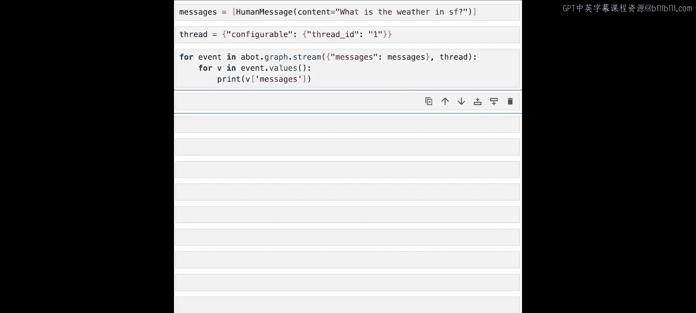

We can see that we get back a stream of results。

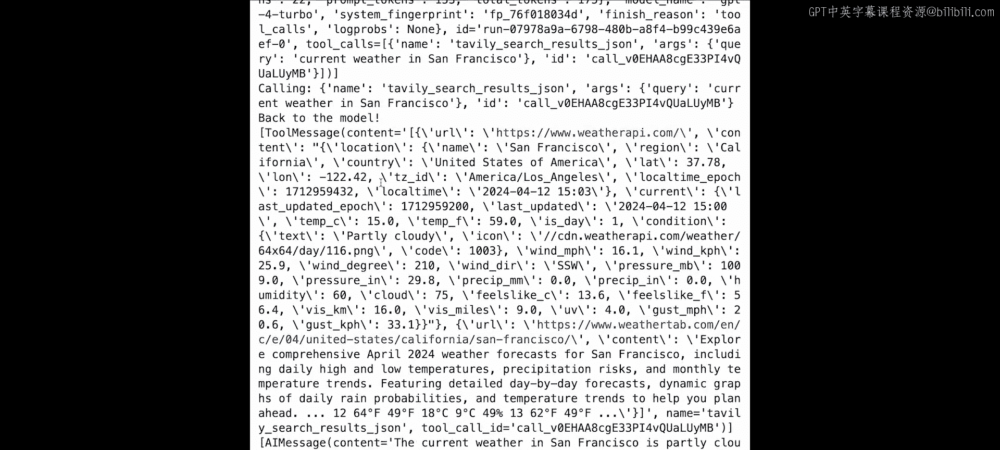

First， we get back an AI message。 This is the first result from the language model and it's telling us to call to Vily。

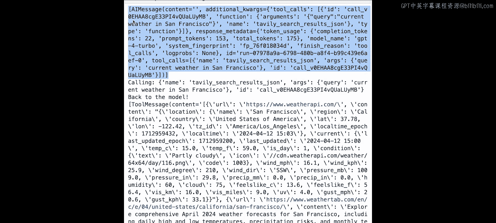

Next， we get back a tool message。 This is the result of calling to Vily。

 and it has the results from the search。

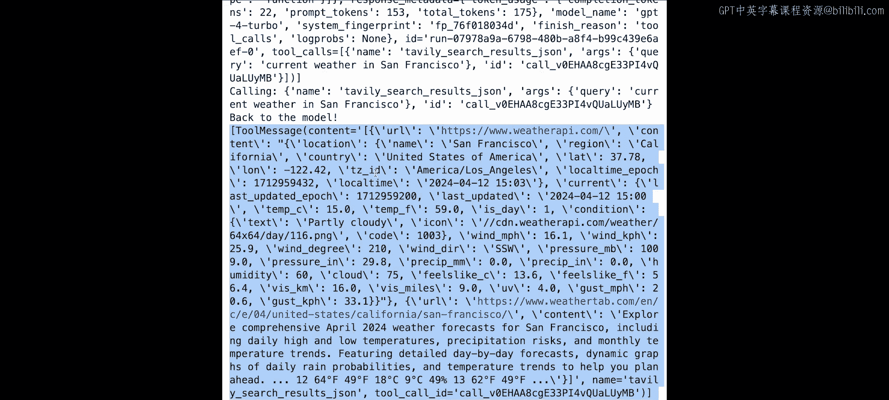

And finally， we get back a third A eye message。 This is the final result from the LLM answering our question。

With this stream method， we get back all of these intermediate results。

 and we have really good visibility into what exactly is going on。

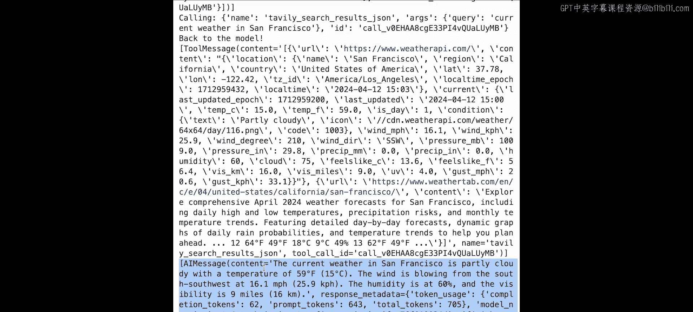

Let's now call it with another message。 This time we're going to say what about in LA A。

 So this is continuing the same conversation that we had before。 It's asking a follow up question。

 We don't say anything explicitly about the weather， but based on it being a conversation。

 we would expect it to realize that that we're asking about the weather here。

 in order to make sure that we're continuing from that same point。

 We're passing in the same thread I D here。

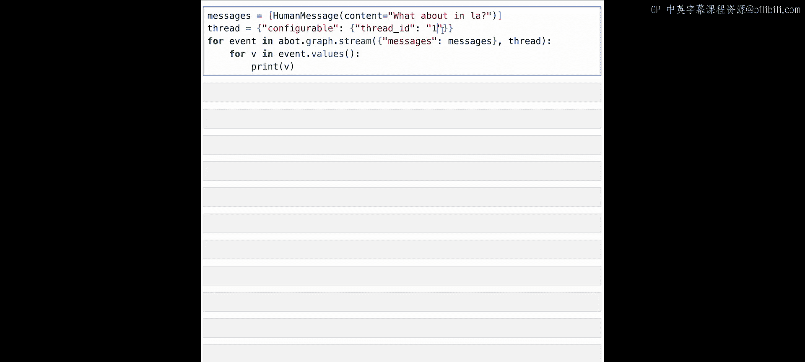

If we run this。We can see that it returns first a function call where it's looking for current weather in Los Angeles。

 Again， it's knowing that we asked about weather because it has this persistence from the checkpointer。

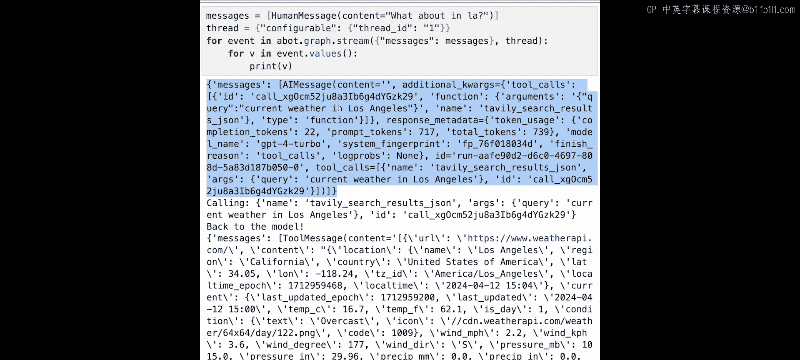

We can then see that it's getting back results from Tivli。

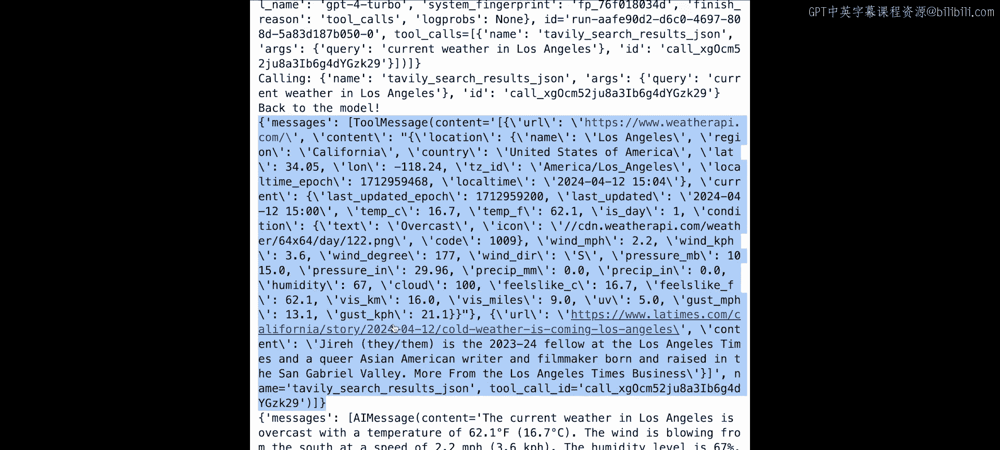

And finally， that is responding with an AI message that says the current weather in Los Angeles is blah。

 blah， blah。

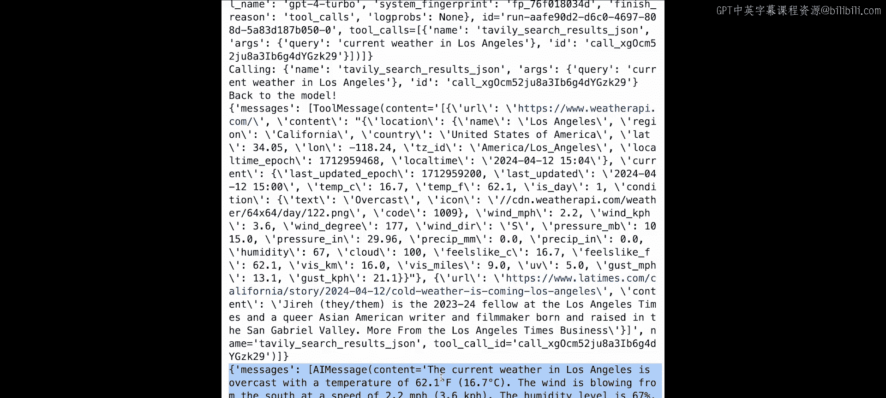

We can call this yet again using the same thread ID with the message which is warmer。

Here it has access to the full history so it can accurately respond Los Angeles is currently warmer than San Francisco。

Just to demonstrate the importance of this thread ID， let's change this。To be two。

 if we run this now， we can see that the language model is really confused。

 Can you please specify the two or more items you are comparing to determine which is warmer。

 That's because it doesn't have access to any history。

 and that's because we're using a separate thread I。

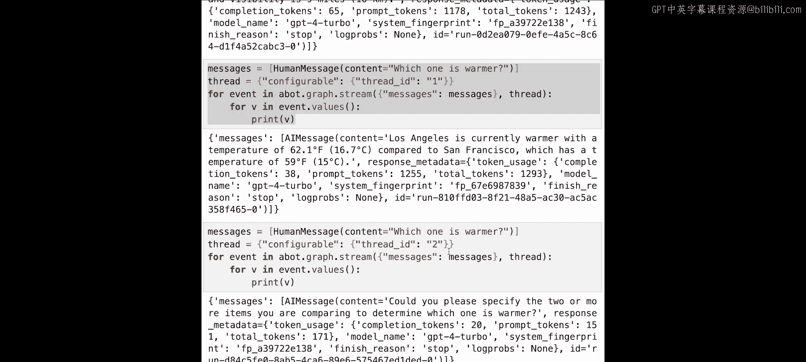

So we've covered the importance of persistence and we've showed how you can stream events。

But what about streaming tokens themselves？For that。

 we're going to want to use the A streamam events method that comes on all lane chain and lane graph objects。

AsStream Even is an asynchronous method， which means that we're going to need to use an async checkpointer。

In order to do this， we can import async SQelite saver and pass that to the agent。

 This is very similar to before， It's just swapping out a synchronous sQelite saver with an async sQelite saver。

 This allows us to use async methods on the graph。We'll use a new thread I D。

 so this will start the conversation from fresh。 We're also going to be iterating over a different type of event。

 These events represent updates from the underlying stream。

 What we want to do is we want to look for events that correspond to new tokens。

These kind of events are called on chat model St。When we see these events happening。

 we want to get the content andprint out and we'll print it out with this pipe delimiter。

 When we run this， we should see it streaming real time into the screen。

So we can see a few things here。 First， we can see that it called the function under the hood。

 The reason it didn't stream out anything there is there actually was no content to stream。

 It was just a function call。 But then we can see that when it did get to the final response。

 and it is returning a final answer， we stream out those tokens， one at a time。

 We can see that we've got this little funny pipe delimiter here。

 but we could easily remove that in our production application if we wanted to。😊。

So that's it for persistence and streaming。Pretty simple to get started with。

 but really powerful for building production applications。

 You're going to want your agents to be able to have multiple conversations at the same time and have a concept of memory so they can resume those conversations。

 and you're also going to want them to be able to stream both the final tokens。

 but also all of the messages that came before。Persistence is also really important for enabling human in the loop type interactions。

 and that's exactly what we're going to cover in the next lesson。

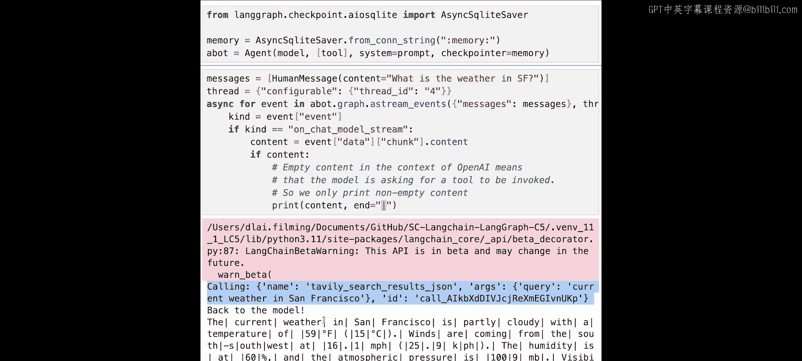