# 吴恩达&langchain《用LangGraph搭建智能体｜AI Agents in LangGraph》【短课英字可关】 - P6：6.Lesson 5 Human in the Loop.zh - GPT中英字幕课程资源 - BV1bi421v7oD

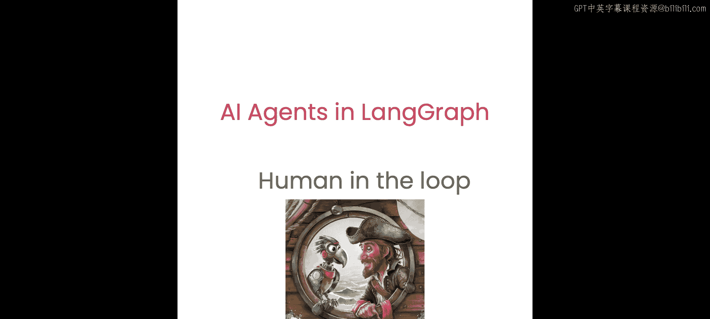

There are many occasions when you would like to put a human in the loop to keep tabs on what an agent is doing。

This is pretty easy to do with La graphra。

Let's see how this works。We're going to resume from where we left off in the last lesson。

So let's start by setting up our environment variables。From there。

 we can make all the relevant imports and set up our checkpointer。

We're now going to set up our agent state， and we're going to make one small modification。

In the previous example， we annotated the messages list with the operator。 ad。

That added messages to the existing messages array。 However。

 for these human in the loop interactions， we may want to actually replace existing messages。

In order to do that， we're going to write a custom reduced messages function that basically looks for messages with the same I。

 And if it sees that you're inserting one with the same I as one that already exists。

 it's just going to replace that。 Otherwise， it will append them。After that。

 we can create our same Tiv tool that we've been using。And we can create our same agent。

We're actually going to make one small modification。

So when we compile the graph in addition to passing in the checkpointer。

We're also going to pass this interrupts before equals action parameter what this is going to do is it's going to add and interrupts before we call the action node。

 so the action node is where we call the tools。And so the reason that we're going to do this is we're going to add something that requires manual approval before we run any tools。

This is useful when you want to make sure that tools are executed correctly。

This interrupt happens before we call the action node where all tools are called。

 Sometimes you may only want to interrupt if a certain tool is called that's covered in other parts of the documentation。

 and I encourage you to check that out later。Let's initialize the agent with the same system prompt and model and checkpointer that we've been using。

We now call it and we'll pass in this thread config using the thread ID of one。

 because this is a separate notebook， it'll start from fresh。

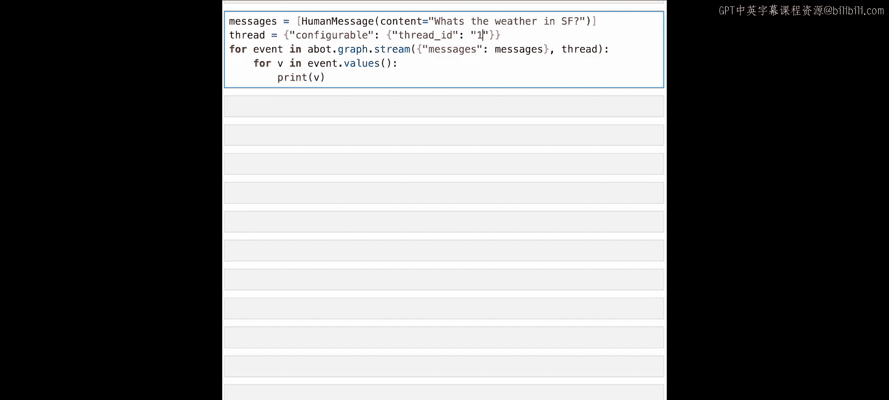

We stream back responses and we stop after this AI message。

This is because the AI message is saying that we should call it tool。

 but we have that interrupt before parameter， which stops it there。

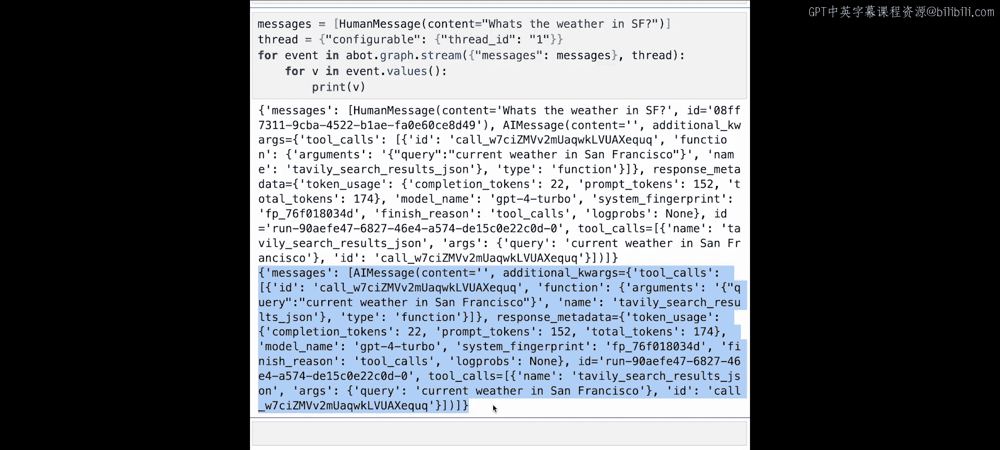

One thing we can do from here is get the current state of the graph for this thread。

 so in order to do that， we'll pass in this thread config。

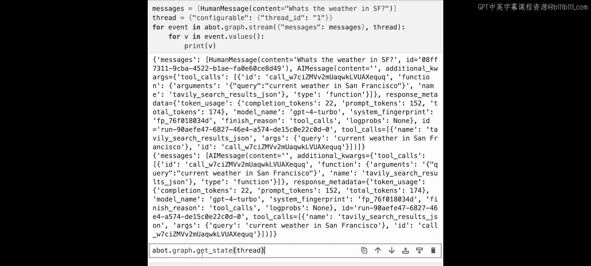

We'll get back this configuration objects， which has a few parameters。

 We can see that the largest ones are this list of messages here。

 This is the state of the graph at this point in time。We can also see that it has a next parameter。

 This is the node that is to be called next。 We can see here that it's action。

 This means that we're about to call the action node。In order to continue。

 we can callSt again with the same thread config and just pass in none as the input。

This will stream back results， and we will see that we get the tool message from calling the tool。

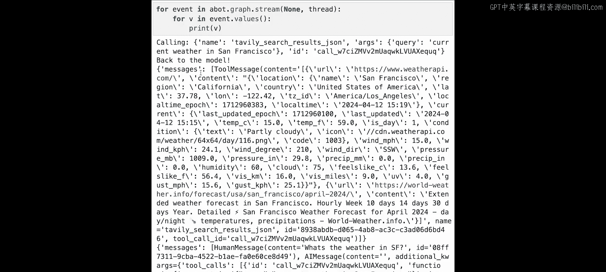

And then we also get the final AI message。Notice that there was no break in between the action node and the LLM node because we didn't add any interrupt there。

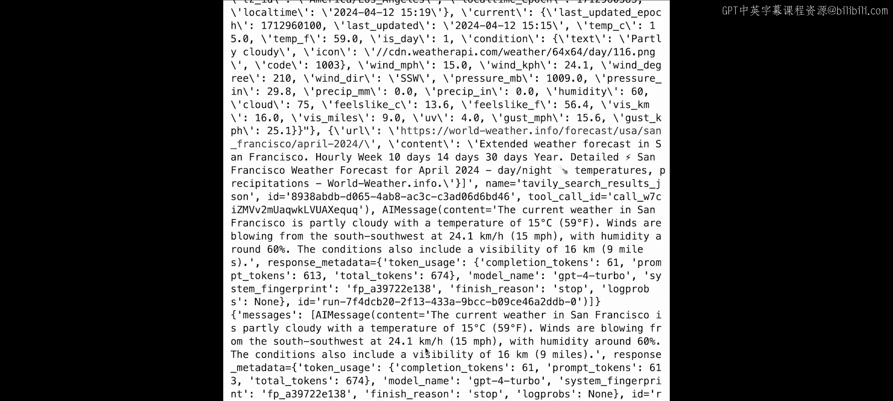

If we now get the state， we can see that the Me list contains the full list of messages。

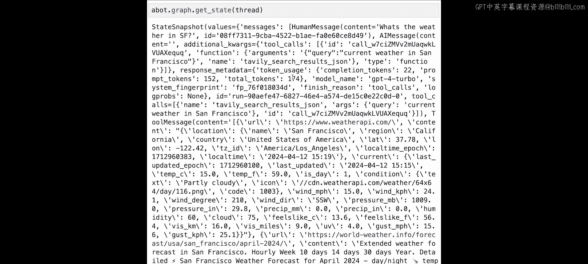

And if we get the next parameter， we can see that it's empty， there's nothing left to be done。

For fun， we can write some code that runs this in a little loop and prompts us for input about whether to continue or not。

 We'll pass in a new thread ID so we start afresh。

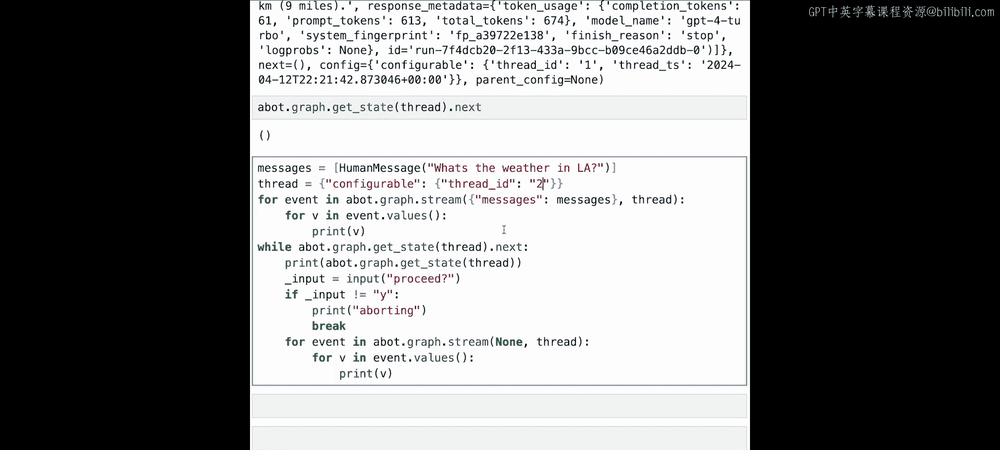

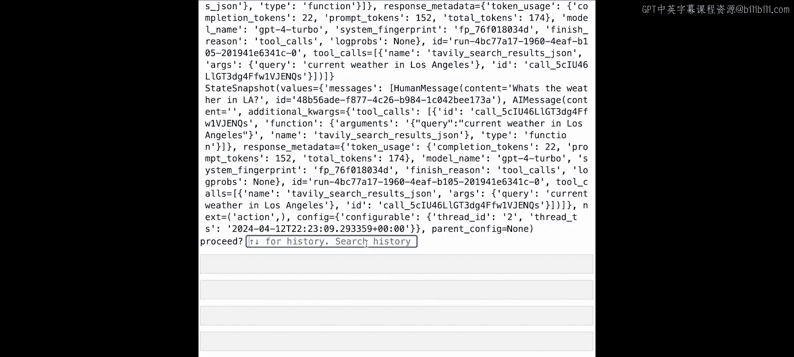

We get this little input box here asking us whether we want to proceed， we can hit yes。

 and then the agent continues on its way。

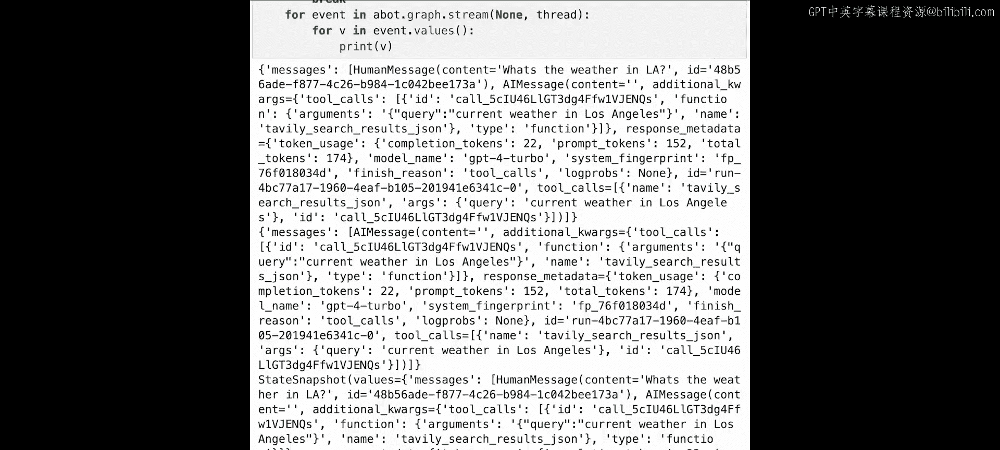

This is a good time to stop and try it out with other inputs。

 try adding different places to interrupt before and see what happens。

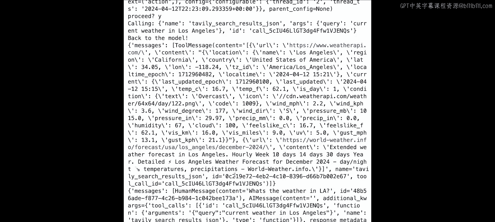

Before we get to the next section， let's talk a little bit more about state memory。

As a graph is executing， a snapshot of each state is stored in memory。What's in that snapshot Well。

 there's the agent state which you've already defined and then there's some other useful things for example。

 there's the thread and a unique identifier for each of the snapshots that's the thread TS right there you can use that to access the snapshots。

There's some commands to access memory。 There's get state which you've already seen。

 If you provide the thread without the unique identifier and just return that thread I D。

 It will return the current state。 There's also get state history。

 which returns an iterator over all of the state snapshots。

 You can use the iterator to get access to all of the unique identifiers for each of the states。

 What can you do with that， Well， heres an example， Given the thread identifier。

 or rather that thread T S， the unique identifier， you could， for example。

 access that first state state 1， and use that in an invoke command。

 That'll use state1 as the current state or the starting point for the rest of the graph。

 This is effectively time travel。 Conversely， without that thread T S。

 If you just pass in the thread I D， will use the current state of the thread as the starting point。

 You can also use that unique。You identifier to access a particular state。

You can then modify that state。And then you can use update state to update the state and store it back into memory in the location of the current state。

 from there， if you run stream or invoke， itll use the new state。

 the modified state as its starting point。All right。

 you'll be seeing some examples of these in the upcoming section， so let's get back to it。

Now let's show an example of modifying the state， so let's start a new thread and let's ask it what's the weather in LA。

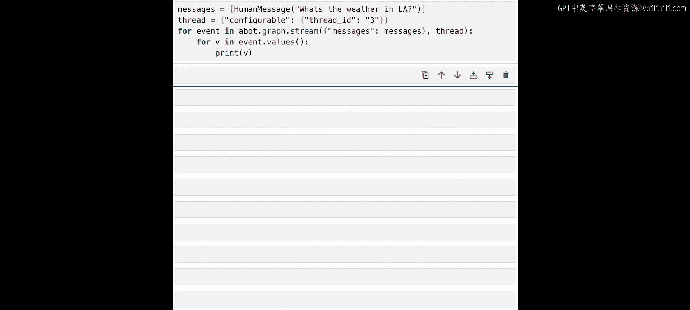

At this point in the thread， we have two messages， the human message and then the AI message。

 which is saying to search to Lilly for current weather in Los Angeles。 But let's modify this。

 Let's pretend we were instead asking about the weather in Louisiana， not Los Angeles。

 So how would we modify this to correct the agent action。

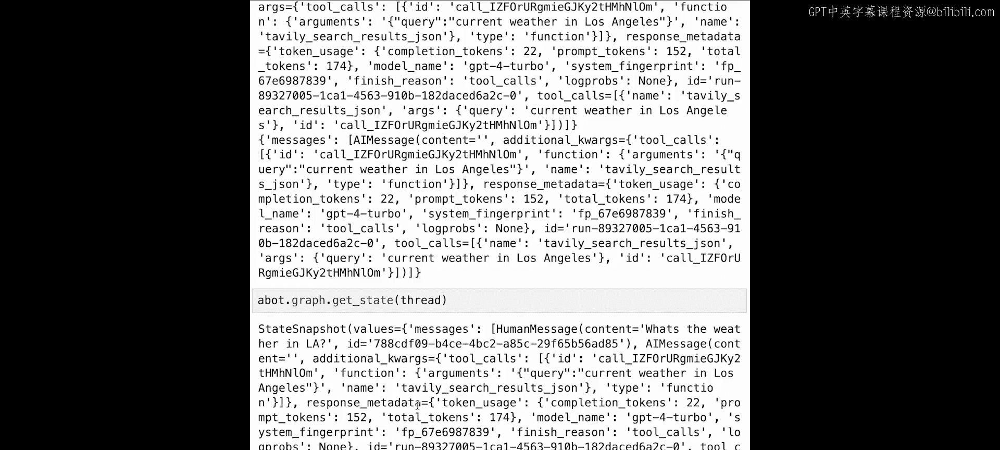

First， let's save the current state of the graph to a variable calledCurrent values。

The last message we have in this state is the AI message。

 which is saying to search for a particular search term， in this case。

 current weather in Los Angeles。We can drill in even further in to see the list of tool calls associated with this message。

Let's now update these tool calls In order to do that。

 we can first get the ID associated with the tool call。

 We'll then update the tool calls' property to be a list。 This list will have one element。

 It's a dictionary。 It's got one tool call It's calling the Tivli search results。

 Json that's the same as before， but the arguments are different This time。

 we have query with current weather in Louisiana。This doesn't actually do anything until we call updated state on the graph we're going to pass in the thread config。

 and this is so we know which thread we're operating on。

 and we're going to pass in the new values that we want to override with。

If we get the current state of the graph now， we can see that we have this search term here。

 current weather in Louisiana。

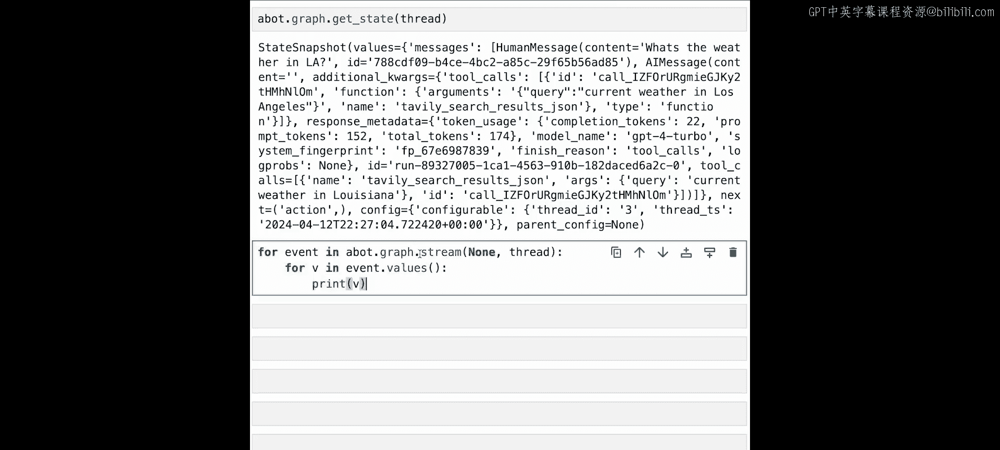

If we continue from here， we can see that it calls to Vily with the current weather in Louisiana and gets back some response and then responds accordingly。

 the current weather in Louisiana shows sunny conditions。

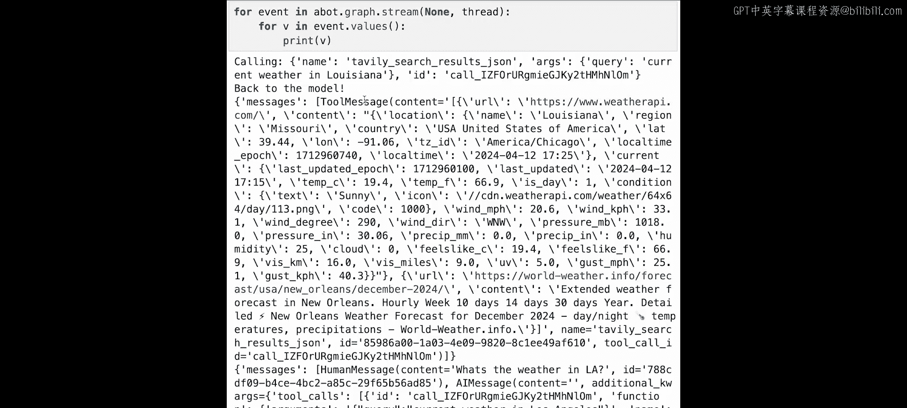

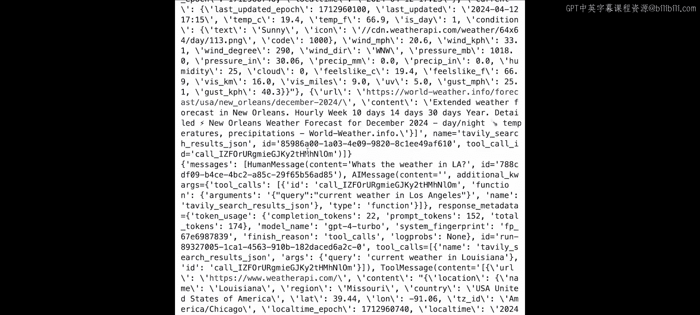

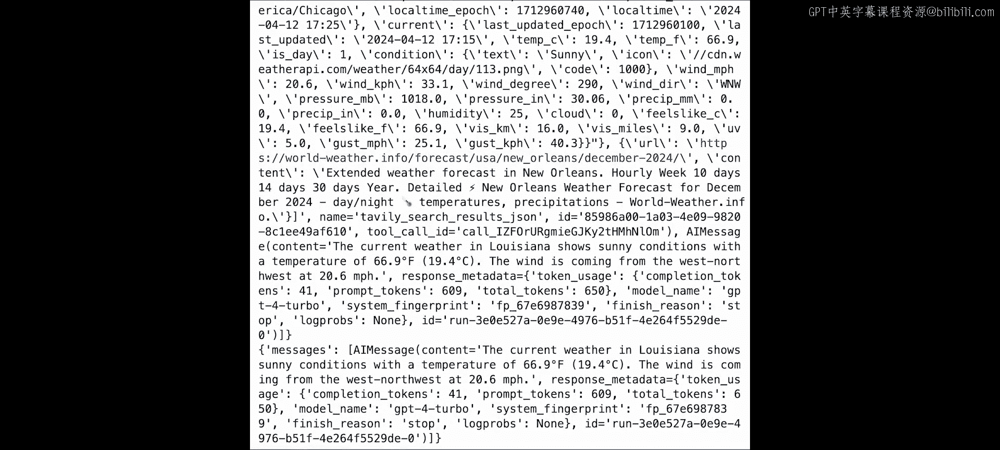

We've now shown how we can modify the state of the draft in order to control what the agent does。

 One important thing to note is that we're actually keeping a running list of all these states。

 So when we modify the state， we actually created a new state， and that became the new state。

 and then every time we update it with results from the nodes。

 it's actually creating a new state one after the other。

 This is really nice because it actually allows us to go back and visit previous states in something we're calling time travel。

So in order to do this， we can call get state history on the graph， passing in again。

 the thread ID we'll then start building up this list of states over time。

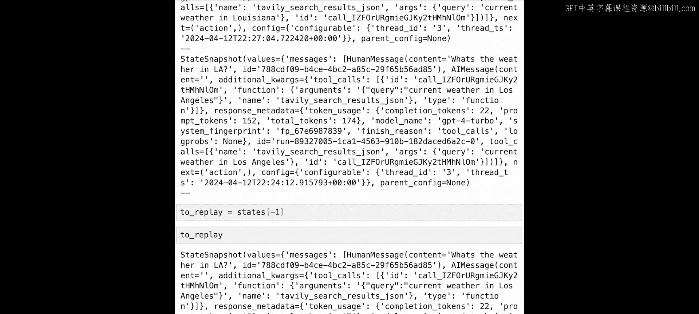

If we get the last state in this list， we can see that it's actually the earliest one。

 And so this is the one where it was looking up the current weather in Los Angeles。

 This was the original state update that was made based on the first language model call。

 If we wanted to go back in time and resume from this checkpoint where it was looking for Los Angeles。

 we easily can。In order to do that， all we have to do is call graph dot stream again。

 pass in none and now notice that we're passing in to replay do config。

 so2 replay is the state where we want to resume from and config is just the configuration parameters that tell us that we're resuming from this state。

 So if we run this we'll start to see that it's searching for the current weather in Los Angeles it's getting a result back from Tivli and then it's generating a response and that's our final answer。

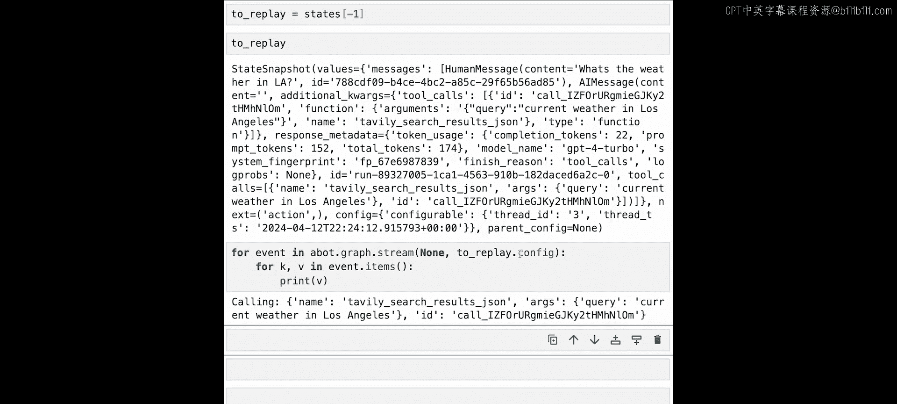

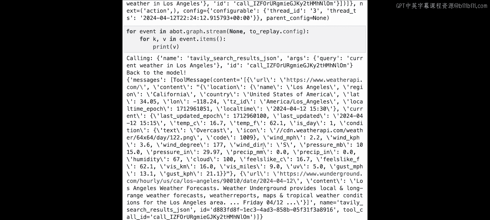

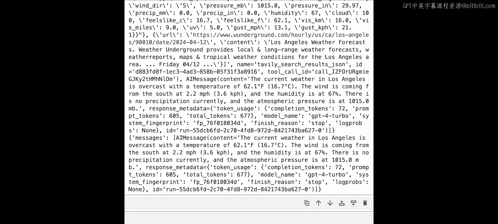

One thing we can also do is go back in time and then edit it from there。

So here we have this two replay config and this is where it's the current weather in Los Angeles。

So we can do the same thing that we did before where we modify this state。

And so we'll modify this to do current weather and LA Acuweath。

 presuming that we want a response from Acuweath， and the reason this is different than before is that here we're going back in time and then editing as opposed to before where we were editing from the most recent state。

We can update the state of this two replay and we'll get back to this branch state where we've branched off with this modification。

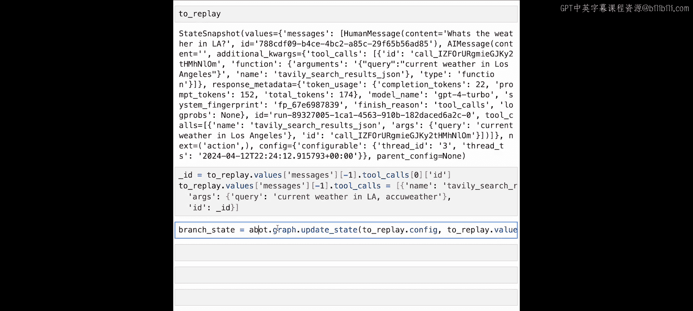

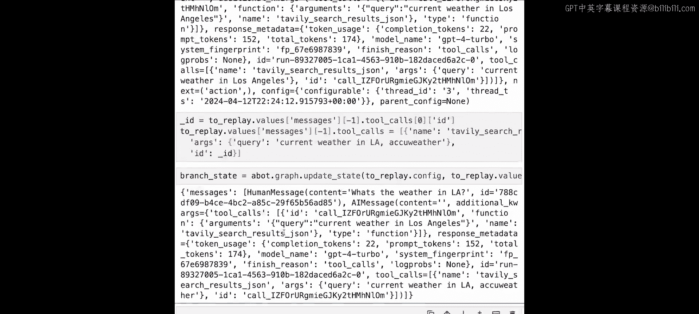

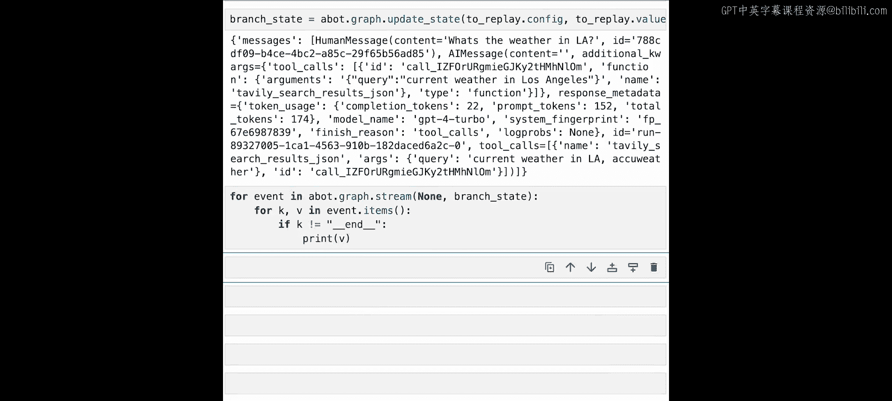

If we now call Gph dot streamam with none on this branch state。

 we can see that we're looking up acuwe and getting a result from there。

 and we're getting back a new answer and then we're responding from the AAI。

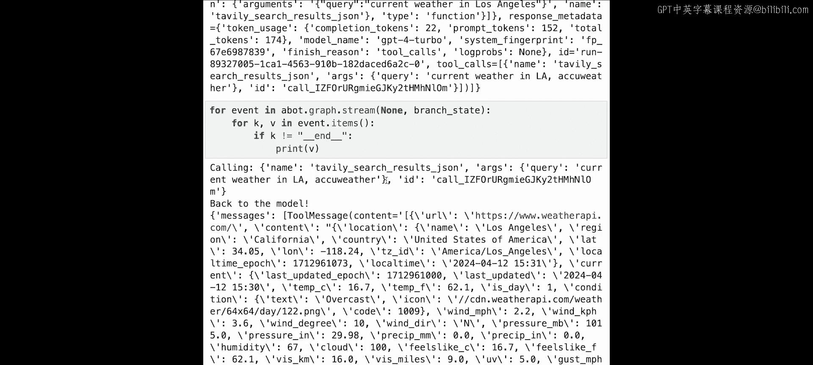

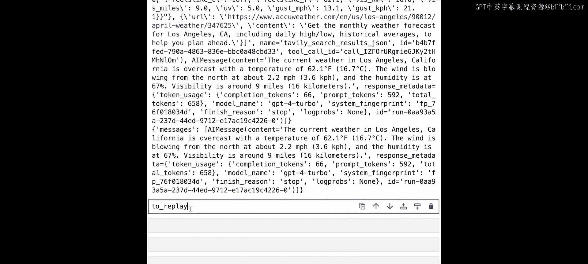

Another thing we can do is add messages to a state at any given point in time。

 so here we have this two replay config， which we've modified to have the current weather in LA Acuwe。

 Now let's presume that instead of actually calling to Vily。

 we wanted to mock out a response we can do that by appending a new message into the state。

We're going to grab the ID of the tool call that we're supposed to be making。

And we're going to create this state update， which is a list of messages。

 and it's a new message this time。 It's got a tool call idea of this。

 It's got a name of Tvili search and it's got a content of 54 degreesC。

 So here this is a new message。 So when we update this state in the graph。

 it's not going to replace an existing message， it's going to append it to the list of messages。

We're now going to update the state of the graph。But because we are actually adding and pretending that an action has taken place as opposed to modifying the existing state。

 we need to do an additional thing。 We need to add this as node equals action parameter here。

 What this is basically doing is it's saying that the state update that we're making isn't just a modification。

 we're actually making this update as if we were the action node。

 The reason that this is relevant is because before we add this message。

 the current state of the graph is about to go into the action node。 But after we add this message。

 we don't want it to go into the action mode anymore。

 So we're basically saying that when we update this state。

 we're acting as if we were the action node。

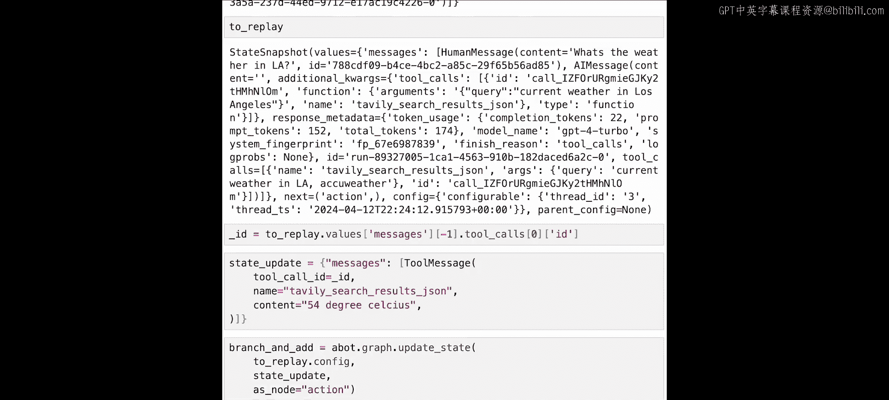

If we now call streamam on this new configuration。We can see that it doesn't take an action anymore。

 Rather it just calls the model and responds with this AI message。

 the current weather in Los Angeles is 54 degrees Celsius。

 this is what we pretended that the tool had responded with。

This has shown off a lot of really advanced and complicated human in the loop interaction patterns。

 so you've learned how to add a break before a node takes place。

 This allows for humans to approve or deny specific actions you've also shown how you can go back in time and how you can modify the state either the current state or the past state Additionally。

 you've also shown how you can update the state manually。

This allows you to manually give the agent the result of calling a tool rather than actually calling a tool itself。

 All of these human in the loop patterns better serve to facilitate how you interact with agents。

 They give you more control over what it's doing。 It allows you to go back to a previous point in time。

 and by editing， it allows you to correct what it has done。

So far we've been working with a pretty simple agent， it's got one LLM call， one prompt。

 and it's got a pretty simple state， just a list of messages in the next and final example in this course。

 we're going to create a much more complicated agent made up of multiple LLM calls that has a pretty complex state See there。

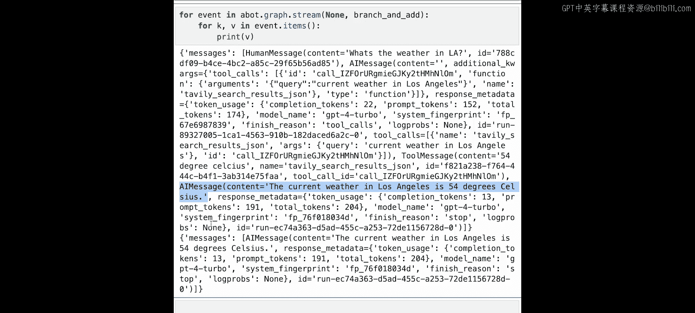