# 吴恩达&langchain《用LangGraph搭建智能体｜AI Agents in LangGraph》【短课英字可关】 - P7：7.Lesson 6 Essay Writer.zh - GPT中英字幕课程资源 - BV1bi421v7oD

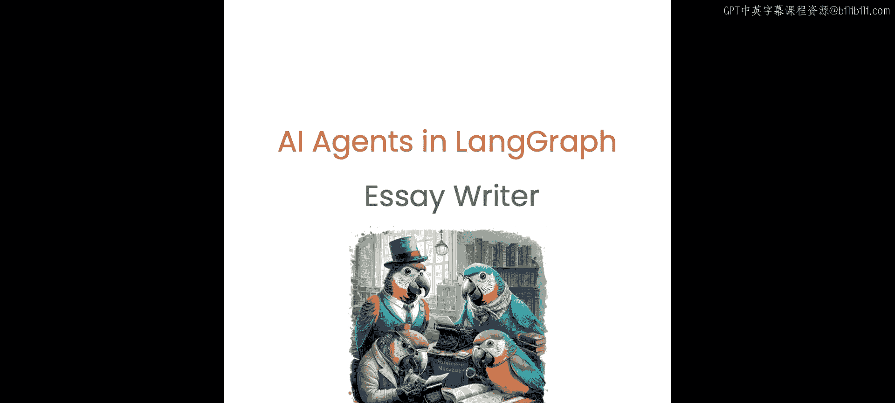

In this lesson， you'll build a project with a bit more scope。

 we'll build a compact version of an AI researcher in this case， an essay writer， let's get to it。

So we're going to create an essay writer。 This is going to be broken down into a few different sub steps。

So first we're going to generate a plan for the essay this is going to happen once up front。

 then based on that plan， we're going to do some research。

 this involves calling to Vily and getting back some documents。

From there we're going to go to generate and then generate。

 we're going to follow the plan using the documents that we researched and we're going to write the essay。

From there， we're either going to finish or we're going to continue。 If we continue。

 we're going to go into a reflect node， or we're going to generate a critique of the current essay。

 Then based on that critique， we're going to do another research step with Tivli and get another set of documents。

We're going to append those to the existing set of documents and go all the way back to the generate step where we're going to once again try to write this essay。

And we're going to continue this until some criteria is met and we exit。Let's see this in code。

We're going to start with again， importing all our environment variables。

We're then going to make some standard imports and set up our in memoryory SQL A checkpointer。

Now we're going to create the agent state and it's going to be a little bit more complicated than before。

So we're going to want to keep track of a bunch of different things。First。

 we're going to keep track of the task。 This is the human input。

 This is what we're trying to write an essay about。

 Then we're going to have a key to keep track of the plan。

 This is the plan that the planning agent will generate。 Then we've got a key for the draft。

 This is a draft of the essay。 And then we've got a key for the critique part。

 So the critique agent will populate this key。 We're also going to add in content。

 This is a key to keep track of the list of documents that Til has researched and come back with。

 And then we're going to have two arguments that keep track of how many times we've gone through this。

 So revision number， which is going to keep track of the number of revisions we've made and max revisions。

 which is keeping track of the maximum revisions that we want to make。

We're going to use those last two things and the criteria to decide whether to stop or not。

Let's create our model， we're going to be using open AI。

 and now let's write some prompts for our agents。First， we have this planning prompt。

 This is the prompt for the LLM that's going to write out a plan for our essay。

Next we have the writer prompt， this is the one who's writing the essay。

 given all the content that was researched。We now have the reflection prompt。

 this is the prompt that's going to control how we're critiquing the draft of the essay。

We now have a prompt that we're going to use for the agents that's doing research after the planning step。

 so given a plan， we're going to generate a bunch of queries and pass these to T Vli so this is the prompt that does that。

And then we also have this research critique prompt。

 so after we've made the critique we're going to generate a list of queries to pass a Til。

 so this is slightly different than the planning prompt just because it's working on a critique versus a plan。

 but it serves a similar purpose。For generating these list of queries to pass to Vili。

 we're going to use function calling to ensure that we get back a list of strings from the language model。

In order to do that， we're going to set up this pedantic model that just represents the result that we want to get back from the language model。

 which in this case is a list of strings。We're going to import the Tvili client instead of the tool because we're working with it in a slightly unconventional way。

Now we can start to create all our different agents， all our different nodes， let's go in order。

 so first we're going to start with the node or agent that does the planning。

What this note is going to do is going to take in the state。

 It's then going to create a list of messages。 One of them is going to be the planning prompt。

 That's going to be the system message。 We're then going to create a human message。

 That is the task that we want to do。 We're going to pass that to the model。

 We're going to get it back a message。 And then we're going to take the content of that message and set that equal to plan。

 And so this is going to update the plan key to be this response。

The next node that we're going to want to do is the agent that takes in the plan and does some research。

So for this we're going to create the research plan node。

 this is going to take in the agent state and we're first going to generate some queries。

 so we're going to do model and this is the open AI model。

 and then we're going to say with structured output and put queries right there。

 and so this is basically saying that the response of what we're going to invoke this with。

Is going to be that pedantic object that we had， which has that list of queries。

 So we're going to call invoke， and we're going to call invoke on a list of messages。

 We've got this research planning prompt。 and then we pass in this human message， this task。

 and so for this part， we're generating the queries based on the task。

We're then going to get our list of current documents。

 the content documents that we're going to use to write this essay。

 so we're going to look in the state for content if it exists or if it doesn't exist。

 we're just going to create an empty list of documents。

We're then going to loop over the queries that we generated and search for them into Vily。

 We're going to get back the results and we're going to append them to the content。

We're then going to return this content key equal to the content that is the result of the original content plus the accumulated content。

Okay， so we've made a plan and we've done some initial research。

 Now it's time to write the first draft。So for the generation node。

 the first thing we're going to do is prepare the content。

 so we're going to take this list of strings and join them into one big one。

We're then going to create the user message where we're going to combine the task and the plan。

 So we create a user message that's basically like。This is my task， and then here is my plan。

 The plan。 Remember， this is what we generated two steps before。 The task is the original user input。

We're then going to create a list of messages。 This is a system message with the writer prompt where we format in this content。

 we format in the documents that we fetched， and then we're going to pass in this user message。

 which is a combination of the task in the plan。 We're going to pass this to the model and get back a response。

 We're then going to update two things in the state。 First， we're going to update the draft。

 So we're going to take the response from the model and use that as the new draft version。

 Then we're going to update the revision number。 So this keeps track of how many revisions we've made。

And so here we're going to add one to the current revision number in the state。After generating。

 we now need a reflection node。This reflection node is going to take the reflection prompt as a system prompt。

 and it then's going to take the draft， This is what we just generated。

 we're going to have these two messages and we're going to pass them into the model and get back a response。

 and this is going to generate the critique that we're going to update the state with。

The last agent we need is the agent that's going to take the critique and do some research。

 So we're going to do a very similar thing that we did with the research plan node。

 We're going to take this model。 We're going to do with structured output with queries。

 So that's returning queries。 We're going to invoke it。

 This time we're passing in the research critique prompt。

 and we're also passing in the critique from before。 based on that。

 we're going to get the current content list and we're going to start app to it the results of our tivli searches。

 We're then going to return this updated content key。

The final thing we need is this should continue condition。

 This is going to look at the revision number。 And if it's greater than the number of max revisions。

 we're going to end。 If not， we're going to go on to reflect。 Remember。

 this is getting run after the generation step。 So after the generation step。

 we're either going to finish or we're going to go into this critique loop。Okay。

 we made all our agents， all our little nodes。 We made our conditional edge。 Now。

 let's put it together into one big graph。First， let's initialize the graph with the agent state。

Let's then add in all the nodes that we created。We then need to set an entry point。

 so the entry point here is going to be the planning node。

Let's then add it in our conditional edge so after generate we're going to call the should continue function and we're either going to end or we're going to reflect and so here if the should continue condition returns end。

 we're going to end if it returns reflect， we're going to go to the reflect node。

We now need to add in the basic edges so after planning。

 we're going to go through the research plan node after research plan。

 we're going to go to generate generates already covered above。

 so then after reflect we're going to go to research critique and after research critique。

 we're going to go back to generate。Let's now compile it and we'll pass in the checkpointer that we created before。

We can visualize this same as before， it's a much more complex graph。Allright。

 so let's use this writing agent。 Let's call graph dot stream so we can see all the steps that are happening because this is gonna to take a while and we really want that visibility。

 Let's pass in a task。 Let's ask it what is the difference between L chain and Ling Smith。

 I don't think G 3。5 noise about any of these And then let's pass in max revisions equals 2 and let's pass in revision number equals 1 So it's starting on the first revision and we want it to make two revisions of what it's going to do。

Let's call this and it's going to start getting to work。So we can see that it generates a plan first。

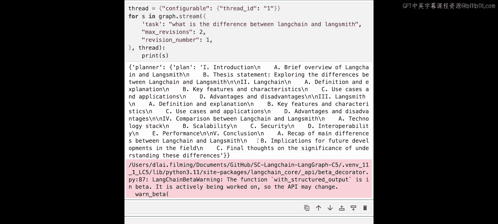

It then does some research， it gets back a bunch of documents。

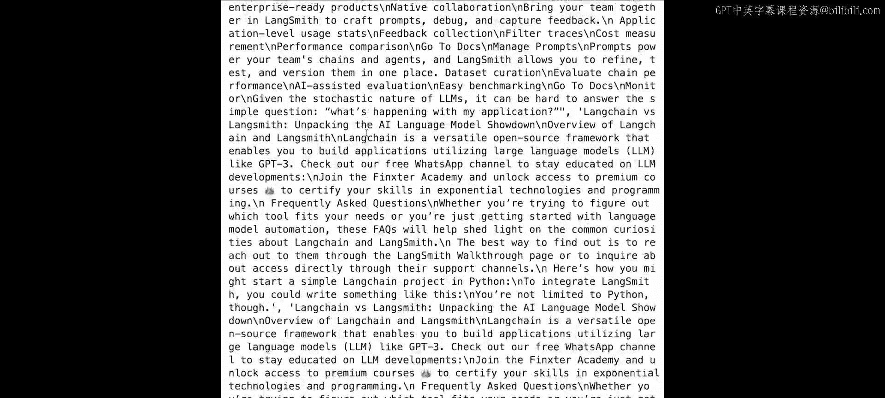

It's now got a first draft so we can see that it generated a title unveiling the distinctions。

 Lang chain versus Langsmith， and it started writing。

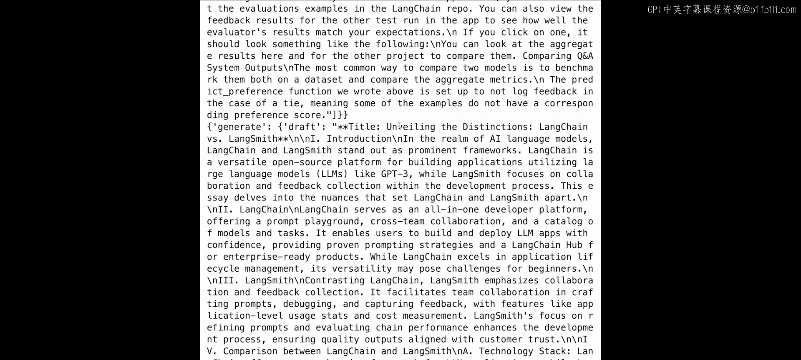

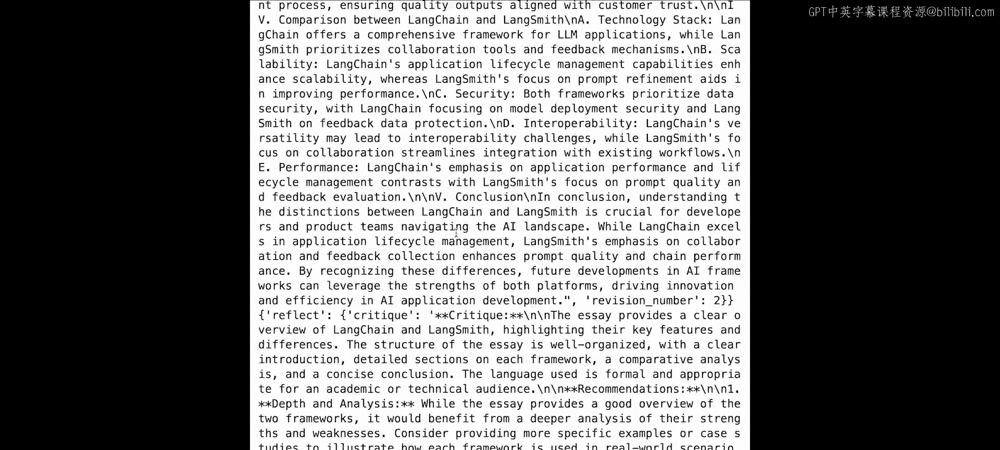

Here we can see the critiquing that the agent did。 The essay provides a clear overview。 blah， blah。

 blah， with here some recommendations。 It would benefit from a deeper analysis of the strengths and weaknesses。

 Okay， great。 now we can go to planning。 So here we have the research critique node。

 This has done research based on the critique of the agent。😊。

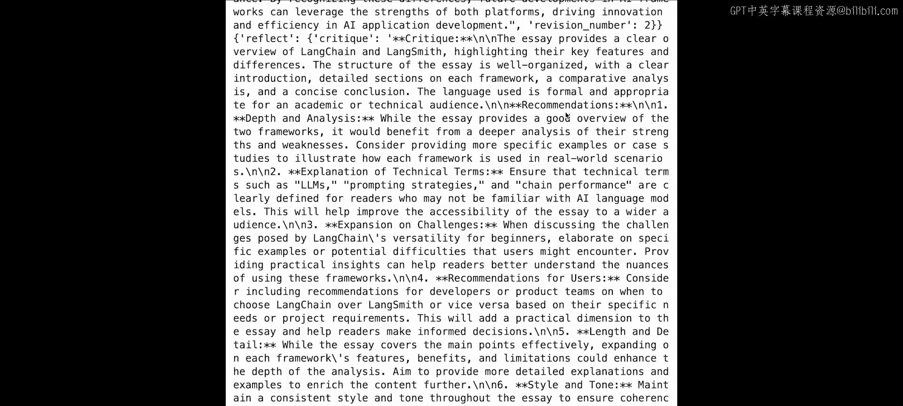

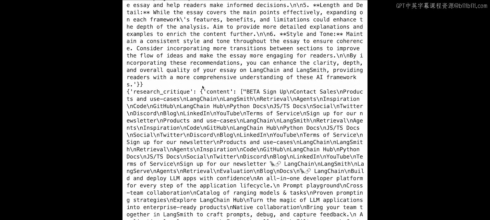

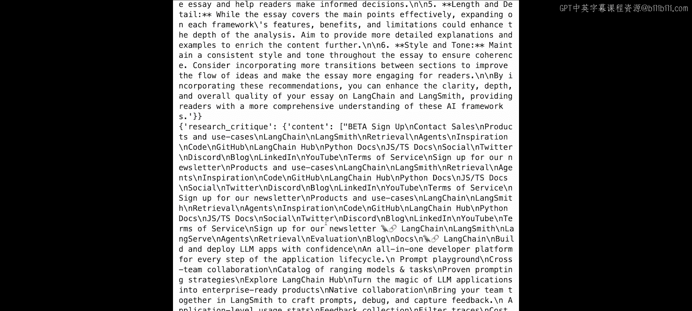

Here we get to generate again。 This is the second draft， and we've only told it to do two drafts。

 So this is the final one。 It ends after this， and we can see the final essay that we get L chain versus Langsmith。

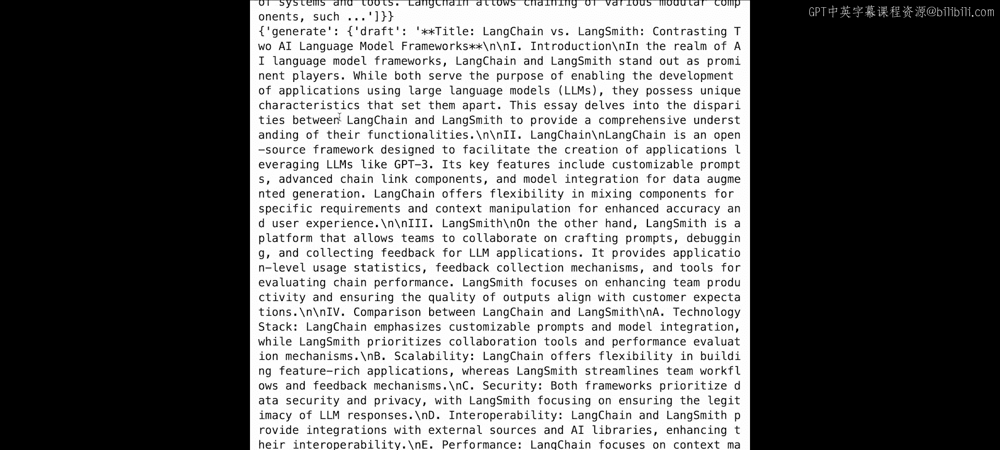

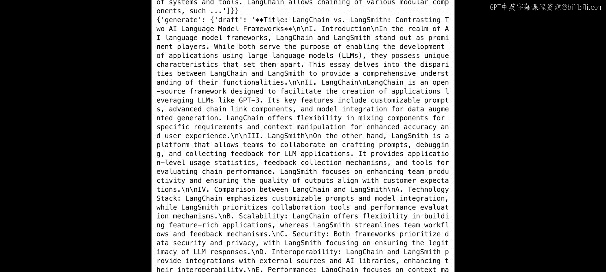

We can see some more details on what Lang chain is， what Langsmith is， some talk about scalability。

 interruptopability， performance。

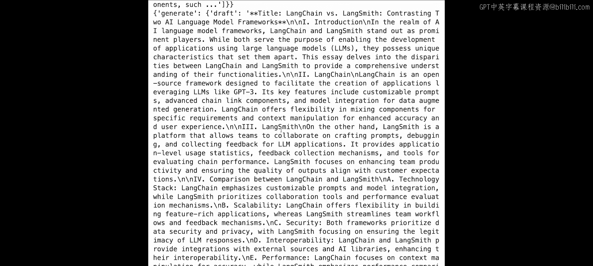

We've now created this writer agent。 This is a great time to go back and try it out with different questions。

 Maybe have it right a few different revisions。 See how it performs。 Me around with the prompts。

 There's a lot that you can change here to see how this overall writing agent responds。😊。

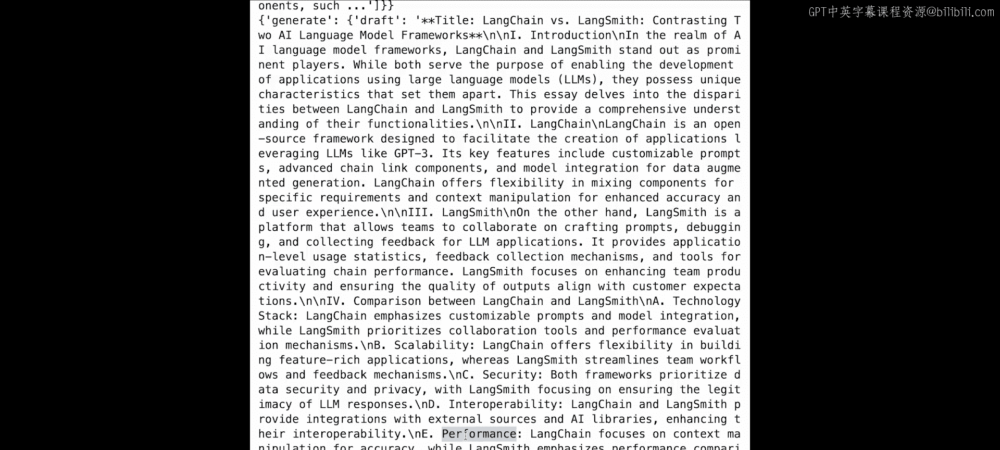

We built a little GuUI that you can use to try out the essay generator。Here's how it works。

You can put in a topic here。And then you can hit this button， generate essay。

That will invoke your graph。And it will go and it will run off and it will start the generation process。

And as you can see， we stopped， we stopped at the planner node。 Last node was planner。

 Next node was research were n thread0。We're doing our first draft with a kind of one we've taken one step in our graph。

So why do we stop Well， if you look and manage agent， we have this interrupt after state set。

 so you may recall from code what that looks like。So when we're compiling the graph。

 we have interrupt after set for each。Of the states。 So after each state， it'll stop。

And what it will do is in the GuUI logic， it'll come back and it will look to see if that state is checked。

And if it is， it will stop。And if it's not， then it will continue and so you can uncheck these and continue all the way through the process。

Now we stopped the planner， so we should have a plan at this point， let's take a look， sure enough。

 theres our introduction。But if we look at a research content， for example。

 we don't have any and same for draft and for critique。There's also this tab。The state snapshots。

 and this is giving us a view into the current memory。This just lists all the things in memory。

We can see that there were two initial states inserted by the graph logic。

 And then there was this state that we just inserted。 It was the tasks， the pizza shop。

 The last node were in and the values of the agent state At this point in time。

 The last node is planner。 Our plan was briefly introduce the topic of pizza shops and the popularity and so on。

 We don't have any drafts， et cetera。So that's our current state。

Now you may want to do something a little bit different to this introduction。

Let's say what you really wanted to talk about was。Discuss。

The importance of jelly donuts in pizza baking。Now this is a bit nonsensical。

 but you can now update the state if you hit this modified button。

That will run the update state command that we had seen earlier。

And we can go in and take a look and see what happened。So we can refresh our state snapshots。

And here's the state we were in previously， and now we have a new state。The current state。

And here we have。Our plan is discuss the importance of jelly donuts in pizza making。

And so we can continue from here if we go back to the front end。

And if we hit continuein essay as opposed to generate。

 then we continue on the path of the thread that we've already started。Okay。😊。

So now we're at the research plan， the next node is generate。

 let's go ahead and click continueinue and we'll generate a draft。Let's take a look at the draft。

And if we refresh， we can see the last node was generated， the thread ID0， the version1， step4。

And so if we read this， we can see jelly donuts， a beloved tree in many cultures。

 hold a surprising significance in the world of pizza making。What is the price。

Let's go back to our agents。Well， we could continue this。

But you may have had second thoughts about this whole pizza making and jelly donuts connection。

So maybe we want to go back to the beginning。So with this update state from tab。

 you can go back to the original planner state。And that just didn't update it state。

 so if we go take a look at our state snapshot。That pushes onto the memory。

The state that we had selected。And that's back to our original。

Plan the briefly introduce the topic of pizza shops and their popularity。So we can go back to there。

 and then we can then run from there。And so let's unclick those two things and run all the way to generate。

 click Conue essay。And see what happens。All right， so the last node is generate。

 so now we can look at a draft， let's refresh。Pizza shops have become a staple in the food industry。

 offering a wide variety of options， blah， blah blah。

 so we don't have any more references to jelly donuts in pizza making。

If you decide to do a different topic， for example。

Let's say you want to do a topic on New England IPAAs。

So you can change that value and then hit generate essay。Now you're starting a new topic。

 so you start a new essay。What happens here？I we get the live agent output down here。

And we're going to go all the way to generate because we didn't have those two interrupt after states selected。

Now you'll notice that we have two different threads to choose from， we have thread 0。

 which is the pizza shop and then one， which is the New England IPA topic。

And our New England IPA only has a couple of states here。

So you can explore essay making with this GuI。More importantly is to understand what's happening to memory state and how the graph is being run。

If you want the details， you can go into the Helper。pi file and all the code is there。

It's a little long。But you can use that as a basis for your own project。

We've covered a lot in these past six lessons， but it's honestly just the start of building agents。

In the next section， we'll do a quick overview of some resources that you can peruse in your own time after the course to get an even deeper understanding。

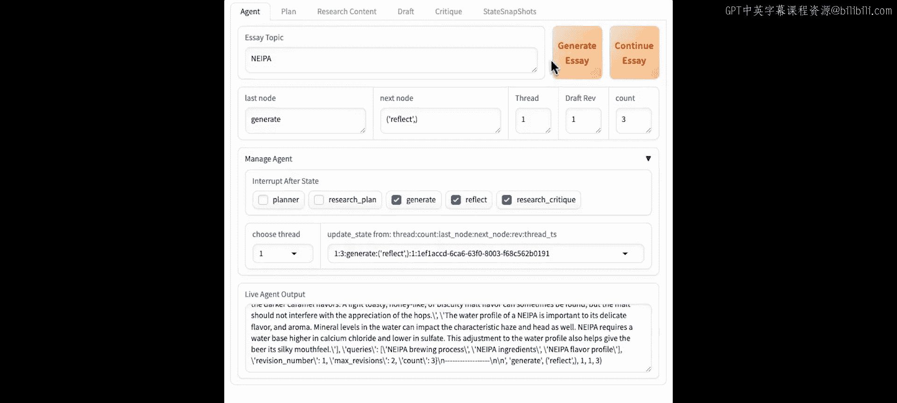