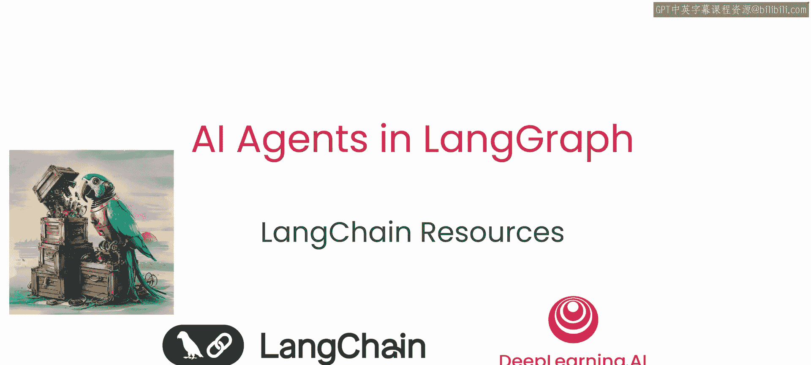
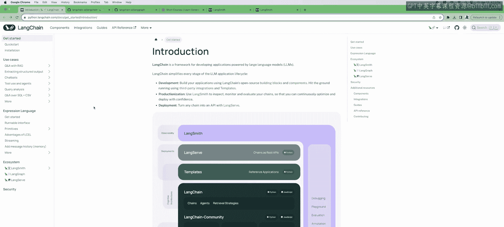
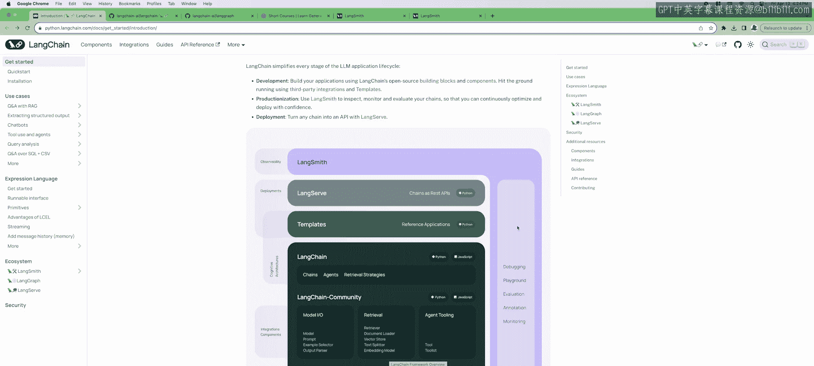
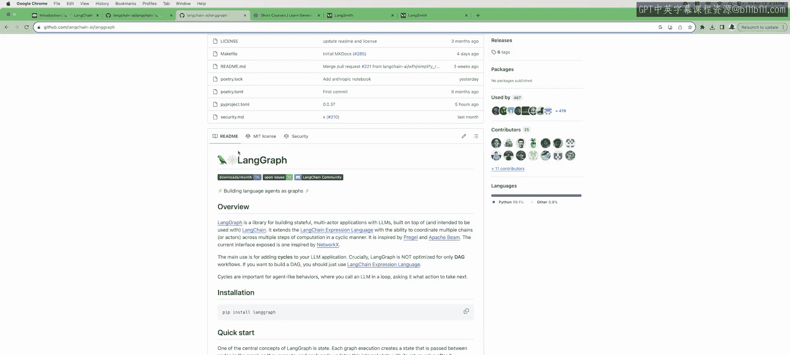
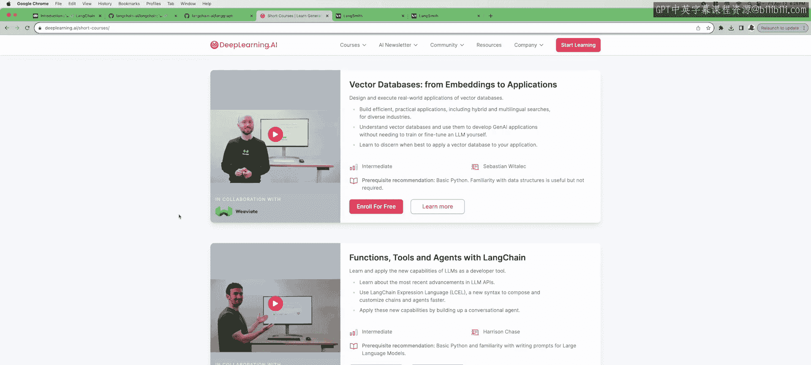
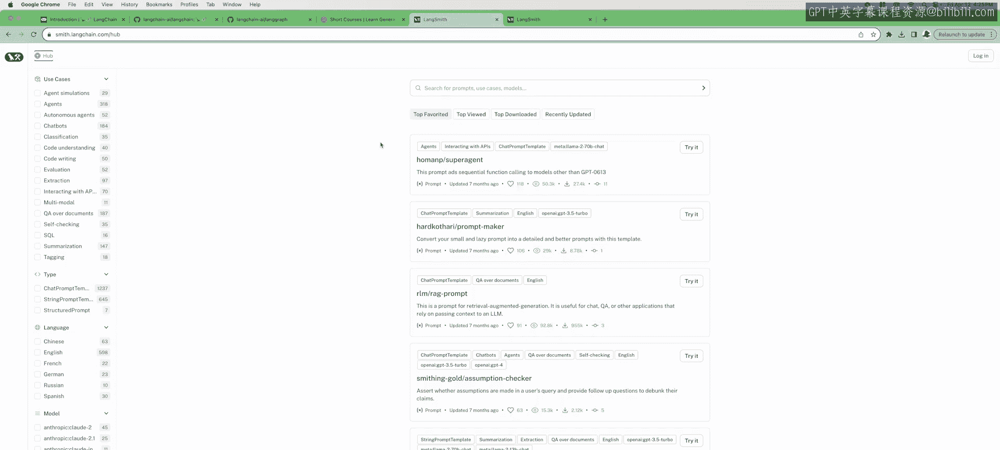

# 吴恩达&langchain《用LangGraph搭建智能体｜AI Agents in LangGraph》【短课英字可关】 - P8：8.resources.zh - GPT中英字幕课程资源 - BV1bi421v7oD

Look， we have only covered some of the basics here today。

 I want to point out where you can find some more information to continue your agent journey。

We've covered a lot of info。 Here are some of my favorite resources for diving deeper into all that we just talked about。

The Lang chain documentation is a great place to start。Specifically。

 it provides a great high level overview of all the packages and services in the Lang chain ecosystem。

 So we break down the different Lang chain core packages。

 as well as all the L chain community packages。 So we use Tivli as part of Lang chain community。

 And then we also use Lang chain open AI， which is a separate partner package。

 but we have a ton of other integrations， and you can explore those here。😊。

Lang chain itself is more high level and covers agents and other chains and different retrieval strategies that are good high level entry points。

 If you just want to get started， we also have a bunch of templates that can be deployed easily with Lngserv。

 Lang serve is just a really easy way to turn your L chain application into a web server。

Helping out with all of this is Langsmith。 From the beginning， Langsmith can help with debugging。

 and then it can also help with monitoring and production， and it also has a playground。

 which we saw earlier。 looking at a few other sites。

 The Langch Github repo has a lot of good resources。

 a lot of good cookbooks and a lot of templates for getting started。

The Lagra repo， of course， has in depth documentation on Lagra， everything that we just covered。

 So great reference docs， great tutorials and great Pa2 guides。😊。

We've also done previous courses on L chain with deep learning that I'd highly recommend checking out in particular。

 functions， tools and agents with Lang chain is a really good precursor to this lesson。

We already saw the prompt hub once， but just to reiterate。

 this is a great place to go to get inspiration and see what other expert prompters are doing。

