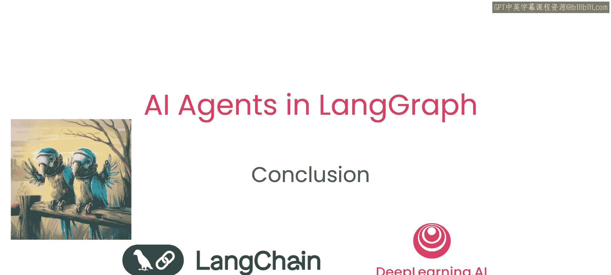
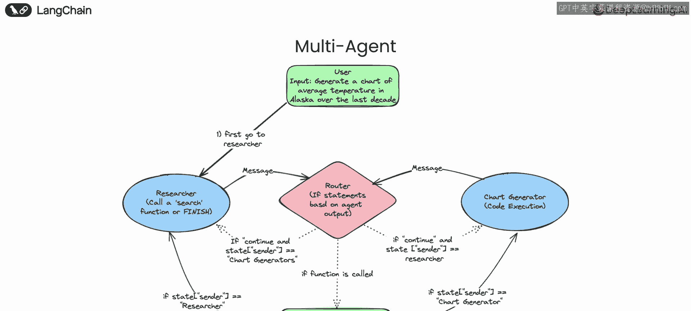
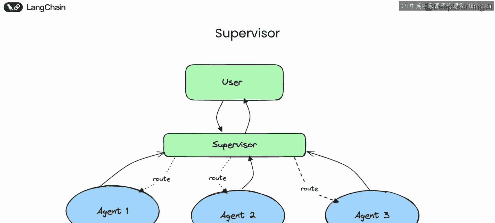
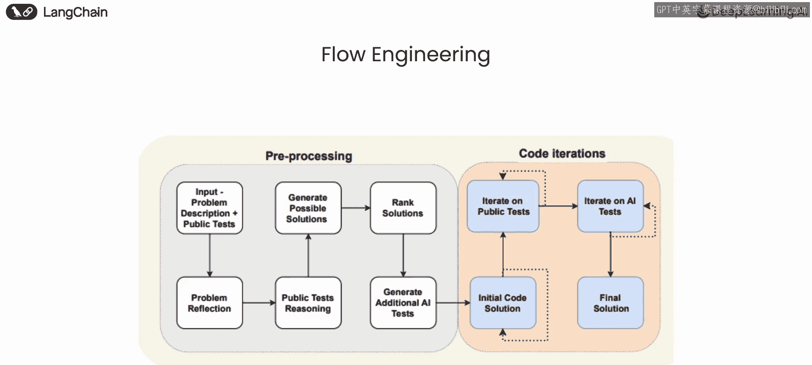
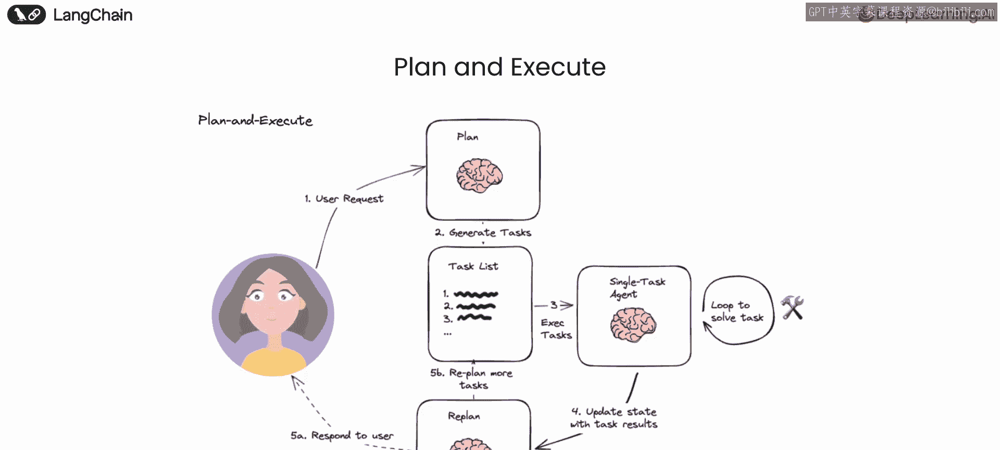
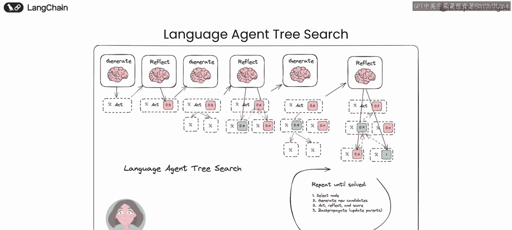

# 吴恩达&langchain《用LangGraph搭建智能体｜AI Agents in LangGraph》【短课英字可关】 - P9：9.conclusion.zh - GPT中英字幕课程资源 - BV1bi421v7oD

Congratulations， you now have a good hand on how to build your own agents。

With what you have learned today， you can build simple or quite complex agents， but before we go。

 I wanted to cover some of the agent flows that we couldn't build today。

 but I think you should know about。The first architecture I want to talk about is a multi agent architecture。

And we cover this a little bit with the writing agent。

 but just to make it a little bit more concrete。A multi agent architecture is when multiple different agents work on the same shared state。

 and so these agents could be just a prompt and a language model as they were in the writer。

 They could also have different tools that they could call those， so they could be a prompt。

 a language model and tools， and they could actually have their own loops inside them。

The crucial thing here and the differencei between the next thing that we'll see is that they all work on the same shared state。

 so they're passing that around from one agent to the next。

Let's contrast that with a supervisor agent。 So here we have a supervisor where is calling into some subag。

 And here， the supervisor will actually determine what the input to that agent is。

 And those agents themselves could have different states inside them。 They' a graph。

And so there's not necessarily the same concept of a shared state， other than that。

 this is pretty similar to the multiageent framework。

 it just really emphasizes that there's this one supervisor that's in charge of routing and coordinating these other agents。

This is often good when you can use a really powerful language model as the supervisor。

 because doing this supervision， doing this planning requires a lot of intelligence。

One term that's popped up a bunch recently is flow engineering。

This comes from an alpha codedium paper where they achieve state of the art coding performance。

 and they do it with a very graphical like solution like this。 And so looking at it。

 you can see that it's basically a pipeline， but there are a few key nodes where there's actually a loop。

So there's loops on the initial code solution， there's loops when you iterate on public tests and there's loops when you iterate on AI tests。

 and so this is an interesting graph because you have this very directed flow up until a certain point。

 and then you have these iterations。This is a really bespoke architecture for a particular coding problem。

 but the concept of flow engineering extends more broadly。

 and it generally refers to thinking of what is the right information flow for your agents to take action and think。

In that vein。A common paradigm is to have a plan and execute style flow。

 where first you do an explicit planning step up front， and then you start to execute on that plan。

So you may come up with a few steps that a sub agent should go do。 It can then go do 1。 Come back。

 Maybe you update the plan。 Maybe you don't。 This is where there are some different variants。

But then it goes on to the next thing and it does that and it comes back until it finishes the plan。

 then you maybe check to see if the plan is successfully accomplished or whether you need to replan。

And then if all' is good， you return to the user。The final one I want to touch on is a really interesting paper called Lagu Agent Tese。

So this basically does a tree search over the state of possible actions。

 and so it first generates an action， it then reflects and then goes down based on that action and generates some other subaions。

 reflects on that， and throughout all these reflections。

 it can basically reflect on where in the tree of action states it wants to jump back to。

So it can back propagate and update parent nodes to have more information。

 which may inform future directions from that previous state for this in particular。

 you can really see why persistence is really important because you need to be able to go back in time to previous states。

These are just some of the emerging paradigms for creating more complex agent flows。

 Linggraff is really aimed at being highly controllable and allowing you to create these cyclical or non cyclical flows。

 This degree of controllability is really what differentiates it from other frameworks。

 And it's what we're really excited about going forward as we view this to be crucial to creating agents that actually work。

😊。

