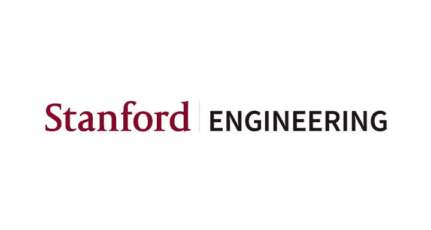
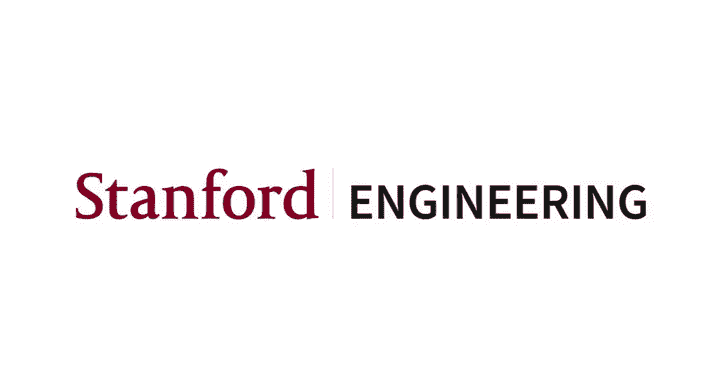

# 吴恩达@斯坦福大学《深度学习｜Stanford CS230： Deep Learning ｜ Autumn 2018》中英字幕（豆包翻译 - P10：[10]Lecture 10 - Chatbots _ Closing Remarks.zh_en - GPT中英字幕课程资源 - BV19y421z7jz

So hello everyone and welcome for the last lecture of CS230 deep learning。

 so it's been 10 weeks and you've been studying deep learning all around。

 starting with fully connected networks， understanding how to boost these networks and make them better and then using recurrent neural networks in the last part and convolution neural networks in the fourth part to build models for imaging and text and other applications。

So today is the class wrap up and the lecture might be slightly shorter than usual。

 but we're going to go over a small case study on conversion assistance to start with。

 which is an industrial topic we will do a small quiz competition with Menti and the fastest person who has the best answer will win 400 hours of GPU credits on Amazon。

😊，So you guys can start working on it。😊，We will see some class project advice because you guys have about two weeks。

 less than two weeks before the poster presentation and the final project due date。😊。

We'll also go over some of the next steps after CS230。

 what have our students done over the past year and what we think are good next steps。

And closing remarks to finish。But if you have a click here with batteryship， please。

 can you bring it to me？😊，Okay， so let's get started with how to build a chatbot to help students find or and enroll in the right course。

😊，So this is going to be a pretty simple case of a chatbot because chatbots and conversational conversational assistance in general have been very hard to build and have been in this real topic。

 There are some places where academia has helped the chatbos。

Improvements and here we're going to see how we can take all our algorithms。

 what we've learned in this class and plug it in in a conversion setting。😊，That sounds good。

 so let me give you an example。😊，Students might write to the chat but hi。

 I want to enroll in CS 106A for winter 2019 to learn coding。

The chatbot can answer for sure I just enrolled you， so that would be one goal of the chatbot。

A second example might be。😊，Finding information about classes。Hi。

 what are the undergraduate level history classes offered in spring 2019？

Then the chatbot can get back to the students and said here's the list of history classes offered in spring 2008。

So we're making a small assumption here。 we're building a chatbot for a very restricted area。

In general and a lot of time， chatbots which work very well are super goal oriented or transactional and the state of possible utterances or request from users is small。

 smaller than what you could expect in other industrial settings so here we're making the assumption that the students will only try to find information about a course or will try to enroll in the course。

So I want you guys to pair in groups of two or three and try to come up with ideas。

Of what methods that we've seen together can be used in order to implement such a chatbot。Okay。

 so take a minute。Introduce yourself to your mates and try to figure out which methods can be leveraged in this case。

Okay。Let's see what we have here。RNN for natural language processing， transfer learning。

And let's see to pick out important words from input based on those input triggers， output。

 some pretty fine information from storage。 Yeah， so this seems to。

To say that there is going to be one learning part where we need to have probably。

Recur neural own networks helping out and one other knowledge base or storage part where we can retrieve some information。

We're going to see that。Some attention models， it's true that today a lot of natural language processing models are built with attention models。

RNN for speech recognition and speech generation So we didn't talk about the speech part so far we assume that the conversion assistant is text based。

 but later on we will see what happens if we want to add speech to it。😊，Fancy methods。

Or reinforcement learning for making decisions about responses。 That's interesting。

So why do you guys think we would need reinforcement learning？Yes。

It allows you to have sort notion context。 you have different states and you also have like a value associated with new very or So you could of have a。

 Yeah， that's good。 So just to repeat， it's important to keep an notion of context。

 And also we have a sequence of utterances from the user and the the conversion assistance。

 And probably the outcome of the conversation would come far along the way and not that every step。

 So that's true。😊，Reinforcement learning has been a research topic for commercial assistance as well。

 and oftentimes we will try to learn a policy for the chatbot which given a state will tell us what action to take next this can be done using Q learning which is the method we've seen together or sometime with policy gradients。

😊，Okay。Word and quoting， so Im word embedding probably。O。Cool。

 so I agree there is many ways to plug in a deepear algorithm in this chat boxt setting。

 we're going to see a few of them。Oh。First， I'd like to introduce some vocabulary which is commonly used when talking about conversation assistance。

 conversational assistance an utter is you can think of it as a user input so if I say the student utter it's the sentence that was written by the students for the chatbot the assistant utter is the one coming from the chatbot site。

The intent denotes the intention of the user， so in our case we will have two intents。

 which is very limited。 The user either wants to find information for a course or the user wants to enroll in a class。

 these are two different intentions that are probably to be detected early on the conversation。

And then you have something called slots。Slots are used to gather multiple information from the user on a specific intent that your user has。

So let's say the students wants to enroll in a class in order to enroll the student in a class。

 you need to fill in several slots， you need to understand probably which class the student is talking about。

Which quarter the student wants to enroll in the class。

 which year is the student talking about and eventually you want to know the SUID of the student。

But probably we can assume that the SUID is already encoded into a conversation on the environment we're in。

So these are three vocabulary and we're also going to talk about terms for conversational assistance。

So so single turn conversation is when there is just a user utter and a response and multi turn is when there is several user utterances。

And conversational assistant to utterances。And you understand that multi utterance conversations are harder to understand because we need to track context。

Our assumption today will be that we work in an environment with limited intents and slots。

 it means we can define two intenses and for each of these two intents。

 there are several slots that we want to fill in is going to make our life easier。😊，Of course。

In practice， you can have。MulttiMyriads of intenses and slots。

 and you the task becomes more complicated when you have more of those。So。

My first question would be how to detect the intent。Based on the user utterance。

Can you talk about what kind of data set you need to build in order to train a model to detect the intent？

Or what type of network do you want to use？おします。There is not a single good answer。

 So go for it show on a brainstorm。So I think there's going to be two options。

 obviously because we have a sequence coming in， which is the user input。

 we might want to use the recurren neural network。To encode long term dependencies。

 or we might want to use a convolutional network。Actually。😊。

Convolutional networks have some benefits that recurrent neural networks don't have， and they。

 they might work better。 for example， if the intent we're looking for is always encoded in a small number of words somewhere in the input sequence。

Because you will have a filter scanning that and the filter can detect the intent。

 So if you have a filter that was trained in order to detect the intent in form。

Another filter trained to detect the intents androll。

 Then these two filter will detect the word enroll or the word I'm looking for and so on in order to detect the intent。

Okay， in terms of data。😊，What you probably need is pairs of user utterances along with the intent of the user。

So you would need to label the data sets like this one with X and input I want to， so it's padded。

 I want to enroll in CS10 6A for winter 2019 to learn coding and this you will label it as enroll。

And notice that enroll here is a function。😊，So the label is actually noted as a function。

And the reason is because we can call this function in order to retrieve information another example is high。

 what are the undergraduate level history classes offered in spring 2019。

 and this would be labeled as in four。😊，So it's probably a two class classification or three classes if you want to add a third class。

That corresponds to other intents。A user might want to use this chatbot for another intent that the chatbot wasn't built for。

So these are the classes enroll in inform and what's interesting is that if we identify that the intent of the user is enroll。

 we probably want to call an API or to request information from another server and in this case it might be access because the platform we use to enroll in classes is access。

And same to retrieve information in order to help the user about their classes。

 we can probably call explore courses， assuming that these。These services have APIs。

These surfaces have APIs， Does that make sense？And now the interesting part is that the unroll function might request some input that you have to identify。

 those will be the slots， same for the inform function。Okay。So we could train a sequence classifier。

 either convolutional or recurrent。And these we're not going to go into the details。

 You've learned it in the sequence models class。How to detect the slots now？So in terms of data。

It's going to look very similar to the previous one。

 but we will have a sequence to sequence problem now where the user utter will be a sequence of words。

 and the slots tag will also be a sequence。 So， for example， show me the Tuesday。

5ifth of December flights from Paris to Kuala Lumpur。

 If you were to build conversational assistance for flights booking。

Then the label you want to have is probably something like that doesn't have to be exactly this。

 but why？😊，Theyote zero for some of the words， the sequence is B， day I day，00 B， depth， B R， R。

 what do you think these correspond to and why do we need that？

You've probably seen that in the sections a few weeks back。So why do we denote？

These labels in a certain。Format。干嘛。It helps you to identify the slot tax and like one of them's departure or arrival arrival。

 and then the other one per days highlighting possible things that find the data。Yeah。Yeah， correct。

 So I agree with what you said for day day departure arrival arrival。

 So these words are encoding day， departure and arrival。 How about the B and the I and the O。又系嘢。

Someone has an idea。 beginning beginning sometimes these things more than one word Yeah， exactly be。

 be the notes beginning。While I， denotes in or inside an O out or output general。

So what happens here is that sometimes you would have a slot which might be filled by several words and not a single word。

 and you want to be able to detect this entire chunk。It's called Ching。

So you would use a special encoding in order to identify if this word is the beginning of a word that you want to fill in the slots or is the end or inside or out of the word you want to fill in the slot and then day departure and arrival or three possible slots that we want to fill in in order to be able to book the flight。

If you don't receive these slots， you might want to have your chatbots request these slots later on。

Okay， so another example in and classes here can be day departure arrival class like do you want to travel in Eco or business。

 a number of passenger that you want to have on your flight。If we were for our chat bot here。

 it would be high， I want to enroll in CS106A for Winter 2019 to learn coding and we will encode it by B beginning of the code of the class。

 beginning of the quarter and beginning of the year。😊，That would be a possible encoding。

And then you will train。Using probably a recurren neural network。

 an algorithm to predict all these tags。Does that make sense。So now we have already。😊。

Two models that are running on our chatbots， one that is for the intents and one that is for the tags。

What do you think about joint training， Do you think it's something we could do here。

And what do I mean by joint training？Yep， training on all the different codes， like training for。

Quarer year and class， rather than training a separate network for each of them。

 so that's like the joint element of the training。嗯。Not training for different codes， no。

I was talking more about training for different tasks。

 so intent and intent for enroll and intent from intent and slots tagging。

Because here we have one intense classifier， which takes an input sequence and outputs a single class。

 and we have a slot。Tiger， which takes the same input。

Exactly the same input and tags every single word in the sequence。

 So probably we can use joint training in order to train one network that might be able to do both。

 And this network would be jointly trained with two different loss functions。

One for the intents and one for the slots。It's usually helpful to jointly train two networks。

 especially in the earlier layers， because you end up learning the same type of features。

AndThat's that's interesting for natural language processing。There is yes。

 how do you do the joint loss function for them， Does it calculate both losses independently and sum them together。

 or is there a tradeoff between So the question is。

 how would you describe the loss function in this joint training。

 Youd actually sum two loss functions。 The two loss functions you are using。

 You would just sum them and hope that the back propagation will train actually， both networks。

 And the networks will probably have a common base and then will be separated after。

 So let's say you have a first LSTM layer that encode some information about your user utterance。

 Then this will give will give its output to two different networks。

 which will be trained separately。Okay， and classes here are codes for the class quarter year and SUID。

 assuming SUID is already in the environment， we will not need to request it。😊。

So can you tell me how to acquire this data now that we've seen it？

So take take about a minute to discuss with your mates how to acquire that type of data and then answer on Menti。

O。So let's go over some of the answers。Mechanical trick have people manually collect andnotate the data。

 That's true。So as we discussed earlier in the quarter， this would be the method。

 which is probably the more rigorous when it's applied with a specific labeling process and data collection process。

It will take more time， so you would have to build a UI user interface for them to be able to label all these data。

 which is not trivial in general。Amazon E pay large number of Stanford students that works。诶。

Have a human chat As service user and enter the data in。Hand labeled data， Yeah。

 I think you can start with hand labeling probably。

Can auto generate some data by substituting debt courses， quarter and other tag， oh。

 that's a good idea。So who wrote that， Someone wants to comments， yeah。Yeah。

 because then you can already have the animationnotations。 like I have bank with。

Some like database of every annotation and that' substituting it。To some。Yeah。Yeah。

 that's a good idea， so I repeat for the SBD students。

We already have a bunch of possible dates we can easily find a list of dates you've done it in one assignment right where you were using manualure machine translation to transfer for human readable dates to machine readable dates so we have data sets of dates so we could use that we also have a list of courses that we can probably find on explorer courses we know that there are not too many quarters and we have probably databases for any other tag like least of possible SUIDs are like seven figures。

 something like that so all numbers of seven figures hopefully。😊。

And then we can have sentences with like blank spots where we insert these and we can generate a lot of data using this insertion scheme automated and every time we insert we can label。

 we're going to see that。😊，嗯。I like this idea as well。 Use a part of speech tagger。

 identify recognition model to identify examples requests that are found elsewhere。

 So one thing we discussed in section is that you have available models to do part of speech tagging。

Right， so why don't we use them， These are trained really well and we could give our user utterances that we collected online and tag them automatically using these good models。

Of course， it's not going to be perfect， but we can at least get started with that and leverage a model that someone else has built。

😊，To tag and label our dataset set。Okay， good ideas here。So let's see the data generation process。

 which is the most strategic to start with， I would say。呃。

We would have talking about the flight booking virtual assistance。

 we would have a database of all the departure locations。Whatever Paris， London。

 Kuala Lumpur and a lot of arrivals as well。 So these are a list of cities that have airports。

 probably in the world。And we will have a list of way to write days and also class business， Eco。

 Eco plus， premium， I don't know， whatever you want and user utterances。

 And then what we will do is that we will pull a user utternce from the database。😊，Such as this1。

 I would like to book a flight from depth to arrival for。In in business class。

 let's say in class for this day。And then， we can plug in。From data randomly。The slots。

 that makes sense。 We can generate a lot of data using this process。

 So this user utterance can be augmented in。Virtually。Tens or hundreds of different。Combinations。

So that's one way to augment your dataset automatically and label it。

 but you also need hand labeled data because you don't want your model to overfit to this specific type of user utterances。

O。And so on。So same for our virtual assistant for the for for the university。 Hi。

 I want to enroll in code for quarter year， and then we can insert from the database the quarter。

 the year and the code of different classes。😊，So that we can train our network on that。

Does this state augmentation make sense？So these are common tricks you would see in various papers。

 and this is an example of one of them。Okay， so we can label automatically when inserting and we can train a sequence to sequence model in order to fill in the slots。

😊，Okay。So let's go on Menee and start the competition， which is the。The most fun。Okay。

 so let's get back to where we were。 We have a chatbot that is able to answer for sure I just enroll you。

 the way it does that is that it receives the user utter。

 I want to enroll in CS1 6A winter 2019 to learn coding It identifies the intent of the user using sequence classifier same type of network as you've built for the emmoGify assignment and then it also runs another algorithm which will fill in the slots and here we have all the slots needed。

 we have the code for the class。 we have the quarter and we have the year the studentite ID is implicitly given so we're able toroll to enroll the students by calling access with all these slots。

😊，Done。😡，Now， let's make it a little more complicated。Let's say the students say hi。

 I want to enroll in CS106A to learn coding。So the difference between these utterance and the previous one。

 example one， is that you don't have all the slots。

You identify with your slot stagger that C S106A is the code of the class。

 but you don't know the quarter。 You don't know the year。

 So you probably want your chatbot to get back to the to the student and say for which quarter would you like to enroll。

Right。And the student would hopefully say winter 2019 or winter。

 and then you have to ask for the year 2019。And finally， you can say for sure， I just enroll you。

 So we're not making any assumption here on natural language generation。

 You worked on a Shakespeare assignment where you generate Shakespeare like sentences。 In fact。

 a good chatbot would have this feature of generating language。 but for our purpose。

 which can just hard code that when you're able to enroll the students， you just say。

 I just enroll you when you were able to retrieve information from the students。

 you would just write， here is some information and you would plug in whatever the Exp courses API sent back in adjacent。

😊，Okay， so here the idea is this student utter cannot be understood without context。

There is no way to understand winter 2019， if you don't have。A context management system。

Does it make sense。So we want to build that context management system。

And then the question is how to handle context。 So there is there is many there are many ways to do that and people are still searching for the best ways。

 One way is to handle it with reinforcement learning。 As you mentioned earlier。

 another way which is quite intuitive and closer to what we've seen together in sequence model in the module in the module 5 is this type of architectures。

 which which is taken from chain at all and to end memory networks with knowledge carryover for multiter spoken language understanding。

 So now you're able to understand what multiter means。😊，And end to end memory network。

 So what happens here just to describe it？Is we will save all the history utterances。

 It means from the beginning of the conversation， we will record all the utterances and messages exchanged between the user and the assistant。

😊，We will keep it in a storage that we would call history utterances。C is the current utter。

 so let's say the student says win  third 2019。This is the utter of the student at this point。

We will run this C and of course， like it this entrance would be run into an RnN and we will get back an encoding of this sentence。

 So there' is all the like word embedding stuff that I don't describe。 but you guys are used to it。

 So we use word embeddings。 We run it to we run it to an RN and we get back the encoding of the user utterance。

 and this encoding will then be compared to what we have in memory。

 So all the user utterances that we had in memory are also going to be run in an RN that will encode their information in vectors。

😊，These vectors are going to be put in a memory representation， and R。

You will be directly inner product。 We， we will have an inner product from our you with all the memories。

 And this pulled into a softm will give us a vector of attention。😊。

That you guys should be used to now， a knowledge， attention distribution telling us what's the relation。

 where should we put our attention in the memory for this specific utterance。Does that make sense？

So simple inner product， softmax gives us a series of weights here。Okay。

 then we get a weighted sum of all these attention weights multiplied by the memory。

 and it gives us a vector that encodes the relevance of the memory regarding our current utterance。😊。

This is then summed and run into a simple matrix multiplication to get an output vector。

 which would be run in a slot staing sequence and usually。It's experimental。

 but they pass also the current utterance to the RNAnN tiger。

 and the RN tagger comes up with a slot tagging。So using that。

 you can understand that winter 2019 is actually the tag for the slots。Quarter and year。

 because you have this memory network。Does it make sense。So， this is。

AndAnother type of attention models you want to use。

 and this memory network can be used to manage some context for the slot tiggger。Okay。

So just to recap， we have our example， hi I want to enroll in a class and we detect the intent which is enrolled。

 we also detect that there are some slots missing because we we know that the enroll function needs the quarter the year and the class in order to be able to be called。

So we have to ask for those， so we probably hard coded the fact that if you don't have the quarter the year and the class。

 you probably want to first ask for the class。Or the quarter or the year。

 then you can you can get back to the person by asking which class you want to enroll in。

The person would get back to you， you will use your memory network to understand that CS230 is a slot for the enroll intent。

😊，You would fill it in。 So now we have our intent with the class equals CS S2 30。

 and we have our slots quarter and year， which are to be filled。😊。

The chat bot get backs for which quarter and hopefully the student gives you the year at the same time and you can fill in the slots。

😊，And then you're enrolled in CS230 for winter 2019。Yep。Should be Springer。😊，Hes shot boy。

 he's not trained very well。Okay any questions on that so this is a very simple case of a conversational assistant just to give you some ideas。

 there are some paper listed in the presentation that you can go to in order to get more advanced research insights but the idea here is that were limited to a specific intents to two specific intents and a few slots What do you think we would need if we didn't restrict ourselves to specific intents and slots。

😊，It's a very complicated topic。1。Industrial way to do it is to use a knowledge graph。

What it means is， let's say you're a ecommerce-commer platform。You probably have from your platform。

 a knowledge draft or of all the items on the platform with connections among them， like let's say。

 color of， let's say you have a shoe。A shoe is a slot that might be the object for the intent I want to buy something。

The shoe can have several attributes like color or size or men or women， like gender。

 and all these are connected together in a gigantic knowledge graph。😊。

And you will follow the path of this knowledge graph following some probabilities。

 so when we detect the intent of the user， which is buy something。😊，We could。Identify the object。

 I want to buy a shoe and then based on our knowledge graph。

 it says that the next question that we should ask or the next slots that we need to feel is which brand do you want your shoe to be？

And so the knowledge graph is going to tell you with 60% probability。

 go to brand and ask about the brand once you're there what other information you need in order to be able to retrieve five results for the user to review and so on。

😊，So the knowledge graph is something industrial that can be used in order to have multiple intents。

 multiple slots for every intent。Okay， and at the end we can make an APA call here with CS230。

 quarter winter 2019， quarter winter year 2019 and the SUID。O。

Another question I had for you I've had for you I have for you is how to evaluate the performance of a chatbot。

What do you think of that。So there， there are common ways to， to。

 to evaluate several parts of your pipeline。 like， how is your slot tiger doing。

 How is your intent classifier doing， You can use metrics such as。

Presion and recall F1 score a mix of both and report those in order to compare how this module is doing。

Forward to chatbot。But ultimately you want to understand how good is your chatbot overall So some experiments are done and this is a paper of a deeper reinforcement learning chatbot built in 2017 by the Mila Serban et all and what they did is that they use mechanical jerk in order to evaluate their chatbot and also build the scoring system for their reinforcement learning chatbot So I'm reading for you the instructions you will be presented with a conversation between two speakers。

 Spea A and B， you will also be presented with four potential responses from one of the speakers for this dialogue and the task is for you to reach each of the responses between one inappropriate doesn't make sense to five highly appropriate and interesting based on how appropriate the response is to continue the conversation three is neutral。

And。If two responses are equally appropriate， you should give them the same score。

 and if you see a response that is not in English， please give a one score。

So here is what happens from a user perspective。You would have a conversation。

 you need to work on your English。Why do you say that about me， well， your English is very poor。

So this is the conversation。 And then the response one is， but English is my native language。

Response2 is what other reasons come to mind Re3 is here is a funny fact go is the shortest complete sentence in the English language。

 and then the fourth response is by Doggy。So obviously， you have to。

 you have to score you have to score these， these responses according to what you think how relevant they are。

And then。And then these scores will be used either for the scoring system of the deeper reinforce learning chatbot or can be used to evaluate how good is your chatbot compared to other chatbots。

 So maybe each of these response come from a different。Model。Does it make sense。

So these are a few ways。They' are another way which is asking for the opinion of the user on different responses。

 so let's say you're a user and you are comparing two chatbots you can give your opinion on which one you think is more natural and you would ask a lot of users to do that to compare two or three chatbots together and also comparing them to natural language from human。

And then by doing a lot of mean opinion score experiments。

 you can evaluate which chatbots are better than the others。 just comparing them 1， on， one。Okay。Now。

 getting back to。One thing that a student mentioned earlier is what if we want to have a vocal assistant。

 So right now， our assistant is not vocal。 It's just text。

 What other things do we need to build in order to make it a vocal assistant。

We're not going to go in the in the details， but roughly you would need a speech to text system。

Which will take the voice of a user convert it into a text。 And this。

 as you've seen in the sequence model class， has different。Step in the pipeline。

And a speech to text so and a text to speech that takes the text from the chatbot and convert it into a voice。

😊，So that's how you have like virtual assistants talking to us is because they have a text to speech system running。

 And these are three papers。 The first one is this speech 2 from Baidu team which built an N toN speech recognition in English and Mandarin。

 and the two others are T2 speech synthesis。😊，So one came up in February 2018。

 which is the Tacoronron2， and the second one is WaveNet which is a very popular generative models。

 and these are far beyond the scope of the class， but you can study them in other classes at Stanford which are more specific to speech。

Okay class project advice so this Friday we're going to go over again the rubrics of what we look at when when we grade projects and here is the list of things we would look at so make sure you have a very good problem description when you read papers you see that there is a very good abstract we expect you to give us a very good abstract so that when we read it we get a good understanding of the paper hyperparameter tuning always report what you do。

 you don't need to to be very exhaustive but but you can just tell us what hyperparmeters you've been choosing and which ones you've been testing and why they didn't work。

😊，The writing we look for typos， this is common in the grad scheme， typos clear language。

 so review it peerre your paper explanation of choice and decision this is a very important part we expect you to explain the decisions you're making so we don't want you to tell us I've taken I've made that decision just without explaining but rather tell us there is this paper that mention that these architecture worked well on that specific task I've tried three architectures here are my hyperparmeters and results that's why I'm going to dig more into that one and so on data cleaning and preprocessing if applicable to your project explain it how much code you wrote on your own it's important to us and please submit your Github privately to the Ts when you submit your project going to make it easier for us to review the code。

嗯。Insights and discussions include the next steps。 What would you have done if you had more time and also interpret your results。

 Don't just give results without explanation， but rather try to extract information from these results。

And it can also drive your next steps explanation。呃。

Results are important but if you don't have the results you expected it's fine。

 we will look at how much work you've done and some tasks are very complicated。

 we don't expect you to beat state of the art on every single task。

 some of you are going to beat state of the art hopefully but those of you who didn't still report all your results and explain why it didn't work。

Give references and also penalty for more than five pages。 So if you're working on a。

 on a theoretical project， you can add additional pages as appendix。

 You can also add appendix for your project。 But the core has to be  five pages。

And for the final poster presentation， which will happen not this Friday， next one。

 we will ask you to pitch your project in three minutes。😊，So not everyone in the group has to talk。

 but at least one person has to talk and we prefer if several of you talk in the project。

 but you have three minutes to pitch your project so prepare to pitch in advance and you will have two minutes of questions from the TA which are also part of the grading okay。

Finally， what's next after CS230 so there's a ton of class at Stanford we're in a good learning environment which which is super next steps can be in the university classes you can take in natural language processing and computer vision but also classes from different departments deep generative models is a good way to learn about T2 speech for example。

 or GANS probably Cal models is also a very important class in the CS department。

 of course if you haven't taken it yet， CS229 machine learning or CS229 a applied machine learning or the go to to learn machine learning。

 reinforcement learning is a class where you can delve more into Q learning。

 policy gradients and all these methods that sometimes use deep learning。

So we're going to publish that list in case you want to check it。

 but these are examples of classes you can take and of course there are other classes that Arman not mentioned here that might be relevant to pursue your learning in deep deep learning and machine learning。

😊，Okay， that said， I'm going to give the microphone to Andrew for closing remarks and yeah good luck on your projects。

 so we'll see you on Friday for the discussion sections and next week for the final project。

就是 microphone。Thanks hand。Oh， so。All right， here we are at the end of this class。

 Ne at the end of this class。You know， the NewOs conference is taking place right now formerly the NIPS conference。

 but renamed in NewOs and I remember it was 10 years ago that at that time a PC Sun and Na Bridgetette Raer presenteds the paper workshop paper at NIPS telling people。

 hey， consider using GPUs and K there， which is a new thing that NVDdia I just published to train neural networks and we done that work on a GPU server that Ian Goodfeellow。

 the creator of GNs had built in his dormme room when he was an Oiggrad at Stanford。

 so our first GPU server was built in a Stanford Oiggrad's Dom room。嗯。

And I remember sitting down with Jeff Hinton in food court and saying， hey。

 check out the scooer thing。 And Jeff said， the GPU program is really hard。 But then。

 then oh maybe this cool thing looks promising。 and I tell the story because I want you to know as Stanford students that your work can matter right when Ian Goodfeel built that GPU server in his dorm room。

 I had no idea if he realized that a decade later you know。

 someone would be winning several hundred hours of AWs credits。

 to train bigger deep learning algorithms。 But I think。😊，At Stanford here at Stanford University。

 we' very much at the heart of the technology world。

 I think Silicon Valley is here to a large part because Stanford University is here and we live in a world where with the superpowers that you now have you have a lot of opportunities to do new and exciting work。

 which may or may not seem like a match in the short run。

 maybe it even seem consequent in the short run because certainly you have a huge impact in the long run。

Actually a couple weekends ago。 so my wife we roast coffee beans at home。

 right My wife buys raw coffee beans and then we actually roast them and Carol。

 my wife tends to roast them and this really cheap popcorn poppa that we have right so I't I don't know how much coffee you guys drink。

 I drink a lot of coffee And so you know， so Carol buys these green coffee beans。

 she puts them in this like cheap popcorn poppa， which is made for popping popcorn。

 not made for roasting coffee beans。 This is one of the。

Standard cheap ways to roast coffee beans and I love my wife。 I drink the coffee she makes。

 but sometimes she burns the coffee beans。 So I found this article on the Internet from a former student that I written an article and how to use machine learning to roast to optimize the roasting of coffee beans and I forwarded to the carol she wasn't very happy about that。

😊，But I raise this is another example of how all of you， you know。

 I would never have thought of applying machine learning the roasting coffee beans， it's just。

 I mean， you know， I like my coffee， but it had never occurred to me to do that。

That someone taking a machine learning class， like you guys are。

 go ahead and come up with a better way of roasting coffee beans， using learning algorithms。

 And again， I think he， I don't know this particular of person who wrote this law post or think of building a business all of it。

 I don't know。 There might be a business there。 they might not or it might be just a fun personal hobby。

 actually don't know。 But all of you would be skills have that opportunity。😊，And then again。

 earlier this week， was it Monday night， a group of us we were actually in the Gates  building where a bunch of students actually from the AI for healthcare boot camp that Ken alluded to。

 we're going over some of the final projects the students in the AI for healthcare boot camp were working on and I think and I think actually met several people including RT right when she first participated in a much earlier version of that AI healthcare boot camp。

 you can ask RT about it's what Im interested。 but there one of the massive students who's working with PhD in Praav Raj Perker。

 I think you guys met in this class， he was demoing an app。Where you could pull up an X ray film。

And take a picture with your cell phone upload the picture to a website and have a website， you know。

 read the X-ray and suggest a diagnosis for for a patients most of the planet today has insufficient access to radiology services there are many countries where it costs you three months of salary to go and get an X-ray taken and then maybe try to find a radiologist to read it。

 but most of the planet billions of people on this planet do not have sufficient services or radiology services and while the Stansons and AF for healthcare bootca is still a research project。

 actually you're a coauthor on the checknet paper once you're Yeah right yes actually a co authorthor on one of these papers it is again。

 maybe work done here at Stanford that you know is taking the first steps to what may。

If we can improve the deep learning algorithms， post hurdles， proof safety。

Maybe that type of work happening here at Stanford， doing healthcare。

 maybe that would have a transformative effect on how healthcare is run around the world。So。嗯。

The skills that you guys now have。Are very unique set of skills。

 there are not that many people on the planet today that can apply learning algorithms and deep learning algorithms the way that you can。

 And you can tell a lot of the ideas you learn in this class where you invent it in the last year or two。

 So there's just not yet been time for these ideas even become widespread And if I look at a lot of the most pressing problems facing society be a lack of access to healthcare or scientists spend a lot of time think about climate change and I think if we look at can we improve access to education。

 can we just make whole society run more efficiently I think that all of you have the skills to do very unique projects And I hope that as you graduate from this class。

 I'm sure some of you great businesses may make a lot of money that's great。

 and I hope that all of you will also take the unique skills you have to work on projects that matter the most to other people that help other people because。

One of you does not take your skills to do something meaningful。

 then there's probably some very meaningful project that just no one is working on because I think the number of meaningful projects。

 I think actually greatly exceeds the number of people in the world today that a skilled at deep learning。

 which is why all of you have a unique opportunity to take these algorithms that you now know about to apply to anything from developing novel chatbots to improving healthcare to I guess my team at landing AIs improving manufacturing agriculture。

 also some healthcare to maybe helping with climate change to helping with global education and any other problems that really matter。

 so I hope that all of you go on to do work that matters。And then one last story， you know， a few。

 a few months ago now， I got to drive a tractor。 right It was very big， little bit scary。

 It feels like a bigger machine。 then I should be qualified to drive。

 it's a huge tractor and and it turns out that when you drive a tractor。

 So it turns out when you drive a normal car。 know。

 it's really clear which way is up on a steering wheel right you point the steering up and your car driveries forward for the tractor that I got to drive this huge tractor。

 It turns out that this giant steering wheelel and to drive straight。

 the giant steering wheel was just oriented as some weird angle and to turn right。

 you turn the clockwise to turn left。 you turn anticlockwise and and that was that So it's a lot of fun。

😊，And maybe in addition to and and it was just fun。 I drove a tractor， made a U turn。

 drove back to where I started， did not hit anyone。 know， no accident。

 And then I climbed down off this giant tractor。 and maybe I tell that story because I hope that even while you are doing this important maybe benefit other peoples of work。

 I hope I hope you also have fun。 I think that I feel really privileged that as a machine learning engineer。

 some days I get to go drive a tractor， and I hope that and one of the most exciting things。

 you know， I feel like。😊，呃。A lot of the best， a lot of the biggest untapped opportunities for AI lie outside the software industry。

 I'm very proud of the work that I helped do leaving the Google brain team， leading AI by I do。

 And I think more people should do that type of work， and I think that here in Silicon Valley。

 many of you will get jobs in the tech sector and that's great。 we need more people to do that。

 And I also think that if you look at all of human activity。

 the majority of human activity is actually outside the software industry。

 the majority of global GDP growth global GDP is actually outside the software industry。

 And I would just urge you as youre considering what is the most meaningful work。

 So consider the software industry， but also look outside the software industry because I think really the biggest untapped opportunities for AI lie outside。

 I think like outside the software industry and we can't have everyone doing the same thing iss actually not a healthy planet if everyone works on improved web search or。

😊，Ive or even improve health care。 And I think we neither aware will all of you have these skills。

 share these skills， teach other people what you should learn and go out to。

Do this work that hopefully affects the software industry， affects other industries， affects。

 nonprofit affects government， but uses these AI capabilities to lift up the whole human race and then finally the last thing want to say on behalf of Kenian and me and the whole teaching team is I wanted to thank you for your hards work on this class I know that you watching the videos doing the works on the website me to the Ts going to the section。

 you know that many of you have put a lot of work in this class and it wasn't so long ago。

 I guess when I was a student you know staying at home doing this homework or trying to derive that math thing I also take some online classes myself。

 it's actually not so long ago that you know sitting a computer much like you trying to watch some Cora videos and then click on this。

 click on that and answer things online and I appreciate Ken and I and the whole teaching team。

 appreciate。All the hard work you put into this and I hope also that you got a lot。

 all of your hard work and that you will take these rare and unique skills you now have to go on and when you graduate from Stanford or or for the whole viewers I guess whole viewers as well the in costumeum viewers that you take these rare skills you now have and go on to do work that matters and go on to do work that whole people So with that I look forward to seeing all of your projects at the poster session and apologize in advance。

 we won't be to really get a deep understanding in three minutes。

 but don't worry we do read your project reports but I look forward to seeing hope you are looking forward also to seeing everyone else's work and the poster session that let me just say on behalf of the Qian and me and the whole teaching team thank you all very much。

