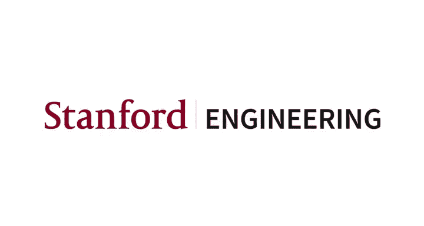
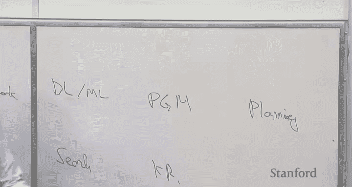
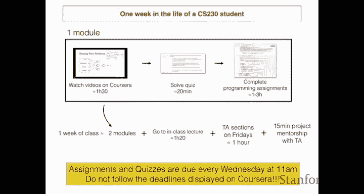
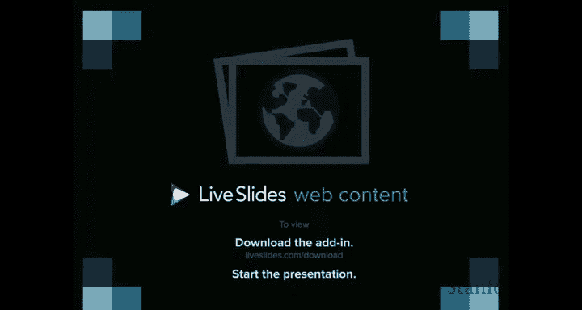
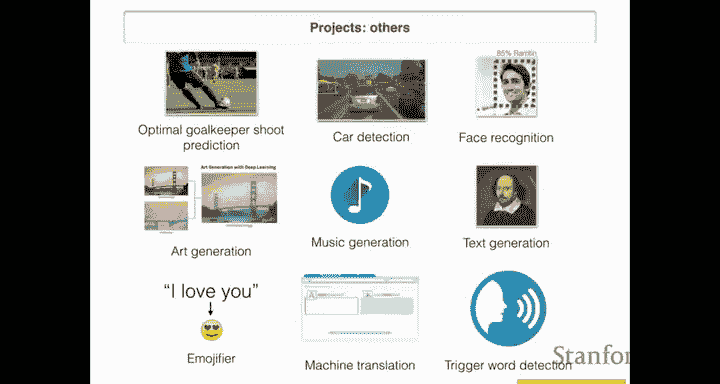
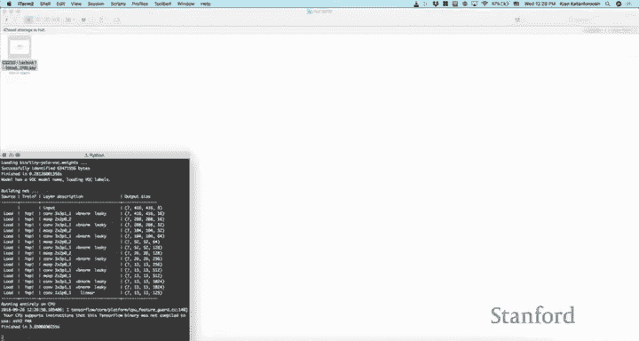
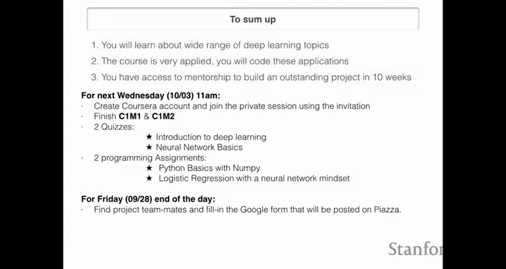
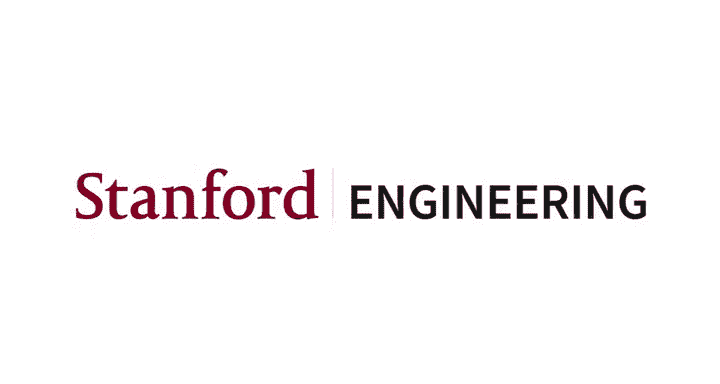

# 吴恩达@斯坦福大学《深度学习｜Stanford CS230： Deep Learning ｜ Autumn 2018》中英字幕（豆包翻译 - P1：[01]Lecture 1 - Class Introduction & Logistics, Andrew Ng.zh_en - GPT中英字幕课程资源 - BV19y421z7jz

Okay， hey everyone， morning， welcomel to CS230 Deep learning。

 So many of you know that deep learning these days is the latest hardest area of computer design or AI arguably deep learning is the latest hardest area of you know all of human activity maybe but this is CS230 deep learning where we hope that we can help you understand the state of the art and become expert at building and applying deep learning systems unlike many Stanford classes。

 this class will be more interactive than others because this class we offer in the flipped classroom format where we'll ask you to watch a lot of the videos at home a lot of the deep learning AI content host on Cosera thus' preserving the classroom and discussion section time for much deeper discussions So to get started let me first。

😊，Introduce teaching team。 so the co instructorstructors are Kenian Katton Feruch who is actually one of the co-creators of the deep learning specialization。

 deeple AI content that we're using in this class and the rest of the teaching team Swati Dube is the class coordinator and she has been working with me and others on coordinating I guess CS230 also CS29 CST29 to make all of these classes run well and let you have a relatively smooth experience Euns Mauri is the co advisor and he also worked closely with Kian in creating a lot of the online content that you use and Euns is also head T for CST29 which some of you may also be taking and then we have two co T Abagu who's worked on machine learning research for a long time and。

ho's still traveling back， I think， and also a large team of Ts that I think about half of our Ts in CS230 had previously T discourse and their expertise spends everything from applying machine learning to problems in healthcare。

 applying machine learning or applying deep learning to problems in in robotics to problems in computational biology to problems in so I hope that as you work on your projects this quarter as part CS230。

 you' be able to get a lot of great advice and help and mentorship from all of the Ts as well。

 So the plan for today is I was going to spend maybe the little bit of time sharing with you what's happening in deep learning。

 why deep learning is taking off and how this might affect your careers and then in the second half can will take over and talk a bit more about the projects you。

Work on in this class， not just a final term project。 but you know。

 the little machine translation system you build， the face recognition system you build。

 art generation system you build all of the many pretty cool machine learning。

 deep learning applications。 I think you get to build throughout the course of this quarter and also share you the detailed logistics for the plan for the class okay。

😊，So I think thats。Let's see。 All right。 I'm going to just use the whiteboard for this part。Cool， so。

You know。Deep learning， right， It seems like the media still can't start talking about it。

 And it turns out that a lot of the ideas of deep learning have around for several decades right the basic ideas of deep learning happen around for decades。

 So why is deep learning suddenly taking off now Like Why is it coming out of nowhere or whatever people say。

 I think that the main reason that deep learning has been taking off and why， you know。

 suddenly all of you hopefully we be do really powerful things with it much more effectively than two or three years ago is the following。

For a lot of。Over the last couple decades with the digitalization of society。

 we've just collected more and more data。 So for example。

 all of us spend a lot more time on our computers and smartphones now。

 and whenever you do things on the phone， know that creates data and and what used to be represented through pieces of paper is now much more likely a digital record as well。

 So if you go take an x-ray at least in the United States。

 less than some other developing economiesies in the United States。

 there's a much higher chance now that your X-ray in the hospital is a digital image rather than the physical piece of film。

 or if you order a new marker there's a much higher chance that the fact that you order a marker off a website is now represented as a digital record compared to 10 years ago when the state of the global supply chain。

 actually if you order if you order 10000 markers there's a much higher chance。

 10 years ago that the fact that。Place that order was stored on a piece of paper that someone stt saying。

 hey， ship 10000 markers to Stanford， but now that's much more likely to be a digital record。

 And so the fact that so many pieces of paper are now digital has created data。

And for a lot of application areas， the amount of data。Has。Sor of， you know， exploded over the loss。

20 years。 But what we found was that if you look at more traditional。Learning algorithms。Yeah。

Traditional machine learning algorithms， the performance of most of them with plateau even as you feeded more and more data。

 So by traditional learning algorithms， I mean logistic progressions， vector machines。

 you know maybe decision trees develop influential details。

 and it was as if our older learning algorithms didn't know what to do of all the data you can now feed it。

 but what we start to define several years ago was if you train a small neural network。Right。

This performance may look like that。 if you train a medium。

Nenet this performances me looks like that。 And if you train a very large neural net the performance kind of keeps on getting better and better up to some usually up to some theoretical limit called base error array。

 which you learn about later this quarter。 but performance can never exceed 100 percent but sometimes sometimes there's some ceilinging on the performance。

 but we've been able to measure on many， many problems we've not yet I think that across machine learning and deep learning broadly。

 I think we've not yet hit the limits of scale。 and by scale， I mean， the amount of data。

 you can throw the problem that's still useful for the problem as well as the size of the neural networks。

 And I think you know GP computing was a large part of how we were able to go from training small to medium to now training very large neural networks。

 And once upon a time I think the first actually I think a lot of the early work on training neural networks on GPUs which actually done here as。

Ker using Ka to train neural networks。 But what used to be。

 you know one of the one of the lessons we learned over and over in computing is that what yesterday's supercomputer is today's processor on your smartwatch and so what used to be an amount of computation that was accessible only to large research labs and Stanford。

 they could spend 100000 on GPUus today， you could rent that on a cloud relatively inexpensively。

 and so the availability of relatively large neural network training capabilities has allowed really students really almost everyone。

 many people not not many people to have enough access computational power to train large enough neural networks to drive very high levels of accuracy for a lot of applications and it turns out that if you look broadly across AI I think。

Mass media right newspapers reporters use the term AI。

 I think within academia or within the industry， you tend to say machine learning and deep learning。

 but if you look broadly across AI， it turns out that AI has many。

 many tools that's beyond machine learning that's even beyond deep learning and if any of you take CS221 right stamp is AI class Great class you learn about a lot of these other tools of AI but the reason that deep learning is so valuable today is that if you look across many of the tools of AI and that's safe。

You know， there's a deep learning。Slash machine learning and again some of you know neural networks and deep learning mean almost exactly the same thing right It's just that as you know as we start to see deep learning rise over the last several years。

 we found that deep learning was just a much more attractive brand and you know and so that's the brand that took off but if you look at if you take an AI class。

 if you look broadly across the portfolio of toolss you have an AI。

 I think that you know often use deep learning machine learning。

 I' sometimes also use a probabilistic graphcom model we should learn about CS22 also great class。

 Sometimes I use the planning algorithm when I'm working on self driving car you need a motion planning。

 you need various planning algorithms sometimes I use the search algorithm sometimes I use knowledge representation。

 It's very interesting。 This is one of the technologies specifically knowledge graphs is。

One of the technologies that is widely we use an industry。

 but I think often underappreciated in academia if you do a web search and a web search engine posts up a hotel and a list of room prices and what is wi-fi with a swimming pool that's actually a knowledge draft or knowledge representation knowledge draft so it's actually used by many companies this large databases。

 but is actually maybe underreciated in academia or sometimes even game theory。

哎。So if you learn about AI， there is a very large portfolio of many different tools you will see。

 But what has happened over the last several years。Is。

If you go to a conference on probabilistic graphical models， right。

 if this is time and this is a performance。You see that you know， every year。

 probabili graphical models work a little bit better than the year before。

 if you go to the UAI conference， uncertainty and AI conference。

 maybe one of the leading conferences， maybe the leadingding one notll on PGMs。

 you see that every year， researchers publish papers are better than the year before in the state the field is steadily marching forward same for planning。

 if you go to triple AI or something you see a few is advancing search albums are getting better。

 knowledge representation algorithms is getting better， game theory algorithms are getting better。

 And so the field of AI marches forward across all of these different disciplines。

But the one that has taken off， you know， incredibly quickly is。Deep learning。

Machine learning and I think a lot of this progress was initially driven by scale。

 scale of data and scale of computation。 the fact that we can now get tons of data thrown into genuine network and get good performance。

 but more recently has been also driven by the positive feedback loop of seen early traction in deep learning thus causing a lot more people to do research and deep learning algorithms。

 And so there's been tons of algorithmic innovation in deep learning in the last several years。

 And you hear a lot about algorithms that were you know。

 relatively recently invented in this class as well。 And so really。

 I think initially the twin forces of a scale of data scale of computation。

 but now the triple forces of also a lot of algorithmic innovation and massive investment is continuing to make deep learning make tremendous progress。

😊，And so in CS 230。Be kind of， I think two main goals。

 The first is to have you become expert in the deep learning algorithms。

 have you have you learned the city of the art have you have deep technical knowledge on the save outs and deep learning And second is to give you the know how to apply these algorithms to whatever problems you want to work on。

 So one of the things I've learned。 So I think actually some of you guys know my history， right。

 So work the Stanford for a long time， then started as leading the Google brain team。

 which did lot of projects at Google。 And I think the Google brain team that built from scratch was arguably the leading force for helping Google go from what was already a great Internet company and today a great AI company。

 And then did something something that Baid do in China or which was head in China。

 which kind of help Baidu。😊，Go from also what was already a great company into today。 you know。

 many people say China's greatest AI company。 and I think through working on many projects at Google。

 many projects at Bau and now leading landing AI helping many companies on many projects and running around the different companies and see many different machine learning projects they have。

 I think I've been fortunate learn a lot of lessons not just about the technical aspects of machine learning。

 but about the practical know how aspects of machine learning。

 And if you and I think that what you can learn from you the internet or from purely academic sources or from reading research papers is a lot of the technical aspects of machine learning and deep learning。

 but there are a lot of other practical aspects of how to get these algorithm to work that I actually do not know of any other academic course that kind of goes into great depth teaching it there might be one。

 but。😊，Not sure， but one of the things that we hope to do in this class is to not just give you the tools。

 but also give you the know how on how to make it work And I think， you know。

 actually spent a lot of time thinking about so actually late last night I actually that very late last night reading this new book by John on software architecture。

 And I think that there's a huge difference between， you know。

 a junior software engineer and a senior software engineer。

 maybe everyone understands the C plus and the Python and a Java syntax。

 you can get that just figure out hey， this is how C works。

 this is how job works is how Python works。 But is often the high level judgment decisions of how do architecture the system what abstracts you use how do you define interfaces that defines a difference between really good software engineer versus a less experienced software engineer understanding C syntax。

 I think in the same way。Today， there are lots of ways for you to learn the technical tools of machine learning and deep learning。

 and you will learn that in this class。 you learn how to trade a neural network。

 if you learn the latest optimization algorithms， understand deeply what the con is。

 whether recurring neural network where when an LTM is you understand what intention model is you learn all of these things in great detail and you work on projects and computer vision national processing。

 speech and so on。 But I think one of the thing that is relatively unique to this class and to I guess the things you see the deeple AI Cora websites as well the things we do in class is trying to give you the practical know how so that when you're building machine learning system。

 you can be very efficient in deciding things like should you collect more data or not And the answer is not always yes。

 I think I think that many of us try to convey the message that having more data。

is good and that's actually true。 More data pretty much never hurts。

 But I think the message of big data has also been over hypped and sometimes it's actually not worth your while to go and collect more data but so when you're working on a machine learning project。

 And if you' are either doing it by yourself or leaving a team your ability to make a good judgment decision about should just spend another week collecting more data or should just spend another week searching for hyper parameters or tuning parameters your neural network。

 that's the type of decision that if you make it correctly can easily make your team 2 x or 3 x or maybe 10 x more efficient。

 And so one thing we hope to do in this class is the more systematically in parts to you this type of knowledge And so I think even today。

 you know actually I actually visited lots of a machine learning teams around silicon value around the world and kind of see what they're doing。

 And recently， I visited a company。😊，That are a team of 30 people trying to build a learning algorithm。

 and a team about 30 people was working in a learning algorithm for about three months， right， and。

 and they had not yet managed to get it to work。 So they basically， you know， like， you know。

 not succeeded after three months。 One of my colleagues took the data set。Oh， can。

 can you're broadcasting。Don't say anything bad。All right。All right。

 so one of my colleagues took the data set home and spent one weekend working on it。对， let's j一 now。

哎Yeah没爱 go。And and and one of my colleagues working on this problem for one long weekend。

 he worked on over a long weekend for three days， was able to build a machine learning system that outperform what this group of 30 people have been able to do after about three months。

 So was that that's It know。 that's more than a ten difference in speed and and a lot of the differences between the great machine learning teams versus less experience ones is' actually not just do you know how to implement is's not just。

 you know how to implement in LTM in Tensorflow or carers or whatever。

 you have to know that but it's actually other things as well。

 And I think Kenn and I and a teaching team are looking forward to trying to systematically impart to you a lot of this knowhow so that when hopefully someday with you are leading a team of machine learning engineers or deep learning engineers that you could help direct the team's efforts more efficiently。

😊，And oh， and actually， if any' interested， one of the things I've been。Actually。

 how many of you have heard of machine learning yearning？Machine learning yearning。 Wow。

 almost none of you。 Okay， interesting。 So this is if this is your first machine learning clause。

 this may be too advanced for you。 but if you've had a little bit of other machine learning background。

 machine learning yearning is a booklet that've been working on its still in draft form but if any of you want to but machine learning yearning is my attempt to try to turn get the best principles for turning machine learning from a black art into systematic engineering discipline。

 And so if you go to this website you know， this website willll send you actually I just finished the last just finished the whole book draft last weekend And so email out soon。

 So if you want to copy， go to the website and enter your email address and I'll make sure that when we send out the book actually might be later today。

 I' not sure that that you get a copy of the book draft as well。😊。

I tend to write books and then just post them on the internet for free so you could。

 but here we just emailed in the out to people so you can can you can get it if you go to the website。

And I think this will and I think this caused to talk a lot about lot of the principles in machine learning year。

 but give you much more practice as well than than just reading a book， might。嗯。So。Let's see。 Okay。

 so。Cian will give a greater overview of what we'll cover in this class。

 but one of the principles I've learned as well is that you know so I think actually some of you know my background is cofounder Cora wasn't educated for a long time。

 So it's been a long time， really thinking a lot about education。 And I think CS S 230 represents。

 you know Chiian and I and our teaching teams a really best attempt to deliver a great on campus deep learning course。

 And so。Oh interestinging。嗯。And so the format of this clause is what's called a flipped classroom class。

 and what that means is that so you know I think I've taught on SPD for a long time many。

 many years I guess and I found that even for classes like CST29 or other Stanford classes often students end up you know watching videos at home and I think with the flipped classroom。

 what we realized was if many students are watching videos of these lectures at home anyway why don't we spend a lot of effort to produce higher quality videos that you can watch then are more time efficient for you to watch at home and so our team created videos deep learning about AI created kind of the best videos we knew how to create on deep learning that are now host on Cosera and so I actually think that it would be quite time efficient for you to watch those videos do the。

Online pro exercises， do the online quizzes。 And what that does is it preserves the class time。

 both the weekly sessions that we meet right here on Wednesdays。

 as well as the T A discussion sessions on Fridays for much deeper interactions and for much deeper discussions。

 and so。The format of the class is that we ask you to do the online content created by Dev Hoson Cosera and then in class both the meetings with Kiian and me。

 I think Kiian and I were split these sessions roughly 50-50 as well as for the deeper small group discussion sessions you have with the TAs that lets you spend much more time interacting with the Ts interacting with Kiian me and going deeper into the material than just than the online content by itself and that will also give us more opportunities to give you advanced material that goes beyond was hosted online as well as give you additional practice with these concepts right？

And so。Let's see。Yeah， and so I was to finish up with two more thoughts and now'll hand it over to Kan。

 I think， you know。Machine learning， deep learning， AI， whatever， it's changing a lot of industries。

 right I think AI is the new electricity。Much as the rise of electricity about 100 years ago。

 starting in the United States transformed every industry， really， you know。

 the rise of electricity transformed agriculture because finally。

 we have refrigeration that transform agriculture， it transform healthcare。

 imagine going to hospital today， there's no electricity。 how do how do you even do that computers。

 mental devices， how do run a healthcare system transform communications through telecom through the telegraph initially。

 but now so much communications really needs electricity。

 but electricity transform every major industry。 And I think machine learning and deep learning has reached a level of maturity where we see a surprisingly clear path for it to also transform pretty much every industry。

 And I hope that through this class after these next 10 weeks that all of you will be well qualified to go into these different industries and help transform them as well。

 And I think you know， after this class I hope that。

Be well qualified to like get a job at some of the big shiny tech companies that have large AI teams。

 I think a lot of the most exciting work to be done today is to go into the less shiny industries that do not yet have AI machine learning yet and to take it to those areas actually on the way and chatting with a student that works in cosmology who is commenting that who was it at the back was commenting the cosmology needs more machine learning and maybe he will be the one to take a lot of the ideas from deep learning into cosmology because I think even outside the shiny tech areas like maybe since I hope play a role in AI of two large companies I'm likeing Internet search companies。

 And I think that but I think and I think it's great that we have those great AI teams like Google G AI group other large tech companies have great AI teams I think that's wonderful。

 I think a lot of the important work to be done that hope many of you will do is to take AI to healthcare take AI。

😊，Take to civil engineering。 Take AI to mechanical。 I think all of this is worth doing。

 Just like electricity didn't have one killer app is useful for a lot of things。

 And I think many of you will go out after this cause and execute many exciting projects。

 both in tech companies and in， other areas that that like cosmology right or other areas that were not traditionally considered Cs areas。

😊，So。Just wrap up with two last thoughts。I think that。

One of the things that excites me these days is。Hoping呃。

I want to share you one of the lessons I learned， right。

 watching the rise of AI in multiple companies and spent a lot of time thinking about， you know。

 what is it that makes a great AI company。 And one of the lessons I learned was really hearing Jeff Bezel speak about what is it that makes for Internet company And I think a lot of the lessons that we learned with the rise of the Internet will be useful an Internet was maybe one of the last major technological ways of disruption。

 And just as it is a great time to start working on the Internet maybe 20 years ago。

 I think today is a great time to start working on AI on deep learning。

 And so sort way to turn on the lights on this side as well。 do I control that。😊，啊。Okay， thank you啊。

 nice。So， so I want to share with you one of the lessons I learned really spend a lot time trying to understand the rise of the Internet because I they be useful to many of you as you navigate the rise of machine learning AI in your upcoming careers as well。

 which is。😊，One of the lessons I learned was you can take your favorite shopping mall。Okay。

And build a website for the shopping mall。That does not turn your shopping mall。ううん。

Into Internet company right so you know， like my wife like Stanford Shopping Center and and Stanford Shop Center has a website。

 But even if you know a great shopping mall sells stuff on a website。

 there's a huge difference between a shopping mall with a website compared to true Internet company like an Amazon and。

 So what's the difference。 about5，6 actually6，7 years ago。

 I was chatting with the CEO of a very large American retailer。 And at that time。

 he and his CIO were saying to me， they were saying， look， Andrew。

 we have a website we sell things on a website。 Amazon has a website。

 Amazon sells things on the website is the same thing。 But of course it's not。 And today。

 this particular large American retailers， you know future existence is actually a little bit in question。

 partly because of Amazon。 So one of the lessons I learned really very inezzos is that what defines an Internet company is not just you have a website。

😊，Instead， it is， have you organized your team or your company to do the things that the internet lets you do really well。

 for example。Internet teams engage in pervasive A B testing。

 right we we we know that we could launch two versions of the website and just see which one works better。

 And so we learn much faster。 Where a traditional shopping mall。

 you can't launch two shopping malls in two parallel universes。 You see which one works better。

 So you just it just it's much harder to do that。 we tend to have short shipping times。😊，Yes。It。

Right， you can ship a new product every day or every week。 And so you learn much faster。

 Where a traditional shopping mall may redesign the shopping mall once per once every three months。

 right， And we actually organize our teams differently。 We tend to push decision making。😊。

Down to the engineers or engineers and product managers， because in the traditional shopping mall。

 you know， things kind of move slower and maybe the CEO says something and then everyone just does what the CEO says and that' fine。

 but in the Internet era， we learn that the technology and the users is so complicated that only the engineers and the product managers for those you that know what that is are close enough to the technology。

 to the algorithms and the users to make good decisions。

 And so we tend to push the Zoo making power in Internet companies down to the engineers or engineers and product managers。

 and you have to do that in the Internet era because that's how you organize a company。

 or organize a team to do the things the internet lets you do really well。

So I think that was the rise of the internet。I think with the rise of the AI era or AI machine learning or deep learning。

 whether you want to call it， we're learning that if you have， you know， a traditional company。Plus。

 a few neural networks。う。That does not。By itself。Turn the company into an AI company。

 And I think what will define the great AI teams of the future will be。

 do you know how to organize your own work and organize your teams' work to do the things that modern。

 you， machine learning and deep learning and other AI things lets you do really well。

 And I think having the AI teams at Google and Bau the buyers。

 I think Google and Bau are great and ahead of many other companies and thinking through。

 But I think even the best companies in the world having completely figured out whether the principles by which to organize AI teams。

 But I think some of them will be that we tend to I think that AI teams tend to be very good。

As a strategic data acquisition。And so you see AI companies or AI teams even even you do things that may not seem like it makes sense。

 why do these companies of all these three products that don't make any money， Well。

 some of it is acquire data that you can monetize through other ways through advertising or through learning about users。

 And so there are a lot of data acquisition strategies that at the surface level may not make sense。

 but actually do make sense if you understand how this can be married with deep learning algorithms to create value elsewhere。

 And I think that AI companies tend to organize data differently。

Right AI teams tend to be very good at putting our data together。

 I think before the rise of deep learning， many companies have fragmented data warehouses where we have a big company。

 if you have 50 different databases you know in 50 different divisions it's actually very difficult for an engineer to look at all this data and put it together to train the learning algorithm to do something valuable。

 So the leading AI companies tend to have unified data warehouses。

 And I guess and I know we have a large home audience or SPD or other home audience here。

 So if any of you work at large techch companies， this is something that many companies are investing in today to lay the foundation for learning algorithm rooms。

We tend to be very good at smarting， pervasive automation opportunities。

Right which is very good at spotting opportunities where you could instead of having people do a task。

 have a deep learning algorithm do a task。 So have a different AI algorithm do a task。

 And we also have a。😊，う。New job descriptions， which I don't have time to talk about。

 But just as with the rise of the internet， we started creating a lot of new roles for engineers right I think actually once upon a time。

 the world was simple and there was just the software engineering title。

 But as technology got more complicated。 we started to specialize。

 So that's why with the internet where frontend backend。

 mobile and then we and then we increasingly other roles Q Devs it specialization of knowledge。

 And so with the rise of machine learning we're starting the creation of new roles like machine learning engineer machine learning research scientists and our product managers and AI teams also behave differently than product managers in Internet companies。

 And so one of the things will revisit a few times throughout this quarter is and I don't mean to corporate。

 I know that many of you some of the SVD audience or online audience are really work company many of you。

😊，When you graduate from Stanford will end up maybe starting your own company or joining an existing company。

 but I think that solving a lot of these questions of how to organize your teams effectively in the AI era will help you do more valuable work。

And I think to make one more analogy， you know I think that one of the things I hope Kenian and I will share with you throughout this quarter is just as in the software engineering world。

 it took us a long time to figure out what is agile development or what the pros and cons of waterfall model versus agile or how do you what is a strongum process it' code review a good idea。

 seems is a good idea to me but these practices after after programming languages were creative or invented or whatever。

 we still had to figure all these ways to help individuals and teams write software effectively And so if you worked in high performing corporate industrial AI teams using these software engineering practices。

 everything code review to agile to whatever you know that having a team work effectively the write software is more than everyone knowing C plus+ syntax。

 everyone。Python syntax， and I think in the machine learning world。

 we're still in the process of inventing these types of processes， What is the str。

 what is the agile development， what's the equivalent of code review for developing machine learning algorithms。

 And I think probably this class， more than more than this class the machine learning you're learning more than any other visuals I'm aware of right now。

 I think well try to systematically teach you these tools so that you don't just are able to derive a learning algorithm and and implement the learning algorithm。

 but that you're actually you know very effective in terms of how you go about building these systems。

嗯。So last thing before I passit Kian is the other question that I've been asked。

 I guess several times this week now that just preemptively answer is so there are multiple machine learning classes going on at Stanford this quarter So the other frequently asked question is which of these classes should you take。

 So we me just addresss that preemptively before someone asked me because I've been asked twice already in the other two classes this quarter So I think actually what's happened over the last several years at Stanford is the demand for machine learning education has been rising dramatically because I mean the majority of CSPD applicants at Stanford are applying to do work and machine learning or applying to do work in AI and I think all of you can kind of see that there's such a shortage of machine learning engineers and there's a little bit of and I think。

Shor would continue for a long time。 So I think many people see that if you come explain machine learning。

 there'll be great opportunities for you to do meaningful work on campus to take machine learning to come bio or cosmology or mechanical or do great research on campus as well as graduate from Stanford and do very unique work when I wonder around Silicon Valley。

 I feel like there are so many ideas for great machine learning projects that exactly zero people seem to be working on because it's just aren enough machine learning people in the world right now。

 So by learning these skills， could you have many opportunities to be the first one to do something very exciting and meaningful and and you probably read in the newspapers about how much money machine learning people make。

 I'm actually much less。 I actually find that I hope a lot of you make a lot of money。

 I actually don't find out that。😊，You， as exciting。

 I think that every time there's a major technological disruption。

 it gives us an opportunity to rem launch parts of the world。

 And I hope that as some of you go improve a healthcare system， improve educational system。

 Maybe you， see if you can help preserve the smooth functioning of democracy around the world。

 I think that it really your unique skills in deep learning will give you opportunity to do that。

 I think hopefully very meaningful work。😊，But because of this massive massive rise in demand for machine learning education。

 there are so for a long time， CS229 machine learning was the core machine learning class at Stanford and then CS230 is actually the newest new creation I think and the other class that we involved in that Unis and I are involved in this quarter is CS229 A so if trying to decide which of these classes to take I think that these classes are a little bit like Pokemon right you really should collect them all but I think we've been trying to design these classes to actually teach different things and not have too much overlap and so there is so I have seen students take two classes at the same time and that's actually fine's not the rear of OL is fine that you actually learn different。

😊，if you take any two of these classes at the same time。

 CS229 is machine learning is the most mathematical of these classes and we go much more CS29 goes much more into the mathematical derivations of the algorithms CS229 is applied machine learning is much less mathematical but spends a bit more time on the practical aspects is actually the easiest on ramp to machine learning as well as the least mathematical of these classes CS230 is somewhere in between is more mathematical than CS29 less mathematical than CS230 but where CS230 focuses on is on deep learning。

 which is just one small subset of machine learning。

 but is the hotest subset of machine learning whereas there are a lot of other machine learning algorithms from your PC K means recommended systems support vector machines that are also very useful that I use in my work quite frequently that we don't teach in CS230 but that is taught in CS229 and CS29 so。

ne things about C230 is it focusing on deep learning。

 So It know if you wantna list deep learning on your resume。

 I guess maybe this is the easiest way to do it。 I don't know。

 it's not what I tend to optimize for bit。 but and I think CS230 goes the deepest in the practical know how and how to apply these algorithms and so I want to set expectations accurately as well So what I don't want you guys to complain in a quarter that there wasn't enough math because that's actually not the point what has happened in the last decade is the amount of math you need to be a great machine learning person has actually decreased I think I wanted to do less math in CS230 but spend more time teaching you the practical know how of how to actually apply these algorithms yeah I think to is easiest class that's the most this is the most handson you do a lot of projects on different different topics and I think these calls。

A often the foundation or some subset that these are often the foundational causes that students say。

 because if you say learn deep learning。 So common sequence for students is the， you know。

 learn the foundations the machine learning。哦。啊。Machine learning of deep learning so you have the foundation first before you go which then often sets you up to later go deeper into computer vision or national language processing or robotics or deeper reinforce learning and so common sequencing that common tactic that Stan take is the use these are the foundation you see a bit of everything from computer vision。

 national language processing， speech recognition， touch a little bit on self-driving cause。

 but that gives the foundation to then decide， do you want to go deeper into national language processing or robotics or enforcement learning or computer vision or something else。

 So is common sequencing of classess that students take。

So look forward to spending this quarter with you。 Let me just check any quick questions。

 and then I'll hand it over to Kan。😊，Go。 what's the third bullet in AI era。Oh。

 what's the third bullet in the AI decision making by engineers and product managers。

 really pushing decision making。 I wrote decision making by engineers there。

 but really engineers and product managers。Oh AI error， sorry pervasive automation。やっぱそう。

So when you talk about ahi being the next like electricity。I was wondering so to say that。诶。

Well like so far， what are the most meaningful successes of machine learning？That you think。

Have happened already。So all of you are using learning algorithms probably dozens of times a day。

 maybe even hundreds of times a day without knowing it right Every time you use a web search engine。

 there's a learning algorithm that's improving the quality of search results there's also a learning algorithm trying to show you the most relevant ads and this helps those companies actually make a lot of money every time it turns out that actually both Google and Baidu have said that over 10% of searches on mobile through voice search And so I think it's great that you can now talk to your cell phone rather than type on a tiny little keyboard if you do a web search and mobile if you go to a website like Amazon or Netflix there are learning algorithms recommending relevant movies more relevant products to you every time you use a credit card。

 there's a learning algorithm probably from almost all companies I'm aware of theres a learning algorithm trying to figure out if you using a credit card or if its still in they should just allow see if it's a fraudulent transaction or not。

you open up your email the only reason email is even usable is because of your stand filter。

 which is because of learning algorithm that works much better now than before。

 I don't know so there's I think one of the amazing things about AI machine learning I love it when it disappears in the background use these algorithms up your math application and it finds a short drive from here there and there's a learning algorithm predicting what traffic will be like highway1011 hour now。

 but you don't even need to think that it was a learning algorithm trying to figure out what traffic will be like one hour in the future。

 Sees magical that you could just use it can build all these wonderful products and systems that people but abstract away a lot of the details that's the present And I think in the future near future most of my PhD students my research work machine learning for healthcare I think that will have。

😊，Can ins know my team at landing AI is spending a lot of time with a lot of industries from manufacturing the agriculture to other things。

 I'm excited about machine learning for education give people precise tutor people recommended precise content。

 this fascinating research done here at Stanford by Chris Pe and a few others on using learning to give people feedback on coding homework assignments so so sorry。

 there's so many examples of machine learning。 I could talk for quite some time。

rightOne last question I hand over can Yeah go ahead。 that just be very different from what is all。

Let's see so so the format of the class is that you watched videos created by Deepblded AI and host on Cora。

 So you see me a lot there。 but in addition， Ken and I will be having lectures here in this classroom every Wednesday and that will be know completely new material that is not online anywhere at least right now and then also I think the point of the flipped classroom thing really is some of the things is really more time efficient for you to just learn online。

 So there's the online content。 but what that does is at leaves this classroom time for us to not deliver the same lecture year after year。

 but to try to get spend time to get to know you have more time answering questions and also give you more inclass practice on these things So there is a coursera Deepbler AI Cora content a lot what we do in CS230 is to augment that to give you a much deeper practice more advanced。

Samples some more deeper mathematical derivations and and more practice。

 So you so you deepen your knowledge of that。And with that， let me hand it over to Qn。Yeah。

 I'm going to get back at him by making noise what he's talking。Yeah， okay。스해。O。Thanks， Andrew。

Hi everyone， I'm Kan， we're excited to have you here today。

 those of you who are in class but also those of you who are SCPD students。

 we wanted to take a little more time to explain a little bit about the course Los。

 what this course is about and also what it is to be a CS230 student in fall 2018。😊。

So the course online is structured into five chapters or sub courses。

 let's say what we will teach you first is what is a neuron you need to know that after understanding what a neuron is you're going to build layers with these neurons you're then going to stack these layers on top of each other to build a network that can be small or deep。

This is the first course unfortunately it's not enough to deploy a network just building a neural network is not enough to get it to work so in the second course we're going to teach you the methods that are used to tune this network in order to improve their performances this is the second part。

😊，嗯。As Andrew mentioned。One thing we really。Putting a huge emphasis on NS230 is the industrial applications and how the industry works in AI。

 so the third course is going to help you understand how to strategize your project that you do throughout the quarter but also in general how do AI teams work you can have an algorithm you have to identify why does the algorithm work。

 why does it not work and if it doesn't work， what are the parts that you should improve inside the algorithm。

The two last courses， coursese4 and 5 are focusing on two fields that are defined by two types of algorithms。

 first convolutional neural networks that have been proven to work very well on imaging or videos and on the other hand sequence models that include also re neural networks that are applied a lot in natural language processing or speech recognition。

So you're going to see all that。From the online perspective。We use a specific notation in CS230。

 so when I will say C2 M3， it refers to Cose2 module 3。

 so the third module of improving deep neural networks and I'd like everyone to go on the website CS230s syllabus after the class to look at all the syllabus throughout the quarter check when the midterm is and when the final poster presentation is。

😊，The schedule is posted there， so check it out and we're going to use the CourseApp platform as you know。

So on Coursesera you will receive an invite on your Stanford email and you should have received it already for course1 in order to access the platform from the platform you will be able to watch videos do quizzes and do programming assignments and every time we finish one of these courses so C1 has four modules when you're at C1M4 you will receive a new invite to access C2 and so on okay。

Inside CS230， we're going to use Piazza as a class forum for you to interact with the Ts and with the instructors you can post privately or publicly depending on the matter。

Okay， so let's see what is is to be one week in the life of a CSD  to 30 student。

 so we're going to do 10 times that over the fall quarter。😊，So what is one module in a module。

 you will watch about 10 videos on Coursera， which will be about one hour and a half。

 You will do quizzes after watching the videos。 This is going to take you about 20 minutes per module。

 and finally， you will complete programming assignments， which are on Jupyter notebooks。😊。

You will get cells to test your code and also submit your code directly on the CourApp platform。

In one week of class in Stanford here， we will have two modules。Usually。On top of these two modules。

 you will come to lecture for a one hour and a half in class lecture on an advanced topic that is not taught online。

And after that， you will have TA sections on Fridays that are around one hour。

 and it's a good chance for you to meet other students for your projects and also to interact with the TAs directly。

Finally， we have also a personalized mentorship this quarter where every one of you will meet 15 minutes per week with the TA in order to check in on your projects and give you the next steps so we put you a huge emphasis on the project in this class and we want you you will see it later build to decide of your teams by this Friday in order to get started as soon as possible。

😊，Next week you will have your first mentorship meeting with the TS。O。It's going to be fun。

Assignment and quizzes that are part of modules are due every Wednesday at 11 am。

 so 30 minutes before class， so you can come to class with everything done and understanding it。😊。

And do not follow the deadlines displayed on the Coursera platform。

Follow the deadlines posted on the CS S 230 website。

 The reason the deadlines are different is because we want to allow you to have late days and Coursera was not been for late days。

 So we， we put the deadlines later on on Coursera to allow you to submit。

 even if you want to use a late day。 Does that make sense。O。

So we're also using a kind of interactive this is going to start coursese2。

 we will use an interactive tool that is called Mentimemeterter to check in attendance in class and also for you to answer some interactive questions so it's going to start next next week sorry not course2。

Regarding the grading formula， here it is， so you have a small part on attendance that is 2% of the final grade。

 8% on quizzes， 25% on programming assignments， and a big part on the midterm and on the final projects。

嗯。So this is posted on the website if you want to check it。

 attendance is taken for in class lectures for 15 minutes TA meetings and for the TA sections on Friday。

You can have a bonus。 and we've had students very active on on Pazza， that answered。

Questions to other students， which was great。 And they got a bonus。

 So I encourage you to do the same。😊，Maybe we don't need Ts and instructors anyway。O。

So I wanted to take a little more time to go over some of the programming assignments that you're going to do this quarter so that you know where you're going。

In about three weeks from now， you're going to be able to translate these pictures here in the numbers that they correspond to in sign languages。

 so it's sign language translation from images to the output signification。

You're going to be the convolutional neural network and the first logistic integration and then a convolutional neural network in order to solve this problem。

A little later， you're going to be a deep learning engineer in a house that is not too far from here called the Happy House。

So there is only one rule in this house and the rule is that no sad person should enter the house should avoid that。

And because you're the only deep learning engineer that has the knowledge you're given this task。

 which is don't let these sad people in， just let happy people in。😊。

And you're going to build a network that will run on a camera that is in front of the house and that is going to let people in or not。

 and unfortunately some people will not get in and other people will get in because they're happy。

And you will save the happy house at the end of the assignment， hopefully。This is one of the the。

The applications of of deep learning I that I personally prefer， It's called object detection。

 you might have heard of it。 So this is running real time。 And that's what is very pressy。

 You're going to work on a deep learning architecture called Yolo V2。

And Yoo V2 is an object detection algorithm that runs real time and is able to detect 9。

000 objects as fast as that。So it's really， really impressive you have a few links here if you want to check the paper already。

 but maybe you will need some weeks to understand it。😊，O。Actually， we have a。

We can even run it directly on my computer， I think is going to be fun。

Oh yeah， we can't run it。So here you see it' running live on this computer。

And so you see that if I move， it will find out that I move so I cannot escape。Yeah， here it is。O。

Okay a few other projects， one two weeks from now you will build an optimal goalkeeper shoot prediction。

 so in soccer you're a goalkeeper and you want to decide where you should shoot the ball in order to make it land on one of your teammates you're going to find what's the exact line on the field which tells the goalkeeper where to shoot two weeks from now。

About in the， in the fourth course， convolutional neural network。

 You're going to work on car detection。 So this is a bigger image。

 This is exactly the programming assignment。 So you're going to work on the。

Autonnoomous driving application that is finding cars， finding stop signs， finding lights。

 finding pedestrians， and all the objects that are related to road features。Okay。

 this is pretty cool。 And you will generate these images yourself。

 So this is a picture taken from a camera put in the front of。😊，Of a car and was。

 was generated by Drive dot AI。You will have a face recognition system that is going to first。

Do face verification。Is this person is this person the right person。

 but also face recognition who is this person， which is a little more complex。

 We're going to go over that together both online and in lecture。Our generation。

 some of you have heard of this， it's an algorithm called neuralt transfer。

 and again we usually put the papers at the bottom of the slides in case you want to check in yourself for your project。

But this is a problem where you give a content image。

 which is a Golden Gate Bridge and a style image which is an image that was painted usually by someone or an image from which you want to extract the style this algorithm is going to generate a new image。

😊，Is going to mix the content of the first image with the style of the second image。

Music generation which is super fun， you're going to generate jazz music in the fifth course sequence models。

 you're going in the same course， also generate text by giving a huge corpus written by Shakespeare a long time ago of poems。

 you're going to teach algorithm to generate poems as if it was written by Shakespeare。

So you can even write the first sentence is going to continue。MOG P。

 you all have smartphones and I guess you notice that when you write a sentence on your smartphone。

 it usually tells you what you should put next and sometimes it's an MOG。

 you're going to do this part， you're going to implement the algorithm that takes an input sentence and tells you what's the MOG that should come after it。

😊，Machine translation is a。Is one of the application that has been。

Tremendously performing well with deepearning， you're going to implement not a full machine translation from one language to another。

 but a similar task that is as exciting， which is changing human readable dates to machine readable dates。

So you know， let's say you're filling in a form and you're typing a date。

 the entity that gathers this data will have a hard time convert all these dates into a specific format。

 you're going to implement the algorithm that is going to take all these different dates in different formats and generate the right format。

😊，Translated to human， from human readable to machine readable data。And finally。

 trigger word detection that I also love and some of you have seen us build this algorithm a year ago。

 I believe， which Eunice and Andrew and I have worked on。

 trigger word detection is a problem of detecting a single word。So you know。

 you probably have objects from big companies that detect the voice and activate themselves under a trigger word。

 you're going to build this algorithm for the trigger word activate。

And many more projects that you will see。Now， these are the things that you will all build in this course。

 Every one of you will build it through programming assignments。

But you also have to choose your own projects to work on to the course。

 And these are example of projects that C S 2，30 students have have built in the past and which have worked very well。

One is coloring black and white pictures using a neural network into the color representation of these pictures。

 So it's pretty cool because we can now watch movies that were。😊。

That were filmed in the 1930s or 1950s。 Or I don't know when in color， which is super cool。😊。

Predicting a price of an object from a picture， so this was a great project in the first iteration of CS230 where you give it a bike and the neural network guesses how much is the bike。

😊，So if you want to sell stuff， you don't know how much， just give it。Then you sell it at the price。

 The student had actually implemented an algorithm to see which features of the bike are related to the price。

😊，So it was super fun to see if it's the steering wheel or if it's the wheels or if it's the body of the bike that makes this bike expensive according to the algorithm。

😊，And many more。 so last quarter specifically we've had a lot of projects in physics and astrophysics and chemical engineering and mechanics。

 which was great。 Some examples are detecting earthquake precursor signals。😊，With a sequence model。

Predicting the atom energy based on the atomic structure of an atom。 So you， you have， for instance。

 softwares that run that are really computationally expensive。

 that look at the atomic structure of an atom。 and we'll output the energy of this atom。

 This takes a long time。 These students have tried to make it a threesecon problem by running a neural network to find the energy of the atom。

 So you have a bunch of problem across industries。 So healthcare cancer parking on Alzheimer detection。

 we've had a lot of this。 We've had brain tumor segmentation segmentation is a problem of on an image。

 classify every pixel。 Tell me which pixel correspond to the tumor， for example。😊。

So we're really excited to see what you guys are going to build at the end of this quarter and that's why we want you to build your teams very quickly。

 get started because the project is what you should be proud of at the end of the quarter we hope that you guys will cover the poster session proud of your poster proud of the final project that you sent us and you can talk about it in the 10 next years or 20 next years hopefully。

😊，And I guess Andrew can confirm that CS229 students from the few past years have done projects that are amazing today and have been featured around the world as a researcher or industrial project。

So to sum up in this course， you will build a wide range of applications。It's very applied。

 There is some math， but less than CS2 to9， more than CS2 to9A。And you have access to。

Personalized mentorship， thanks to the amazing T8 team。And the instructor。嗯。😊，And finally。

 we'll have to build a 10 week long project。So now we get to the serious thing what is what we are up to this week so at the end of every lecture you'll have one slide that's gonna remind you what you have to do for next week next Wednesday。

 11 AM so create your Coursera account based on the invite that you receive if you didn't receive an invite send it as a private post on Pazza we will send it again finish the two first modules of course1 C1 M1 and C1 M2 it corresponds to two quizzes and two programming assignments and around 20 videos which are listed here and for Friday it means two days from now by the end of the day find project teammates and fill in the form to tell us who are your teammates is's going to help us find you a mentor。

嗯。Finally， there is a T A section also this Friday。 no project mentorship。 It will start next week。

 but we， we will see you on Friday。 I'm going to take a few questions if you have about。 Yes。

 these slides。 Yeah， these slides are going to be posted at the end of these task。😊。

。So the TA sections， we're going to have a large range of TA section on Friday。

 so there's going to be basically every time you're going to be assigned to one of them。

And if you want to move， you can send an email as a Pazza post privately to us to be moved to another section。

help is visit team。How big is a team usually it's from one to three students。

 exceptionally we would accept four students if the project is challenging enough。Yes。

 can we combine the project with other classes as well？

So it is possible to combine the project with other classes and it's been done in the past。

 What we want is you to。To give a project and a poster that that is framed as C S 230 wants it to be framed。

 I。 And you discussed with us in order for us to validate if you can merge this project with another class。

 because it requires to have deepear。 Of course， you。

 you're not supposed to combine this project with something that doesn't have deepear at all。Okay。

One more question。zz zz zzSo you can retake the quizzes as much as you want on Coursera。

 We will consider the last submitted quiz for this class。 Okay。

 so you can resubmit if you didn't get full grade。😊，Yeah， okay， thanks guys and see you on Friday。

