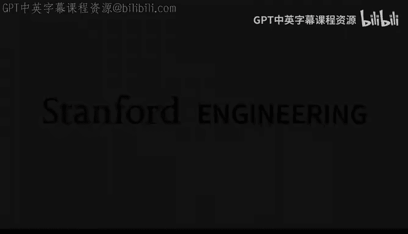
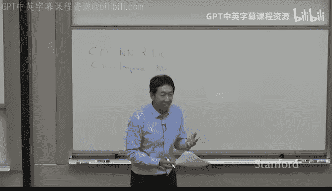
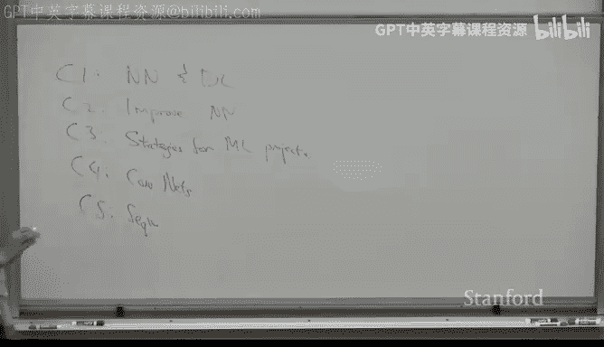
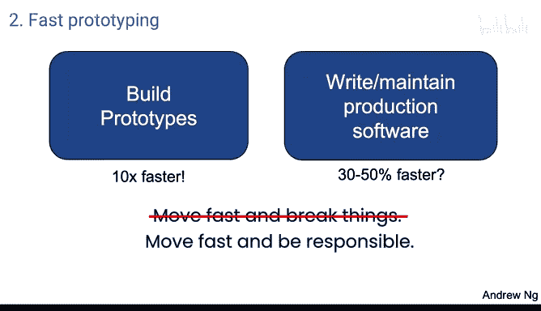
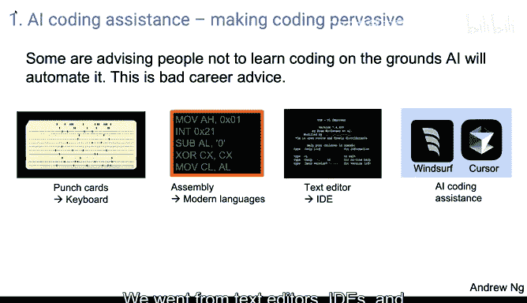
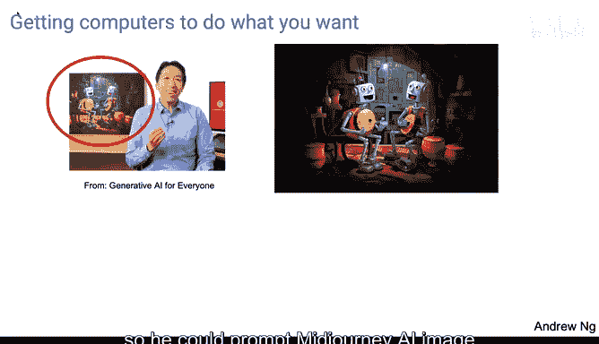

# 吴恩达@斯坦福大学《深度学习｜CS230 Deep Learning 2025》中英字幕 - P1：1_ Introduction to Deep Learning.zh_en - GPT中英字幕课程资源 - BV1J1x4zoEVK

What I want to do today is give an overview of this class。

 I'm actually curious before we get started， This is now September 2025。 How many of you， you know。

 just started at Stanford。 Raise your hand。Wow， cool， awesome。

 So others pay attention to who just raise their hands and do say hi to them and， you know， hope。

 welcome all of the people that just joined Stanford in whatever program。😊，嗯。

CSU 30 is a class that we offer in the flipped classroom format。

 and what that means is that instead of listening to me or Chiian my coinstructor that you meet you meet next week。

 instead of listening to us lecture at you for an R 20 minutes or whatever why actually ask you to watch a lot of the video lectures online so that we can then make use of the preciouss in classroom time for much richer。

 deeper discussions so both today and for the entire quarter。

 I would really warmly welcome anyone raising questions raise your hand and in fact。

 I find that instead of you sitting there even though we have a longer session schedule by the registrar will use usually only up to an R 20 minutes for this course and the goal is to it turns out that a lot of Stanford students were watching you know the lectures on Sgull on the。

Online videos anyway， so rather than us delivering that lecture， same lecture year after year。

 we put a lot more effort to put very high quality lecture videos online and we'll ask you to just watch that online。

 which people are doing anyway， but just highlyeditive。

 offline watching and spend the classroom time you know doing the things that makes sense for us to get together in person too。

So because you haven't watched any of the lectures yet。

 or I assume most of you have not today will even maybe have a slightly shorter session to use the class。

 talk over logistics， and so on， right？As many of you know。

 deep learning is one of the latest hottest trends technologies of computer science and AI if we look at。

 you know， say our PhD emissions or even NASA's admissions。

 a very large fraction of all students that come to Stanford or applying to come to Stanford want to work on AI right I'm not sure if I'm allowed to say the numbers。

 but they are you know extremely high， as you can imagine。

And so my goal and my co instructorstructor， Kan's Go。

 our collective goal is through this quarter to help you get to near or at pretty much state of the art with regard to deep learning and make sure that all of you walk away from this class highly skilled at applying deep learning。

And so。It turns out that a lot of progress in AI over the last， I don't know， decade。

Maybe 1015 years was made by scaling。 And one of the reasons why deep learning was so successful was because it's good at absorbing a lot of data。

 so。😊，You know。If I drew a figure where on the X axis， I plot the amount of data。

We have for problem then using more traditional machine learning algorithms。

 so you know logistic regression， maybe decision trees。

 we using all the generations of AI machine learning algorithms。As you gave it more and more data。

 the performance of the accuracy of the more traditional algorithms with plateau， right。

 It was as if so take speech recognition with older generations of algorithms。

 even as you fedted more and more data， hundreds and thousands and tens of thousands of hours of speech data。

 the accuracy would often。😊，Platau， and it was as if the older generations algorithms didn't know what to do of all the data that we now have。

But what we started to find about 1015 years ago was that if you train a small。Neo network。

 also known as a small deep learning model， is performance would kind of maybe get better and better。

And if we train a medium size one。And if you train a very large。New network。

 the performance just keeps getting better and better。

 And I think the reason that deep learning has dominated the AIC for the last 10，50 years is because。

There is a recipe for training very large neural networks that we could then shove a lot of data into the results in exceptional performance。

 So I think。We started to see this because of some frankly some Stanford research papers about 15 years ago when you did the first early work on using Ker programming and GPUs to scale deep learning。

 by the way actually it one fun fact the first my first GPU machine used to train neural networks。

 using Ker， which is a controversial thing at the time。

 it was built by a Stanford undergrad in his dorm room his name was even good fellow but I think that compute server built in a Stanford undergrarad dorm room allowed us at Stanford to lay the early foundations of using Ker at that time a modern language for train GPUs to train large neural networks and then obviously that influence a lot of people and helped scaling up deep learning takeoff。

 I tell that story because sometimes the work that some of you can do in a dorm room or student housing or whatever or in a lab is Stanford looking。

BackOver some number of years， it can really have a huge impact。 and maybe in this class。

 some of you will do work as impactful as that someday as well。

But so what it started to find was that as we train larger and larger neural networks。

 they could soak up lots of data and drive exceptional performance and then those a research paper out of Baidu will show that as you scale up neural networks as you scale deepbuing algorithms。

 the performance gains are actually quite predictable so you can forecast if you buy this many GPUs。

 so this will compute industry data what would the performance be and then later open AI popularize the idea with a really influential paper on scaling laws and that predictability of how deep learninging gets better in performance then drove a lot of the investments in data centers and building very large AI models of loss of data。

嗯。And so。Let's see in terms of where this class sits。 So in computer science。

 all of us build on each other's work right， a lot of the way that computer science and AI has made progress is we build on top of other ideas that are in turn。

 build on top of other ideas They in they' in turn， build on top of other ideas。

 So maybe we want to give you a little map to show you maybe where deep learning sits。So。

 I think there are。You know， machine learning is built on top of computer science。

 I think it's actually helpful to learn CS fundamentals and even though I use。

 I suspect vast majority of use AI system coding be it tools like cloud code or general ICI or O codex or cursor or windsurf or whatever。

 I find that people that know CS fundamentals that really understand computer science that really understand how computers work rather than like I'm gonna vibe code this when you understand CS fundamentals。

 you get things that work much better。But on top of CS fundamentals。There's a sense of。

Machine learning skills。So how do you build algorithms that can learn from data？

And then deep learning is a special type of machine learning。Well。

 that's really the most effective type of machine learning of Fa cantel in which we train neural networks。

 which train certain types of algorithms to learn from large amounts of data。So far。

 the last 10 minutes you probably heard me use the words deep learning and neural networkss。

 and I think today those two terms are almost interchangeable some purs will insist on some technical differences all practical they mean the same thing。

But what happened was the term neural networks had been around for decades， but around 10。

15 years ago， a number of us realized that， you know， deep learning。It was just a much better brand。

 And so even though neural networks have been around for decades， stocking about 10，15 years ago。

 it was deep learning that took off because who doesn't want learning。😊，That is really deep。 right。

 It's just a good brand。嗯。But you hear me use those terms kind of interchange aably。

 but deep learning algorithms， neural networks。They give us a way to take advantage of more and more and more compute capacity so they can build very large AI models with a lot of parameters to soak up the large amounts of data to get more and more intelligent or to make better and better predictions。

 so generate more and more accurate outputs， using the large amount of data that's available to us。

Ever since I was a teenager， my mom's been trying to convinced me to stop mumbling。But now。

 many years later， I still struggle with that。 So I， I'll try my best。

 But please wave at me or kind of let me know if I start to drift lower again。 Yeah， I think。

My mother would be very happy that to practice like this now。All right。So CS fundamentals。

 machine learning， deep learning， and then the recent generative AI revolution。You know。

 generative AI， sorry， bat hand rating， generative AI。😊。

Which is mostly built by a specific type of neural network called a transformer neural network。

 which you learn about in the this class， you actually learn what is the transformer architecture later in this quarter as well。

 is， in turn built on top of deep learning right So I assume all of you， you know。

 I regularly prompting OMs large language models to help you get work done。 And what I find is that。

😊，While I use Os all the time for a lot of applications， just prompting LMs， it doesn't cut it。

 There are a lot of things like cannot get to work just by prompting an LM。

 and so I often have to go a layer deeper into the deep learning layer of abstraction and fillddle with deep learning algorithms in order to get certain things to work。

And in fact。So what this class covers is we'll try to make sure that you are you know。

 expert near expert in deep learning by the end of this class。

 but we' also kind of dip a little bit into machine learning concepts。

 we'll talk a lot about objective functions and tips and tricks for optimizing parameters in efficient way。

 and then we'll also actually reach up a little bit to cover some Gen AI in particular。

 we'll talk about what the transformer network。 And then through this quarter。

 Gen and I will also chat a little bit about the job landscape as relates to Gen AI and deep learning and how to use how deep learning is enabling certain types of GenI applications。

I have more to say about this， but let me just pause for a second and see if you have any questions。

Yeah隔水。重正で新。Oh， good question。 Well I say Pre right， by， congratulations。

 you've won the prize for the first question asked in CS230，2035。 so well done。😊。

Yeah so there machine learning a prereed this cause not really so I think two common entry points to AI at Stanford are CSs well a few common entry points are CS129 CS229 in CS230 if you don't know any machine learning this course may end up going a little bit fast may seem like it's going a little bit fast in the first I't know two or three weeks but some people do pick things up quickly that way and maybe actually experience so a few causes that you may hear about。

あ。So 1，29 is relatively easy entry points into machine learning that tends to。

 takes a longer time to go through the core concept of machine learning。 Like。

 what's an optimization objective， How the employment grade understands what is logistic regression。

 What's a very basic neural network。 So this is a relatively the applied。Eas as of this list。C229。

 which I'm also involved in coteaching， is much more mathematical and theoretical， very high pace。

 very intense and very mathematical。 And this is less applied than 129 and 230。

 but this will go over a lot more of the theory and the math derivations behind machine learning algorithms。

 So for example， if you want to learn how to do calculus not using real numbers。

 but calculus using matrices and vectors you know that's a bunch of of I don't know mildly complex math that's worth knowing CS229 goes over that。

 CS230， this class is relatively applied and it focuses just on deep learning。

 So if all the machine learning there a lot of machine learning algorithms out there right Sur learning unsized learning。

 a lot of machine learning algorithms out there and many。

 many of them are very useful and so they're all worth learning about but of all the machine learning algorithms out there。

 the one category that is most useful is there's taken off the most。😊。

I deep learning and this class focus is just on that， but the other also worth learning about。

 So 129 is easiest on ramp， but if you've done either 229 or 230。

 I would probably skip 129 at that point。 But if you are getting started there there are multiple on ramps。

29。Oh， yeah。 Can you take 2，3，9 and 2，30 together。 Yep， thank you， Price for the second question。

 right， feel look my clock。 short go for it。😊，Yes， you can take CS230 and CST29 together。

 we designed the two curricula to be relatively low in overlap。

 so the very small amount of overlap between these two。Right， right。

 we won't clap for every single question。 but yeah go ahead。卡分。ませ。Bage operator。Yeah。

 so when we cover the recent OM developments， we will touch on the transformer neural network。

 but not the latest OM variations in this course。I think a lot of the it turns out that when you go to get a job maybe assuming you go and work in industry。

 the number of people training OMs is actually very small right so of those jobs have be probably well pay so hear about kind of very high salaries and use media but the vast majority of application builders end up sometimes working the GenI level not that often training a transformer from scratch。

 but then often using deep learning tools as well， so maybe one example something that many of my teams have done is we have trained transform foundation models from scratch with relatively small ones and say startups but one thing we do do quite a lot is take a pretrained transformer network and then engineer our own data to further find unit right sorry if I'm using words you may not totally understand you pretrained find tune and you know what all those termss are by the end of the quarter。

The things that we actually do kind of day to day this is important for getting a bunch of problems of world so you will gain the foundations needed to do type of work in discourse the thing one thing we don't do is talk a lot about how to train the largest cutting edge transformer networks I think that is a very important skills that is relatively niche one for which some people are getting paid really really well but the number of people doing that in the world is actually small whereas the number of people building applications with you to set of skills is very large。

Pes。The calls is covering that， I think Percy Liang was thinking about doing something。

 but I don't remember he's doing it this quarter， few people I think think think about doing something like that。

说情况。哦。医療防法石。elseですね。So just repeating for themic for the home viewers what portion is coding versus what portion is mathematical ankle analysis。

 this course is relatively math light， sorry， maybe that was too strong a statement。

 but I think this course is very practical。I I remember many years back。

 I was speaking with a mathematician and， you know， we， were just chatting and he was asking。

 he was just taught about his career， why he chose to be a mathematician。 And I， I still remembered。

😊，You know， he had he had like stars in his eyes when he told me that he chose his career path because he felt his role is to pursue truth and beauty in the universe。

 and that's why he became a mathematician。In this course。

 I'm not going to do any proven beauty stuff， right， you。True of beauty is good。

 but you find that I I want to take a very practical approach to talking about how to build applications and build software that works。

好。Anything else？Right。Awesome， right， thank you for all the questions。

 please keep them coming and feel free interrupt me or Karen throughout this quarter as well with questions。

 love it。😊，So just just to flesh this out a little bit more。

 this is what I see in terms of teams building practical applications and Im saying about applications because with improving machine learning algorithm rooms。

 deep learning algorithm rooms Jen algorithm rooms there are a lot of applications that you can build now that just where you know impossible or like really inaccessible you know to any person to build even a few years ago。

And so I find that when I prompt Gen EI， it works really well。For a lot of text based applications。

 And there's work on multimodal Os， launch multimodal models。 So making inros into vision。

 making inros into audio， but really Gen algorithms， especially transforming networks。

 trained to output text， you know， likeG Gemini and so on。

 really fantastic for text based applications。 And I find myself。😊。

Regularly working with deep learning algorithms directly when I am working with。오디오デ。damage咩。

And video data。 And then also a lot of structured data。So， my handwritings。我服。Right。

So structured data refers to large tables of numbers， right like giant know Excel or Google Sheets。

 spreadsheets so that's structured data。 unstructured data refers to text， audio images， maybe video。

 And because a lot of GenI， large language models like H GV I grown up being text in text out kinds of machines。

 they are remarkable for a lot of text processing applications。 but for other types of data。

 I end up often you know dipping down directly to use various deepbuing algorithms。

And then it turns out that for textbased data， if all you do is prompting。

 you could usually go quite far。 so a lot of applications are built by prompting OMs。

 but but I've been on quite a few teams where after fiddling with the prompts for a month。

 you just can't get the performance to be better just by tuning the prompts or another good problem to have。

 it turns out use of GenI2s are relatively inexpensive when you're prototyping a few dollars per million tokens。

 you can do a lot but sometimes if you're lucky enough to be on a product that his product marketfi and a lot of users want to use。

 multiple times I've been on teams where we basically did not care about large language model bill it was like whatever $20 a month or $100 a month was fine。

But when more and more users start using it， then to your team's kind of positive surprise。

 your AI bill really starts a skyrocket。 And then at some point。

 you look at how much you're paying for your AI bill for the large language models and to bend the cost curve back down often larger techniques and deep learning become very relevant as well。

 So there are I don't know I'm thinking just some of our bills were really breathtaking。

 I don't want to say the numbers， which is kind of definitely more than we wanted to pay as much as we love the companies providing Os our bills that were're paying them were significantlyically larger than I wanted to pay and then knowing how to use deep learning to find to use smaller models that was really the criticalical skill set that just bend the cost curve back and just made the whole thing affordable to keep on providing a service so。

Yeah， right。So that's the skill sets I hope you get from this course。Let's see。All right。And。

To give her。是。Okay， sorry let me use this one。Yeah。So to give a quick overview， this cause。

 the online materials is broken down to the five modules。

 so just give you an overview of the five of them， first one is on the basics of neural networks and then neural networks and Dl deep learning so you learn how to build a neural network or deep learning algorithm from scratch and Python I find that sometimes if you use the framework like tends to fill a Pytorch it hides a lot of the detail so actually work through how to build a basic neural network and how to build a basic deep learning algorithm just in raw Python so you really understand it。

And then the second module， the second mini course will be on how to improve how to tune your neural networks。

 So we have heard that when you're training a neural network， there are a lot of parameters。

 or we call them hyper parameters。 Hyperpar are parameters of control of the parameters， right。

 So the weights of parameters， Hy parameters are things like the learning rate or what's the size of your neural network。

 And so there are actually a lot of hyper parameters that we end up tuning and try to give you a way sense of whether the most important ones and practical skills for tuning them。

 It turns out that。If a look at， you know， like my PhD students。

 I think every one of them that right， well， I think I think that probably every one of them。

 definitely everyone that every PhD student I know that became great， I think。

At some point wound up up at 2 a tuning hyperparameter right and I still have very clear recollections of like being in the office。

 you know 2 a3 a filling the parameters shall get to work。

 And it turns out that literally your skill at tuning hyperpara it really makes a difference。

 So there was some evenings that I knew my skill at tuning hyperparameter， you know frankly。

 it made the difference between whether I went home to sleep at 3 a versus where I went home to sleep at 7 a。

 maybe there not maybe don't do what I do， I'm not encouraging to have behavior but this is just my personal experiences。

 but it really makes a big difference。 your practical skill at how quickly you can figure out the recipe to get these neural networks to train。

嗯。And。And related to that is。Yeah。Okay。One thing we've chat a lot about in this course is strategies for building machine learning projects。

So it turns out that if you build a complex system， you know。

 let's say you build this one example will go too late this quarter。

 So you want to build a system that recognizes your face， a camera that recognizes your face。

 your friend's face， unlock a door security safety whatever So something like that。

 I' work on something like that Ch that these are complex systems with multiple components。

 There's a camera do youtract clean up the image， do you color the face。

 how do you register the face， how do you compare a face。

 how do you decide to take another picture before you unlock the door or just or someone trying to hold up a picture。

 printed a piece of paper， they actually lot of decisions。

And so what I find is that the biggest difference between a team that knows how to drive for a project like this well and get it done in days rather than weeks or weeks rather than many months is the ability to drive a disciplined development process。

 It turns out when you have a complex system less experience teams will often almost pick things at random to work on right one research paper and say。

 oh， I read in the research paper which you get more data。

 well because like some newspapers said AI needs lots of data。

 so let's go spend six months to collect more data。Turns out all the time。

 collecting more data does not help your application。

 but sometimes it's a huge help so given your application。

 how do you decide should you spend more time collecting data。

 maybe you should buy more GPUs I should definitely know people that read in the news a lot of GPUs are helpful right and then I've literally met you know fairly senior business leaders that have spent a very large amount of money buying GPUs。

And then， you know。Some funny stories。 And then， and I go talk to them and say。

 what are you doing these GPUs。 And then sometimes， you know。

 there was one meeting I was in where literally a very large family run business had bought a lot of GPUs and the CTO。

😊，Then pointed to his nephew who whos a current college student undergrarad and said， oh。

 my nephew knows AI， I'm giving him this very large budget in GPUs and I think he'll do AI for me right but so I think that knowing how to make these decisions and not just buy into the hyp that you read about in the newspapers is really important and one thing I hope to do in this course is share with you what driving a disciplined development process looks like because this is one of the things that really makes a 10x difference in the speed with which you can get something to work I've literally seen teams you know like take six months or 10 months pursuing an approach that experience engineers would go in and go。

You know what， I could have told you six months ago that spending all this time collecting data。

 this was not going to get your application to where you wanted to go， right。

 But so how do you examine an application and figure out the diagnostics to figure out what are the productive things to do for your application。

 Why she spend a lot the time on that。 And in fact。

I'm excited about doing some simulation exercises in this classroom with you later this quarter。

 where I'll invite you later this quarter to say in this scenario。

 what would you do and see if you could make decisions in a more systematic way， right？All right。

Then close4， we'll talk about convolutional networks。嗯。Very useful for computer vision applications。

And then。So confidence are specialized models used mostly for vision applications。

 dealing with images， and then we'll talk finally about sequence models。

So sequences could be time series or sequences of text like words。

 so also touching the transform network， that power law the gene revolution。Okay。

 and so throughout learning， through learning all of these things。

 I hope that you again a large twochess that enable you to tackle an almost bewildering range of applications。

I think one of the things I' most enjoyed as an AI person is。It turns out when you work on AI。

 there are so many other teams that have data and that could use our hope， right。

 So I feel like as an AI person， you know， I somehow bizarrely had a right to play in， you know。

 building autonomous helicopters or hoping companies， I don't know。

Place more relevant as maybe not the most inspiring thing I've worked on。

 but very lucrative some companies or improve web search rankings or improve safety get rid of the kind of negative toxic results。

 you may not want search results to come back on or improve ecommerce-commerce retailing or improve speech recognition or help ship be more fewer efficient there's all these are real examples or fight fraud。

 which is actually really exciting when you're fighting financial fraud which is obviously a bad thing but sometimes when you're fighting fraud。

 sometimes you wake up in the morning and your teams alert at you。

 that there's a new scam and then you just have to go and fight them and build algorithms in real time and you know that every hour you take know more money。

 actually lease the financial systems。 So it's kind of awful that this financial fraud but it's actually one of the most exlarating things I've worked on because literally every hour you are slower to formulaative response。

 you know more dollars are leaking up every hour so。Anyway， so。

 so somehow when you have this tool set of deep learning。

 you just have a bewildering right to play or ability to play in a huge range of applications that could use your hope right And I think on campus too。

There's certainly many departments across campus in the sciences， engineering， humanities。

 business that have interesting data where your skill set will let you， if you choose。

 collaborate with them to do interesting projects。 and I find， for example， bizarreli。啊。

Some of my PhD students are working on climate science is like， what do I know about climate science。

 I wish I knew more， But using machine learning tools， Yeah。

 we could actually work on climate modeling and and geoengineering and just play in all of these important。

 important， hopefully important and interesting places。

 So I hope that you had that skill set as well by the end of this quarter， yeah。😊，す気よくな。そ。对对。Yeah。

 so how do you know if enough， How do you know if you have enough data for a neural network。

 It turns out to be really difficult to know。 So if it's a application that others have worked on or that you've worked on before。

 then you may have a sense。 So， for example， I know I。Because I work on face recognition。

 you kind of have a sense if you want to train a face recognition system from scratch。

 having like 50000 images 50000 unique phases is pretty good right so if you worked on it or if you read the research literature for something people worked on that would give you a gut sense for how much data could be enough to get you started But then for greenfield brand new projects that no one in the world has worked on before if you can't find parallel projects are kind of comparable it could be really hard to tell and so common advice for completely greenfield greenfield。

 I mean a brand new project just than things so for example if someone has invented a new medical device and no one has collected this type of blood specimen data before is really hard to tell And in that case。

 the most common advice is get a little bit of data and just try training a model and the degree to which your initial model works or does not work that would help you。

Hone your perspective on how much data may be needed， and you may be surprised。

Maybe 100 data points is all unique， right， Sometimes we've been surprised by that。

 And then sometimes we've also worked on applications where， you know。

100 billion data points later we're still trying to get a lot more data。

 And I find it really difficult to tell。对不可心的。你肥。Oh。

 so this is a good time for me to pause and take questions because so what I'm going to do is。呃。

Right， what I'm going to do after this is switch tracks and talk a little bit about exciting trends in AI。

 kind of recent trends in AI that we excited about and how I view the AI landscape。

 but so this is actually a good break point to see if people have other questions before I talk about some trends in AI。

2分ま。Yeah必死。有本协议。我。Yeah。So I guess。Let's see all of these many of these terms are blurry and kind of fuuzz a little bit into each other。

 but when I refer to generative AI， generative AI is this body of work that generates text and sometimes also images sometimes also audio using deep learning algorithms in certain ways。

 I think gene AI refers to body of work with mostly of the centered gravity on generating text。

 maybe also images and the text generation algorithms have been mostly implemented using transform neural networks train on large amounts of data straight off the internet and elsewhere So so when I refer to Gen AI I guess that's one particular application of deep learning models that has given us large language models like IGP and cloud and Gemini and Mema and so on。

That makes sense。Yeah， cool。系。Any famous else。酷ol拜0。So let me Could we go to the slides， please。

One of the nice things about this class is Ken and I can occasionally just share with you things we're seeing in the。

Broader world。 Hey， while doing that， I'm much curious。

 how many of you use a specialized AI assisted coding tool， like cloud code cargen I CI codeex。

 current windsurf。😊，Awesome， almost everyone， but not everyone， interesting。Oh interesting。

 Oh I thought interesting。 Okay， cool。 So， yeah， one of the most exciting things that' happened in programming is AI system coding。

 and I feel like I personally hope I never， ever have to go back to coding by hand， right。😊。

It's just is such interesting。 I often work in coffee shops on the weekend and a few weekends ago。

 sitting in a coffee shop and sitting next to me was someone that was。

 you know coding by hand and looks so strange。 I just awesome。

 What are you doing in a respectful way， know， And it turns out that that theyre doing a homework from some other university that required code by hand。

 But one of the things I find exciting is that。😊，Individual programmer productivity is much higher than never used to be right and maybe I want to share you just one thing what I see is so I find that in the software work did I do I maybe categorize into two buckets one is building quick and dirty prototypes to see if something works and then sometimes I write production grade enterprise great robust reliable software that has a scale and I find that it's where AI assist code has made the biggest difference is building a quick and dirty prototypes whereas I think actually literally one of my collaborators use one of the agentic codes did I name。

 but I won't say I wish one but literally this morning she sent me a slack message saying sorry you know this agentic coder had a database migration ever and we just wiped out all of the database records fortunately for a test application with like five uses that it did happen So I find that thank you。

So I find that my use of the agent code is， you know。

 for the production grain software is more careful， whereas for building quick and dirty prototypes。

 it kind of。Soless you're not shipping software in irresponsible way。

 quick and dirty prototypes have a lot fewer dependencies。

 you don't need to integrate legacy data infrastructure。 and then you know。

 I'm going to say something that that that feels like something I'm not supposed to say。

 I'll say it anyway， which is I find that。When I am running code I find that people often worry about safety and reliability of software or security of software。

 So one thing I often say to my teams is if you are building a prototype that only runs on your own laptop and doesn't use any sense of information so there's no risk sense of information。

 then unless you are planning to you know maliciously happen to your own laptop right the security requirements can be lower and so I find that when building quick and dirty prototypes。

Having a sandbox environment that lets you operate within it quickly means that you can just make a lot of decisions faster without wearing as much scalability or security or reliability。

 So long the sandbox environment means this stuff isn't going get out there or leak information or grid security loop。

 So that's part of what lets us。Move much faster。And so I find that because of the speed of prototyping。

 so you can do so in a responsible way to pursue innovative ideas。

 my teams will increasingly try 20 things and see what sticks because and I know that a lot of teams are lamenting that many proof of concepts never make into production right you try something and it doesn't work。

 And I know some teams are feeling angs about that。

 I have a different view I think of the cost of a proof of concept is low enough。

 then who cares if you have to do 20 of them and that's a price。

 the finding the one or two things that works really well。

 So one thing you hear about in this course is both when you're building a machine learning application。

You usually don't know what's going to happen。 And the specific reason for that。

 The reason is the output of a machine learning algorithm， it depends both on the code you write。

 as well as on the data you're training on。 And while you control the code 100%。

You don't really know usually what's really in the data in the weird and wonderful data that the world has given you。

 So， for example， work on speech recognition a lot in multiple companies in multiple contexts。

 And even now when I work on speech recognition， I'm still， you know。

 sometimes a little bit surprised that oh， this data has people of a certain accent more than I realize。

 or people somehow speak faster。 or boy， there's a lot of background noise when people use it in a car right So even though I work on speech recognition multiple times。

 oh， and actually one recent example， or application I was actually surprised by the number of background speakers。

 they talk to us， they come and talk to a different person。

 then they talk to us and then we get confused So so I find that the data that the world gives us is often weird and wonderful。

 And so it is only by building a system that you didn't start to discover these things in the data that lets you make。

😊，Progress and with a lot of software applications as well。

 separate from machine learning applications， a lot of what I end up having to discover is what do users actually want。

 right， So again， I control my code 100%。 I can write whatever code I want， I control that。😊。

But you don't get to control how your users will react to your system。

 And I find that our ability to build quick and dirty prototypes rapidly。

 both to discover what's in the data and also to take the users to see if they like it。

 that allows us to drive faster feedback loops than was ever possible before to then help us build more and more valuable software right。

And I think， you know， I know that the mantra move fast and break things， right， got the bad right？

Because it broke things and I find that some teams took away from this that we should not move fast。

But I think that's a mistake state。 So what I usually tell my teams is move fast and be responsible and despite all the hype about you know AI extensionction risks AI calls all all that somewhat bizarre hype in my opinion。

 I find that when teams move really fast， we can then implement things test out in the responsible way and much more quickly identify problems and fix them。

 So I find that are the most responsible teams I know。

 teams able to really get stuff to work really quickly。

 they tend to be some of the fastest moving teams it is that speed of execution that lets you finally implement it。

 figure out what's in your data， figure what uses one and that's the best way to figure out what could actually go wrong to then make sure things don't actually go wrong。

And。Somewhat related to that。Is。AI coding assistance and I assume you know almost everyone or everyone in this class knows how to code if you are you haven't learned to code yet。

 you probably may not want to take this class yet， but I find that there have been people。

 including very senior right business leaders， advising others and not learn to code and the grounds that AI will automate it。

And I want to share this with you， not because I think you need to learn to code。

 but because I hope you helped me spread the word， right。

 go to all of your friends in other departments to tell them this advice and not learn to code。

I think we'll look back on this as some of the worst career advice ever given。

 and the reason is when coding becomes easier， more people should do it rather than fewer。

So when humanity went from punch cards to keyboard and terminal that made coding easier。

 and so more people learn to code when went from assembly language to modern， well， at that time。

 modern programming languages that made coding easier。 more people learn to code。 I went back。

 I actually found these papers on when these articles on when cobal。

 very old school programming language right， was invented and there actually people that said， oh。

 wow， now we have the cobal programming language， coding is so easy。

 Who these programme is anymore right and and obviously the opposite happened。When from text editor。

 I Ds and then you AICC coding as coding comes easier， people should code a lot more。

 lot more people should learn to code and。

The other thing I'm seeing is I just add just something like this on people's minds。

 I know that unemployment of recent computer science graduates has ticked up to higher than it's been you know compared to I think the last decade and so I know that to people learning CS that has caused some consternation so I'm going to share my view on that so。

It turns out that what I see in Silicon Valley and beyond Silicon Valley is we just can't find enough people with these skills right I know many businesses that would well I know large businesses that love to hire a thousand people with skills in GenI and L deep learning and machine learning。

 but that are struggling to find people with these skills conversely there are still you know universities。

With curricula that has not changed since has not changed much right for the last like I' know。

 since 2002 before the rise of GenI， and so I do see that many new CSDs。

 not from Stanford but from around the country are struggling with finding jobs。

Because unfortunately， that older non- AI enabled skill set that is you know。

 not as much in demand and maybe just for myself， today I will not hire someone。

 I will not hire a software engineer that doesn't know how to use AI to help them accordingly。

 it just doesn't make sense。Same reason why I just won't hire someone that uses a punch cards keyboard and terminal。

 right and I think when the work evolved from punch card to keyboard and terminal。

 people still had punch card jobs for a while， But eventually the punch card jobs just went away。

 just doesn't make sense anymore。 So today， there are still coding by hand jobs around。

 maybe some specialties， some very low level coding where AI is not very good。

 So AI is not very good at sometimes of G programming， know。

 there's some niches with coding by hand actually still make sense。

 But for building applications you know。Oh， so I remember it was a few months ago now。

 many months ago now， where I interviewed two engineers back to back。

1 had not yet graduate from college， but was highly on top of Gen I coding。

 So spoke with that candidate knew how to use AI to approval get someone quickly。Right after that。

 I also interviewed someone with 10 years of experience as a full SAC engineer。

 but whose skill set was exactly the same as the 2002 skill set， had not tried out any AI encoding。

 really good skills full S engineer with 10 years of experience。

And it was actually really clear to me。 I picked the fresh college gra where he had not he was a wealthy graduate over someone with 10 years of experience。

 right， So I think making sure you master these skills are really important。

 And what I'm seeing is there is a very large。😊，Gap that businesses are having a hard time fullying for people with these skills。

But the demand for the 2022 skill set。Software engineering， full science engineering skill set。

 that is not there， right so。So， I think。And then in terms of airic coding。

I find that CS fundamentals really are important。 So in addition。

 so I know I have hired someone in fresh college draft over someone 10 years ago that true story。

 There's actually one of the parts to this story， which is with respect to all of you about the graduate from college。

 the best problems I know are also not fresh college draft know to suspect intended to fresh college draft。

 someone about the graduate from Sandford， the best problems I know are really on top of AI Ased coding。

And additionally， deeply understand computer science fundamentals， so。

It turns out that maybe I'll illustrate this as a quick story。When I C an online course。

 my team wanted to generate background pictures like this， you just a decoration。

So when I was working on this， this of course generous AI for everyone。

 I was working for collaborator Tommy Nelson that understood art history。

And so my collaborator knew the language of art， He knew the artistic genre inspiration， the palette。

 so he could prompt midjoney AI image generation with the language of art。

 and so he could generate beautiful pictures like these。😊。

In contrast， I don't know art history。 I wish I did。 like。

 and so all I could do was go to mid journey your AI image generation type。

Please make pretty pictures of robots for me。And I could never get the control that。

My collrated Tommy could to generate pictures like these。

 which is why we use all of his pictures in none of mine。😊，系。

And I'm seeing the same thing in computer science。One of the most important skills for the future is to understand how computers work and understand how Gen and deep learning and machine learning work so that you can use the language of AI use the language of these tools to tell a computer exactly what you want so that the computer can do it for you and there is actually a huge difference in performance between you someone that's learned to just prompt an LM without understanding how computers or how AI really works versus people they can look at the problem analyze it。

 and then with AI cicod telecomputer how to take them accept。

 which is why I think that CS fundamentals is very valuable CS fundamentals。

 machine learning fundamentals， deep learning fundamentals my I and my teams we use that knowledge like every day in making pretty consequential decisions。

So I hope that you get that from this class and the many of the classes of Stanford as well。Right。

 all right， I think I might leave the rest。 There's more I could say on trends in AI。

 but I find that。A oh， but but one thing I hope you do really。

 you know go to all your friends in all the departments across campus and encourage them to be a biller because the other thing I'm seeing is clearly for computer science professionals。

 you using as coding noC fundamentals。Bt cool stuff。But for other disciplines as well。

 that is not computer science or not AI， I'm finding that you know the education professional or the climate scientist or the mechanical engineer。

 the ones that know how to build software are just more productive and get lot more done and the barrier to entry to AI to coding is the lowest has' ever been in our lives。

 and so this is a good time frankly， I wish every single standard students will learn to build software with AI assistance so I hope you go help your friends across campus to master those skills as well。

Okay。yeah any other questions？やか。こ数ば。不到费应的。我不给你。ス？We knows it's just carried。

This's like just music coding。Very。Just because they have no experience。いしや。Yeah。

 so let me rank productivity right and'll give you four levels I think and again and I say this with a lot of respect for individuals if I talk about productivity is not with any disrespect or any lack of affection for anyone or their work right but I think。

 you know least productive are people with no experience and don't know AI， right？

One step on top of that is people with less experience， but sorry。

 one step on top of that is people with， say a decade of experience， but that don't know AI。

On top of that， I would rather take a fresh Sch grant that does no AI。

But then even more productive as someone with， you know。

 a decade of experience and also really on top of AI。So I think between the two factors。

 really un AI is very important， but experience is also important， and so the best developers I know。

 we just work and we just ship code like was no one's ever done， I think。

 even two three years ago are very experienced developers they're also very on top of how the use of latest AI technologies。

Yeah Oh， oh， sorry。 And just one other thing about the job market。

 I find that a lot of employers have not yet figured out how to hire appropriately。

 just as contributing。 frankly， a lot of employers you know。

 if a company has no one that knows Gen I hardly even know how to interview appropriately。

 So that is a problem that we need to solve as well。会发现。エル。为啥会正在。规章可。嗯。被三。把啲难装。Yeah， boy。 So CS， S 1。

7， CS S 1，11 are great。 So， so do take them if you' are considering them。

 I find that the fundamentals are important。😊，How to put it。Yeah。

 I'm not sure what to say other than that。 I think I think honestly Stanford were known for CS department were known for really I know I'm biased。

 but I want to say like the best entry level program causes of any university in the world。

 I'm very biased。 should say that。 But I think the excellent course that you want to learn the fundamentals in really solid way。

 And I know the instructors are routinely thinking about how the updated curriculum and realities of Jen。

 So I think they do an excellent job with that mix。查下 face。こ hand。これが？Comp就不是 just是。告。Yeah。

 how does define someone that really knows GenI compared to someone that just use the tool in types of problem So I feel like in GenI there are two buckets of skill and again。

 by the way， deep learning is not GenI deep learning is also a very valuable skill。

 but since by GenI I think the two things one is I find it really useful do that know how to use AI coding assistance that's really valuable。

But having you kind of fundamental knowledge hope right you do that。

 And then the other thing is in GenI， there's a number of emerging tools。

 I'm going tossle some buzzwords。 Okay， so if you don't know what any this was me。

 don't worry about it， But but I think they are emerging tools like rag generation or how to vector databases。

 how to do evals and error analysis， how to build Godvails， how to use knowledge draws。

 interface that with your all， maybe how to do multimodals， how to find you the model。

 what else I'm pretty blanking on something。 how to build agent workflows。

 But I feel like that these of new techniques， built on top of GenI that are like a useful bag of tools So building applications。

 So when well， frankly， when I'm intervene candidates， which still do a fair amount of is。

It is very Jenny I wrote as these skills I tend to look for。

 this set of tools as well AI assist coding。And then yeah。

 I don't know if this question is as to your。If I'm considering。

At the same time to discuss and final projects recommend？1月8月7日。と。Yeah。

 so I' me just give one tip about CS S courses in general， not just 2，39， CS S 230。

 which is I encourage you to think of AI causes at Sanford that been like Pokemon。

You've got to cash them all。But in all is， I think taking more C S courses in AI。

 it is a good thing to do。 definitely encourage you to take multiple course。 I think in some years。

 we've had students do joint projects where the standard is higher higher expectations for sure。

 but that's one option to。😊，这度看。哎，个个水。我们是。啊这一。Oh， so let's see。

 229 and 230 are very different causes 229， well， in 229， we have live instructors。😊。

Doing the lectures in person rather than online contents is not the flipped classroom。 So in CSU 30。

 we have most of materials prepared， kind of in online videos， highly edge online videos and then。

I think the the other biggest difference is CS229 is more mathematical， theoretical。

 but there's important map， right whereas CS230 is more practical。

 And so I don't know if we do even want a single maybe we do like one proof somewhere in the lectures。

 but we just don't do a lot of math in CS230 years and it' very a lot of machine learning is very empirical。

 You should try to see what works， but have a discipline approach for exploring what works。

 So we focus a lot more on that in CS230 and in 229 covers a lot more techniques right So there are a lot of machine learning techniques so as learning as as learning I don't know。

 decision trees boosting。😊，K meanss clustering， so CS 229 covers a much broader survey of a lot of machine learning techniques where CS 230 is just one thing。

 Well we go really deep into deep learning。

